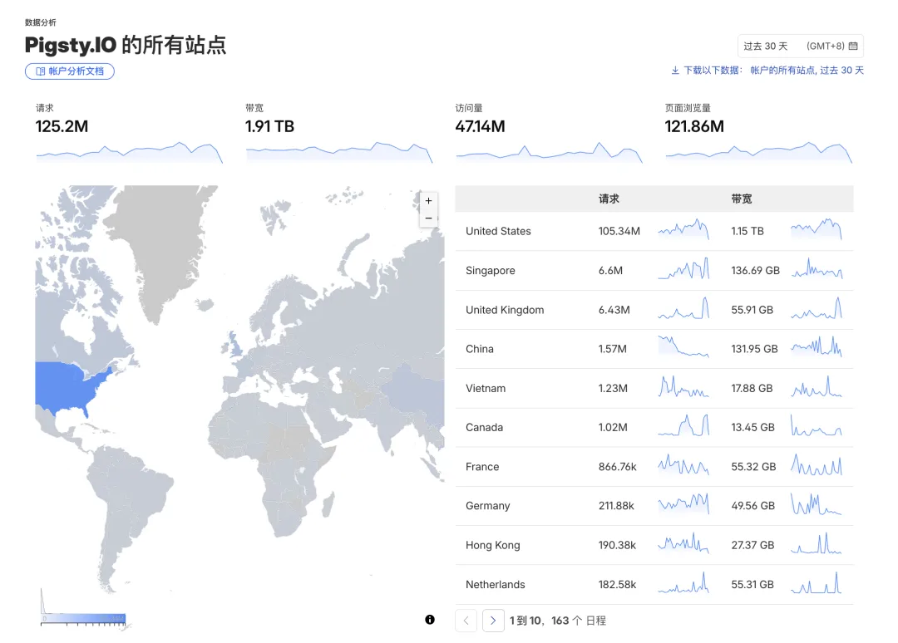
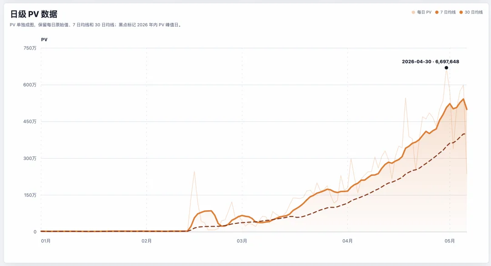
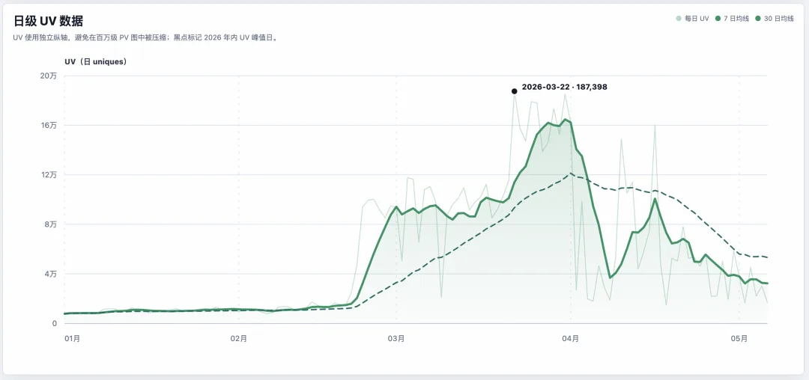
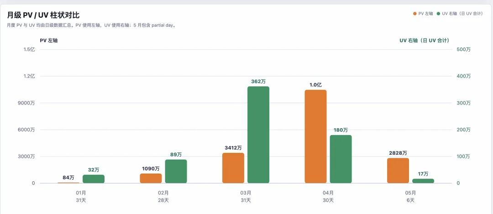
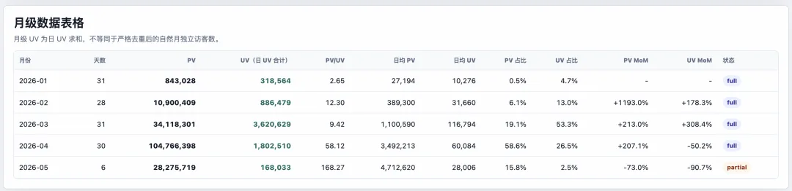
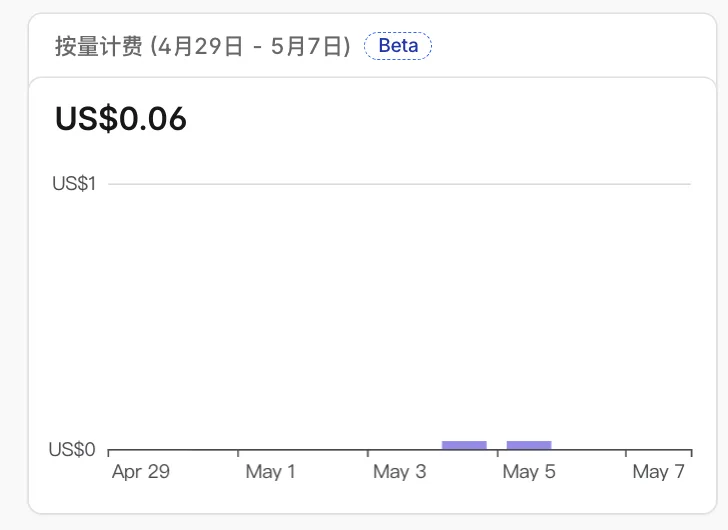

Over the past three months, monthly page views on Pigsty.io have grown roughly **100x**.

Monthly request counts tell the story: 840,000 in January, 10 million in February, 34 million in March, and well past 100 million in April.

I find myself opening the Cloudflare dashboard every day just to stare at the numbers. Where does an open-source project documentation site—with tens of thousands of annual active users and 20,000 to 30,000 daily page views—get this kind of request volume?

## Humans or Agents?

I have a decent sense of how many real human users Pigsty has. According to Google Analytics, annual active users sit around 100,000.

Blog posts and articles bring in additional readers—probably in the millions over time. For instance, in early March, I forked and took over maintenance of MinIO, which spent a few hours on the front page of Hacker News. That brought a huge wave of unique human visitors, though once the initial buzz faded, that spike in human traffic tapered off as expected.

So where is all this traffic coming from? As I mentioned briefly in an earlier post, almost all of it comes from agents—see [Give DBA Agents a Body](/en/ai/dba-agent-body/).

## Content Distribution in the AI Agent Era

When I broke down Pigsty.io's traffic on Cloudflare a while back, bots accounted for roughly 92% of requests. Even then, the number looked absurd.

Looking back now, **92% was an underestimate**.

And it isn't just traditional search crawlers anymore. Judging by User-Agent strings and request paths, the traffic falls into three main buckets:

**First, explicitly declared AI crawlers**: GPTBot, ClaudeBot, PerplexityBot, ByteSpider, and their peers, scraping content to feed training pipelines.

**Second, search and SEO crawlers**: Googlebot, AhrefsBot, and the usual suspects. They have always been around, but their volume is climbing—because a growing number of downstream systems (including AI systems) depend on their indexes.

**Third, live agent traffic**: Requests that look like browsers on the surface but are driven by scripts underneath. One-off IP counts have exploded alongside high-frequency probing of API endpoints—much of it from AI agents actively fetching pages, testing endpoints, and inspecting data while executing tasks.

Back when I was building the Pigsty DBA Agent, I kept asking myself: **How should an agent read infrastructure? How should it access documentation? How should it consume content?**

It turns out I didn't need to overthink it—they are already reading it, and reading far more of it than humans ever did.

The direction is clear: open-source infrastructure has entered a new phase where the primary consumers of content have shifted from humans to machines.

That isn't bad news. It means the content is genuinely being used, indexed, cited, and learned from. What it does mean is that our traditional concept of **user growth** needs a rethink.

## Thanks to the Generosity of Cloudflare, the Cyber Buddha

Credit where it's due: Cloudflare—affectionately known among Chinese developers as the "Cyber Buddha"—absorbs all of this traffic for free without charging a dime.

What does it actually cost each month to serve this software repository infrastructure to users worldwide? Storage runs 6 cents a week, or about $22 a year; the `.io` domain costs $50 a year. Together, that comes to $72 a year—under 500 RMB in total.

I did put Pigsty.io on a Cloudflare Pro plan ($20/month), which brings my total annual cost to a little over 2,000 RMB—roughly the price of a single month's Codex subscription. The Pro plan doesn't add anything essential, mostly just a few extra analytics metrics. The site would run fine without it, so I treat that $20 a month as burning a stick of incense for the Cyber Buddha.

---

Published on: [WeChat Official Account](https://mp.weixin.qq.com/s/1U7gbxLTP7RUF3ZD9e7TVg)
