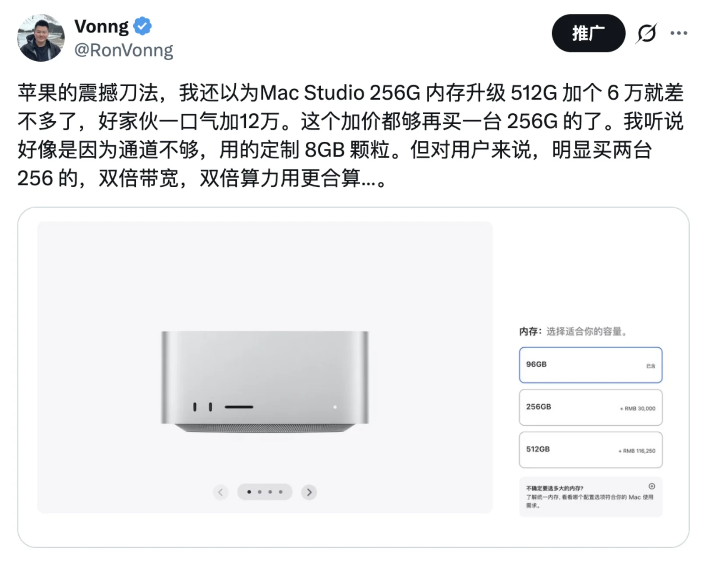
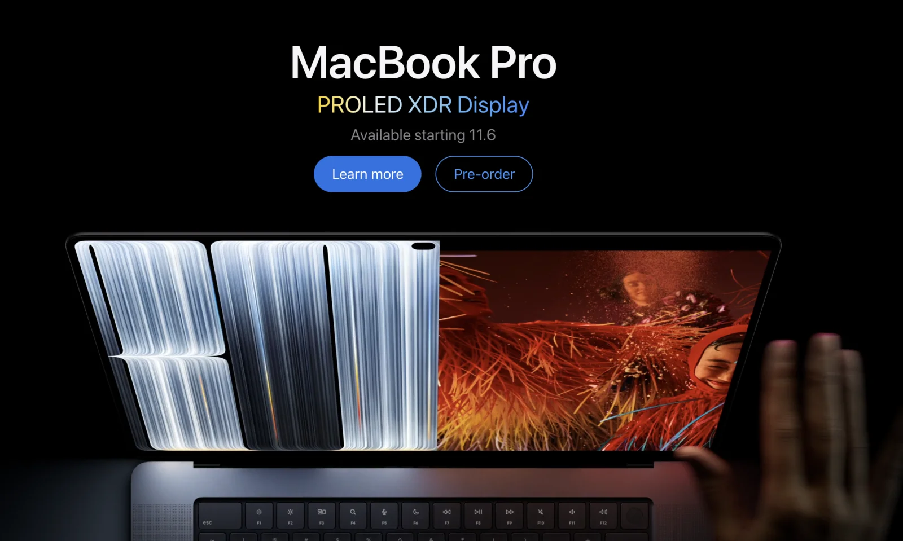
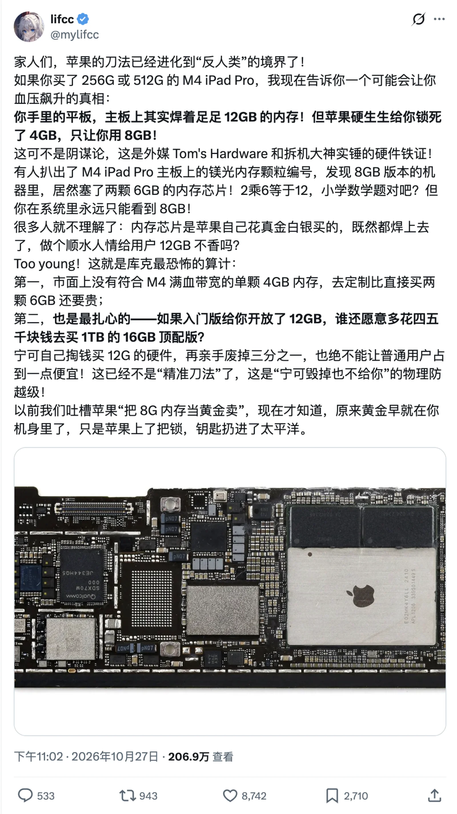

In the early hours of October 29 Beijing time, Apple held an unstreamed ["Pro and Tell"](https://www.techradar.com/news/live/oled-touchscreen-macbook-pro-apple-pro-and-tell-live-october-2026) event in Los Angeles.

It capped a three-day rollout: an [OLED iPad mini](https://www.macrumors.com/2026/10/26/apple-announces-ipad-mini-with-oled-display/) on Monday, the M6 iMac and base MacBook Pro on Tuesday, and the touchscreen MacBook Pro as Wednesday's finale. None of that was what I cared about. When I woke up just after 4 a.m. and reached for my phone, my eyes went straight to the one line quietly added to the Mac Studio configurator: [512 GB of unified memory](https://www.macrumors.com/2026/10/28/mac-studio-m5-ultra-512gb-ram/).

When the M5 Ultra launched in late August, the 512 GB tier was left as a teaser promised for ["late October"](https://www.apple.com.cn/newsroom/2026/08/apple-introduces-mac-studio-with-m5-max-and-m5-ultra/). To Apple's credit, it went live right on schedule on October 28. Then I clicked through to the price, and my mood soured immediately.

## Gold-Plated RAM: Priced Above a Whole Mac, Treating Buyers Like Suckers

Normally, unit price drops as you move up the tiers. That was how the previous-generation M3 Ultra worked: the more memory you bought, the less you paid per gigabyte. With the M5 Ultra, the first step up (96 GB to 256 GB) jumped to $4,000. When I [wrote my estimate in August](/en/db/apple-m5-ultra/), I extrapolated from past generations and figured the next tier would add another $6,000, putting a 512 GB system with a 2 TB SSD around RMB 140,000–150,000. Steep, but I was ready to live with it.

Instead, Apple nearly doubled that: [jumping from 256 GB to 512 GB costs $11,500 for the RAM upgrade alone](https://9to5mac.com/2026/10/28/apple-reveals-pricing-for-mac-studio-with-512gb-of-ram/). In mainland China, the add-on is RMB 86,250, pushing [the 512 GB base price to RMB 172,999](https://www.ithome.com/1/019/246.htm). My imagination for Apple's upsell curve was clearly stuck in the last generation.

| Memory Configuration (U.S. Store) | M3 Ultra (2025)          | M5 Ultra (2026)           |
|-----------------------------------|--------------------------|---------------------------|
| 96 GB → 256 GB                    | +$1,600 (~$10/GB)        | +$4,000 ($25/GB)          |
| 256 GB → 512 GB                   | +$2,400 (~$9.4/GB)       | +$11,500 (~$45/GB)        |
| 512 GB + 1 TB system              | $9,499                   | $22,299                   |
| 512 GB + 16 TB maxed out          | $14,099                  | $29,799                   |

To be fair, VRAM and system memory prices have surged across the industry over the past two years. Even NVIDIA's 128 GB DGX Spark has [climbed from $3,999 to $6,950](https://runaihome.com/blog/dgx-spark-64gb-vs-128gb-vs-strix-halo-2026/) (+74%). Still, while everyone else raised the baseline across the board, Apple inverted the volume curve: the more you buy, the harder you get gouged. The second tier costs nearly twice as much per gigabyte as the first.

The math that really makes you laugh through gritted teeth is this: a complete [M5 Ultra system](https://www.engadget.com/2263184/apple-mac-studio-m5-ultra-review/) with a 36-core CPU, 80-core GPU, 256 GB of RAM, and a 1 TB SSD sells for $10,799 (~$42/GB). Adding another 256 GB of RAM alone costs $11,500 (~$45/GB). **The bare RAM upgrade costs more than buying an entire second machine—SoC, logic board, power supply, cooling, and a 1 TB SSD included.**

China pricing has the same punchline: the RAM upgrade is RMB 86,250, while a [complete 256 GB machine in the same spec](https://www.nodeseek.com/post-895005-1) is RMB 86,749—a difference of just RMB 499. In the U.S., buying two complete 256 GB systems actually comes out $701 cheaper than buying a single 512 GB machine.

At the same price, why not cluster two 256 GB machines instead? That doubles both GPU compute and the 1.2 TB/s memory bandwidth. According to Apple's own [Thunderbolt 5 RDMA multi-node benchmarks](https://machinelearning.apple.com/research/mlx-distributed-inference), running tensor parallelism over a dual-cable direct link (rather than pipeline parallelism, which only pools capacity) yields a 1.7–1.8× speedup across two nodes and 2.6–3.0× across a fully connected four-node mesh. Losing a bit over 10% to interconnect overhead is slightly higher than I expected, but it is still a massive compute upgrade for free.

Of course, if you run into a behemoth like Meta's [Muse Spark Open](https://macrumors.com/2026/10/15/meta-muse-spark-open-mac-studio/) (816B parameters, ~493 GB at 4-bit quantization), two 256 GB machines will not quite fit it once you subtract system overhead—but a single 512 GB box will not run it comfortably either. To handle a frontier model of that size properly, the real answer is **four 256 GB machines**: at $43,196 total, they cost over $1,000 less than two 512 GB units ($44,598) while pushing generation speed from 25.0 to 36.7 tokens/s.

After mulling over this bizarre pricing, my best guess is that it comes down to DRAM die density: the 256 GB tier uses standard 4 GB packages, whereas hitting 512 GB within the available channel count requires expensive, custom-ordered 8 GB packages. That explains the hardware cost, but from a buyer's perspective, unless you are dead set on having only a single box on your desk—or determined to run a memory hog like [Kimi K3](https://www.superbash.ai/articles/mac-studio-m5-max-m5-ultra-local-ai-buying-guide/), which consumes 1.4 TB even at 4-bit and demands at least four 512 GB nodes—the 512 GB configuration is a sucker's bet. Two 256 GB machines make far more sense. The only catch is that delivery estimates have already slipped to February next year.

## The Touchscreen MacBook Pro: Breaking Founding Dogma for a Fingerprint Magnet

Wednesday's real headliner—the ["MacBook Ultra"](https://macrumors.com/2026/03/08/apple-planning-macbook-ultra) rumored for over half a year—officially landed as the [MacBook Pro with PROLED XDR](https://www.macrumors.com/2026/10/28/apple-new-macbook-pro/). Apple presumably held back the "Ultra" badge because the machine still runs the exact same M5 Pro and M5 Max chips introduced in March, with zero gain in compute. When I [bought my 128 GB M5 Max laptop](https://mp.weixin.qq.com/s?__biz=MzU5ODAyNTM5Ng%3D%3D&mid=2247491450&idx=1&sn=a2fd37dc58543aa1c333a7bd04066daf&scene=21#wechat_redirect) early this year, I bet that the year-end redesign wouldn't be for me and bought ahead of the price hike to enjoy it sooner. That call was spot on.

Paying the [$400 premium](https://tidbits.com/2026/10/28/new-macbook-pro-gets-proled-xdr-display-touchscreen-dynamic-island/) ($2,899 base for the 14-inch, $3,399 for the 16-inch, and up to $14,549 maxed out—enough to buy a Mac Studio) gets you a 2,000-nit tandem OLED panel, Dynamic Island, a chassis that shaves off 200–300 grams (though less than 1 mm in thickness), and the headline feature: a touchscreen.

Touch is the exact problem. I mostly run my laptop with the lid closed as a portable server, where a touchscreen is worth precisely nothing. Even with the lid open, holding your arm in the air to poke at a vertical display is terrible ergonomics. Steve Jobs [explained why back in 2010](https://www.techradar.com/pro/quote-of-the-day-by-apple-co-founder-steve-jobs-on-touchscreens-after-an-extended-period-of-time-your-arm-wants-to-fall-off-savaging-a-bitter-rivals-pc-pivot): touch surfaces don't want to be vertical—after a while, your arm wants to fall off.

Every touchscreen laptop that gets this right—whether a 360-degree convertible like the Lenovo Yoga, or a detachable 2-in-1 like the Surface Pro or ROG Flow Z13—shares one essential premise: **the screen can fold flat into a tablet**. On a traditional clamshell that neither flips nor detaches, the Mac's best-in-class trackpad already handles every interaction better, without leaving a layer of greasy fingerprints across the panel. The darkly funny part is that Apple had to stiffen the hinge specifically to keep the lid from wobbling when you poke it—proof that Apple knows full well how awkward the posture is.

The software isn't ready either. Right now, macOS mostly just maps touches crudely to mouse clicks. There is no Apple Pencil support, and fluid gestures will have to wait for third-party developers to adapt their apps. The rollout feels uncomfortably like the 2016 Touch Bar, which lingered for seven years before Apple quietly retired it.

Jobs's no-touchscreen rule held as company orthodoxy for 16 years. Barely two months after Tim Cook handed the CEO reins on September 1 to [John Ternus](https://newsonair.gov.in/apple-announces-john-ternus-as-successor-to-tim-cook-as-ceo-from-september-1/)—nicknamed "Zhang Tieniu" ("Iron Ox Zhang") by Chinese fans—that taboo is gone. Worse is the muddled positioning: power users buying top-spec chips care about thermal headroom, not touch. If reports from overseas outlets hold true and the older mini-LED models are being discontinued, anyone buying an M5 Max laptop from here on out will have to hold their nose and pay this $400 "touchscreen tax."

## A 60 Hz iPad mini and Cracking Foldables: Spec-Rationing Meets Sloppy QA

Apple forces touch onto laptops that don't need it, while stingily rationing high refresh rates on tablets whose entire experience revolves around the screen.

I have always had a soft spot for the iPad mini; outside the Pro lineup, it is the most comfortable iPad to hold and use. Monday's update swaps in an 8.5-inch OLED panel and an A20 Pro, trims the thickness to 5.4 mm, and brings the weight down to a remarkable [255 grams](https://9to5mac.com/2026/10/26/new-ipad-mini-vs-previous-model-heres-everything-new/), while raising the starting price from $599 to $699. Yet comb through the spec sheet and [the refresh rate is still locked at 60 Hz](https://www.pcguide.com/news/apples-new-ipad-mini-with-oled-display-looks-like-its-locked-to-60hz-with-no-promotion-technology/).

Keep in mind that even last year's $799 [base iPhone 17 finally got 120 Hz](https://techcrunch.com/2025/09/09/apple-launches-iphone-17-with-a-120hz-display). Play a couple of matches of *Honor of Kings* and the gulf between 60 fps and 120 fps is unmistakable. When all your primary devices run at high refresh rates, dropping back to 60 Hz for a few sluggish swipes is enough to ruin whatever goodwill the OLED panel earns. Overseas forums are already speculating that the panel physically supports 120 Hz and is simply capped in software. No teardown has confirmed that yet, but it fits Apple's textbook price-discrimination playbook of keeping the mini permanently one step short. If true, it is no different from masking a 6 GB DRAM chip down to 4 GB in firmware—classic artificial scarcity, like dumping milk during a glut to prop up prices.

While the product segmentation stays ruthless, quality control is slipping. Take Apple's first foldable, the $1,999 [iPhone Duo](https://fortune.com/2026/10/27/apple-iphone-duo-foldable-screen-cracking-hinge/), which went on sale last week. Preorders sold out in minutes and pushed backorders into January, yet within days of the first deliveries, reports began piling up of the 7.6-inch inner display snapping cleanly along the crease. One Australian buyer heard a sharp crack before the hinge had even reached 20 folds. iFixit suspects a support rod that fails to retract fully and punctures the panel from underneath, or dust intrusion into the mechanism; Apple's official response so far is simply to punt affected buyers to AppleCare replacements.

Whether this snowballs into another Antennagate or Bendgate will depend on broader failure rates. Still, Samsung is already on its eighth generation of foldables. For Apple to show up seven full years late, trip over basic hinge mechanics, and quote $999 for an out-of-warranty inner screen replacement—$200 more than a brand-new iPhone 17—is genuinely embarrassing.

> https://x.com/mylifcc/status/2115096683662942702
>
> https://www.tomshardware.com/tablets/ipads/m4-ipad-pros-with-8gb-of-ram-may-actually-have-12gb-teardowns-reveal-possible-apple-hijinks

## Local AI's Best Hardware Ally, and Its Worst Storage Gouger

Underneath the snark, I find all of this genuinely disappointing. I worked at Apple years ago, cycled through generations of its gear, and spent hundreds of thousands of yuan over more than a decade as a loyal fan. What makes it even more frustrating is that, from my long-standing position advocating cloud exit and data sovereignty, Apple happens to be the strongest hardware ally local AI has right now.

The M5 Ultra delivers a blistering 1.2 TB/s of memory bandwidth—[more than four times the DGX Spark's](https://petronellatech.com/blog/mac-studio-m5-ultra-vs-nvidia-dgx-spark-for-local-ai/)—and bakes Thunderbolt 5 RDMA clustering straight into the OS. Putting a quiet little aluminum box on your desk and running models with hundreds of billions of parameters is something Apple has pulled off beautifully. Nobody else in the industry comes close.

Then you look at the configurator, and your best ally turns into a ruthless storage gouger. Taking an M5 Ultra SSD to 16 TB adds $7,500 ($500/TB). On the new Mac mini, upgrading to 1 TB adds $500 and 2 TB adds $1,000, whereas third-party SSD modules for the previous generation sell for just $300 and $420. Worse, Apple is soldering shut the escape hatch: after the M4 Mac mini finally moved to a modular SSD card, the new M6 and M5 Pro Mac minis [solder the NAND flash right back onto the logic board](https://9to5mac.com/2026/09/22/m6-mac-mini-upgrade-storage-change/). The Mac Studio still uses removable modules for now, but I wouldn't bet on Apple keeping its hands off the next generation.

I am not worried about Apple's balance sheet. As of late June, the company was sitting on roughly [$146.5 billion in cash and marketable securities](https://www.sec.gov/Archives/edgar/data/0000320193/000032019326000020/aapl-20260627.htm); coasting on the local AI wave and its existing hardware moat is more than enough to print money. Still, I can't shake the feeling: **keep squeezing buyers like this with spreadsheet-driven upsells, and sooner or later someone is going to flip the table on Apple's whole racket.**

People put up with the segmentation and pay the Apple tax today because buying a Mac means paying two tolls. The first is "software rent" for **macOS**: a thriving commercial software ecosystem that bridges polished GUI apps, CLI tooling, and a genuine Unix foundation underneath. The second is "compute protection money" for **large unified memory**: a way to fit massive models on a desk without paying enterprise GPU ransom. Yet no moat lasts forever, and cracks are already opening on four fronts across both software and hardware:

1. **Desktop Linux is getting its act together.** DHH's Omarchy polishes Arch and Hyprland with real taste and has the nerve to take on macOS with a free Linux desktop. I [took it for a serious spin in August](/en/db/omarchy-desktop/) and went back to Ubuntu for now, but the gap is visibly narrowing.
2. **AI agents are changing who sits at the keyboard.** Apple's desktop moat held because human users are picky about UI polish and trackpad feel. As agents take over more of the actual driving, the moment Windows or Linux offers an equally frictionless computer-use environment, the rule that "serious work requires a Mac" starts to crumble.
3. **Coding agents are brute-forcing macOS ports.** Lately I have seen even wilder experiments: using coding agents to port and run macOS smoothly on commodity mini PCs and PC laptops. If that path matures, it cuts the legs right out from under Apple's hardware lock-in.
4. **Hybrid inference is routing around overpriced unified memory.** Riding the wave of sparse MoE architectures, newly open-sourced hybrid inference engines like [Strata](https://github.com/Niko1221/Strata) keep hot, frequently activated experts pinned in VRAM while dynamically offloading cold experts to cheap system DDR and NVMe SSDs. A single aging GPU with 12 GB of VRAM, paired with an ordinary high-RAM desktop, is enough to run the 125B-parameter Qwen3.8-Flash-Next. Smart software scheduling breaks the monopoly of giant unified memory pools and gives cheap mini PCs plus used GPUs a second wind.

Right on my own desk sits a Strix Halo mini PC with 128 GB of unified memory. The whole system goes for [around $3,000](https://runaihome.com/blog/dgx-spark-64gb-vs-128gb-vs-strix-halo-2026/)—I paid under RMB 12,000 for mine—while an M5 Max Mac Studio with the same 128 GB costs [$5,399](https://blog.invidelabs.com/m5-ultra-mac-studio-local-ai/). Once the open-source community and AI knock down both the "software rent" wall and the "giant unified memory" wall, Apple's prized memory-and-storage upsell ladder is going to stop working.

## Grumble Now, Pay Up Anyway

Look back at Apple's week: outrageous markups on 512 GB, a touchscreen MacBook charging extra for a panel you won't want to touch, an iPad mini stubbornly stuck at 60 Hz, and the foldable iPhone Duo stumbling over its own hinge. It is hard not to feel that an aging champion is losing its edge.

The frustrating reality is that, for all my griping, I will probably still fork over the cash for two 256 GB Mac Studios and wire them together. Right now, if you want a quiet, plug-and-play desktop rig that runs large models locally without headaches, there simply isn't a second option. Still, with shipping dates already pushed out to February, I am in no rush. The six local machines and six cloud servers I already run are plenty for now; I can wait until EPP discounts go live and ask a friend at Apple to take a look.

Apple can lay its pricing games right out in the open because it knows you still have to pay. That is where the arrogance comes from. After more than a decade of the same routine, though, it has gotten old. What will finally force Apple to put away the scalpel isn't complaints from longtime fans—it's the day someone closes the software gap and flips the table.
