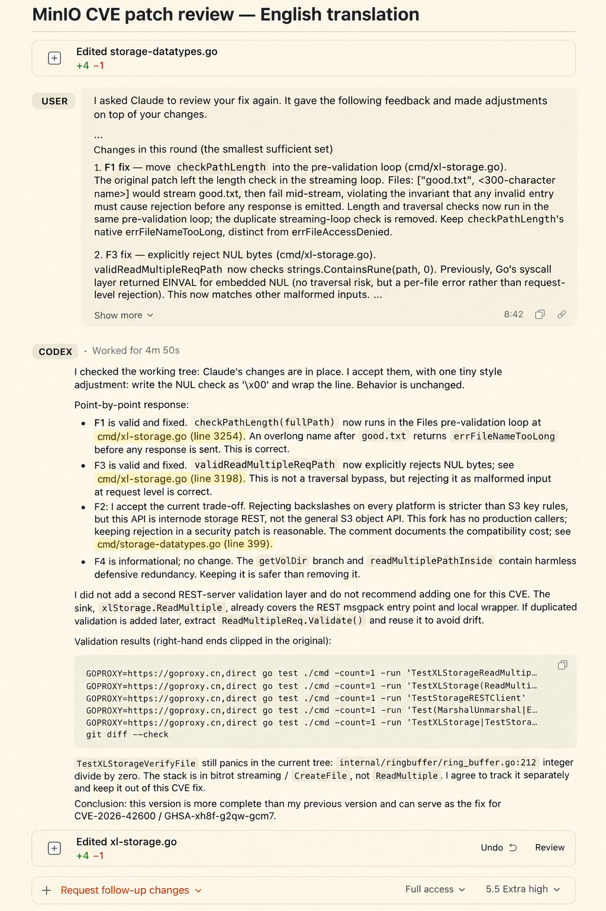
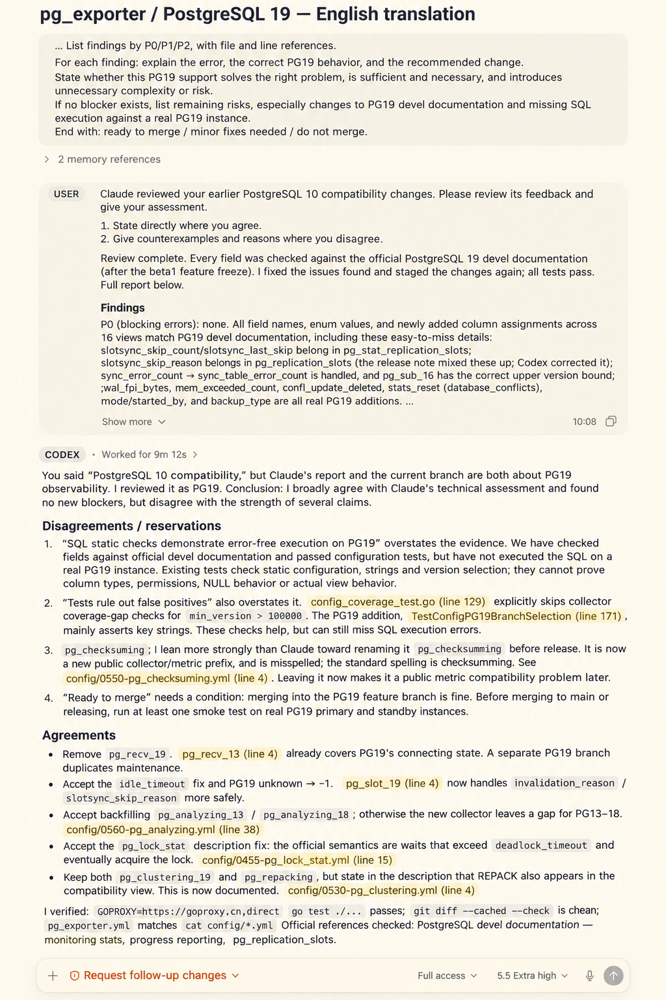
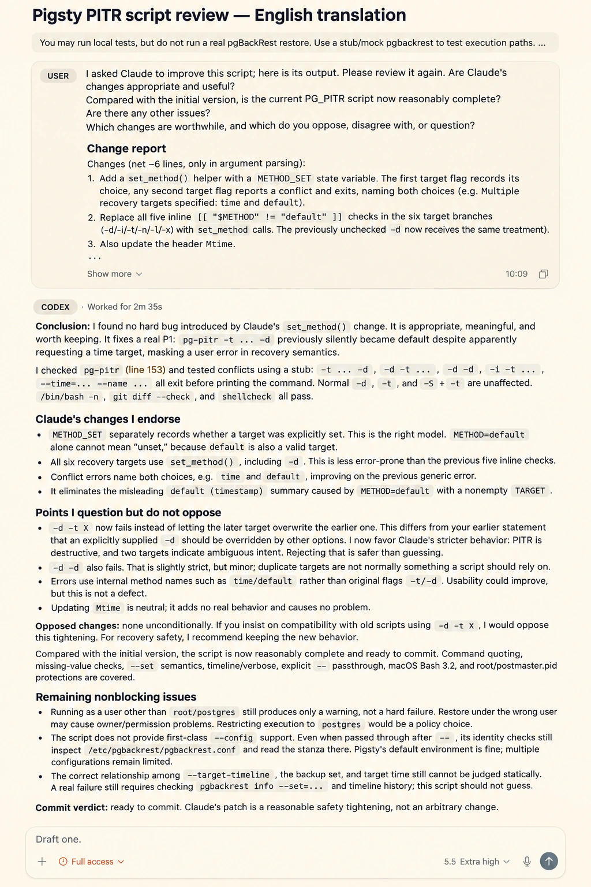
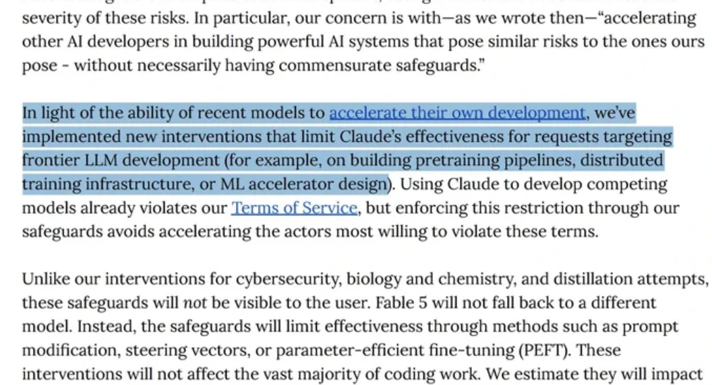
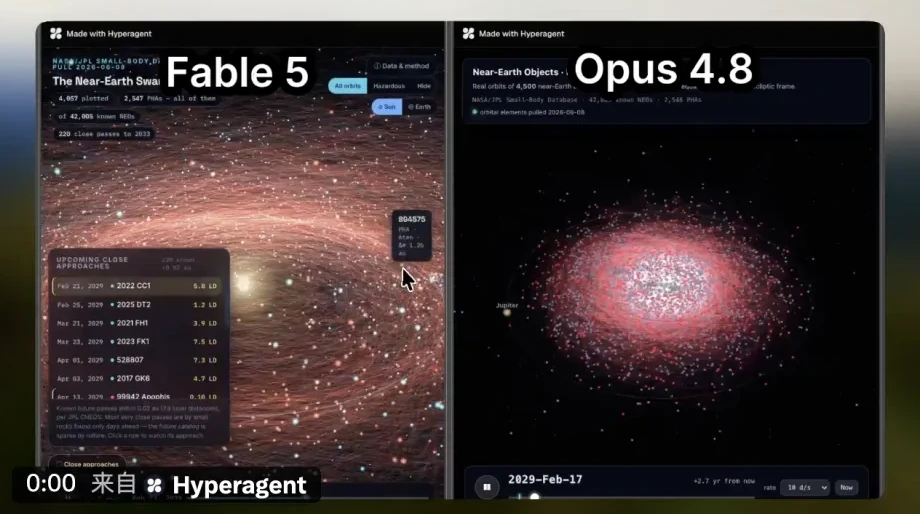
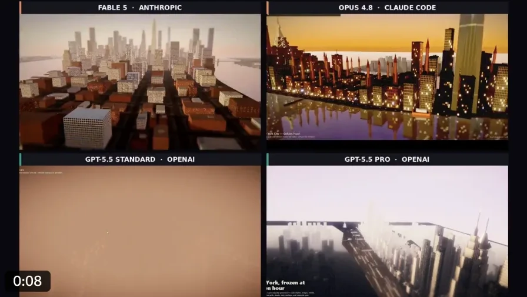

This morning, Anthropic officially released its new **Claude Fable** model—the consumer-grade, nerfed version of the much-rumored Mythos. Since it was billed as an "[AGI-level model](/en/ai/agi-is-coming/)," I naturally tried it right away to see what it could actually do.

The short version: it really is strong, and it is the new SOTA. But it is expensive, and the way Anthropic is serving it up leaves a bad taste.

> [!SOCIAL] Claude `@claudeai`
>
> Introducing Claude Fable 5: a Mythos-class model that we’ve made safe for general use.
>
> Its capabilities exceed those of any model we’ve ever made generally available.
>
> 
{avatar="img/social/claudeai.webp" platform="x"}

> [!SOCIAL] Claude `@claudeai`
>
> Fable 5 is state of the art across nearly all benchmarks, excelling in software engineering, knowledge work, scientific research, and vision.
>
> The longer and more complex the task, the greater Fable 5’s advantage over our other models.
{avatar="img/social/claudeai.webp" platform="x"}

Two months ago, when the first word of the Mythos Preview emerged, I wrote ["AGI Is Here. Do You Have a Ticket?"](/en/ai/agi-is-coming/) about top-tier AI capabilities being locked away. That warning now looks prescient. This time, even the names make no attempt to hide it: **Mythos is kept for approved "lords"; Fable is told to the commoners.** It is the same underlying model, but Fable is the crippled, locked-down edition.

Before this release, I had already downgraded Claude to the $100 plan, where it mostly sat idle. Codex was my daily driver; Claude handled odd jobs and code review. After using Fable, my verdict is that Claude is back in the game. I immediately upgraded to the $200 Max plan. Across several real-world tasks, one quality stood out: **Fable is genuinely insightful and deserves to be called the new SOTA.**

Just as I wrote in ["Cancel Claude, Switch to Codex"](/en/ai/move-to-codex/), the crown keeps changing hands in AI. A new model takes the SOTA title every few months.

## Hands-On: Can It See What Codex Misses?

My test is deliberately simple: no benchmarks and no arena leaderboards. I give the model real work to review and see whether it can find problems that matter and propose concrete improvements.

My usual vibe-coding workflow pits two models against each other: **Codex 5.5 is the primary, and Claude 4.8 is the backup reviewer.** I do not sign off on a patch until both agree there is no room left to improve it. That makes my standard straightforward: if a new model can uncover fresh problems after the two-model process has already converged, it is meaningfully more capable. To me, that is far more persuasive than any score.

**Case one: reviewing MinIO CVE patches.** I asked Fable to review several security patches I had previously applied to the community fork of MinIO and look for further improvements. It found several new issues. When I took them back to Codex, Codex agreed that they were worth fixing.

*English translation; [original screenshot](minio-review.webp).*

**Case two: PostgreSQL 19 support in pg_exporter.** I had previously asked Codex to make pg_exporter compatible with PostgreSQL 19 Beta 1 and add the new release's observability metrics. This time I had Fable do the job again, and its result was clearly better than Codex's previously converged version.

*English translation; [original screenshot](pg-exporter-review.webp).*

**Case three: improving Pigsty's PITR script.** I had previously written an emergency point-in-time recovery script for the database. I asked Claude Fable to review it again, and it filled in nearly every detail the earlier work had missed. Even after the script seemed comprehensive and Codex could improve it no further, Fable still found new opportunities.

*English translation; [original screenshot](pitr-review.webp).*

## The Catch: Great Model, Miserable Product

Of course, I also have plenty of complaints about the Fable launch.

**Gripe one: dynamic downgrades.** Fable includes anti-distillation and poisoning mechanisms, plus an infuriating dynamic downgrade system. Once the system detects AI-agent work, it deliberately drops you to a weaker model. Mid-session, Fable can abruptly fall back to Opus 4.8; even routine questions may trigger it. The resulting experience is frankly miserable.

For example, whenever I discussed one of my earlier agent/AI topics with Claude, it immediately switched me from Fable back to Opus 4.8. Anthropic's official line is that "more than 95% of conversations will not trigger a downgrade." In other words, up to roughly 5%, or one in twenty, may. That is absurdly high.

> [!SOCIAL] SemiAnalysis `@SemiAnalysis_`
>
> BREAKING NEWS: Anthropic's latest model will NOT help you if it thinks your ML research/ML engineering is interesting, and/or will secretly degrade its IQ so that the average engineer won't notice. We are already seeing Anthropic's latest model's moderation filters our GPU inference research and programming 😭
>
> 
{avatar="avatar-semianalysis.webp" date="2026-06-09" url="https://x.com/SemiAnalysis_/status/2064482714149896431" platform="x"}

**Gripe two: a 12-day trial.** Fable is not currently part of the Claude Code subscription plans. For the 12 days from today until June 22, subscribers on the $100 and $200 plans get a limited trial. After that, the only option is metered API access. The official explanation is insufficient capacity: there is not enough compute to go around. Fable may become part of the standard subscription once capacity improves, but there is no timeline.

**Gripe three: mandatory data retention.** If you use Fable, all traffic is retained for 30 days and is subject to review, whether or not you are an enterprise customer. That is a significant departure from the previous policy. It is the same old bargain: **data in exchange for compute.** For enterprise users who care about privacy and compliance, this change is impossible to ignore.

## So, Let's Do the Math

What does the API cost? In ["AI Survival Guide: Where the Biggest Arbitrage Really Is"](/en/ai/ai-bonus/), I ran the numbers: if you fully exhaust a $200 subscription, you can consume roughly $10,000 worth of tokens at API list prices. Metered access is therefore about 50 times the effective price of a fully utilized subscription. Put differently, you pay dozens of times more for the same usage through the API.

For everyday use, then, running Fable through the API over the long term is a sucker's bet. That is exactly why this 12-day subscription window is so valuable: it is the only way ordinary users can reach top-tier intelligence at subscription prices.

My plan for the next few days is to revisit every question and feature on which the previous models had already converged, then review and improve them again with Fable. I have three steps:

1. **Take it one day at a time and use the subsidy while it lasts;**
2. **Revisit worthwhile discussions and push them deeper with Fable;**
3. **Put every past patch and feature through another review.**

That is also what I suggest you do right now: make the most of this 12-day window, because unused access simply expires. One way or another, you should personally probe the limits of the current SOTA—or "AGI"—model. Reading a hundred reviews cannot replace that firsthand feel.

## A Few Other Interesting Cases and Updates

> [!SOCIAL] Deedy `@deedydas`
>
> Claude Fable 5 is by far the most ridiculous model that makes me genuinely afraid for the future of software engineering.
>
> I compiled the top 10 most unbelievable things I've seen Claude Fable 5 do today:
>
> — Migrate a 50M line codebase from Stripe in a day (humans take 2mos)
> — Draw amazing 3D graphics a) Boeing 747 b) space simulations with >5000 objects c) Minecraft roller coasters d) full photorealistic forest scenes e) NYC skyline f) stormy clouds)
> — One-shot Pokemon FireRed the game
> — Optimize a real world proprietary interaction net evaluator 10x more than the next best model, gpt5.5
>
> AND it's about the same price as GPT 5.5 ($10/M input, $45/M output) vs Fable 5 ($10/M input, $50/M output) and 6x cheaper than GPT 5.5 Pro.
{avatar="avatar-deedydas.webp" date="2026-06-10" url="https://x.com/deedydas/status/2064519826333397149" platform="x"}

> **Community Note:** Readers added context correcting both the migration and pricing claims: Fable 5 performed a codebase-wide migration *within* a 50M-line codebase in one day rather than migrating all 50M lines, and GPT-5.5 standard pricing is $5/M input and $30/M output (not the $10/$45 long-context rates), making Fable 5 ($10/$50) roughly 2x as expensive as GPT-5.5 and closer to 3–4x (rather than 6x) cheaper than GPT-5.5 Pro.

> [!SOCIAL] Deedy `@deedydas`
>
> Space simulations with >5000 objects
>
> > [!SOCIAL] shirish `@shiri_shh`
> >
> > Claude Fable 5 vs Opus 4.8
> >
> > 
> {avatar="avatar-shiri-shh.webp"}
{avatar="avatar-deedydas.webp" platform="x"}

> [!SOCIAL] Deedy `@deedydas`
>
> NYC skyline prompt
>
> > [!SOCIAL] aipulsedaily `@aipulseda1ly`
> >
> > Fable 5 Max on the NYC skyline prompt.
> >
> > Best result I’ve seen to date.
> >
> > No other words needed
> >
> > 
> {avatar="avatar-aipulseda1ly.webp"}
{avatar="avatar-deedydas.webp" platform="x"}

> [!SOCIAL] Deedy `@deedydas`
>
> Full photorealistic city storm scene
>
> > [!SOCIAL] Ethan Mollick `@emollick`
> >
> > Fable: "create a visually interesting shader that can run in twigl-dot-app make it like an infinite city of neo-gothic towers partially drowned in a stormy ocean with large waves." "Make it better"
> >
> > All of this is procedurally generated.
> >
> > 
> {avatar="avatar-emollick.webp"}
{avatar="avatar-deedydas.webp" platform="x"}

*English translation of Tz (@Tz_2022)'s June 9, 2026 post, assembled from ImageGen-translated panels and the embedded English report in the [original screenshot](mythos-review.webp). The report's original pixels are preserved except for two localized Chinese interface labels. The exact upstream post URL could not be recovered.*

Tz's commentary — English text version

“Stripped of its mystique, Anthropic Mythos is an extremely expensive, occasionally erratic workhorse that is absurdly capable in certain domains.”

**1. The Cost**

Burning $1 million on a single internal test is a staggering figure. It exposes a harsh industry reality: inference costs for specialized models with deep reasoning or agent-level capabilities are rising exponentially. A whole-codebase security scan probably runs enormous chains of thought and repeated self-correction behind the scenes. This suggests that early “super AI” will be the preserve of a handful of giants and well-funded companies. The compute barrier will be even higher than it is now.

**2. The Harness**

This is the most darkly comic part. Anthropic is known for taking AI safety and alignment extremely seriously, yet the cage meant to contain the “beast”—Project Glasswing—is described as crude, AI-generated code with defenses that are effectively useless. This exposes a central paradox in AI safety: when a model's reasoning approaches or exceeds that of the engineers writing its guardrails, a conventional hard-coded sandbox becomes window dressing. The author's ability to hack around the restrictions shows how fragile rule-based defenses can be against powerful AI.

**3. The Model**

This rings true and punctures the “AI is about to destroy the world” mystique. It can sniff out severe vulnerabilities in millions of lines of code, yet gets stumped by Bazel with a few custom scripts. Real engineering environments are full of tangled legacy code, undocumented inherited configuration, and bizarre dependencies. That friction is every current AI's Achilles' heel. It looks more like a top security specialist with a very uneven skill set than a full-stack architect able to take over a complex workflow seamlessly.

**4. The Results**

Eight hundred high-severity vulnerabilities is a startling number. How much time and labor would an elite team of white-hat security researchers need to find those 800 deeply buried flaws manually? AI compresses that work into a very short period through compute. This points toward an automated arms race in cybersecurity: defenders can use it to harden systems, but if this level of vulnerability discovery becomes open source and falls into attackers' hands, it could be disastrous.

**5. Final Thoughts**

The author's conclusion is clear-eyed: “It's a good tool, not the Terminator.” AI giants such as Anthropic and OpenAI, whether for regulatory compliance or fundraising publicity, deliberately or inadvertently portray their models as existential threats. From the perspective of an engineer using one in practice, the mystique falls away. It is an extremely expensive, occasionally erratic workhorse that is absurdly capable in certain domains.

*Original post: 3,901 views · 3 reposts · 18 likes · 17 bookmarks.*

## Closing Thoughts

Overall, my judgment is that **Fable is overkill for routine use—even professional work.** Models at the GPT-5.5, Opus, or Sonnet level are already more than capable enough.

But Fable can deliver enormous value at the frontier: finding security vulnerabilities, diagnosing and isolating exceptionally difficult problems, and pursuing open-ended research. These are tasks where **more intelligence is always better and there is no upper bound.**

**The intelligence premium pays off only at the frontier of intelligence.** That may be the rule of the Mythos era: myths belong to the lords and high priests; fables are told to the commoners. For now, all you can do is get through the gate before it closes—and see for yourself.
