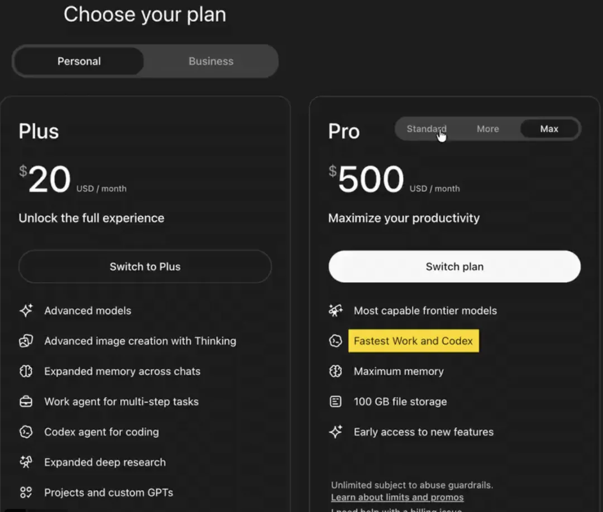
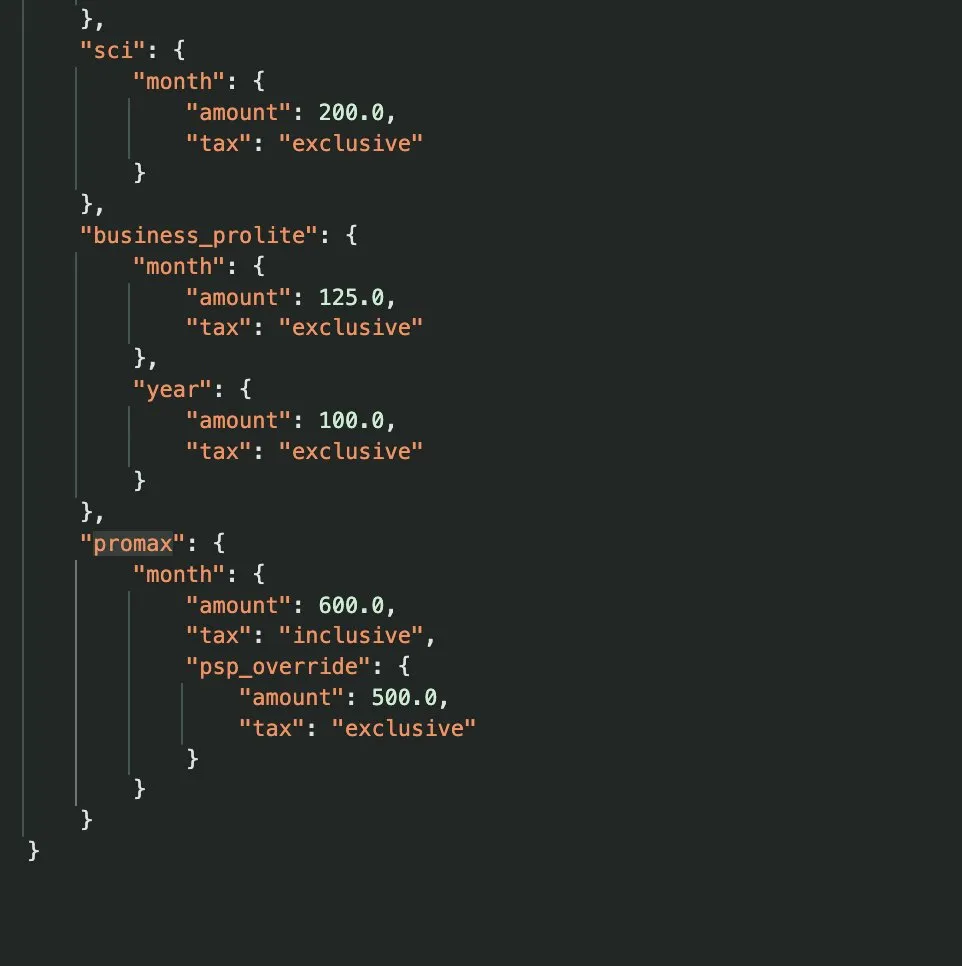
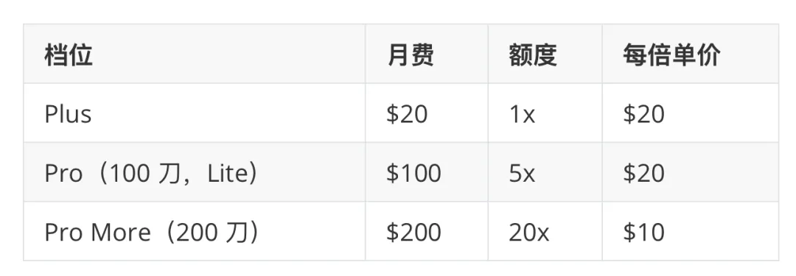

On September 24, a new subscription tier surfaced in OpenAI's frontend: **ChatGPT Pro Max, at $500 a month.** Some screenshots showed $600, which included local VAT.

The next day, OpenAI merged a PR into the open-source Codex repository that renamed the entire Pro lineup: the $100 tier is now "Pro," the $200 tier is "Pro (More)," and the new `promax` tier is "Pro (Max)." Authentication, account handling, and rate-limit plumbing are already wired up.

Digging into the backend pricing config on `chatgpt.com` turns up the full regional table: $500 in the US (pre-tax), ¥84,000 in Japan (roughly $534, tax-inclusive), NT$16,500 in Taiwan, £445 in the UK, and €510 in Germany. Country-by-country localization is already done.

So this isn't a rumor; it's in the release pipeline. The most likely launch venue is DevDay in San Francisco next Tuesday—early September 30 Beijing time.

I'm not interested in debating whether $500 is expensive. For anyone using these models to get real work done, $500 a month isn't much. What I want to talk about is a number nobody knows yet: **the usage multiplier.**

That number matters far more than the sticker price.

## Start with the Unit Math

Here is ChatGPT's current paid ladder, normalized to the Plus quota as 1×:

The $200 tier is the best deal on the board. Each 1× unit of quota costs $10—half the retail rate of Plus and Lite. That wholesale discount is the exact reason heavy users crowd into the $200 plan.

So what multiplier will $500 Pro Max offer? It comes down to one question: **does each $100 buy 5× quota or 10×?**

- **10× per $100** gives you **50×**, preserving the $10/unit wholesale rate.
- **5× per $100** gives you **25×**, reverting to Lite's $20/unit retail rate.
- **20× total**—the same quota, just faster—works out to $25 per unit, pricier than Plus.

I'd love to see Pro Max offer 100×, of course, but that's wishful thinking.

Right now, both theories are making the rounds online. Several Chinese outlets have reported "50× quota" as fact, while others claim it carries "the same quota as the $200 plan, only faster." I checked the primary sources, and neither claim has any backing. OpenAI's code contains the plan identifiers, but no multipliers; the pricing configuration contains prices, but no multipliers either.

Compare the Pro Max and Pro descriptions on the upgrade page, and the only substantive addition is a single line: "**Fastest Work and Codex**." The 50× figure was almost certainly calculated by dividing $500 by the $10 wholesale rate; "only faster" is a guess extrapolated from that line of copy.

One detail in the pricing data is telling, though. Someone scraped prices across 14 countries and noticed that in every single market, **Pro Max costs exactly five times as much as the $100 tier**. In the UK, the $100 tier is £89; Pro Max is £445 to the penny. In other words, Pro Max's pricing is anchored to the $100 Lite tier, not the $200 plan. **If its usage allowance is anchored to Lite's unit price too, the multiplier will be 25×.**

## The Multiplier Is the Message

Why does the multiplier matter so much? Because it answers a direct question: **is OpenAI still willing to subsidize heavy users?**

At 50×, the message is simple: the wholesale rate stays, the subsidies continue, help yourselves. At 25× or 20×, the message is the opposite: the wholesale discount ends here. If you want more capacity, you pay retail—or a priority fee on top. One expands the subsidy; the other reins it in.

My bet is on the latter. Just look at what OpenAI has done this month. On September 3, GPT-6 Astra launched, with Greg Brockman calling it "the beginning of the AGI era." A week later, on September 10, OpenAI halted new sign-ups and upgrades for the $200 tier. Tibo, who leads Codex and ChatGPT, explained that demand for Astra was "unprecedented" and that the $200 tier put the heaviest load on their infrastructure. Existing subscribers could renew as usual, but new buyers were locked out. More than two weeks later, sign-ups still haven't reopened.

Put that timeline together: two weeks ago, OpenAI was so short on compute that it stopped taking new $200 subscriptions; two weeks later, it rolls out a $500 tier. If that tier offered 50× usage—selling even more compute at the same $10 wholesale rate—what exactly was the September 10 freeze supposed to accomplish?

**When compute is scarce, a better-value bulk plan doesn't appear out of nowhere.**

The only exception would be if Pro Max runs on an entirely separate compute pool. Some people suspect Cerebras: earlier this year, OpenAI signed a deal worth more than $10 billion with Cerebras for up to 750 megawatts of inference capacity, and in August it previewed Sol Ultrafast running on Cerebras at up to 14× speed. The word "Fastest" in the upgrade copy fits that neatly.

Now look at the groundwork laid over the past two months. All through July and August, Codex forums were full of complaints about shrinking quotas. OpenAI insisted nothing had been cut while quietly resetting users' quotas every few days to calm things down. In late August, the five-hour rolling cap returned to Plus. Users also spotted OpenAI testing a button to pay $80 for an immediate quota reset after hitting the cap.

Put the pieces together and the trajectory is clear: **flat-rate subscriptions are converging toward usage-based pricing.** First, freeze new sign-ups on the cheapest wholesale tier. Then slot a much pricier tier above it. You never have to announce a price hike—just leave the cheaper plan "temporarily" unavailable. It's the cleanest way to raise prices without calling it a price increase.

I've argued for a long time that subsidized AI subscriptions are, at bottom, a trade of compute for training data—a game of musical chairs. Once a lab has enough data and starts preparing for an IPO, the music stops. It hasn't stopped yet, but the tempo has changed. **And the subsidies at the very top of the pyramid are the first to go.**

## Why "Only Faster" Is Actually Worse

It's worth unpacking the "same 20× quota, only faster" scenario. Plenty of people think that sounds fine: same allowance, higher speed. That gets the math backwards. Codex meters usage in tokens. If you already run coding agents around the clock, faster execution simply burns through your weekly token budget earlier in the week. More speed without more quota just makes you hit the wall sooner.

If your bottleneck is latency—say, you want Astra driving computer-use tasks faster for gaming or video editing—extra speed is genuinely useful. But if your bottleneck is weekly quota, speed alone does nothing for you.

So if DevDay reveals a 20× multiplier, Pro Max simply isn't meant for people like us: individuals paying out of pocket for multiple personal accounts to keep agents running. The signal would be unmistakable: the good times for individual power users are over.

## The $200 Account as a Grandfathered Relic

If OpenAI really is shrinking the subsidy per dollar, an interesting consequence follows: **existing $200 accounts are about to become prized grandfathered plans.**

Consider the setup. At $10 per unit of usage, it's the cheapest tier in the lineup. Newcomers can't buy it while the sales freeze drags on. And Tibo has said that Pro won't get a five-hour limit over the next several months. Put those three facts together, and an active $200 account is a discontinued collector's item.

OpenAI's billing rules are explicit: cancel, downgrade, or miss a renewal payment, and you lose the $200 tier. There is a one-time return offer, but only for existing subscribers who held the plan around September 10. It's a one-way ticket—step off, and you can't get back on.

I've lived through this exact cycle once already this year. When Zhipu AI launched its Coding Plan in January, I bought an annual Max subscription for 1,700 RMB (about $240), which works out to just over 140 RMB ($20) a month. That early plan had only a five-hour rolling cap and no weekly limit at all, so you could run it almost continuously. When Zhipu later overhauled its tiers, my plan was relabeled "Legacy Version V1" in the console. Under the new V2 pricing, Max costs 375 RMB a month even for existing users, and 9,000 RMB ($1,280) a year for new sign-ups.

None of this is new. Telecom carriers spend years calling holdouts to talk them off legacy unlimited plans, and anyone who knows what they have refuses to budge. Cloud storage providers once handed out free terabytes to grab users, then throttled speeds or shut down. **Whenever a business buys market share with subsidies, its earliest plans eventually become family heirlooms.** Subsidy-era pricing is set for growth, not unit cost. Once the growth story runs its course, prices have to come back in line with cost.

## What to Do Now

A few blunt takeaways.

**If you have a $200 account, don't cancel.** If your credit card is close to expiring, update it before an auto-renewal fails. This plan may already be discontinued for good; lose it, and you probably won't get it back.

**If you don't have one, stay away from resold shared accounts.** OpenAI's terms explicitly prohibit account sharing and resale. If the account gets banned, you have no recourse—and whoever controls the account has full access to your chat history and uploaded files.

**Watch that multiplier at DevDay.** The $500 price tag tells us very little on its own; the multiplier tells the whole story. At 25× or below, subsidized usage is shrinking and the window for heavy users is closing. Near 50×, OpenAI is still buying market share, and the deal has some life left in it.

**Either way, run the tap while it's still open.** Last month I wrote that while the subsidy window lasts, you should use it as hard as you can and ship whatever you need to build. That judgment hasn't changed—only the urgency has.

One final thought. A $500 price tag isn't the alarming part. What's alarming is that we may be standing at an inflection point: AI subscriptions are shifting from selling *usage volume* to selling *speed and priority*. Mass-market tiers will keep getting cheaper—free users already have unlimited chat—while the best, fastest compute at the very top of the pyramid gets progressively more expensive.

The multiplier on Pro Max is a letter from OpenAI to its heavy users. It will say either "keep going" or "the party's over."

We should find out next Tuesday.

Here's hoping this week's Opus 5.5 gives OpenAI enough competitive urgency to keep the allowances generous a little longer.
