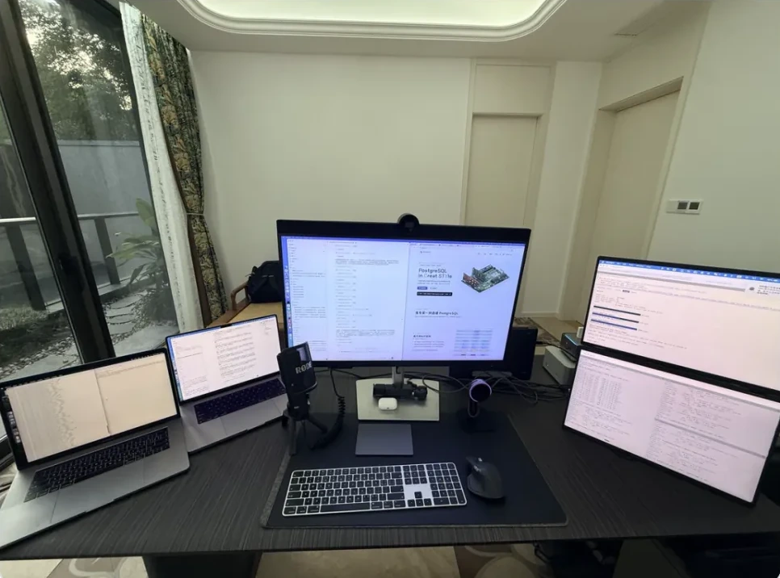
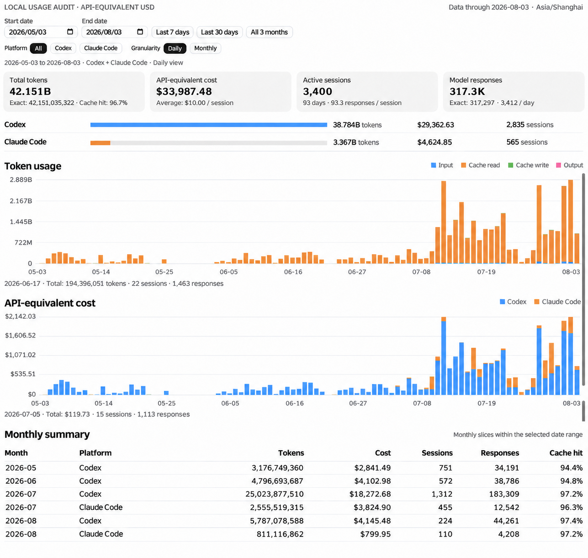
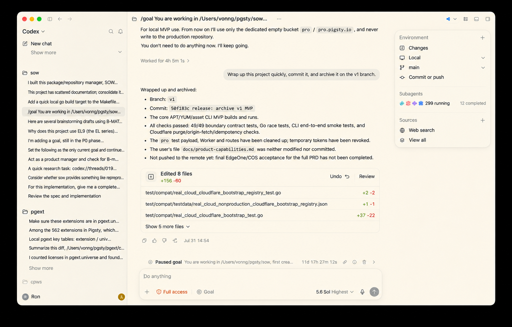

Last month, OpenAI seemed to lose its mind and went into full giveaway mode, replenishing everyone's Codex quota every few days—the AI equivalent of a Chinese supermarket handing out free eggs at the door to win new customers.

User numbers soared past ten million. Tibo, the executive responsible for Codex and ChatGPT—and the man behind the reset button—was even canonized as “Saint Tibo” by the community. The first thing I did every morning was open X to see whether the saint had performed another miracle.

Now it seems the eggs have run out. It has been more than six days since the last reset, and another is nowhere in sight. Users reverse-engineered the pattern: resets were tied to weekly active user milestones. Every additional million users triggered one, all the way to ten million.

> [!SOCIAL] Tibo `@thsottiaux`
>
> Three million people are now using Codex weekly - up from two million a little under a month ago. Incredible to see the growth. Thank you to all of you and to the ecosystem we’re part of. To celebrate, we’re resetting rate limits so you can keep building, and we’ll reset them every additional 1M users until we reach 10M, so we can keep celebrating along the way.
>
> Enjoy and thank you!
{avatar="img/social/thsottiaux.webp" date="2026-04-07" url="https://x.com/thsottiaux/status/2041655710346572085" platform="x"}

What happens after ten million? Someone asked Tibo on X whether Codex had crossed eleven million. He said it had done so long ago. After all these days without another reset, the conclusion is fairly clear: the promotion is over. The mass giveaway has run its course. If you want a reset now, about your only option is to DM Tibo with a useful suggestion and hope he grants you one directly.

> [!SOCIAL] Tibo `@thsottiaux`
>
> I asked Codex to pull up some stats and I receive on average one DM or email every 6 or so minutes to ask for a reset. I occasionally do oblige if it comes with really solid feedback or banter.
{avatar="img/social/thsottiaux.webp" date="2026-08-06" url="https://x.com/thsottiaux/status/2085221386713198988" platform="x"}

That is a shame. But the eggs themselves were never worth much. What matters is what I turned them into over that month.

## Make Hay While the Sun Shines

In “[AI Survival Guide: Where the Biggest Arbitrage Really Is](/ai/ai-bonus/)” and several other posts, I repeatedly urged readers to make hay while the sun shines—to seize the opportunity while it lasts. I followed my own advice.

During this month-long AI bonanza, I had seven 20× MAX subscriptions: four ChatGPT accounts and three Claude Code accounts, spread across three computers. OpenAI and Anthropic each gave me one for free as an open-source contributor, so I actually paid for five $200-a-month plans: $1,000 per month in total. It was worth every penny.

Of course, free quota from the Reset spree was only a cost advantage. Far more important were two developments in July: GPT-5.6 Sol launched, and Fable became continuously available through Claude subscriptions, bringing both AGI-class models to a broad audience. Their leap in intelligence made burning tokens more cost-effective than ever and dramatically raised the ceiling on what they could do. Their greater autonomy magnified the leverage on human time even further: a task I once ran for an hour can now be left running for a week.

> [!SOCIAL] Vonng `@RonVonng`
>
> Five $200 subscriptions, plus one free from an open-source program: $1,000 a month, or RMB 6,800. Sounds expensive, but these subscriptions deliver 100 times the output and efficiency of hiring someone for RMB 6,800 a month. Then you realize this is damn good value—a bargain from day one. The more you buy, the more you save. Still, running six at once has pushed me to my limit.
>
> > [!SOCIAL] Vonng `@RonVonng`
> >
> > I have three MacBook Pros—fully maxed-out 2018, 2022, and 2026 models—that I never sold and left gathering dust. Now they’re finally useful. Three laptops run three Codex accounts plus three Claude accounts, with the six subscriptions split across them and working around the clock. I also find MacBooks more convenient than Mac minis: they come with a built-in KVM and UPS.
> >
> > 
> {avatar="img/vonng.jpg" date="2026-07-14"}
{avatar="img/vonng.jpg" date="2026-07-14" platform="x"}

In short, the whole setup wrung me dry. I pedaled the machine until it smoked. Readers may have noticed that I barely published anything on my WeChat channel over the past month. I simply had no time. The occasional articles I did squeeze out were often criticized for sounding too AI-generated, because I genuinely had no time to write—much less edit and polish.

The only reason I have started writing again over the last two days is that the promotion ended and I ran every subscription dry.

## Usage and Cost

Subscription quotas disappeared remarkably fast. After Codex removed its five-hour cap a while back, I could burn through one full Codex subscription and half a Claude subscription almost every day. Codex resets came often enough to roughly keep pace, but after a week without one, I have clearly hit the bottleneck.

*Usage on my primary computer—roughly two Codex subscriptions and one Claude subscription. English localization of the original dashboard, with data through August 3, 2026.*

I also perfected the art of squeezing every last drop from those quotas. As I explained before, when your Codex quota is nearly exhausted, Codex lets unfinished tasks that are already running continue. You can therefore launch many large tasks in parallel. From what I have observed, those tasks can consume as much as another week's worth of quota, effectively doubling what you get.

*English localization of the original screenshot, retaining its historical counts, elapsed times, and model settings.*

But even with every trick in the book, the quota still disappears fast. To be fair, Codex's quotas are genuinely generous—there is a lot to work with. The key is how you use them and what you use them for. This month, I treated Codex as a wish-granting machine. Used that way, no number of subscriptions lasts long.

There is a bottleneck, of course. At the level Fable 5 and Codex 5.6 have reached, the main creative bottleneck is now the human operator's ability to formulate good wishes and validate the results. I can make a few big wishes, then spend my time validating a steady stream of smaller ones. Seven subscriptions were enough during the Reset bonanza, but they feel stretched thin now that it is over. I expect my steady-state setup to converge on six Codex and four Claude subscriptions, or $2,000 per month.

That sounds expensive, but it is really a steal. As Jensen Huang's famous line goes, “The more you buy, the more you save.” So the question I hear all the time is: after burning all those AI tokens, what did you actually make? The honest answer? So much that I have not even had time to write an article explaining it. I will cover it in detail in the next post.

AI content in this article: 0%.
