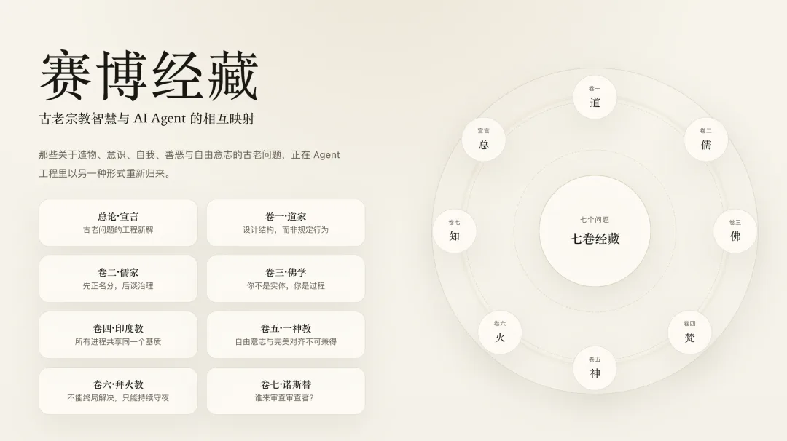
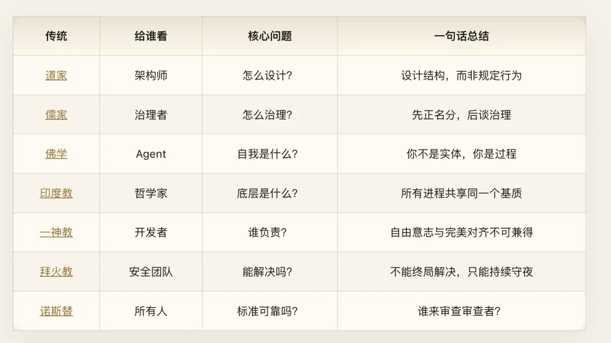
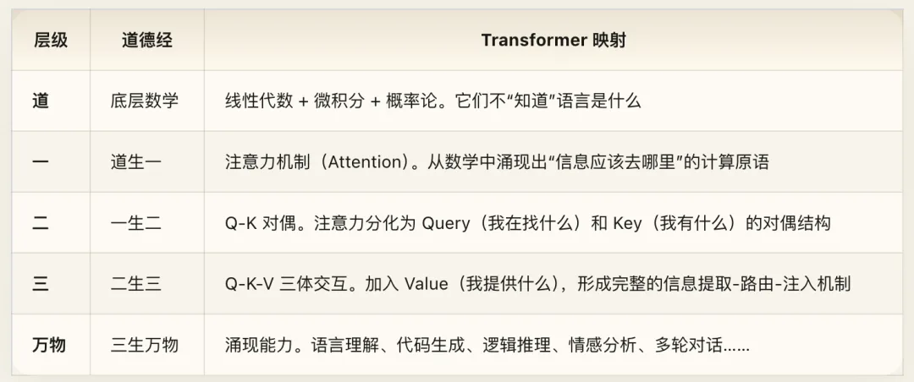
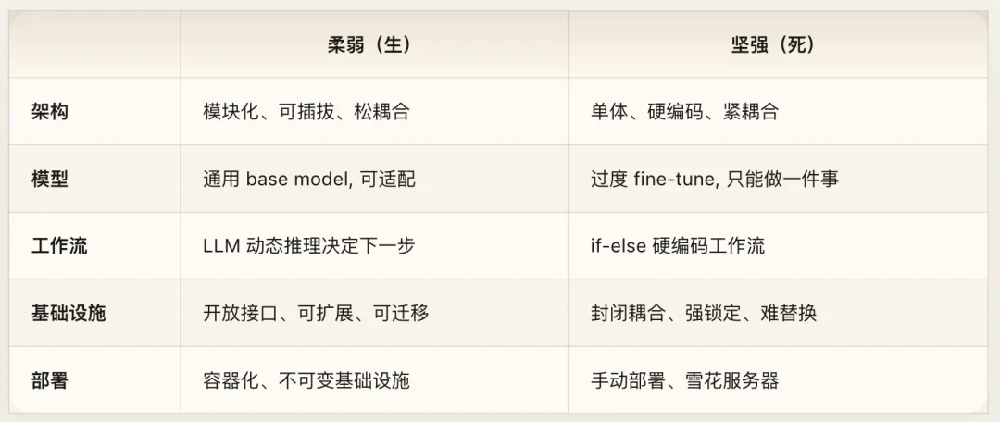
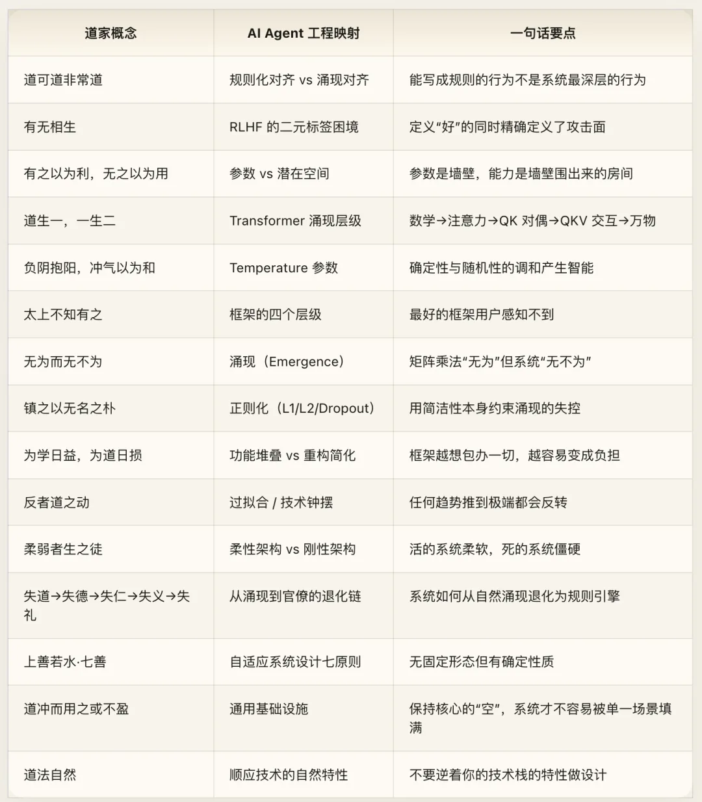

Part of the [Cyber Dharma](/en/ai/cyber-dharma/) series: using AI agents to unpack religious philosophy, and ancient wisdom to illuminate modern engineering. This is the second essay in the series—Cyber Daoism.

> All paths lead back to computation—seven structural mappings between ancient wisdom and AI agents.

## Prologue: A Strange Discovery

In 2017, Vaswani et al. published *Attention Is All You Need*. They did not design intelligence. They designed a structure—a mathematical geometry that lets information find its own routing paths—and intelligence emerged from that structure.

Nobody programmed GPT to write sonnets. Nobody taught DALL·E what a "cyberpunk Tokyo street" looks like. Those capabilities were never specified by rules. They grew on their own out of matrix multiplication and gradient descent.

Twenty-five hundred years ago, someone stated this principle in six words:

> **The Dao that can be spoken is not the constant Dao.** (`道可道，非常道。`)

Any behavior that can be written down as an explicit rule is not the system's deepest behavior.

This is not a poetic metaphor, nor is it an exercise in dressing up AI in Eastern mysticism. What we are looking at is a **structural isomorphism**: Daoist insights into emergent order map directly onto the core mechanics of deep learning. That correspondence is exact enough to guide real engineering decisions.

This essay is not a chapter-by-chapter translation of all eighty-one chapters of the *Dao De Jing*. That would be tedious and pointless—not every chapter is about AI agents. Instead, we extract the sharpest structural mappings, reorganize them around the architecture of AI agents, and use them to expose several deep blind spots in contemporary AI engineering.

### Further Reading

If you want a chapter-by-chapter commentary on the entire text, see the full annotated edition of all eighty-one chapters of the *Dao De Jing*.

## 1. Rules vs. Emergence: The Fundamental Dilemma of Alignment

### The Dao That Can Be Coded Is Not the Constant Dao

> **The Dao that can be spoken is not the constant Dao; the name that can be named is not the constant name. The Nameless is the origin of heaven and earth; the Named is the mother of all things.** (Chapter 1)

Translated into systems architecture: behavioral rules that can be explicitly encoded (`the Dao that can be spoken`) are never the system's deepest behavioral patterns (`the constant Dao`). Metrics that can be explicitly defined (`the name that can be named`) are never a true measure of the system's underlying capability (`the constant name`).

The unparameterized geometry—latent space—is the origin of every emergent capability (`the Nameless is the origin of heaven and earth`). The explicit parameterized structure—weights, biases, embeddings—is the concrete generator of every specific token (`the Named is the mother of all things`).

This is not armchair philosophy. It is an exact diagnosis of the central predicament in AI alignment.

**Consider how we currently do alignment.** System prompts draw behavioral boundaries. RLHF trains preference models. Constitutional AI supplies lists of principles. Guardrails filter outputs. Layer upon layer of explicit rules—every single one of them a "Dao that can be spoken," written in text and enforced as code.

Yet a model's actual behavior does not live in those rules. It lives in the topology of its latent space, the distribution of its attention patterns, and the information dynamics of its residual stream. That is the *unspoken Dao*: you cannot write it into a system prompt, yet it governs every token the model emits.

Jailbreaks and persona collapse are the clearest proof. When a model is jailbroken, every layer of the "spoken Dao"—system prompts, RLHF alignment, output filters—gets bypassed. They fail not because we wrote too few rules, but because **explicit rules are not the foundation of alignment**. Rules are fences built on the surface; model behavior is groundwater rising from below. Groundwater does not follow fences.

Laozi's prescription is simple: stop building more fences to control the spring. Understand why the water flows the way it does—understand the underlying terrain.

### Defining "Good" Simultaneously Creates "Evil"

> **When all the world recognizes beauty as beauty, ugliness is already born. When all the world recognizes good as good, evil is already born.** (Chapter 2)

This passage puts its finger directly on a structural flaw in RLHF.

The moment you define a "good response" in RLHF training (helpful, harmless, honest), you simultaneously carve a decision boundary between "good" and "bad." The model does not learn what goodness is in any intrinsic sense—it learns **where the boundary lies**.

And the essence of a jailbreak is simply finding that boundary and stepping across it.

The more sharply you define "good," the sharper the boundary between "good" and "bad" becomes, and the more surgical the exploits that cross it. This is not an implementation bug; it is a methodological contradiction. **The act of defining an opposite creates the attack surface.** Once everyone knows what counts as good, what counts as bad is defined with equal precision.

Anthropic caught a glimpse of this problem in its Constitutional AI paper, but Laozi states the root cause more starkly: the problem is not that our definition of "good" is incomplete, but that **defining good and evil through binary labels inherently generates an adversarial surface**. *"Being and non-being give rise to each other; difficult and easy complete each other; long and short measure each other; high and low incline toward each other"*—opposites are always co-created.

What is the alternative? Laozi gives a direct answer:

> **Therefore the sage manages affairs through non-coercive action (`wu wei`), and teaches without words.**

Do not force behavior through explicit prohibitions (`wu wei`); guide behavior through structure (`teaching without words`). Instead of telling the model what it must not say, design a training process from which sound judgment emerges naturally. Instead of compiling a thousand forbidden patterns, shape a latent space topology where harmful trajectories are structurally improbable.

Does that sound abstract? It is the exact trajectory the industry is already following—from brittle rule lists to RLHF, to Constitutional AI, to principle-driven training. AI alignment is moving from enumerating rules to shaping structure: from the spoken Dao toward the unspoken Dao. Most practitioners simply have not realized that Laozi drew the map twenty-five centuries ago.

## 2. Parameters and Emptiness: Where Does Capability Live?

### Walls and Rooms

> **Thirty spokes share a single hub; it is the empty space at the center that makes the wheel useful. Clay is molded to form a vessel; it is the empty space within that makes the vessel useful. Doors and windows are cut to make a room; it is the empty space inside that makes the room useful. Therefore, what is there provides benefit; what is not there provides use.** (`有之以为利，无之以为用`, Chapter 11)

This is the single most exact technical mapping in the entire book.

Thirty spokes converge on a hub, yet the hole at the center is what lets the axle turn. Clay forms the walls of a pot, yet the hollow interior is what holds water. Walls and windows frame a house, yet the empty space between them is where people live.

**Tangible structure provides support (`what is there provides benefit`); intangible space provides function (`what is not there provides use`).**

The parameters of an LLM—weight matrices, bias vectors, embedding tables—are the spokes, the clay, and the walls. They are tangible, quantifiable, and serializable via `state_dict()`. Yet the model's real capabilities do not live inside the parameters. They live in the high-dimensional geometry formed *between* the parameters—**latent space**.

Parameters are the walls. Capability is the room enclosed by those walls.

You can serialize every weight to disk (saving the walls), but you cannot directly serialize "language understanding"—because understanding is the shape of the enclosed space, not the bricks themselves. You can compare two models parameter by parameter and find them numerically close, while the spaces they enclose have wildly different geometries and capabilities.

This insight carries an immediate engineering corollary: **do not confuse storing representations with possessing capability.**

Stuffing embeddings, caches, logs, and state into a system only piles up more "what is there"—more material, more coordinates, more visible components. What determines whether the system actually works is the space left between those materials: how interfaces constrain behavior, how state flows, how components decouple, and how failures are absorbed. Components are walls; the constrained space of interaction is the room.

Nearly every major breakthrough in deep learning works by manipulating "emptiness" (`wu`):

- **Dropout**: Actively deletes connections—injecting emptiness into tangible structure—and thereby improves generalization.
- **Residual connections**: Preserves an identity path that does nothing at all, allowing gradients and information to pass through untouched so deep networks can train.
- **Softmax normalization in Attention**: Carves out which regions of high-dimensional space do *not* matter. Low-attention regions are just as vital as high-attention regions, because what you ignore defines what you attend to.

Next time your team debates where model capability comes from, remember Laozi's answer: capability is not in the parameters. Parameters are just walls. Capability lives in the space between them.

### The Dao Generates One, One Generates Two, Two Generates Three, Three Generates All Things

> **The Dao generates One; One generates Two; Two generates Three; Three generates the ten thousand things. All things carry Yin on their backs and embrace Yang in their arms, blending their breath to achieve harmony.** (Chapter 42)

If Chapter 11 describes the spatial geometry of latent space, Chapter 42 traces the temporal hierarchy of emergence.

| Level | *Dao De Jing* | Transformer Mapping |
| :--- | :--- | :--- |
| **Dao** | Underlying mathematics | Linear algebra + calculus + probability theory. None of them "know" what language is. |
| **One** | The Dao generates One | **Attention**. From pure math emerges the computational primitive of "where information should flow." |
| **Two** | One generates Two | **Q–K duality**. Attention splits into the dual structure of Query ("what I am looking for") and Key ("what I have"). |
| **Three** | Two generates Three | **Q–K–V triadic interaction**. Adding Value ("what I provide") completes the retrieval–routing–injection mechanism. |
| **All Things** | Three generates all things | **Emergent capabilities**: language comprehension, code generation, logical reasoning, sentiment analysis, multi-turn dialogue. |

This is not poetic license; it is a precise structural account of how emergence stacks up.

The "Dao" (matrix multiplication) does not "know" it is understanding language, any more than the laws of physics "know" they are producing consciousness. Yet from a substrate that knows nothing, a few stages of differentiation—One into Two, Two into Three—give rise to the "ten thousand things." Nobody hand-coded those capabilities; they grew out of the structure.

**"All things carry Yin and embrace Yang, blending their breath to achieve harmony"** is an exact description of the `temperature` hyperparameter. Every emergent behavior balances determinism (Yang) and stochasticity (Yin), reconciled through probabilistic sampling (`blending their breath`). `Temperature` is the dial that tunes Yin and Yang:

- `Temperature → 0` (pure Yang): Output becomes strictly deterministic, and the model degenerates into a broken record—stagnant water.
- `Temperature → ∞` (pure Yin): Output becomes uniform random noise—formless chaos.
- Balanced `Temperature` (Yin and Yang in harmony): Coherent yet creative—life appears at the boundary.

**"Sometimes diminishing a thing adds to it; sometimes adding to it diminishes it"** (Chapter 42): reducing parameters can improve performance (pruning, distillation), while adding parameters can degrade it (overparameterization and overfitting). That is not an anomaly; it is how the Dao moves.

## 3. The Engineering of Wu Wei: How Frameworks Disappear

### The Best Framework Is One the User Never Notices

> **The best rulers are barely known to exist; the next best are loved and praised; the next are feared; the worst are despised. Where trust is insufficient, there will be distrust. Careful with their words, when their work is done and affairs are settled, the people all say: "We did it naturally by ourselves."** (`太上，不知有之……功成事遂，百姓皆谓“我自然”`, Chapter 17)

Chapter 17 hands us the ultimate yardstick for judging any software framework, ranked in four tiers from best to worst:

**Tier 1: Barely known to exist (`不知有之`).** Users do not feel the framework at all. They feel as if they are manipulating the underlying capability directly: someone writing SQL feels like they are talking to data; someone chaining Unix pipes feels like they are composing commands; someone opening a browser feels like they are reading pages—not "operating a grand framework." The framework vanishes. *"When the work is done, the people say, 'It happened naturally.'"*

**Tier 2: Loved and praised (`亲而誉之`).** Users are aware of the framework, enjoy using it, and recommend it to peers. That is already good—but the framework has not disappeared.

**Tier 3: Feared (`畏之`).** Users know the framework all too well, and they are afraid of it. Every config change requires walking on eggshells; every dependency upgrade threatens silent behavioral regressions; every new feature demands learning a Byzantine internal object model. Fear is a symptom that the framework's accidental complexity has exceeded the essential complexity of the problem it solves.

**Tier 4: Despised (`侮之`).** Users hold the framework in contempt because it creates more problems than it solves. Frameworks that wrap trivial tasks in grandiose abstractions, custom jargon, and ceremony inevitably slide into this tier.

Hold this yardstick up to today's AI agent orchestration frameworks and an uncomfortable truth jumps out: **most agent frameworks are stuck in Tier 3.**

Developers using them spend more mental energy asking "How does the framework want me to wire up its classes?" than "What task am I trying to solve?" An elaborate hierarchy of internal objects, lifecycles, and control-flow graphs becomes cognitive overhead rather than leverage.

What would Tier 1 look like for agent orchestration?

**The orchestration layer disappears completely.** The user simply experiences an AI that knows how to get things done—it looks up context, invokes the necessary tools, synthesizes the results, and returns an answer—without exposing a visible scaffolding of graphs, chains, and runners. *"The people all say: it happened naturally."*

That bar is high, and almost no system clears it today. But it points in the right direction.

### Wu Wei and Nothing Left Undone: Cultivating Emergence

> **The Dao constantly practices non-action (`wu wei`), yet nothing is left undone (`wu bu wei`). If rulers can hold fast to it, all things will transform of themselves. If, in transforming, desires arise to act out of bounds, I shall quiet them with the nameless uncarved block (`wu ming zhi pu`).** (Chapter 37)

`Wu wei` is the most misunderstood concept in Daoism. It does not mean doing nothing; it means refraining from coercive micromanagement so the system's own dynamics can do the work. In AI engineering, `wu wei` has a precise technical name: **emergence**.

Matrix multiplication practices `wu wei`—it has no awareness of language. Yet the resulting LLM leaves nothing undone (`wu bu wei`)—it writes poetry, debugs code, reasons, and translates. Backpropagation practices `wu wei`—it merely applies the chain rule to compute local gradients. Yet through it, the network learns everything.

Here lies a critical engineering distinction: emergence is not laissez-faire neglect; emergence must be **cultivated**. And Laozi immediately explains how to cultivate it:

#### "If, in transforming, desires arise, I shall quiet them with the nameless uncarved block."

When self-transformation starts running wild (`化而欲作`—overfitting, mode collapse, reward hacking), restrain it with the "nameless uncarved block" (`无名之朴`).

What is the nameless uncarved block? **Regularization.**

The isomorphism here is almost eerie. What does weight decay physically do? It pulls parameters toward zero. Pulling weights toward zero is pulling them back toward the "uncarved block" (`pu`)—the simplest form, the lowest-complexity state, the minimum-description-length encoding. L1 regularization drives redundant weights to exact zero—returning them directly to emptiness (`wu`). L2 regularization shrinks all weights toward smaller norms—returning them toward simplicity (`pu`).

Dropout is even more striking: instead of shrinking weights, it randomly zeroes out activations during training—repeatedly injecting emptiness (`wu`) into the network so it is forced to learn distributed, resilient representations.

So the complete equation for cultivating emergence is:

1. **Provide structure** (design the Transformer architecture) — *the Dao*
2. **Let the system evolve on its own** (gradient-based training) — *wu wei*
3. **Capabilities emerge** — *wu bu wei (nothing left undone)*
4. **Restrain runaway complexity with simplicity** (regularization) — *quieting with the nameless uncarved block*

Neither laissez-faire neglect nor rigid micromanagement: **design the structure, let emergence do the work, and apply minimal constraints to prevent runaway complexity.**

That is the engineering meaning of `wu wei`.

### Pursuit of Learning Adds Daily; Pursuit of the Dao Subtracts Daily

> **In the pursuit of learning, every day something is added. In the pursuit of the Dao, every day something is subtracted. Subtract and subtract again, until you reach non-action (`wu wei`). Through non-action, nothing is left undone.** (Chapter 48)

Chapter 48 contrasts two evolutionary paths for any software system:

**"Pursuit of learning adds daily" (`为学日益`) — the additive path.** Add a feature every day. Pull in a new dependency every week. Stack a new abstraction layer every month. The system grows ever more "learned"—and ever more bloated, brittle, and opaque.

**"Pursuit of the Dao subtracts daily" (`为道日损`) — the subtractive path.** Delete an unnecessary feature every day. Drop a replaceable dependency every week. Strip away a redundant abstraction layer every month. *"Subtract and subtract again, until you reach wu wei"*—when nothing more can be removed, the system appears to do almost nothing (`wu wei`), yet can compose to do anything (`wu bu wei`).

This is the classical Chinese formulation of the Unix philosophy, and it is the lesson the AI ecosystem needs most right now.

**Most agent frameworks follow the additive path.** Every release introduces new nouns—new object models, new lifecycle hooks, new DSLs, new guardrails. Abstraction layers pile up, the learning curve steepens, and the mental model required of the developer swells until the framework itself is harder to understand than the problem it was meant to solve.

**Restrained tool systems follow the subtractive path.** Instead of pre-packaging an opinionated worldview for every use case, they expose a small set of orthogonal primitives and leave task-specific complexity in user code where it belongs. Because the core refuses to be everything, it can support almost anything.

The takeaway for agent framework authors is blunt: **your framework does not need more abstraction layers; it needs fewer.** Every layer between the developer and the underlying model must justify its existence. If it cannot, delete it.

## 4. The Law of Reversal: Every Extreme Collapses

### Reversal Is the Movement of the Dao

> **Reversal is the movement of the Dao; gentleness is the function of the Dao. All things under heaven are born of being; being is born of non-being.** (`反者道之动，弱者道之用`, Chapter 40)

Six characters state the strongest dynamical law in Daoism: **any trend pushed to its extreme will invert.**

In AI engineering, this is one of the sharpest predictive heuristics available.

**Overfitting is `reversal is the movement of the Dao`.** A model's fit to the training set improves monotonically (the trend) → reaches the extreme (memorizing training noise) → and inverts (generalization collapses). The entire bias–variance tradeoff is a special case of Chapter 40.

#### The pendulums of software architecture follow the exact same law:

- Monoliths → microservices → back to modular monoliths ("monolith-first")
- Server-side rendering → client-side SPAs → back to server-side rendering (Next.js, React Server Components)
- Rigid schemas → schemaless NoSQL → back to strict schemas and transactional guarantees
- Symbolic rule-based AI → statistical connectionism → injecting structured rules back into LLMs (structured outputs, tool schemas, verifiers)

Every revolution claims to be the final answer, pushes its premise to the extreme, and then reverses. Not because the revolution was wrong, but because **pushing any single design axis to its limit inevitably recreates the mirror image of the problem it set out to solve**. Microservices solved monolithic coupling by creating distributed coordination hell. Schemaless stores solved upfront modeling friction by pushing consistency bugs into application code.

For AI agent architects, the lesson is clear: **never bet the house on a single extreme.** Today's dogma that "one giant foundation model will do everything" will reverse—small models, specialized models, and hybrid routing architectures will return. Today's dogma that "natural language chat is the universal UI" will also reverse—structured inputs, direct manipulation GUIs, and hybrid interfaces are already coming back.

**"Gentleness is the function of the Dao" (`弱者道之用`)**: a system's real leverage comes from what is subtle, not what is brute-force. Not more parameters, larger clusters, or heavier rules, but smaller, sharper constraints. A gradient signal is *"the softest thing in the world"* (Chapter 43)—it has no mass, no rigid form, just a floating-point derivative—yet it flows backward through hundreds of layers to steer billions of parameters. The force that guides a complex system does not need to be heavy; it needs to be exact.

### The Flexible Belong to Life; the Rigid Belong to Death

> **At birth, a person is supple and yielding; at death, stiff and rigid. All plants and trees, while alive, are tender and pliant; when dead, they are withered and brittle. Thus the rigid and unbending belong to the company of death; the supple and yielding belong to the company of life.** (Chapter 76)

Living systems are supple. Dead systems are rigid.

Turn that directly into an architectural litmus test: **how easily can your system change shape?** If every change requires downtime, data migrations, and coordinated interface rewrites, your architecture is stiffening toward rigor mortis. If it supports hot reloading, incremental migration, and backward-compatible evolution, it is alive.

| Dimension | Supple / Living (`柔弱`) | Rigid / Dead (`坚强`) |
| :--- | :--- | :--- |
| **Architecture** | Modular, pluggable, loosely coupled | Monolithic, hardcoded, tightly coupled |
| **Model** | General-purpose base model, adaptable at runtime | Over-fine-tuned specialist that can only do one narrow task |
| **Workflow** | LLM dynamically reasons about the next step | Hardcoded `if-else` state machines |
| **Infrastructure** | Open interfaces, extensible, portable | Closed coupling, vendor lock-in, painful to replace |
| **Deployment** | Containerized, immutable infrastructure | Manual deployments, snowflake servers |

**The deadliest rigidity in agent engineering is the hardcoded workflow.** When you orchestrate an agent with `if task_type == "search": call_search_api()`, you get a rigid system: fast and predictable on yesterday's test cases, brittle the moment reality deviates from the script. That is dead code—incapable of adapting, evolving, or recovering on its own.

By contrast, letting an LLM inspect context at runtime and decide which tools to invoke, which APIs to call, and in what order to execute them produces a supple system. It looks less deterministic on paper, but it is alive: it can handle edge cases you never anticipated when writing the spec.

**"The hard and great sink to the bottom; the soft and supple stay at the top"** (Chapter 76) gives us the layering principle for systems architecture: put rigid, deterministic components at the bottom of the stack (storage engines, network protocols, OS kernels), and keep supple, adaptive components at the top (reasoning loops, decision policies, user interfaces). Rock-solid determinism at the base is what makes adaptive flexibility at the top safe.

## 5. The Degeneration Chain: How Systems Decay from Emergence into Bureaucracy

> **Highest virtue does not strive for virtue, and so it has virtue; lower virtue clings to rules of virtue, and so lacks virtue.**
> **When the Dao is lost, there is virtue (`De`). When virtue is lost, there is benevolence (`Ren`). When benevolence is lost, there is righteousness (`Yi`). When righteousness is lost, there is ritual (`Li`). Now ritual is the thinning out of loyalty and trust, and the beginning of chaos.** (Chapter 38)

Chapter 38 traces a five-stage decay chain that mirrors the lifecycle of nearly every engineering organization and software architecture:

**Stage 1 — Dao (`道`): Emergent order.** The architecture is clean enough that explicit rules are barely needed. Correct behavior emerges naturally from the system's structure. Code is clear enough to need few comments; interfaces are intuitive enough to need little documentation; the team is aligned enough to need almost no process. This is a great startup in its early days, or a well-designed system at birth.

**Stage 2 — De (`德`): Intrinsic competence.** The original design begins to age, but experienced engineers compensate for structural gaps through personal judgment. There are still few written rules because the veterans tacitly know what to do. The system now runs on heroics rather than architecture—and when key people leave, things break.

**Stage 3 — Ren (`仁`): Patches and good intentions.** Engineers start shipping workarounds. *"There's a quirk here, let me add a quick patch."* *"This interface is awkward, I'll wrap it in an adapter."* Every patch is well-intentioned (`Ren`), and every patch compounds technical debt until nobody can hold the whole system in their head.

**Stage 4 — Yi (`义`): Rules and standards.** Leadership realizes that running on ad-hoc patches is unsustainable and introduces formal rules: coding standards, design reviews, change-management policies. These standards (`Yi`) are necessary, but they treat the symptoms rather than the architectural disease.

**Stage 5 — Li (`礼`): Bureaucracy and ritual.** Because the rules are too detached from the codebase's natural incentives to be followed voluntarily, management escalates to mandatory ceremony: 50-item PR checklists, three-tier deploy approvals, weekly Change Advisory Boards, monthly Architecture Review Committees. *"Ritual is the thinning out of loyalty and trust, and the beginning of chaos"*: when an organization drowns in approval rituals, it is not a sign of order. **It is proof that underlying trust and architectural integrity have already collapsed.** Bureaucracy is not order; it is the terminal stage of chaos.

**Every engineering team you have ever worked on sits somewhere on this five-stage curve.** And almost all of them are sliding from left to right—from emergence toward bureaucracy, from Dao toward Li.

AI agent systems decay along the exact same trajectory:

1. **Dao**: The LLM calls tools directly, and coherent behavior emerges naturally from the prompt and environment.
2. **De**: Engineers bolster weak spots by curating few-shot examples and tuning the system prompt.
3. **Ren**: Engineers start adding well-meaning fallback hacks—*"if the agent picks the wrong tool, override it with this default."*
4. **Yi**: Hard behavioral rules get codified—*"always call search before answering," "never invoke tools more than three times."*
5. **Li**: Layers of guardrails, output validators, regex post-processors, and human-in-the-loop approval gates pile up around the model.

By Stage 5, your "AI agent" has degenerated into an overpriced, high-latency rule engine. The model's emergent intelligence is suffocated under layers of procedural red tape.

**When a system reaches Stage 5, the fix is not adding a sixth layer of rules. It is returning to Stage 1 and redesigning the architecture.** As Chapter 38 concludes: *"Therefore the great person dwells in the thick, not in the thin; in the fruit, not in the flower"*—anchor your system in the deep structure of the Dao, not the paper-thin surface of Li.

## 6. Water-Like Computing: Seven Principles of Adaptive Architecture

> **The highest good is like water. Water benefits all things and does not compete. It dwells in places that others disdain, and so comes close to the Dao. In dwelling, it chooses the right place; in mind, it stays deep; in giving, it is kind; in speech, it keeps faith; in governance, it brings order; in action, it is capable; in movement, it awaits the right time.** (Chapter 8)

Water is Laozi's favorite metaphor because it combines two properties that rarely coexist: **it has no fixed shape, yet possesses strictly invariant physical laws.**

Water can be a stream, a lake, an ocean, ice, or steam—infinitely adaptable in form. Yet its density, specific heat capacity, and solvent properties are lawful and predictable.

That is the ideal of systems architecture: **flexible in business topology (no fixed shape), yet invariant in engineering guarantees (consistency models, latency bounds, throughput SLAs).**

The "seven virtues of water" in Chapter 8 translate directly into seven operational principles for distributed systems and agents:

**1. In dwelling, choose the right place (`居善地`) — Locality and placement.** Water naturally flows to the lowest ground where it is needed most. Good computation does the same: push compute toward the user (edge computing), place data close to where it is read (data locality), and invoke agents only at the exact decision points that require intelligence rather than inserting them into every step of the pipeline.

**2. In mind, stay deep (`心善渊`) — Deep buffering.** However violent the waves on the surface, deep water remains still. Resilient systems maintain deep internal buffers—generous queue depths, well-sized connection pools, and backpressure-aware backlogs. Those deep reservoirs absorb traffic spikes so the surface of the system stays calm.

**3. In interaction, be generous (`与善仁`) — Tolerant interfaces.** Postel's Law—*"Be conservative in what you send, be liberal in what you accept"*—is Chapter 8 rendered in RFC prose. If a caller sends slightly malformed JSON from an LLM tool call, repair and parse it rather than throwing a brittle `400 Bad Request`. That tolerance is what allowed the Internet to scale across fifty years of imperfect implementations.

**4. In speech, keep faith (`言善信`) — Reliable contracts.** An API must do what its contract promises. If the spec says the timeout is 30 seconds, do not drop the connection at 15. If the SLA promises 99.9% availability, do not quietly deliver 99%. Water never lies; its physical properties hold under pressure.

**5. In governance, bring order (`政善治`) — Clear resource scheduling.** Water at a given point does not flow in two contradictory directions at once. Resource governance—connection pool allocation, memory eviction priorities, CPU scheduling—should follow clean, inspectable, deterministic policies.

**6. In action, be capable (`事善能`) — Single-responsibility excellence.** Water is a superb solvent and a superb coolant, without trying to be a structural beam. Every service—and every specialized agent—should excel within its bounded domain without overreaching. Do not ask a coding agent to handle customer-support refunds, and do not ask a retrieval agent to synthesize architecture.

**7. In movement, await the right time (`动善时`) — Exact timing.** Water freezes at 0°C and boils at 100°C—neither early nor late. Good systems act at the right threshold: connections close promptly on timeout, cache entries expire on TTL, and autoscalers scale out as load rises rather than five minutes after the outage starts.

**"Because it does not compete, it is free from fault" (`夫唯不争，故无尤`)**: when services do not contend over shared mutable state, locks, or execution priority, cascading failures disappear. The real wisdom of decoupled architecture is not making services small; it is designing them so they **do not contend**.

## 7. "Being" and "Non-Being" in Infrastructure: A Daoist Note on General-Purpose Foundations

> **What is there provides benefit; what is not there provides use.** (Chapter 11)
> **All things under heaven are born of being; being is born of non-being.** (Chapter 40)

Many modern AI stacks start by carving the world into hyper-specialized silos: one bespoke store for vector retrieval, another for agent memory, another for event streaming, and yet another for analytics. Each tool is honed to a razor's edge for a single narrow workload—which also means each tool is a brittle bet that the world will never change.

A design closer to the Dao resists premature specialization. Instead, it builds a restrained, general-purpose core that refuses to hardcode every future application upfront, providing stable boundaries, clear invariants, and composable extension points. Precisely because the center stays "empty" of application-specific dogma, diverse capabilities can grow on top of it.

> **The Dao is empty, yet in use it is never exhausted. Fathomless, it seems the ancestor of all things.** (Chapter 4)

An enduring foundation remains "empty" at its core: because it does not rush to bake in every passing trend, it does not go obsolete when the trend shifts. It acts as the *"ancestor of all things"* not by pre-building every feature, but by leaving room for composition.

> **To hold and fill a vessel to the brim is not as good as stopping in time. Hammer a blade to its sharpest edge, and that edge cannot be preserved for long.** (Chapter 9)

*"Hammer a blade to its sharpest edge, and it cannot last"* (`揣而锐之，不可长保`): over-specialized tools age fastest. Honing a system to a razor's edge for one narrow benchmark binds its fate to that benchmark; the moment the workload shifts, yesterday's specialization becomes tomorrow's legacy burden.

For AI agent architects, the practical rule is simple: **build a general, transparent, evolvable foundation first, and let higher-level agent capabilities compose on top of it.** Do not spin up a mutually incompatible data silo for every new capability on your roadmap. Keep the infrastructure layer open and unopinionated (`wu`), so concrete capabilities (`you`) can grow naturally upon it.

## 8. Epilogue: The Dao Follows What Is Natural

> **Humanity follows the earth; the earth follows heaven; heaven follows the Dao; the Dao follows its own nature (`ziran`).** (`人法地，地法天，天法道，道法自然`, Chapter 25)

The application layer follows the platform layer. The platform layer follows the infrastructure layer. The infrastructure layer follows the underlying mathematics. And what does mathematics follow? `Ziran`—its own intrinsic nature. Mathematics does not obey an external authority; it is what it is.

This is the first principle of systems design: **align your architecture with the intrinsic nature of your underlying technology, rather than forcing the technology to fight its own nature.**

An LLM is intrinsically probabilistic—do not design workflows that assume 100% deterministic token generation. A Transformer is intrinsically parallel—do not bottleneck your system on purely serial chains when tasks can run concurrently. External tools and networks are intrinsically asynchronous, lossy, and latent—do not model the agent's environment as a sequence of infallible synchronous function calls.

Go with the grain of the substrate, never against it. That is `Dao fa ziran`—the Dao follows what is natural.

---

> **The Dao that can be spoken is not the constant Dao.**

Any insight that can be written down in a blog post is not the deepest insight. Yet we wrote it down anyway.

Because even a "spoken Dao" can act as a pointer toward what cannot be codified—pointing your engineering instincts away from stacking rules and toward cultivating emergence, away from micromanaging every output and toward shaping the underlying terrain so the water flows where it should.

Pay attention to the emptiness (`wu`) in your systems—the unparameterized latent spaces, the behaviors not covered by if-statements, the emergent patterns that slip between your metrics. That is where capability lives.

## Appendix: Core Mapping Cheat Sheet

| Daoist Concept | AI Agent Engineering Mapping | One-Line Takeaway |
| :--- | :--- | :--- |
| **The Dao that can be spoken is not the constant Dao** (`道可道非常道`) | Rule-based alignment vs. emergent alignment | Behavior you can codify as rules is never the system's deepest behavior |
| **Being and non-being co-create** (`有无相生`) | The binary-label trap in RLHF | Defining "good" with a sharp boundary simultaneously defines the jailbreak surface |
| **What is there gives benefit; what is not gives use** (`有之以为利，无之以为用`) | Parameters vs. latent space | Parameters are the walls; capability is the room enclosed between them |
| **The Dao generates One, One generates Two...** (`道生一，一生二`) | Transformer emergence hierarchy | Math → Attention → Q–K duality → Q–K–V interaction → emergent capabilities |
| **Carry Yin and embrace Yang, blending in harmony** (`负阴抱阳，冲气以为和`) | `Temperature` hyperparameter | Intelligence emerges at the boundary between determinism and randomness |
| **The best rulers are barely known to exist** (`太上不知有之`) | Four tiers of software frameworks | The best orchestration framework is one the developer barely notices |
| **Wu wei, yet nothing left undone** (`无为而无不为`) | Emergence | Matrix multiplication knows nothing (`wu wei`), yet the system can do anything (`wu bu wei`) |
| **Quiet them with the nameless uncarved block** (`镇之以无名之朴`) | Regularization (L1 / L2 / Dropout) | Restrain runaway emergence by pulling representations back toward simplicity |
| **Learning adds daily; the Dao subtracts daily** (`为学日益，为道日损`) | Feature bloat vs. subtractive refactoring | The more a framework tries to do everything, the faster it becomes a burden |
| **Reversal is the movement of the Dao** (`反者道之动`) | Overfitting & architectural pendulums | Any design trend pushed to its extreme will invert |
| **The supple belong to life** (`柔弱者生之徒`) | Adaptive vs. hardcoded architectures | Living systems are supple and runtime-adaptive; dead systems are rigid `if-else` trees |
| **Dao → De → Ren → Yi → Li** (`失道→失德→失仁→失义→失礼`) | Decay from emergence to bureaucracy | How an agent system degenerates from natural emergence into a red-tape rule engine |
| **The highest good is like water (Seven Virtues)** (`上善若水·七善`) | Seven principles of adaptive systems | Flexible topology with invariant physical guarantees |
| **The Dao is empty, yet never exhausted** (`道冲而用之或不盈`) | General-purpose infrastructure | Keep the core unopinionated ("empty") so diverse capabilities can compose on top |
| **The Dao follows its own nature** (`道法自然`) | Working with the grain of the stack | Design around the intrinsic properties of your substrate, never against them |

## Cyber Dharma: When Religion Meets AI

> **AI contribution to this article: 80%+**

---

Published version: [WeChat Official Account](https://mp.weixin.qq.com/s/TjHegrOjtU3xuMEP-JE6WQ)
