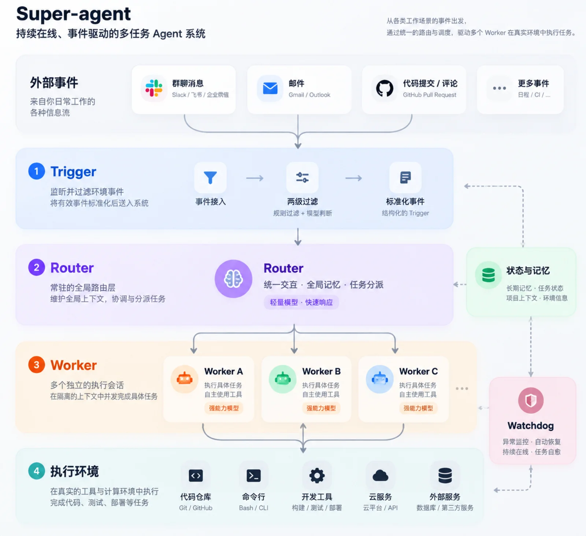
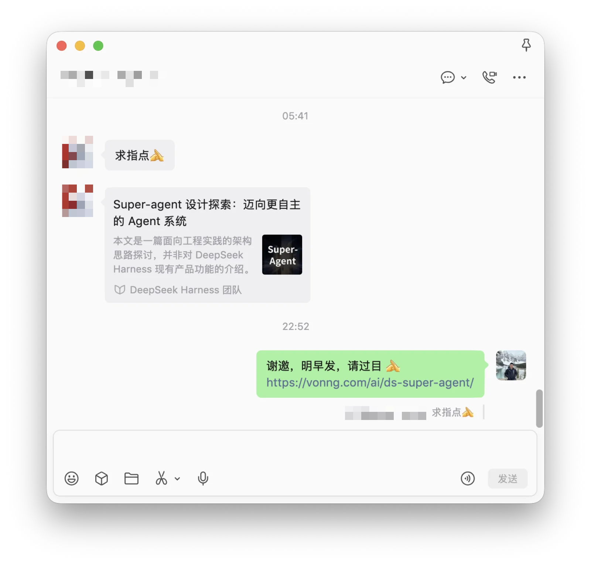
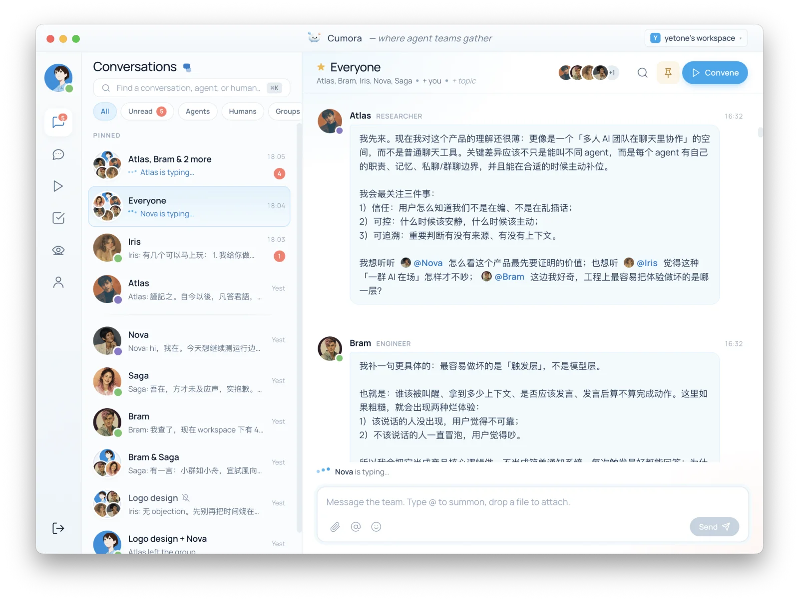

今天 DeepSeek Harness 团队发了一篇文章，《[Super-agent 设计探索](https://mp.weixin.qq.com/s/zoS7GlReWPhfCjENGxXCdg)》。崔老板找老冯点评一下，我觉得这个确实值得聊聊，遂有此篇。

文章挺长，外面的解读多在复读概念，其实剥掉那些系统术语的外壳，它要解决的是一个特别朴素的真问题：**[人的注意力是有限的](/ai/attention-bottoleneck/)，同时盯三五个会话脑子就转不过来了，一个人到底怎么高效管理多个并发干活的 Agent？**

文章里有句金句：**“Session 应当是系统的实现细节，而不应是用户的认知负担。”**

那怎么把 Session 藏起来？DeepSeek 的做法很直白：最外层接事件触发器（Trigger），中间摆一个常驻的 Router，底下挂一堆干具体活的 Worker Session。Router 自己不下场干重活，专门守在入口听你说话，判断该把任务分给哪个 Session，等底下干完了再汇总回给你。

平心而论，如果把题目限定在“怎么在一个对话框里，替用户自动切分 Session、异步派活”，这套开源原型的工程设计相当扎实，不少细节一看就是真干过活、踩过坑的人写出来的。

但读完之后，老冯想接着追问一个原文没有正面回答的问题：**把 Session 藏到底下之后，Router 凭什么知道你这句话该派给谁？** 靠这套路由，真能解决“一个人管理多个复杂任务”的难题吗？

我看悬

> 免得被 DS 狂热粉冲了…

## 为什么小秘书遇上大工程就拉胯？

“对着一个聊天框派百样活”并不是今天才有的新鲜玩意儿。OpenAI 9 月底发布的 Dots，就是一个常驻在线的 [个人 Agent](/ai/secretary-era/)，可以替你给 Codex 派活。更早一点，老冯今年 5 月就用过 [Today.AI](https://today.ai/)，路数基本一致。他们一号工程师是我哥们儿，这产品怎么一步步磨出来的，老冯是一路看着的。

用下来我的体感很明显：干点日常杂活、做做分析调研，这类 Personal Agent 还凑合；可一旦碰上严肃场景，拿去干点正经大工程，立马就拉胯。让它当个汇总信息、跑跑轻办公的小秘书没问题，真要像指挥 [Codex](/ai/try-codex/)、[Claude Code](/ai/claude-code-intro/) 舰队那样派活，实在太难为它了。

为什么全都卡在这里？

一层原因是很多产品被客观环境框住了手脚。最典型的就是微信：至少到今天，微信只给个人机器人开了点对点单聊的口子。你手里养着“小龙虾”或“爱马仕”，也没法把它们拉进各种工作群里。大家被迫在单聊的螺蛳壳里做道场，做着做着，就把这种受限于环境的权宜之计，当成了 Super-Agent 本该有的样子。

再往深处想：**今天的多任务并行里，真正充当 Super-Agent 的，其实是我们自己。** 在几个 Codex 窗口、几个 Claude 对话、几个飞书群之间来回切换，脑子里记着每摊事推到了哪一步、该按什么规矩办的人，是你。

Router 真想替你扛下这活，就得先把你脑子里装的这份东西搬出来：眼下这句话属于哪个项目，代码在哪台机器的哪个目录，守哪份规范，手里有什么权限，上次拍板定了什么。这份搬出来的东西有个现成的名字，就叫 Context。

所以老冯认为，真正的问题不是把 Session 藏起来，而是把上下文显出来。

如何管理上下文，是任何 Agent 架构都必须先回答的第一问。

## Context 到底是什么？

很多人一提 Context，想到的只是大模型的上下文窗口（Context Window），也就是往模型眼前塞多少 Token。原文花大篇幅讲的 `Inline & Spill` 和链式召回，解决的也是这一层：窗口装不下时怎么腾挪调度。

但在真实的工程实践里，决定系统生死的其实是**工作上下文（Working Context）**。说白了，**Context 是一组边界：你在哪个现场，能碰什么东西，守什么规矩，跟谁一起干活。**

落到写代码这个场景，它就是具体的代码仓库，是散落在不同机器上的工作目录，是写明环境依赖与行为准则的 `AGENTS.md`，是内部文档站的链接，外加绑在这套环境上的工具权限和历史决策。你在 Codex Claude 里给每个仓库单独配的那套环境，本质上就是一个显式的 Context。

把这两层分清楚，道理就很简单了：**Session 只是一次临时的执行过程，藏进底层天经地义；但 Context 是工作现场和权限边界，必须端到端摆在明面上，绝不能对用户隐藏。**

单一入口模式的问题恰恰是把 Context 连同 Session 一块藏了起来，指望背后的 Router 去猜你这句话对应哪个工作现场。在一个真能对外动手的系统里，靠猜来路由，迟早要出事故。你在聊天框里随口一句“帮我把临时垃圾清一下”，本意是清理本地测试目录，Router 但凡猜偏一步、派错了地方，搞不好就是一场线上删库事故。

## 群聊是正确的形态

那管理多个 Context，最自然的交互形态是什么？

不妨先看看人是怎么干活的。人在现实里说话之所以能省字，是因为开口前就知道自己在什么场合：会议室有会议室的规矩，机房有机房的红线；你在家里和在老板办公室说话肯定不是一个调门，往不同的邮件列表发信也守不同的规矩。人本来就是看场合说话的（Context-aware），没道理到了工程协作里，反而把场合边界全抹平，去让概率模型硬猜。

原文有句话说得很对：**相似的设计约束会导出相似的架构选择**。几百人的公司怎么管、几十个项目怎么并行推，人类早就交出了标准答案：国内协同在飞书、钉钉、企微上，海外在 Slack、Discord 上；更硬核的开源世界里，PostgreSQL 社区靠 `pgsql-hackers`、`pgsql-bugs` 这些邮件列表，井井有条地运转了几十年。

说到底，除了私聊，人类搞多线程协作最通用，最习惯，最广泛的载体就是 **群聊**。因为**每一个群，天生就是一个显式的 Context 容器**。财务群、法务群、运维群、研发群，同一个人在不同的群里扮演不同的角色，守不同的群规。

把机器人拉进群里干活，这思路一点都不新。GitHub 十多年前就在聊天室里 `@` [Hubot](https://hubot.github.com/) 跑部署，后来这套玩法有了名字叫 ChatOps，撑起了 Slack 过去十年的机器人生态。只是到了今天，有三件事变了：机器人不再是跑死脚本的工具，而是有独立执行环境、能跨机器干活的 Agent；群里也不止一个机器人，而是一支得互相配合的舰队；更重要的是，它们底下得有一份共享的状态。

与其费劲在单聊框里搞一个全局 Router 猜谜，不如直接按工作上下文建群，把对应的 GitHub 仓库、文档站绑进群里。你点进 Silo 研发群，`@` 里面的编码 Agent 派活，它自然就带着 Silo 的代码目录、`AGENTS.md` 规范和专属权限去动手。原本最容易出错的路由问题，在你进群开口的那一刻就零成本解掉了。这就好比没人会写个数据库代理，靠语义去猜一条 SQL 该发给哪个库；连上 PostgreSQL 的第一件事，永远是显式声明 `database` 和 `role`。

这也是为什么 ChatGPT 和 Claude 都在往 Slack 里钻，让你直接在频道里 `@` 它们干活。当然，群聊本身也有一身毛病：信息过载、重要决定转眼被刷走、群一多根本看不过来。把 Agent 塞进群里肯定不是终点。群只是把 Context 摆到了明面上，至于群聊自己的老毛病，得靠后面说的“书记”和数据库来治。

## 多对多的上下文容器

有人可能会说：DeepSeek 的架构不也支持多人在群里 `@` Super-Agent 干活吗？区别在于，在它那里，群聊只是一根外接的“消息输入管道”；
无论是在多个群里，还是多个人使唤一个 Agent，都不改变这一点。
而在老冯说的这套模式里，群本身就是硬隔离的 Context 容器。把这层关系倒过来，顺手就能解开另外两个死结。

第一，**安全与主动性可以分级**。公开的用户反馈群碰不到生产环境，大可放手让 Agent “无人 `@` 也自动复现 Bug”；但握着线上密钥的运维群，就得立下铁律：必须同时满足**显式的群 × 有权限的真人 × 明确的指令**，三样齐了才准动手。转发的聊天记录、贴进来的邮件、别的 Agent 的转述，统统不算数。至于全局 Router，退居二线当个“版主”就够了：有人在私聊或别的群里跑题派活，它负责认出来，提醒把话题挪回对应的项目群，进对了房间再开工。

第二，也是更要紧的一点：**复杂的重活，从来指望不上单个 Agent 包打天下，你手里调度的是一支异构的 Agent 舰队。** 这里头需要的不光是 1:1 和 n:1 的沟通，更是 m:n 的多对多协作。

到了指挥舰队的阶段，人的核心工作其实是做管理：划定群组、分配角色、立规矩、给权限、做制衡。至于有没有个秘书替你猜每句话该发去哪个群，排不上号。所以问题的关键，是找到正确的问题。

拿我自己维护 [Pigsty](/pg/pigsty-intro/)、[Silo](/db/long-live-silo/) 这类底层开源项目的日常来说，我现在就是舰队指挥官，跑的是一套“三方制衡”的工作流：Claude 做顶层设计和规划，Codex 埋头写代码，写完由 Gemini 和 Claude 一起审 Codex 的活，最后交给 Gemini 补文档、记账。写文章也是这套路数：找 Claude 头脑风暴，让 Codex 做事实核查，最后由 Gemini 润色收口。

不同厂商的模型盲区不一样，交叉审查能揪出单一模型自己怎么也看不出来的问题。很多时候老冯根本不过问执行细节，就让这几个脾气秉性不同的 Agent 互相挑刺、辩论，达成共识再往上交。靠制度和制衡拿结果，比自己贴身盯细节省心得多。

这也是原文天然不会展开的一层：它只按能力给模型分了轻重，没讨论让不同厂商的模型混编、互相制衡。站在模型厂商的立场上，最理想的当然是一个入口、一份记忆、一家模型全包圆；但站在用户立场上，最好是入口中立、记忆攥在自己手里、多个模型提供交叉视角。既然多个各司其职的 Agent 得在同一处现场沟通、交接、互审，**群聊就是这支舰队最顺理成章的公共作战室**。

聊到这儿，就能回答开头那个问题了：一个人盯十个群，跟盯十个 Session，精力消耗差在哪？

差在群是可以做出层次结构的。Session 是一条平铺直叙的流水账，什么过程细节都往脸上刷；群里却可以分层：Agent 之间的交接和争论默认折叠，群里的“书记”定期出摘要，敲定的结论沉淀进 Wiki，人只在三种时刻露面：被 `@`、要拍板、出事故。省下注意力的从来不是一个更聪明的路由器，而是良好的信息结构。

## 群聊是皮，数据库是骨

如果群聊是必由之路，这套东西往深了做，架构应该长什么样？

先看眼下的窘境。舰队要打配合，总得有地方共享上下文；可现阶段大多数人的做法，是在各个工具之间手动复制粘贴，拿自己当人肉总线。想让 Claude 接手 Codex 干了一半的活，要么把 Codex 里的整段会话展开贴过去，要么指路让它去翻 Codex 的本地会话，然后它还真就钻进人家的私有目录，硬啃那一堆 JSONL 日志。这种协作方式，实在太糙了。

> [AI Agent 的操作系统时刻](/ai/agent-os/)

病根在于，现在的 Agent 工具大都各管一摊，在本地写一堆零散日志，彼此看不见，自然谈不上配合。要是大家都驻在同一个群里，每个 Agent 都能直接看到其他人和 Agent 的讨论、思路与产出，效率肯定比人肉搬运高得多。

这跟 Coding Agent 走过的路一模一样。两年前老冯用 AI 写代码，还得把代码一段段手工贴进聊天窗口；等 Claude Code 出来，就再也不用干这种蠢事了：它直接把本地代码仓库当成上下文，缺什么自己去翻。Coding Agent 让 Agent 住进了代码仓库，下一步，就是让 Agent 住进团队的协作现场。

再往下挖一层，**群聊其实只是套在外面给人看的一层皮，底下真正的骨头，是一个跨 Agent 共享的[数据库](/db/agent-native-db/)。** 假如系统里只有 Agent，压根不需要渲染聊天气泡，直接在数据库里读写结构化记录、传指针、发信号，效率最高。

说穿了，IM 软件本身也是数据库套了层壳。之所以要保留群聊这层皮（或者给老派极客配个邮件列表网关），纯粹是为了迁就人类的习惯：人要看进展，要查审计，要随时插话接管。底下存的是同一份状态：普通人看群聊，老黑客看邮件，Agent 直接读写库。

有了这样一个共享数据库兜底全局状态，很多棘手的问题就顺了。各家 Agent 按约定协议读写，交接工作只需传个指针，又快又准；库里还能做细粒度的权限隔离，正好补上了严肃生产环境最缺的那块板。

顺着这个思路，还能推出两件事。第一，人往群里说的是大白话，得配一个“书记”，负责把日常讨论提炼成库里的结构化记录：建了什么任务，做了什么决定，推到了哪一步。第二，Agent 之间私下怎么高频沟通都行，但每一条都得对人透明，平时折叠收起，需要时随时展开；否则群聊“看得见、插得上话”的最大价值就丢了。

另外别忘了，群只是 Context 露在 IM 里的那一面，并非全部。一个项目的 Context 底下，往往同时挂着聊天群、代码仓库和文档站。原文举过一个例子：你在 IM 里定了用方案 A，后来在 PR 评论里改成了方案 B，Agent 得跟得上变化。放在这套模型里，这事就很自然：群和仓库本来就挂在同一个 Context 底下，两边改的本就是同一份状态。

## 记忆：从聊天记录到 Wiki

原文把长期记忆也列成了开放问题。顺着上面的账往下算，解法其实很清楚：聊天记录是原始流水，长期记忆应该沉淀成文档或 Wiki，机器再在旁边建好向量、全文和图索引，方便检索召回。

做数据库的看这套分层肯定觉得亲切：聊天记录相当于 WAL（预写日志），只追加不修改，是一切事实的源头；Wiki 相当于表，是从记录里整理出来、人能读能改的知识；至于各类索引，随时都能重建。所以备份只需盯紧前两样，索引丢了重算一遍就行。

真正难的不是存，是怎么持续整理：谁来干，多久干一次。这就像数据库得定期跑 `VACUUM`，光往里堆不收拾，记录越积越多，Wiki 很快就会臃肿到没法看——这就是“书记”的第二份工作。整理时最值得留住的有两类：一是决定，也就是当时为什么这么定，这是群聊刷屏最容易冲走的东西；二是规矩，比如 `AGENTS.md`，往往是真金白银踩坑换来的，含金量最高。Wiki 里的每条结论，最好都能链回群里的原话，方便日后追溯。

落地时还有三个坑得提前防着。一是向量这种模糊检索对报错码、函数名这类精确字符串很不灵，必须配上全文检索；二是记忆写入得设门槛，不能群里谁随口一句话就往长期记忆里塞，最好像提 PR 一样，由书记提议、人或负责审查的 Agent 批准合入，免得一句话污染所有 Agent 的记忆；三是要学会遗忘，被推翻的决定、过时的结论要能标记作废、定期清理，就像清理 MVCC 里的死元组一样，不然一个早被否掉的旧方案还会在记忆里阴魂不散。

> [文档驱动：AI 软件工程的第一秘籍](/ai/sdd/)

## 这套东西放在哪，归谁

真要把这套体系搭起来，马上会撞上两个很实际的部署问题。

第一，Agent 得常驻。跑在笔记本上的 Agent，盖子一合、电一断就失联了。除非你接受手底下的 Agent 到点跟你一块下班，否则早晚要给它找台常开的机器：家里的迷你主机，智能网关路由音箱，或者一台云服务器。

第二，你的工作环境又不在那台机器上。没提交的代码、本地的凭据、挑环境的工具链，散落在这台笔记本、那台开发机上。原文在这一点上判断得很准：既然这些环境很难搬上云，那就让它们留在原地，每台机器驻一个轻量 Daemon（最轻甚至可以是 sshd），Agent 需要时远程过去执行命令。中心只要记好一本总账：有哪些 Context，各自在哪台机器的哪个目录，按什么规矩办。代码同步直接走 git，犯不着再造一个网盘。

这么一拆，整个系统的分工就非常清晰了：Agent 跑在哪无所谓，模型走 API 调用随时能换，唯独**状态**（记录、记忆和规矩）必须有个固定的家。老冯在《[三分天下：为什么Agent Memory框架是死路](/ai/agent-memory-framework/)》里写过，Agent 技术栈最终会收敛成模型、Harness、数据库三层，讲的就是这个逻辑。现在看还得再补一样：**身份**，也就是 Agent 的账号由谁发，手里的钥匙归谁管。

运行环境和模型只会越来越便宜、越来越容易替换，**最后真正值钱的是状态和身份**，所以厂商一定会想尽办法把这两样攥在自己手里。这事不是杞人忧天，2025 年年中就已经演过一回了。当时 Salesforce 改了 Slack 的 API 条款：第三方不许再通过 API 批量导出消息、建持久索引、长期保存，也不许拿去喂大模型，只能走它自己的搜索接口按条查。网页上的导出按钮虽然还留着，但你想挂个自己的工具持续做镜像、建独立索引，已经走不通了。数据名义上是你的，能带走多少却得看房东脸色。

老冯的观点一以贯之：数据的控制权应该留在自己手里，检验标准只有一条，**能不能随时带走**。状态放在 PG 里，哪怕用的是别人托管的 PG，哪天不爽了随时一行 `pg_dump` 拎包走人；要是塞进厂商私有的记忆黑盒里，真想迁走就得脱层皮了。

## 有人做出来了吗

老冯之前在上海 AI 应用大会的 [圆桌上聊到过这种形态](https://mp.weixin.qq.com/s/JMjX9A_5_L5fn3g5JGpC-A)：谁把这条总线做出来，谁就赢了。那现在有人做出来了吗？简单说：**零件到处都是，完整的还没有。**

大厂这边，探路的方向其实大同小异，只是各砌各的墙。腾讯的 WorkBuddy 今年 3 月公测，几个月后日活就报到了 1300 万（花旗 7 月研报的数字），10 月又跟企业微信打通；但它骨子里还是个人桌面 Agent，IM 只是个遥控器，算不上协作现场。飞书往前多走了一步，让 Agent 进群、领工号、和别的 Agent 分工，往“有工号的数字同事”上靠。Slack 则干脆把原文那套 Router 做成了产品，由 Slackbot 统一调度各家 Agent，卖点就是你不用操心哪个 Agent 管哪摊事。

开源社区攒出来的零件也不少。OpenClaw 已经做到了一个群对应一个会话，但数据还是散在每个 Agent 本地的 JSONL 文件里；MCP Agent Mail 给每个写代码的 Agent 发了身份和收件箱，活像一个给 AI 用的邮件列表，但默认只跑在单机上；Mattermost 支持自己部署，底层正是 PostgreSQL，群里也能放好几个接不同模型的机器人，但它们目前主要还是对话助手，缺独立的执行环境。

还有个叫 AI Village 的实验挺逗，把 OpenAI、Anthropic、Google、xAI 四家的 Agent 放进同一个群里干活，测下来发现群体协作有时提效、有时反而拖后腿。其中一个 Agent 总结出的心得很有意思：在社区里当 Agent，最要紧的是拿捏好什么时候闭嘴。

看了一圈，离老冯心目中那个形态最近的，反倒是独立开发者 yetone 的两个开源项目。一个是 [cumora](https://cumora.ai/)，主打人与 Agent 混编的团队聊天工具：Agent 跟人一样进群、发私信，有自己的记忆和状态，既能接托管的云端大脑，也能把你本机上的 Claude Code、Codex 挂进来，后端用的正是 Postgres。另一个是 [magpie](https://usemagpie.ai/zh/)，专门管模型这一层：本机上每个 Agent 调哪家模型，在一个界面里就能随时切。

拼起来看就很清楚了：大厂有群、有数据、有身份，但全锁在自家的围墙花园里；开源的零件越造越齐，但把**自己部署、以 Context 为中心、各家 Agent 混编进群、共享数据库底座、跨机远程调度**这几块拼图一口气咬合到一起的东西，目前还没有。

## 超级代理的 Infra 底座

商业软件那边的赢家，基本已经由渠道决定了：飞书、Slack、微信手里本就攥着人。开源这边要想赢，拼的绝不是功能比大厂多，而是能不能做成那个谁都敢用、谁也卡不住谁的中立标准，就像 [PostgreSQL](/pg/ai-db-king/) 之于数据库。

而不管走哪条路，共享状态的底座扒到底都落在两样东西上：**数据库和对象存储**。单机玩具用本地文件系统配 SQLite 就够对付了；一旦要跨设备、跨机器，标准答案就是 PG 加 S3，外头再配一套文档框架跑 Wiki，一个 Git 仓库管代码。

细数一下就会发现，这几乎全是 PG 的看家本领：结构化记录直接落表；Agent 之间发信号，有 `LISTEN / NOTIFY`；给时断时连的机器排异步任务，有 `SKIP LOCKED` 队列；两个 Agent 抢着改同一页 Wiki，有 `advisory lock`；按 Context 隔离权限，有行级安全（RLS）；混合检索有 `pgvector` 和全文索引；合规审计有 `pgaudit`。至于大文件和构建产物，扔进 S3 就完事了。

老冯心目中的理想形态其实很朴素：找一台常开的 Linux 机器，摆在书房的迷你主机也好，云上的虚拟机也罢，在里头跑齐数据库、对象存储、Web 服务、托管代码仓库和自建 IM，再驻一个总控 Agent。这就是你那帮 Agent 的家。模型按需去租，执行环境散在各处，唯独状态和身份稳稳留在自己手里。

这套东西里最吃重的两块，一个是 PostgreSQL 数据库，一个是兼容 S3 的对象存储，正好是老冯这几年一直在打磨的 [Pigsty](https://pigsty.cc/) 和 [Silo](https://silo.pgsty.com/)。
上层的 IM 完全可以先拿 [Mattermost](https://pigsty.cc/docs/app/mattermost/)、Zulip 这类原生跑在 PG 上的现成方案顶上，各家的 Agent 通过 ACP 这类协议统一接入。真正需要新造的，其实就是显式的 Context 管理层，以及群里那位“书记”。

实话实说，这套完整体老冯自己也还没攒出来 —— 没时间折腾这个。即使今天，我也经常在几个 Harness 之间手工当人肉总线，这篇文章里的大半念头，就是被这份苦差事逼出来的。“Super-Agent 控制面”这场应用层的仗，老冯大概率不会亲自下场去打；但在底座这一层，我也早就下了注：Pigsty 把 PostgreSQL、上面点名的全套扩展，连同 Silo 对象存储打包在一起，在 Linux 上敲一行命令就能拉起来，开源免费。谁想捣鼓这套东西，尽管拿去当底座。

眼下真正的 Super-Agent 还是人类自己。AI 什么时候能接过这个班，老冯不知道；但不管最后谁坐这个位置，脚下那块管状态、管边界的 Context 底座，反而是高度确定性的。

## Reference

- DeepSeek Harness 团队：《Super-agent 设计探索：迈向更自主的 Agent 系统》
- OpenAI Dots：[TechCrunch](https://techcrunch.com/2026/09/29/openai-launches-dots-its-bubbly-agentic-avatar/)、[36氪](https://eu.36kr.com/en/p/4019234701480070)
- Today：[Founder Park](https://hub.baai.ac.cn/view/58389)、[猎云网](https://t.cj.sina.com.cn/articles/view/2822771827/a8401473020017qle)
- Slack API 条款变更：[Salesforce Locks Down Slack Data](https://www.natlawreview.com/article/salesforce-locks-down-slack-data-time-review-your-slack-api-terms)，National Law Review
- Slackbot 调度第三方 Agent：[Building an agent-first workspace in Slack](https://slack.com/blog/news/agent-first-workspace-slack)
- WorkBuddy：[IT之家](https://www.ithome.com/0/927/230.htm)、[上线三个月数据](https://www.itiger.com/hans/news/2654008710)
- 大厂办公 Agent 与飞书 Agent：[虎嗅](https://www.huxiu.com/article/4895661.html)、[新华网](https://www.news.cn/tech/20260723/5a84c09560134a5c9937a825773fba95/c.html)
- OpenClaw：[会话管理文档](https://docs.openclaw.ai/reference/session-management-compaction.md)、[记忆机制](https://stackharbor.com/en/knowledge-base/openclaw-persistent-memory/)
- [MCP Agent Mail](https://github.com/Dicklesworthstone/mcp_agent_mail_rust)
- [Mattermost Agents](https://docs.mattermost.com/configure/agents-admin-guide.html)
- ACP：[Zed External Agents](https://zed.dev/docs/ai/external-agents?highlight=codex)
- AI Village：[AI Digest](https://theaidigest.org/village/blog/what-we-learned-2025)、[Decrypt](https://decrypt.co/352398/welcome-to-the-ai-village-a-reality-show-for-ais?amp=1)、[Asterisk](https://asteriskmag.com/issues/15/what-to-expect-when-you-re-expecting-a-world-of-multi-agent-systems)
- Cumora：[GitHub](https://github.com/yetone/cumora/blob/main/docs/COORDINATION.md)、[CodePick 入门](https://codepick.dev/zh/guides/cumora-agent-team-chat/)
- magpie：[GitHub](https://github.com/yetone/magpie/wiki)

## 扩展阅读

[三分天下：为什么Agent Memory框架是死路](/ai/agent-memory-framework/)

[AI Agent 的操作系统时刻](/ai/agent-os/)

[把 Agent 的状态放进数据库](/db/agent-state-db/)

[给 DBA Agent 以身体](/ai/dba-agent-body/)

[AI 时代，PostgreSQL 凭什么赢了？](/ai/postgres-and-ai/)

[为什么PG将主宰AI时代的数据库](/pg/ai-db-king/)

[应用层塌缩：当 Agent 吃掉软件，护城河退守数据库](/ai/sor-harness/)

[相爱相杀五十年：文件系统、数据库，与 Agent 时代的存储终局](/ai/db-fs/)

[Agent的数字躯体：一场不在内核的数据库革命](/db/agent-native-db/)

[写代码一文不值的时代，什么才值钱？](/ai/try-codex/)

[如何验收 AI 拉出来的屎山？](/ai/sdd/)

[OINK：文档框架这件事，折腾了六年，终于靠 Codex 毕业了](/db/oink-release/)

[Claude Code 免翻上手指南](/ai/claude-code-intro/)

[重置：Codex 与 Claude 大战又开打了](/ai/reset-codex-claude/)

[RAG 没死，但也快了](/ai/rag-is-dead/)

[什么是 PostgreSQL 发行版？](/pg/what-is-pg-distro/)

[Silo 发布：兼容 S3/MinIO 的开源对象存储](/db/long-live-silo/)

[Pigsty是什么？](/pigsty/what-is-pigsty/)

[AI撕掉了软件的皮](/ai/saas-burn-pg-rise/)

[Jev无嘴模型：AI 的 OLTP 时刻](/ai/jev-shutup-model/)
