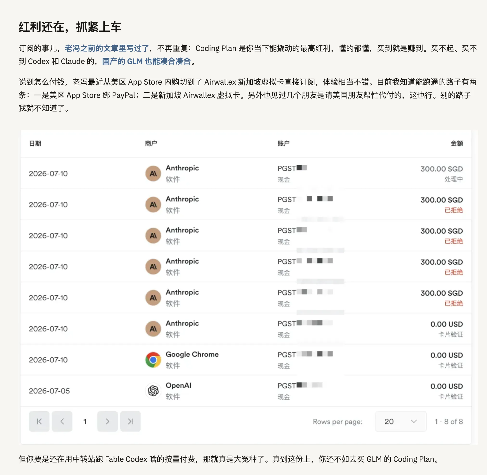
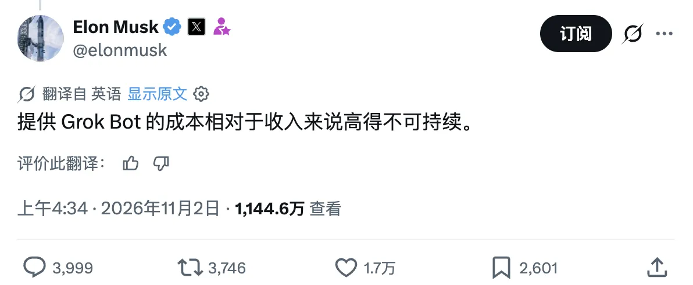
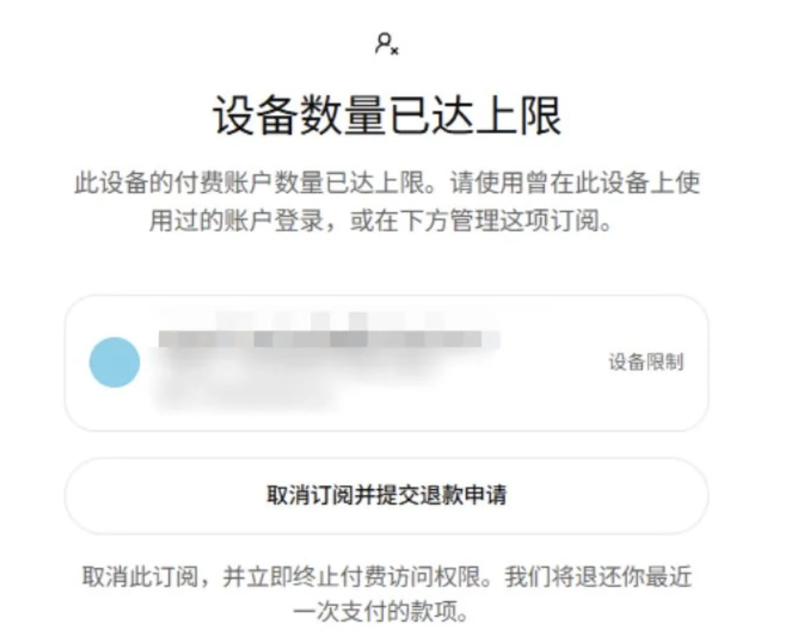
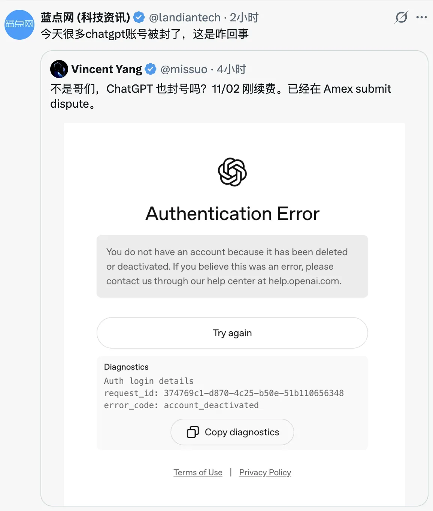
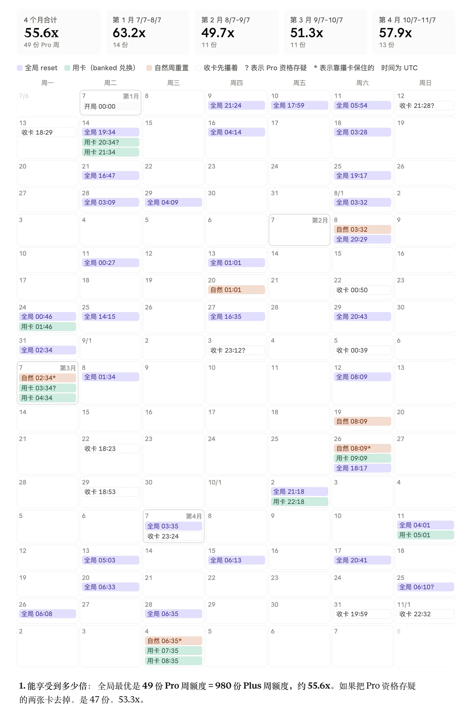
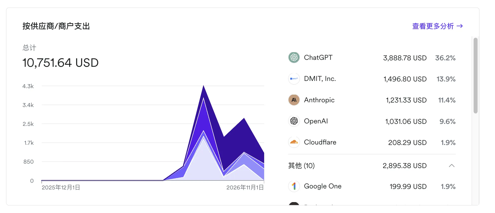
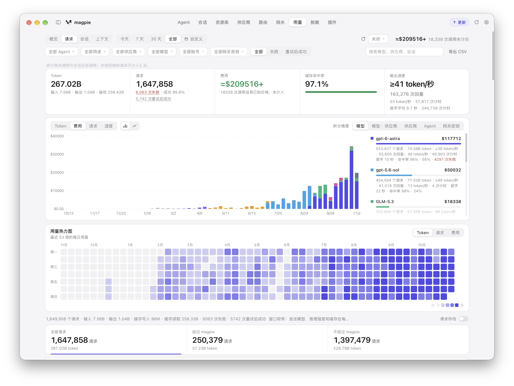
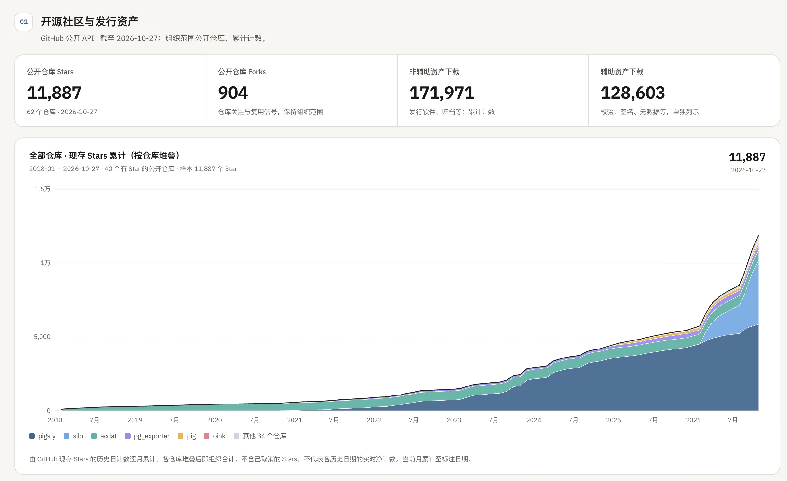
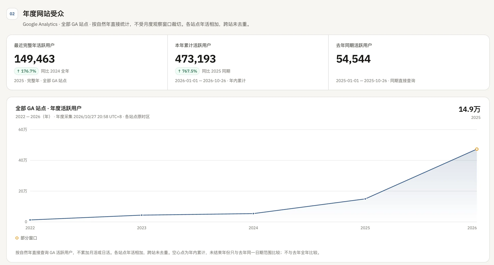

On August 8, I wrote “[The Codex Reset Party Is Over](/en/ai/codex-reset-end/).” Looking back, I called it too early.

OpenAI went on to hand out more than a dozen further rounds of freebies to push up weekly active user counts: resets at 15 million users, banked resets at 20 million, and resets to compensate for a September outage. In October, Codex lead Tibo launched a challenge: “a new release or a reset every day for 28 days.” Fourteen of those 28 days brought resets.

I was two months early, but the story played out as expected. The ending was already there in the posts I wrote from July through September:

- **In July**, I kept telling friends that subscription subsidies offering tens of times more compute for the money were temporary. They could last only a few more months. Use them while they last; take as much as you can put to work.

- **On September 11**, in “[Local AI: A Political Calculation, Not an Economic One](/en/ai/local-ai-movement/),” I wrote: “Enterprise API data is excluded from training by default. Metered enterprise APIs cost dozens of times more than subscriptions; that data clause is the main thing the extra money buys. **Once the provider has enough data, or starts preparing for an IPO, these subsidies will end. They are not a permanent arrangement. This is a game of musical chairs… A public company cannot keep reporting losses to subsidize users forever.**”

- In “[A Survival Guide for the AI Era](/en/ai/ai-bonus/),” I took the argument further: “Under a data-for-compute business model, the platform will inevitably assign a value to each account. **Accounts judged to produce valuable data will stay. Those judged worthless will be banned on whatever pretext is convenient. This is not a conspiracy theory; it is business logic.**” It later turned out there really was a scoring algorithm.

- **In late September**, in “[A \$500 ChatGPT Subscription? Your \$200 Pro Plan May Become an Heirloom](/en/ai/codex-promax/)” and “[The Other Shoe Drops: ChatGPT Halves the Quota on Its \$200 Plan](https://mp.weixin.qq.com/s?__biz=MzU5ODAyNTM5Ng==&mid=2247493506&idx=1&sn=9299c6b014ceb7e84fc641a9046f9c33&scene=21#wechat_redirect),” I was explicit: **The retreat would come through caps, downgrades, and tiers, rather than a straight price increase. Subscription subsidies were nearing their end.**

Today is November 7. The evidence for declaring the “great reset era” over is much stronger than it was in August or September. Put the news from the past two weeks together:

- Anthropic’s and OpenAI’s revised usage policies take effect on **November 12** and **November 20**, respectively. Both target proxy services and resale.

- OpenAI has started enforcing limits on how many paid accounts can share a payment card or device.

- Tibo’s 28-day challenge ended on November 2. The final two days offered banked reset cards.

- OpenAI cut its fundraising target from \$30 billion to \$20 billion, lowered its valuation from \$1.4 trillion to \$1.25 trillion, and pushed its IPO back to 2027.

- Wall Street institutions have pushed Anthropic’s expected IPO valuation down from \$2 trillion to \$1.5–1.6 trillion.

- Musk said outright on Twitter that Grok Bot’s service costs were unsustainably high relative to revenue. Quotas were tightened soon after.

My conclusion is straightforward: **The era of subsidies for everyone, with everyone feeding from the same pot, really is over. But subsidies have not disappeared. They are moving from free eggs outside the supermarket to a Costco membership.**

## Both Providers Are Closing the Gates

**Anthropic: new rules on November 12.** Announced on October 8, this was the first update in more than a year. The clause against “persistent, meaningless abuse of models” got the headlines. The consequential addition was the ban on unauthorized “resale and proxying” of Claude: services that route requests through personal subscriptions or spoof client fingerprints are prime examples. Account bans rose from 1.45 million in the second half of 2025 to 11.4 million in the first half of 2026. Only 10.6% of appeals succeeded.

**OpenAI: new rules on November 20, plus card and device limits.** The revised usage policy, announced on October 21, requires model routers and AI gateways to obtain OpenAI’s approval before providing access. As early as August 21, Tibo warned that many accounts with anomalous quota usage were using `sub2api` or tools such as MarketPad to turn subscriptions into API traffic for resale or sharing. All would be flagged by the fraud detection system.

The help center has also added card and device limits. Too many subscriptions on one card, and you cannot buy another. Too many paid accounts on one device, and logging in produces a `Device limit reached` dialog. Go, Plus, and the \$100/\$200/\$500 Pro tiers all count. Large numbers of ChatGPT account bans are already being reported today.

Taken together, **how many accounts can one person still use while staying within the rules?**

1. **Anthropic’s compliant maximum is two accounts**: one Personal account (\$200 Ultra, 10x) and one Team account (\$100, 5x). That makes two legitimate accounts.

2. **OpenAI is aiming for one account per person**: one phone number can currently be linked to at most three accounts. Add the card and device limits, and my guess is that the practical ceiling is three accounts under one phone number, each running on a separate computer. OpenAI wants heavy users on the highest quota tier: **\$500 a month for a single account**. The days of one person opening ten accounts and hammering them all look numbered.

The targets are precise: shared subscriptions, proxy services, third-party subscription payments, and **account rotation**. Subscription pricing assumes one person’s use. Resellers divide one subsidy among ten customers; agent fleet operators rotate through a dozen subscriptions to collect the subsidies. During the land grab, providers could look the other way. Once an IPO brings scrutiny of the books, users who cost more to serve than they pay have to go.

## Gym Economics: Getting 50x for \$200

Codex resets are, at heart, customer acquisition campaigns. In April, when Codex reached 3 million weekly active users, OpenAI promised a reset for every additional million, up to 10 million. According to `codex-resets.com`, there were 42 universal resets from September 2025 through mid-August 2026, one every eight days on average. Weekly active users grew from roughly 600,000 at the start of the year to 20 million in August, and now to 40–50 million. I have never seen a more aggressive growth tactic.

Many people assume 42 universal resets must have cost OpenAI a fortune. **Not necessarily. The underlying economics are those of a gym membership.**

OpenAI’s weekly quota uses a **rolling seven-day window**. When you use a reset, your scheduled renewal moves to “seven days from now.” Suppose you normally exhaust your quota on Sunday and get a fresh allowance the following Sunday. Use a reset on Wednesday, and the scheduled renewal moves to the following Wednesday. Two variables matter: **timing and how much you have used**.

1. **Break even**: use one-seventh of your quota each day. Whenever a reset lands, you neither gain nor lose.

2. **Lose out**: barely use the subscription during the week, saving the quota for the last day. A reset arrives just as you start using it. Your unused allowance disappears, and the next scheduled renewal is now seven days away. **If you have used less than the share corresponding to the days already elapsed when the reset arrives, you lose out.**

3. **Maximize the gain**: burn through an entire weekly allowance within an hour of a scheduled renewal, then catch the next reset immediately afterward. The scheduled window shifts by just one hour, and you gain the equivalent of six days and 23 hours of compute.

Not everyone has the ability, or enough work, to exhaust a subscription. When I first bought a \$200 plan six months ago, I could not use it all every week either.

A DBA with a view of the whole system could run a `SELECT` against the global database and calculate the optimal moment for a reset. Statistics and the **power-law distribution** suggest that the vast majority of ordinary users come nowhere near their limits. Press the universal reset button and you also move millions of infrequent users’ renewal clocks to seven days later. **Across the entire customer base, this mechanism could well make money rather than lose it.** It is like a gym: most annual members show up twice a year for a shower, and their fees subsidize the few obsessives who spend a dozen hours there every day.

| Usage strategy | Full weekly allowances | Effective multiplier |
| --- | ---: | ---: |
| Play it straight: scheduled weekly renewals only, no resets | 18 | 20.4x |
| Use each reset card as soon as it arrives | 46 | 52.2x |
| Hoard reset cards like Scrooge | 49 | 55.6x |

How much could someone like me, using automated workflows to consume every available allowance, gain while staying within the rules?

**Let’s do the arithmetic.** Take a classic **\$200/month Pro account at 20x, equivalent to the compute of twenty \$20 Plus subscriptions**. From **July 7 to today, November 7**, that is exactly **four months: 123 days, or 17.57 weeks**.

Assume that whenever quota becomes available, **you exhaust it within one hour**. You immediately redeem a top-up card or banked reset, exhaust that too, and collect every official universal reset along the way. Because you trigger each reset within the first hour after the previous refresh, setting the next renewal to seven days later shifts the scheduled cycle by only an hour. Almost none of the window is lost. Over those four months, this one \$200 account could consume roughly **50 full weekly allowances**.

In other words, you pay for the \$200 `20x` plan and receive 50 allowances. **On top of subscriptions already priced dozens of times below metered APIs, you get another 2.5x multiplier.** For agent fleet operators, the new \$500 `50x` subscription simply marks the end of getting `50x` for \$200. The normal price for `50x` is now \$500.

## Spending \$10,000 on Nearly RMB 3 Million of Compute

Multiplying one account’s allowance by 2.5 was only the start. For the past few months, you could also **scale horizontally**. One person could open ten or twenty accounts. The most aggressive individual I saw had more than twenty; beyond that, you are no longer really an individual user. At my peak, I had **15 subscriptions in the \$200 tier**, spending \$3,000 a month.

At the advertised multipliers, fifteen `20x` accounts equal **300 Plus subscriptions**. Apply the **2.5x multiplier** from banked and ordinary resets, and at the peak I had compute throughput equivalent to **750 Plus accounts running flat out**.

*Partial figures: usage on the main machine among my six local computers.*

A couple of days ago, I added up my AI spending over those four months: **about \$10,000 spent, roughly 500 billion tokens consumed, and a little over \$400,000 in usage at metered API prices.** In other words, over four months I ran nearly RMB 3 million worth of compute through my keyboard. What I actually paid for subscriptions was just 2.3% of the list-price value.

That compute produced tangible results:

- **Single-handedly translated almost the entire PostgreSQL world into Chinese**: documentation for 31 major versions, localization of PostgreSQL itself, and more than thirty books.

- **Maintained an entire database distribution and extension ecosystem**: shipped successive major releases of **Pigsty**, took it to the top spot worldwide among native PostgreSQL distributions for Linux, and maintained **PGEXT.CLOUD**, with 626 extensions across 16 operating systems and more than 30,000 build targets.

- **Took over and rebuilt core open-source projects**: assumed maintenance of the [**Silo** object-storage fork](/en/db/long-live-silo/), took over and upgraded the community Rust extensions `vchord` and `pg_mooncake`, and built several independent projects: the [Oink documentation framework](/en/ai/oink-intro/), Barn for virtual machine management, the [sow package manager](/en/db/sow/), the Boar GUI component for Pigsty, the Crib documentation app, and CapsLock.

Even after work that an entire development team might struggle to finish in a year, I still had plenty of free time. I even took a road trip.

This has radically widened the gap between individuals. **We used to talk about 10x programmers. If you are already a 10x programmer and add 100x the compute throughput, you become a 1000x programmer.** The productivity gap between people really can grow to hundreds of times.

If you used all that leverage during these four months, you could move a hundred times faster and cover ground you would never have thought possible. That was the windfall of this moment. You either used it or missed it.

## From Free Eggs to Membership Fees

If it worked so well, why stop now? Because the gym now has more bodybuilders than occasional shower users, and investors are looking at the books. The providers have to change the rules.

The clearest signal: **resets are now for sale.** OpenAI has started selling “paid instant resets” to Plus and Pro users, at roughly RMB 300 for a fresh weekly allowance. Once you can sell something, you stop giving it away so freely. The help center also states plainly that free banked and automatic resets are discretionary promotional benefits. Neither their availability nor their timing is guaranteed.

Quota generosity ultimately depends on the money behind it. Over the past month, capital has become more expensive for both Silicon Valley leaders:

| Key metric | Earlier pitch | Now: November 2026 |
| --- | --- | --- |
| OpenAI funding round | \$30 billion | About \$20 billion; roughly \$11 billion committed |
| OpenAI valuation this round | \$1.4 trillion | \$1.25 trillion, down about 11% |
| OpenAI IPO timing | Second half of 2026 | Delayed to 2027 |
| Anthropic IPO valuation | About \$2 trillion: market expectations | \$1.5–1.6 trillion: institutional bids, down about 20–25% |
| Anthropic IPO timing | October | Late November, before Thanksgiving |

**OpenAI: a smaller funding round and an IPO delayed to 2027.** In March, it raised \$122 billion at a post-money valuation of \$852 billion. On October 30, the FT reported that the current round had been cut by a third. The first close was expected to come in below \$20 billion, with some institutions reducing their commitments at the last minute. Altman pushed the IPO into 2027 to defend a \$1 trillion valuation; the respectable explanation offered to the press was “safety.”

**Anthropic: the prospectus opens the books.** It made its S-1 public on October 26 and added third-quarter financials on November 2:

- **Slowing growth**: Q3 revenue was \$16.96 billion, up 47% quarter over quarter. Q2 revenue had been nearly 2.5 times Q1’s. Revenue was still growing, but growth was no longer accelerating.

- **From profit to loss**: Q3 brought an operating loss of \$567 million, versus an operating profit of \$974 million in Q2. The main cause was demand exceeding the compute it had secured in advance, forcing it to **buy \$5 billion of expensive short-term capacity**. There was also a \$2 billion noncash expense for matching employee donations.

- **High costs**: Q3 compute and infrastructure costs reached **\$9.86 billion, or 58% of revenue**. Price cuts and contractual discounts reduced Q3 revenue by another roughly \$600 million.

- **Huge binding commitments**: the reported net loss was \$23.3 billion, including \$21.9 billion in fair-value changes on convertible debt. The crucial number is **about \$895.4 billion in purchase and lease commitments**, almost entirely for compute and infrastructure. Roughly **\$70 billion** falls due within a year.

**The backdrop was the late-October sell-off in US tech stocks.** On October 30, the Nasdaq fell 2.9% in a day, leaving it 7.8% below its early-month high. Intel dropped 28.6% in a day, and CoreWeave lost 37% over October. Once a company is public, every universal reset is a cost on its financial statements. Anthropic’s \$5 billion in short-term compute purchases in Q3 makes the point: **when capacity is scarce, every extra allowance you give away has to be bought at expensive spot prices.**

The quota arithmetic tells the same story. OpenAI originally planned to halve the old \$200 `20x` allowance at the end of October, then said it would not. An official user survey asked whether people wanted the quota restored or the five-hour limit brought back. Users preferred half the quota to having a five-hour limit. In the end, it appeared that users got both benefits back. In practice, stopping resets has the same effect as halving the quota.

A reset was effectively a 2.5x multiplier on your allowance. If you want double the quota without the five-hour limit, the provider will find another way to make the numbers work. So it ends the reset promotion. The Reset Company becomes the Token Company. The great reset era may be over.

Subsidies have not vanished, but their logic has changed. Free eggs have become membership cards.

| Dimension | Before: free giveaways | Now: Costco membership |
| --- | --- | --- |
| Goal | **Acquisition**: a giveaway for every million users, boosting weekly actives for the growth story | **Retention**: extra quota for the heaviest paying users to keep them from switching |
| Eligibility | **Everyone**: any account could collect; more accounts meant more subsidies | **Verified identity**: one person, one card, one device; verify before collecting |
| Form | **Free**: Tibo presses a button and everyone gets a full tank | **A product**: bankable, saleable, and issued at the provider’s discretion |

The free-egg giveaway outside the supermarket is over. In its place is a Sam’s Club membership: verified identity, one card per person, bulk quantities for heavy users, and a door policy that keeps out resellers who split up the packs.

## What Comes After the Reset Era?

What follows will probably be the unremarkable combination of metered billing and capped subsidies on the highest subscription tiers.

I will scale back too: replace my ten \$200 Codex accounts with three \$500 accounts on my three main computers. Each machine gets one \$500 Codex subscription and one Claude Ultra subscription. I will also keep three \$200 subscriptions: one each for Gemini, Grok, and GLM. No more account switching or `magpie` account pools. That comes to \$2,700 a month, roughly RMB 20,000.

Nine top-tier subscriptions are manageable. Beyond that, even I find it tiring.

From AGI-level models arriving in July to the AI bubble bursting in US equities in November, this four-month party is nearly over. What next?

What made it possible to spend \$10,000, consume RMB 3 million worth of compute, and produce at 1000x as a one-person army? I discussed it in “[Enterprise AI Transformation May Be a False Premise](/en/ai/ai-native-org/)”: **the spectacle of the one-person company, or OPC, rests on abundant compute subsidized through tokens.** A price gap of tens of times lets a small budget do a great deal. As subsidies recede, we do have to redo the arithmetic.

But I am not worried. I am even looking forward to the compute glut after the AI bubble bursts.

Look at Anthropic’s prospectus. That company alone has **\$895.4 billion** in compute purchase commitments, with **\$70 billion** in binding contracts due within a year. Add the other Silicon Valley giants, and trillions of dollars’ worth of data centers and GPUs will come online over the next few years.

Compute is perishable. The moment a data center powers up, it depreciates every second. Capacity left idle today cannot be saved for tomorrow. And demand? When the AI bubble bursts, traditional corporations that spent six months chasing “enterprise AI transformation” will find that, beyond writing weekly reports, they cannot get a positive ROI. They will slash budgets and cancel enterprise allocations en masse.

**On one side, traditional companies have no results to show and leave, canceling their quotas. On the other, trillions of dollars of surplus compute come online. That capacity has to go somewhere.**

Once the bubble bursts and compute is in severe oversupply, providers will not need reset promotions. The base price of tokens will collapse. **One-person companies that can build and ship, and already have working AI workflows**, will be the winners: **using surplus tokens at a tenth of today’s price to expand into new territory at speed.**

That is where the biggest opportunity lies.

My view is this: **The great reset era, when providers deliberately handed out subsidies, is over. The next great reset will come from the bubble bursting.**

Until then, there are no more free eggs. Buy a membership, keep your tools sharp, and get on with the work.

*One last suggestion: the first \$20 or \$200 you spend on each kind of subscription always gives you the greatest marginal return. If you have only \$20, buy Claude’s \$20 plan. With a \$100 monthly budget, get one each of Claude, ChatGPT, Gemini, and Grok. If you need to do more work, move up to the \$100/\$200/\$500 tiers in that order: Claude, ChatGPT, then Gemini.*
