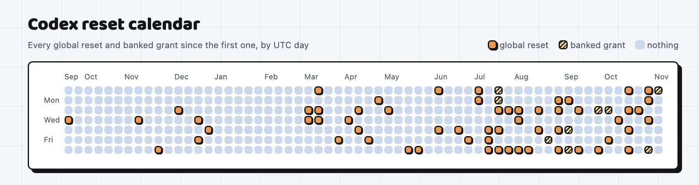
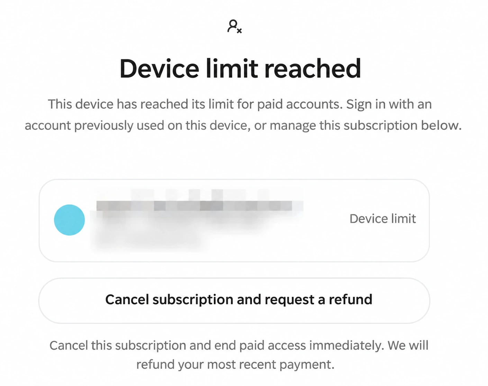
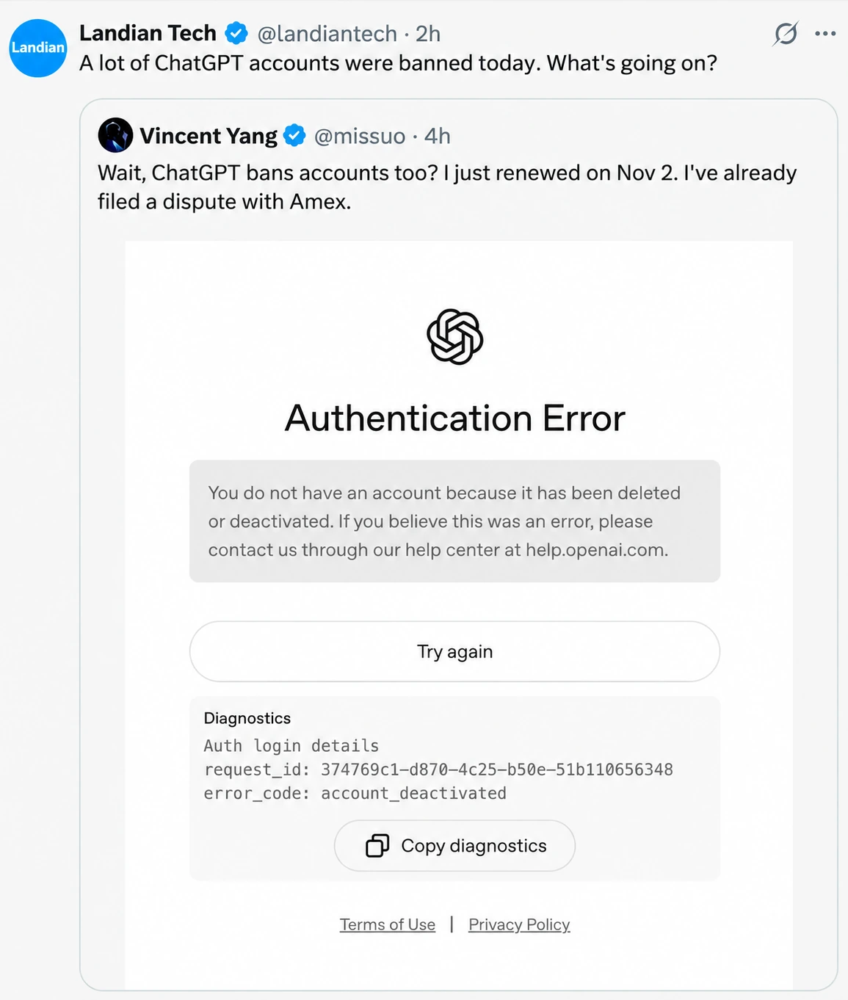
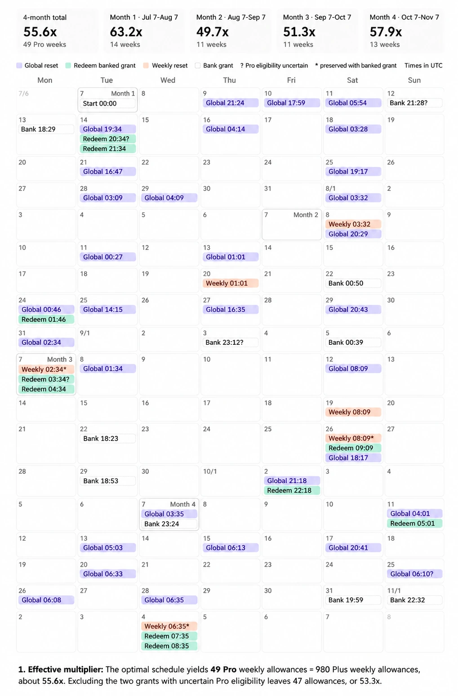
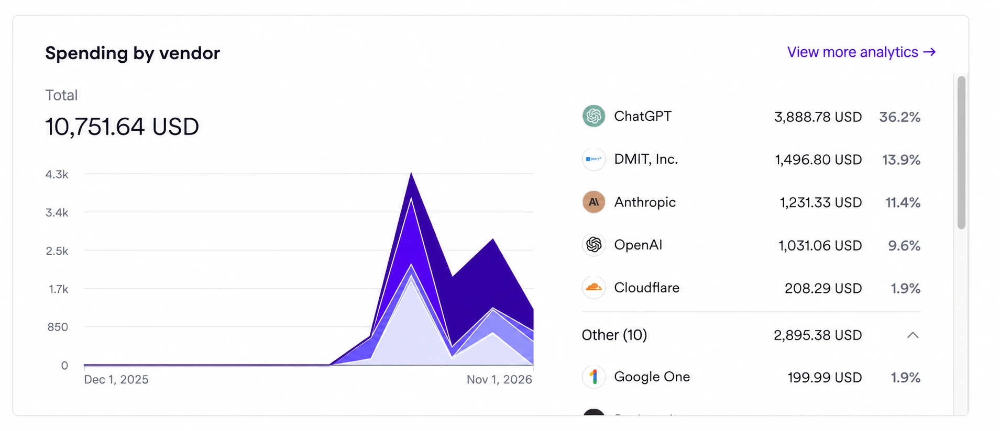
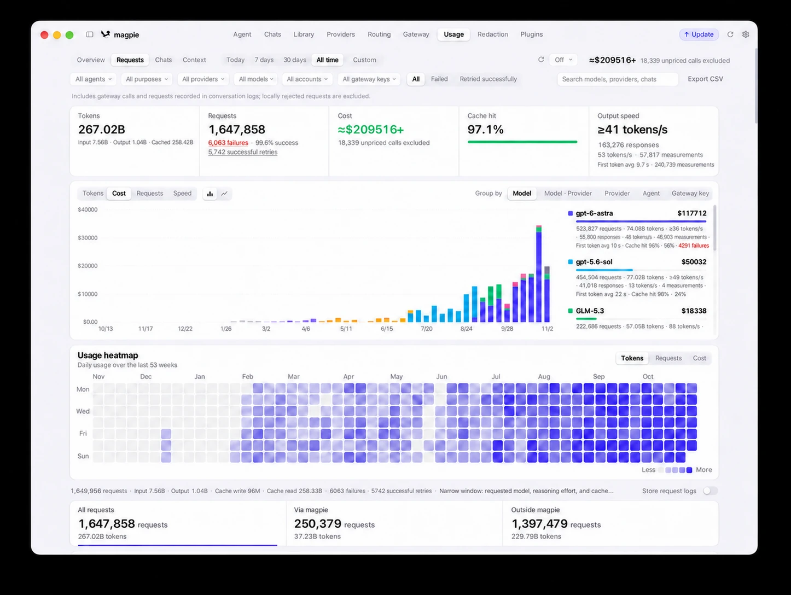

On August 8, I wrote “[The Codex Reset Party Is Over](/en/ai/codex-reset-end/).” Looking back, I called it two months too early.

To keep driving weekly active users, OpenAI handed out more than a dozen additional rounds of free quota resets: milestone resets at 15 million users, banked resets at 20 million, and compensation resets after a September outage. In October, Codex lead Tibo ran a 28-day challenge promising either a new release or a quota reset every single day. Fourteen of those 28 days brought resets.

[](https://codex-resets.com/)

The timing slipped by two months, but the trajectory played out just as expected. Looking back through what I wrote between July and September, the endgame was already clear:

- **In July**, I told friends that flat-rate subscriptions offering a 10x–50x discount against metered API rates were a temporary anomaly. A subsidy that steep could only last a few months, so the rational move was to open the tap and run as much real work through it as possible while the window stayed open.
- **On September 11**, in “[Local AI: A Political Calculation, Not an Economic One](/en/ai/local-ai-movement/),” I wrote: “Enterprise API traffic is excluded from training by default. Metered enterprise APIs cost dozens of times more than personal subscriptions because the spread pays for that data clause. **Once a provider accumulates enough training data, or starts preparing for an IPO, these subsidies will stop. This is a game of musical chairs… A public company cannot keep subsidizing negative-margin users on its income statement forever.**”
- In “[A Survival Guide for the AI Era](/en/ai/ai-bonus/),” I followed that logic a step further: “Under a compute-for-data model, the platform inevitably scores every account. **Accounts judged to produce valuable data stay; accounts that burn compute without yielding useful data get banned on whatever pretext is convenient. This is not a conspiracy theory; it is unit economics.**” Sure enough, an internal account-scoring system later surfaced.
- **In late September**, in “[A \$500 ChatGPT Plan? Why the \$200 Pro Tier May Become a Grandfathered Bargain](/en/ai/codex-promax/)” and “[The Other Shoe Drops: ChatGPT Halves the Quota on Its \$200 Plan](https://mp.weixin.qq.com/s?__biz=MzU5ODAyNTM5Ng==&mid=2247493506&idx=1&sn=9299c6b014ceb7e84fc641a9046f9c33&scene=21#wechat_redirect),” I noted that **the unwind would come through rate limits, quota cuts, and pricier tiers rather than a headline price hike. Subscription subsidies were running out of road.**

*Historical screenshots below were translated into English with AI, preserving their figures, dates, and redactions.*

Today is November 7. The evidence that the reset era is over is far more concrete than it was in August or September. Put the news from the past two weeks together:

- Anthropic’s and OpenAI’s revised usage policies take effect on **November 12** and **November 20**, respectively, both targeting proxy services and unauthorized resale.
- OpenAI has started enforcing backend limits on how many paid accounts can share a single payment card or device.
- Tibo’s 28-day challenge wrapped up on November 2; the final two days handed out “banked reset” cards rather than instant global resets.
- OpenAI cut its current fundraising target from \$30 billion to \$20 billion, marked its valuation down from \$1.4 trillion to \$1.25 trillion, and pushed its IPO back to 2027.
- Wall Street institutions have marked down Anthropic’s expected IPO valuation from \$2 trillion to \$1.5–1.6 trillion.
- Elon Musk stated bluntly on X that Grok Bot’s serving costs were “unsustainably high relative to revenue,” and tightened usage quotas shortly afterward.

[](https://x.com/elonmusk/status/2116992258520064397?lang=en)

*Original English post by Elon Musk.*

My takeaway is straightforward: **The era of across-the-board, no-strings-attached subsidies is over. Subsidies themselves have not disappeared, though—they are shifting from loss-leader giveaways at the door to a Costco-style membership model.**

## Both Labs Start Closing the Door

**Anthropic: new rules on November 12.** Announced on October 8, this was the first policy overhaul in over a year. While social media focused on the clause against “persistent, meaningless abuse of models,” the real teeth are in the new ban on unauthorized “resale and proxying” of Claude—specifically services that route API requests through personal subscriptions or spoof client fingerprints. Account bans jumped from 1.45 million in the second half of 2025 to 11.4 million in the first half of 2026, with an appeal overturn rate of just 10.6%.

**OpenAI: new rules on November 20, plus card and device limits.** The updated usage policy published on October 21 requires model routers and AI gateways to obtain OpenAI’s prior approval before offering access. As early as August 21, Tibo warned that accounts showing anomalous quota burn were using `sub2api` or tools like MarketPad to repackage subscription quota into resold or shared API traffic, and would be flagged directly by anti-fraud systems.

At the same time, OpenAI’s Help Center rolled out card and device limits: bind too many subscriptions to the same payment card, and new purchases fail; log into too many paid accounts on the same machine, and you hit a `Device limit reached` prompt. Go, Plus, and the \$100/\$200/\$500 Pro tiers all count toward the cap. A wave of ChatGPT account deactivations is already underway today.



*Related documentation: [OpenAI’s card and device limits](https://help.openai.com/en/articles/20001559-understanding-card-and-device-limits-in-chatgpt).*



Put both providers’ moves together, and **how many accounts can one person still run while staying strictly within the terms of service?**

1. **Anthropic’s compliant ceiling is 2 accounts**: the policy allows an individual to hold one Personal account (\$200 Ultra, 10x) plus one Team seat (\$100, 5x).
2. **OpenAI is converging on 1 account per person**: a single phone number can currently verify at most three accounts. Combined with same-card and same-device restrictions, the practical ceiling is likely three accounts tied to one phone number, each running on its own physical machine. OpenAI’s clear goal is to push heavy users onto a single **\$500/month** top-tier plan—the days of one person spinning up ten accounts and cycling through them at full throttle are effectively over.

The enforcement targets are specific: shared accounts, API proxies, gray-market payment brokers, and **multi-account rotation**. Flat-rate subscriptions are priced around single-user utilization. Resellers slice one subsidized plan across ten buyers; agent fleet operators rotate through a dozen personal subscriptions to harvest the subsidy spread. During the land-grab phase, labs could look the other way. Once IPO auditors start scrutinizing gross margins, deeply negative-margin accounts have to be cleared off the books.

## Gym Membership Economics: Squeezing 50x Out of \$200

At bottom, Codex resets were an acquisition campaign. In April, when Codex hit 3 million weekly active users, OpenAI promised a global quota reset for every additional million users up to 10 million. According to `codex-resets.com`, between September 2025 and mid-August 2026 OpenAI triggered 42 universal resets—roughly one every eight days. Over that span, weekly active users grew from roughly 600,000 at the start of the year to 20 million in August, and 40–50 million today. It is the most aggressive growth loop I have ever seen in software.

Many people assume firing off 42 universal resets must have bled cash. **Not necessarily. Under the hood, it runs on gym-membership economics.**

OpenAI’s weekly quota uses a **rolling seven-day window**. When you trigger a reset, your natural renewal timer is pushed back to “seven days from right now.” Suppose your quota normally runs out on Sunday and renews the following Sunday; if you use a reset on Wednesday, your next natural renewal shifts to the following Wednesday. That creates two variables that govern your actual yield: **phase alignment and burn rate**.

1. **Break-even**: burn exactly one-seventh of your quota per day. Whenever a reset lands, you neither gain nor lose.
2. **Net loss**: leave the account idle all week and save your workload for the final day, only for a universal reset to hit right after you start. Your unspent quota vanishes, and your next natural renewal is pushed out seven full days. **Whenever a reset triggers before you have consumed the pro-rata share of the days already elapsed, you come out behind.**
3. **Maximum yield (burst burn)**: drain the entire weekly quota within the first hour after a natural renewal, then immediately catch a reset. Your natural renewal clock shifts by only one hour, netting 6 days and 23 hours of bonus capacity.

Not everyone has the workload—or the automation—to keep a subscription pinned at 100%. Six months ago, when I first bought a \$200 plan, I couldn’t max it out every week either.

A DBA with a global view of the telemetry can run a single `SELECT` across the user table to find the optimal timestamp for a reset. Because token consumption follows a steep **power-law distribution**, the vast majority of casual subscribers never come close to their weekly cap. Firing a universal reset simultaneously pushes millions of low-utilization users’ natural renewal clocks back by seven days—**meaning that on the global ledger, a universal reset quite likely saves compute rather than costing extra.** It works just like a commercial gym: most people buy an annual pass and show up twice a year, subsidizing the handful of powerlifters who live in the weight room.

So how much leverage could an automated power user extract while staying completely within the rules?

**Run the numbers.** Take a standard **\$200/month, 20x Pro account** (equivalent to twenty \$20 Plus plans) over the four months from **July 7 to November 7**—exactly **123 days, or 17.57 calendar weeks**.

Assume that whenever quota refreshes, **automated workflows drain it within one hour**, immediately redeem a banked reset or promo reset card, drain that within an hour, and catch every global reset along the way. Because each reset fires in the first hour of the cycle, the “push back seven days” rule delays the natural renewal clock by only an hour, reducing window slippage to nearly zero. Over those four months, a single \$200 account could harvest roughly **50 full weekly allowances**:

| Usage Pattern                                            | Weekly Allowances | Effective Multiplier |
|----------------------------------------------------------|------------------:|---------------------:|
| Baseline (natural weekly renewals only, no resets)       |                18 |                20.4x |
| Min-maxed timing (hoard and trigger right after renewal, squeeze it dry) |                49 |                55.6x |



In short, paying \$200 for a nominal `20x` plan yielded ~50 weekly allowances—**stacking an extra 2.5x multiplier on top of subscription pricing that was already discounted dozens of times below API rates.** Seen in that light, the new \$500 (`50x`) tier isn’t an expansion for heavy agent operators; it simply closes the window where \$200 bought `50x` and reprices `50x` at \$500.

## \$10,000 in Subscriptions, \$400,000 in API-Equivalent Compute

A 2.5x single-account multiplier wasn’t the ceiling, because for the past several months you could also **scale horizontally**. An individual could open ten or twenty accounts—the highest count I saw for a solo user was north of twenty. At my peak, I ran **15 subscriptions in the \$200 tier**, spending \$3,000 a month.



At nominal multipliers, fifteen `20x` accounts equal **300 Plus subscriptions**; factor in the **2.5x reset multiplier**, and peak throughput matched **750 Plus accounts** running concurrently at full capacity.



*Partial telemetry: token consumption on the primary workstation out of my six local machines.*

A few days ago, I tallied my total AI spend over these four months: **roughly \$10,000 out of pocket for around 500 billion tokens—usage that would have cost just over \$400,000 (nearly RMB 3 million) at metered API list prices.** Effective subscription cost came out to 2.3% of rack-rate API pricing.

That compute budget went straight into shipping code and documentation:

- **PostgreSQL localization and documentation**: translated PostgreSQL core server messages and the official documentation across 31 major releases into Chinese, along with more than 30 technical books.
- **Database distribution and extension packaging**: shipped successive major releases of **Pigsty** (now the most widely used native Linux distribution for PostgreSQL) and maintained **PGEXT.CLOUD**, packaging 626 extensions across 16 operating systems and more than 30,000 build targets.
- **Open-source maintenance and new tooling**: took over maintenance of the [**Silo** object-storage fork](/en/db/long-live-silo/), adopted and upgraded the community Rust extensions `vchord` and `pg_mooncake`, and built several standalone tools from scratch: the [Oink documentation framework](/en/ai/oink-intro/), the Barn VM manager, the [sow package manager](/en/db/sow/), the Boar web UI for Pigsty, the Crib documentation tool, and the CapsLock utility.

In the past, that scope of work would have kept a small engineering team busy for a year. With agent workflows running in the background, my schedule stayed relaxed enough to take a road trip in the middle of it.

This changes the math on individual output. **The industry used to talk about 10x programmers; pair a strong engineer with 100x the compute throughput, and effective output scales to 1000x.** The output gap between developers is widening to hundreds of times.

During those four months, anyone prepared to max out that leverage could move at 100x speed and tackle projects that used to be out of reach for one person. It was a one-off subsidy window: if you caught it, you shipped; if you missed it, it’s gone.

> The author's open-source stars and site visitors:
>
> [Cumulative growth in retained GitHub stars across repositories](https://pgsty.com/report/#report=github&period=180d&cfMetric=requests).

```echarts {height="300px"}
{
  "animation": false,
  "backgroundColor": "transparent",
  "useUTC": true,
  "aria": {"enabled": true, "label": {"description": "Cumulative retained GitHub stars across 46 repositories, sampled monthly from January 2018 to November 7, 2026. Final total: 12,215 stars."}},
  "tooltip": {"trigger": "axis", "confine": true, "renderMode": "richText", "order": "seriesDesc", "axisPointer": {"type": "line"}},
  "legend": {"type": "plain", "bottom": 0, "left": "center", "textStyle": {"fontSize": 11}, "itemWidth": 14, "itemHeight": 8, "itemGap": 12, "data": ["pigsty", "silo", "acdat", "pg_exporter", "pig", "oink", "40 other repositories"], "selectedMode": false},
  "grid": {"top": 18, "right": 14, "bottom": 62, "left": 8, "containLabel": true},
  "xAxis": {"type": "time", "boundaryGap": false, "splitNumber": 5, "axisLabel": {"formatter": "{yyyy}", "hideOverlap": true}, "min": "2018-01-01T00:00:00Z", "max": "2026-11-07T00:00:00Z"},
  "yAxis": {"type": "value", "min": 0, "max": 15000, "interval": 5000},
  "color": ["#336791", "#5fa8e8", "#2bb3a3", "#9b87f5", "#f2b443", "#f17a8f", "#94a3b8", "#64748b"],
  "series": [{"name": "pigsty", "type": "line", "stack": "stars", "showSymbol": false, "smooth": false, "lineStyle": {"width": 0.6}, "areaStyle": {"opacity": 0.9}, "emphasis": {"focus": "series"}, "encode": {"x": "date", "y": "pigsty"}}, {"name": "silo", "type": "line", "stack": "stars", "showSymbol": false, "smooth": false, "lineStyle": {"width": 0.6}, "areaStyle": {"opacity": 0.9}, "emphasis": {"focus": "series"}, "encode": {"x": "date", "y": "silo"}}, {"name": "acdat", "type": "line", "stack": "stars", "showSymbol": false, "smooth": false, "lineStyle": {"width": 0.6}, "areaStyle": {"opacity": 0.9}, "emphasis": {"focus": "series"}, "encode": {"x": "date", "y": "acdat"}}, {"name": "pg_exporter", "type": "line", "stack": "stars", "showSymbol": false, "smooth": false, "lineStyle": {"width": 0.6}, "areaStyle": {"opacity": 0.9}, "emphasis": {"focus": "series"}, "encode": {"x": "date", "y": "pg_exporter"}}, {"name": "pig", "type": "line", "stack": "stars", "showSymbol": false, "smooth": false, "lineStyle": {"width": 0.6}, "areaStyle": {"opacity": 0.9}, "emphasis": {"focus": "series"}, "encode": {"x": "date", "y": "pig"}}, {"name": "oink", "type": "line", "stack": "stars", "showSymbol": false, "smooth": false, "lineStyle": {"width": 0.6}, "areaStyle": {"opacity": 0.9}, "emphasis": {"focus": "series"}, "encode": {"x": "date", "y": "oink"}}, {"name": "40 other repositories", "type": "line", "stack": "stars", "showSymbol": false, "smooth": false, "lineStyle": {"width": 0.6}, "areaStyle": {"opacity": 0.9}, "emphasis": {"focus": "series"}, "encode": {"x": "date", "y": "other"}}, {"name": "Total", "type": "line", "showSymbol": false, "lineStyle": {"width": 1.4}, "encode": {"x": "date", "y": "total"}, "z": 5}],
  "dataset": {
    "dimensions": ["date", "pigsty", "silo", "acdat", "pg_exporter", "pig", "oink", "other", "total"],
    "source": [
      ["2018-01-31T00:00:00Z", 0, 0, 103, 0, 0, 0, 0, 103], ["2018-02-28T00:00:00Z", 0, 0, 136, 0, 0, 0, 0, 136], ["2018-03-31T00:00:00Z", 0, 0, 165, 0, 0, 0, 0, 165], ["2018-04-30T00:00:00Z", 0, 0, 179, 0, 0, 0, 0, 179], ["2018-05-31T00:00:00Z", 0, 0, 199, 0, 0, 0, 0, 199], ["2018-06-30T00:00:00Z", 0, 0, 216, 0, 0, 0, 0, 216], ["2018-07-31T00:00:00Z", 0, 0, 246, 0, 0, 0, 0, 246], ["2018-08-31T00:00:00Z", 0, 0, 256, 0, 0, 0, 0, 256], ["2018-09-30T00:00:00Z", 0, 0, 267, 0, 0, 0, 0, 267], ["2018-10-31T00:00:00Z", 0, 0, 278, 0, 0, 0, 0, 278], ["2018-11-30T00:00:00Z", 0, 0, 287, 0, 0, 0, 0, 287],
      ["2018-12-31T00:00:00Z", 0, 0, 295, 0, 0, 0, 0, 295], ["2019-01-31T00:00:00Z", 0, 0, 306, 0, 0, 0, 0, 306], ["2019-02-28T00:00:00Z", 0, 0, 311, 0, 0, 0, 0, 311], ["2019-03-31T00:00:00Z", 0, 0, 325, 0, 0, 0, 0, 325], ["2019-04-30T00:00:00Z", 0, 0, 341, 0, 0, 0, 0, 341], ["2019-05-31T00:00:00Z", 0, 0, 352, 0, 0, 0, 0, 352], ["2019-06-30T00:00:00Z", 0, 0, 362, 0, 0, 0, 0, 362], ["2019-07-31T00:00:00Z", 0, 0, 374, 0, 0, 0, 0, 374], ["2019-08-31T00:00:00Z", 0, 0, 389, 0, 0, 0, 0, 389], ["2019-09-30T00:00:00Z", 0, 0, 395, 0, 0, 0, 0, 395], ["2019-10-31T00:00:00Z", 0, 0, 400, 0, 0, 0, 0, 400],
      ["2019-11-30T00:00:00Z", 0, 0, 414, 0, 0, 0, 0, 414], ["2019-12-31T00:00:00Z", 0, 0, 429, 2, 0, 0, 0, 431], ["2020-01-31T00:00:00Z", 0, 0, 437, 6, 0, 0, 0, 443], ["2020-02-29T00:00:00Z", 0, 0, 445, 6, 0, 0, 0, 451], ["2020-03-31T00:00:00Z", 0, 0, 448, 6, 0, 0, 0, 454], ["2020-04-30T00:00:00Z", 0, 0, 457, 6, 0, 0, 0, 463], ["2020-05-31T00:00:00Z", 0, 0, 461, 9, 0, 0, 0, 470], ["2020-06-30T00:00:00Z", 0, 0, 470, 11, 0, 0, 0, 481], ["2020-07-31T00:00:00Z", 0, 0, 473, 11, 0, 0, 0, 484], ["2020-08-31T00:00:00Z", 0, 0, 483, 13, 0, 0, 0, 496],
      ["2020-09-30T00:00:00Z", 0, 0, 489, 15, 0, 0, 0, 504], ["2020-10-31T00:00:00Z", 4, 0, 492, 20, 0, 0, 0, 516], ["2020-11-30T00:00:00Z", 12, 0, 499, 28, 0, 0, 0, 539], ["2020-12-31T00:00:00Z", 20, 0, 506, 37, 0, 0, 0, 563], ["2021-01-31T00:00:00Z", 40, 0, 511, 48, 0, 0, 0, 599], ["2021-02-28T00:00:00Z", 43, 0, 515, 50, 0, 0, 0, 608], ["2021-03-31T00:00:00Z", 57, 0, 520, 50, 0, 0, 0, 627], ["2021-04-30T00:00:00Z", 65, 0, 523, 52, 0, 0, 0, 640], ["2021-05-31T00:00:00Z", 80, 0, 530, 59, 0, 0, 0, 669], ["2021-06-30T00:00:00Z", 111, 0, 533, 63, 0, 0, 0, 707],
      ["2021-07-31T00:00:00Z", 142, 0, 539, 66, 0, 0, 0, 747], ["2021-08-31T00:00:00Z", 157, 0, 543, 71, 0, 0, 0, 771], ["2021-09-30T00:00:00Z", 173, 0, 548, 76, 0, 0, 0, 797], ["2021-10-31T00:00:00Z", 186, 0, 551, 79, 0, 0, 0, 816], ["2021-11-30T00:00:00Z", 212, 0, 556, 83, 0, 0, 0, 851], ["2021-12-31T00:00:00Z", 250, 0, 561, 84, 0, 0, 0, 895], ["2022-01-31T00:00:00Z", 270, 0, 569, 86, 0, 0, 0, 925], ["2022-02-28T00:00:00Z", 282, 0, 572, 86, 0, 0, 0, 940], ["2022-03-31T00:00:00Z", 357, 0, 574, 89, 0, 0, 0, 1020], ["2022-04-30T00:00:00Z", 392, 0, 583, 91, 0, 0, 0, 1066],
      ["2022-05-31T00:00:00Z", 494, 0, 591, 96, 0, 0, 0, 1181], ["2022-06-30T00:00:00Z", 548, 0, 593, 104, 0, 0, 0, 1245], ["2022-07-31T00:00:00Z", 640, 0, 600, 108, 0, 0, 0, 1348], ["2022-08-31T00:00:00Z", 659, 0, 604, 108, 0, 0, 0, 1371], ["2022-09-30T00:00:00Z", 674, 0, 609, 110, 0, 0, 0, 1393], ["2022-10-31T00:00:00Z", 696, 0, 610, 113, 0, 0, 0, 1419], ["2022-11-30T00:00:00Z", 715, 0, 614, 114, 0, 0, 0, 1443], ["2022-12-31T00:00:00Z", 727, 0, 615, 114, 0, 0, 0, 1456], ["2023-01-31T00:00:00Z", 768, 0, 616, 116, 0, 0, 0, 1500], ["2023-02-28T00:00:00Z", 901, 0, 618, 117, 0, 0, 0, 1636],
      ["2023-03-31T00:00:00Z", 1030, 0, 620, 119, 0, 0, 0, 1769], ["2023-04-30T00:00:00Z", 1077, 0, 622, 122, 0, 0, 0, 1821], ["2023-05-31T00:00:00Z", 1118, 0, 623, 124, 0, 0, 0, 1865], ["2023-06-30T00:00:00Z", 1155, 0, 626, 124, 0, 0, 0, 1905], ["2023-07-31T00:00:00Z", 1186, 0, 632, 125, 0, 0, 0, 1943], ["2023-08-31T00:00:00Z", 1312, 0, 632, 130, 0, 0, 0, 2074], ["2023-09-30T00:00:00Z", 1622, 0, 633, 130, 0, 0, 0, 2385], ["2023-10-31T00:00:00Z", 1683, 0, 633, 130, 0, 0, 0, 2446], ["2023-11-30T00:00:00Z", 2057, 0, 637, 132, 0, 0, 0, 2826],
      ["2023-12-31T00:00:00Z", 2151, 0, 641, 133, 0, 0, 0, 2925], ["2024-01-31T00:00:00Z", 2194, 0, 644, 137, 0, 0, 0, 2975], ["2024-02-29T00:00:00Z", 2250, 0, 646, 139, 0, 0, 0, 3035], ["2024-03-31T00:00:00Z", 2578, 0, 646, 145, 0, 0, 0, 3369], ["2024-04-30T00:00:00Z", 2703, 0, 648, 150, 0, 0, 0, 3501], ["2024-05-31T00:00:00Z", 2817, 0, 649, 155, 0, 0, 0, 3621], ["2024-06-30T00:00:00Z", 2875, 0, 649, 158, 0, 0, 0, 3682], ["2024-07-31T00:00:00Z", 2937, 0, 649, 163, 0, 0, 0, 3749], ["2024-08-31T00:00:00Z", 3189, 0, 651, 165, 0, 0, 0, 4005],
      ["2024-09-30T00:00:00Z", 3295, 0, 653, 168, 0, 0, 0, 4116], ["2024-10-31T00:00:00Z", 3356, 0, 655, 175, 0, 0, 6, 4192], ["2024-11-30T00:00:00Z", 3472, 0, 656, 179, 0, 0, 18, 4325], ["2024-12-31T00:00:00Z", 3568, 0, 656, 181, 39, 0, 23, 4467], ["2025-01-31T00:00:00Z", 3633, 0, 656, 189, 88, 0, 29, 4595], ["2025-02-28T00:00:00Z", 3672, 0, 656, 196, 110, 0, 36, 4670], ["2025-03-31T00:00:00Z", 3729, 0, 657, 203, 128, 0, 38, 4755], ["2025-04-30T00:00:00Z", 3789, 0, 658, 213, 130, 0, 41, 4831], ["2025-05-31T00:00:00Z", 3885, 0, 659, 228, 137, 0, 43, 4952],
      ["2025-06-30T00:00:00Z", 3957, 0, 660, 246, 141, 0, 44, 5048], ["2025-07-31T00:00:00Z", 4035, 0, 660, 247, 145, 0, 52, 5139], ["2025-08-31T00:00:00Z", 4107, 0, 660, 260, 148, 0, 53, 5228], ["2025-09-30T00:00:00Z", 4162, 0, 660, 269, 157, 0, 55, 5303], ["2025-10-31T00:00:00Z", 4217, 1, 660, 276, 158, 0, 57, 5369], ["2025-11-30T00:00:00Z", 4272, 1, 662, 279, 165, 0, 66, 5445], ["2025-12-31T00:00:00Z", 4396, 6, 662, 286, 171, 0, 73, 5594], ["2026-01-31T00:00:00Z", 4516, 11, 662, 293, 177, 0, 80, 5739], ["2026-02-28T00:00:00Z", 4740, 643, 662, 323, 181, 0, 96, 6645],
      ["2026-03-31T00:00:00Z", 4909, 1130, 662, 337, 184, 0, 113, 7335], ["2026-04-30T00:00:00Z", 5020, 1392, 662, 344, 184, 0, 130, 7732], ["2026-05-31T00:00:00Z", 5114, 1577, 662, 347, 191, 0, 143, 8034], ["2026-06-30T00:00:00Z", 5169, 1739, 662, 348, 192, 0, 153, 8263], ["2026-07-31T00:00:00Z", 5231, 1896, 662, 355, 194, 0, 164, 8502], ["2026-08-31T00:00:00Z", 5573, 2639, 663, 361, 200, 66, 205, 9707], ["2026-09-30T00:00:00Z", 5740, 3679, 663, 365, 204, 110, 259, 11020], ["2026-10-31T00:00:00Z", 5880, 4426, 663, 366, 205, 144, 319, 12003],
      ["2026-11-07T00:00:00Z", 5914, 4567, 663, 366, 206, 160, 339, 12215]
    ]
  }
}
```

> Daily active users and the 7-day average across sites: [full report](https://pgsty.com/report/#report=ga&period=180d&cfMetric=requests).

```echarts {height="300px"}
{
  "animation": false,
  "backgroundColor": "transparent",
  "useUTC": true,
  "aria": {"enabled": true, "label": {"description": "Daily active users across all tracked sites, May 12 to November 6, 2026. Includes a trailing 7-day average. Users are not deduplicated across sites."}},
  "tooltip": {"trigger": "axis", "confine": true, "renderMode": "richText", "order": "seriesDesc", "axisPointer": {"type": "line"}},
  "legend": {"type": "scroll", "bottom": 0, "left": "center", "textStyle": {"fontSize": 11}, "itemWidth": 14, "itemHeight": 8, "itemGap": 12},
  "grid": {"top": 18, "right": 14, "bottom": 42, "left": 8, "containLabel": true},
  "xAxis": {"type": "time", "boundaryGap": false, "splitNumber": 5, "axisLabel": {"formatter": "{MM}-{dd}", "hideOverlap": true}},
  "yAxis": {"type": "value", "min": 0, "max": 30000, "interval": 10000},
  "color": ["#90b3d2", "#336791"],
  "series": [{"name": "Daily active users", "type": "line", "showSymbol": false, "smooth": false, "connectNulls": false, "lineStyle": {"width": 1, "opacity": 0.65}, "encode": {"x": "date", "y": "daily"}}, {"name": "7-day average", "type": "line", "showSymbol": false, "smooth": false, "connectNulls": false, "lineStyle": {"width": 2.3}, "areaStyle": {"opacity": 0.12}, "encode": {"x": "date", "y": "average"}}],
  "dataset": {
    "dimensions": ["date", "daily", "average"],
    "source": [
      ["2026-05-12T00:00:00Z", 1220, null], ["2026-05-13T00:00:00Z", 2394, null], ["2026-05-14T00:00:00Z", 2397, null], ["2026-05-15T00:00:00Z", 1889, 1975.0], ["2026-05-16T00:00:00Z", 1274, 1834.8], ["2026-05-17T00:00:00Z", 923, 1682.83], ["2026-05-18T00:00:00Z", 1373, 1638.57], ["2026-05-19T00:00:00Z", 1339, 1655.57], ["2026-05-20T00:00:00Z", 1254, 1492.71], ["2026-05-21T00:00:00Z", 1186, 1319.71], ["2026-05-22T00:00:00Z", 1177, 1218.0], ["2026-05-23T00:00:00Z", 918, 1167.14], ["2026-05-24T00:00:00Z", 843, 1155.71], ["2026-05-25T00:00:00Z", 1056, 1110.43],
      ["2026-05-26T00:00:00Z", 1149, 1083.29], ["2026-05-27T00:00:00Z", 2206, 1219.29], ["2026-05-28T00:00:00Z", 1269, 1231.14], ["2026-05-29T00:00:00Z", 1379, 1260.0], ["2026-05-30T00:00:00Z", 849, 1250.14], ["2026-05-31T00:00:00Z", 902, 1258.57], ["2026-06-01T00:00:00Z", 1343, 1299.57], ["2026-06-02T00:00:00Z", 1337, 1326.43], ["2026-06-03T00:00:00Z", 1152, 1175.86], ["2026-06-04T00:00:00Z", 1252, 1173.43], ["2026-06-05T00:00:00Z", 1185, 1145.71], ["2026-06-06T00:00:00Z", 1003, 1167.71], ["2026-06-07T00:00:00Z", 1132, 1200.57], ["2026-06-08T00:00:00Z", 1393, 1207.71],
      ["2026-06-09T00:00:00Z", 1340, 1208.14], ["2026-06-10T00:00:00Z", 1185, 1212.86], ["2026-06-11T00:00:00Z", 1159, 1199.57], ["2026-06-12T00:00:00Z", 989, 1171.57], ["2026-06-13T00:00:00Z", 818, 1145.14], ["2026-06-14T00:00:00Z", 1123, 1143.86], ["2026-06-15T00:00:00Z", 1552, 1166.57], ["2026-06-16T00:00:00Z", 1553, 1197.0], ["2026-06-17T00:00:00Z", 1255, 1207.0], ["2026-06-18T00:00:00Z", 1500, 1255.71], ["2026-06-19T00:00:00Z", 1183, 1283.43], ["2026-06-20T00:00:00Z", 1018, 1312.0], ["2026-06-21T00:00:00Z", 1060, 1303.0], ["2026-06-22T00:00:00Z", 2385, 1422.0],
      ["2026-06-23T00:00:00Z", 1421, 1403.14], ["2026-06-24T00:00:00Z", 2083, 1521.43], ["2026-06-25T00:00:00Z", 1271, 1488.71], ["2026-06-26T00:00:00Z", 1154, 1484.57], ["2026-06-27T00:00:00Z", 851, 1460.71], ["2026-06-28T00:00:00Z", 904, 1438.43], ["2026-06-29T00:00:00Z", 1384, 1295.43], ["2026-06-30T00:00:00Z", 1664, 1330.14], ["2026-07-01T00:00:00Z", 1147, 1196.43], ["2026-07-02T00:00:00Z", 1253, 1193.86], ["2026-07-03T00:00:00Z", 1147, 1192.86], ["2026-07-04T00:00:00Z", 904, 1200.43], ["2026-07-05T00:00:00Z", 824, 1189.0], ["2026-07-06T00:00:00Z", 1093, 1147.43],
      ["2026-07-07T00:00:00Z", 1326, 1099.14], ["2026-07-08T00:00:00Z", 1319, 1123.71], ["2026-07-09T00:00:00Z", 1632, 1177.86], ["2026-07-10T00:00:00Z", 1387, 1212.14], ["2026-07-11T00:00:00Z", 1162, 1249.0], ["2026-07-12T00:00:00Z", 1156, 1296.43], ["2026-07-13T00:00:00Z", 1632, 1373.43], ["2026-07-14T00:00:00Z", 3574, 1694.57], ["2026-07-15T00:00:00Z", 1355, 1699.71], ["2026-07-16T00:00:00Z", 1279, 1649.29], ["2026-07-17T00:00:00Z", 1126, 1612.0], ["2026-07-18T00:00:00Z", 1107, 1604.14], ["2026-07-19T00:00:00Z", 848, 1560.14], ["2026-07-20T00:00:00Z", 1194, 1497.57],
      ["2026-07-21T00:00:00Z", 1311, 1174.29], ["2026-07-22T00:00:00Z", 1155, 1145.71], ["2026-07-23T00:00:00Z", 1585, 1189.43], ["2026-07-24T00:00:00Z", 1307, 1215.29], ["2026-07-25T00:00:00Z", 1117, 1216.71], ["2026-07-26T00:00:00Z", 1043, 1244.57], ["2026-07-27T00:00:00Z", 7853, 2195.86], ["2026-07-28T00:00:00Z", 4169, 2604.14], ["2026-07-29T00:00:00Z", 1417, 2641.57], ["2026-07-30T00:00:00Z", 1410, 2616.57], ["2026-07-31T00:00:00Z", 1275, 2612.0], ["2026-08-01T00:00:00Z", 1211, 2625.43], ["2026-08-02T00:00:00Z", 1282, 2659.57], ["2026-08-03T00:00:00Z", 1633, 1771.0],
      ["2026-08-04T00:00:00Z", 1748, 1425.14], ["2026-08-05T00:00:00Z", 10553, 2730.29], ["2026-08-06T00:00:00Z", 2153, 2836.43], ["2026-08-07T00:00:00Z", 2601, 3025.86], ["2026-08-08T00:00:00Z", 1306, 3039.43], ["2026-08-09T00:00:00Z", 1200, 3027.71], ["2026-08-10T00:00:00Z", 1673, 3033.43], ["2026-08-11T00:00:00Z", 1740, 3032.29], ["2026-08-12T00:00:00Z", 1849, 1788.86], ["2026-08-13T00:00:00Z", 1471, 1691.43], ["2026-08-14T00:00:00Z", 1815, 1579.14], ["2026-08-15T00:00:00Z", 1888, 1662.29], ["2026-08-16T00:00:00Z", 1240, 1668.0], ["2026-08-17T00:00:00Z", 2167, 1738.57],
      ["2026-08-18T00:00:00Z", 2176, 1800.86], ["2026-08-19T00:00:00Z", 2308, 1866.43], ["2026-08-20T00:00:00Z", 2308, 1986.0], ["2026-08-21T00:00:00Z", 2437, 2074.86], ["2026-08-22T00:00:00Z", 1733, 2052.71], ["2026-08-23T00:00:00Z", 1332, 2065.86], ["2026-08-24T00:00:00Z", 1833, 2018.14], ["2026-08-25T00:00:00Z", 2449, 2057.14], ["2026-08-26T00:00:00Z", 2400, 2070.29], ["2026-08-27T00:00:00Z", 2604, 2112.57], ["2026-08-28T00:00:00Z", 2316, 2095.29], ["2026-08-29T00:00:00Z", 1991, 2132.14], ["2026-08-30T00:00:00Z", 1944, 2219.57], ["2026-08-31T00:00:00Z", 2636, 2334.29],
      ["2026-09-01T00:00:00Z", 2426, 2331.0], ["2026-09-02T00:00:00Z", 2097, 2287.71], ["2026-09-03T00:00:00Z", 2152, 2223.14], ["2026-09-04T00:00:00Z", 2042, 2184.0], ["2026-09-05T00:00:00Z", 1521, 2116.86], ["2026-09-06T00:00:00Z", 1444, 2045.43], ["2026-09-07T00:00:00Z", 1895, 1939.57], ["2026-09-08T00:00:00Z", 2397, 1935.43], ["2026-09-09T00:00:00Z", 2224, 1953.57], ["2026-09-10T00:00:00Z", 2728, 2035.86], ["2026-09-11T00:00:00Z", 2374, 2083.29], ["2026-09-12T00:00:00Z", 1805, 2123.86], ["2026-09-13T00:00:00Z", 1512, 2133.57], ["2026-09-14T00:00:00Z", 2487, 2218.14],
      ["2026-09-15T00:00:00Z", 2686, 2259.43], ["2026-09-16T00:00:00Z", 2468, 2294.29], ["2026-09-17T00:00:00Z", 2835, 2309.57], ["2026-09-18T00:00:00Z", 3554, 2478.14], ["2026-09-19T00:00:00Z", 2114, 2522.29], ["2026-09-20T00:00:00Z", 2427, 2653.0], ["2026-09-21T00:00:00Z", 2500, 2654.86], ["2026-09-22T00:00:00Z", 2220, 2588.29], ["2026-09-23T00:00:00Z", 1987, 2519.57], ["2026-09-24T00:00:00Z", 1914, 2388.0], ["2026-09-25T00:00:00Z", 2087, 2178.43], ["2026-09-26T00:00:00Z", 1567, 2100.29], ["2026-09-27T00:00:00Z", 1573, 1978.29], ["2026-09-28T00:00:00Z", 2231, 1939.86],
      ["2026-09-29T00:00:00Z", 2382, 1963.0], ["2026-09-30T00:00:00Z", 2213, 1995.29], ["2026-10-01T00:00:00Z", 1795, 1978.29], ["2026-10-02T00:00:00Z", 1749, 1930.0], ["2026-10-03T00:00:00Z", 3279, 2174.57], ["2026-10-04T00:00:00Z", 1597, 2178.0], ["2026-10-05T00:00:00Z", 1781, 2113.71], ["2026-10-06T00:00:00Z", 1804, 2031.14], ["2026-10-07T00:00:00Z", 1810, 1973.57], ["2026-10-08T00:00:00Z", 2400, 2060.0], ["2026-10-09T00:00:00Z", 2310, 2140.14], ["2026-10-10T00:00:00Z", 2076, 1968.29], ["2026-10-11T00:00:00Z", 1837, 2002.57], ["2026-10-12T00:00:00Z", 2908, 2163.57],
      ["2026-10-13T00:00:00Z", 4483, 2546.29], ["2026-10-14T00:00:00Z", 7033, 3292.43], ["2026-10-15T00:00:00Z", 12854, 4785.86], ["2026-10-16T00:00:00Z", 12454, 6235.0], ["2026-10-17T00:00:00Z", 7345, 6987.71], ["2026-10-18T00:00:00Z", 4537, 7373.43], ["2026-10-19T00:00:00Z", 4485, 7598.71], ["2026-10-20T00:00:00Z", 5354, 7723.14], ["2026-10-21T00:00:00Z", 5050, 7439.86], ["2026-10-22T00:00:00Z", 15011, 7748.0], ["2026-10-23T00:00:00Z", 7436, 7031.14], ["2026-10-24T00:00:00Z", 8509, 7197.43], ["2026-10-25T00:00:00Z", 6191, 7433.71], ["2026-10-26T00:00:00Z", 8276, 7975.29],
      ["2026-10-27T00:00:00Z", 7381, 8264.86], ["2026-10-28T00:00:00Z", 7843, 8663.86], ["2026-10-29T00:00:00Z", 14581, 8602.43], ["2026-10-30T00:00:00Z", 19525, 10329.43], ["2026-10-31T00:00:00Z", 23980, 12539.57], ["2026-11-01T00:00:00Z", 26664, 15464.29], ["2026-11-02T00:00:00Z", 19357, 17047.29], ["2026-11-03T00:00:00Z", 14346, 18042.29], ["2026-11-04T00:00:00Z", 12573, 18718.0], ["2026-11-05T00:00:00Z", 16046, 18927.29], ["2026-11-06T00:00:00Z", 16958, 18560.57]
    ]
  }
}
```

## From Doorbuster Giveaways to Costco Memberships

If the growth loop worked so well, why shut it down now? Because the weight room now has more competitive powerlifters than casual shower users—and with IPO filings underway, the auditors are checking the books.

The clearest signal is that **resets are now a paid SKU.** OpenAI has started selling instant quota resets to Plus and Pro users at roughly \$40 (RMB 300) for an extra weekly allowance. Once a quota reset has a price tag, it stops being handed out for free. The Help Center now states explicitly that free banked and automatic resets are “discretionary promotional benefits,” with no guarantee of availability or schedule.

How generously a lab rations tokens ultimately depends on its cost of capital. Over the past month, capital got tighter for both frontier labs at once:

| Metric                  | Prior Expectation                | Current Reality (Nov 2026)                            |
|-------------------------|----------------------------------|-------------------------------------------------------|
| OpenAI funding round    | \$30 billion                     | ~\$20 billion (~\$11 billion committed so far)        |
| OpenAI round valuation  | \$1.4 trillion                   | \$1.25 trillion (~11% haircut)                        |
| OpenAI IPO timeline     | H2 2026                          | Pushed to 2027                                        |
| Anthropic IPO valuation | ~\$2 trillion (market consensus) | \$1.5–1.6 trillion (institutional bids, down 20%–25%) |
| Anthropic IPO timeline  | October                          | Late November, before Thanksgiving                    |
{.wide .expand}

**OpenAI: smaller raise, IPO pushed to 2027.** Back in March, OpenAI raised \$122 billion at an \$852 billion post-money valuation. By October 30, the *Financial Times* reported that its latest fundraising target had been cut by a third, with the first close expected below \$20 billion after several institutions scaled back their commitments. On the public markets side, Altman delayed the IPO to 2027 to defend a \$1 trillion valuation floor, citing “safety” as the public rationale.

**Anthropic: the S-1 opens the books.** Anthropic made its S-1 filing public on October 26 and appended Q3 financials on November 2:

- **Decelerating growth**: Q3 revenue reached \$16.96 billion, up 47% quarter-over-quarter—healthy growth, but a marked slowdown from Q2, when revenue was nearly 2.5x Q1’s.
- **Swinging back to an operating loss**: Q3 posted an operating loss of \$567 million, reversing Q2’s \$974 million operating profit. The primary culprit was demand outstripping pre-committed capacity, forcing Anthropic to **buy \$5 billion of high-priced short-term spot compute**, alongside \$2 billion in non-cash employee donation-matching expenses.
- **Stubbornly high COGS**: Q3 compute and infrastructure spend hit **\$9.86 billion, or 58% of revenue**. Price cuts and enterprise contract discounts shaved another ~\$600 million off Q3 top-line revenue.
- **Massive off-balance-sheet commitments**: GAAP net loss came in at \$23.3 billion (including \$21.9 billion in fair-value adjustments on convertible notes). The real headline number is **\$895.4 billion in total purchase and lease obligations**, almost entirely for compute and data centers, with roughly **\$70 billion** coming due within the next twelve months.

**All of this unfolded against a late-October tech sell-off in US equities.** On October 30, the Nasdaq dropped 2.9% in a single session, putting it 7.8% below its early-October peak; Intel fell 28.6% in a day, and CoreWeave shed 37% over the month of October. For a public company—or one on an IPO roadshow—every global quota reset is a direct hit to gross margin. Anthropic’s \$5 billion spot-compute bill in Q3 proves the point: **when baseline capacity is tapped out, every “free” promotional reset has to be covered by buying expensive spot GPUs.**

Put OpenAI’s recent pricing moves against that backdrop and the pieces fit together. In late October, OpenAI planned to cut the \$200 (`20x`) tier’s quota in half. After immediate pushback, it sent out a user survey asking subscribers to choose: restore the original quota, or accept the return of a five-hour rolling cap? Users overwhelmingly preferred taking a 50% quota cut over bringing back the five-hour window. On the surface, OpenAI backed down—neither cutting base quota nor re-imposing the five-hour cap. Instead, it quietly stopped issuing free resets, achieving the exact same reduction in practice.

Put simply, frequent resets had been acting as a 2.5x multiplier card. Once users rejected both a headline quota cut and a five-hour throttle, the platform balanced the ledger from the other side: it shut off the reset promotion, turning itself from the “Reset Company” back into a token company. With that, the great reset era came to an end.

Subsidies haven’t vanished, but their unit logic has shifted from doorbuster giveaways to warehouse club memberships:

| Dimension   | Before (Doorbuster Giveaways)                                                      | Now (Costco Membership)                                                                     |
|-------------|------------------------------------------------------------------------------------|---------------------------------------------------------------------------------------------|
| Objective   | **Acquisition**: global reset every 1M users to juice WAU for the growth narrative | **Retention**: reserve extra quota for top-tier paying users so they don’t churn to a rival |
| Eligibility | **Unrestricted**: anyone with an account collects; more accounts = more free quota | **Verified identity**: one person, one card, one device; verified before provisioning       |
| Delivery    | **Free**: Tibo hits a button and refills every tank at once                        | **Metered SKU**: bankable, purchasable, and granted at the provider’s discretion            |
{.wide .expand}

The supermarket doorbuster—handing out free eggs at the entrance to anyone who walks by—is over. In its place is the Sam’s Club and Costco warehouse model: verified identity, one card per member, bulk allowances to keep high-volume customers locked in, and strict limits at the door to keep resellers from breaking up bulk packs for arbitrage.

## What Comes After the Reset Era?

From here on out, the market will likely settle into a prosaic equilibrium: metered API billing paired with capped subsidies on the highest subscription tiers.

I am scaling back my own setup accordingly—trimming ten \$200 Codex accounts down to three \$500 plans across my three primary workstations. Each workstation gets one \$500 Codex plan and one Claude Ultra (\$200) plan, supplemented globally by three \$200 subscriptions (one each for Gemini, Grok, and GLM). No more account rotation or `magpie` account pools. Total spend settles at \$2,700 a month (roughly RMB 20,000).

Nine top-tier subscriptions is a comfortable steady state. Managing any more than that was getting tedious anyway.

From the release of AGI-class models in July to the bursting of the AI capital bubble in November, this four-month AI binge has largely run its course. What comes next?

What made it possible to turn \$10,000 of subscriptions into \$400,000 of compute and ship like a full engineering department? As I argued in “[Why ‘Enterprise AI Transformation’ May Be a False Premise](/en/ai/ai-native-org/),” **the rise of high-output one-person companies (OPCs) has been powered by heavily subsidized token abundance.** Exploiting a 40x spread between subscription pricing and API rack rates let solo builders punch far above their weight; as subsidies taper off, everyone has to rerun the numbers.

Even so, I am not worried. If anything, I am looking forward to the compute glut that will follow the AI capital bubble bursting.

The numbers in Anthropic’s S-1 tell the story: that single company is on the hook for **\$895.4 billion** in compute commitments, with **\$70 billion** in binding contracts due within twelve months. Add the hyperscalers and the other frontier labs, and several trillion dollars’ worth of data centers and GPU clusters are scheduled to be energized and come online over the next few years.

Compute is a perishable commodity, like fresh produce. The moment a data center is energized, every second of idle capacity is pure depreciation; FLOPs unused today cannot be warehoused for tomorrow. And on the demand side? When the AI capital bubble deflates, traditional enterprises that spent six months chasing “enterprise AI transformation” only to discover they have nothing to show for it beyond automated status reports will slash their AI budgets and cancel enterprise seats en masse.

**On one side, traditional enterprises churn out after failing to find positive ROI; on the other, trillions of dollars of pre-committed data center capacity comes online. All of those surplus tokens will need buyers.**

When the capital bubble pops and inference capacity tips into severe oversupply, nobody will need promotional quota resets—base token prices will collapse on their own.

But a capital bubble is not a technology bubble. **One-person companies (OPCs) with real engineering execution and battle-tested AI workflows** will have a huge advantage here—

**They will buy surplus tokens at a tenth of today’s prices and out-ship incumbents across entire software categories.**

That is where the real opportunity lies.

**The era of vendor-funded quota resets is over. The next great reset won’t be a promotional giveaway from model labs—it will be delivered by a bursting bubble and a compute glut.**

Until then, the free giveaways at the door are gone. Get a membership card, keep your tools sharp, and keep shipping.

> Tip: the first \$20 or \$200 subscription you buy in any model family always delivers the highest marginal return. If your budget is \$20 a month, buy the \$20 Claude plan. At \$100 a month, get one \$20 plan each from Claude, ChatGPT, Gemini, and Grok. If you have heavier workloads to run, scale up to the \$100 / \$200 / \$500 tiers in that order: Claude first, then ChatGPT, then Gemini.

## Read More

- [A \$500 ChatGPT Plan? Why the \$200 Pro Tier May Become a Grandfathered Bargain](/en/ai/codex-promax/)
- [Both of My Claude Accounts Were Banned](/en/ai/bye-claude/)
- [How Do You Burn Through 10 \$200 Codex Subscriptions?](/en/ai/10x-subscription/)
- [GPT Astra Launch Giveaway: Free Banked Resets](/en/ai/astra-reset/)
- [The Codex Reset Party Is Over. No More Free Eggs.](/en/ai/codex-reset-end/)
- [Quota Reset: Round N of the Codex/Claude War Begins](/en/ai/reset-codex-claude/)
- [Pedaling the Codex/Claude Bike Until the Wheels Smoke](/en/ai/bicycle/)
- [What Can a One-Person Company Ship with \$1,000 a Month in AI Subscriptions?](/en/ai/yield-with-agents/)
- [I Asked Claude to Profile Me and Value My One-Person Company](/en/ai/claude-opc-eval/)
- [How Will the AI Bubble Burst?](/en/ai/ai-bubble/)
- [Why Established Companies May Never Become AI-Native](/en/ai/ai-native-org/)
- [Local AI: A Question of Power, Not Price](/en/ai/local-ai-movement/)
