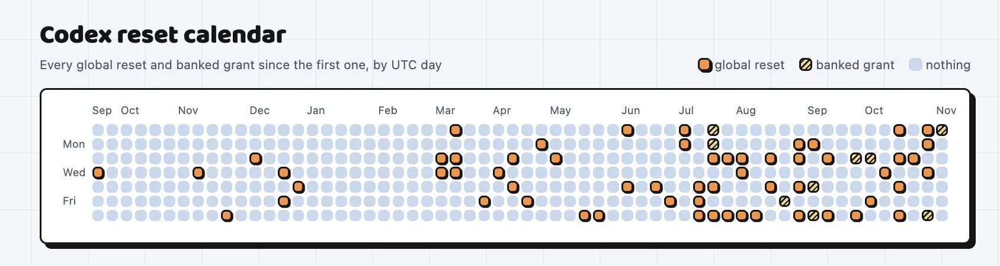
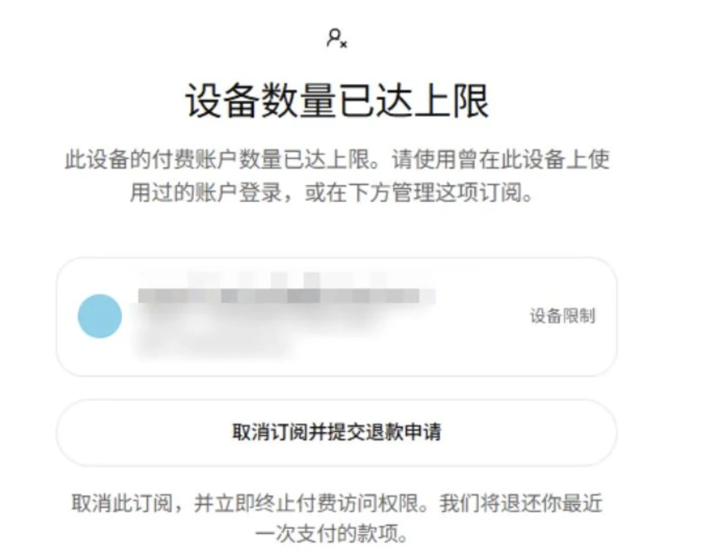
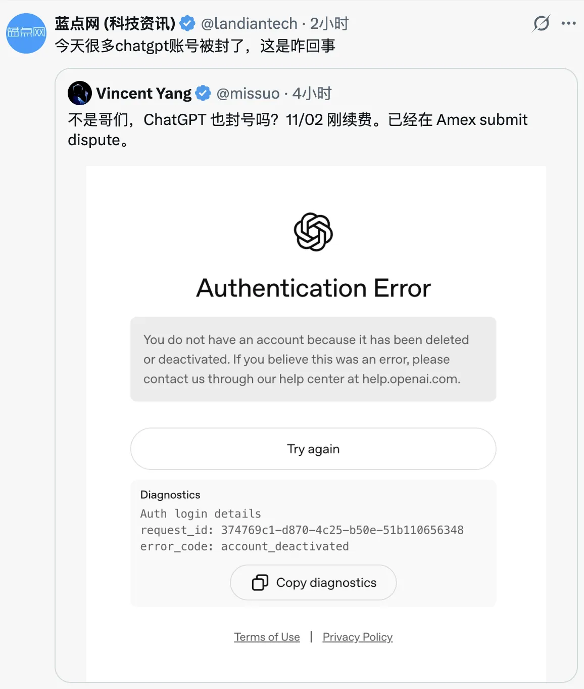
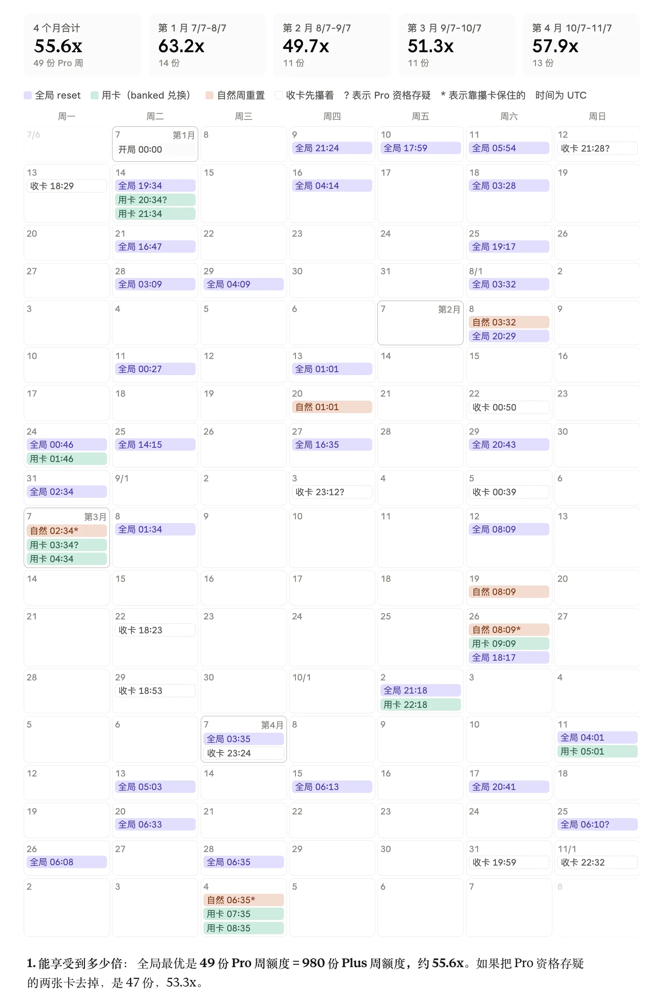
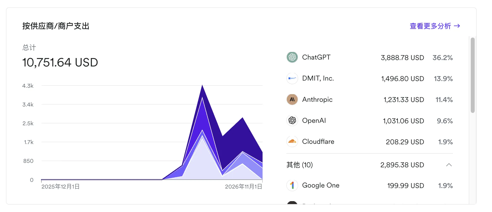
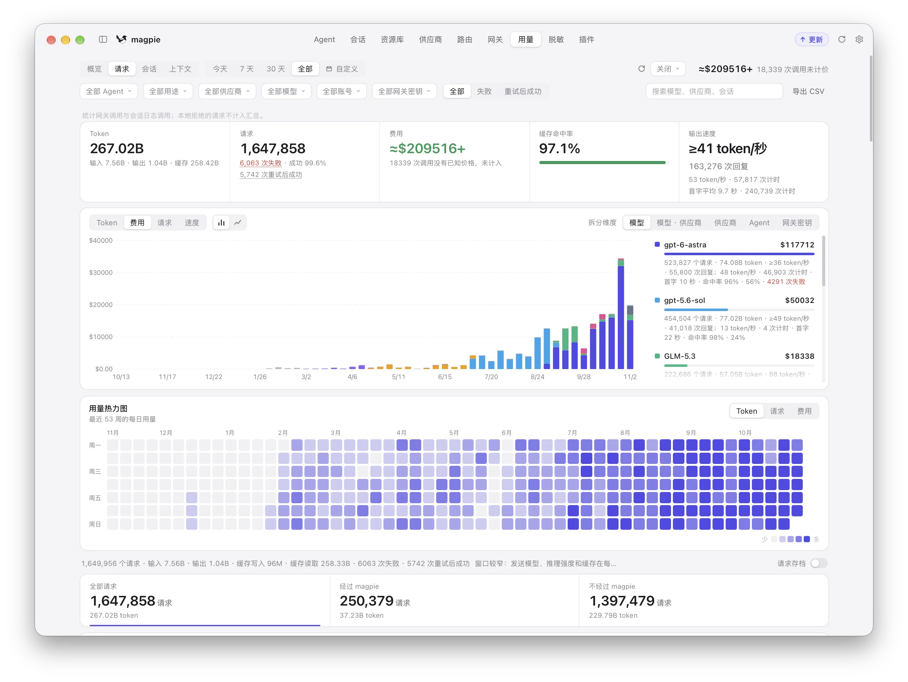

8 月 8 日，老冯写过一篇《[Codex Reset 狂欢结束](/ai/codex-reset-end/)》。现在回头看，当时的结论下早了。

那之后 OpenAI 为了冲周活，又发了十几轮鸡蛋：1500 万用户重置、2000 万用户送预存重置、9 月宕机补偿重置。到了 10 月，Codex 负责人 Tibo 搞了个“28 天里每天要么上新、要么重置”的挑战，28 天里有 14 天发了重置。



时间点虽然晚了两个月，剧本走向却一点没偏。翻翻我今年 7 月到 9 月在专栏里的几篇文章，结局早就写好了：

- **7 月份**，我就跟身边的朋友念叨：大厂几十倍价差的订阅补贴只是临时状态，撑不久，也就这几个月的光景，大家得“有水快流，能吃多少是多少”。
- **9 月 11 日**，在《[本地 AI：算的是政治账，不是经济账](/ai/local-ai-movement/)》里写过：“企业 API 默认不拿数据做训练；个人订阅之所以比企业 API 按量付费便宜几十倍，差价里买的核心就是这条数据条款。**等它积累够了数据，或者要冲 IPO 的时候，这种补贴绝对不是常态，一定会停。这是一个击鼓传花的游戏……上市公司的报表不能长期亏着补贴。**”
- 《[AI 时代生存指南](/ai/ai-bonus/)》里还做过一个推演：“在数据换算力的商业模式下，平台必然在给每一个账号估值。**被评估为‘数据有价值’的就留着，评估为没价值的就随便找个由头封号处理掉。这不是阴谋论，这是商业逻辑。**”后来发现还真有一套评分算法。
- **9 月底**，在《[ChatGPT 500 美元订阅？200 刀 Pro 或成传家宝](/ai/codex-promax/)》和《[靴子落地：ChatGPT 200 刀订阅额砍半](https://mp.weixin.qq.com/s?__biz=MzU5ODAyNTM5Ng==&mid=2247493506&idx=1&sn=9299c6b014ceb7e84fc641a9046f9c33&scene=21#wechat_redirect)》里我也明确说过：**退坡的方式不会是直接涨价，会是限量、降配、分层。订阅补贴，要到头了。**

今天是 11 月 7 日。这次再说“大重置时代结束了”，证据比八九月份硬得多。把过去两周的新闻拼在一起看：

- Anthropic 和 OpenAI 的新版使用政策，分别在 **11 月 12 日**和 **11 月 20 日**生效，矛头都指向中转和转售。
- OpenAI 开始在底层限制同一张卡、同一台设备上的付费账号数量。
- 11 月 2 日，Tibo 的 28 天挑战收官，最后两天发的已经是“预存重置卡”。
- OpenAI 这轮融资目标从 300 亿美元砍到 200 亿，估值从 1.4 万亿降到 1.25 万亿，上市推迟到 2027 年。
- Anthropic 的 IPO 估值预期，被华尔街机构从 2 万亿压到 1.5–1.6 万亿。
- 马斯克直接发推摊牌，说 Grok Bot 的服务成本“相对收入高得不可持续”，随后收紧了额度。


老冯的结论很明确：**阳光普照、大锅饭式的补贴确实结束了。但补贴本身没有消失，它正在从“街头送鸡蛋”变成“Costco 会员制”。**


## 两家同时开始封口

**Anthropic：11 月 12 日新规。** 这项新规于 10 月 8 日公布，是一年多来首次更新。舆论刷屏的是“禁止持续、无意义地虐待模型”这条，真正要命的是新加的“转售与代理”禁令：不得未经授权转售、代理 Claude，典型例子就是通过个人订阅中转请求、伪装客户端指纹的服务。从封号数量上看，2025 年下半年还是 145 万，2026 年上半年直接飙到 1140 万，申诉翻案率只有 10.6%。

**OpenAI：11 月 20 日新规，加上卡和设备限制。** 10 月 21 日公布的新版使用政策要求：模型路由器、AI 网关在提供访问之前，必须先经 OpenAI 审核批准。早在 8 月 21 日 Tibo 就警告过，很多额度异常的账号在用 `sub2api` 或类似 MarketPad 的工具，把订阅转成 API 流量再转售或共享，都会被反欺诈系统直接标记。

同时帮助中心上线了“卡与设备限制”：同一张卡绑的订阅太多，新订阅买不了；同一台设备上的付费号太多，登录直接弹窗 `Device limit reached`。Go、Plus、Pro 100/200/500 全算在内。而且今天已经出现大量 ChatGPT 账号被封的例子。





两家动作拼在一起，在合规合法的前提下，**以后一个人到底还能有几个号？**

1. **Anthropic 的合规上限是 2 个号**：政策允许个人持有一个 Personal 号（200 美元 Ultra，10x），外加一个 Team 号（100 美元，5x）。
2. **OpenAI 的目标是限制到 1 人 1 号**：现在一个手机号最多绑 3 个号，加上同卡、同设备限制，它能容忍的物理上限，估计也就是拿一个手机号开 3 个号，分别跑在三台电脑上。OpenAI 的真实意图是把重度用户逼到单号 **\$500/月** 的最高配额档位上——以前那种一个人开 10 个号哐哐蹬车的玩法，以后目测是不让搞了。

这波打击的对象非常精准：拼车、中转、代充、**多号轮换**。订阅价是按“一个人用”定的，黄牛把一份补贴拆给十个人吃，舰队指挥官开着十几个订阅轮换薅羊毛。跑马圈地时可以睁只眼闭只眼，要上市查账的时候，负毛利资产必须清退。


## 健身房原理，200 刀吃出 50x

Codex 的 Reset，本质是拉新营销。4 月 Codex 周活 300 万时，OpenAI 承诺之后每多 100 万用户重置一次，直到 1000 万。按 `codex-resets.com` 的统计，2025 年 9 月到 2026 年 8 月中旬，全体重置发了 42 次，平均 8 天一次。同期周活从年初约 60 万涨到 8 月的 2000 万，到现在的四五千万。这是我见过最暴力的增长手段。

很多人觉得 OpenAI 连发 42 次全员 Reset 是在纯亏钱。**其实真不一定，这里面底层是“健身房原理”。**

OpenAI 的周限额是 **7 天滚动窗口**。当你使用 Reset 时，原本的自然重置窗口会被推迟到“当前时刻起的 7 天后”。比如正常周日用完、下周日重置；如果你在周三用了 Reset，自然重置时间就会顺延到下周三。这就引出了两个核心变量：**对齐与进度**。

1. **刚好打平**：一天用七分之一，哪天赶上重置都不赚不亏。
2. **净亏吃瘪**：平时不用，把额度攒到每周最后一天才跑。结果刚用一点赶上 Reset，没用完的额度作废，自然重置还被往后推了 7 天。**只要在 Reset 触发时，你没把已消耗自然天数对应的份额用完，就是净亏的。**
3. **收益最大（极速蹬车）**：刚自然重置完，1 个小时内把一整周额度全部跑空，紧接着赶上 Reset。自然窗口只往后推 1 小时，白赚 6 天 23 小时的满管算力。

并不是所有人都有能力、或者有足够的活儿把订阅额度打满的。半年前老冯的 \$200 订阅，也不是每周都能用满。

后台开天眼视角的 DBA 对全局数据库跑个 `SELECT`，就能算出最优的重置时间点。从统计学和**幂律分布**来看，绝大多数普通用户的额度远远用不满。一次全员 Reset 按下去，顺手把几百万低频用户的自然重置时钟往后推迟 7 天——**这个机制在全局账本上大概率不但不亏，反而是一笔赚钱的生意。** 就像健身房办卡：绝大多数人办了年卡一年只去洗两次澡，用会费补贴了极少数每天泡在里面十几个小时的硬核玩家。

那么，像老冯这样奉行“有水快流”、用自动化工作流疯狂蹬车的玩家，在规则允许范围内能占多大便宜？

**算一笔账：** 拿一个经典的 **\$200/月、20x（相当于 20 个 \$20 Plus 订阅算力）** 的 Pro 账号，从 **7 月 7 日算到今天 11 月 7 日**，正好 **4 个月（123 天，17.57 个自然周）**。

假设每次额度一出来，**1 个小时内立刻蹬完**；随后立刻用充值卡或预存重置券（Banked Reset）再蹬完，并吃上官方的每一次全员自动重置。因为每次都在刷新后的第 1 小时内触发重置，Reset“往后推 7 天”只让自然周期顺延了 1 小时，窗口损耗几乎为零。在这 4 个月里，这一个 \$200 的账号能吃到的满管周额度大概在 **50 份**左右：

| 用法                                     | 份数 |  等效 |
|------------------------------------------|-----:|------:|
| 老实人（不吃任何 Reset，只有自然周重置） |   18 | 20.4x |
| 葛朗台（精算卡点重置，吃干抹净）         |   49 | 55.6x |




也就是说，你花了 200 刀（`20x`）的钱，实际拿到了 50 份额度，**在原本已经倒挂几十倍的订阅补贴之上，又乘了 2.5 倍的杠杆。** 所以现在推 500 刀 `50x` 的新订阅，对 Agent 舰队指挥官来说，本质上就是原本 200 刀吃出 `50x` 的福利期结束，回归到 500 刀买 `50x` 的常态。

## 花 1 万刀，烧掉 300 万人民币算力

单号乘 2.5 倍还不是终点，因为这套玩法过去几个月可以**加横向杠杆**。一个人可以开 10 个、20 个号，我见过最猛的开了二十多个号，再多的就不是个人用户了。老冯自己最高峰时开了 **15 个 \$200 级别的订阅**，每月投入 3,000 美元。



按标称倍率算，15 个 `20x` 账号相当于 **300 个 Plus 订阅**；算上 Banked Reset 和普通 Reset 的 **2.5 倍乘数**，高峰期手里的算力吞吐量等效于 **750 个 Plus 账号**同时拉满。



*部分统计：六台本地电脑中的主力电脑消耗。*

前两天我统计了一下过往这四个月的 AI 总开销：**一共花了 1 万美元左右，消耗的 Token 大概在 500B 左右，按 API 按量计费大约 40 万美金出头。** 换句话说，过去 4 个月里，老冯在键盘上烧掉了近三百万人民币的算力，而实际付出的订阅成本，只是列表价的 2.3%。

三百万算力烧下去，产出也是实打实的：

- **单枪匹马几乎把整个 PostgreSQL 世界汉化了一遍**：完成 PG 内核消息汉化、31 个大版本的官方文档汉化，外加翻译了三十多本技术书籍；
- **维护整个数据库发行版与扩展生态**：连续迭代 **Pigsty** 大版本，在 PG Linux 原生发行版赛道干到全球第一，维护 **PGEXT.CLOUD** 横跨 16 个操作系统的 626 个扩展、三万多个构建目标；
- **接盘与重构核心开源项目**：接盘维护[对象存储分支 **Silo**](/db/long-live-silo/)，接管并升级社区 Rust 扩展 `vchord` 与 `pg_mooncake`，外加手搓了[文档框架 Oink](/ai/oink-intro/)、虚拟机管理软件 Barn、[包管理器 sow](/db/sow/)、Pigsty GUI 组件 Boar，以及文档工具 Crib、效率工具 CapsLock 等好几个独立项目。

干完这一整个研发团队一年都未必干得完的活，我的时间依然很自由，中间还抽空跑出去自驾游了一趟。

这件事把人与人的差距彻底拉开了：**以前厉害的程序员叫 10x 程序员；现在如果你本身是个 10x 程序员，再加上 100 倍速的算力吞吐量，那就是 1000x。** 人和人的生产力差距，真会被放大到几百倍。

在这四个月里，你如果把杠杆拉满，就能用百倍的速度抢下大量以前想都不敢想的地盘。这就是时代红利，吃到了就是吃到了，错过了也就错过了。

> 以老冯开源项目 Star 与网站访客为例
>
> [各仓库现存 GitHub Stars 的累计增长报表](https://pgsty.com/zh/report/#report=github&period=180d&cfMetric=requests)。

```echarts {height="300px"}
{
  "animation": false,
  "backgroundColor": "transparent",
  "useUTC": true,
  "aria": {"enabled": true, "label": {"description": "2018 年 1 月至 2026 年 11 月 7 日，46 个仓库现存 GitHub Stars 的逐月累计曲线，按仓库堆叠，期末合计 12,215。"}},
  "tooltip": {"trigger": "axis", "confine": true, "renderMode": "richText", "order": "seriesDesc", "axisPointer": {"type": "line"}},
  "legend": {"type": "plain", "bottom": 0, "left": "center", "textStyle": {"fontSize": 11}, "itemWidth": 14, "itemHeight": 8, "itemGap": 12, "data": ["pigsty", "silo", "acdat", "pg_exporter", "pig", "oink", "其他 40 个仓库"], "selectedMode": false},
  "grid": {"top": 18, "right": 14, "bottom": 62, "left": 8, "containLabel": true},
  "xAxis": {"type": "time", "boundaryGap": false, "splitNumber": 5, "axisLabel": {"formatter": "{yyyy}", "hideOverlap": true}, "min": "2018-01-01T00:00:00Z", "max": "2026-11-07T00:00:00Z"},
  "yAxis": {"type": "value", "min": 0, "max": 15000, "interval": 5000},
  "color": ["#336791", "#5fa8e8", "#2bb3a3", "#9b87f5", "#f2b443", "#f17a8f", "#94a3b8", "#64748b"],
  "series": [{"name": "pigsty", "type": "line", "stack": "stars", "showSymbol": false, "smooth": false, "lineStyle": {"width": 0.6}, "areaStyle": {"opacity": 0.9}, "emphasis": {"focus": "series"}, "encode": {"x": "date", "y": "pigsty"}}, {"name": "silo", "type": "line", "stack": "stars", "showSymbol": false, "smooth": false, "lineStyle": {"width": 0.6}, "areaStyle": {"opacity": 0.9}, "emphasis": {"focus": "series"}, "encode": {"x": "date", "y": "silo"}}, {"name": "acdat", "type": "line", "stack": "stars", "showSymbol": false, "smooth": false, "lineStyle": {"width": 0.6}, "areaStyle": {"opacity": 0.9}, "emphasis": {"focus": "series"}, "encode": {"x": "date", "y": "acdat"}}, {"name": "pg_exporter", "type": "line", "stack": "stars", "showSymbol": false, "smooth": false, "lineStyle": {"width": 0.6}, "areaStyle": {"opacity": 0.9}, "emphasis": {"focus": "series"}, "encode": {"x": "date", "y": "pg_exporter"}}, {"name": "pig", "type": "line", "stack": "stars", "showSymbol": false, "smooth": false, "lineStyle": {"width": 0.6}, "areaStyle": {"opacity": 0.9}, "emphasis": {"focus": "series"}, "encode": {"x": "date", "y": "pig"}}, {"name": "oink", "type": "line", "stack": "stars", "showSymbol": false, "smooth": false, "lineStyle": {"width": 0.6}, "areaStyle": {"opacity": 0.9}, "emphasis": {"focus": "series"}, "encode": {"x": "date", "y": "oink"}}, {"name": "其他 40 个仓库", "type": "line", "stack": "stars", "showSymbol": false, "smooth": false, "lineStyle": {"width": 0.6}, "areaStyle": {"opacity": 0.9}, "emphasis": {"focus": "series"}, "encode": {"x": "date", "y": "other"}}, {"name": "合计", "type": "line", "showSymbol": false, "lineStyle": {"width": 1.4}, "encode": {"x": "date", "y": "total"}, "z": 5}],
  "dataset": {
    "dimensions": ["date", "pigsty", "silo", "acdat", "pg_exporter", "pig", "oink", "other", "total"],
    "source": [
      ["2018-01-31T00:00:00Z", 0, 0, 103, 0, 0, 0, 0, 103], ["2018-02-28T00:00:00Z", 0, 0, 136, 0, 0, 0, 0, 136], ["2018-03-31T00:00:00Z", 0, 0, 165, 0, 0, 0, 0, 165], ["2018-04-30T00:00:00Z", 0, 0, 179, 0, 0, 0, 0, 179], ["2018-05-31T00:00:00Z", 0, 0, 199, 0, 0, 0, 0, 199], ["2018-06-30T00:00:00Z", 0, 0, 216, 0, 0, 0, 0, 216], ["2018-07-31T00:00:00Z", 0, 0, 246, 0, 0, 0, 0, 246], ["2018-08-31T00:00:00Z", 0, 0, 256, 0, 0, 0, 0, 256], ["2018-09-30T00:00:00Z", 0, 0, 267, 0, 0, 0, 0, 267], ["2018-10-31T00:00:00Z", 0, 0, 278, 0, 0, 0, 0, 278], ["2018-11-30T00:00:00Z", 0, 0, 287, 0, 0, 0, 0, 287],
      ["2018-12-31T00:00:00Z", 0, 0, 295, 0, 0, 0, 0, 295], ["2019-01-31T00:00:00Z", 0, 0, 306, 0, 0, 0, 0, 306], ["2019-02-28T00:00:00Z", 0, 0, 311, 0, 0, 0, 0, 311], ["2019-03-31T00:00:00Z", 0, 0, 325, 0, 0, 0, 0, 325], ["2019-04-30T00:00:00Z", 0, 0, 341, 0, 0, 0, 0, 341], ["2019-05-31T00:00:00Z", 0, 0, 352, 0, 0, 0, 0, 352], ["2019-06-30T00:00:00Z", 0, 0, 362, 0, 0, 0, 0, 362], ["2019-07-31T00:00:00Z", 0, 0, 374, 0, 0, 0, 0, 374], ["2019-08-31T00:00:00Z", 0, 0, 389, 0, 0, 0, 0, 389], ["2019-09-30T00:00:00Z", 0, 0, 395, 0, 0, 0, 0, 395], ["2019-10-31T00:00:00Z", 0, 0, 400, 0, 0, 0, 0, 400],
      ["2019-11-30T00:00:00Z", 0, 0, 414, 0, 0, 0, 0, 414], ["2019-12-31T00:00:00Z", 0, 0, 429, 2, 0, 0, 0, 431], ["2020-01-31T00:00:00Z", 0, 0, 437, 6, 0, 0, 0, 443], ["2020-02-29T00:00:00Z", 0, 0, 445, 6, 0, 0, 0, 451], ["2020-03-31T00:00:00Z", 0, 0, 448, 6, 0, 0, 0, 454], ["2020-04-30T00:00:00Z", 0, 0, 457, 6, 0, 0, 0, 463], ["2020-05-31T00:00:00Z", 0, 0, 461, 9, 0, 0, 0, 470], ["2020-06-30T00:00:00Z", 0, 0, 470, 11, 0, 0, 0, 481], ["2020-07-31T00:00:00Z", 0, 0, 473, 11, 0, 0, 0, 484], ["2020-08-31T00:00:00Z", 0, 0, 483, 13, 0, 0, 0, 496],
      ["2020-09-30T00:00:00Z", 0, 0, 489, 15, 0, 0, 0, 504], ["2020-10-31T00:00:00Z", 4, 0, 492, 20, 0, 0, 0, 516], ["2020-11-30T00:00:00Z", 12, 0, 499, 28, 0, 0, 0, 539], ["2020-12-31T00:00:00Z", 20, 0, 506, 37, 0, 0, 0, 563], ["2021-01-31T00:00:00Z", 40, 0, 511, 48, 0, 0, 0, 599], ["2021-02-28T00:00:00Z", 43, 0, 515, 50, 0, 0, 0, 608], ["2021-03-31T00:00:00Z", 57, 0, 520, 50, 0, 0, 0, 627], ["2021-04-30T00:00:00Z", 65, 0, 523, 52, 0, 0, 0, 640], ["2021-05-31T00:00:00Z", 80, 0, 530, 59, 0, 0, 0, 669], ["2021-06-30T00:00:00Z", 111, 0, 533, 63, 0, 0, 0, 707],
      ["2021-07-31T00:00:00Z", 142, 0, 539, 66, 0, 0, 0, 747], ["2021-08-31T00:00:00Z", 157, 0, 543, 71, 0, 0, 0, 771], ["2021-09-30T00:00:00Z", 173, 0, 548, 76, 0, 0, 0, 797], ["2021-10-31T00:00:00Z", 186, 0, 551, 79, 0, 0, 0, 816], ["2021-11-30T00:00:00Z", 212, 0, 556, 83, 0, 0, 0, 851], ["2021-12-31T00:00:00Z", 250, 0, 561, 84, 0, 0, 0, 895], ["2022-01-31T00:00:00Z", 270, 0, 569, 86, 0, 0, 0, 925], ["2022-02-28T00:00:00Z", 282, 0, 572, 86, 0, 0, 0, 940], ["2022-03-31T00:00:00Z", 357, 0, 574, 89, 0, 0, 0, 1020], ["2022-04-30T00:00:00Z", 392, 0, 583, 91, 0, 0, 0, 1066],
      ["2022-05-31T00:00:00Z", 494, 0, 591, 96, 0, 0, 0, 1181], ["2022-06-30T00:00:00Z", 548, 0, 593, 104, 0, 0, 0, 1245], ["2022-07-31T00:00:00Z", 640, 0, 600, 108, 0, 0, 0, 1348], ["2022-08-31T00:00:00Z", 659, 0, 604, 108, 0, 0, 0, 1371], ["2022-09-30T00:00:00Z", 674, 0, 609, 110, 0, 0, 0, 1393], ["2022-10-31T00:00:00Z", 696, 0, 610, 113, 0, 0, 0, 1419], ["2022-11-30T00:00:00Z", 715, 0, 614, 114, 0, 0, 0, 1443], ["2022-12-31T00:00:00Z", 727, 0, 615, 114, 0, 0, 0, 1456], ["2023-01-31T00:00:00Z", 768, 0, 616, 116, 0, 0, 0, 1500], ["2023-02-28T00:00:00Z", 901, 0, 618, 117, 0, 0, 0, 1636],
      ["2023-03-31T00:00:00Z", 1030, 0, 620, 119, 0, 0, 0, 1769], ["2023-04-30T00:00:00Z", 1077, 0, 622, 122, 0, 0, 0, 1821], ["2023-05-31T00:00:00Z", 1118, 0, 623, 124, 0, 0, 0, 1865], ["2023-06-30T00:00:00Z", 1155, 0, 626, 124, 0, 0, 0, 1905], ["2023-07-31T00:00:00Z", 1186, 0, 632, 125, 0, 0, 0, 1943], ["2023-08-31T00:00:00Z", 1312, 0, 632, 130, 0, 0, 0, 2074], ["2023-09-30T00:00:00Z", 1622, 0, 633, 130, 0, 0, 0, 2385], ["2023-10-31T00:00:00Z", 1683, 0, 633, 130, 0, 0, 0, 2446], ["2023-11-30T00:00:00Z", 2057, 0, 637, 132, 0, 0, 0, 2826],
      ["2023-12-31T00:00:00Z", 2151, 0, 641, 133, 0, 0, 0, 2925], ["2024-01-31T00:00:00Z", 2194, 0, 644, 137, 0, 0, 0, 2975], ["2024-02-29T00:00:00Z", 2250, 0, 646, 139, 0, 0, 0, 3035], ["2024-03-31T00:00:00Z", 2578, 0, 646, 145, 0, 0, 0, 3369], ["2024-04-30T00:00:00Z", 2703, 0, 648, 150, 0, 0, 0, 3501], ["2024-05-31T00:00:00Z", 2817, 0, 649, 155, 0, 0, 0, 3621], ["2024-06-30T00:00:00Z", 2875, 0, 649, 158, 0, 0, 0, 3682], ["2024-07-31T00:00:00Z", 2937, 0, 649, 163, 0, 0, 0, 3749], ["2024-08-31T00:00:00Z", 3189, 0, 651, 165, 0, 0, 0, 4005],
      ["2024-09-30T00:00:00Z", 3295, 0, 653, 168, 0, 0, 0, 4116], ["2024-10-31T00:00:00Z", 3356, 0, 655, 175, 0, 0, 6, 4192], ["2024-11-30T00:00:00Z", 3472, 0, 656, 179, 0, 0, 18, 4325], ["2024-12-31T00:00:00Z", 3568, 0, 656, 181, 39, 0, 23, 4467], ["2025-01-31T00:00:00Z", 3633, 0, 656, 189, 88, 0, 29, 4595], ["2025-02-28T00:00:00Z", 3672, 0, 656, 196, 110, 0, 36, 4670], ["2025-03-31T00:00:00Z", 3729, 0, 657, 203, 128, 0, 38, 4755], ["2025-04-30T00:00:00Z", 3789, 0, 658, 213, 130, 0, 41, 4831], ["2025-05-31T00:00:00Z", 3885, 0, 659, 228, 137, 0, 43, 4952],
      ["2025-06-30T00:00:00Z", 3957, 0, 660, 246, 141, 0, 44, 5048], ["2025-07-31T00:00:00Z", 4035, 0, 660, 247, 145, 0, 52, 5139], ["2025-08-31T00:00:00Z", 4107, 0, 660, 260, 148, 0, 53, 5228], ["2025-09-30T00:00:00Z", 4162, 0, 660, 269, 157, 0, 55, 5303], ["2025-10-31T00:00:00Z", 4217, 1, 660, 276, 158, 0, 57, 5369], ["2025-11-30T00:00:00Z", 4272, 1, 662, 279, 165, 0, 66, 5445], ["2025-12-31T00:00:00Z", 4396, 6, 662, 286, 171, 0, 73, 5594], ["2026-01-31T00:00:00Z", 4516, 11, 662, 293, 177, 0, 80, 5739], ["2026-02-28T00:00:00Z", 4740, 643, 662, 323, 181, 0, 96, 6645],
      ["2026-03-31T00:00:00Z", 4909, 1130, 662, 337, 184, 0, 113, 7335], ["2026-04-30T00:00:00Z", 5020, 1392, 662, 344, 184, 0, 130, 7732], ["2026-05-31T00:00:00Z", 5114, 1577, 662, 347, 191, 0, 143, 8034], ["2026-06-30T00:00:00Z", 5169, 1739, 662, 348, 192, 0, 153, 8263], ["2026-07-31T00:00:00Z", 5231, 1896, 662, 355, 194, 0, 164, 8502], ["2026-08-31T00:00:00Z", 5573, 2639, 663, 361, 200, 66, 205, 9707], ["2026-09-30T00:00:00Z", 5740, 3679, 663, 365, 204, 110, 259, 11020], ["2026-10-31T00:00:00Z", 5880, 4426, 663, 366, 205, 144, 319, 12003],
      ["2026-11-07T00:00:00Z", 5914, 4567, 663, 366, 206, 160, 339, 12215]
    ]
  }
}
```

> 各网站每日活跃用户与 7 日均线：[完整报表](https://pgsty.com/zh/report/#report=ga&period=180d&cfMetric=requests)。

```echarts {height="300px"}
{
  "animation": false,
  "backgroundColor": "transparent",
  "useUTC": true,
  "aria": {"enabled": true, "label": {"description": "2026 年 5 月 12 日至 11 月 6 日，各站点每日活跃用户合计及 7 日均线；跨站未去重。"}},
  "tooltip": {"trigger": "axis", "confine": true, "renderMode": "richText", "order": "seriesDesc", "axisPointer": {"type": "line"}},
  "legend": {"type": "scroll", "bottom": 0, "left": "center", "textStyle": {"fontSize": 11}, "itemWidth": 14, "itemHeight": 8, "itemGap": 12},
  "grid": {"top": 18, "right": 14, "bottom": 42, "left": 8, "containLabel": true},
  "xAxis": {"type": "time", "boundaryGap": false, "splitNumber": 5, "axisLabel": {"formatter": "{MM}-{dd}", "hideOverlap": true}},
  "yAxis": {"type": "value", "min": 0, "max": 30000, "interval": 10000},
  "color": ["#90b3d2", "#336791"],
  "series": [{"name": "每日活跃用户", "type": "line", "showSymbol": false, "smooth": false, "connectNulls": false, "lineStyle": {"width": 1, "opacity": 0.65}, "encode": {"x": "date", "y": "daily"}}, {"name": "7 日均线", "type": "line", "showSymbol": false, "smooth": false, "connectNulls": false, "lineStyle": {"width": 2.3}, "areaStyle": {"opacity": 0.12}, "encode": {"x": "date", "y": "average"}}],
  "dataset": {
    "dimensions": ["date", "daily", "average"],
    "source": [
      ["2026-05-12T00:00:00Z", 1220, null], ["2026-05-13T00:00:00Z", 2394, null], ["2026-05-14T00:00:00Z", 2397, null], ["2026-05-15T00:00:00Z", 1889, 1975.0], ["2026-05-16T00:00:00Z", 1274, 1834.8], ["2026-05-17T00:00:00Z", 923, 1682.83], ["2026-05-18T00:00:00Z", 1373, 1638.57], ["2026-05-19T00:00:00Z", 1339, 1655.57], ["2026-05-20T00:00:00Z", 1254, 1492.71], ["2026-05-21T00:00:00Z", 1186, 1319.71], ["2026-05-22T00:00:00Z", 1177, 1218.0], ["2026-05-23T00:00:00Z", 918, 1167.14], ["2026-05-24T00:00:00Z", 843, 1155.71], ["2026-05-25T00:00:00Z", 1056, 1110.43],
      ["2026-05-26T00:00:00Z", 1149, 1083.29], ["2026-05-27T00:00:00Z", 2206, 1219.29], ["2026-05-28T00:00:00Z", 1269, 1231.14], ["2026-05-29T00:00:00Z", 1379, 1260.0], ["2026-05-30T00:00:00Z", 849, 1250.14], ["2026-05-31T00:00:00Z", 902, 1258.57], ["2026-06-01T00:00:00Z", 1343, 1299.57], ["2026-06-02T00:00:00Z", 1337, 1326.43], ["2026-06-03T00:00:00Z", 1152, 1175.86], ["2026-06-04T00:00:00Z", 1252, 1173.43], ["2026-06-05T00:00:00Z", 1185, 1145.71], ["2026-06-06T00:00:00Z", 1003, 1167.71], ["2026-06-07T00:00:00Z", 1132, 1200.57], ["2026-06-08T00:00:00Z", 1393, 1207.71],
      ["2026-06-09T00:00:00Z", 1340, 1208.14], ["2026-06-10T00:00:00Z", 1185, 1212.86], ["2026-06-11T00:00:00Z", 1159, 1199.57], ["2026-06-12T00:00:00Z", 989, 1171.57], ["2026-06-13T00:00:00Z", 818, 1145.14], ["2026-06-14T00:00:00Z", 1123, 1143.86], ["2026-06-15T00:00:00Z", 1552, 1166.57], ["2026-06-16T00:00:00Z", 1553, 1197.0], ["2026-06-17T00:00:00Z", 1255, 1207.0], ["2026-06-18T00:00:00Z", 1500, 1255.71], ["2026-06-19T00:00:00Z", 1183, 1283.43], ["2026-06-20T00:00:00Z", 1018, 1312.0], ["2026-06-21T00:00:00Z", 1060, 1303.0], ["2026-06-22T00:00:00Z", 2385, 1422.0],
      ["2026-06-23T00:00:00Z", 1421, 1403.14], ["2026-06-24T00:00:00Z", 2083, 1521.43], ["2026-06-25T00:00:00Z", 1271, 1488.71], ["2026-06-26T00:00:00Z", 1154, 1484.57], ["2026-06-27T00:00:00Z", 851, 1460.71], ["2026-06-28T00:00:00Z", 904, 1438.43], ["2026-06-29T00:00:00Z", 1384, 1295.43], ["2026-06-30T00:00:00Z", 1664, 1330.14], ["2026-07-01T00:00:00Z", 1147, 1196.43], ["2026-07-02T00:00:00Z", 1253, 1193.86], ["2026-07-03T00:00:00Z", 1147, 1192.86], ["2026-07-04T00:00:00Z", 904, 1200.43], ["2026-07-05T00:00:00Z", 824, 1189.0], ["2026-07-06T00:00:00Z", 1093, 1147.43],
      ["2026-07-07T00:00:00Z", 1326, 1099.14], ["2026-07-08T00:00:00Z", 1319, 1123.71], ["2026-07-09T00:00:00Z", 1632, 1177.86], ["2026-07-10T00:00:00Z", 1387, 1212.14], ["2026-07-11T00:00:00Z", 1162, 1249.0], ["2026-07-12T00:00:00Z", 1156, 1296.43], ["2026-07-13T00:00:00Z", 1632, 1373.43], ["2026-07-14T00:00:00Z", 3574, 1694.57], ["2026-07-15T00:00:00Z", 1355, 1699.71], ["2026-07-16T00:00:00Z", 1279, 1649.29], ["2026-07-17T00:00:00Z", 1126, 1612.0], ["2026-07-18T00:00:00Z", 1107, 1604.14], ["2026-07-19T00:00:00Z", 848, 1560.14], ["2026-07-20T00:00:00Z", 1194, 1497.57],
      ["2026-07-21T00:00:00Z", 1311, 1174.29], ["2026-07-22T00:00:00Z", 1155, 1145.71], ["2026-07-23T00:00:00Z", 1585, 1189.43], ["2026-07-24T00:00:00Z", 1307, 1215.29], ["2026-07-25T00:00:00Z", 1117, 1216.71], ["2026-07-26T00:00:00Z", 1043, 1244.57], ["2026-07-27T00:00:00Z", 7853, 2195.86], ["2026-07-28T00:00:00Z", 4169, 2604.14], ["2026-07-29T00:00:00Z", 1417, 2641.57], ["2026-07-30T00:00:00Z", 1410, 2616.57], ["2026-07-31T00:00:00Z", 1275, 2612.0], ["2026-08-01T00:00:00Z", 1211, 2625.43], ["2026-08-02T00:00:00Z", 1282, 2659.57], ["2026-08-03T00:00:00Z", 1633, 1771.0],
      ["2026-08-04T00:00:00Z", 1748, 1425.14], ["2026-08-05T00:00:00Z", 10553, 2730.29], ["2026-08-06T00:00:00Z", 2153, 2836.43], ["2026-08-07T00:00:00Z", 2601, 3025.86], ["2026-08-08T00:00:00Z", 1306, 3039.43], ["2026-08-09T00:00:00Z", 1200, 3027.71], ["2026-08-10T00:00:00Z", 1673, 3033.43], ["2026-08-11T00:00:00Z", 1740, 3032.29], ["2026-08-12T00:00:00Z", 1849, 1788.86], ["2026-08-13T00:00:00Z", 1471, 1691.43], ["2026-08-14T00:00:00Z", 1815, 1579.14], ["2026-08-15T00:00:00Z", 1888, 1662.29], ["2026-08-16T00:00:00Z", 1240, 1668.0], ["2026-08-17T00:00:00Z", 2167, 1738.57],
      ["2026-08-18T00:00:00Z", 2176, 1800.86], ["2026-08-19T00:00:00Z", 2308, 1866.43], ["2026-08-20T00:00:00Z", 2308, 1986.0], ["2026-08-21T00:00:00Z", 2437, 2074.86], ["2026-08-22T00:00:00Z", 1733, 2052.71], ["2026-08-23T00:00:00Z", 1332, 2065.86], ["2026-08-24T00:00:00Z", 1833, 2018.14], ["2026-08-25T00:00:00Z", 2449, 2057.14], ["2026-08-26T00:00:00Z", 2400, 2070.29], ["2026-08-27T00:00:00Z", 2604, 2112.57], ["2026-08-28T00:00:00Z", 2316, 2095.29], ["2026-08-29T00:00:00Z", 1991, 2132.14], ["2026-08-30T00:00:00Z", 1944, 2219.57], ["2026-08-31T00:00:00Z", 2636, 2334.29],
      ["2026-09-01T00:00:00Z", 2426, 2331.0], ["2026-09-02T00:00:00Z", 2097, 2287.71], ["2026-09-03T00:00:00Z", 2152, 2223.14], ["2026-09-04T00:00:00Z", 2042, 2184.0], ["2026-09-05T00:00:00Z", 1521, 2116.86], ["2026-09-06T00:00:00Z", 1444, 2045.43], ["2026-09-07T00:00:00Z", 1895, 1939.57], ["2026-09-08T00:00:00Z", 2397, 1935.43], ["2026-09-09T00:00:00Z", 2224, 1953.57], ["2026-09-10T00:00:00Z", 2728, 2035.86], ["2026-09-11T00:00:00Z", 2374, 2083.29], ["2026-09-12T00:00:00Z", 1805, 2123.86], ["2026-09-13T00:00:00Z", 1512, 2133.57], ["2026-09-14T00:00:00Z", 2487, 2218.14],
      ["2026-09-15T00:00:00Z", 2686, 2259.43], ["2026-09-16T00:00:00Z", 2468, 2294.29], ["2026-09-17T00:00:00Z", 2835, 2309.57], ["2026-09-18T00:00:00Z", 3554, 2478.14], ["2026-09-19T00:00:00Z", 2114, 2522.29], ["2026-09-20T00:00:00Z", 2427, 2653.0], ["2026-09-21T00:00:00Z", 2500, 2654.86], ["2026-09-22T00:00:00Z", 2220, 2588.29], ["2026-09-23T00:00:00Z", 1987, 2519.57], ["2026-09-24T00:00:00Z", 1914, 2388.0], ["2026-09-25T00:00:00Z", 2087, 2178.43], ["2026-09-26T00:00:00Z", 1567, 2100.29], ["2026-09-27T00:00:00Z", 1573, 1978.29], ["2026-09-28T00:00:00Z", 2231, 1939.86],
      ["2026-09-29T00:00:00Z", 2382, 1963.0], ["2026-09-30T00:00:00Z", 2213, 1995.29], ["2026-10-01T00:00:00Z", 1795, 1978.29], ["2026-10-02T00:00:00Z", 1749, 1930.0], ["2026-10-03T00:00:00Z", 3279, 2174.57], ["2026-10-04T00:00:00Z", 1597, 2178.0], ["2026-10-05T00:00:00Z", 1781, 2113.71], ["2026-10-06T00:00:00Z", 1804, 2031.14], ["2026-10-07T00:00:00Z", 1810, 1973.57], ["2026-10-08T00:00:00Z", 2400, 2060.0], ["2026-10-09T00:00:00Z", 2310, 2140.14], ["2026-10-10T00:00:00Z", 2076, 1968.29], ["2026-10-11T00:00:00Z", 1837, 2002.57], ["2026-10-12T00:00:00Z", 2908, 2163.57],
      ["2026-10-13T00:00:00Z", 4483, 2546.29], ["2026-10-14T00:00:00Z", 7033, 3292.43], ["2026-10-15T00:00:00Z", 12854, 4785.86], ["2026-10-16T00:00:00Z", 12454, 6235.0], ["2026-10-17T00:00:00Z", 7345, 6987.71], ["2026-10-18T00:00:00Z", 4537, 7373.43], ["2026-10-19T00:00:00Z", 4485, 7598.71], ["2026-10-20T00:00:00Z", 5354, 7723.14], ["2026-10-21T00:00:00Z", 5050, 7439.86], ["2026-10-22T00:00:00Z", 15011, 7748.0], ["2026-10-23T00:00:00Z", 7436, 7031.14], ["2026-10-24T00:00:00Z", 8509, 7197.43], ["2026-10-25T00:00:00Z", 6191, 7433.71], ["2026-10-26T00:00:00Z", 8276, 7975.29],
      ["2026-10-27T00:00:00Z", 7381, 8264.86], ["2026-10-28T00:00:00Z", 7843, 8663.86], ["2026-10-29T00:00:00Z", 14581, 8602.43], ["2026-10-30T00:00:00Z", 19525, 10329.43], ["2026-10-31T00:00:00Z", 23980, 12539.57], ["2026-11-01T00:00:00Z", 26664, 15464.29], ["2026-11-02T00:00:00Z", 19357, 17047.29], ["2026-11-03T00:00:00Z", 14346, 18042.29], ["2026-11-04T00:00:00Z", 12573, 18718.0], ["2026-11-05T00:00:00Z", 16046, 18927.29], ["2026-11-06T00:00:00Z", 16958, 18560.57]
    ]
  }
}
```


## 从“送鸡蛋”到“会员制”

既然这么爽，为什么现在停了？因为健身房里的健美教练比洗澡的散客还多，加上资本开始查账，大厂必须改规则了。

最典型的信号是：**Reset 现在能卖了。** OpenAI 开始向 Plus 和 Pro 账号出售“付费即时重置”，大概三百块钱充值一次周额度。能卖的东西，就不会再随便送。帮助中心也白纸黑字写明：免费的预存重置和自动重置是“酌情发放的促销福利”，不保证有，也不保证什么时候有。

额度松紧，最终取决于背后的钱。这一个月，硅谷两强的钱同时变贵了：

| 核心指标           | 原先的预期            | 现在（2026 年 11 月）                   |
|--------------------|-----------------------|-----------------------------------------|
| OpenAI 本轮融资额  | 300 亿美元            | 约 200 亿，已落实承诺约 110 亿          |
| OpenAI 本轮估值    | 1.4 万亿              | 1.25 万亿，约 -11%                      |
| OpenAI 上市时间    | 2026 年下半年         | 推迟至 2027 年                          |
| Anthropic IPO 估值 | 约 2 万亿（市场预期） | 1.5–1.6 万亿（机构要价），约 -20%～-25% |
| Anthropic 上市时间 | 10 月                 | 11 月下旬、感恩节前                     |
{.wide}

**OpenAI：融资缩水，IPO 推到 2027。** 3 月那一轮融资还是 1220 亿美元、投后估值 8520 亿。到了这一轮，10 月 30 日被 FT 曝出融资目标砍了三分之一，首轮交割预计不到 200 亿，部分机构临阵缩减了认购。上市方面，Altman 为了守住 1 万亿估值将 IPO 推迟到 2027 年，对媒体给的体面理由是“安全”。

**Anthropic：招股书把账摊开了。** 10 月 26 日公开 S-1，11 月 2 日补上三季度财报：

- **增速放缓**：Q3 营收 169.6 亿美元，环比 +47%。Q2 营收是 Q1 的近 2.5 倍，虽然还在增长，但不再加速。
- **由盈转亏**：Q3 经营亏损 5.67 亿，而 Q2 还是经营利润 9.74 亿。主因是需求超出预先锁定的算力，**临时买了 50 亿美元的高价短期算力**；另有 20 亿非现金的员工配捐费用。
- **成本高企**：Q3 算力和基础设施费用 **98.6 亿，占营收 58%**。降价和合同折扣还让 Q3 营收少了约 6 亿。
- **巨额远期死约**：账面净亏 233 亿（含 219 亿可转债公允价值变动）。核心数字是**采购和租赁承诺合计约 8954 亿美元**，几乎全是算力和基础设施，一年内到期的就有约 **700 亿**。

**背景是 10 月底的美股科技股暴跌。** 10 月 30 日纳指单日跌 2.9%，较月初高点回撤 7.8%；Intel 单日跌 28.6%，CoreWeave 整个 10 月跌了 37%。一旦上市，每一次全员重置都是财报上的一行成本。Anthropic 三季度那 50 亿短期算力已经说明：**算力不够的时候，送出去的每一份额度，都是按现货高价买来的。**

把这笔账套回 OpenAI 最近的动作，逻辑就全通了。10 月底，OpenAI 原本打算把 200 刀（`20x`）档位的配额砍半，遭到反弹后又发了一份用户调研：是想要恢复原有额度，还是接受重新引入 5 小时窗口限制？结果大家宁可只要一半额度，也绝不接受 5 小时限制。最后表面上看，官方既没砍额度，也没加 5 小时限制——但转头就把免费 Reset 停了，实际效果和额度砍半是一回事。

简单来说，高频 Reset 相当于一张 2.5 倍倍率卡。既然用户既想要保住双倍额度，又不肯接受 5 小时限制，那平台自然会从别处找补回来——直接停掉重置活动，从 Reset Company 变成 Token Company。大重置时代，就此告一段落。

补贴并不是消失了，但逻辑发生了变化，从送鸡蛋变成了办会员卡：

| 维度 | 以前（送鸡蛋模式）                          | 现在（Costco 会员制）                        |
|------|---------------------------------------------|----------------------------------------------|
| 目的 | **拉新**：每 100 万用户撒一次，冲周活讲故事 | **留存**：给最重的付费用户加量，防他跑去对家 |
| 对象 | **撒网**：谁有号谁领，多号多领              | **实名**：一人一卡一设备，验证后才给         |
| 形式 | **免费**：Tibo 一按全员拉满                 | **商品**：可存、可卖、酌情发放               |
{.wide}

超市门口免费鸡蛋大放送、阳光普照的活动结束了，换成了山姆与 Costco 的会员卡模式：实名认证、一人一卡，用大分量留住重度大客户，同时把拆包倒卖的黄牛挡在门外。


## 大重置时代结束之后呢？

大重置时代过去了，以后大概率就是平淡的“按量付费 + 顶级档位限量补贴”模式。

老冯自己接下来也会收敛一下，把 10 个 Codex \$200 的号砍一砍，换成 3 个 \$500 的，跑在 3 台主力电脑上。每台电脑配一个 Codex \$500 加一个 Claude Ultra（\$200），另外全局再配三个 \$200 订阅（Gemini、Grok、GLM 各一）。以后也不搞换号和 `magpie` 号池了，每个月 2,700 刀，折合人民币两万块差不多了。

9 个顶级订阅，是一个比较轻松的状态。订阅再多，我也觉得怪累的。

从 7 月 AGI 级模型发布，到 11 月美股 AI 资本泡沫破裂，这一轮四个月的 AI 狂欢基本到尾声了。然后呢？

靠 1 万美金烧出 300 万算力、一个人活成一支军队的 1000x 产出，底层逻辑是什么？我在《[企业 AI 转型可能是个伪命题](/ai/ai-native-org/)》里聊过：**这种 OPC（一人公司）奇观，建立在算力充裕的 Token 补贴之上。** 吃了几十倍价差的补贴，用小钱办大事；补贴退坡，大家确实得重新算账。

但我对此一点都不担心，甚至有点期待 AI 资本泡沫崩盘后的算力过剩。

看一眼 Anthropic 招股书里的数字就明白了：光它一家就背了 **8954 亿美元**的算力采购承诺，一年内到期的硬合同就有 **700 亿美元**；把硅谷几大巨头全算上，未来几年陆续通电上线的机房和显卡是数万亿美元级别的。

算力就像生鲜，机房一通电，每一秒都在折旧，今天不用掉明天就作废。而需求端呢？当 AI 资本泡沫破裂，那些跟风搞“企业 AI 转型”的传统大公司折腾大半年，发现除了写周报根本跑不出正向 ROI，一定会大面积砍预算停掉企业额度。

**一边是传统企业没产出、停掉额度离场，另一边是几万亿美金砸出来的过剩算力洪峰上线——多出来的算力总得有个去处。**

当泡沫崩盘、算力严重过剩时，根本不需要大厂搞什么 Reset 促销，Token 的基础价格本身就会雪崩。
但资本泡沫不是技术泡沫，真正有工程落地能力、已经把 AI 工作流跑通的 **OPC（一人公司）**，反而会在这里占了大便宜 ——
**拿着比今天再便宜 10 倍的过剩 Token，到处抢地盘嘎嘎乱杀。**

最大的机会，恰恰就在这里。

**厂商主动撒钱的大重置时代结束了。下一次大重置，不是厂商送的，是泡沫崩盘送的。**
在那之前，没有免费的鸡蛋了。办张会员卡，磨好手里的刀，平平淡淡地用吧。

> 小建议：每一类订阅的第一个 20 刀 / 200 刀，始终是边际效益最大的。如果你只有 20 刀，请购买 Claude 20 刀订阅；如果你有 100 刀月预算，Claude / ChatGPT / Gemini / Grok 各开一个；如果你要多干点活，按照 Claude / ChatGPT / Gemini 的顺序加到 100 / 200 / 500 刀档位就好了。

## 扩展阅读

- [ChatGPT 500 美元订阅？200 刀 Pro 或成传家宝](/ai/codex-promax/)
- [国庆节，老冯的 Claude 号被封了](/ai/bye-claude/)
- [如何蹬掉 10 个 200 美元的 Codex 订阅？](/ai/10x-subscription/)
- [紧急福利：GPT Astra 发布，重置卡大放送](/ai/astra-reset/)
- [Codex Reset 狂欢结束，免费的鸡蛋没了](/ai/codex-reset-end/)
- [重置：Codex／Claude 第 N 轮大战启动](/ai/reset-codex-claude/)
- [Codex/Claude 脚踏车要蹬冒烟了](/ai/bicycle/)
- [OPC 一个月烧 1000 刀订阅，能有多少产出？](/ai/yield-with-agents/)
- [请 Claude 为老冯画像与估值](/ai/claude-opc-eval/)
- [AI 泡沫将如何破裂？](/ai/ai-bubble/)
- [企业 AI 转型，可能是个伪命题](/ai/ai-native-org/)
- [本地 AI：算的是政治账，不是经济账](/ai/local-ai-movement/)
