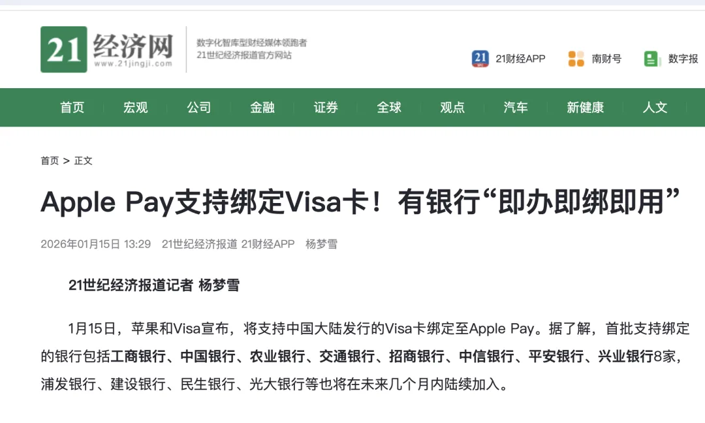
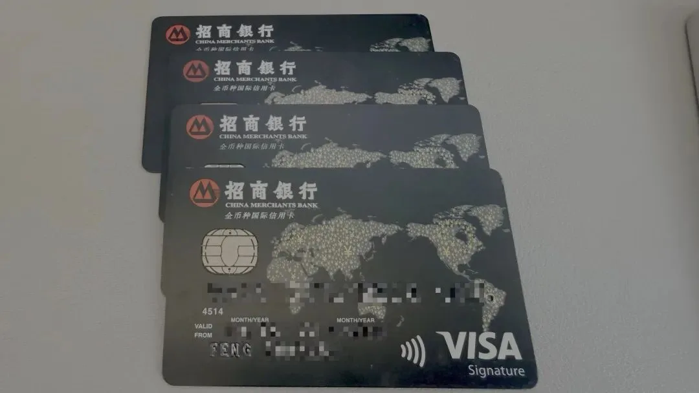
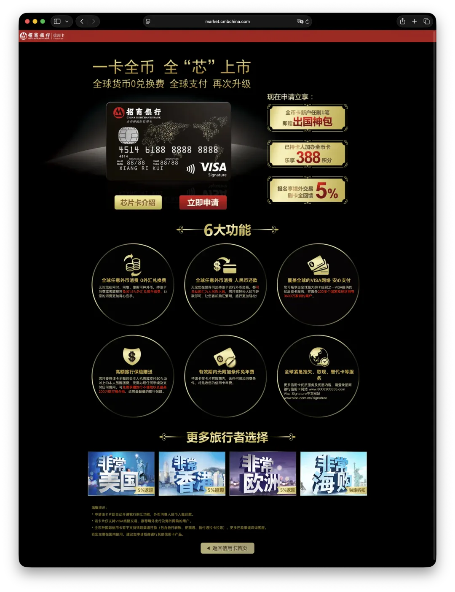
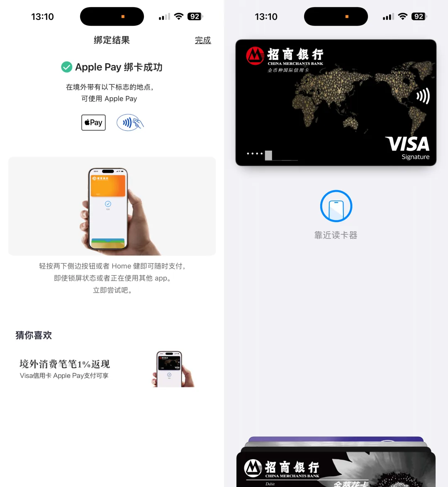
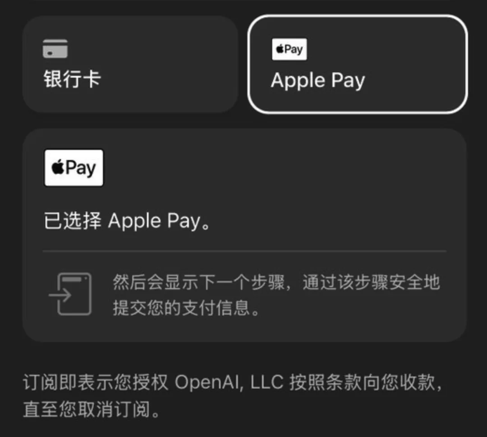

> Starting January 15, 2026, Visa credit cards issued in mainland China officially support Apple Pay. For developers and users in China, this opens up a clean, safe, and low-cost path to subscribe to overseas services like ChatGPT and Claude.

As I noted in my [guide to running Claude Code without a VPN](/en/ai/claude-code-intro/), users in mainland China face two main hurdles when trying to access frontier AI models: network censorship (the Great Firewall) and foreign payment cards. Bypassing the firewall is relatively easy—a decent proxy costs around a couple of dollars a month (ten-odd RMB)—but getting a working international payment card has always been a real barrier.

If you try to pay for overseas digital services like ChatGPT or Claude with a UnionPay card—or even with many Visa or Mastercard credit cards issued in mainland China or Hong Kong—you almost always hit the same wall: **declined by risk control**. That leaves people scrambling for third-party top-up agents or gray-market resellers, which are expensive, slow, and often require handing over your account credentials.

Friends often ask me, "Claude and GPT are great, but how do you actually pay for them?" When I tell them I just use my credit card, they look baffled: "I have a credit card too—why doesn't mine work?" The short answer is simple: **your card works in theory, but on these merchants' payment gateways, it gets blocked by risk controls in practice**.

The old workaround was to route payments through a US Apple ID paired with a US PayPal account, which just turned into another yak-shaving exercise: how do you set up those two in the first place? Fortunately, a key change landed today (**January 15, 2026**): Apple Pay (Apple Wallet) in mainland China now supports Visa cards issued by local Chinese banks for overseas contactless tap-to-pay, in-app purchases, and online web checkouts.

Visa cards could already process cross-border transactions. What makes this change significant is that you can finally wrap a mainland-issued Visa card inside Apple Pay's much smoother payment rail and sidestep merchant risk filters. Built right into every iPhone, Apple Pay **never exposes your actual card number to the merchant** during a transaction; instead, it uses a Device Account Number and a dynamic security code—essentially a tokenized payment credential. Because of that tokenization, services that block mainland China or Hong Kong cards by BIN/card number can no longer reject the transaction based on the raw card number alone.

(Disclaimer: I am not guaranteeing that this setup is 100% immune to risk controls forever—nobody can promise that with payment gateways—but I have already seen users bind their cards and successfully pay for ChatGPT subscriptions.)

## Which Bank Should You Pick?

The initial rollout covers eight mainland banks: **ICBC (Industrial and Commercial Bank of China), Bank of China (BOC), Agricultural Bank of China (ABC), Bank of Communications (BoCom), China Merchants Bank (CMB), China CITIC Bank, Ping An Bank, and Industrial Bank (CIB)**. For domestic user experience, **China Merchants Bank (CMB)** is hands-down the best in my book.

I never take sponsored posts, but when I have used a product myself for years and know others will find it useful, I am happy to recommend it. I applied for this CMB Visa card back in 2015 right after graduating from college. Every time I travel abroad, it is my primary card—it has carried me across the US and Canada and works reliably for online international services. With it in your wallet, you never have to worry about how to pay when you are outside China's Alipay ecosystem.

I have used this card for 11 years now and gone through three renewal replacements.

Its appeal is straightforward, no-frills utility. It skips the flashy perks bundles and focuses on two things that actually matter: no annual fee and no foreign transaction (FX) conversion fee. You spend in foreign currency and pay the bill back in RMB, with virtually zero holding cost. Note that because this is a single-network Visa card rather than a dual-network UnionPay card, you cannot swipe it on domestic UnionPay POS terminals inside mainland China. It also has a nice quirk: despite having a low application bar—I got approved fresh out of school—it is issued at the **Visa Signature** tier, which sits a level above Visa Platinum.

Since plenty of readers have asked me recently how to pay for GPT and Claude, I figured this card could save you some headaches. I have dropped my referral link below—if you apply through it, the bank sends me a free suitcase, haha.

[China Merchants Bank Credit Card Application Page](https://res.cc.cmbimg.com/itafront/Frog/#/mgmLogin/api3xxmgmlj4/remote?webAddress=SOUSUOZQ_M1&where=zs9_jd2&pageName=MRecContract&activityTitle=MGMXSDS202509JD2&appChn=05&dsid=&dscontr=&pretrackno=6cb0929b83974d21ad4134cebd6554f8&pretrack=10403788&mgmSm2Flag=1&mgmSource=share&m1TraceId=6cb0929b83974d21ad4134cebd6554f8)

The application process itself is self-explanatory: open the link, fill out the form, and submit. Once your card is active, open CMB's **CMBLife (掌上生活) app**, search for `Apple Pay`, and link the card to Apple Wallet. It takes about a minute—I bound mine right away:

Once the card is added to Apple Pay, head over to `chatgpt.com` (you still need a proxy to reach the site), select the Apple Pay option at checkout, and pay directly. Several users have already tested this exact CMB Visa card via Apple Pay and confirmed that ChatGPT Plus subscriptions go through without issue.

Paying for Claude directly on the web still gets blocked, but you can bypass their risk checks by using Apple Pay to buy US Apple Gift Cards, redeeming the balance on a US Apple ID, and subscribing in the iOS app. That route still requires a US Apple ID, which is a separate topic—though easy enough to set up. Full disclosure: I haven't tested the direct Apple Pay checkout myself since my existing subscriptions already run through my older US PayPal + US Apple ID setup, but based on confirmed reports from others, it works cleanly.

This setup resolves most of the "Your card was declined" and "Not available in your region" errors that plague mainland users. When you find yourself jumping through half a dozen hoops, paying middleman markups, and handing your login credentials to strangers just for a single subscription, one lesson becomes obvious: **in the digital era, payment access is itself a means of production**.

Today's rollout of Apple Pay support for mainland Visa cards meaningfully lowers the barrier for ordinary developers in China to use frontier AI tools. You don't need insider connections, an offshore bank account, or a gray-market reseller—just a standard Visa credit card and a reliable payment rail.

---

Originally published on [WeChat Official Accounts](https://mp.weixin.qq.com/s/QswTVFKt7UpkSf4BPCIphQ).
