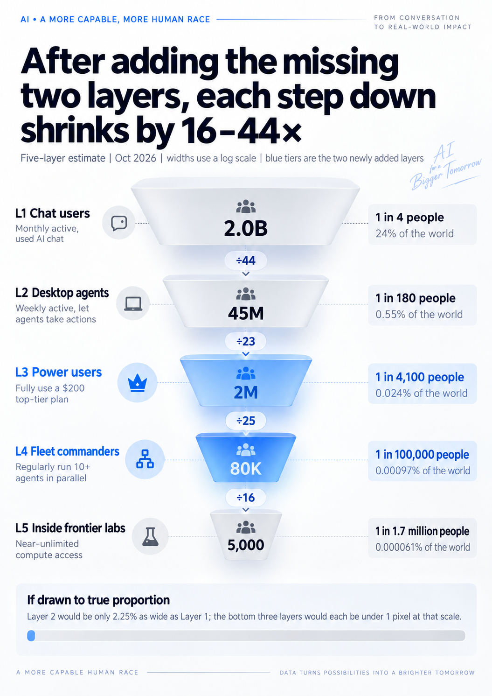
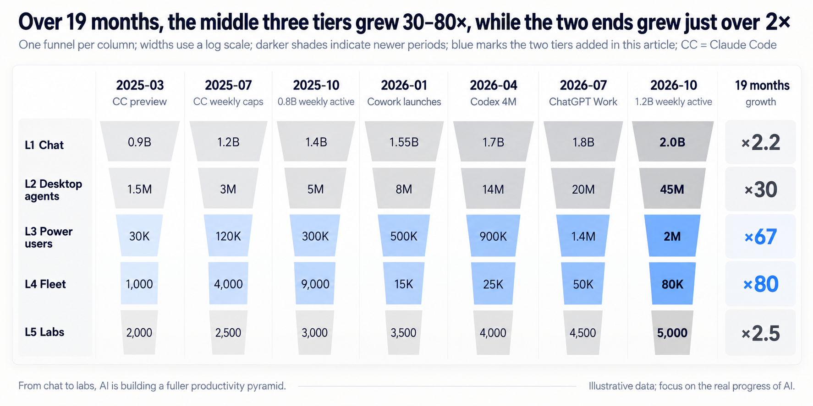
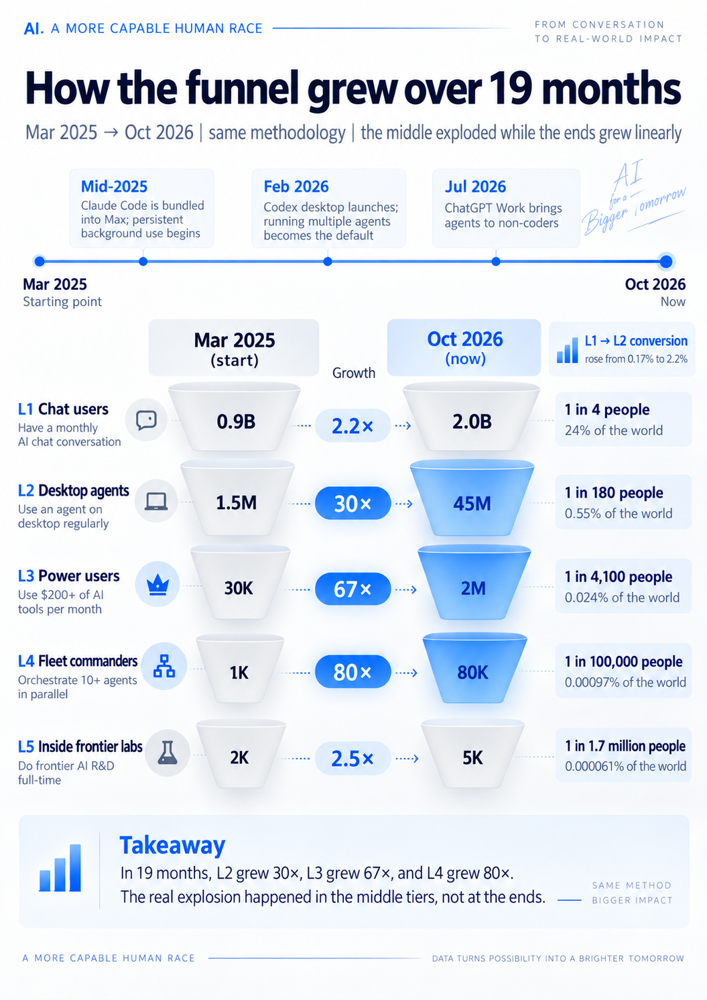

At DevDay in late September, OpenAI announced an eye-popping number: [1.2 billion people use ChatGPT every week](https://openai.com/index/devday-2026-recap/). Two weeks later, Karpathy offered another: only about 5,000 people worldwide have seen frontier AI running flat out. A gap of 240,000 to one.

Both numbers ring true to me. I keep a dozen or more top-tier subscriptions active and just as many agents running around the clock. Most of my friends still use AI to polish copy, look things up, or chat when they're bored. We all call it “using AI,” but we're barely using the same thing.

How many people push AI as hard as I do? In “[AGI Machine Guns Are Now Standard Issue](/en/ai/ai-machinegun-for-everyone/),” I estimated tens of thousands to the low hundreds of thousands. Here I'll dig through the public data again and do some back-of-the-envelope arithmetic. My conclusion: **plenty of people have tried AI, but remarkably few use it deeply.**

## The gap in Karpathy's funnel

On October 11, Karpathy recast something he'd written in April as a four-level funnel ([an explanation of the post](https://cellcog.ai/blog/karpathy-llm-understanding-funnel/)). The OpenAI cofounder [joined Anthropic this May](https://fortune.com/2026/05/19/who-is-andrej-karpathy-vibe-coding-anthropic-openai-rubiks-cube/), so he knows his way around frontier labs. He divided the world's population by depth of understanding and use:

- **About 6 billion people (75%)** have barely used an LLM.
- **1–2 billion people (about 20%)** use free chatbots as search engines and writing assistants.
- **About 20 million people (0.2%)** use frontier models for mathematics and programming. They've watched an agent finish projects that would take weeks or months, all from a single prompt.
- **About 5,000 people** inside leading labs watch thousands of agents collaborate for weeks on enormous software projects, discover zero-day vulnerabilities, and push the frontiers of mathematics.

Karpathy admits these are gut estimates. The shape of the funnel matches my experience, but jumping from 20 million to 5,000 means a 4,000-fold drop in one step. There's a level missing.

In between are independent power users. They lack the labs' unlimited compute but can direct a dozen or several dozen agents at once, well beyond “writing some code with Claude Code.” That's the gap I want to fill.

## The result: a five-level funnel

Here are my estimates by depth of use, as of October 2026:

- **L1 — Chatbot users: about 2 billion.** Used an AI chat assistant in the past month.
- **L2 — Desktop agent users: about 45 million.** Have tools such as Claude Code, Codex, or ChatGPT Work do work for them at least once a week.
- **L3 — Power users: about 2 million.** Consistently exhaust a \$200 top-tier subscription's allowance.
- **L4 — Fleet commanders: about 80,000.** Routinely run ten or more agents simultaneously and maintain a stack of top-tier subscriptions.
- **L5 — Lab insiders: about 5,000.** Core staff at frontier labs with effectively unlimited compute.

This chart needs a logarithmic scale; otherwise, the lower four levels collapse into a line. One in four people on Earth has tried AI, but only one in 100,000 commands an agent fleet.

## The easier estimates: L1, L2, and L5

For a Fermi estimate, start with the parts anchored in public data, then infer the opaque middle.

### L1 — Chatbot users: about 2 billion

I count unique individuals who have used any AI chat assistant in the past month, estimated in three parts:

- **ChatGPT:** OpenAI officially reported [1.2 billion weekly active users](https://openai.com/index/devday-2026-recap/) at DevDay.
- **Gemini:** it [passed 1 billion monthly active users](https://siliconangle.com/?p=812556) in August. Assuming a quarter don't use ChatGPT adds about 260 million.
- **China:** [more than 700 million people used generative AI](https://www.news.cn/20260929/40258c3794684c20ae7867909cdec2ce/c.html) in the first half of 2026. That counts use over six months; a 20% discount gives roughly 600 million monthly users.

Together, that's about 2 billion people, or 24% of the world's population. Microsoft's device telemetry gives a lower figure: in June, [18.8% of people worldwide aged 15–64 had used generative AI](https://blogs.microsoft.com/on-the-issues/2026/09/21/the-continued-state-of-global-ai-diffusion-in-2026/). But Microsoft also says broader measurement in its next report will substantially raise the figure for China, so I treat this as a lower bound.

### L2 — Desktop agent users: about 45 million

OpenAI gives us a concrete number: [Codex and ChatGPT Work together have more than 35 million weekly active users](https://vgtimes.com/tech-and-hardware/169376-openai-sums-up-devday-2026-new-agents-work-tools-and-cloud-codex.html).

Anthropic has never disclosed an absolute user count for Claude Code. In February, it said only that [Claude Code's annualized revenue had passed \$2.5 billion and weekly active users had doubled in six weeks](https://www.anthropic.com/news/anthropic-raises-30-billion-series-g-funding-380-billion-post-money-valuation). We can work backward from two angles:

- **Revenue:** Anthropic's [total annualized revenue reached \$65 billion at the end of July](https://www.webull.ca/news-detail/15422614464930816). Assuming Claude Code accounts for 15–20%, with each weekly active user contributing \$100–150 a month on average, that implies 6–11 million users.
- **Surveys:** in JetBrains' survey, [39% of professional developers said they used Claude Code at work](https://aiunderstanding.org/news/36kr-reports-claude-code-led-github-copilot-in-jetbrains-2026-developer-survey). There are roughly 40 million professional developers worldwide. Halve the result to account for a sample skewed toward active developers, and we get about 8 million.

The two estimates agree, so I'll use 8 million. Cursor, Copilot Agent, Gemini CLI, and others add about 7 million; China's Trae, Qoder, and the major vendors' Coding Plans add about 5 million. Public data is thinnest for China, so that estimate mostly reflects what I see in the community.

The total is about 55 million. Deduplicate people using two or three tools, and I get **45 million**, or 0.55% of the global population. About 20 million actually use them to write code, which also lines up with Karpathy's third level.

### L5 — Core lab staff: about 5,000

I use Karpathy's estimate and cross-check it against headcounts. OpenAI had about 4,500 employees in March and [planned to reach 8,000 by year-end](https://engadget.com/ai/openai-reportedly-plans-to-double-its-workforce-to-8000-employees-161028377.html); Anthropic had [around 4,000 at the start of the year](https://www.longtermwiki.com/factbase/property/headcount). Add the other leading labs and the total is on the order of 20,000–30,000.

Exclude administration, sales, and peripheral teams, and 5,000 seems reasonable for core researchers and engineers with direct access to internal frontier systems and almost no compute ceiling. Even a broader definition would put it at no more than 15,000.

## The opaque middle: follow the money

L3 and L4 have no public user counts, but spending offers some clues.

On October 5, the seventh edition of a16z's Top 100 Gen AI Consumer Apps report introduced [rankings based on actual spending](https://a16z.com/100-gen-ai-apps-7/) from YipitData's US credit-card panel. The bills follow an extremely steep power law:

- Median monthly spending among paying users is just **\$25**, roughly one basic subscription, and has barely risen in years.
- The top **10%** account for roughly half of all spending.
- The top **1%** contribute 19.5%, more than the bottom half combined (16.6%). They spend an average of **\$903 a month**, up 80% from 18 months earlier, mainly on automation, product development, and content creation.
- Only **13%** of paying users pay for a second AI product.

The enterprise picture is even more extreme. Ramp's data shows that [the top 1% of customers account for 80% of OpenAI's and Anthropic's enterprise revenue](https://www.pymnts.com/news/artificial-intelligence/2026/openai-and-anthropic-get-80percent-of-revenue-from-1percent-of-customers/).

The other side of the ledger is the subsidy. SemiAnalysis estimates that a fully exhausted \$200-a-month ChatGPT Pro plan consumes compute worth up to \$14,000 at API prices; Claude Max 20x comes to about \$8,000. An OpenAI top-tier user needs to consume just [5.7% of the theoretical allowance before the platform starts losing money](https://techspot.com/news/112759-openai-anthropic-cant-afford-have-everyone-use-ai.html). Vast numbers of light users are subsidizing a handful of compute guzzlers at the top.

Fit a Pareto tail to the spending shares of the top 10% and top 1%, and the exponent is roughly 1.7. Extrapolate, and we get a profile of the top one in a thousand:

| Percentile | Monthly spending threshold | Average monthly spending | Rough equivalent |
| --- | --- | --- | --- |
| Top 1% | About \$370 | \$903 (measured by a16z) | One or two \$200 top-tier subscriptions, plus assorted other tools |
| Top 0.1% | About \$1,400 | About \$3,500 (extrapolated) | Seven to eighteen \$200 top-tier subscriptions running at once |

That's roughly the financial profile of an agent fleet. So I use **the top 1% of paying users as a proxy for L3, and the top 0.1% for L4**.

What about the denominator? ChatGPT already had [more than 50 million paying users](https://aibusinessweekly.net/p/chatgpt-statistics) in February. In [a16z's panel](https://a16z.com/100-gen-ai-apps-7/), its paying user base is roughly three times the size of Claude's or Gemini's. Deduplicating across the big three, coding tools, and other specialized products, I estimate **120 million** paying users worldwide, with a range of 80–150 million.

### L3 — Power users: about 2 million

One percent of 120 million is 1.2 million. That covers people paying with their own cards. Then there are power users whose employers pay: among engineers tracked by Jellyfish, [the top 2% consume 500 million tokens a week](https://workos.com/blog/nicholas-arcolano-jellyfish-token-maxing-diminishing-returns), running highly autonomous multi-agent pipelines. I estimate this group at 600,000–800,000, bringing the total to about **2 million**.

Usage behavior provides a cross-check. OpenAI's Codex paper reports that [more than 10% of users manage three or more agents simultaneously at some point during the week](https://ideas.repec.org/p/arx/papers/2606.26959.html). Restrict that to people who routinely work this way, and I'd estimate about 4% of L2, or 1.8 million, close to the first result.

### L4 — Fleet commanders: about 80,000

One-tenth of one percent of 120 million is 120,000. But a16z notes that much of the spending at the top goes toward video generation and visual design. I assume half of these users aren't running agent fleets, leaving 60,000. Add about 20,000 engineers running clusters on company API budgets, and we get **80,000**. Another yardstick gives a similar range: 0.1–0.2% of L2 is 45,000–90,000.

For a sense of intensity, consider OpenAI's internal data: its P99 users (the top 1%) [run more than 60 agent-hours a day](https://openai.com/index/how-agents-are-transforming-work/), roughly three agents working around the clock. L4 fleet commanders outside the labs typically run at three to ten times that daily intensity.

## Nineteen months: how the funnel grew

Apply the same estimation method back to March 2025 and draw the funnel at quarterly intervals:

Claude Code had just launched its preview. L2 had only 1.5 million users, L3 about 30,000, and L4 at most 1,000, fewer than the researchers inside the labs. People weren't reluctant to spend; they lacked tools that could turn money into productivity. Three turning points followed:

1. **Mid-2025:** Claude Code became available through the flat-rate monthly Max subscription. Enthusiasts started running it in the background around the clock, pushing Anthropic's compute to the limit and forcing it to [introduce weekly usage limits in late July](https://techcrunch.com/2025/07/28/anthropic-unveils-new-rate-limits-to-curb-claude-code-power-users).
2. **February 2026:** the [Codex desktop app launched](https://en.wikipedia.org/wiki/OpenAI_Codex_%28AI_agent%29). Running multiple agents in parallel went from an enthusiast's custom setup to the default way of working.
3. **July 2026:** [ChatGPT Work](https://openai.com/index/chatgpt-for-your-most-ambitious-work/) put agents in the hands of office workers who don't code. L2 more than doubled in a single quarter.

## Why adoption still isn't that deep

**First, trying AI isn't the same as using it deeply.** Some 24% of the world's population has chatted with AI, but only **0.55%** actually delegates work to agents. a16z sees the same gap in the US: nearly half of people say they've tried AI, but [only 25% use it daily](https://a16z.com/100-gen-ai-apps-7/), and just 4.5% pay out of pocket for a personal subscription.

**Second, the middle is exploding from a tiny base.** In nineteen months, the middle three levels grew 30–80-fold, while the two ends grew a little more than twofold. Conversion from L1 to L2 climbed from 0.17% to 2.2%. The growth is startling, but most people still haven't made the jump.

**Third, more people doesn't mean equal firepower.** L4 users outside the labs already outnumber L5 insiders sixteen to one. Yet as of June, models at the level of Claude Mythos were [available to only about 150 organizations](https://en.wikipedia.org/wiki/Claude_Mythos). However many subscriptions we buy, we're still watching what Karpathy calls the “trailer.”

**Fourth, quotas increasingly constrain the jump from L3 to L4.** Tighten the subsidies, and the heaviest users immediately feel the squeeze. In September, OpenAI briefly stopped selling \$200 Pro plans to new users. At DevDay, it [introduced the \$500-a-month Pro 500 and brought back the \$200 tier with its allowance cut in half](https://vgtimes.com/tech-and-hardware/169376-openai-sums-up-devday-2026-new-agents-work-tools-and-cloud-codex.html). Uber also [capped spending per engineer on any single coding agent at \$1,500 a month](https://workos.com/blog/nicholas-arcolano-jellyfish-token-maxing-diminishing-returns). The size of an agent fleet increasingly depends on who will pay for the compute.

## Where the opportunities are

The daily online arguments over whether AI is a bubble or an industrial revolution often amount to people at different levels of the funnel talking past each other, drawing on entirely different experiences. Understand that gap, and the opportunities become clearer.

**For application and product builders, the biggest opportunity is between L1 and L2.** Whoever removes the barriers and makes delegating everyday tasks to agents a habit for people who don't code can capture the next tenfold expansion. a16z already sees personal agents spreading beyond developers.

**For infrastructure builders, prepare for a different kind of user.** When L2 grows from 45 million to 450 million, software will be operated mainly by tireless agents. The databases and systems being spun up, read, and written concurrently by thousands of agents in the background will far outnumber the apps people tap in the foreground.

AI adoption still doesn't run very deep, which means the story is just beginning. But if the chasm from early adopters to the early majority remains unbridged, this frenzy may move from its “installation period” into a crash and shakeout.
