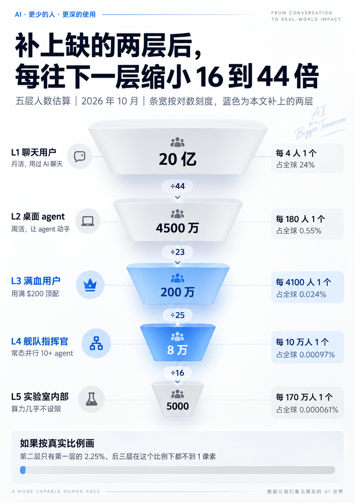
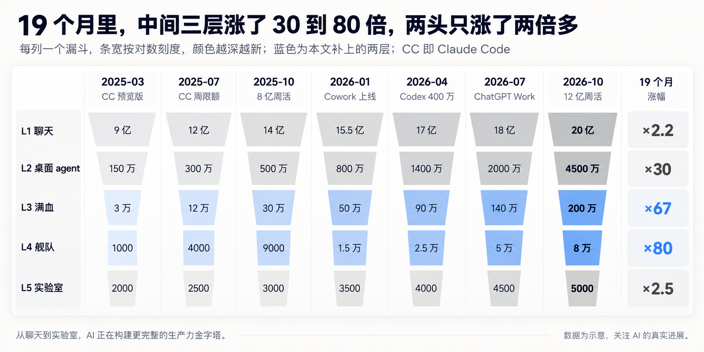
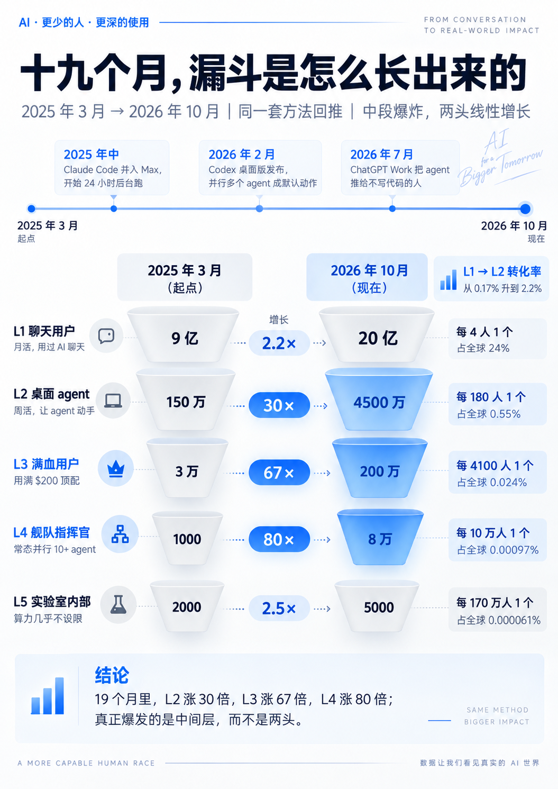

9 月底 OpenAI 开 DevDay，报了个很唬人的数字：ChatGPT [每周有 12 亿人在用](https://openai.com/index/devday-2026-recap/)。两周后，Karpathy 扔出另一个数字：全世界真正见过前沿 AI 全力运转的人，大约只有 5000 个。两者差了整整 24 万倍。

这两个数字，老冯都有切身体感。我常年挂着十几个顶配订阅，同时指挥十几个 Agent 连轴转；身边大多数朋友用 AI，却还停留在改文案、查资料、陪聊解闷。同样叫“用 AI”，大家用的根本不是一个东西。

像我这样重度折腾 AI 的人，到底有多少？我在《[AGI 机关枪发下来了](/ai/ai-machinegun-for-everyone/)》里估过，可能也就几万到十几万人。今天再扒一遍公开数据，做笔毛估估的账。结论是：**AI 的“用过率”不低了，但“用深率”依然低得惊人。**

## Karpathy 漏斗里的断档

10 月 11 日，Karpathy 把自己 4 月写的一段话改成了四层漏斗（[帖子解读](https://cellcog.ai/blog/karpathy-llm-understanding-funnel/)）。这位 OpenAI 联合创始人今年 5 月刚[加入 Anthropic](https://fortune.com/2026/05/19/who-is-andrej-karpathy-vibe-coding-anthropic-openai-rubiks-cube/)，算是清楚前沿实验室水深水浅的人。他按理解和使用深度，把全球人口分成四层：

- **约 60 亿人（75%）**：基本没碰过大模型；
- **10～20 亿人（约 20%）**：用免费聊天机器人，把它当搜索引擎和码字助手；
- **约 2000 万人（0.2%）**：拿前沿模型做数学、写代码，亲眼见过几周、几个月的项目被 Agent 一个 Prompt 干完；
- **约 5000 人**：在顶级实验室内部，看着成千上万个 Agent 连续几周协作，做超大型软件工程、挖零日漏洞、推进数学前沿。

Karpathy 承认这些数是凭直觉拍的。作为体感坐标，老冯认同这个形状，但从 2000 万直接跳到 5000，一步缩水 4000 倍，明显断档了。

夹在中间的野生重度玩家，没有实验室的无限算力，却能同时指挥十几、几十个 Agent，早就超出了“用 Claude Code 写写代码”的范畴。这就是我想补上的空档。

## 先上结论：五层漏斗

按 2026 年 10 月估算，我把使用深度分成五层：

- **L1 聊天用户：约 20 亿**。最近一个月用过 AI 聊天助手；
- **L2 桌面 Agent 用户：约 4500 万**。每周至少让 Claude Code、Codex、ChatGPT Work 这类工具动手干一次活；
- **L3 满血玩家：约 200 万**。能把一个 200 美元的顶配订阅稳定用满；
- **L4 舰队指挥官：约 8 万**。常态化同时跑十个以上 Agent，养着一堆顶配订阅；
- **L5 实验室内部：约 5000 人**。前沿实验室里，算力基本不设限的核心人员。

这张图必须用对数刻度，不然下面四层就缩成一条线。地球上每 4 个人里有 1 个用过 AI，但每 10 万人里，才挑得出 1 个指挥 Agent 舰队的人。

## 两头好算：L1、L2 和 L5

做费米估算，先找有公开数据兜底的部分，再推中间的暗箱。

### L1 聊天用户：约 20 亿

口径是近一个月用过任意 AI 聊天助手的独立自然人，分三块估：

- **ChatGPT**：DevDay 官方披露了 [12 亿周活](https://openai.com/index/devday-2026-recap/)；
- **Gemini**：8 月[突破 10 亿月活](https://siliconangle.com/?p=812556)。假设其中四分之一不用 ChatGPT，净增量约 2.6 亿；
- **国内**：截至 2026 年上半年，[生成式 AI 用户超过 7 亿](https://www.news.cn/20260929/40258c3794684c20ae7867909cdec2ce/c.html)。这是半年内用过的口径，打八折换算成月活，约 6 亿。

合计约 20 亿，占全球人口的 24%。微软用设备遥测得到的数更低：今年 6 月，全球 15～64 岁人口里有 [18.8% 用过生成式 AI](https://blogs.microsoft.com/on-the-issues/2026/09/21/the-continued-state-of-global-ai-diffusion-in-2026/)。不过微软也说，下版报告扩大统计口径后，中国的数字会明显上调，所以我把它当下限看。

### L2 桌面 Agent 用户：约 4500 万

OpenAI 给了明牌：[Codex 和 ChatGPT Work 的周活合计超过 3500 万](https://vgtimes.com/tech-and-hardware/169376-openai-sums-up-devday-2026-new-agents-work-tools-and-cloud-codex.html)。

Claude Code 没公布过绝对用户数，只在今年 2 月透露过[年化收入超过 25 亿美元，周活六周翻倍](https://www.anthropic.com/news/anthropic-raises-30-billion-series-g-funding-380-billion-post-money-valuation)。可以从两头反推：

- **收入**：Anthropic [7 月底总年化收入 650 亿美元](https://www.webull.ca/news-detail/15422614464930816)。假设 Claude Code 占 15%～20%，每个周活用户月均贡献 100～150 美元，算出来是 600 万到 1100 万人；
- **调查**：JetBrains 的问卷里，[39% 的职业开发者在工作中用 Claude Code](https://aiunderstanding.org/news/36kr-reports-claude-code-led-github-copilot-in-jetbrains-2026-developer-survey)。全球约 4000 万职业开发者，考虑到样本偏活跃，打个对折也是 800 万上下。

两边对得上，就取 800 万。Cursor、Copilot Agent、Gemini CLI 等再加 700 万，国内 Trae、Qoder 和各家的 Coding Plan 约 500 万。国内这块公开数据最薄，基本靠圈内体感估。

合计约 5500 万，扣掉同时用两三个工具的重叠用户，取 **4500 万**，占全球人口的 0.55%。其中真正拿来写代码的约 2000 万，也对上了 Karpathy 的第三层。

### L5 实验室核心人员：约 5000 人

直接采用 Karpathy 的估算，再拿编制交叉核对：OpenAI 今年 3 月约 4500 人，[计划年底扩到 8000 人](https://engadget.com/ai/openai-reportedly-plans-to-double-its-workforce-to-8000-employees-161028377.html)；Anthropic 年初约 [4000 人](https://www.longtermwiki.com/factbase/property/headcount)。算上其他几家，顶尖实验室总人数在两三万量级。

剔除行政、销售和外围团队，能直接调用内部前沿系统、算力几乎不设限的核心研发，估在 5000 人很合理；口径放宽，顶多 1.5 万。

## 中间的暗箱：从花钱找人

L3 和 L4 没有公开用户数，但钱的流向能提供线索。

10 月 5 日，a16z 第七版《消费级生成式 AI 百强榜》首次引入 YipitData 美国信用卡面板的[真实花费排名](https://a16z.com/100-gen-ai-apps-7/)。账单是一条极陡的幂律：

- 付费用户月消费中位数只有 **25 美元**，就是一个基础会员，这几年几乎没涨；
- 前 **10%** 的用户贡献了约一半流水；
- 前 **1%** 贡献了 19.5%，超过倒数一半人的总和（16.6%）。他们人均每月花 **903 美元**，比 18 个月前涨了 80%，主要用于自动化、产品开发和内容创作；
- 只有 **13%** 的付费用户会为第二个 AI 产品掏钱。

企业端更夸张：Ramp 的数据显示，OpenAI 和 Anthropic 的企业收入里，[前 1% 的客户贡献了 80%](https://www.pymnts.com/news/artificial-intelligence/2026/openai-and-anthropic-get-80percent-of-revenue-from-1percent-of-customers/)。

账本背面是补贴。SemiAnalysis 测算，200 美元/月的 ChatGPT Pro 榨干后，算力按 API 价格折算高达 1.4 万美元，Claude Max 20x 也值约 8000 美元。OpenAI 顶配用户只要用到 [5.7% 的理论上限，平台就开始亏钱](https://techspot.com/news/112759-openai-anthropic-cant-afford-have-everyone-use-ai.html)。海量轻度用户，正在养金字塔尖那一小撮算力吞金兽。

用前 10% 和前 1% 的消费份额拟合帕累托尾部，幂指数约 1.7，便能外推前千分之一的画像：

| 分位 | 月花费门槛 | 人均月花费 | 大致相当于 |
| --- | --- | --- | --- |
| 前 1% | 约 370 美元 | 903 美元（a16z 实测） | 一两个 200 美元顶配，外加一堆周边工具 |
| 前 0.1% | 约 1400 美元 | 约 3500 美元（外推） | 七到十八个 200 美元顶配同时在烧 |

这差不多就是 Agent 舰队的财务画像。因此，我用**付费用户的前 1% 对应 L3，前 0.1% 对应 L4**。

分母怎么算？ChatGPT 今年 2 月已有 [5000 万以上付费用户](https://aibusinessweekly.net/p/chatgpt-statistics)；在 [a16z 的面板](https://a16z.com/100-gen-ai-apps-7/)里，其付费体量约为 Claude 或 Gemini 的 3 倍。把御三家、编程工具和其他垂类产品去重，全球付费用户我估在 **1.2 亿**，区间为 8000 万到 1.5 亿。

### L3 满血玩家：约 200 万

1.2 亿的 1% 是 120 万，这是自己刷卡的部分。还有公司买单的重度用户：Jellyfish 跟踪的工程师里，[最顶端的 2% 每周要烧掉 5 亿 Token](https://workos.com/blog/nicholas-arcolano-jellyfish-token-maxing-diminishing-returns)，跑高度自治的多 Agent 流水线。这批人我估在 60～80 万，加起来约 **200 万**。

使用行为也能交叉验证。OpenAI 的 Codex 论文提到，[超过 10% 的用户每周某个时刻会同时管理 3 个以上 Agent](https://ideas.repec.org/p/arx/papers/2606.26959.html)。若只算常态化这么干的，我估约占 L2 的 4%，即 180 万，和前面的结果接近。

### L4 舰队指挥官：约 8 万

1.2 亿的千分之一是 12 万。但 a16z 提到，头部消费中不少钱花在视频生成、视觉设计上。我假设其中一半不是在养 Agent 舰队，扣掉后剩 6 万；再加上用公司 API 预算跑集群的工程师约 2 万，合计 **8 万**。换一把尺子，取 L2 的千分之一到千分之二，是 4.5 万到 9 万，也在这个范围。

强度上可以参考 OpenAI 的内部数据：其 P99（前 1%）重度用户[每天跑 60 多个 Agent 小时](https://openai.com/index/how-agents-are-transforming-work/)，差不多是 3 个 Agent 连轴转。外面的 L4 舰队指挥官，日常强度通常是这个数的 3 到 10 倍。

## 十九个月：漏斗是怎么长出来的

用同一套方法回推到 2025 年 3 月，按季度画出漏斗：

那时 Claude Code 刚发预览版，L2 只有 150 万，L3 约 3 万，L4 满打满算 1000 人，比实验室里的研究员还少。大家不是舍不得花钱，是压根没有能把钱变成生产力的趁手工具。后来有三次关键拐点：

1. **2025 年年中**：Claude Code 并入固定月费的 Max 订阅，极客们开始 24 小时后台挂机，把官方算力干冒烟，逼得 Anthropic 7 月底[上线每周额度限制](https://techcrunch.com/2025/07/28/anthropic-unveils-new-rate-limits-to-curb-claude-code-power-users)。
2. **2026 年 2 月**：Codex [桌面版发布](https://en.wikipedia.org/wiki/OpenAI_Codex_%28AI_agent%29)，并行挂多个 Agent 从极客的私房手艺变成了默认操作。
3. **2026 年 7 月**：[ChatGPT Work](https://openai.com/index/chatgpt-for-your-most-ambitious-work/) 把 Agent 交给不写代码的白领，L2 一个季度翻了一倍还多。

## 为什么说渗透率依然没有那么高

**第一，“用过”不等于“用深”。** 全球 24% 的人跟 AI 聊过天，真正把活交给 Agent 的只有 **0.55%**。a16z 在美国也看到了这道落差：近一半的人说用过 AI，[每天用的只有 25%](https://a16z.com/100-gen-ai-apps-7/)，自费买个人订阅的只有 4.5%。

**第二，腰部在爆炸，基数却仍然很小。** 十九个月里，中间三层涨了 30～80 倍，两头只涨了两倍多。L1 到 L2 的转化率从 0.17% 爬到 2.2%，增速吓人，但绝大多数人仍没跨过去。

**第三，人多不代表火力追平。** 外面的 L4 与实验室 L5 已经是 16 比 1，但 Claude Mythos 这一级的模型，今年 6 月也只[对约 150 家机构开放](https://en.wikipedia.org/wiki/Claude_Mythos)。我们哪怕把订阅买穿，看到的依然是 Karpathy 口中的“先行预告片”。

**第四，卡住 L3 往 L4 跃迁的，越来越是配额。** 补贴一收紧，头部的脖子就被卡住。今年 9 月，OpenAI 一度暂停新用户购买 200 美元的 Pro；到 DevDay，[推出了每月 500 美元的 Pro 500，恢复上架的 200 美元档额度砍半](https://vgtimes.com/tech-and-hardware/169376-openai-sums-up-devday-2026-new-agents-work-tools-and-cloud-codex.html)。Uber 也把[每位工程师在单个编程 Agent 上的开销封顶在每月 1500 美元](https://workos.com/blog/nicholas-arcolano-jellyfish-token-maxing-diminishing-returns)。舰队能开多大，越来越取决于谁愿意为算力买单。

## 机会在哪儿

网上每天争论“AI 是泡沫还是工业革命”，很多时候只是漏斗不同层的人，拿着完全不同的体验在鸡同鸭讲。看懂了这道落差，机会也就清楚了。

**做应用和产品的，最大的金矿在 L1 到 L2 之间。** 谁能把门槛踩平，让不会写代码的人也习惯把日常任务交给 Agent，谁就能吃下下一个十倍。a16z 已经看到，个人 Agent 正在向非开发者群体扩散。

**做基础设施的，要准备迎接调用主体的变化。** 当 L2 从 4500 万涨到 4.5 亿，操作软件的将不再主要是人，而是不知疲倦的 Agent。后台被成千上万个 Agent 并发拉起、读写的数据库和系统，数量会远远超过前台被人点开的 App。

AI 的“深透率”还不高，意味着故事才刚开始。但如果从早期少数到早期大众的这道鸿沟迟迟跨不过去，这波狂热恐怕就该从“安装期”进入崩盘与清算了。
