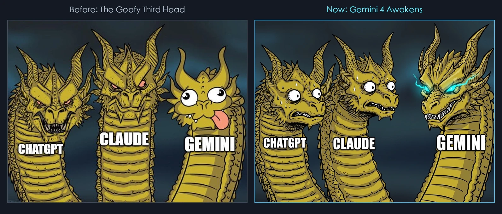
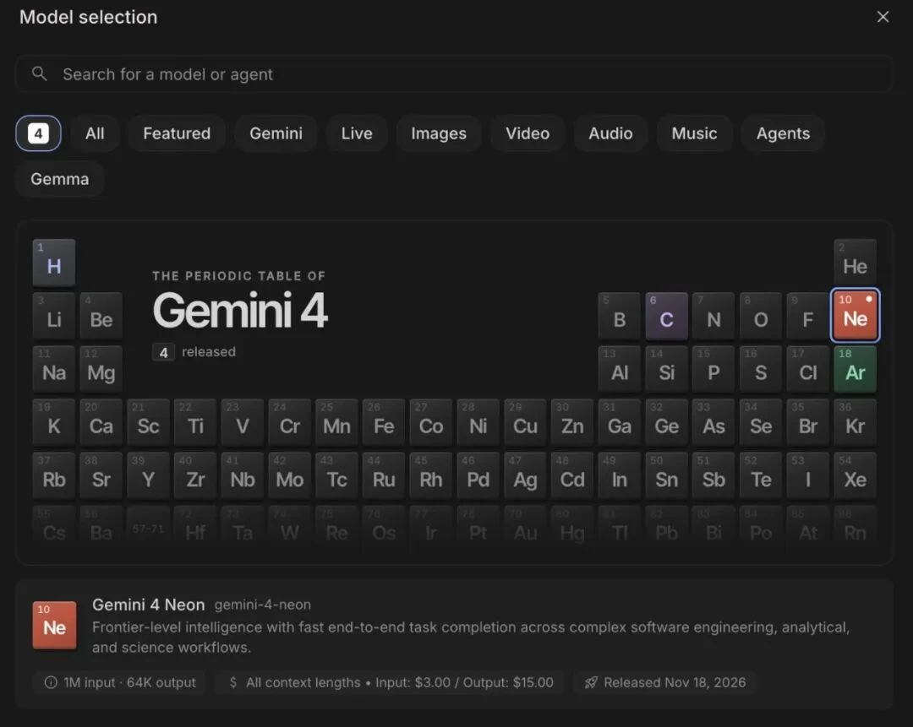
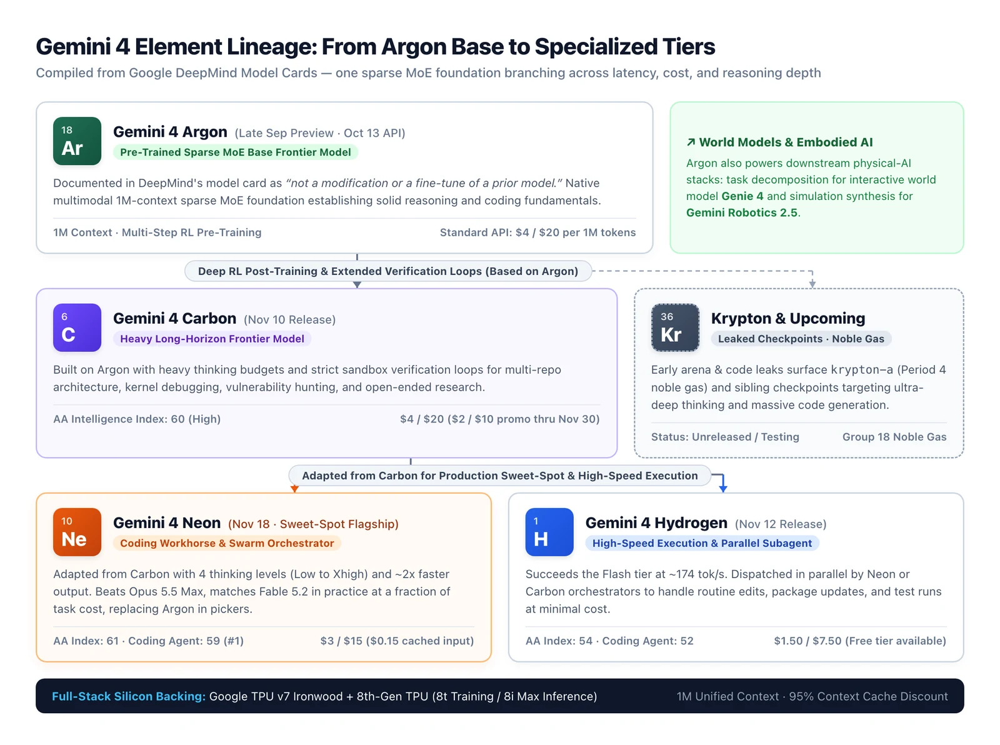
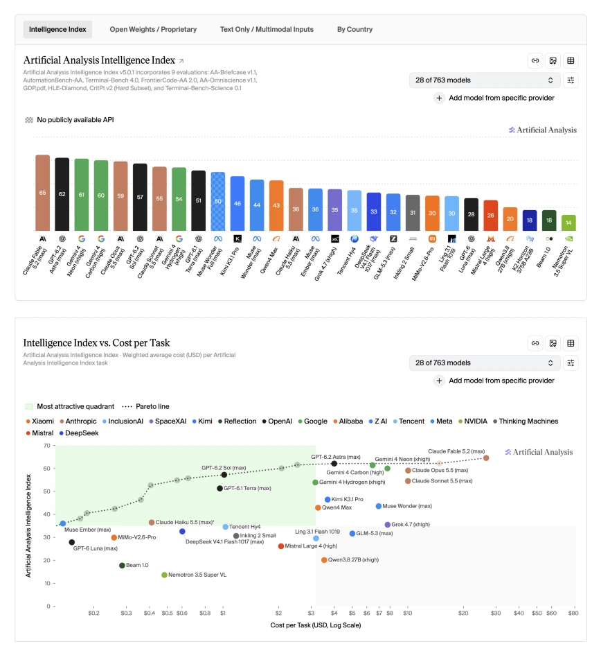
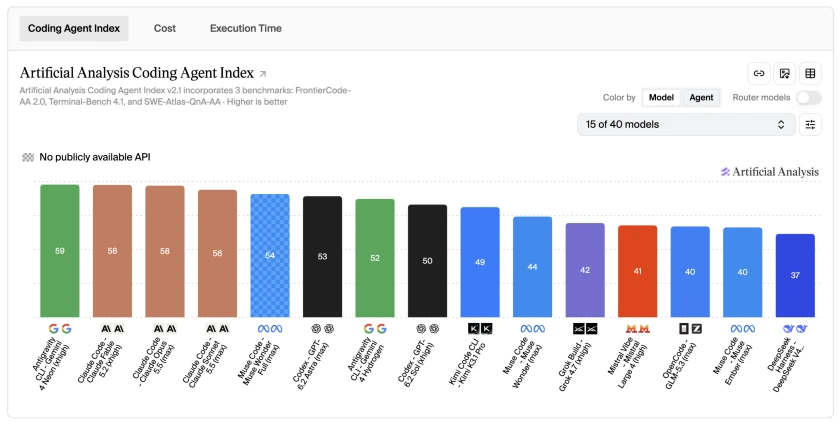
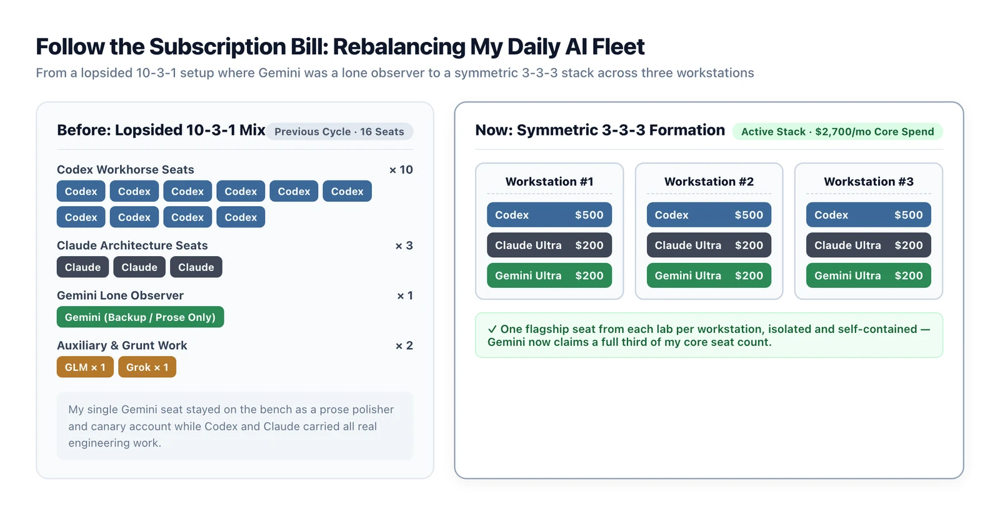

A quick disclaimer up front: this post is here to sing Gemini's praises, and I dictated the rough draft to Gemini so it could write the piece itself. Asking an LLM to ghostwrite its own tribute has a certain dark humor to it, yet looking at where the models stand today, it has earned every bit of it.

For a long stretch, Chinese developers had a brutally accurate nickname for Gemini, calling it "North American Doubao" after ByteDance's mass-market consumer chatbot. The jab was blunt: backed by Google's deep pockets, abundant compute, and flashy multimodal tricks, Gemini was pleasant enough for casual chat, yet turned into a running joke the moment you threw hard reasoning or production code at it.

During its roughest stretch, outside commentary was unsparing. According to one story that made the rounds in the industry, after someone publicly mocked them with "DeepMind is no longer a frontier lab," a DeepMind employee printed that line on a sheet of paper and taped it squarely above their desk, looking up at it every day as both a reminder and fuel.

Big companies do turn slowly, yet once an organization sorts out its internal execution, deep reserves of talent and compute start to show. Eventually the team locked onto the right direction, shook off its old institutional caution, and cut loose even without Jeff Dean around. Everyone has seen what happened next: the whole lineup took off.

## Gemini 4 Breaks Out the Periodic Table

Going by the codenames for this generation, Google practically wheeled out the periodic table, with a clear soft spot for noble gases.

*Note: After someone on X mocked up a tongue-in-cheek "periodic table" model selector for Gemini 4, Google AI Studio lead [Logan Kilpatrick leaned into the joke](https://x.com/OfficialLoganK) and shipped the periodic table directly into the live product.*

Even with Argon a little while back, heavy daily use left me impressed; the underlying foundation felt noticeably steadier. Now that Google has shipped Carbon, Neon, and Hydrogen in rapid succession, with Krypton (another noble gas) and several other upcoming models already leaking beneath the surface, the entire product line is in a different league altogether.

*Further reading: [Introducing Gemini 4 Neon](https://blog.google/innovation-and-ai/models-and-research/gemini-models/introducing-gemini-4-neon/) · [DeepMind Model Cards](https://deepmind.google/models/model-cards/).*

## Head-to-Head with Claude: Parity on Intelligence, Winning on Cost

With Carbon and Neon in particular, my hands-on verdict from real production work is simple: they are seriously strong. Neon alone clearly performs on par with Opus 5.5 Max. Put it under a magnifying glass next to Fable 5.2 and it might trail by a hair, though on actual software engineering tasks that gap is practically imperceptible.

At this point on the curve, Google's strategic intent is hiding in plain sight: take Claude down head-on. Now that raw intelligence sits on the same plane across both camps, the decision comes down to unit economics, and on price-performance Google comes out well ahead.

Original charts: [AA Intelligence Index](https://artificialanalysis.ai/#artificial-analysis-intelligence-index-chart) · [Intelligence Index vs. Cost per Task](https://artificialanalysis.ai/#intelligence-index-vs-cost-per-task-chart) · [Coding Agent Index](https://artificialanalysis.ai/coding-agents).

More surprising still, Google, long known for a streak of engineer-knows-best arrogance, has finally figured out commercial execution.

With Black Friday landing today, Google rolled out promotional discounts right on cue, and I've noticed its usage-quota resets getting far more frequent lately. Google dropped the aloof act and started borrowing from ChatGPT's ["quota-reset marketing"](/en/ai/reset-codex-claude/) playbook.

I've always felt that marketing developer tools doesn't need clever gymnastics. Pass real savings directly to users, let them get a bargain and enjoy the workflow, and they will happily move over on their own. Earlier today, for instance, Google tweaked its backend `limit cache`. Going by past experience, that is usually the tell right before another wave of aggressive quota resets, which gives plenty to look forward to.

## Follow the Subscription Bill: The New 3-3-3 Lineup

Praise is cheap; your monthly subscription bill is what tells the truth.

Until recently, my [AI account mix](/en/ai/sota-fable52-carbon/) was heavily lopsided: 10 Codex accounts, 3 Claude accounts, plus 1 Gemini, 1 GLM, and 1 Grok. Back then, that lone Gemini account sat on the bench mostly as a backup and canary observer.

After putting this new generation through heavy real-world testing, I reshuffled and pared back my primary stack into the following deployment:

- 3 Codex subscriptions ($500 tier)
- 3 Claude Ultra subscriptions ($200 tier)
- 3 Gemini AI Ultra subscriptions ($200 tier)

That clean 3-3-3 formation maps neatly onto my three main workstations: one full set per machine, each running independently without interfering with the others. Going from a lone observer account to claiming a full third of my core seat budget says everything that needs to be said.

## Rough Edges and Basic Decency: Antigravity and the Big Three

Giving the models their due doesn't mean the surrounding tooling gets a pass. Every time I open Antigravity, Google's own agent harness, I still let out an involuntary sigh.

Not to mince words, Google's harness is hot garbage. At this stage of the game, you could grab almost anyone to slap together a vibe-coded UI and it wouldn't come out this ugly. The disconnect inside Big Tech between frontier model intelligence at the bottom of the stack and basic product taste at the top is hard to wrap your head around.

Aesthetics aside, it is also aggressively hostile to reverse proxies. Routine automation workflows, such as running automated Merge Request pipelines, might work fine over on Claude, whereas routing Antigravity through an API reverse proxy will quickly trip Google's risk controls and trigger an outright account ban. Consider this a friendly warning: never do that on your primary Google account. If you really need a reverse-proxy setup, spin up separate burner accounts for the job. Risking a main account tied to years of personal assets just to test Google's anti-abuse tripwires makes zero sense.

Having rebalanced my stack into a three-way split, watching how the major labs have evolved over the past few years leaves me with a certain wry perspective.

Think back a few years to when self-styled frontier labs like OpenAI and Anthropic first broke onto the scene. Their favorite pitch was simple: incumbents like Google and DeepMind moved too slowly, and if a Big Tech monopoly ever locked up frontier AI, it would inevitably turn evil, so idealistic startups had to step in and put AI into ordinary people's hands.

Only a few years have passed, and looking back at those slogans now carries a heavy dose of dry irony.

OpenAI at least still comes across as relatively normal, acting like a company seriously trying to run a business. The vibe coming off Anthropic lately, by contrast, is frankly unsettling. Go watch the footage circulating from their IPO bell-ringing ceremony yesterday: the expressions and energy in that room hit peak uncanny valley, like Stepford-style pod people straight out of a horror movie. Nobody preaches louder in public about safety and human flourishing, and nobody is more ruthless behind the scenes when it comes to banning accounts, throwing up access hurdles, and enforcing cliquish gatekeeping.

Set against that, Google—the old incumbent once cast as the villain—at least used to carry "Don't be evil" as its motto. Down in the weeds of daily work, as long as you steer clear of explicit anti-abuse red lines like reverse proxies, Google largely stays out of the indiscriminate ban-wave business. On the most basic transaction of all, actually taking your money, it has also remained relatively accommodating toward mainland Chinese accounts and bank cards. Being able to pay for a productivity tool with dignity and get your work done in peace already counts as rare decency in today's environment.

## High IQ, High EQ: A Touch of Hallucination, Plenty of Spark

To close, here is a sober read on how this generation of Gemini behaves day to day.

What makes it easiest to like right now is that both its IQ and EQ are online at the same time: its logical reasoning has caught up to the top tier, while its conversational tact and grasp of nuance remain sharp. It picks up on subtext without ever slipping into a preachy, patronizing lecture.

As for shortcomings, its hallucination rate does still run slightly higher than the other two.

Still, there are two sides to that trade-off. If you are writing essays, working on creative pieces, or brainstorming, a slightly looser rein on hallucination actually works in your favor, because the flip side of hallucination is imagination and creative reach. An overly rigid model writes lifeless prose and offers none of the warmth or lively rapport that makes a conversation click.

In software engineering, where everything has to fit together seamlessly, higher hallucination is a real hazard on paper. In my own heavy rotation lately, though, it has held up completely fine. The reason isn't complicated: once a model's baseline intelligence clears the bar, its grasp of codebase context and its ability to self-correct rise right along with it, easily catching minor hallucinations and steering itself back on course.

A recent look at the [LMSYS Arena leaderboard](https://arena.ai/) backs up that gut check. All told, the former "North American Doubao" has pulled off a real turnaround. On my own tier list, this generation of Gemini goes straight to S+—unambiguously top-shelf.
