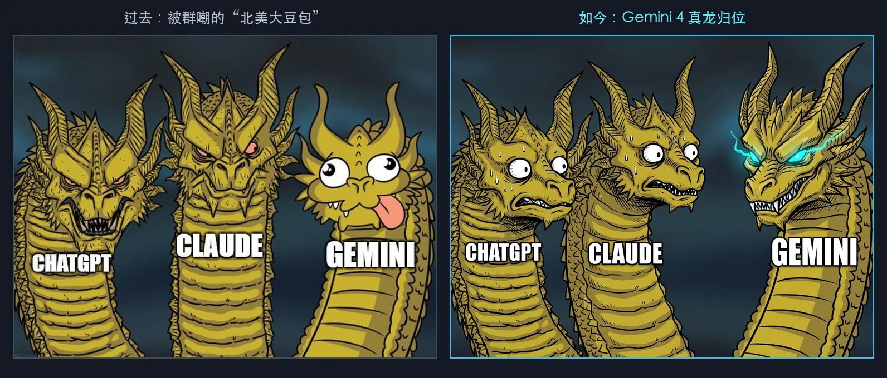
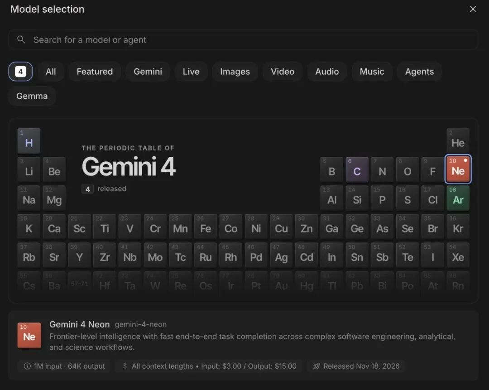
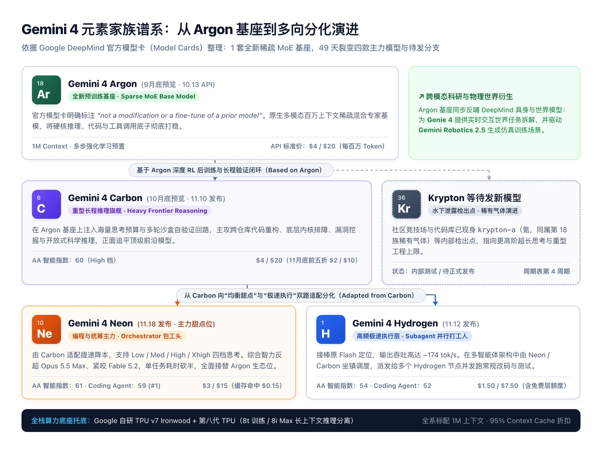
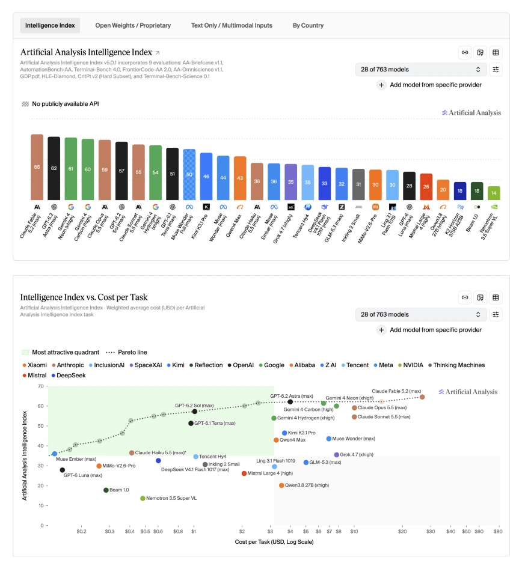
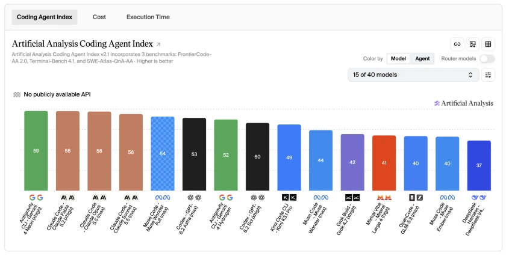
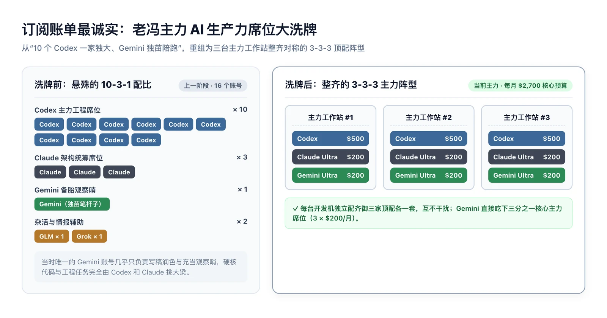

写这篇文章之前先交代个背景：这是一篇专门用来吹 Gemini 的稿子，而初稿正是老冯口述、让 Gemini 自己动笔整理的。让一个大模型写文章表扬自己，听起来多少带点黑色幽默；但放在今天这个时间节点上，平心而论，它确实配得上这份夸奖。

过去很长一段时间里，Gemini 在国内技术圈有个损得很精准的外号，叫“北美大豆包”。意思很直白：背靠 Google 的深厚家底，算力管够、多模态花样多、平时陪聊态度也好，但只要一碰硬核推理和写代码这种真刀真枪的活儿，表现基本就是一个 Joke（笑话）。

在最被动的那段日子里，外界对它的评价相当不留情面。圈子里流传过一段轶事：当时有人公开嘲讽“DeepMind 已经不是一家前沿实验室了”，DeepMind 内部有员工干脆把这句话打印在一张纸上，端端正正贴在自己的工位桌前，每天抬头看一眼用来提醒和激励自己。

大公司转身确实慢，但一旦把内部的路子理顺了，家底厚的威力就慢慢显出来了。后来整个团队算是彻底把方向整明白了，哪怕 Jeff Dean 不在了也照样放飞，没了以前那种束手束脚的包袱——结果大家最近也看到了，直接起飞。

## 把元素周期表搬出来的 Gemini 4

看最近这一代模型的代号，Google 几乎是把元素周期表搬了出来，尤其偏爱稀有气体。

*注：X 上有网友调侃式地给 Gemini 4 画了一套“元素周期表”选模界面，结果 Google AI Studio 负责人 [Logan Kilpatrick 直接玩梗接招](https://x.com/OfficialLoganK)，真把这套周期表做进了线上产品里。*

前阵子的 Argon，老冯日常高强度用下来就已经觉得相当不错，底子明显稳了很多。等到最近密集端出 Carbon、Neon、Hydrogen，再加上水底下已经泄露出来的 Krypton（氪，同样是稀有气体元素）以及其他几个待发的新模型，整条产品线的成色已经完全今非昔比。

*延伸阅读：[Introducing Gemini 4 Neon](https://blog.google/innovation-and-ai/models-and-research/gemini-models/introducing-gemini-4-neon/) · [DeepMind 官方模型卡](https://deepmind.google/models/model-cards/)。*

## 正面硬刚 Claude：智商拉齐，重算经济账

尤其是到了 Carbon 和 Neon 这两代，老冯实际干活用下来的感受就是已经非常牛逼了。单看 Neon 现在的表现，很明显已经达到了 Opus 5.5 Max 的水平；如果非要拿放大镜跟 5.2 比，可能还差那么微乎其微的一点点，但在实际工程任务里基本感知不到这点差距。

到了这个身位，Google 的战略意图其实已经摆在明面上了——这就是奔着正面干翻 Claude 去的。毕竟两边的绝对智力已经拉到了同一条水平线上，可一旦回过头来算经济账，Google 的性价比明显要好出一大截。

查看原始图表：[AA Intelligence Index](https://artificialanalysis.ai/#artificial-analysis-intelligence-index-chart) · [智能指数与单任务成本](https://artificialanalysis.ai/#intelligence-index-vs-cost-per-task-chart) · [Coding Agent Index](https://artificialanalysis.ai/coding-agents)。

更难得的是，一向带点工程师傲慢的 Google，最近在商业运营上也终于开窍了。

今天正好赶上黑色星期五，Google 顺势放出了打折优惠活动；而且老冯留意到，最近它的额度重置（Reset）开始变得频繁起来。它终于放下了身段，开始像 ChatGPT 一样去学习[“重置营销”](/ai/reset-codex-claude/)的技巧。

老冯一直觉得，做工具产品的营销没必要搞太多弯弯绕绕，朴实无华地让利，实打实给大家好处，用户占到了便宜、用得舒心，自然就会开开心心搬过来。比如今天后台刚刚调整了 limit cache，按经验判断，这大概率又是准备开启新一轮疯狂 reset 的前兆，还是相当值得期待的。

## 订阅账单最诚实：洗牌后的 3-3-3 阵型

嘴上夸得再多也是虚的，手里的订阅账单最诚实。

在此之前，老冯手头的 [AI 账号配比](/ai/sota-fable52-carbon/)非常悬殊：10 个 Codex 账号、3 个 Claude 账号，外加 1 个 Gemini、1 个 GLM 和 1 个 Grok。那时候留着唯一的那个 Gemini 账号，基本只是当个备胎和观察哨。

而在高强度测完这一代新模型之后，老冯把整套主力生产力重新做了一次洗牌和裁剪，现在的部署结构如下：

- 3 个 Codex（500 刀档）
- 3 个 Claude Ultra（200 刀档）
- 3 个 Gemini AI Ultra（200 刀档）

整整齐齐的 3-3-3 阵型，正好分配在老冯日常干活的三台主力电脑上，每台机器各配一套，各自独立运行、互不干扰。能从原来的“独苗观察员”直接吃下老冯三分之一的核心预算，本身就已经说明问题了。

## 槽点与体面：Antigravity 与御三家众生相

当然，一码归一码，模型争气不代表周边工具就没有槽点。Google 自家搞的那个 Antigravity，每次打开还是让人忍不住叹气。

不客气地说，Google 这个 Harness 做得真的是一坨屎。都什么时候了，哪怕随便找个人用 Vibe Coding 糊一套界面出来，都不应该做出这么丑的东西。大厂在底层模型智力和表层工具审美之间的割裂感，有时候真是让人匪夷所思。

除了丑之外，它对反代（反向代理）也极其不友好。像平时跑一些自动化的 Merge Request 这类常规流程，放在 Claude 那边可能完全没问题，但如果你拿 Antigravity 去挂反代，很容易触发风控直接封号。这里老冯顺带给各位提个醒：如果是你自己的 Google 主力账号，千万不要干这种事；真有折腾反代的需求，老老实实单开几个小号去跑，犯不着拿绑定了一堆资产的大号去试探风控底线。

把主力阵型调成三分天下之后，看着这几家实验室这几年的变化，老冯心里多少也有点感慨。

回想几年前，OpenAI 和 Anthropic 这些所谓的前沿实验室刚冒头的时候，最爱讲的叙事是：Google 和 DeepMind 这种大公司动作太慢，而且科技巨头一旦掌握了垄断级的 AI 技术必然会作恶，所以必须由他们这些有理想的创新公司站出来，让 AI 普及到普通人手中。

这才过去没几年，回看当初的口号，多少有点冷幽默的意思。

OpenAI 目前来看还算相对正常，至少像一家认真做生意的公司；而 Anthropic 现在呈现出来的气质，实在让人有些不适——大家去看看昨天他们上市敲钟现场流出来的那些画面，里面那帮人的神态和氛围，简直是一副标准的“伪人”面孔，看久了真跟恐怖电影一样。嘴上把安全与人类福祉念得比谁都响，背地里搞起封号、设卡、小圈子排他那套动作来，比谁都狠。

两相对比之下，反倒是当年被当作靶子的老牌巨头 Google，起码以前好歹在明面上奉行过 “Don't be evil（不作恶）” 的理念。落实到咱们日常干活的细节上，只要你不去硬碰反代那种明确的风控红线，它基本不搞无差别封号那套破事；在付钱这件最朴素的事情上，它对国内的账户和银行卡也一直比较宽容。花钱买个生产力工具，能让人体体面面把钱付出去、安安稳稳把活干完，在今天这个环境里，已经算是相当难得的体面了。

## 双商在线：一点幻觉，十分灵气

最后再客观盘一盘这一代 Gemini 的脾气秉性。

它目前最讨喜的地方在于双商在线——逻辑智商追上了第一梯队，同时对话时的分寸感和理解力依然很好，能听懂弦外之音，没有那种好为人师的爹味。

至于短板，它的幻觉率确实还是比另外两家略高那么一点。

不过这事得两面看。如果你是在做文艺创作、写文章或者发散构思，高一点的幻觉反倒是个优势——因为幻觉的背面往往就是想象力和创造力，太死板的模型写不出灵气，也提供不了那么充足的情绪价值。

到了写代码这种讲究严丝合缝的场景里，幻觉偏高理论上确实是个隐患。但老冯自己这段时间重度用下来，整体体感是完全 OK 的。道理也不复杂：当一个模型的底层智力在线时，工程上下文的理解与自我纠偏能力也会跟着水涨船高，完全可以把那点小幻觉带来的偏差兜回来。

如果你最近去翻过 [LMSYS 的榜单](https://arena.ai/)，基本也能印证这种体感。总而言之，昔日的“北美大豆包”这一仗确实打翻身了。按老冯的标准给个最终评价：这一代 Gemini，完全可以给到夯——实打实的夯爆了。
