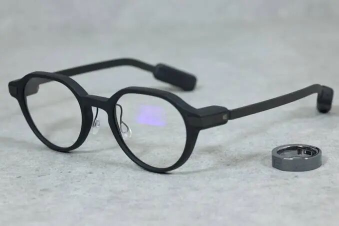
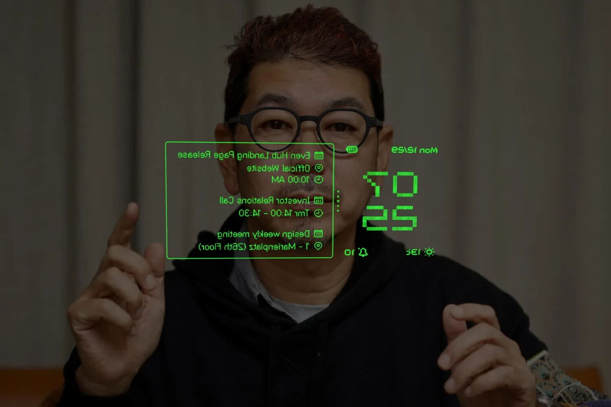
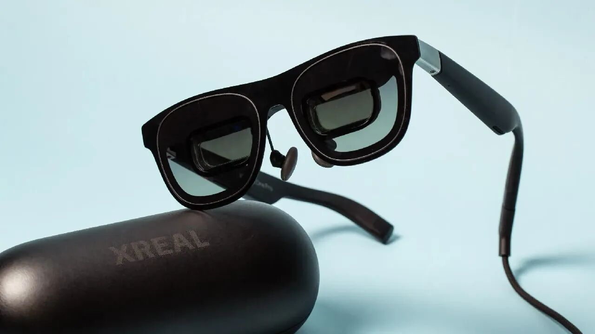
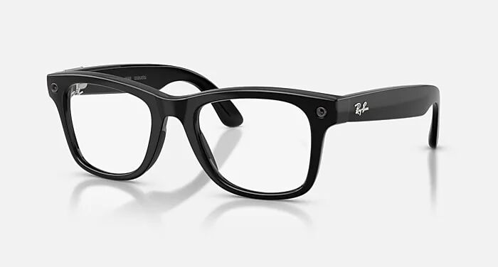
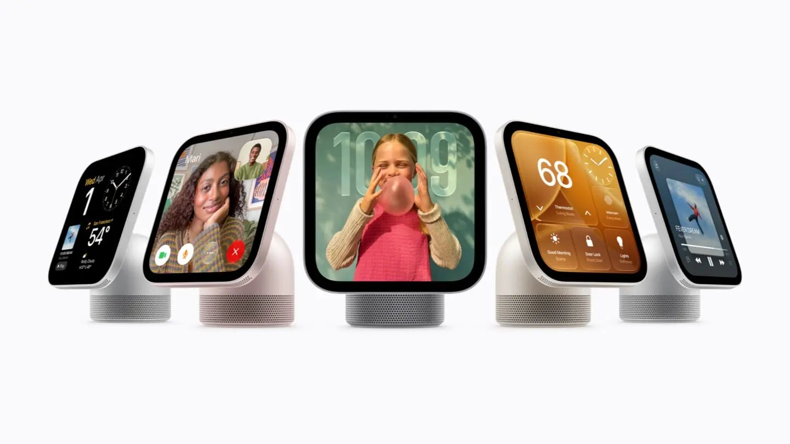
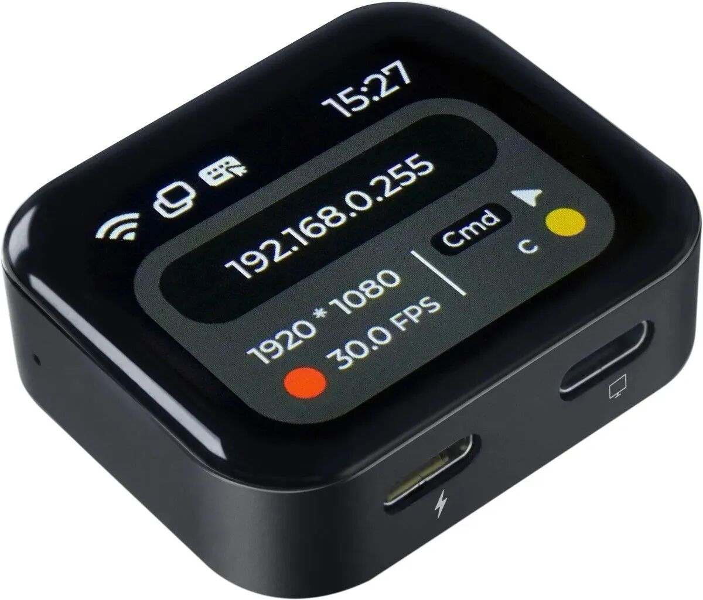

During last week’s Singles’ Day sales, my feed was full of recommendations for smart glasses, mostly from Rokid and RayNeo. I had three talks coming up that week, so I figured I’d try a pair.

What interested me was the teleprompter. An optical waveguide puts five or six lines of text right in your field of view. I could give a talk without looking down at my notes or staring at a monitor in front of the stage. That sounded worth trying.

I was tempted to buy a pair. After a bit of research, I had my eye on the Even Realities G2 and its companion R1 ring. You turn the page by swiping the ring or touching the arm of the glasses. The glasses and ring together cost 7,000 yuan, a lot for a teleprompter. I found a set on Xianyu, a Chinese secondhand marketplace, for 100 yuan a day and rented it for a week.

I’m glad I rented. Some things you have to try for yourself.

## 1. Giving talks and vibe coding with the G2

As a teleprompter, the G2 was lousy.

The biggest problem was **how much the text shook**. I could read it lying perfectly still. The moment I turned my head, the text jerked along with it and I could barely make out the words. The XREAL glasses I’d bought for watching movies smooth out that movement, so the picture stays much steadier when I turn. On these lightweight waveguide glasses, the text is pinned to the lenses.

The whole point of a teleprompter is to let me make eye contact with the audience. To do that, I have to keep turning my head to scan the room. Just when I needed my next line, I couldn’t read it.

Then there was the **light leakage**. The website bills the display as invisible. Get close enough and you can see a faint green glow on the lenses. It’s a giveaway that I’m reading a prompt. Between the jitter and the green glow, I’d have felt awkward wearing them onstage.

I gave all three talks without the glasses. There went my 700 yuan. Then again, spending 700 yuan on a week’s rental saved me several thousand on something that would have sat gathering dust. I’m happy with the price of that lesson. For the occasional talk, I can justify a few dozen yuan to a hundred or so per day. Several thousand to own a pair is too much.

I’d also had high hopes for the **Codex and Claude Code integrations**. My idea of vibe coding was to lie in bed with the glasses on, speak into the mic, and have the glasses send my instructions to Codex and show me its output.

After some tinkering, I got it working. I’d sooner reach for an iPad or my phone and run the session remotely.

## 2. What would make smart glasses worth buying?

I’ve tried most of the main kinds of smart glasses on the market. Before renting the G2, I’d bought Meta’s AI glasses and the XREAL One Pro. I’ve also spent time with the Apple Vision Pro, HoloLens, Google Glass, and a handful of other headsets, including VR gear.

What distinguishes them is **how they combine inputs and outputs**. You can use touch, a ring, a phone, a mic, or a camera for input. For output there’s audio through an earpiece, text on a waveguide, an external monitor, or a full XR environment. In roughly descending order of display capability, I’d put them in four groups.

1. **Spatial computing (Apple Vision Pro).** Both the visuals and the way you interact with them are in a class of their own. It’s also heavy enough to stretch the definition of glasses.
2. **Wearable cinema or monitor (XREAL).** Plug a cable into your phone and you have an external display. I liked watching short-form dramas in the car on business trips. These days my mom uses the glasses for exactly the same thing. Watching video is what you buy these for. Walking around in them feels odd. I tried working in them as well. The pitch is a 150-inch screen you can take anywhere. For work it doesn’t come close to a real monitor. What you’re buying is a wearable cinema.

   

3. **Basic waveguide displays (Rokid Glasses, RayNeo X3 Pro, Even Realities).** A tiny projector puts a small patch of text on the lens, in monochrome or a few colors. Google Glass pioneered this more than a decade ago. It seemed astonishing at the time, but the price kept it from catching on. These days you can get glasses in this category for 2,000 yuan.
4. **Camera and voice chat, no display (Ray-Ban Meta).** You get a mic, speakers, and a camera. You can take photos and talk to an AI. There’s no visual output at all. As it happens, this is the best-selling and most successful category so far.

   

Of the four, waveguide glasses came closest to what I’d imagined for a wearable assistant. A few lines of text would be there wherever I went. In practice, these glasses are sold mainly for two things. Neither does much for me.

- **Prompting during talks.** How often do I need this? I can rent a pair on Xianyu for 50, 70, maybe 100 yuan a day. Why spend several thousand to own one?
- **Everyday translation.** Phones and earbuds already do this well. It’s hard to justify putting on a pair of glasses just for translation.

I haven’t found a killer app for the glasses themselves. The case for buying a pair may depend on what a **personal AI agent** can do with them.

## 3. Audio in, visual out

So what hardware would I want for a personal agent? For me, the interface comes down to **audio in, visual out**.

Human I/O is asymmetric. Speaking is the easiest and fastest way to get words out. Typing is much slower. In the other direction, our eyes have far more bandwidth than our ears.

I hate getting 60-second voice messages on WeChat. Every time, I have to tap to get a transcript. Recording one is easy. Listening means sitting through the full 60 seconds, ums, uhs, repetitions, and digressions included. I can skim the transcript in a second or two. The sender saves time by making the listener spend it.

The same goes for an assistant. I’m happy to tell it what to do out loud. Having it read a long reply aloud wastes my time. I rarely have the patience to listen to a robot drone on when I could take in the whole reply at a glance.

That’s why a personal agent needs **primarily visual output**. Audio is good for a very short alert. The bulk of the response belongs on a screen. That’s where audio-only smart speakers fell short as assistants, and why I think waveguides that put a few lines of text in your field of view have the right idea. The optics and battery life still have some way to go.

## 4. A personal agent makes more sense at home

Even if someone sorted out the display, battery life, and portability, glasses would still be an awkward way to carry a personal agent.

If you want the kind of help you’d get from a good secretary, you have to give the agent the information a secretary would have. There’s only so much it can learn from what you type in a chat box. It needs eyes and ears wherever you go so it can see what you see and hear what you hear.

Try that in public. Walk around with a camera on your glasses and someone might take a swing at you. People see the camera and their guard goes up. That helps explain why less conspicuous devices like Anker’s little recording puck, card-sized recorders, and pocket voice recorders sell better. You can slip one into a pocket or clip it to your collar where people won’t notice it.

The technology works. Getting people to accept it is another matter. There have long been laws on recording in Europe and the US. I find it deeply unethical to record people without their knowledge. You may think you’re documenting your own life, but you’re recording other people’s private lives in the process. If you’re often out in public, it’s hard to see a wearable camera and an always-on mic working out.

**At home, in a private space, I could see this working just fine.** I can decide what to give my agent access to, without all the suspicion and friction I’d run into in public.

But who wants to wear glasses around the house to read a few lines of green text? What I’d want at home is **a smart speaker with a screen**, along the lines of the HomeView home hub Apple has been working on. I could talk to it and read its answers. Ideally it would have a camera too. If I wanted to show it a paper document or something else, I could just hold it up to the lens.

## 5. An old phone and an ESP32 dock

Come to think of it, why build a smart speaker with a screen from scratch?

**A phone already is one.** It has a camera, a mic, a high-resolution screen, a loudspeaker, and even an earpiece for listening in private. You can’t walk around holding it up all day. At home you can just put it in a dock.

What a personal agent needs is to **stay online**. That takes steady power and software that keeps running in the background. A phone set up for everyday use turns off its screen and goes to sleep after a few dozen seconds. An old phone on a desk charger, with the screen on and the agent always running, would make a fine assistant.

The charging dock could do something more interesting, too.

1. Put an **ESP32 chip** in a USB-C dock and enable developer debugging on the phone.
2. Use the dock as a **miniature KVM**. It would emulate an external mouse and keyboard while capturing the output of a virtual display.

Why go to the trouble? Try installing an agent on your phone and asking it to control other apps. The OS has tight permissions, and plenty of apps give the agent no way in. Some block it outright. With the ESP32 in the dock emulating an external mouse and keyboard and reading the screen, the agent could sidestep those software restrictions. As far as the OS and the apps are concerned, it’s the equivalent of a person looking at the screen and tapping the phone. That’s a perfectly legitimate form of input. In principle, the agent could use it to operate any app.

The NanoKVM Go+ Pro already does this sort of thing, but at 500 to 600 yuan, it’s still pricey next to an ESP32.

Most of us have a few retired phones in a drawer by now. Spend a few hundred yuan on a USB-C dock with an ESP32, plug in one of those phones, and leave your personal agent running. That gives you a screen, a mic, a camera, continuous power, and a way to control the phone through hardware inputs.

I don’t know if anyone sells a dock like that yet. If someone could make one for a few hundred yuan, I think they’d have a hit.

## 6. The Vision Pro was a few years early

For a personal agent, an old phone in a dock is the most practical setup I can think of today. But I still like the idea of wearing a headset to vibe code. That brings me back to the **Apple Vision Pro**.

Calling it a pair of glasses is a stretch, as I said earlier. I still think it’s the best head-mounted display on the market. Even now it feels like science fiction. The 5K-class image is good enough that I could actually use it as my monitor at work.

For vibe coding in a home office, that’s my ideal setup. I can look at a window to select it, shift my gaze to switch contexts, dictate instructions, and use hand gestures. It’s the best interface I’ve found for that kind of work.

Apple’s biggest mistake was the price. At 30,000 yuan, the Vision Pro was always going to have a small audience. Apple had the cash to take a page from the makers of the PS5 and the Switch. It could have subsidized the hardware, gotten it into enough hands to build a market, then made money on the software ecosystem. Imagine a Vision Pro at 10,000 yuan, with Apple taking the loss on each unit. You could have bought one for the price of an iPhone. The category might have taken off, and competitors might never have had an opening.

[Watch the video in section 6 of the original WeChat article.](https://mp.weixin.qq.com/s/bHg_7H6fZAdbjC1cRyECxA#:~:text=%E8%BF%99%E4%BA%8B%E6%88%96%E8%AE%B8%E5%B0%B1%E5%81%9A%E6%88%90%E4%BA%86%E3%80%82)

I can’t see Apple bringing itself to do that. And in fairness, the Vision Pro arrived a few years early. At launch there was precious little to watch or run on it. Hardware that good needed software to match.

Now AI is driving a boom in software. Hardware this unusual finally has a chance to do things you can’t do anywhere else. If I were putting together a vibe coding workstation today, I’d build it around the Vision Pro. I’ve had my fill of trying to read text that bounces around on a waveguide.

I used to wish it had development tools that worked the way I wanted. These days, given a little time, I could build my own interface for T3 Code or Codex around what the Vision Pro does well. I could move from one context to the next with a glance and a gesture.

*Originally published on [my WeChat channel, 老冯云数](https://mp.weixin.qq.com/s/bHg_7H6fZAdbjC1cRyECxA).*
