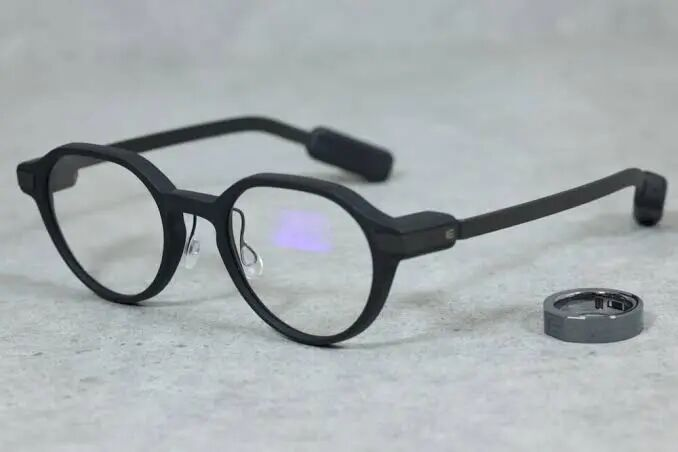
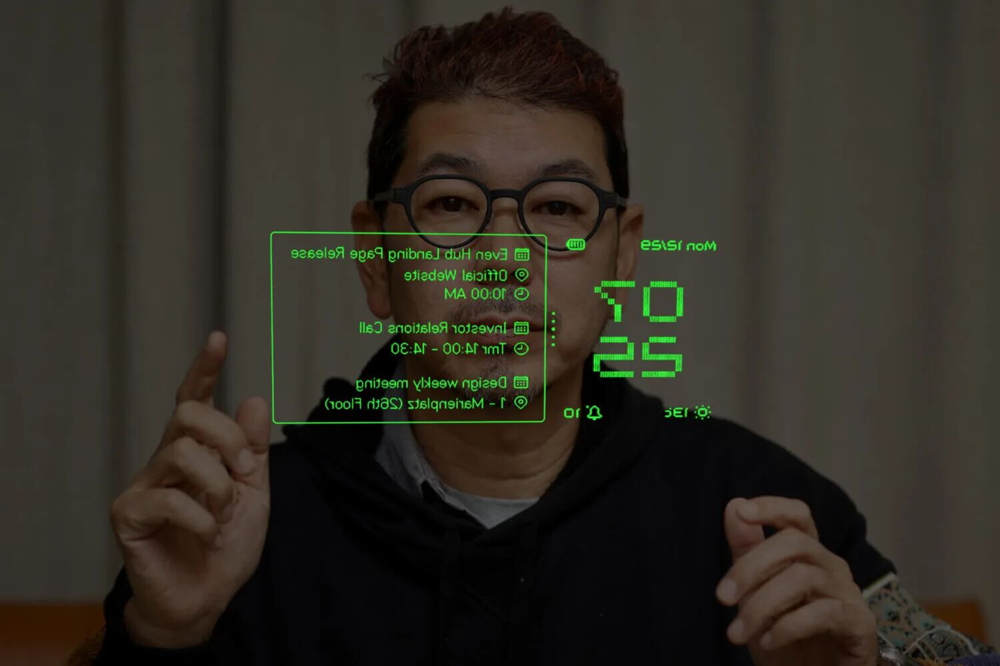
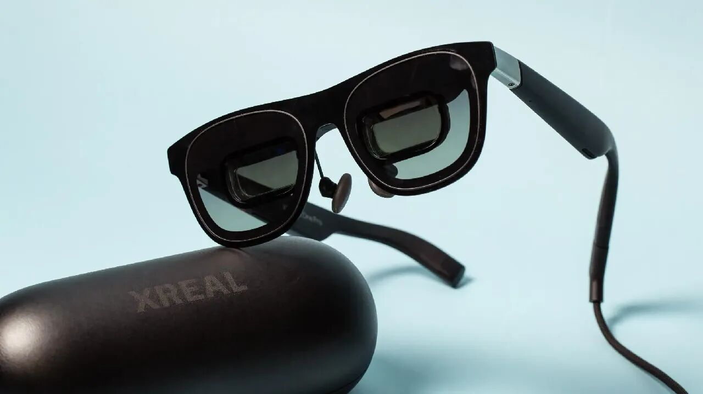
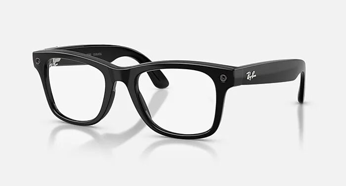
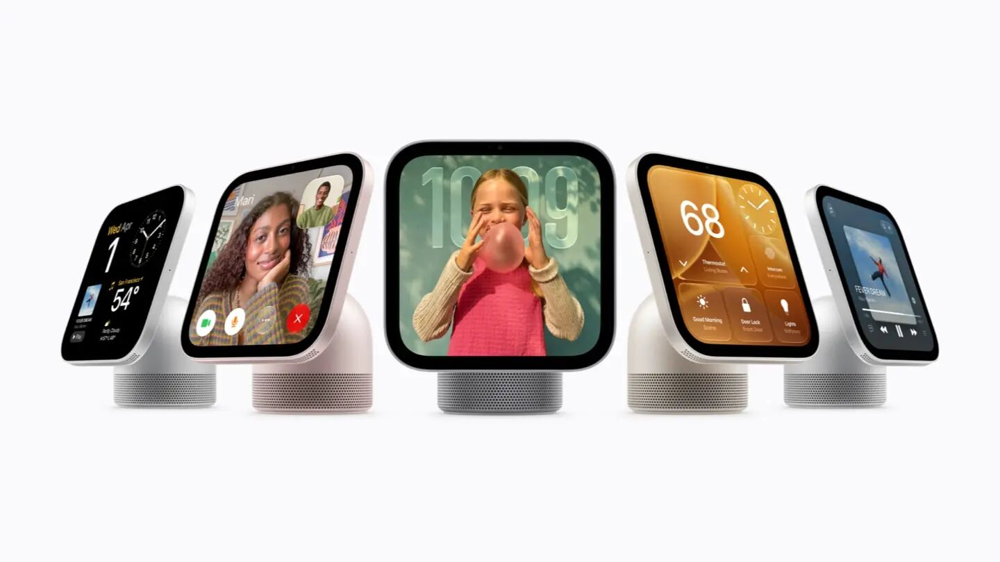
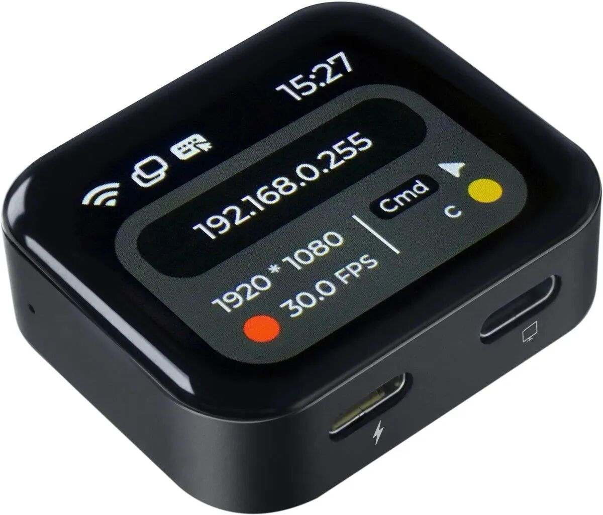

上周双十一，老冯刷到了不少智能眼镜的推荐，主要是 Rokid 和雷鸟。正好接下来一周连着有三场演讲，就想着干脆弄一副试试。

吸引我的是提词功能：戴上眼镜，光波导直接把五六行字投影到眼睛里，相当于随身带了个提词器。不用低头看稿，也不用盯着台下的屏幕，听上去挺有意思。

冲动消费之前我调研了一圈，最后看中了 Even Realities G2 和配套的 R1 戒指。简单说就是一副眼镜加一个戒指，手指拨弄戒指或者摸眼镜腿就能翻页。但这套东西买下来得七千块，单纯当个提词器实在太贵，我就在闲鱼上找了租赁，100 块一天，租了一周。

事实证明，这个决策非常英明。东西还是得上手用了才知道。

## 一、上手体验：提词和 Vibe Coding 都挺鸡肋

先说结论：拿它当提词器，体验很差。

最大的问题是**非常晃**。躺着一动不动看还行，可只要一扭头，那几行字就跟着眼球生硬地晃来晃去，根本看不清。我以前买过 Xreal 的观影眼镜，它会对画面做平滑跟随，扭头时画面稳得多；但这种轻量化光波导眼镜没有这个功能，字是死死钉在镜片上的。

讽刺的地方就在这：提词器的卖点本来是让你演讲时保持眼神交流，可眼神交流恰恰需要你不停扭头扫视全场。结果头一动字就晃，完全帮不上忙。

第二个问题是**漏光**。官网宣传的是隐形显示，实际情况是别人走近了，能隐隐看出你镜片上泛着绿光，一眼就知道你在看提词器。既不稳，又不隐形，戴在台上挺尴尬的。

最后三场演讲，我一场都没戴，白花了 700 块租金。但花 700 块钱租一周，省下了几千块吃灰钱，这笔学费交得太值了。这种低频场景的硬件，现阶段撑不起几千块的买断价，只撑得起一天几十上百块的租金。

另一个我本来寄予厚望、实际用下来也很鸡肋的功能，是 **Codex 和 Claude Code 的集成**。我之前一直畅想一种 Vibe Coding 的场景：躺在床上戴着眼镜，对着麦克风说话，它把指令发给 Codex，Codex 再把输出直接打到眼镜上。

实际折腾完发现，虽然确实能接上，但体验一言难尽。要我说，真不如顺手拿个 iPad 或者手机遥控一下好使。

## 二、智能眼镜的几种形态，为什么都撑不起买单？

老冯不是第一次折腾“智能眼镜”了。除了这次租的 Even G2，我之前还买过 Meta AI Glasses、Xreal One Pro，市面上几种主流品类基本都摸过一遍；其他类似设备也没少体验，Apple Vision Pro、HoloLens、Google Glass，外加几款头显和 VR。

拆开来看，不同形态的核心区别就是**输入和输出的排列组合**。输入端无非是触摸、戒指、手机、麦克风和摄像头；输出端无非是耳机播报、光波导投字、外接显示器，或者完整的 XR。按显示能力由重到轻排个序，大概就四类：

1. **空间计算形态（Apple Vision Pro）**：视觉和交互体验毫无疑问是独一档的，但它实在太重，严格来说已经算不上传统意义上的眼镜了。
2. **影院/显示器形态（Xreal 这类）**：一根线插手机上当外置显示器。出差在车上刷短剧体验挺好，后来给我妈拿去刷短剧了。这东西自成一家，买它就是为了看片，戴着走路非常奇怪。我也试过拿它办公，宣传上吹什么随身携带 150 寸大屏，实际体验跟真显示器根本没法比，本质上就是个头戴影院。

   

3. **轻显示光波导形态（Rokid Glasses、雷鸟 X3 Pro、Even Realities 这类）**：显示能力很弱，靠微型投影往镜片上打一小块单色或简单彩色的字。十几年前的 Google Glass 就是这个形态的先驱，当时惊为天人，就是太贵没做起来，现在两千块就能买到了。
4. **无显示拍照对话形态（Meta Ray-Ban）**：有麦克风、喇叭、摄像头，能拍照也能调 AI 对话，但彻底砍掉了视觉输出。反而是目前卖得最好、最成功的一类。

   

在这几种里，用光波导往视野里投几行小字，原本最像随身智能助理的样子。它现在主打的场景也就两个：日常翻译和演讲提词。

但你要问老冯这东西实用不实用，老实说，不实用：

- **演讲提词**：太低频了。我为什么不在闲鱼花五七十到一百块钱一天租一副？根本没必要花几千块买。
- **日常翻译**：现在的手机翻译、耳机翻译都已经非常成熟了，没必要专门为此戴副眼镜。

单看眼镜本身，我没看到什么杀手级场景。真要撑起这个品类的叙事，最后可能还是得靠 **Personal Agent**。

## 三、交互大原则：语音输入，视觉输出

顺着这个思路，聊聊 Personal Agent 的硬件形态到底该长什么样。

我觉得 Personal Agent 的交互核心原则只有一条：**Audio In, Visual Out（语音输入，视觉输出）。**

道理很简单，人的信息输入和输出通道是不对称的。动嘴说话是人类最方便、最快速的输出方式，比打字快得多；但获取信息时，带宽最高的通道永远是眼睛，而不是耳朵。

我一直很讨厌别人给我发 60 秒微信语音，每次都得手动点转文字。发语音的人确实省事，可很多语音前言不搭后语、重复冗余、一堆嗯嗯啊啊的口水词，听的人却得实打实耗掉 60 秒；换成文字，一眼扫过去一两秒就看完了。发语音本质上是方便了自己，把时间成本全转嫁给了听的人。

智能助理也是完全一样的道理。你用语音指挥它干活，没问题；但如果让它长篇大论给你播报一大段回复，就是在浪费你的时间。老冯绝大多数情况下根本没耐心听一个机器人在那叭叭念经，我宁可扫一眼屏幕，一目十行就看完了。

所以 Personal Agent 的交互必须以**视觉输出为主**，音频只适合做极简短的提醒，输出的大头一定要靠屏幕。这也是为什么过去那些纯音频智能音箱一直做不成助理，而往视野里投几行字的光波导眼镜方向其实是对的——只是现在的光学显示和续航都还没过关。

## 四、眼镜很尴尬，私密空间才跑得通

但仔细想想，就算显示效果、续航和便携全解决了，在 Personal Agent 这件事上，智能眼镜依然是个很尴尬的存在。

一个基本前提是：你想要秘书级的体验，就得给它秘书级的输入。不能光靠你在对话框里手动喂话，它得有一双眼睛和一对耳朵跟着你，看到你看到的、听到你听到的。

可一旦把这东西带到公共场合，就撞墙了。你戴着一副挂着摄像头的智能眼镜出门，说不定会被人打。别人一看你戴着这玩意儿，很可能立刻提高警惕，戒备心瞬间拉满。所以现在市面上反而是一些隐蔽式的硬件更好卖，比如安克的录音豆、各种录音卡、录音笔，藏在兜里或者别在衣领上，别人看不见。

但这种形态技术上可行，社会接受度上根本走不通。欧美早就立过法，私下录音本身极不道德，更何况你以为在记录自己的生活，实际上把别人的隐私全录进去了。经常出门或在公共场合活动，带摄像头和常开麦克风的穿戴形态很难成立。

反过来，**在家里这种私密空间，这件事其实是完全可行的。** 用户自己允许授权，没有公共场合的戒备和麻烦。

可在家里，眼镜又成了多余的选择——好端端在家待着，谁愿意架着一副眼镜看几行绿字？在私密空间里，最合适的形态其实是**带屏幕的智能音箱**（比如苹果一直在做的带屏 HomeView/ 家庭中控屏）：满足语音输入、屏幕视觉输出，最好再配一个摄像头，你想给它看份纸质文件或者什么东西，直接拿到镜头前面就行。

## 五、旧手机 + ESP32 底座，一个被低估的形态

再往深想一层：我们其实根本不需要重新研发一台带屏智能音箱。

**手机本身就已经是这个形态了。** 摄像头、麦克风、高清显示屏、外放喇叭、甚至私密听筒，手机一应俱全。出门在外你不可能一直端着用，但在家里，只要把它往底座上一插，问题不就全解决了吗？

Personal Agent 真正需要的能力是**常驻在线**——稳定供电、后台常驻运行，不能像日常用手机那样几十秒就熄屏休眠。只要把旧手机插在桌面充电底座上，常亮供电，配一个常驻软件，它天然就是一个体验极佳的智能助理终端。

而且，这个充电底座还可以玩出更硬核的形态：

1. 在 USB-C 底座里塞一块 **ESP32 芯片**，配合开启开发者调试模式；
2. 让底座变成一个**微型 KVM**，直接对外模拟鼠标和键盘，同时读取虚拟显示屏的画面。

这招妙在哪？如果你直接在手机里装个 Agent 软件去操控其他 App，系统权限卡得很死，很多软件根本不给你调，甚至直接封杀；但通过底座里的 ESP32 去模拟外部物理键鼠、读取屏幕，就彻底绕开了软件层的限制——对系统和 App 来说，它纯粹就是在模拟真人在看屏幕、点手机，完全合法合规，什么软件都能操作。

其实这个已经有了，NanoKVM Go+ Pro，不过这玩意五六百块钱。比起 ESP32 还是贵了。

这么多年，大家家里抽屉里总躺着几台换下来的二手旧手机。买一个几百块钱、内置 ESP32 芯片的 USB-C 底座，把淘汰下来的旧手机往上一插，常驻跑一个 Personal Agent 软件：屏幕、麦克风、摄像头、常驻供电、物理级操控能力全齐了。

我不知道现在市面上有没有人做过这东西，但我觉得如果真能把成本压到几百块做出来，这样一个小底座绝对能卖爆。

## 六、超越时代的 Vision Pro

旧手机加底座，是眼下最务实、最容易落地的形态。但如果聊回文章开头那个头戴设备和 Vibe Coding 的执念，最后老冯还是想提一下 **Apple Vision Pro**。

前面说过，它其实已经不算传统意义上的智能眼镜了。但作为一个头戴显示设备，我依然认为市面上没有任何其他产品能够超越 Vision Pro 的体验。哪怕放到今天，它依然是科幻级、独一档的存在——那块 5K 级别的显示效果，是真的能拿来当办公显示器用的。

我觉得如果是家庭办公，Vibe Coding，Vision Pro 就是最理想的形态：用眼球移动锁定窗口、切换上下文，配合语音录入指令，再加上手势操作，这就是办公场景下最好的智能交互样式。

苹果最大的失策，就是把价格定得太高了。卖 3 万块钱，注定了曲高和寡。以苹果的现金储备，如果当年像 PS5 / Switch 这种游戏主机厂商一样——先亏钱补贴铺开硬件、把市场品类做大，后面再靠软件生态赚钱，给它定价 1 万块钱，纯亏本补贴去卖，让用户掏一部 iPhone 的钱就能买到 —— 那可能真就没其他家什么事了，这事或许就做成了。

[在微信原文第六节观看这段视频](https://mp.weixin.qq.com/s/bHg_7H6fZAdbjC1cRyECxA#:~:text=%E8%BF%99%E4%BA%8B%E6%88%96%E8%AE%B8%E5%B0%B1%E5%81%9A%E6%88%90%E4%BA%86%E3%80%82)

可惜这种打法苹果玩不来。老实说，Vision Pro 也确实生不逢时，提早了几年。发布那会儿内容生态太匮乏，根本没有配套的软件能撑起这么顶级的硬件。

但现在不一样了。在这个 AI 驱动的软件爆炸时代，独特且强大的硬件，反而终于能释放出独特的体验。比如现在如果让我给自己搭一套 Vibe Coding 指挥台，最理想的平台绝不是那副晃眼睛的光波导提词眼镜，而是 Apple Vision Pro。

以前上面没有趁手的开发工具，但现在我要是有空，完全可以自己给自己做一个定制版的 T3 Code / Codex 界面，专门针对 Vision Pro 优化，让我靠眼球和手势，在不同的上下文之间纵横捭阖。

*原文发表于[微信公众号「老冯云数」](https://mp.weixin.qq.com/s/bHg_7H6fZAdbjC1cRyECxA)。*
