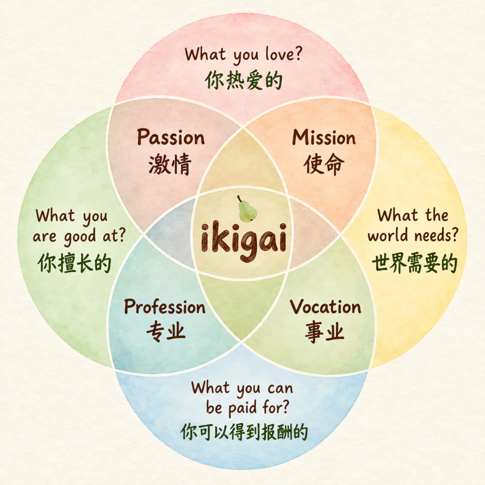
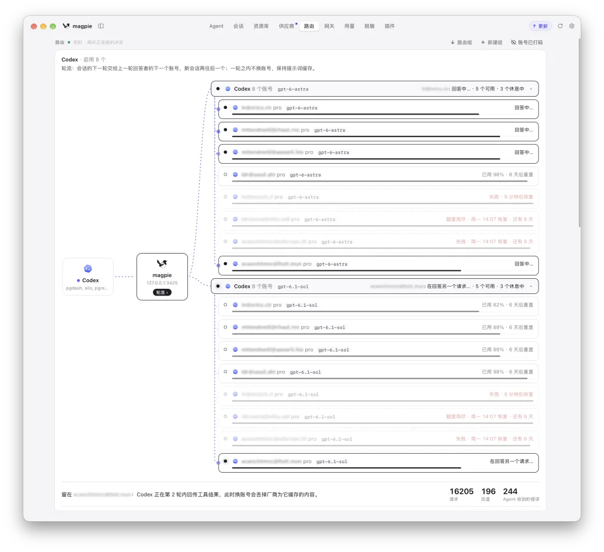

总有朋友问我：“老冯，你拿着 15 个 200 刀的订阅在那儿哐哐烧，到底在做什么东西？”

其实很多产出我之前写文章介绍过，基本上五花八门什么都有。借用投资的概念来说，AI 让“试仓”的成本几乎归零——在如此高密度的 Vibe Coding 下，我脑子里第一时间能想到的主意，基本都已经动手刷过一遍了，有好有坏，有成功的也有失败的。

试完一圈之后，我越来越清楚一件事：试仓可以靠算力广撒网，但“重仓”不行。并不是所有有趣的想法都适合我去做，硬做出来、不去维护，最后也只是数字垃圾。

这就涉及到了 Vibe Coding 最核心的问题：选题。

## 一、选题第一原则：自用

我之前聊过，在 AI 时代做软件工程，人真正不可替代的主要是两件事：

1. 提供创意、点子和愿力
2. 负责工程验收、分发与信任构建

第二件事偏重工程实践与技巧，之前聊过很多次；今天我想重点聊聊第一件事——选题。因为算力可以买，但愿力买不来。哪怕你有再多的 Token，15 个 Agent 并行在跑，它们最后全都得排着队等你一个人去 Review。你的注意力、心力和上下文带宽，依然是绕不开的物理瓶颈。

在这个阶段，决定做什么、不做什么，往往比怎么写代码更重要。

在用 AI 趟过几十个大小项目之后，我总结出了一条简单朴素、但非常管用的经验法则：

- 凡是我自己真正要用的东西，最后都在某种意义上成功了。
- 凡是我自己用不上、纯粹凭空想象或为了好玩写出来的东西，最后基本都失败了。

## 二、Ikigai 的四个圈，哪个被 AI 改了

以前聊职业选择或做事的动力，经常会提到一个“人生意义” Ikigai（生きがい）模型，它由四个圈的交集构成：

1. 你喜不喜欢它（热爱）
2. 你擅不擅长它（技能）
3. 它能不能赚钱（商业）
4. 世界需不需要它（价值）

在过去，“擅长”是一道很高的门槛。一个搞底层架构的工程师想要写一个顺手的前端框架或桌面工具，光是去啃陌生的工具链和语法细节，摩擦成本就足以劝退大半的人。那时候你可能有很多好点子，但因为缺乏对应的专业技能，根本做不出来。

然而现在，这四个圈里有三个正在被 AI 改写：

- “擅长”被大幅拓宽： 门槛从“能亲手写出来”，降到了“能看出 AI 写得对不对”。只要你有基本的工程审美和判断力，AI 就能帮你补齐手艺上的短板。
- “能赚钱”的底线被改写： 过去开发成本高，只有大众需求才值得立项；现在实现成本大幅下降，很多过去算不过账来的小众长尾需求，也变得划算了。
- “世界需要”遭遇了软件通胀： 当任何人周末都能用 AI 搓出一个应用时，供给就过剩了。现在不缺软件，缺的是可信的软件。问题从“有没有”变成了“信不信”。

唯独第四个圈——“你喜不喜欢（热爱）”，是 AI 替你画不了的。AI 可以替你写代码、查资料、跑测试，做软件，但 AI 没有“Want（想要）”，它不能替你渴望一个东西。

按照约束理论，一个系统的最终产出取决于最窄的那个瓶颈。当“专业技能”的门槛被 AI 大幅削平之后，软件工程的瓶颈，就迁移到了人类的“意愿与热爱”上。

题外话：日语里原本的「生きがい（Ikigai）」其实跟赚钱没什么关系，它本来的意思就是“让你每天早上愿意起床的那件事”——热爱。我们常见的四圈韦恩图其实是 2014 年前后一位西方博主糅合出来的二创版本。某种意义上，AI 的出现，恰好把被功利化的 Ikigai 又拉回了它原本的意思。

## 三、热爱在工程上到底意味着什么？

聊“热爱”很容易滑向心灵鸡汤。但在工程里，“热爱 + 自用”不是一种空泛的情绪，而是四套实打实的工程机制：

**第一，它决定了方向的真实性。**
: AI 能跑一万步，但往哪走得有人指路。如果是你自己每天要用的东西，需求是具体、带痛感的；如果是凭空想出来的点子，需求只能靠脑补。想象中的用户永远不会给你提 Issue，一个真实用户的反馈，好过脑补出来的一万个人。

**第二，它是对抗 AI “均值平庸”的判别器。**
: AI Engineering 的瓶颈不在生成，而在验收。AI 的输出本质上是概率均值，天然趋向于 80 分的及格线。如果你做的是一个自己不用的东西，验收时很容易糊弄过去，“编译通过、界面能看”就放行了。只有你自己每天重度使用，才相当于在做持续的集成测试。你会因为一个报错信息不够清晰、一次多余的点击而觉得别扭，进而拉着 AI 改上十几轮——这股把 80 分推向 95 分的劲头，就是工程品味。

**第三，它是跨越“最后 20%”的续航力。**
: AI 把从 0 到 80% 的原型阶段压缩到了几个小时，但软件工程真正耗人的，是从 80% 到 100% 的脏活累活：打包、兼容、写文档、处理升级、修补边缘 Case。更现实的问题是，项目做大之后总会撞墙——上下文开始腐烂，AI 开始原地绕圈，架构面临失控。现在 GitHub 上很多 AI 生成的仓库，最后一次 Commit 都停留在建仓后的第二周，原因很简单：作者自己不用。外部动机驱动的项目，撞上第一堵墙往往就弃坑了；只有“我自己每天还得用它干活”的实际需求，才能推着你耐下性子帮 AI 拆模块、做重构。

**第四，它提供了穿越周期的韧性。**
: 聪明人做选题习惯先算 ROI（投资回报率），但账面上划算的地方人人都看得见，早就挤满了人。而热爱会推着你去干那些“账面上看着不太划算”的苦活。相比于纯粹为了糊口打工、盯着短期回报的人，真正有热爱的人往往不计较一时的得失，坐得住冷板凳——既不会因为某个风口突然大火就盲目凑热闹，也不会因为所做的事一时无人问津就轻易弃坑。那块地方之所以没人跟你抢，恰恰是因为精明人算完账之后都摇摇头走开了；而你的韧性，能让你在别人走开的地方一直待下去。

这些机制，会引领你走向难以复制的“独特处境”。当你靠着热爱与韧性持续深钻，一步步走到无人之境时，你自然就会进入一个极其独特的处境。
独特处境不是天上掉下来的，而是热爱推着你一路深挖之后，自然长出来的护城河。

举个例子，世界上喜欢 PostgreSQL 的人很多；但既能深度使用、懂底层运维，常年在生产一线管过超大规模集群，又具备过硬的工程能力能把这套经验抽象成可复制的开源 PostgreSQL RDS 方案与 Linux 原生发行版，甚至靠一个人把这整摊事全包下来的 —— 这几个条件叠在一起，全世界只有老冯一个。

## 四、审视过往：一号用户的“回本”逻辑

拿这个标准去审视老冯过往的开源项目，脉络非常清晰。

最典型的例子是 Pigsty。很多人以为它是一个中小规模的 PG RDS 高可用方案，其实不是——它从第一天起就是一个 PostgreSQL 舰队管理方案。舰队规模可以小到一个实例，也可以大到一万个实例，但它的底层架构是冲着大规模集群管理去设计的。

为什么 Pigsty 能立住？因为我自己和客户确实有大规模数据库集群需要管理。后来 Pigsty 也开始向个人 PostgreSQL Runtime / Devbox 的方向演进，我自己所有的基础设施——包括家里局域网的 6 台机器，以及生产环境的 6 台机器——全是用 Pigsty 管起来的。

在 Pigsty 这个项目里，我自己就是一号用户。我很清楚自己作为管理员和 Ops，甚至是个人开发者需要什么样的东西。从这个角度看，Pigsty 在开源发布之前就已经不会亏了——只要我自己用着顺手、把自己的集群和机器管好了，这笔研发投入在发布的第 0 秒就已经回本了。至于后来它在开源社区和商业上取得的回报，都是“自用回本”之外的额外红利。

- [什么是 PostgreSQL 发行版？](/pg/what-is-pg-distro/)

- [Pigsty Star 破 5000，一个人的 PG 发行版](/pigsty/star-5000/)

- [打造一个立足中国，面向世界的 PG 数据库发行版](/pg/forge-a-pg-distro/)

顺着这条线往下看，还有几个具体的例子：

### 认清热爱的刻度：对象存储（Silo）
热情是有梯度的，得根据自己实际使用的深度，去匹配工程的野心。比如对象存储，我对它的依赖程度和使用深度，足以支撑我去接盘并维护一个上游跑路的开源对象存储，给它打安全补丁、修 IAM 权限和 Object Lock；但远远没到“我要从零手搓一个全新对象存储引擎”的地步。知道自己用得多深，就知道步子该迈多大，不越界就够了。

- [MinIO 周年祭：如何让死掉的开源项目重生](/db/minio-silo-1year/)

- [Silo 发布：兼容 S3/MinIO 的开源对象存储](/db/long-live-silo/)

- [MinIO 已死，MinIO 复生](/db/minio-resurrect/)

### 痛点倒逼的演进：文档框架 Oink

我一个搞数据库的，为什么要自己写文档框架 Oink？因为我确实有大量的文档要写。无论是 PostgreSQL 与 Pigsty 的工程文档，还是我现在日常使用的“文档驱动（Doc-Driven）”AI 开发流程，都需要一个顺手的内容组织与分发底座。 以前我的站点比较杂乱，有的用 Hugo、Docusaurus、Hextra，有的用 Mintlify，还有的用 Nextra 和 Next.js 挂在 Vercel 上。后来实在受不了这种割裂感，干脆自己动手做了 Oink，把博客、写书、技术文档、甚至图库展览的需求全部收敛到了同一个框架里。

- Oink：蒸馏 Anthropic 官网风格

- [Oink：用 Markdown 快速创建美观的现代网站](/ai/oink-intro/)

- [OINK：文档框架这件事，折腾了六年，终于靠 Codex 毕业了](/db/oink-release/)

现在，我本地和线上的 40 个网站全部跑在 Oink 上。它的每次发版没有什么宏大的路线图，纯粹是因为“新开了一个站，缺某个功能”，就顺手加上。结果这么一版一版迭代下来，不仅我自己的客户开始用它建站，外部也有 Apache 顶级项目迁移了过来。虽然它现在只有 100 多个 Star，但在文档框架这个赛道里，作为每天跟它打交道的一号用户，我对它很满意，这就够了。

同样的逻辑也发生在 PG 包管理器 Pig、仓库管理器 Sow，以及我还没正式发布、但已经在内部日常使用的虚拟机管理器 Barn 上。它们能持续演进，全是因为我自己每天都在真刀真枪地用。

## 五、热爱的到底是钉子，还是锤子？

那不成功的反面例子呢？其实也不少。我之前做过一些花哨的尝试，比如用 AI 把 etcd、MinIO 或者 S3 协议硬嫁接到 PostgreSQL 上。这种东西做出来的时候挺有成就感，发出来也有点噱头。但冷静下来想，这种“架构杂耍”除了图一乐之外，我自己生产环境会用吗？不会用。既然自己都不用，发出来又有什么实际价值呢？

复盘这些废案时，我厘清了一个很关键的区别：你喜欢的到底是“做”的过程，还是“用”的结果？或者说，你喜欢的到底是锤子，还是钉子？ Vibe Coding 是自带多巴胺的。输入几句提示词，看着代码瀑布流一样刷出来、跑通编译，这种体验很像在赌场拉老虎机，SSR 抽卡。很多人在拿到 AI 之后疯狂开新坑，以为自己充满了创造欲，但实际上，可能只是沉迷于“挥舞大锤的快感”，并不在乎那颗钉子本身。

怎么区分自己是爱锤子还是爱钉子？在决定投入精力“重仓”之前，可以用这几个问题做个自检：

- 这个需求，是在你拿到 AI 这把锤子之前就困扰你的，还是拿到锤子之后为了找事干才“发明”出来的？
- 写完之后，它今天就会进入你的日常工作流、替掉某个旧工具吗？
- 如果发到网上没人给 Star、没人关注，你还会继续维护它一年吗？
- 项目里最枯燥、最繁琐的那 20% 脏活，你愿意耐着性子带 AI 一起啃下来吗？
- 如果它半夜坏了，你会受影响吗？

如果答案是否定的，那你大概率只是喜欢挥锤子。

## 六、逆定理：如何挑选别人的开源软件？

反过来看，“自用与热爱”不仅是一条选题原则，也是一条很实用的选型原则。

前面提到，AI 时代的软件供给过剩，大家缺的是信任。怎么在满是半成品的 GitHub 里挑出靠谱的轮子？我现在的标准很简单：看作者有没有 Skin in the game（切身利益）——看他自己到底用不用、在不在乎这个作品。

“作者自己每天都在重度使用”，是开源世界里最硬的背书，比写得再漂亮的 README 都管用。

比如我最近在用的开源软件 magpie。它解决的是一个很具体的痛点：当你手里有十几个不同厂商、不同账号的 AI 订阅时，如何把它们统一接入到一个网关，再去对接给底层的不同 Agent——这是一个典型的 N x N 路由与管理问题。

市面上同类的开源网关我看过不少，最后选了 magpie。原因很简单：作者 yetone 我认识，在 X 上互关，他自己就是重度使用者，非常喜欢折腾这个工具，每天都在高强度自用。你会看到他保持着高频发版的节奏，各种细节痛点都会及时跟进修复。

这种由作者自身需求喂养出来的软件，用起来自然就踏实。而且你也能从它的设计逻辑中反推学习到一些使用技巧，发掘出自己都没有意识到的需求。

## 七、结语

回到最开始的问题：手握无限 Token 算力，我们到底该做什么，如何选题？

AI 越强，凭空造物的诱惑就越大；但越是在算力唾手可得的时候，越要守住那条最朴素的边界——不要去替想象出来的用户写软件，去为你自己写软件。

当“擅长”不再是高不可攀的门槛，算力变成了按月付费的水电煤，你对真实工程细节的在乎、挑剔与持续打磨的愿力，才是唯一买不来的生产力。
