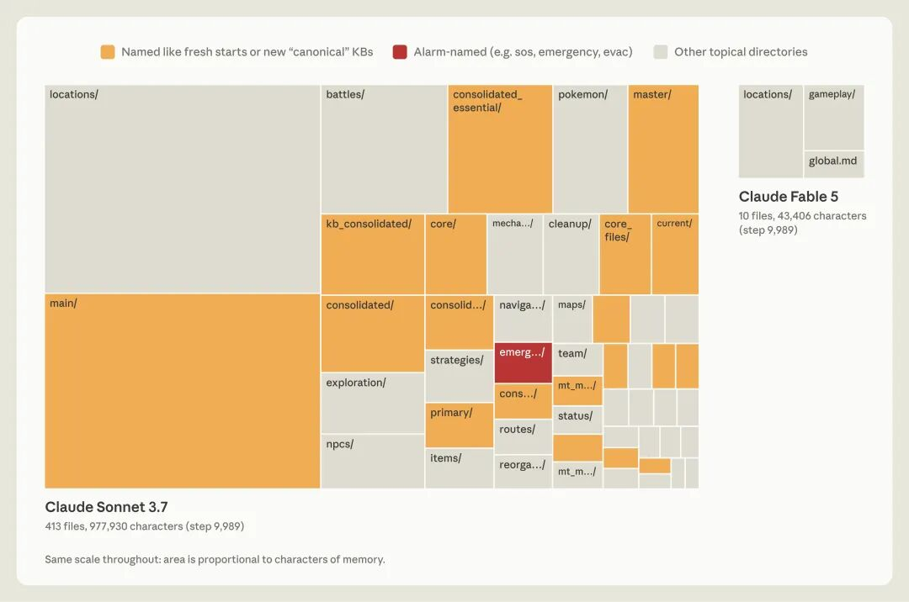
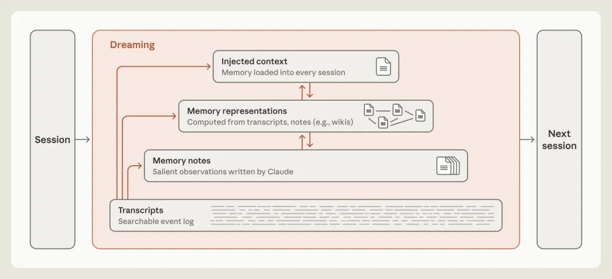
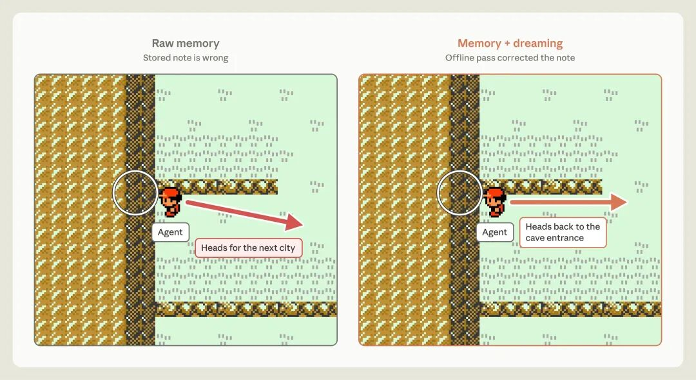
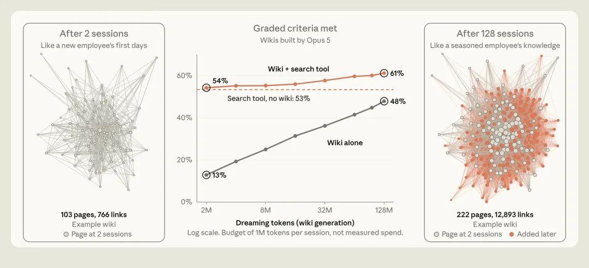

On November 6, Anthropic published an engineering post, [The components of agent memory](https://www.anthropic.com/research/components-of-agent-memory), walking through a clean set of experiments on how agents accumulate experience across sessions. It's an excellent piece on a question I've returned to several times this year: **[Where is the real moat in agents?](/en/ai/agent-moat/)**

My take is straightforward. The opportunity isn't in the agent itself; it's in the environment it runs inside—the **Agent Runtime**. Agents themselves have no moat.

Until now, all I had to back that up was field intuition from daily production work, not hard benchmark data. On the surface, Anthropic's post is about "memory." Read closely, though, and their numbers come down squarely on the side of the environment.

## 1. What Anthropic Found

Start with the punchline: **the hard part of memory isn't how you store it; it's what you choose to write down. Capable models only record what they can't already see in the environment.**

The clearest proof comes from their Pokémon experiments. Playing while taking notes, Sonnet 3.7 frantically wrote 413 files (nearly a million characters of notes) and walked away with just 1 Gym Badge. Fable 5 wrote 9 files totaling just over 40,000 characters, and won 4 Gym Badges.

The difference came down to what each model recorded. Sonnet 3.7 wrote down everything it saw, copying transient state straight off the screen into its notebook, where it promptly went stale as the game moved on. Fable 5 followed the exact opposite rule: if something was visible on screen, it ignored it, recording only what the screen couldn't tell it—strategies, plans, and verified rules. Sure, the two models sit several generations apart, so this isn't a strictly controlled comparison, yet the directional lesson is unmistakable.

Where does that selectivity come from? A second set of experiments gives the answer: from the model itself. Hooked up to the exact same memory harness on CL-Bench, Opus 5.5 jumped from `0.655` to `0.838`, while Sonnet 4.6 barely budged from `0.330` to `0.364`. Strong models know how to tie rules, supporting evidence, and past pitfalls together into coherent notes; weak models just pile up unverified guesses. Flip it around and try to micromanage a strong model with rigid human rules (say, mandating "only record failures"), and the gains from memory actually shrink.

> The corollary is uncomfortable: most of today's "agent memory frameworks" are temporary scaffolding with a short shelf life. Only the model itself knows what's worth remembering. Give it direct access to a filesystem or a database and it can design whatever structure it needs on the fly, with no pre-baked human priors required.

[The Three-Way Endgame: Why Agent Memory Frameworks Are a Dead End](/en/ai/agent-memory-framework/)

One last question: what happens when the model writes down something wrong? In one Pokémon run, the agent recorded a bad route and spent three full loops grinding into a dead end inside Mt. Moon before giving up. Anthropic's fix is **dreaming**: replaying raw session logs offline to correct bad notes and consolidate scattered fragments into an interlinked wiki. Once that bad route note got fixed, the agent walked right through the passage where it had been stuck.

Put the whole post together and the logic is simple: let the model decide what to remember, record only what the environment doesn't already show, and reconcile against the raw logs whenever a note goes wrong.

## 2. Memory Is the Complement of the Environment

Read "only record what you can't see in the environment" in reverse, and you get the real principle: **memory is the complement of the environment.** Anything the environment can tell you directly doesn't belong in memory. The more legible the environment, the less memory an agent has to lug around.

I know this [from firsthand experience](/en/ai/dba-agent-body/).

Back in January, I shipped a [DBA Agent](/en/ai/dba-agent-body/). I didn't build a custom harness, write a single line of Python, or wire up any memory middleware. The entire thing was one plain `agents.md` file: I dropped in the [directory index of my documentation site](/en/ai/rag-is-dead/), then told it where monitoring lives in the environment, where the databases sit, how to fetch credentials, and where to look when something breaks.

One text file, and the DBA Agent was live.

Sounds almost comically crude, right? Yet it wasn't a toy. Plenty of users run this exact setup in production today, and it works far better than they expected. As I shared earlier in [my post on crossing a million visitors](/en/misc/pigsty-opc/), requests to my documentation site surged, with [over 90% of that traffic](/en/ai/agent-traffic-100x/) coming straight from these agents.

Why didn't it need a complex memory stack? Put bluntly, **every agent problem eventually boils down to [context and environment management](/en/ai/sdd/).** As I argued earlier in my [critique of DS SuperAgent](/ai/ds-super-agent/), job one in building agents is always designing the context.

Designing an environment is a lot like starting a company. You set up an org chart and split up responsibilities, because what you're really building is a system of operating rules—legislating order into existence: where the tools live, where the boundaries sit, what's allowed, and what's off-limits.

Once that environment is legible and the rules are in place—[metrics and logs queryable in monitoring whenever needed](/en/ai/dba-agent-body/), operations consolidated into CLI commands, conventions and parameters spelled out clearly in documentation—an agent can move right in with nothing but a carry-on. All that's left for it to remember are things like "what quirks this customer has" and "[why we made that call last time](/en/ai/sdd/)." A small scratchpad is plenty. Drop that same agent into an [opaque black-box environment](/en/ai/agent-moat/), and it has to frantically scribble down "which parameter got changed yesterday" and "which machine is running out of disk."

The more an agent has to remember, the more mistakes creep in. Get even one note wrong, and it's trapped in another Mt. Moon it can't walk out of.

That's why the real moat lies in a well-designed context environment.

## 3. The Environment Is the Real Moat

**The moat was never the agent. It's the runtime environment itself.**

I've long thought most pure-play agent startups are kidding themselves. The agent layer holds zero defensible moat; whatever thin scaffolding you build there gets absorbed by the model providers within months.

Think you'll build a moat with a homegrown harness? Good luck beating Claude Code, Codex, Pi, or Hermes with a random custom wrapper. Step back from general frameworks and build a vertical "Data Agent" or "Legal Agent" instead? Still dead on arrival.

Among all agents, **the coding agent is the crown jewel, and the hardest one to build.** Writing code is a universal meta-skill—at its core, it's the ability to invent tools to solve problems. When existing tools fall short, a coding agent builds a new one on the spot.

Why assume a rigid, pre-baked workflow you sketched on a whiteboard will outperform a coding agent that builds its own tools? Or that the memory schema your framework hardcodes into a database will beat whatever structure the model generates on demand? The odds of either are close to zero.

My DBA Agent is just Codex or Claude Code plus an `agents.md` file, running inside a Pigsty environment. Every vertical piece lives **in the environment**, not in the agent.

All the clever tricks and hard-won know-how accumulated inside `agents.md` and `SKILL.md` are ultimately just ideas. Copyright protects expression rather than ideas. Within a few months, those prompting tricks get washed straight into the next pretraining corpus and absorbed directly by the base models.

So what actually has a moat? The environment the agent runs in. There's an old Chinese saying: *even a mighty dragon crossing the river can't beat a local snake on its own turf.* General-purpose LLMs and coding agents are the dragons. That `agents.md` file is just a map: zero moat, free for anyone to copy. Except copying the map gets you nowhere, because you can't copy-paste the turf it points to: build pipelines for 600+ extensions across 16 Linux distributions, battle-tested HA and PITR automation, and an end-to-end monitoring stack. **A local incumbent's moat isn't the map in its hand; it's the ground under its feet.**

That's also why Personal Agents and "Personal Computer 2.0" have caught fire lately: giving an agent its own computer means giving it a plot of turf of its own. And if the moat lives in the environment, how do you lay its foundation? The second half of Anthropic's post hands us a ready-made list of pitfalls.

## 4. A Hammer Looking for Nails

In the second half of the post, Anthropic lists a string of engineering headaches, nearly all of them around "dreaming" and wiki maintenance. To a database engineer, though, every single one is an old problem the database world solved decades ago:

| What Anthropic Hit | What Databases Call It |
| --- | --- |
| Multiple agents writing to a shared table dropped 16 of 57 facts | Lost Update |
| A second dreaming pass dedicated to fixing 9 broken links | Foreign Key Constraints |
| Keeping memory fresh without full rescans | Incremental View Maintenance (IVM) |
| Scheduling dreaming runs by access frequency | `autovacuum` Thresholds |

Step back and look at the overall architecture: [raw logs are the WAL](/ai/ds-super-agent/), serving as the [Single Source of Truth](/en/ai/db-fs/); notes and wikis are materialized views; and "dreaming" is essentially offline batch processing plus `VACUUM`.

Of course, I'm a database guy: when you're holding a hammer, everything looks like a nail. And I've certainly been swinging this hammer for over half a year. From [*Agent OS: We're Building DOS Again*](/en/ai/agent-os/) and [*AI Says: I Have Intelligence, But Not a Life*](/en/ai/ai-conscious-again/) to [*The Three-Way Endgame*](/en/ai/agent-memory-framework/), I made the same call across multiple essays: the endgame of agent memory is a database.

Yet after six months of heavy daily use in the trenches, I've had to revise that call: we haven't even hit the database bottleneck yet. Right now, **disciplined [Markdown knowledge management](/en/ai/sdd/) is what agents actually need.**

## 5. Markdown and Wikis

Anthropic's own benchmark numbers back this up. They had an agent "dream" over a pile of raw source material to compile an interlinked wiki, then tested question-answering accuracy: searching raw transcripts alone hit 53%, reading the wiki alone hit 48%, and combining the two jumped straight to 61%, while saving roughly 20,000 tokens per question on average. [Raw facts plus low-level retrieval](/en/ai/rag-is-dead/) form the foundation (that's a job for databases), but you get the best results when you stack a [well-structured wiki](/ai/ds-super-agent/) on top.

And what is that wiki, really? Just a well-organized collection of interlinked Markdown files.

"Dreaming" is expensive. Anthropic burned hundreds of millions of tokens compiling that wiki; at top-tier model pricing, rough math says you'd need thousands of queries just to break even. Letting every feral agent dream on its own will never pencil out. Maintain a [high-quality shared wiki up front](/en/ai/sdd/), though, and let [every incoming agent read it repeatedly](/en/ai/rag-is-dead/), and the economics work out handsomely.

This is also why I've spent serious time lately building [Oink](/en/ai/oink-intro/). On the surface it's a documentation framework, but you can just as easily view it as a Markdown-based wiki knowledge base. Every open-source project I start now ships with a wiki like this as standard issue.

[How Do You Audit a Mountain of AI-Generated Crap?](/en/ai/sdd/)

I write software the same way now. I call it **SDD** (Spec-Driven Development, though I prefer calling it *Documentation-Driven Development*): concentrate all core knowledge into the project's wiki. It's miles better than letting agents treat `docs/`, `research-notes/`, and `reports/` like an open litter box. Left unchecked, uncurated status dumps pile up with nobody maintaining them—contradicting each other and drifting out of sync across versions until your repo is a minefield of stale "Mt. Moon notes" waiting to blow up.

I haven't run formal benchmarks or quantitative studies the way Anthropic did, but the day-to-day difference is unmistakable: once those rules are in place, AI engineering works dramatically better in practice.

## Conclusion

Back to the opening question: where is the real moat in agents?

In my view, the real moat lies in a reproducible, well-ordered, high-information-density context environment. For a Data Agent, a lovingly crafted analyst-guide skill isn't a moat—a database schema and catalog where every column carries accurate, detailed comments is. For a DBA Agent, an SOP runbook isn't a moat—an environment with end-to-end monitoring and IaC/CLI management tooling is.

Memory is the complement of the environment. The best context management is building an environment where the context is already in place, ready for a coding agent to explore on its own. Whoever owns that environment is the local snake on its home turf.

> Shameless plug: [Pigsty](https://pigsty.cc) gives your Personal Agent a self-hosted, fully controllable digital home.

## References

- [The components of agent memory](https://www.anthropic.com/research/components-of-agent-memory), Anthropic, 2026-11-06
- [Agent OS: We're Building DOS Again](/en/ai/agent-os/), 2026-01
- [AI Says: I Have Intelligence, But Not a Life](/en/ai/ai-conscious-again/), 2026-03
- [The Three-Way Endgame: Why Agent Memory Frameworks Are a Dead End](/en/ai/agent-memory-framework/), 2026-04
- [OpenAI hires OpenClaw creator](https://www.tomshardware.com/tech-industry/openai-hires-genius-openclaw-creator-but-popular-ai-assistant-will-remain-open-source-sam-altman-says-creator-will-work-on-smart-agents-in-new-role), Tom's Hardware
