At a recent Tsinghua Software Forum talk ([*After The Mythical Man-Month: How Far Can a One-Person Database Company Go?*](/ai/thu-opc-talk/)), the most common question from the audience was simple: when dozens of coding agents are writing code, translating books, and fixing bugs in parallel, how does one person keep any of it under control? I split engineering into three stages—design, coding, and testing—and put **[documentation-driven development](/en/ai/sdd/)** first. Principles are easy to state, though; what actually holds that workflow together every day is a Hugo documentation framework I threw together three and a half months ago: **[OINK](https://oink.pgsty.com/)**.

People often ask why someone maintaining a PostgreSQL distribution spends this much energy on a documentation theme. The math is straightforward.

## 1. Why I Treat a Documentation Framework as a Core Product

The original goal behind [OINK](/en/db/oink-release/) was modest: maintain docs in plain Markdown and standardize a dozen sites on one framework. I was tired of Docsy looking dated and dragging Node and PostCSS along with it, and I had no interest in locking a few pages of documentation into MDX and Next.js. What turned it into a core product, though, were two hard requirements that surfaced once coding agents entered my daily workflow.

### 1. Protecting Attention: Review Agents Through Docs, Not Raw Diffs

The scarcest resource in AI engineering isn't compute—it's human attention bandwidth. *Attention is all you need.* When one person manages dozens of agents at once, the slowest and dumbest workflow is chasing behind them line by line through diffs, or digging through a pile of `PLAN.md`, `NOTES.md`, and `REVIEW_FINAL_v3.md` files dumped in the repo root. There is only so much loose text a human eye can parse in a day before trivial details burn you out.

My fix is direct: **turn the documentation site into the interface between me and my agents.** Architecture proposals, decision records (ADRs), security audits, and acceptance checklists no longer pile up as stray drafts; they go straight into a companion docs site organized as a clean tree—navigation on the left, outline on the right, comparison tables, architecture diagrams, and version history down the middle. I open a browser tab, scan the page, and send anything off-track back for a rewrite. You can skip reading code line by line, but you have to grasp the high-level design and acceptance report at a glance.

Once that base feels frictionless, everything built on top of it moves. Taking over where MinIO left off with [Silo](/en/db/long-live-silo/), rewriting Vagrant as [Barn](/en/db/barn-intro/), adopting several PostgreSQL extensions, and translating over thirty database books—every project got a clean OINK companion site from day one, and that is what made the whole cadence click.

### 2. The Currency of Trust: Written for Humans, Now Read by Agents Too

The second reason is blunter: software exists for other people to use. If an open-source project's manual is a mess, I rarely trust its code to be any better.

Today that rule cuts even deeper: **even when humans can't be bothered to read page by page, their agents will.**

When I evaluate a third-party open-source project now, my first move is to have an agent read through its entire docs site and poke holes in it: are the concepts clear, are the boundaries stated explicitly, do the examples actually run? A crisp, accurate, fast-loading docs site that also serves raw `.md` mirrors and `llms.txt` is probably the highest-leverage way for an open-source author to earn trust.

## 2. From 50 Personal Sites to 100+ Across the Web

When OINK launched in August, I started by [migrating my 18 websites](/en/ai/oink-intro/) onto it. Three and a half months later, the sites I run on OINK myself have grown past **50**—covering the entire Pigsty suite, `pg.center`, thirty-plus multilingual book translations, and my personal blog `vonng.com`. Every time a new release ships, I have an agent upgrade all fifty-plus production sites in one sweep. Dogfooding at that scale means any rough edge gets fixed the same day.

Honestly, I have never promoted OINK on Hacker News, Reddit, or V2EX—at most I wrote two or three WeChat posts. Even so, external adoption grew on its own. The GitHub repo has reached 176 stars, quietly breaking into the top 150 Hugo themes worldwide; over the past two weeks alone it logged more than **3,400 clones** from **1,400+ unique cloners**. When Hugo's lead maintainer Bjørn Erik Pedersen (`@bep`) merged OINK into the [official Hugo Themes directory](https://themes.gohugo.io/themes/oink/), he left a crisp note: **"Great looking theme, thanks."**

A couple of days ago I had an agent sweep GitHub, Google, and theme directories. The [`oink.pgsty.com` showcase](https://oink.pgsty.com/case/) now catalogs **79 live production sites**, **48 of them completely independent third-party community projects**; counting sites we haven't cataloged yet, known live deployments across the web have **passed 100**.

The range of users is much wider than I expected. **[Apache HugeGraph](https://hugegraph.apache.org/)** migrated roughly 300 pages of bilingual Chinese/English docs and has kept right up with releases—upgrading to 1.5.1's Duo View and opening a PR this week to test 1.6's pure CSS and BM25 search. **[Red Hat AI Services (CAI)](https://rh-aiservices-bu.github.io/cai/)** built a ten-language portal and wrapped OINK into an enterprise shared module (`Shell`) and multi-repo shelf (`Library`). Plenty of bloggers also moved over from Docusaurus 3, Blowfish, Docsy, and Jekyll—one crawled more than 10,000 links after migrating with zero broken URLs, and the AI product-management course CC4PM even dedicated Lesson 24.9 to "OINK Content Sites."

Here is a look at a set of external production sites in the wild:

```gallery
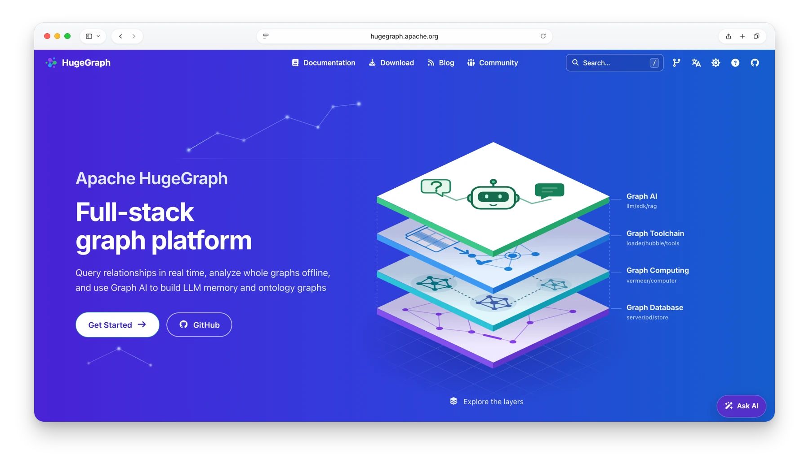 # Apache HugeGraph: ASF top-level graph database project, 300 bilingual pages tracking new releases
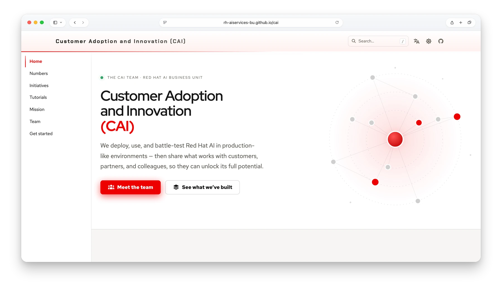 # Red Hat AI Services (CAI): Ten-language portal built by Red Hat's AI team
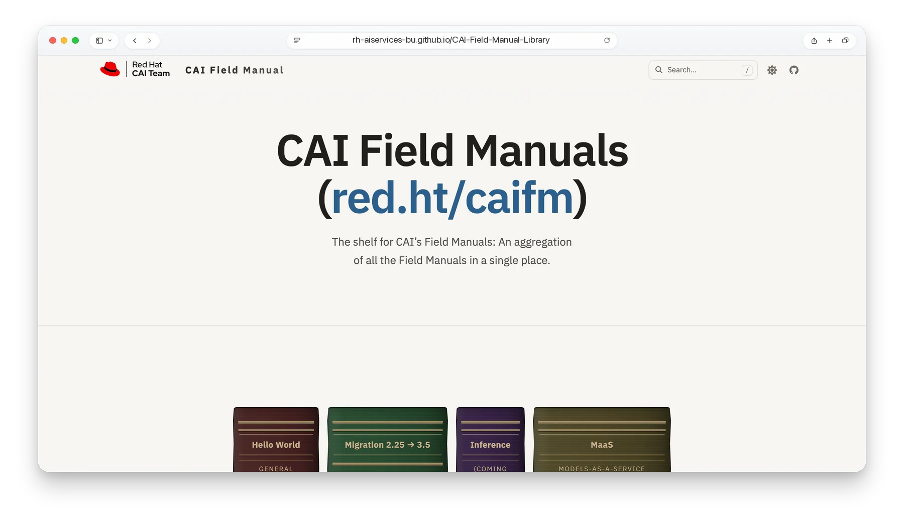 # Red Hat CAI Library: Enterprise multi-repo manual shelf built on OINK
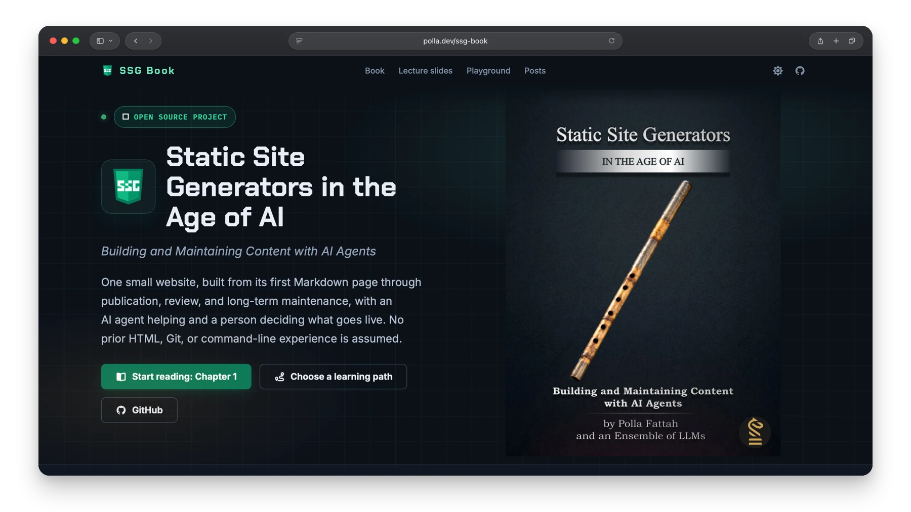 # SSG Book: One of three open-source textbooks published on OINK by lecturer Polla Fattah
 # Cortrix: AI agent semantic-memory docs; opened a PR specifically to restore OINK footer credit
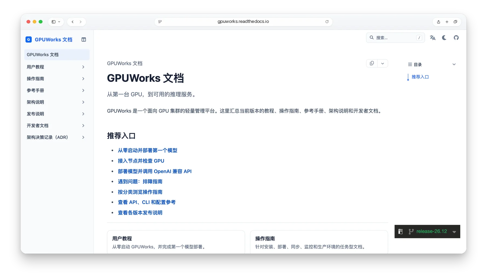 # GPUWorks: GPU compute platform docs, the first multi-version Read the Docs deployment
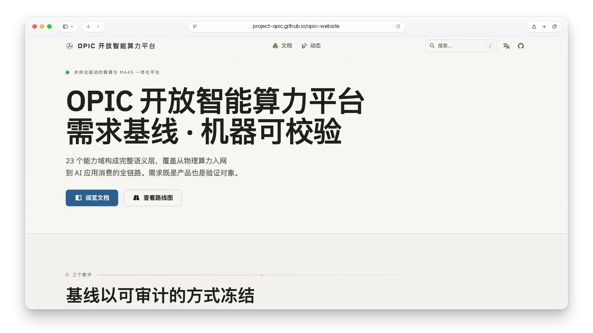 # OPIC: Open intelligent-computing platform migrated from Docusaurus 3 to single-binary Hugo + OINK
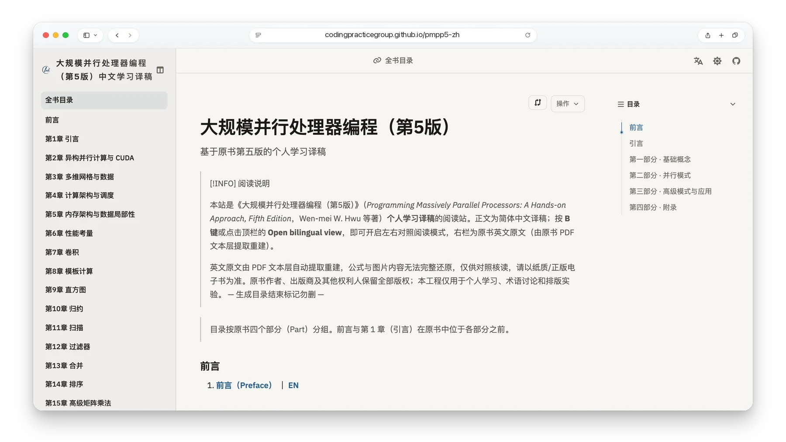 # Programming Massively Parallel Processors (5th ed.): 27 chapters and 230 bilingual anchors in Duo View
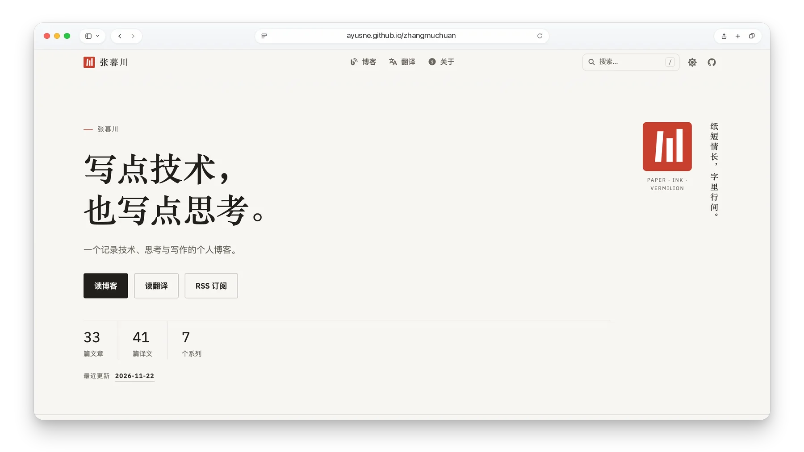 # Zhang Muchuan's blog: Custom East Asian "Paper, Ink & Vermilion" look built on OINK's CSS tokens
```

What surprised me even more was seeing the design ideas spill over into other ecosystems:

- **[Sumi](https://sumi.mkdocs-ng.org/zh/)**, the official theme for Python's **MkDocs NG**, explicitly credited OINK in its launch post for plain-Markdown components, zero-CDN delivery, and fully local fonts, search, and diagrams;
- **[uniblog](https://github.com/AzoteGwei/uniblog)** appeared in the JavaScript **Astro 7** ecosystem as a multilingual blog template recreating OINK's visual styles and local search;
- **[OINK Terminal](https://community.obsidian.md/themes/oink-terminal)** landed on the **Obsidian** community theme marketplace and has already cleared 100 downloads;
- Within the Hugo ecosystem itself, someone built `ft-oink-blog-theme`, a child blog theme that overrides just ten templates while still inheriting upstream upgrades cleanly.

## 3. Back-to-Back 1.6, 1.7, and 1.8: Closing the Early Gaps at Once

Once real users show up in numbers, feedback gets sharp fast. This week I shipped **1.6.0, 1.7.0, and 1.8.0** back to back to close the toughest early gaps all at once.

### 1. Cleaning the Foundation in 1.6: Dropping Sass and Making CJK Search Work

Start at the bottom of the stack. Hugo 0.170 officially removed LibSass and the Extended edition, meaning older themes fail to build unless you install Dart Sass separately. Version 1.6.0 dropped Sass altogether, splitting the entire stylesheet into plain CSS layers (123 layers today) whose compiled output is byte-for-byte identical to the last Sass build. From here on, **a single standard Hugo binary of any version builds the site**—1.8.0 even removed the minimum Hugo version requirement. Bootstrap JS and Lunr went out the door too, shrinking the per-page core script `core.js` from **92 KB to under 9 KB**.

Along the way, I cleaned up several places that wasted bandwidth and build time. ECharts, Mermaid, Markmap, Asciinema, and Giscus comments used to fetch on initial page load; now they **lazy-load only when you scroll near them**, keeping first paint light. KaTeX keeps only `woff2` fonts, cutting math-heavy static assets from 1.1 MB down to 0.3 MB. Sidebar branches outside the active path now render once per build rather than per page, dropping build time on a 449-page docs site from 4.3 seconds to 1.7 seconds. On narrow viewports, top-bar items automatically collapse into icons and then into an overflow menu, and all 32 native UI locale packs got a full proofreading pass.

Search got a ground-up replacement too. Previously OINK relied on Lunr for English with a crude substring fallback for Chinese, and on large sites the browser froze briefly the first time you opened search while building an inverted index. Version 1.6.0 replaces it with a custom **scan-based local BM25 search engine**: no bundled Chinese dictionary required—overlapping bigrams handle **spaceless CJK search** accurately (querying `数据库连接池超时`—"database connection pool timeout"—returns hits immediately); English matches on whole-word boundaries so searching `port` no longer pulls in `support`; and code identifiers like `top_k` or `->>` match literally. Parameter-level anchors also landed, so searching a config option jumps directly to that line's definition instead of stopping at the parent heading. When a large site's index exceeds **2 MiB**, the body index automatically splits out for on-demand loading so initial page loads stay snappy.

### 2. Visual Course Correction from 1.7 to 1.8: 6 Styles, 12 Distinct Themes

On visuals, I actually hit the brakes between 1.7 and 1.8.

OINK originally shipped four styles (Paper, Slate, Ink, Terminal). While building 1.7.0, I gave each style its own system CJK font stack and tweaked the default Paper preset into warm ivory with Songti serif headings. After shipping, I stared at the screen for a while and realized it felt wrong: **users didn't touch a single line of config, upgraded the theme, and suddenly their site wore a different face. That is a breaking change.**

So **1.8.0** straightened out the entire visual system: restored **Paper** faithfully to its classic warm-white surface and blue links; spun off 1.7's well-received serif experiment as **News** (print edition); added **GitHub**, tuned from `github-markdown-css` to reproduce the familiar README reading feel; and rebuilt **Ink** (manuscript) and dark **Terminal** from scratch.

The appearance menu now lays out cleanly as two rows of three—**6 styles × light & dark = 12 themes**. Press `T` anywhere to cycle styles, `Y` to toggle light/dark, or click the showcase cards on the homepage to preview in place:

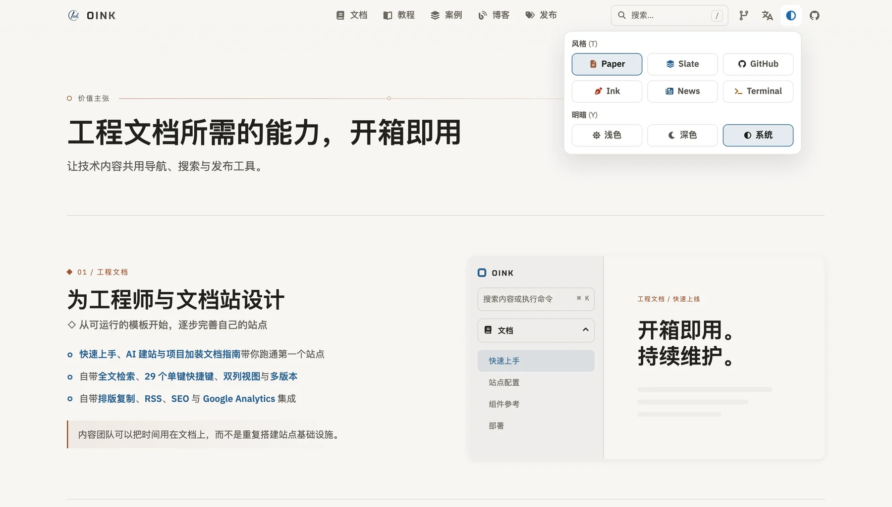

The top row—**Paper, Slate, GitHub**—anchors everyday engineering docs and blogs. The bottom row lets personality take over: **Ink** follows a hand-brushed Xuan-paper scroll, **News** brings crisp letterpress newspaper columns, and dark **Terminal** is a restrained phosphor screen—body text dialed back to a comfortable pale gray-green, reserving glowing phosphor green for headings, links, and the active-line cursor so long reading sessions don't burn your eyes.

One hard rule governs all 12 themes: **dark mode must preserve the typography and layout, never rely on mechanical color inversion, and earn its own nighttime palette.** Even contrast along the vignetted canvas edges was verified programmatically, and every theme ships its own matching Giscus comment stylesheet. Here is the exact same docs page—without changing a single word—laid out side by side with light on the left and dark on the right across all 6 styles and 12 themes (click any image to enlarge):

```gallery {.gallery-2col}
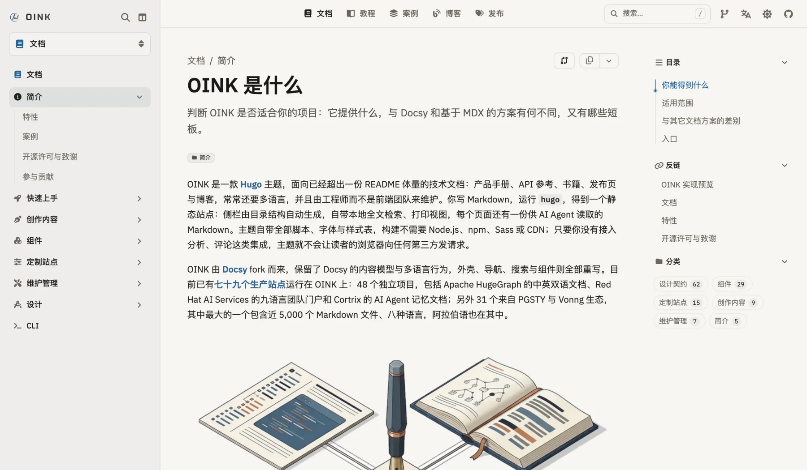 # Paper · Light: Classic warm-white surface and blue links, pairing IBM Plex Sans with system CJK sans
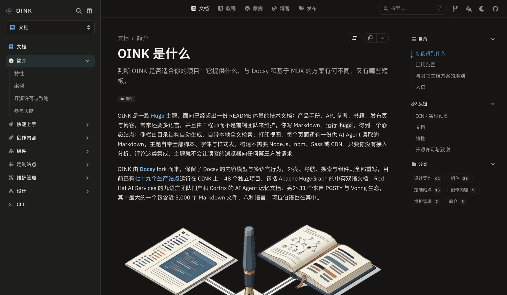 # Paper · Dark: Warm charcoal night paper with soft blue links, keeping identical fonts and layout
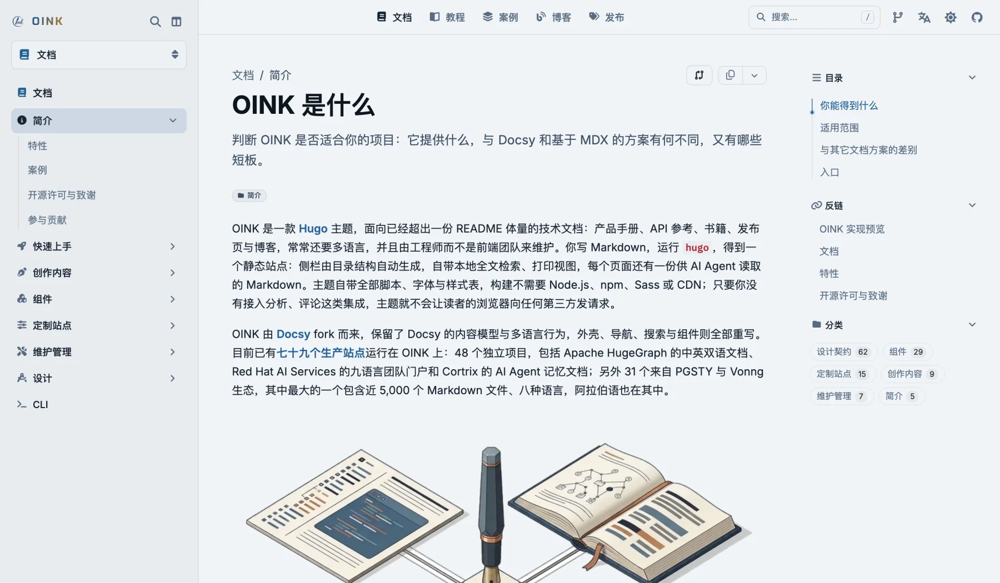 # Slate · Light: Cool blue-gray engineering look with a clean, restrained reference-manual feel
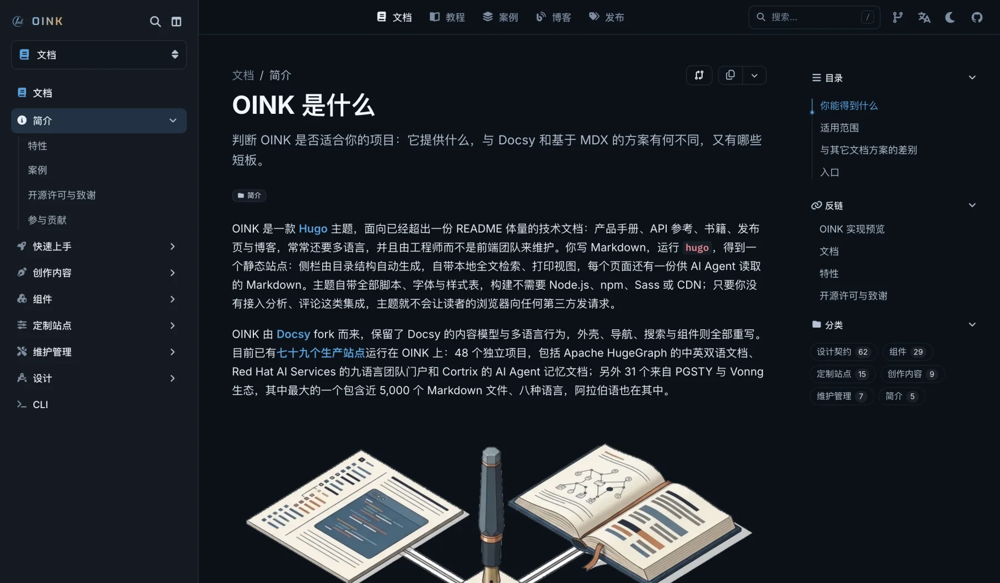 # Slate · Dark: Deep blue-gray panels with bright cyan accents, tuned for long reference sessions
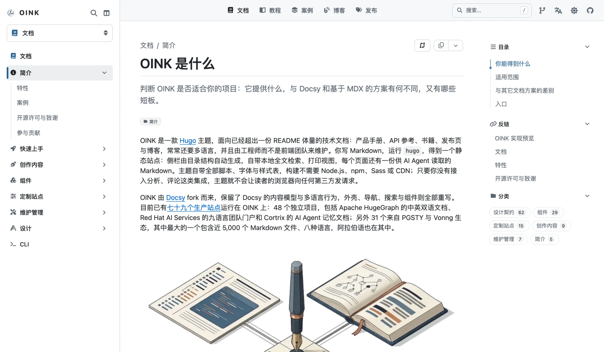 # GitHub · Light: Tuned from github-markdown-css for a familiar, true-to-README reading feel
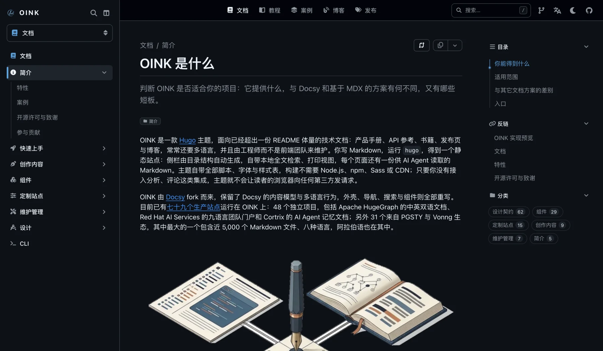 # GitHub · Dark: Faithful GitHub Dark palette with matching code surfaces and striped tables
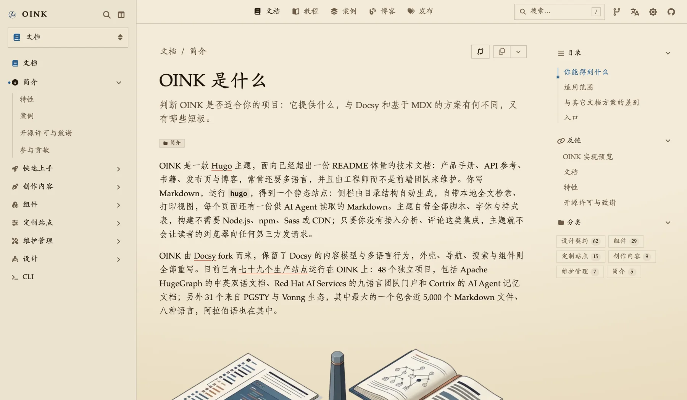 # Ink · Light: Warm Xuan paper, Palatino Latin, Kaiti headings, Fangsong body, and vermilion marks
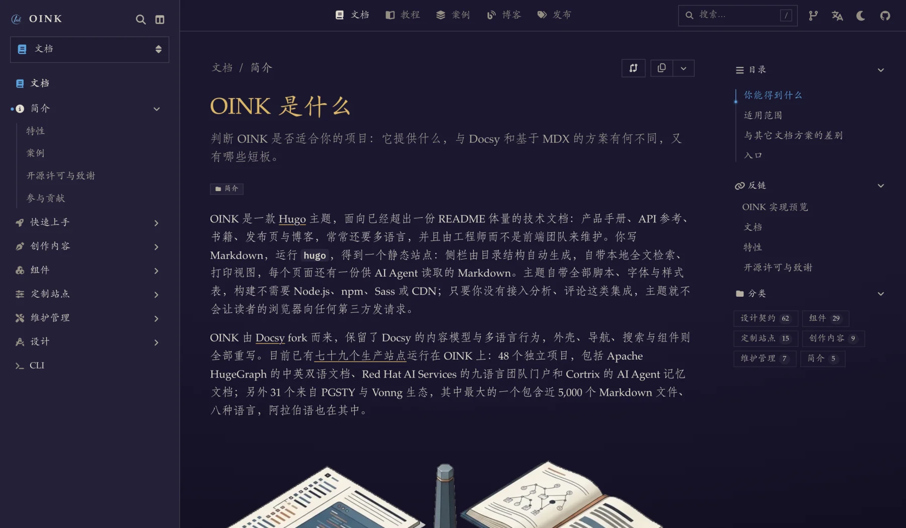 # Ink · Dark: Indigo sutra paper inspired by gilded manuscripts—silver-ink body and gold headings
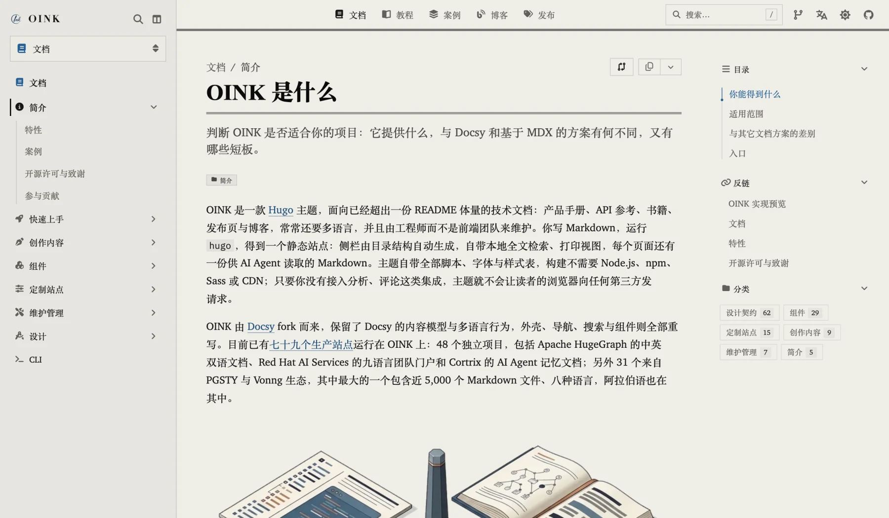 # News · Light: Letterpress broadsheet with gray newsprint, zero border-radius, and double rules
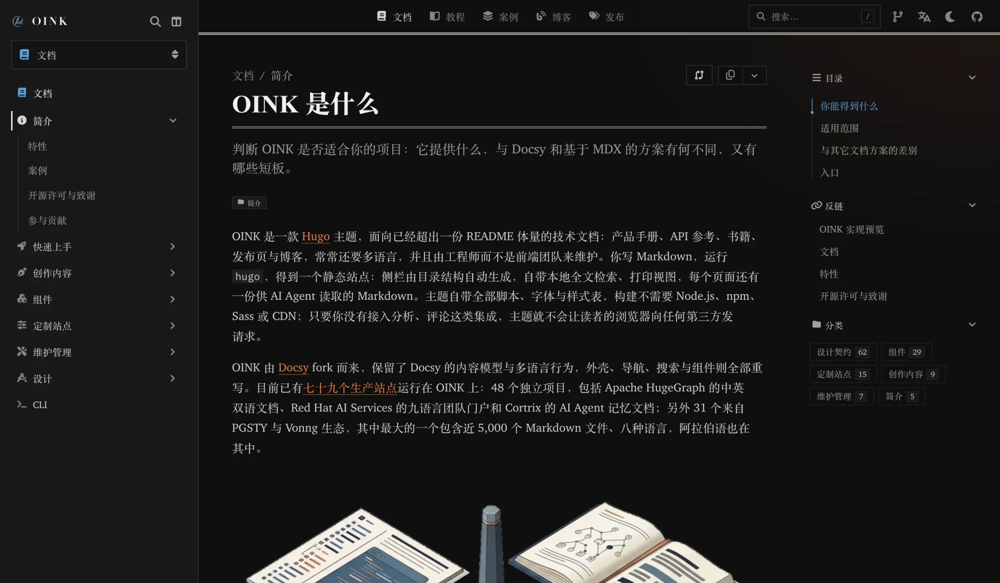 # News · Dark: Photographer's darkroom—pure black ground, silver-halide text, and safelight orange
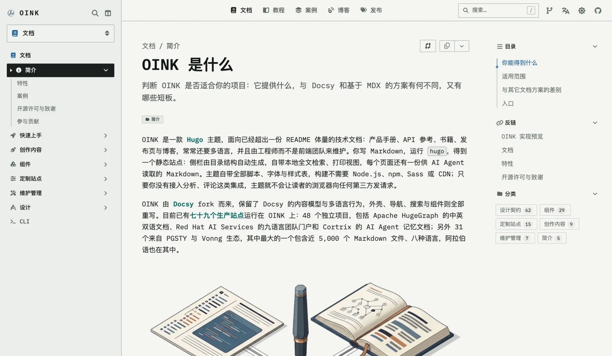 # Terminal · Light: Pale gray-green paper with pure monospace prose for a crisp plain-text feel
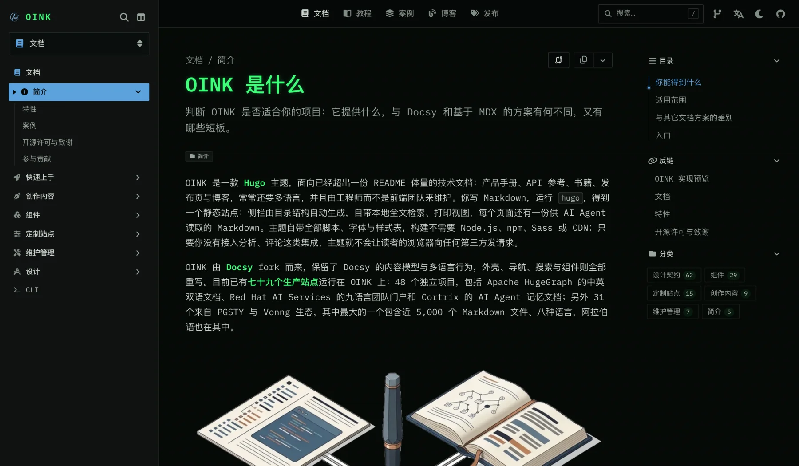 # Terminal · Dark: Restrained Matrix phosphor screen with glowing green headings and faint scanlines
```

The neat part is that all 12 themes compile into the same pure CSS bundle, **bundling zero CJK fonts and making zero external font requests.** Chinese Kaiti and Fangsong are loaded via CJK-scoped `local()` aliases (`OINK Kai`, `OINK Fangsong`) that pull directly from fonts already installed on the reader's OS—so Chinese emphasis finally escapes ugly browser-slanted faux italics while Latin text retains true italics.

### 3. 29 Single-Key Shortcuts, Local History, and Typeset Copy

Since OINK is built for engineers and heavy readers, 1.7.0 tore down the scattered shortcuts accumulated in earlier releases and reorganized them into a tidy **3 × 10 grid (29 single-key bindings)**. Press `'` (single quote) on any page—or click `?` in the footer—to bring it up, even when Zen mode is active or the footer is hidden:

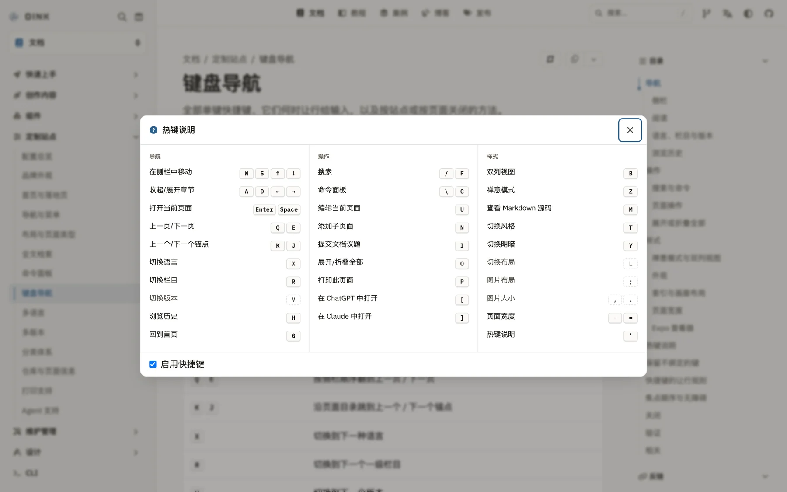

Every frequent action sits within one hand's reach: `W`/`S`/`A`/`D` move through the sidebar, `Q`/`E` step to the previous or next page, `K`/`J` jump along the outline, `O` expands or collapses every collapsible block on the page at once without losing your scroll position, `-`/`=` resize prose width in 100 px steps, `B` toggles bilingual Duo View, `Z` enters Zen mode (hiding surrounding chrome), `M` displays raw Markdown source, and `[`/`]` send the current page straight to ChatGPT or Claude.

There are a few practical engineering details underneath. Not everyone uses a US ANSI keyboard—typing `/` or `\` on German QWERTZ layouts is awkward, and Chinese readers often stay inside full-width IMEs all day. So `/` and `\` have plain-letter aliases `F` and `C`, common full-width Chinese punctuation marks are mapped as well, and anyone who dislikes single-key shortcuts can switch them off with one click via "Enable shortcuts" in the bottom-left corner of the overlay.

I also added a feature I genuinely use myself: press **`H` to open in-site browsing history**. It stores your 100 most recently visited pages in reverse chronological order inside path-scoped `localStorage`, deliberately excluding the current page—which means **tapping `H` then `Enter` jumps straight back to the previous page**.

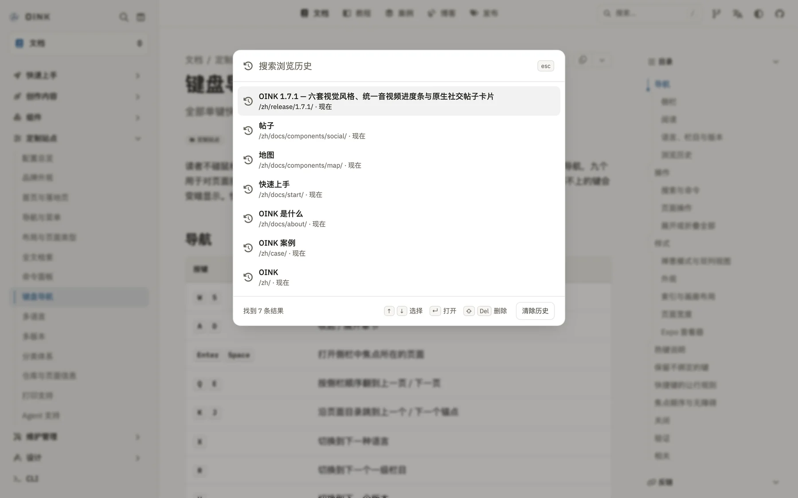

Version 1.7.0 also cured an old annoyance from cross-posting to WeChat's publishing editor: **Typeset Copy**. Copying prose from a web page into WeChat's backend used to haul along gray boxes, dark-mode black backgrounds, `#` heading anchors, line numbers, and copy buttons that had to be stripped out by hand. Now copying body text generates clean inline HTML styled from the current preset's print palette, strips stray spaces introduced by line wraps between Chinese characters, preserves syntax highlighting and ordered-list start numbers, and pastes ready to publish.

### 4. Six New Components Without Breaking Plain Markdown

Releases 1.7 and 1.8 also filled in six high-frequency components: **Map, Social, Update, Timeline, Video, and Audio**. Across all six I stuck to one rule: **never invent proprietary syntax when plain Markdown stays readable.** Even if you leave OINK someday and open the source files on GitHub or in Obsidian, they should still read cleanly at a glance.

Start with **Map (the `map` code fence)**. Write a short block of YAML inside Markdown listing place names, latitude/longitude, captions, photos, and body anchors; add `route=true` to connect them into a track. The theme hardcodes zero tile providers: without a configured tile source, it ships zero JavaScript and zero external requests, degrading into a numbered list of locations with OpenStreetMap links. Once you configure a tile source, it lazy-loads the bundled Leaflet 1.9.4 viewer on demand, with support for dark tiles and click-to-consent loading.

That declarative plain-text format has an unexpected bonus: it is tailor-made for agents to populate in bulk. My blog's [`trip/` section](/en/trip/) held more than twenty travel logs and hundreds of photos accumulated over a decade. As soon as the component landed, I had agents scan photo EXIF metadata, cross-reference capture timestamps against my local Apple Photos library, and calibrate coordinates against public hiking tracks. Running in parallel, they finished in a single evening, adding interactive topographic photo maps to **23 old travel logs**. Take [*Everest East Face: Gamma Gou Trekking*](/en/trip/2018-gamagou/): clicking marker #8 pops up the drone shot I took above the clouds at 4,950 meters as sunrise turned Everest's peak gold, with a link straight back to that day's section:


Next is **Social (`> [!SOCIAL]`)**. Writing technical commentary inevitably means quoting posts from X, Weibo, or Zhihu. Official embed scripts turn blank offline and stuff the page with trackers; screenshots look blurry, glare blindingly white in dark mode, and leave quoted text unsearchable and untranslatable on a bilingual blog. For my first pass in 1.7.0, I built a `` shortcode—then started migrating my own blog, stared at the source files, and hated it. Images wouldn't render in plain Markdown, and the prose sat buried inside curly braces. I was breaking my own rule on day one. So 1.8.0 ripped it out, rebuilt it as a native **`> [!SOCIAL]` alert blockquote** with one line of block attributes—nested quote-posts are just another `> > [!SOCIAL]` layer—and shipped an automatic migration script. The cards require zero JavaScript, make zero requests to external platforms, and adapt to all 12 themes. Afterward, I had an agent run Apple Vision OCR across all 4,600+ images on my site, converting 209 social screenshots (32.8 MB) into **492 offline cards across 149 posts** in one go.

The remaining components follow the same philosophy. **Update** appends `{.update date="2026-11-28" tags="Added, Changed"}` to an ordinary heading, immediately rendering a date and tag bar while inheriting the table of contents, anchors, search, and `J`/`K` jumping. **Timeline** turns a native definition list plus `{.timeline}` into a pure-CSS vertical timeline. **Video / Audio** works from a single line like ``, while YouTube and Bilibili links default to zero-request cards with optional per-platform click-to-load embeds. In 1.7.0, native browser players behaved inconsistently across engines—some even showing two progress bars—so **1.8.0 lets the theme draw a unified control bar**: a three-tone single-track scrubber (played, buffered, and unbuffered clear at a glance) with at least 3:1 contrast tailored to all six styles, complete with playback speed, expandable volume, captions, fullscreen, and 5-second arrow-key seeking, falling back quietly to native browser controls when JavaScript is turned off.

```gallery
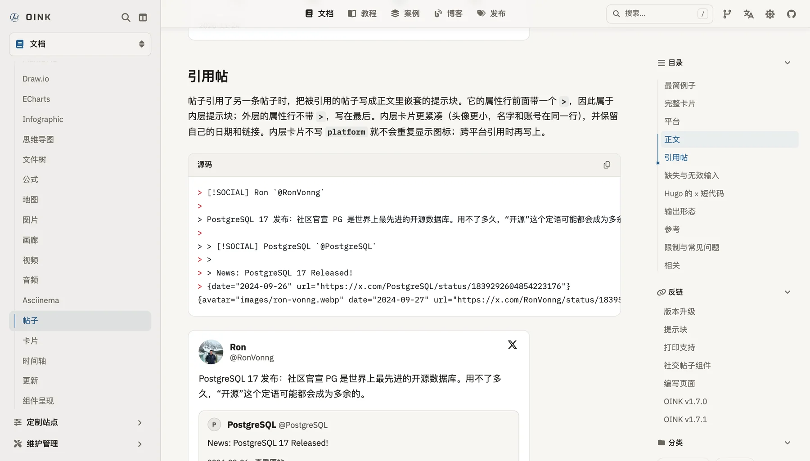 # Native > [!SOCIAL] alert block: readable in plain Markdown, theme-aware across 12 themes, supports nested quotes
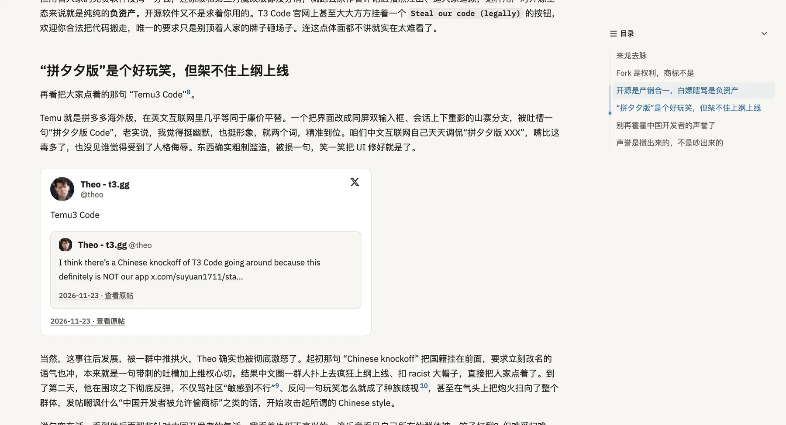 # Live on vonng.com: 492 offline social cards replacing clunky white-background screenshots
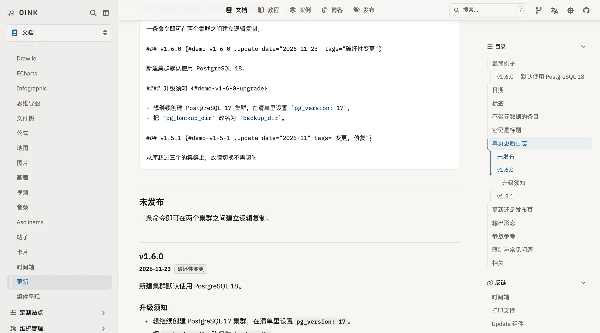 # Update entry: append {.update} to a standard heading for a dated, tagged changelog with TOC anchors intact
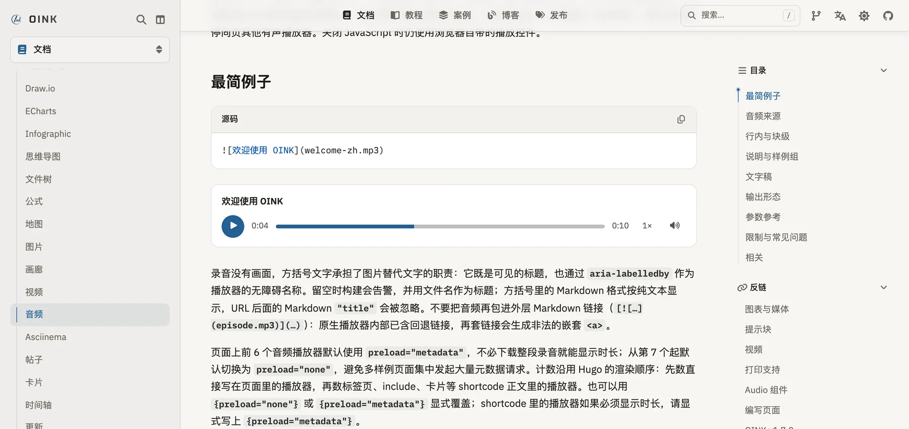 # 1.8 unified media controls: one line of Markdown, three-tone single-track scrubber matched to all six styles
```

## 4. What's Next: Single-Binary `oink` and `.oink` Reading Packages

Static Hugo handles thousands of pages without breaking a sweat—my eight-language `doc.pg.center` site, nearly five thousand files, builds in a few seconds. Still, I have one hard problem static generation cannot brute-force: **the complete historical documentation of PostgreSQL spanning decades and 500+ releases.**

I ran a benchmark on `pgdoc-cn` (560 releases of Chinese PostgreSQL documentation). Rendering every version statically produces **6.15 GB and 529,000 HTML files**; scaled to a bilingual OINK site, PostgreSQL 18 alone takes 808 MB—with 55% of that coming from the entire sidebar baked redundantly into every page. Expanding that across every release is unworkable. Yet the entire Git repository packfile is only **78 MiB**, and the median minor release changes just **107 pages**. Strip the repeated chrome and deduplicate/compress by page body, and all 560 releases fit in **30 to 70 MB**.

Guided by that concrete problem, two pieces are next on the roadmap.

### 1. A Single-Binary `oink` Embedding Hugo and the Theme

The draft is already up in the [`oink` multi-version serving proposal](https://oink.pgsty.com/docs/design/proposals/oink-serve/): embed the upstream Hugo library and the OINK theme directly into a single Go binary. No separate Hugo, Go, or Node install on the machine—one executable handles `oink dev` for local preview, `oink serve` for multi-version production hosting, and `oink build -o site.oink` for packaging.

The core model is simple: **Git stays the sole content store, branches and tags map to versions, and rendered pages are stored as body-deduplicated snapshots; production serves only committed, passing builds, switching version pointers atomically.** Backing it first with **SQLite** (and later **PostgreSQL**) unlocks features static hosting has never handled cleanly—cross-version full-text search, comments, pageview stats, even accounts and access control—strictly opt-in. One hard line stays intact: **plain `hugo` will always build your site as-is**, with zero lock-in for static users.

### 2. `.oink` Single-File Packages and the Crib Native Reader

Earlier, I built **[Crib](https://crib.pgsty.com/)**, a native macOS offline reader covering 31 PostgreSQL documentation lines from 6.3 through 20devel. Next, I want to turn `.oink` into a general single-file package format: run `oink build -o site.oink` to compile any docs site, technical book, or private offline manual into one standalone file. You can hand that file straight to `oink serve` for web hosting, or double-click it to open instantaneously in Crib with every visual theme and offline full-text search intact—no server to run, no tens of thousands of loose HTML files to unpack.

## 5. You Don't Actually Need to Learn OINK

Reading this far, you might think: six styles, 29 shortcuts, twenty-plus components—isn't that a lot to learn? In practice it's the opposite. As OINK has grown more capable, the barrier to entry has dropped.

The earlier official documentation was written by Codex and read like a Soviet textbook: architecture theory first, followed by manual directory scaffolding and memorizing config keys. Over the past few days we threw it out and rewrote the guide from scratch. Chapter 1 is literally titled [*One Prompt, One Site*](https://oink.pgsty.com/book/01-start/). You don't need to learn Hugo or read config files first—create an empty directory, open Claude Code or Codex, fill in the placeholders in `<angle brackets>`, and send this:

```text
Build a website with Hugo and the OINK theme by following the OINK site-building skill: https://oink.pgsty.com/skill.md
Refer to the OINK documentation (https://oink.pgsty.com/docs/) and its showcase examples, and make full use of OINK's built-in features.
Site details: <name, directory, content & audience, topic, sections, format, style preference, domain, hosting platform>
Language: <English, or English + Chinese>
```

Leave the rest to the agent. It reads the latest [`skill.md`](https://oink.pgsty.com/skill.md), picks the closest match from the 79 live showcase sites as a template, wires up the directory structure, styling, search, and deployment pipeline, and starts a local preview for you to review. The human only owns two jobs: **put something worth reading into Markdown, and sign off on the finished site.**

Frontend frameworks churn every two or three years, but the documentation, books, and engineering notes you build up deserve to outlive all of them. If you need a clean, low-maintenance home for a project, blog, or knowledge base, toss that prompt to your agent and see what comes out.

**Feed it Markdown. Let the pig handle the rest.**

---

- OINK homepage and 79 live showcase sites: <https://oink.pgsty.com/>
- OINK GitHub repository: <https://github.com/pgsty/oink>
- One-prompt site-building skill: <https://oink.pgsty.com/skill.md>

## Further Reading

- [After The Mythical Man-Month: How Far Can a One-Person Database Company Go?](/ai/thu-opc-talk/)
- [Documentation-Driven Development: The First Secret to AI Software Engineering](/en/ai/sdd/)
- [OINK: After Six Years of Wrestling with Documentation Frameworks, Codex Finally Got Me Over the Line](/en/db/oink-release/)
- [Oink: Build Modern Websites with Markdown](/en/ai/oink-intro/)
- [Everest East Face: Gamma Gou Trekking (Interactive Photo Map in Action)](/en/trip/2018-gamagou/)
- [Goodbye Vagrant, Hello Barn](/en/db/barn-intro/)
