前阵子去清华软件论坛做了一场分享，聊[《人月神话之后：一个人的数据库公司能走多远？》](/ai/thu-opc-talk/)。
台下问得最多的，是手底下几十个 Coding Agent 同时写代码、译书、修 Bug，一个人到底怎么管得过来。
我把研发拆成设计、编码、测试三段，排在最前面的经验就是 **[文档驱动](/ai/sdd/)** 。不过理念归理念，真正每天帮我把这套流程托起来的，其实是我三个半月前顺手写出来的 Hugo 文档框架 —— **[OINK](https://oink.pgsty.com/zh/)**。

不少人好奇：你一个搞 PostgreSQL 发行版的，没事花这么大精力折腾文档主题干嘛？这笔账，其实很好算。

## 一、为什么把文档框架当主力产品来做

当初写 [OINK](/db/oink-release/) 的想法很简单：我想要用纯 Markdown 维护文档，十几个站点统一用一个框架。
受够了 Docsy 又旧又绑着 Node 和 PostCSS，也不想为了写几篇文档被 MDX 和 Next.js 锁死。
可真正让我把它当成主力产品持续打磨的，是进入 AI 编程时代以后冒出来的两个硬需求。

### 1. 省注意力：用文档验收 Agent，而不是去读代码

AI 工程里最稀缺的不是算力，而是人的注意力带宽。*Attention is all you need.* 
一个人同时管几十个 Agent，最累也最蠢的做法，就是追在后面一行行看 diff，或者在项目根目录里翻它们随手留下的 `PLAN.md`、`NOTES.md`、`REVIEW_FINAL_v3.md`。人的眼睛一天看不了多少散装文本，精力很快就会被琐碎细节耗干。

我的办法很直接：**把文档站变成自己和 Agent 之间的沟通界面。** 架构方案、决策记录（ADR）、安全审计、验收台账不再乱丢成一堆草稿，而是直接按目录树写进伴生文档站——左边有目录，右边有大纲，中间有对比表、架构图和版本演进。浏览器打开扫一眼，思路不对直接打回重写。代码可以不逐行看，宏观设计和验收报告必须一眼看透。

底座顺手后面的事才推得动。接盘 MinIO 做 [Silo](/db/long-live-silo/)、重写 Vagrant 做 [Barn](/db/barn-intro/)、收编几个 PG 扩展、译完三十多本数据库专著，每个项目从第一天起就配一个干净的 OINK 伴生站，整套节奏才算真正跑顺。

### 2. 信任硬通货：文档写给人看，现在更写给 Agent 看

另一个理由更现实：软件终归是要拿出去给别人用的。如果一个开源项目的手册写得一团糟，老冯基本不太信它的代码能有多好。

到了今天，这条规律甚至更直接——**就算人懒得逐页翻，Agent 也会替人去读。** 

老冯现在看一个第三方开源项目靠不靠谱，第一步就是派 Agent 把它的文档站通读一遍挑挑刺：概念清不清楚，边界有没有交代明白，示例能不能跑通。
一套清爽、准确、打开飞快，还能直接吐出 `.md` 原文和 `llms.txt` 的文档站，大概是开源作者攒信任最划算的办法了。

## 二、从 50 个自用站到全网破百

8 月刚发布时，我先把自己的 [18 个网站迁了过去](/ai/oink-intro/)；三个半月过去，自己手里跑在 OINK 上的站已经滚到了 **50 多个**，从 Pigsty 全家桶、`pg.center`、三十多本多语言译著，到个人博客 `vonng.com` 都在上面。每次发新版，我就让 Agent 把这几十个生产站全升一遍——天天吃自己的狗粮，哪里别扭，当天就能顺手修掉。

说实话，我从没在 Hacker News、Reddit 或 V2EX 这些站上宣传过，最多自己写了两三篇公众号。但外部用户自己长起来了。GitHub 攒了 176 颗星，悄悄挤进全球 Hugo 主题前 150；
最近两周的克隆数超过 **3,400 次**，独立克隆者也有 **1,400 多人**。Hugo 首席维护者 Bjørn Erik Pedersen（`@bep`）把 OINK 合进[官方主题库](https://themes.gohugo.io/themes/oink/)时，干脆地留了一句：**"Great looking theme, thanks."**

前两天让 Agent 顺着 GitHub、Google 和各大主题目录扫了一圈，[`oink.pgsty.com` 案例库](https://oink.pgsty.com/zh/case/)里已经收了 **79 个真实上线的站点**，其中 **48 个是完全独立的第三方社区项目**；算上还没来得及收录的，全网已知的线上站点已经**突破 100 个**。

这些用户的覆盖面比我预想的宽得多：[**Apache HugeGraph**](https://hugegraph.apache.org/) 迁入三百来页中英双语文档，一路紧跟更新，刚升完 1.5.1 的双列视图，这周又在 PR 里测 1.6 的纯 CSS 和 BM25 搜索；[**Red Hat AI Services (CAI)**](https://rh-aiservices-bu.github.io/cai/) 搭了十国语言门户，还基于 OINK 封装出一套企业共享模块 `Shell` 和多仓书架 `Library`；也有不少博主从 Docusaurus 3、Blowfish、Docsy、Jekyll 迁过来——有人迁完爬了一万多条链接零断链，还有人在 AI 产品经理课程 CC4PM 里专门开了第 24.9 课讲《OINK 内容站》。

直接看一组外部生产站点的截图感受一下：

```gallery
 # Apache HugeGraph：ASF 顶级图数据库项目，300 页中英双语文档并持续跟进新版本
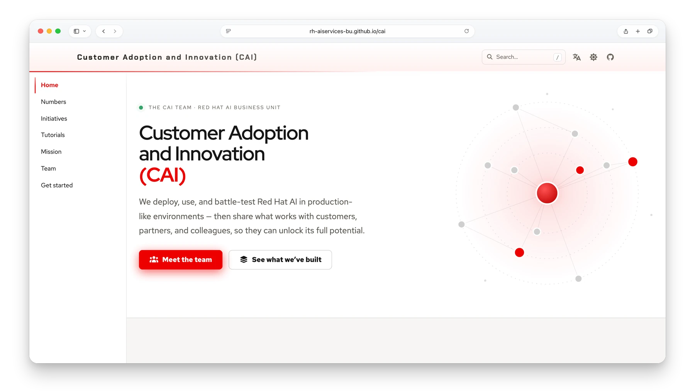 # Red Hat AI Services (CAI)：红帽 AI 团队十国语言门户
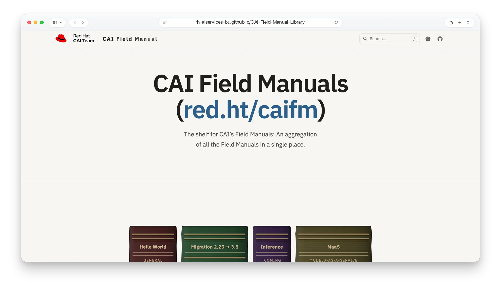 # Red Hat CAI Library：基于 OINK 封装的企业级多仓手册书架
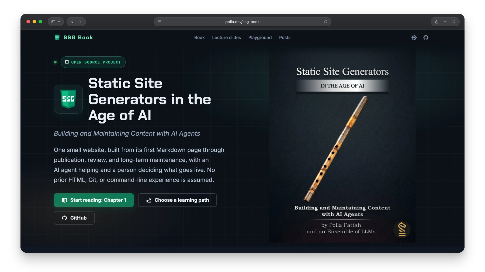 # SSG Book：海外大学讲师 Polla Fattah 用 OINK 出版的三本开源教材之一
 # Cortrix：AI Agent 语义记忆系统文档，专程提 PR 恢复页脚 OINK 署名
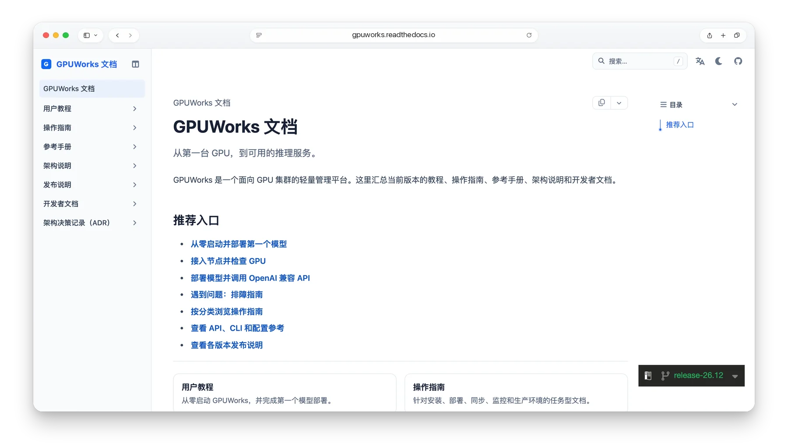 # GPUWorks：GPU 算力平台文档，首个 Read the Docs 多版本部署案例
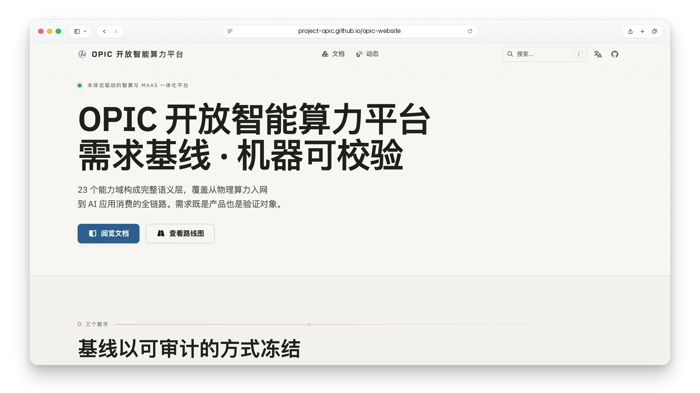 # OPIC 开放智能算力平台：从 Docusaurus 3 完整迁移至单二进制 Hugo + OINK
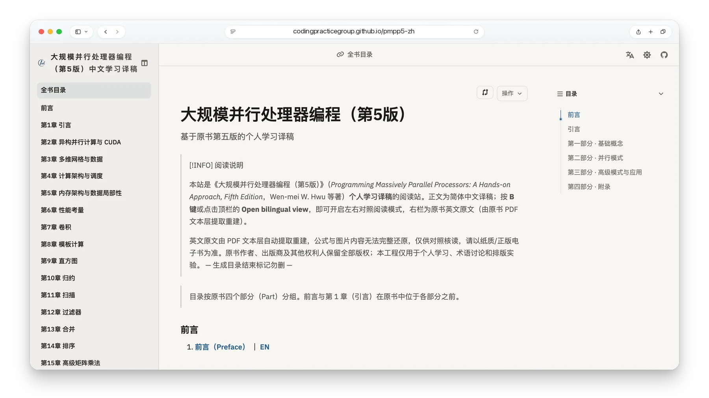 # 《大规模并行处理器编程》第 5 版：用 Duo View 对齐 27 章、230 个中英锚点
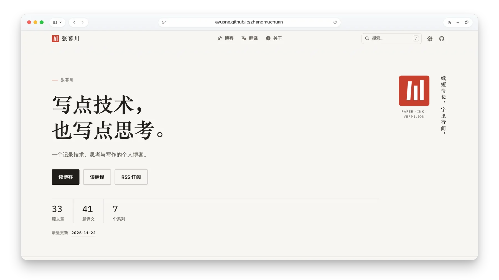 # 张暮川博客：基于 OINK Token 定制的「纸·墨·朱」东方视觉风格
```

更让我意外的是，这套设计思路已经开始往别的生态里溢出了：

- Python **MkDocs NG** 的官方主题 **[Sumi](https://sumi.mkdocs-ng.org/zh/)** 在发布文里直接致谢，说它的「原生 Markdown 组件、字体搜索图表全本地交付、零 CDN」正是借鉴了 OINK；
- JS **Astro 7** 生态冒出了复刻 OINK 风格与本地检索的多语言博客模板 **[uniblog](https://github.com/AzoteGwei/uniblog)**；
- **Obsidian** 社区主题市场上架了 **[OINK Terminal](https://community.obsidian.md/themes/oink-terminal)**，已经有一百多次下载；
- Hugo 社区也长出了只覆写十个模板、就能继承上游升级链的博客子主题 `ft-oink-blog-theme`。

## 三、连发 1.6、1.7、1.8：把几块硬短板一次补齐

真实用户一多，反馈就准起来了。这周干脆一口气连发 **1.6.0、1.7.0、1.8.0** 三个版本，把早期留下的几块硬短板顺手补齐。

### 1. 1.6 清理底座：甩掉 Sass，中文搜索终于顺手了

先说最底层的变化。Hugo 0.170 正式移除了 LibSass 和 Extended 版，老主题如果不单独装 Dart Sass 直接就编不过了。
1.6.0 索性把 Sass 彻底砍掉，整套样式拆成纯 CSS 分层（现在一共 123 层），编译出来的成品和最后一次 Sass 编译逐字节一致。
从此**任何版本的 Hugo，一个二进制就能构建**，1.8.0 甚至连最低 Hugo 版本限制都去掉了。Bootstrap JS 和 Lunr 也一并清理干净，每页加载的核心脚本 `core.js` 从 **92 KB 瘦身到不足 9 KB**。

顺带把几处白费流量的地方也收拾了。像 ECharts、Mermaid、Markmap、Asciinema 和 Giscus 评论，以前进页面就跟着拉，现在改成**滚到附近才按需加载**，不再拖慢首屏。KaTeX 只保留 `woff2` 字体，带公式的站点静态资源直接从 1.1 MB 降到 0.3 MB；没在当前路径里的侧栏分支每次构建只渲染一次，一个 449 页的文档站构建时间从 4.3 秒降到了 1.7 秒。顶栏窄屏自动缩成图标再收进溢出菜单，32 份原生界面语言包也顺手通校了一遍。

搜索这块也彻底换血了。以前靠 Lunr 搜英文、中文用子串硬凑，大站第一次点开搜索，浏览器还得卡一下建倒排索引。1.6.0 换成自研的**扫描式 BM25 本地搜索引擎**：不用打包中文词典，靠重叠二元组就能做**不加空格的中文精准检索**，搜「数据库连接池超时」直接出结果；英文按整词边界匹配，搜 `port` 不会再把 `support` 翻出来；像 `top_k`、`->>` 这类代码标识符也能字面命中。现在还补上了参数级锚点，搜一个配置项直接跳到那一行定义，而不是只落到上一级标题。站点太大、索引超过 **2 MiB** 时，会自动把正文拆出去按需加载，不卡首屏。

### 2. 1.7 到 1.8 的视觉纠偏：6 套风格，12 款独立主题

外观这块，我在 1.7 和 1.8 之间其实紧急叫停过一次。

OINK 原来只有 4 套风格（Paper、Slate、Ink、Terminal）。做 1.7.0 时，我给每套风格配了各自的系统中文字体栈，顺手把默认的 Paper 改成了暖象牙底配宋体标题。结果发完盯着屏幕看了一会儿，越看越觉得不对——**用户一行配置没动，升个级网站莫名其妙换了张脸，这属于破坏性变更。**

于是 **1.8.0** 干脆把整套视觉重新理了一遍：把 **Paper** 原样请回经典的暖白纸面与蓝链；把 1.7 里那套很受好评的衬线出版尝试独立出来，做成 **News（印本）**；新增了一套基于 `github-markdown-css` 调校、原汁原味还原 README 阅读感的 **GitHub**；顺手把 **Ink（写本）** 和深色 **Terminal** 推倒重做。

现在外观菜单整整齐齐排成两排三列，一共 **6 种风格 × 明暗双色 = 12 款主题**。平时看文档按 `T` 换风格、按 `Y` 切明暗，首页展板也可以直接原地点击预览：


上排的 **Paper、Slate、GitHub** 稳稳兜住日常技术文档和博客，下排三套则把气质彻底拉开：**Ink** 走手写宣纸卷的路子，**News** 是干脆利落的铅印报栏，**Terminal** 深色则是克制调校过的荧光屏——正文压成耐读的浅灰绿，荧光绿只留给标题、链接和当前行光标，免得看久了晃眼。

这 12 套主题里立了一条硬规矩：**暗色必须保留字体和版式，绝不做机械反相，每套都要有自己的夜间配色**——连渐变画布边缘的对比度都用脚本逐个校验过，也都配好了各自独立的 Giscus 评论区样式。拿同一页文档，不改一个字，按左浅右深把 6 套风格 12 款主题全部摆开对照（点击可放大）：

```gallery {.gallery-2col}
 # Paper · 浅色：回归经典的暖白纸面与蓝链，IBM Plex Sans 配系统黑体
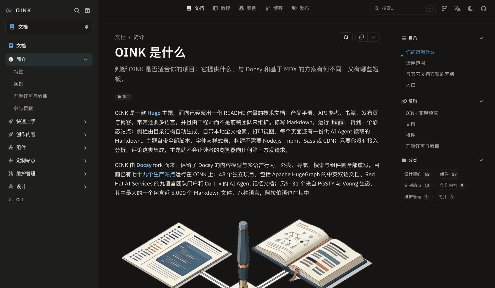 # Paper · 深色：暖炭灰夜纸配柔蓝链接，延续相同的字体与版式
 # Slate · 浅色：冷灰蓝技术极客风，清晰克制的工程手册质感
 # Slate · 深色：深蓝灰面板配高亮青蓝强调，适合长时间翻查手册
 # GitHub · 浅色：基于 github-markdown-css 调校，还原 README 阅读感
 # GitHub · 深色：忠实对应 GitHub Dark 默认配色与斑马纹表格
 # Ink 写本 · 浅色：暖宣纸面、Palatino 西文、楷体标题配仿宋与朱砂着重号
 # Ink 写本 · 深色：紫青绀纸金银写经，深靛紫底配泥银正文与泥金标题
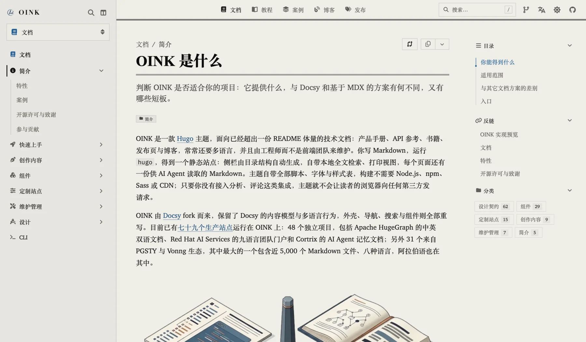 # News 印本 · 浅色：铅印报栏风，灰色新闻纸、全站零圆角与粗重双线
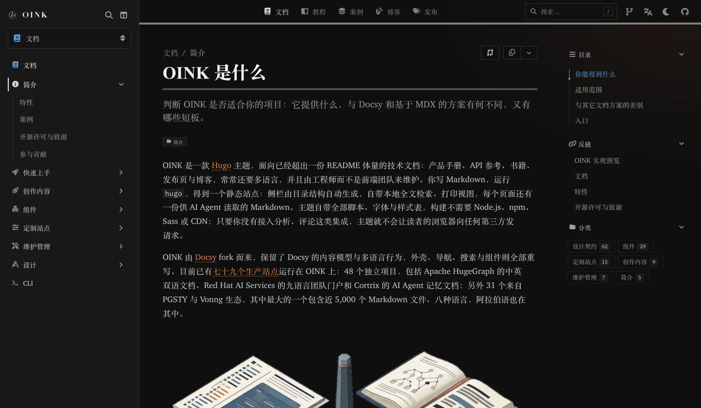 # News 印本 · 深色：暗房意象，纯黑底色配银盐文字与一抹安全灯橙
 # Terminal · 浅色：浅灰绿纸面配纯等宽正文，干脆利落的纯文本终端感
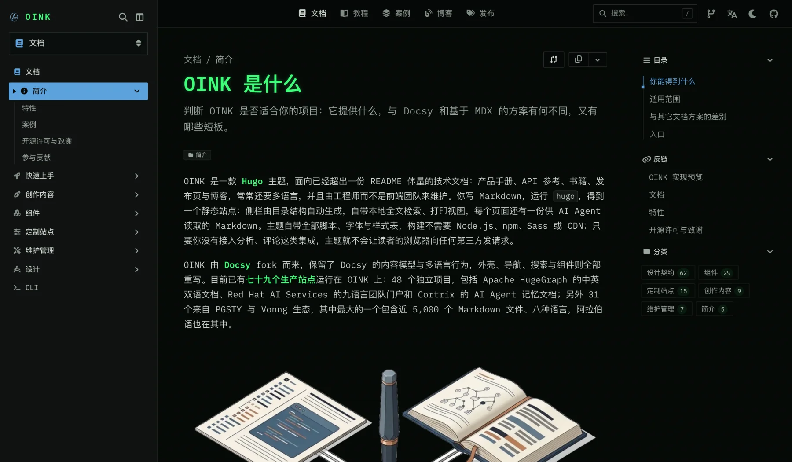 # Terminal · 深色：克制的黑客帝国荧光屏，微光荧光绿标题与淡扫描线
```

有意思的是，这 12 款主题全编进同一份纯 CSS 里，**既不打包中文字体，也不发任何外部字体请求**。中文楷体和仿宋是通过限定 CJK 字符集的 `local()` 别名（`OINK Kai`、`OINK Fangsong`）直接借用系统自带字体——汉字强调终于不用被浏览器强行拉成难看的伪斜体，西文又依然保持真正的斜体。

### 3. 29 个单键快捷键、本地历史与排版复制

既然主要面向工程师和重度阅读者，1.7.0 我顺手把早先零散攒出来的快捷键推倒重做了一遍，排成一张工整的 **3 × 10（29 个单键）热键表**。在任意页面按一下单引号 `'`，或者点底栏的 `?` 就能弹出，哪怕进了禅意模式或者隐藏了页脚也照样能呼出：

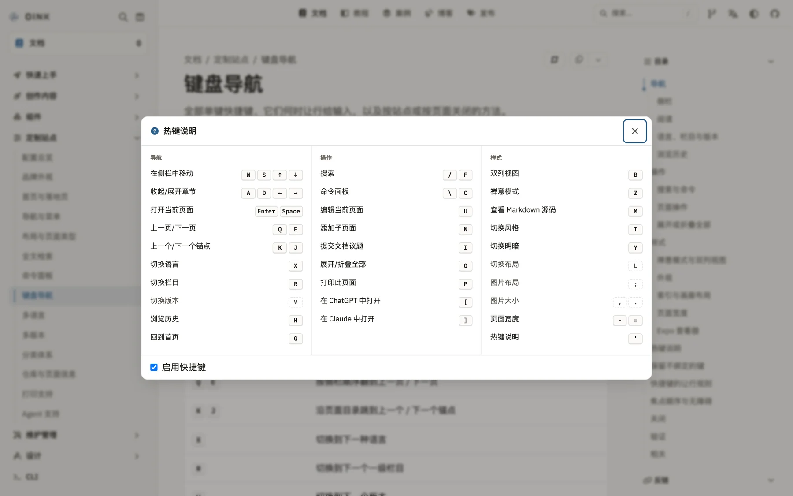

常用操作全在一只手够得着的键位上：`W`/`S`/`A`/`D` 逛侧栏，`Q`/`E` 翻上下页，`K`/`J` 跳大纲，`O` 一键展开或折叠全页所有折叠块还不丢阅读位置，`-`/`=` 按 100 px 步长随时调正文宽度，`B` 切双语对照，`Z` 进禅模式（隐藏周围组件），`M` 看纯 Markdown 源码，`[`/`]` 直接把当前页甩给 ChatGPT 或 Claude。

这套快捷键底下有几个挺实在的细节。考虑到不是所有人都用美式键盘，德语 QWERTZ 之类布局敲 `/`、`\` 很别扭，中文读者还常开着全角输入法，所以我给 `/`、`\` 配了字母等价键 `F`、`C`，把常见中文全角标点一并映射了进来，如果不习惯单键热键，点弹窗左下角的「启用快捷键」就能一键关掉。

另外加了个我会用的功能：按 **`H` 呼出站内浏览历史**。它按站点路径隔离存在浏览器本地的 `localStorage` 里，倒序记着最近访问的 100 页，而且刻意把当前页排掉了——也就是说，**敲一下 `H` 再按 `Enter`，就能直接跳回上一页**。

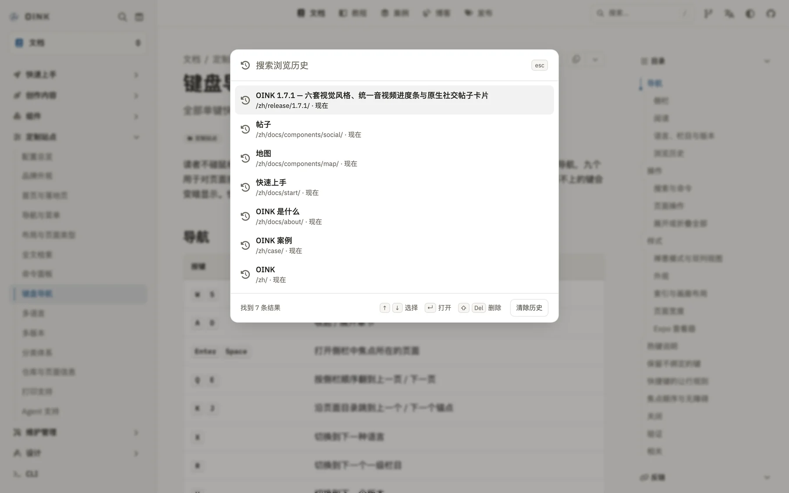

同样在 1.7.0 里，还治好了一个写公众号的老毛病：**排版富文本复制**。以前从网页复制正文往微信公众号后台贴，浏览器总爱顺手带过去一坨灰底框、暗色黑背景、标题 `#` 锚点、行号和复制按钮，还得一点点手删。
现在复制正文时会直接按当前预设的打印调色板生成干净内联 HTML，连汉字源码换行多出来的空格都帮你抹平，代码高亮和有序列表起始序号照样保留，贴过去就能直接发。


### 4. 六个新组件：绝不破坏纯 Markdown

1.7 和 1.8 还一口气补齐了六个高频组件：**地图（Map）、社交帖子（Social）、更新条目（Update）、时间轴（Timeline）、视频（Video）和音频（Audio）**。设计这些组件时我只死守一条原则：**能不破坏原生 Markdown 的可读性，就绝不造私有语法。** 哪怕哪天离开 OINK，在 GitHub 或者 Obsidian 里打开源文件，也得清清爽爽、一眼能看懂。

先看**地图（`map` 围栏）**。只要在 Markdown 里写一小段 YAML，列出地名、经纬度、图注、照片和正文锚点，加上 `route=true` 就能自动连成路线。主题不硬编码任何地图瓦片服务：没配瓦片源时零 JS、零外链，退化成带 OpenStreetMap 链接的编号地点列表；配好瓦片源后，才按需懒加载内置的 Leaflet 1.9.4，还支持暗色瓦片和点击同意后再加载。

这种声明式纯文本有个意想不到的好处——特别适合扔给 Agent 去批量填数据。我博客 [`trip/` 专栏](/trip/)里攒了十来年的二十多篇游记、几百张照片，组件一上线，我直接让 Agent 去扫照片 EXIF、比对本机 Apple Photos 里的拍摄元数据，再拿公开徒步轨迹校准坐标，一个晚上并行跑完，给 **23 篇老游记**全配上了交互照片地形图。看看《[珠峰东坡：嘎玛沟徒步](/trip/2018-gamagou/)》的效果，点开 8 号点就能弹出当年在海拔 4950 米破云航拍的日照金山，还能直接跳回那天的游记段落：


再说**社交帖子（`> [!SOCIAL]`）**。写技术评论免不了引用 X、微博、知乎上的帖子：用官方嵌入脚本，一断网就变空白还塞满追踪器；贴截图又糊、暗色模式下白晃晃刺眼，做双语博客时图片里的字既搜不到也没法翻译。1.7.0 第一版我写的是 `` 短代码，结果往自己博客里一迁，盯着源码越看越别扭——在纯 Markdown 里图片压根不渲染，正文还陷在一堆花括号里，这不是自己打自己脸吗？于是 1.8.0 干脆推倒重写，改成原生的 **`> [!SOCIAL]` 提示块**加一行块属性，嵌套引用就是多写一层 `> > [!SOCIAL]`，顺手配了自动迁移脚本。卡片零 JS、不发外部平台请求，还能自动适配 12 套主题。改完我让 Agent 调 Apple Vision OCR 扫了一遍全站 4,600 多张图，一口气把 209 张（32.8 MB）社交截图，转成了 **149 篇文章里的 492 张离线卡片**。

剩下几个组件也都是这个路数。**Update** 在普通标题末尾挂个 `{.update date="2026-11-28" tags="新增, 变更"}`，立刻长出日期和标签条，目录、锚点、搜索和 `J`/`K` 跳转照常继承；**Timeline** 用原生定义列表加 `{.timeline}`，纯 CSS 就能画出时间轴；**Video / Audio** 一行 `` 搞定，YouTube 和 Bilibili 链接默认只渲染零请求卡片，需要内嵌再按平台开启点击加载。1.7.0 时各家浏览器的原生播放器各唱各调，有的甚至出现两条进度条，**1.8.0 干脆统一由主题来画控件栏**——一根适配六套风格、对比度不低于 3:1 的三色单轨进度条（已播、已缓冲、未加载一目了然），配齐倍速、展开音量、字幕、全屏和方向键 5 秒步进，关掉 JS 时也会安静退回浏览器原生控件。

```gallery
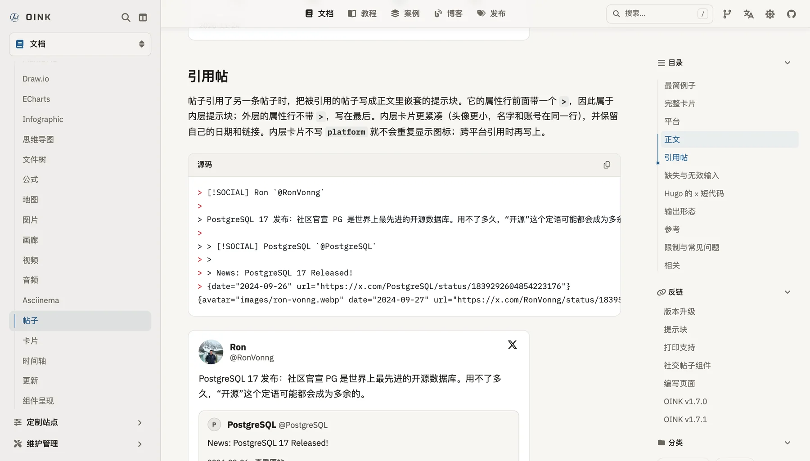 # 原生 > [!SOCIAL] 提示块：纯 Markdown 可读，渲染后自动适配 12 款主题并支持嵌套引用
 # vonng.com 实战：492 张离线社交卡片替代了过去笨重的白底截图
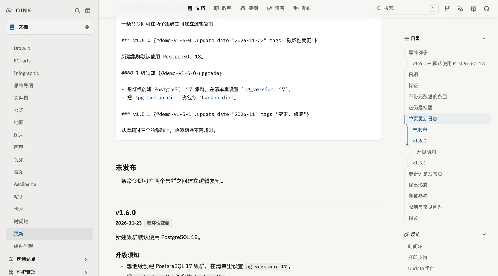 # Update 更新条目：普通标题末尾加 {.update}，秒变带日期标签的 Changelog 且保留目录锚点
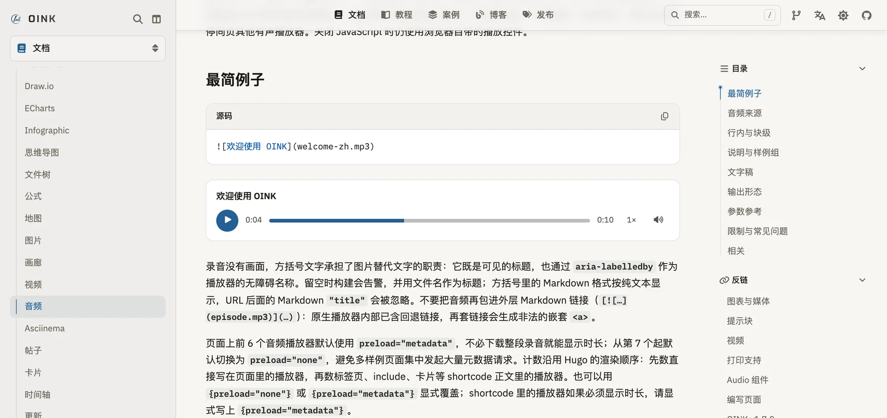 # 1.8 统一音视频控件栏：一行 Markdown 渲染，三色单轨进度条适配六套主题配色
```

## 四、下一步：动态单二进制 `oink` 与 `.oink` 阅读包

纯静态的 Hugo 撑几千页其实毫无压力，像八语言的 `doc.pg.center` 近五千个文件，几秒钟就能编完。可我手里还有一块纯静态啃不动的硬骨头：**PostgreSQL 几十年、五百多个版本的全史文档。**

我拿 `pgdoc-cn`（560 个版本的 PG 中文文档）做过一次实测：如果沿用纯静态逐版渲染，光是 HTML 就有 **6.15 GB、52.9 万个文件**；换算成双语 OINK 站点，单版 PG 18 就要 808 MB——其中 55% 还是每页重复烤进去的整棵侧栏，全量铺开根本扛不住。但实际上，整个 Git 仓库的 pack 文件才 **78 MiB**，每个小版本真正改动的页面中位数只有 **107 页**。去掉重复外壳、按正文去重压缩，全部 560 个版本加起来也不过 **30 到 70 MB**。

沿着这个实际问题，下一步准备推进两件事。

### 1. 内嵌 Hugo 与 OINK 的单二进制 `oink`

草案已经放进了 [`oink` 多版本服务提案](https://oink.pgsty.com/zh/docs/design/proposals/oink-serve/)：把上游 Hugo 库和 OINK 主题直接打进一个 Go 单二进制里，机器上不用另装 Hugo、Go 或 Node，一条命令管齐 `oink dev` 本地预览、`oink serve` 生产多版本服务和 `oink build -o site.oink` 打包。

核心模型很简单：**Git 依然是唯一的内容库，分支和 tag 对应版本，渲染结果按正文去重存成快照；线上只服务已提交且构建成功的快照，版本指针原子切换。** 底层先接上 **SQLite**（后续再扩展到 **PostgreSQL**），这样纯静态托管一直无处安放的跨版本全文检索、评论、浏览统计，乃至账号与权限控制，都能按需打开。同时死守一条底线：**普通 `hugo` 命令依然能原样构建你的站点**，绝不绑架静态用户。

### 2. `.oink` 单文件包与 Crib 原生阅读器

之前我给 PostgreSQL 6.3 到 20devel 共 31 条版本线的手册写过一个 macOS 原生离线阅读器 [**Crib**](https://crib.pgsty.com/)。下一步想把 `.oink` 做成通用的单文件包格式：一条 `oink build -o site.oink`，就能把任意文档站、技术书或者私有化离线手册压成一个独立文件。它既可以直接交给 `oink serve` 托管，也能双击在 Crib 里原生秒开，保留全部排版风格和离线全文检索——既不用搭服务器，也不用解压几万个零散 HTML。


## 五、你其实不需要学会 OINK

看到这里可能会觉得：六套风格、29 个快捷键、二十多个组件，学起来岂不是很费劲？其实正相反，OINK 功能越攒越多，上手门槛反而越来越低了。

之前那版官方文档是 Codex 写的，读起来像苏联教科书——先讲架构原理，再教你一步步建目录、背参数。这几天我们把整套教程推倒重写，第一章直接叫《[**一句提示词，建一个站**](https://oink.pgsty.com/zh/book/01-start/)》：你不用先学 Hugo，也不用看懂配置文件，建个空目录，打开 Claude Code 或 Codex，把下面 `<尖括号>` 里的信息换成自己的，直接发过去就行：

```text
请基于 Hugo 和 OINK 主题建站，遵循 OINK 建站技能：https://oink.pgsty.com/skill.zh.md
参考 OINK 文档（https://oink.pgsty.com/zh/docs/）及其中的各种样例，充分利用 OINK 的特性。
站点信息：【名称、目录、内容与受众、主题、栏目、形式、风格偏好、域名、托管平台……】
```

剩下的活全交由 Agent 去跑：它会自己读最新的 [`skill.zh.md`](https://oink.pgsty.com/skill.zh.md)，从案例库的 79 个真实站点里挑最像的照着搭，把目录、样式、搜索和部署流水线配齐，最后拉起本地预览让你验收。人真正需要管的只有两件事：**把有价值的内容写进 Markdown，对着成品验收拍板。**

前端框架两三年就会换一茬，但你沉淀下来的文档、书稿和工程记录，值得活得比任何框架都久。如果正好要给自己的项目、博客或者知识库安一个干净省心的家，不妨把上面那段提示词扔给 Agent 试试看。

**把 Markdown 喂进去。剩下的，交给这头猪。**

---

- OINK 官网与 79 个真实案例：<https://oink.pgsty.com/zh/>
- OINK GitHub 仓库：<https://github.com/pgsty/oink>
- 一句提示词建站技能：<https://oink.pgsty.com/skill.zh.md>

## 延伸阅读

- [人月神话之后：一个人的数据库公司能走多远？](/ai/thu-opc-talk/)
- [文档驱动：AI 软件工程的第一秘籍](/ai/sdd/)
- [OINK：文档框架这件事，折腾了六年，终于靠 Codex 毕业了](/db/oink-release/)
- [Oink：用 Markdown 快速创建美观的现代网站](/ai/oink-intro/)
- [珠峰东坡：嘎玛沟徒步（交互照片地图实战）](/trip/2018-gamagou/)
- [再见 Vagrant，你好 Barn](/db/barn-intro/)
