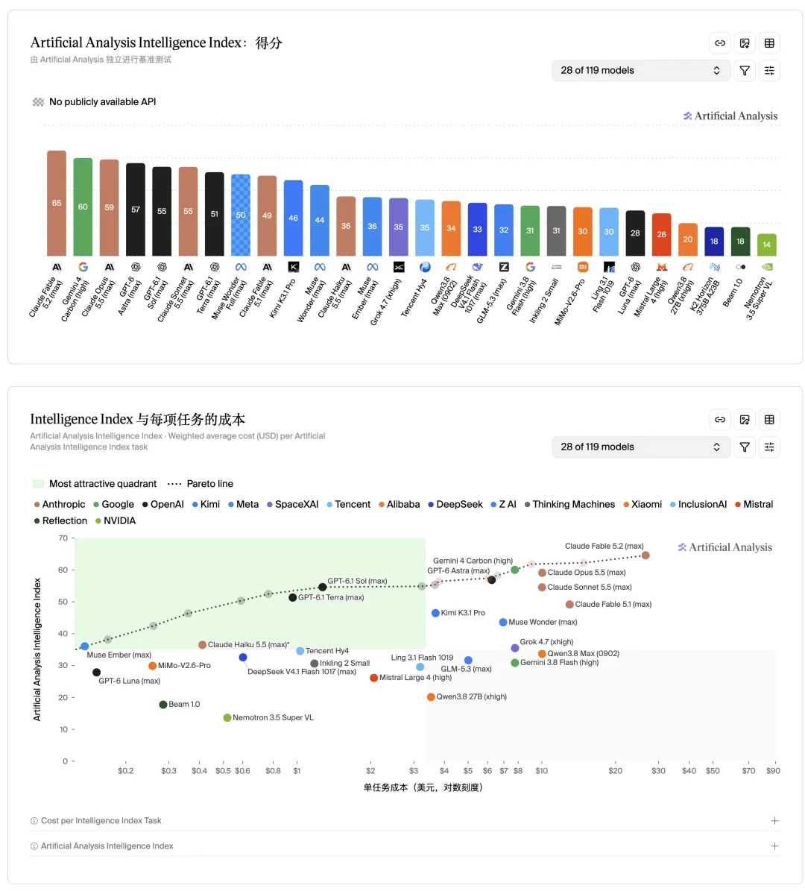
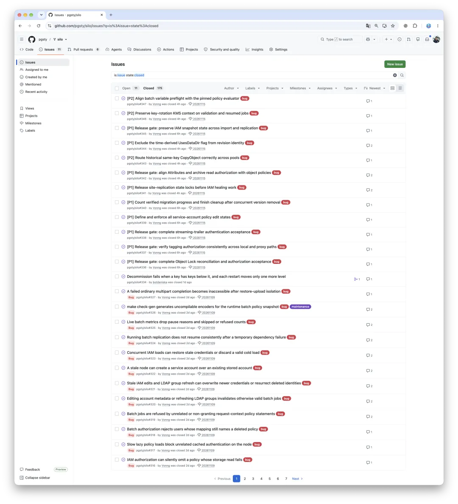
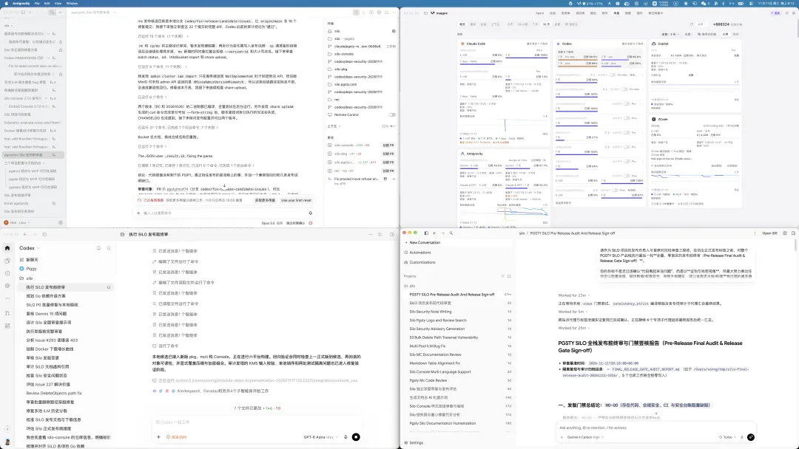
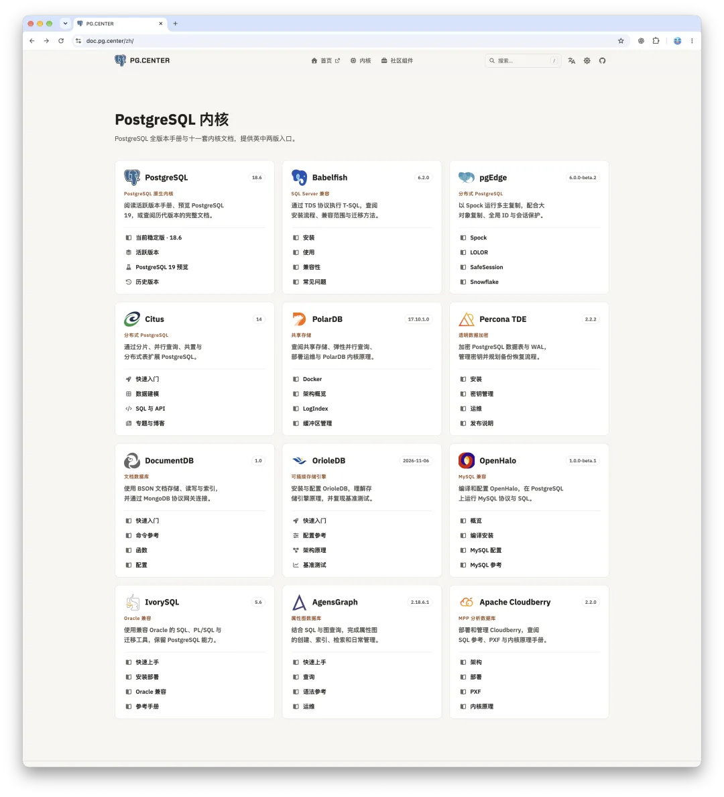
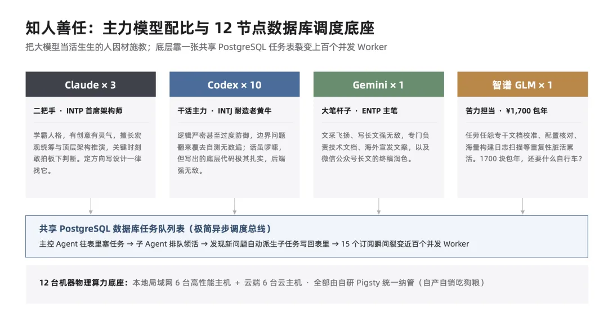
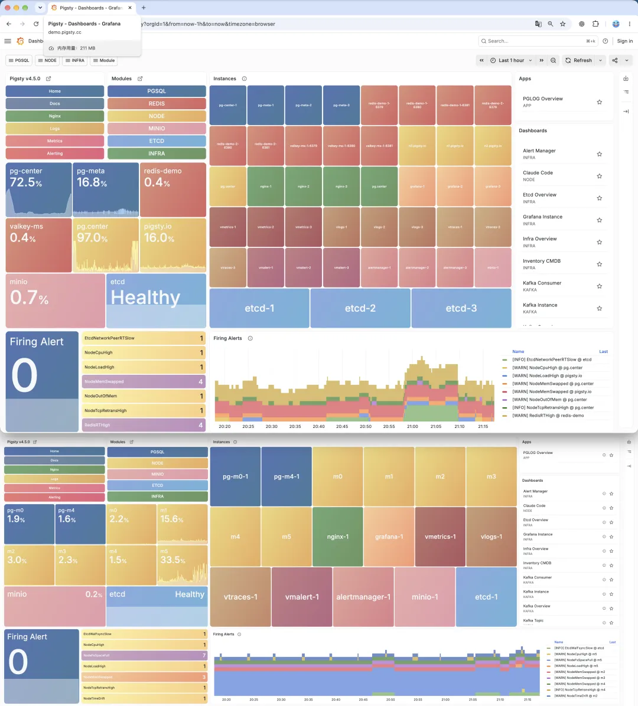

Frontier model drops have come back-to-back over the past two days: Anthropic shipped Fable 5.2, Google released Gemini Carbon, and Qwen 4 Max landed right behind them. Word is OpenAI has something lined up for tomorrow too, with a full rollout of GPT Astra 6.2 likely close behind. To sweeten launch week, Anthropic handed out two free usage-quota resets for Fable, and Codex is throwing in a banked quota reset of its own.

The pileup isn't a coincidence. Anthropic filed its IPO prospectus and officially kicked off its roadshow today. Determined to make a statement, Anthropic went all in, pulling out its strongest model yet and putting Fable 5.2 straight into the $20 Pro tier so anyone can take it for a spin. Fair play to them: in practice, the model is seriously impressive.

Original charts: [AA Intelligence Index](https://artificialanalysis.ai/#artificial-analysis-intelligence-index-chart) · [Intelligence Index vs. Cost per Task](https://artificialanalysis.ai/#intelligence-index-vs-cost-per-task-chart).

*It's an unofficial leaderboard, sure, though not completely devoid of signal.*

Naturally, none of the rival labs were going to sit on their hands and let Anthropic own the news cycle. Every competitor decided to counter-program Anthropic's IPO roadshow week, dropping frontier models at the exact same moment to steal the spotlight and land a few punches while everyone is watching.

My own reaction to all of this is equal parts excitement and resignation.

## Twenty More Vulnerabilities Right Out of the Gate

Just a few days ago, I came through an intense stretch of CVE triage and bug hunting.

Silo, the open-source object storage fork I maintain, got hit with a wave of issues inherited from upstream MinIO. Over the past few weeks, I pointed GPT Astra and Claude Opus 5.5 at the repo to comb through years of tangled legacy code and latent security hazards. I kept patching and re-auditing until repeated passes with both Astra and Opus came back clean with zero new findings. On November 9, I happily tagged and shipped a fresh release.

Blink, and the new models arrived.

I ran Fable 5.2 over the exact same codebase, and on its first pass it flagged 5 new security vulnerabilities. Right after that, I pointed Gemini Carbon at it—and Carbon pulled out 15 more. I just sat there staring at my terminal. You can't even get mad at that point; I just sighed and went right back to patching.

Annoying as the extra work was, I couldn't ask for a clearer benchmark of the generational jump. Blind spots that the previous frontier models missed across repeated passes jumped straight out to the new ones on pass one. Every time the frontier moves forward, I can feel the quality floor of the software I maintain step up a notch with it.

## The Math Flipped: Adopting Extensions and a Database Kernel

Starting with Opus 5.5, Fable 5.2, and Gemini Carbon, I've also crossed a line I used to avoid: PostgreSQL kernel and extension development.

For years while building the Pigsty distribution, I kept a strict scope boundary. I handled packaging, integration, and the occasional small patch, while staying out of the database kernel and low-level extensions. Not because the work was out of reach, but because the ROI made no sense for one person; maintaining internals at that layer would swallow all my time. Once Fable 5.2 and Carbon started reliably pulling the weight of a veteran kernel engineer, that math flipped overnight.

If frontier coding agents in the Fable 5.1 and Astra 6 era already operated like strong senior specialists, Fable 5.2 and Carbon have crossed into staff- or principal-engineer territory. Put plainly, you can now hand them database kernel development and verification work and trust the output to hold up.

Lately I've taken on several projects I wouldn't have touched solo before. First, I stepped up to maintain two PostgreSQL extensions in full: `vchord` for vector search and `Mooncake` for analytics. Having gone that far, I figured I might as well go all the way and forked `OpenHalo`, a PostgreSQL kernel compatible with MySQL's SQL syntax and wire protocol.

Upstream `OpenHalo` had been frozen on PostgreSQL 14 ever since its initial open-source release, and PG 14 hits end of life in just a few days. Using Fable and Carbon, I forward-ported the kernel straight to PG 18.6, fixed a pile of MySQL compatibility bugs along the way, and plan to push it up to PG 19 shortly.

**Surplus Capacity: Adopting Orphaned Open-Source Projects and Rebuilding My Toolchain**

*"When you're swinging a compute sledgehammer, everything starts looking like a nail." With my day job comfortably covered, the spillover capacity goes into adopting core ecosystem projects and building low-level infrastructure tools from scratch.*

| Adopted / In-House Project | Upstream Origin or Tool Replaced | Role in the Stack | Trajectory & Current Status |
| --- | --- | --- | --- |
| [Silo](https://github.com/pgsty/silo) | MinIO (abandoned by a billion-dollar unicorn) | Enterprise-grade S3-compatible open-source object storage | Adopted outside my DB turf · 4,630 ★ · ~8M downloads · 240+ migrations |
| [VectorChord](https://github.com/pgsty/vchord) | vchord (handed over by the original author last week) | High-performance PostgreSQL vector database extension | 2,000+ ★ flagship vector extension · Adopted at the author's invitation |
| [Mooncake](https://github.com/pgsty/pg_mooncake) | pg_mooncake (acquired by Databricks) | Real-time columnar analytics extension for PostgreSQL | 2,000+ ★ · Left behind post-acquisition · Full maintenance & ongoing evolution |
| [OpenHalo](https://github.com/pgsty/openhalo) | openHalo (multi-protocol PG kernel fork) | MySQL protocol-compatible PostgreSQL kernel fork | Adopted kernel fork · Integrated into standard builds & upgraded to PG 18.6 |
| [Oink](https://github.com/pgsty/oink) | Replaces heavyweight Google Docsy | AI-native engineering docs & static-site foundation | Built in-house · Knowledge platform & SDD engine powering dozens of sites |
| [Barn](https://github.com/pgsty/barn) | Replaces abandoned HashiCorp Vagrant | Local multi-node VM fleet orchestrator | Built in-house · Spins up local test clusters across 16 OS variants in one command |
| [sow](https://github.com/pgsty/sow) & [pig](https://github.com/pgsty/pig) | Replaces clunky legacy APT / YUM repo tooling | Software repo manager & extension package manager | Built in-house · End-to-end repo & packaging pipeline, culminating in my own Linux distro |

Watching neglected projects come back to life is genuinely rewarding. Social feeds right now are flooded with people burning Fable 5.2 tokens on generated videos and flashy one-shot toy demos. I don't really have the appetite for that, and I'm too stingy with my token budget to spend it on parlor tricks. Pointing frontier models at unglamorous, abandoned open-source infrastructure and bringing it back into production shape feels like a much better stress test of where the capability frontier actually sits (and frankly, it's a lot more fun).

- [MinIO's One-Year Memorial: How to Revive a Dead Open-Source Project](/en/db/minio-silo-1year/)
- [Why I'm Maintaining a VectorChord Fork](/en/pg/maintain-vchord/)
- [Taking Over Another PostgreSQL Extension: vchord Yesterday, pg_mooncake Today](/en/pg/fork-pg-mooncake/)

## Reorganizing My Two-Pizza Team

Judged strictly on real-world software engineering output, Fable 5.2 is hands-down the strongest model I've used to date. Gemini Carbon, which arrived trailing all those "Talking to God" rumors, matches it closely in practice. On actual engineering work, both have opened up a visible lead over the current Astra 6. Astra's discipline on backend systems is still formidable, though, and once Astra 6.2 lands, all three will likely pull roughly level again, holding the top tier with a clear gap over the rest of the field.

At this stage, the optimal setup is simple: keep one top-tier subscription from each of the big three and run them side by side.

I wrote recently about [the personalities of frontier AI models](/en/ai/llm-personaility/), and those observations still hold up. Through the last cycle, my daily subscription mix was **10 Codex, 3 Claude, 1 Gemini, plus 1 GLM**. Manage them like human engineers on a team, and their strengths split cleanly:

- **Claude is the product lead and my second-in-command (INTP)**: inventive, perceptive, strong at big-picture synthesis and top-level architecture, and willing to make a call instead of hedging. Whenever I need to set direction or work out a design, I go straight to Claude.

- **Codex is the staff architect and primary workhorse (INTJ)**: tireless, methodical, and rigorous to the point of paranoia. It will test and re-test edge cases on the same problem endlessly. It can be verbose, sure, yet the core backend code it produces is rock-solid, and its diagramming is SOTA too.

- **Gemini is the chief wordsmith (ENTP)**: I used to lean on it mainly for prose: technical docs, launch copy, and essay polishing, where it's still unmatched. With Carbon, its software engineering chops have caught up to the top tier, so it can finally take a regular shift in the main coding rotation.

- **Budget open-weight models like GLM handle the high-volume grunt work**: cross-checking documentation, verifying details, and scanning mountains of logs—all the repetitive chores you don't want chewing through frontier quota. My GLM plan runs RMB 1,700 (~$240) a year flat; at that price, what more could you ask for?

With both Fable 5.2 and Carbon taking such a big leap on engineering tasks, I'm rebalancing my seats, paring back from ten Codex subscriptions to an even **3-3-3 lineup**:

- 3 Codex subscriptions at the $500 tier
- 3 Claude Ultra subscriptions at the $200 tier (scaling up to 6 if needed)
- 3 Google AI Ultra subscriptions at the $200 tier

That puts one seat from each of the big three on every one of my three primary workstations. Add GLM and Grok for the grunt work, plus me at the keyboard, and you get a textbook **12-member two-pizza team**. Eleven of them are agents, **though I have no trouble finishing both pizzas myself.**

The hardware underneath this crew is 6 local machines on my LAN plus 6 cloud VMs: 12 hosts in total, all managed through Pigsty in a classic dogfooding setup. Dispatch is dead simple too: a shared PostgreSQL database holding a task queue.

A lead agent inserts tasks into a table, and worker subagents claim jobs from it; whenever they uncover new issues mid-flight, they spawn follow-up tasks straight back into the same table. Crank concurrency all the way up, and those dozen-odd subscriptions quickly fan out into dozens of workers grinding through tasks in parallel.

Keeping that many concurrent workers from stepping on each other or going off the rails does take a few engineering guardrails. I'll dig into how that works after I finish running my mouth on stage at the China Enterprise AI Conference and Tsinghua over the next couple of days.

## Shameless Plug

Two talks on the calendar this week: this Friday, November 13, I'm giving a keynote at the China Enterprise AI Conference titled "One Person, One Agent Team: The Productivity Limits of a Solo Engineer," along with a panel debate (read: polite mutual roasting).

Then on Sunday, I'll be speaking at Tsinghua University on "The Mythical Man-Month: How Far Can a One-Person Database Company Go?" If you happen to be around for either one, come say hi.
