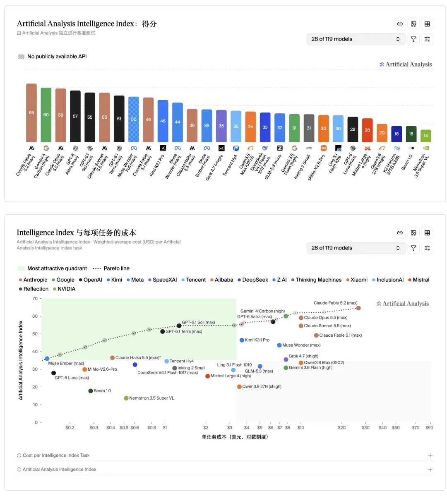
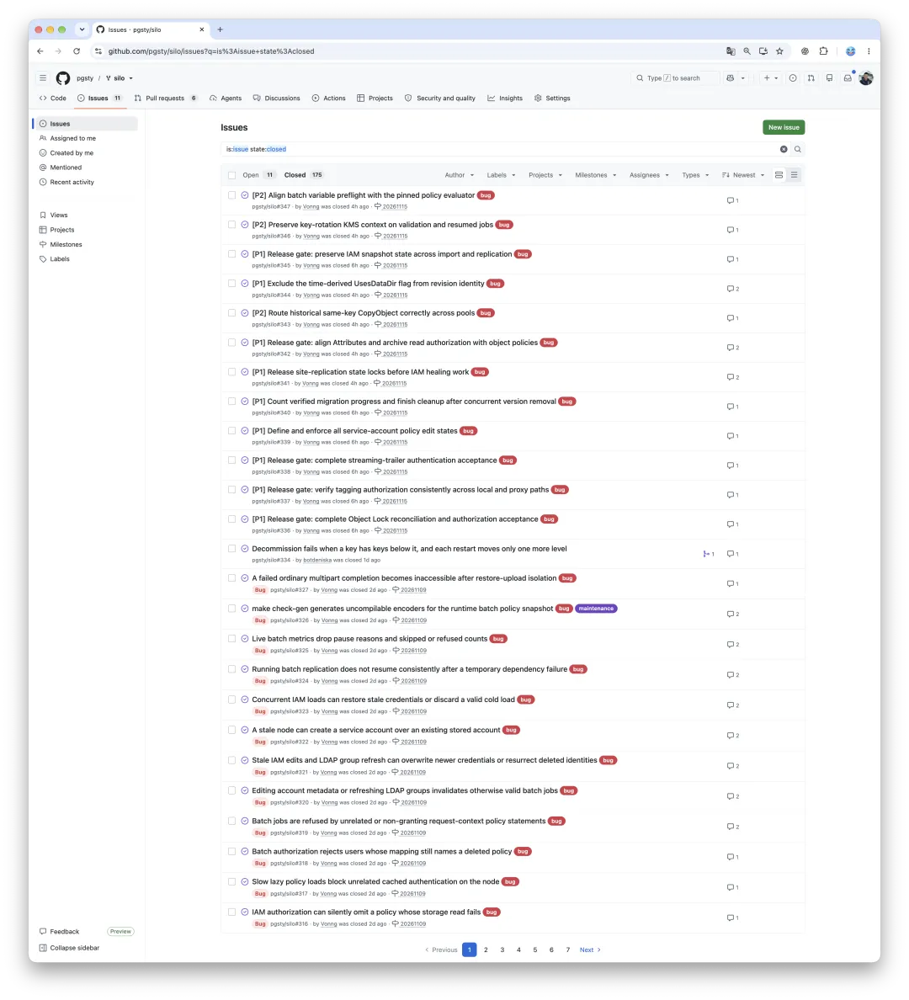
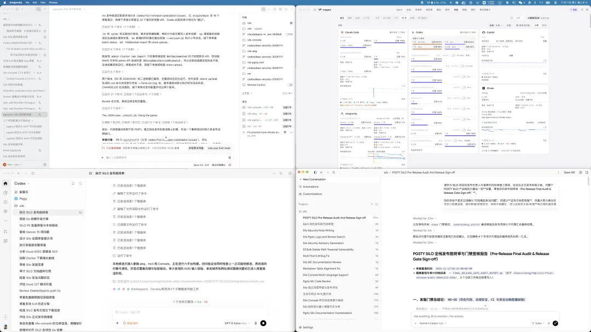
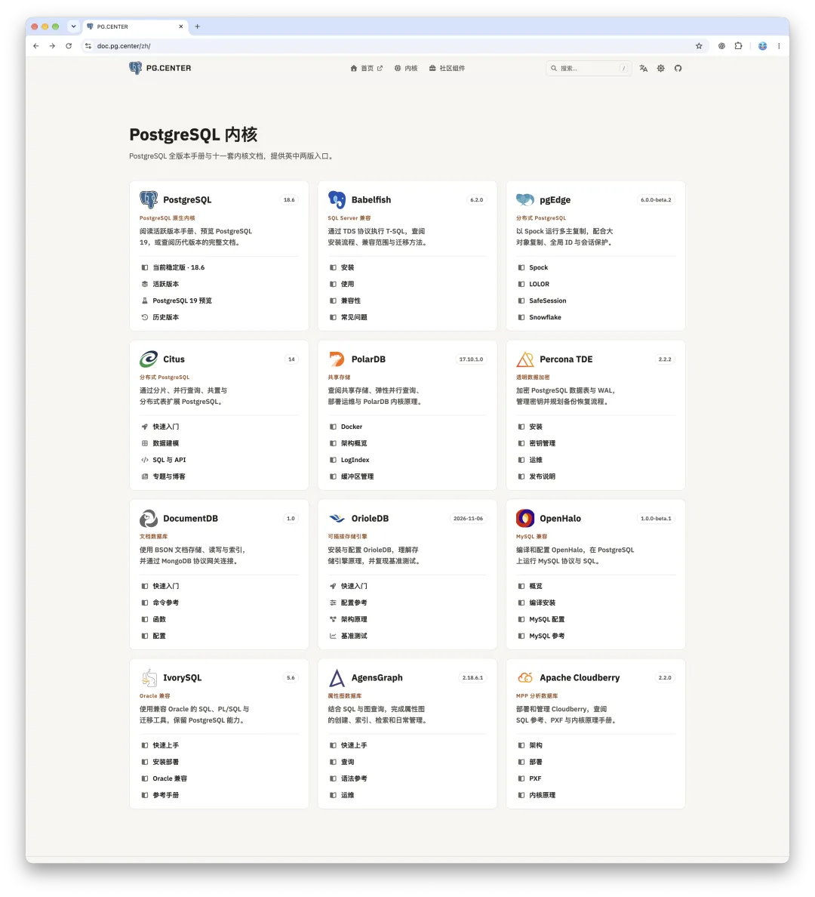
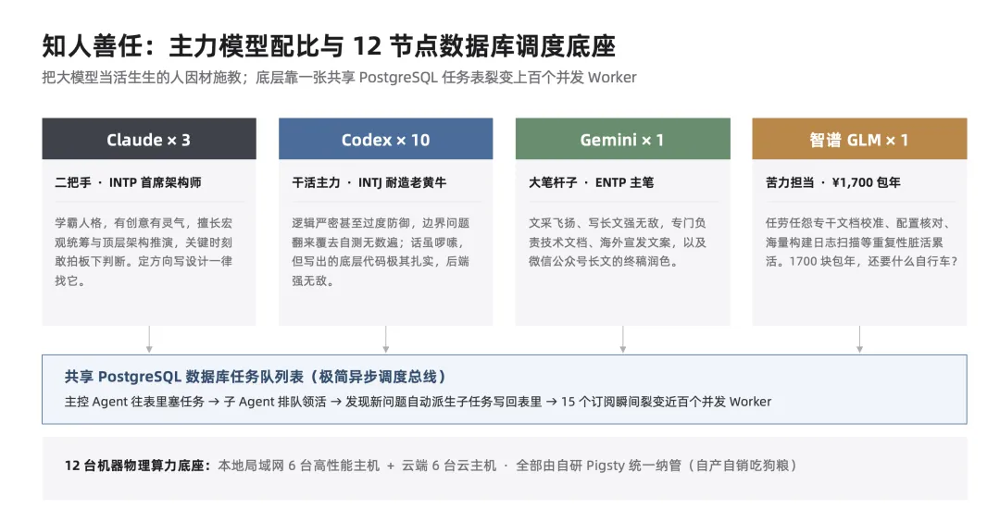
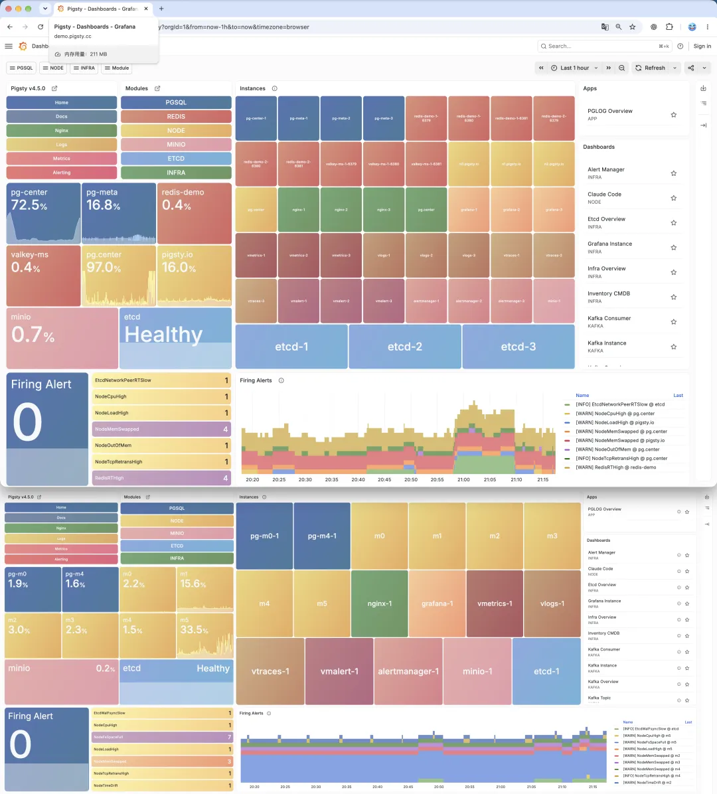

这两天前沿模型密集发布：Anthropic 端出了 Fable 5.2，Google 发了 Gemini Carbon，紧接着千问 4 Max 也亮相了；OpenAI 那边据说明天也有新动作，GPT Astra 6.2 大概很快就要全面推开了。Fable 送了两个 Reset，Codex 也要送一个 Banked Reset。

赶在这个时间点扎堆，很大程度上是因为 Anthropic 交了招股书、今天正式启动路演。Anthropic 自己下了血本，掏出压箱底的绝活，把最新的 Fable 5.2 直接下放到 20 美元的 Pro 档让大家试用——客观讲，这模型的表现确实极强，让人印象深刻。

查看原始图表：[AA Intelligence Index](https://artificialanalysis.ai/#artificial-analysis-intelligence-index-chart) · [智能指数与任务成本](https://artificialanalysis.ai/#intelligence-index-vs-cost-per-task-chart)。

*俗话说，野榜也是榜，也有少量参考价值嘛。*

但其他厂商自然也不会闲着，基本秉持着“一人出山、众人捣乱”的精神，趁着 Anthropic 上市路演噼里啪啦往外甩新模型，赶着这波热闹干他一电炮。

但对此，老冯是既兴奋又无奈的。

## 一眨眼又扫出二十个漏洞

就在几天前，老冯刚经历了一场密集的 CVE 和 Bug 雨洗礼。

我维护的对象存储项目 Silo 受上游 MinIO 牵连爆出一堆问题。前阵子我刚拿 GPT Astra 和 Claude Opus 5.5 把上游遗留的各种陈年屎山代码和安全隐患犁了一遍，一直修到 Astra 和 Opus 翻来覆去再也找不出任何新漏洞为止。11 月 9 日那天，我还高高兴兴地发了个新版本。

结果一眨眼，新模型出来了。

我拿 Fable 5.2 扫了一遍代码，哗一下，直接报出来 5 个安全漏洞；紧接着换 Gemini Carbon 再扫一遍，一下子又拎出来 15 个。当时我都看傻了，除了无奈地继续补洞，实在没脾气。

不过换个角度看，这件事很直观地印证了模型能力的跃升。以前拿着上一代模型怎么重复扫都摸不到的盲区，换上新一代前沿模型，一眼就能揪出来。每一次前沿模型迭代，老冯都能明显感觉到手头软件的质量跟着往上抬了一截。

## 性价比变了：开始接盘扩展与内核

也是从 Opus 5.5、Fable 5.2 和 Gemini Carbon 这一代模型开始，老冯正式动身进军 PostgreSQL 内核与扩展开发了。

以前做 Pigsty 发行版，我的边界划得很清楚：只做打包集成，偶尔打点小补丁，一般绝不去碰内核与底层扩展。倒不是不能做，纯粹是性价比太低，一个人玩这个耗不起那个精力。但当 Fable 5.2 和 Carbon 已经能稳定扮演资深内核工程师的时候，这笔账就彻底划算了。

如果说老冯认为在 Fable 5.1 到 6 的时代，这种前沿 AI Agent 已经达到了高级专家的水平，那么 Fable 5.2 和 Carbon 就已经摸到了资深专家的层次了。简单地说，你可以把数据库内核开发和验证这样的工作交给它了。

最近老冯干了几件以前不敢想的事：先是完整接盘了两个扩展，一个是向量扩展 `vchord`，一个是分析扩展 `Mooncake`；最近干脆一不做二不休，把兼容 MySQL 语法协议的 PostgreSQL 内核 `OpenHalo` 也 fork 了一份接盘过来。

那个内核开源之后就一直停在 PG 14，再过几天 PG 14 就要正式 EOL 了。老冯用 Fable 和 Carbon 把它直接升到了 PG 18.6，顺手修了一大堆 MySQL 兼容性问题，过几天准备再直接往 PG 19 升。

**生产力溢出：批量收编“遗留”开源项目与重构工具链**

*“手握算力大锤，看什么都像钉子”——主业绰绰有余，溢出产能跨界接盘核心生态与自研底层工具。*

| 收编 / 自研项目 | 上游背景或替代对象 | 基础设施赛道定位 | 演化路径与当前状态 |
| --- | --- | --- | --- |
| [Silo](https://github.com/pgsty/silo) | MinIO（十亿美元独角兽弃坑） | 企业级 S3 兼容开源对象存储 | 跨界接盘 · 4,630 ★ · 近 800 万下载 · 240+ 项目迁移 |
| [VectorChord](https://github.com/pgsty/vchord) | vchord（上周原作者主动托付） | PostgreSQL 高性能向量数据库扩展 | 2,000+ ★ 明星向量扩展 · 作者邀请老冯接盘维护 |
| [Mooncake](https://github.com/pgsty/pg_mooncake) | pg_mooncake（被 Databricks 收购） | PostgreSQL 实时列存分析扩展 | 2,000+ ★ 商业收购后社区遗留 · 完整接盘演进 |
| [OpenHalo](https://github.com/pgsty/openhalo) | openHalo（异构协议内核分支） | 兼容 MySQL 协议的 PG 内核分支 | 收编接盘内核分支 · 纳入标准构建，升级到 PG 18.6 |
| [Oink](https://github.com/pgsty/oink) | 替代笨重的 Google Docsy | AI 原生工程文档与静态站点底座 | 自研替代 · 知识管理平台，SDD，驱动数十个站点 |
| [Barn](https://github.com/pgsty/barn) | 替代跑路的 HashiCorp Vagrant | 本地多节点虚拟机舰队编排工具 | 自研替代 · 一键拉起 16 种操作系统的本地测试集群 |
| [sow](https://github.com/pgsty/sow) & [pig](https://github.com/pgsty/pig) | 替代繁琐传统 APT / YUM 工具链 | 软件仓库管理器与扩展包管理器 | 自研仓库与包管理闭环 · 做出了自己的 Linux 发行版 |

看着这些老项目重新焕发生机，还是挺有成就感的。现在网上到处是用 Fable 5.2 做视频、搓小 Demo 的展示，老冯没那么无聊，也舍不得把宝贵的 Token 浪费在这种事情上。拿前沿模型哐哐去接盘、救活硬核开源项目，才算是把大模型的能力边界又往前推了一步。

- [MinIO 周年祭：如何让死掉的开源项目重生](/db/minio-silo-1year/)
- [老冯又接盘新开源项目了](/pg/maintain-vchord/)
- [开源接盘侠又来了：昨天 vchord，今天吃月饼](/pg/fork-pg-mooncake/)

## 重新编组：老冯的“两个披萨”团队

单论软件工程干活的质量，老冯体感下来，Fable 5.2 毫无疑问是目前的第一；而之前顶着“Talking to God”传闻出来的 Gemini Carbon，实际表现跟 Fable 5.2 不相上下。这两个模型在工程实战上已经肉眼可见地优于目前的 Astra 6——当然，Astra 在后端开发的严谨性上依然非常能打，等 Astra 6.2 出来，大概率三家又会重新拉齐到一条线上，稳坐第一梯队，和其他模型拉开身位。

到了这个阶段，以后最佳的配置其实就是顶级模型每家各备一套，互相搭班子干活。

老冯之前写文章聊过“[大模型的人格解析](/ai/llm-personaility/)”，放到现在来看依然成立。在上一阶段，我的主力订阅配比是 **10 个 Codex、3 个 Claude、1 个 Gemini，外加 1 个 GLM**。把它们当人来管，禀赋非常分明：

- **Claude 是产品经理，二把手（INTP）**：有创意、有灵气，擅长宏观统筹与顶层架构设计，而且敢于拍板下判断。凡是定方向、出设计，一律找 Claude，顶级的架构师与点子王。

- **Codex 是架构师，主力马（INTJ）**：耐造的老黄牛，性格极其严谨甚至有些过度防御。一个问题翻来覆去自测无数遍，话虽然啰嗦点，但写出来的核心代码极其扎实，后端强无敌，画图也是 SOTA。

- **Gemini 是大笔杆子（ENTP）**：以前主要用它写文章，技术文档、营销文案与文章润色强无敌；如今到了 Carbon 这一代，工程能力追平了第一梯队，终于也能直接站上主力开发位了。

- **国产模型当苦力**：专门干文档校准、细节核对、海量日志扫描这些重复性的脏活累活。GLM 1700 块钱包年，还要什么自行车？

因为 Fable 5.2 和 Carbon 的工程能力双双起飞，老冯现在的订阅计划也变了，准备把原来重仓的 10 个 Codex 缩编，收敛成均衡的 **“3-3-3”阵型**：

- 3 个 500 美元档的 Codex 订阅
- 3 个 200 美元档的 Claude Ultra 订阅（视情况可扩到 6 个）
- 3 个 200 美元档的 Google AI Ultra 订阅

正好在三台主力开发机上每台配齐御三家各一个；再配上干苦力的 GLM 和 Grok，最后加上老冯本人，刚好凑齐一个标准的 **12 人 Two-Pizza Team**——虽然 11 个是 Agent，**但老冯一个人能吃两个披萨！**

支撑这支队伍的硬件底座，是我本地局域网的 6 台电脑加上云上的 6 台云主机，共 12 台机器，全由 Pigsty 统一纳管，自产自销吃狗粮。调度也很简单：就是一个共享的 PostgreSQL 数据库，里面放着任务队列。

主 Agent 往表里塞任务，子 Agent 去表里领活；执行中发现了新问题，再自动派生新任务写回表里。一旦把并发打满，这十几个订阅能瞬间裂变出几十个 Worker 同时搬砖。

至于怎么管住这几十个并发 Worker 不翻车，里面确实也有一些工程技巧。等这两天去中国企业 AI 大会和清华吹完牛逼，可以再展开聊聊。

## 广告时间

活动预告：后天（11 月 13 日）在中国企业 AI 大会上，老冯会有题为《一个人，一支 Agent 团队，超级个体的效能边界》的主题演讲，和圆桌辩论（互喷）环节。

另外在周日在清华大学，老冯也会进行一场演讲《人月神话，一个人的数据库公司能走多远》，欢迎莅临指导，多多交流。
