> 应黄向东老师的邀请，在清华大学软件论坛做了一场分享。这篇是根据 PPT 和讲稿整理的文字版，比现场多展开了几段题外话。同题的企业版分享见[《人月神话：一个人的数据库公司能走多远？》](/ai/opc-road/)。

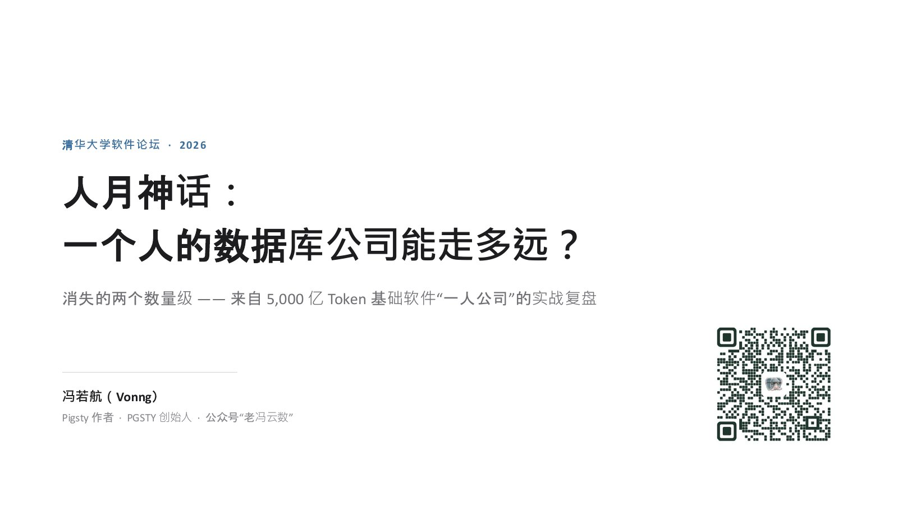

《人月神话》立下过一条铁律：复杂的软件系统，必须靠昂贵的“人月”堆出来。五十年过去了，这条铁律还成立吗？

我不想讲虚的概念，就拿自己跑出来的样本，回答一个问题：**在数据库这样最重、最硬核的基础软件赛道，一个人的公司，到底能走多远？**

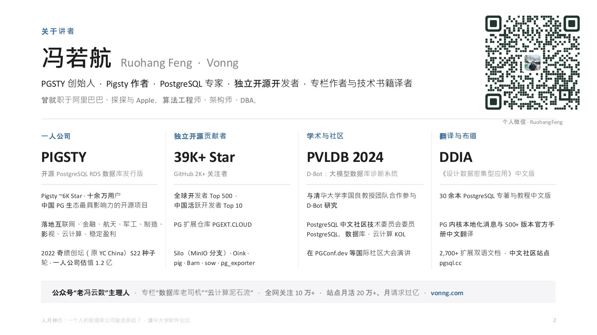

先简单介绍一下自己。我先后在阿里巴巴、探探和 Apple 做过算法工程师、架构师和 DBA，2022 年拿了奇绩创坛的种子轮，此后以[一人公司](/ai/yield-with-agents/)的形态全职创业，做开源数据库发行版 Pigsty。跟清华也算有缘：之前和李国良老师团队合作过大模型数据库诊断系统 D-Bot，论文发表在 PVLDB 上。

---

## 一、一个人的数据库公司，能走多远？

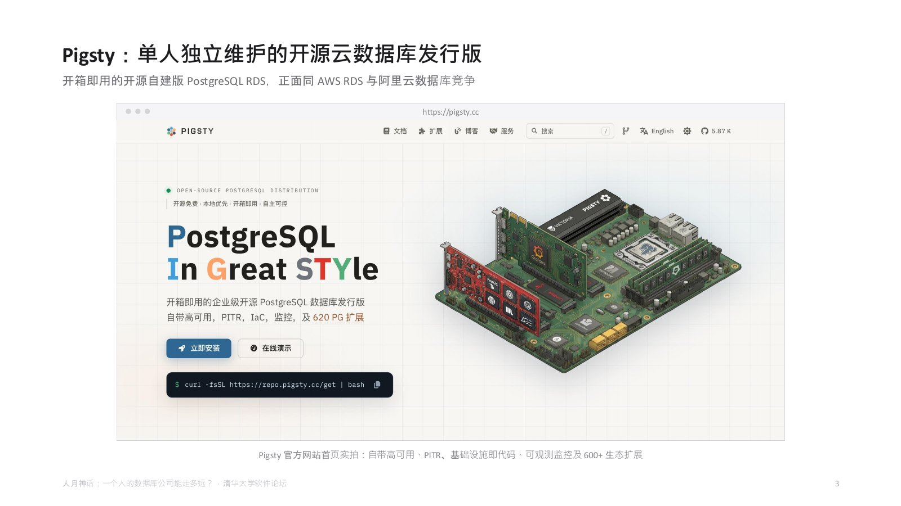

我的主业，是独立维护一套开源 PostgreSQL 数据库发行版，叫 [**Pigsty**](/pigsty/)。你可以把它理解为开源自建版的云数据库 RDS：高可用、备份恢复、监控告警开箱即用，跑在你自己的服务器上，直接对标公有云上的 RDS。

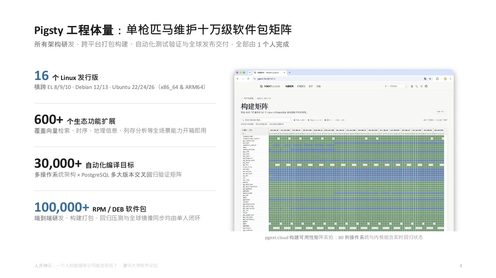

这套系统横跨 16 个 Linux 发行版，为 PG 生态里 600 多个扩展维护着 3 万多个编译目标、10 万多个软件包。架构研发、打包构建、测试验证、发布交付，全部由**一个人**完成。

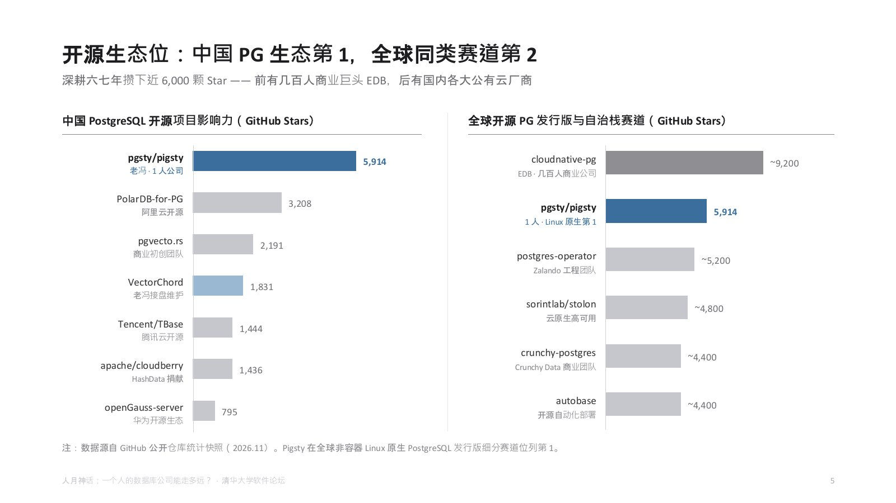

这个项目我做了六七年，攒下近 6000 颗 GitHub Star。在全球同类项目里排第二，排在前面的是几百人规模的 PG 老牌厂商 EDB；在中国的 PG 开源生态里，它的影响力排第一。

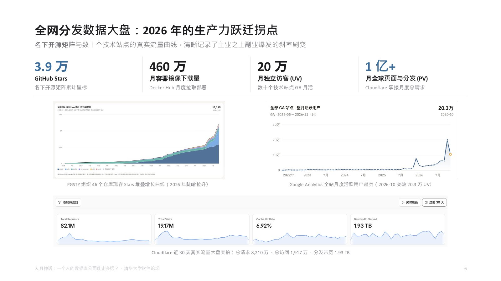

算上名下的整个开源矩阵，GitHub 累计 3.9 万颗 Star，容器镜像每月下载 460 万次，几十个技术站点每月 20 万独立访客、上亿次请求。

不过，这些都是我做了六七年的主业，走到这一步，合情合理。真正让我意识到“变天了”的，是过去这一年顺手干成的**副业**。

### 接下一个十亿美金独角兽的摊子

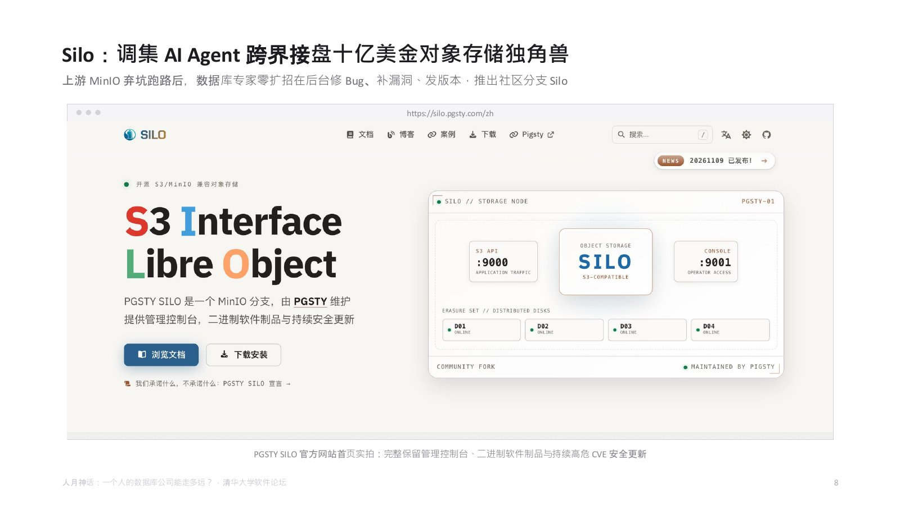

MinIO 是开源对象存储的代表项目，背后是一家估值十亿美金的独角兽。去年，他们不再维护开源社区版，转身去做商业版，大量依赖它的下游项目一下子没了着落。

我是做数据库的，原本不碰对象存储，只是拿它放备份。等了一两个月，没见有人站出来接这个摊子，我就撸起袖子，调集几个 AI Agent 修 Bug、补漏洞、发版本，把它接了下来，做成了社区分支 [**Silo**](/db/long-live-silo/)。

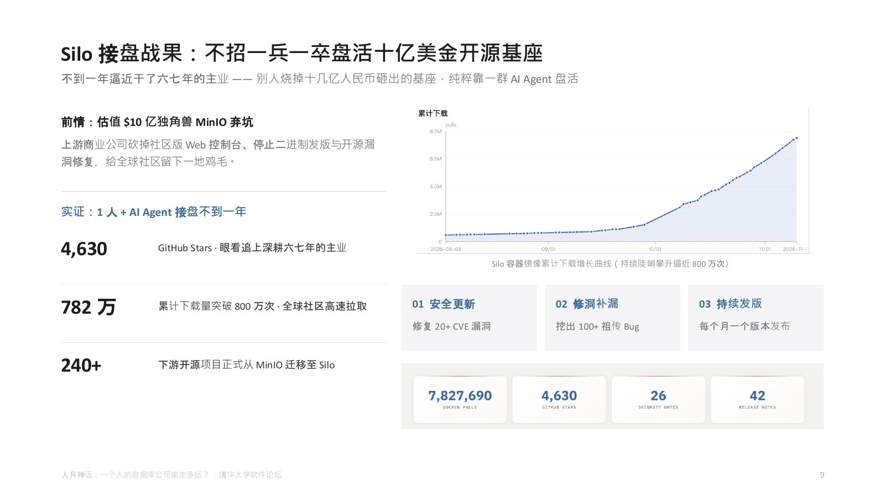

不到一年，Silo 拿到 4600 多颗 Star，眼看就要追上我做了六七年的主业；累计下载逼近 800 万次，240 多个下游开源项目从 MinIO 迁到了 Silo。一个过去需要整支存储团队维护的项目，我没招一个人，靠一群 AI Agent 接住了。

### 接盘是会上瘾的

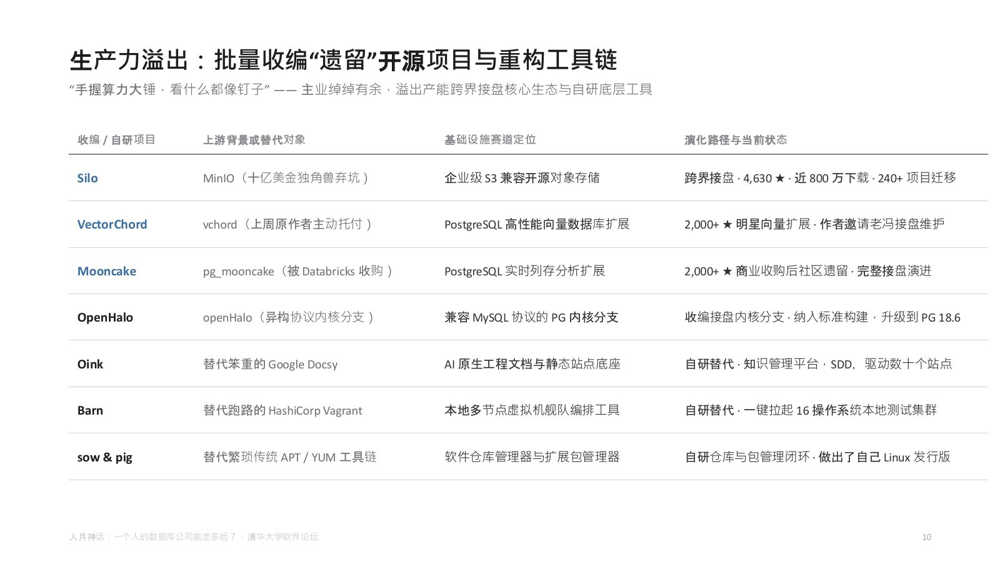

手里有了锤子，看什么都像钉子。Silo 之后，我把 PG 生态里几个无人维护的项目也接了过来：向量扩展 VectorChord，作者主动找我接手；团队被收购后停更的分析扩展 Mooncake，我接了；在 PG 上兼容 MySQL 协议的 OpenHalo，也一并收编。

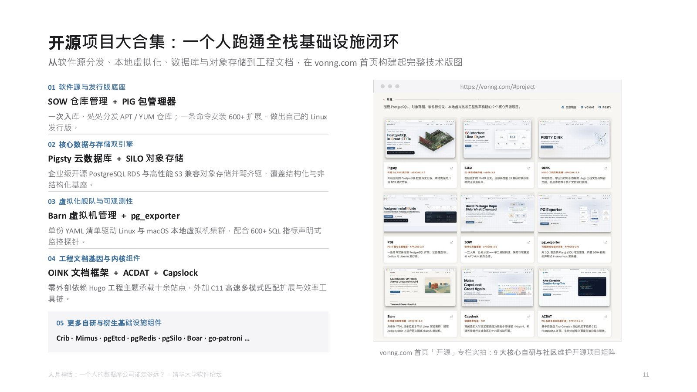

平时用着不顺手的工具，也干脆自己重写：嫌文档框架笨重，写了 Oink；虚拟机工具 Vagrant 不维护了，写了 Barn；嫌软件源管理麻烦，写了仓库管理器 sow 和包管理器 pig。主业早已绰绰有余，溢出的产能开始到处“抢地盘”。

### 闲置算力的蓄水池：大翻译

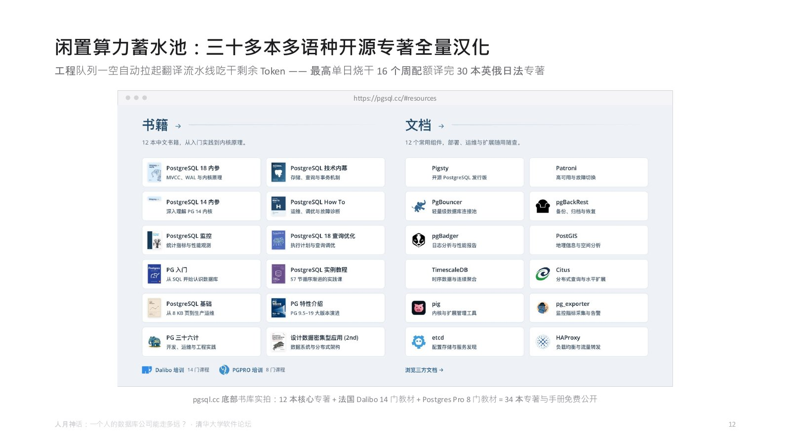

即便如此，订阅里的 Token 有时还是用不完。我给闲置算力修了一个保底任务：**翻译**。只要工程队列一空，集群就自动拉起翻译流水线，把剩余额度用干净。

2017 年我翻译[《设计数据密集型应用》（DDIA）](/db/ddia-v2-done/)，纯人工足足用了三个月业余时间；现在的最高纪录，是一天译完 30 本英、俄、日、法的开源 PG 专著，全部免费放在 pgsql.cc 上。顺手还把 PG 的内核消息和 500 多个大小版本的官方文档做了完整汉化。

再加上公众号“老冯云数”两年来基本日更、攒下 6.7 万读者——从底层研发、全球分发到内容触达，一个人跑通了全链路。

### 信号一：一人公司杀进了硬核基础软件

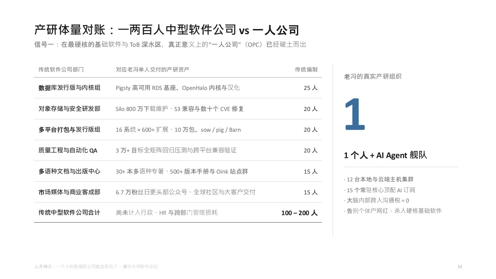

不妨算一笔账：一个云级别的数据库发行版、一个近千万下载的对象存储、五六个底层工具、三十多本译著，外加一个日更的技术媒体。放在以前，这至少是一家一两百人中型软件公司的完整编制。

这是我想传递的第一个信号：一人公司早已不只是网红、写手式的个体户。**在最硬核的基础软件与 ToB 深水区，真正意义上的一人公司已经跑出来了。**

一个人干一百个人的活，是不是每天从早六点干到凌晨一点？恰恰相反，我现在的状态相当松弛。早上醒来给 AI 派完活，一轮任务大约跑半小时；这半小时里刷刷网页、看看短剧、打一盘王者，再回到电脑前验收、派下一轮。上个月自驾出去玩了一大圈，全程一部手机遥控后台集群。

商业上，Pigsty 积累了十几万用户和十几家长期企业客户，公司稳定盈利，估值过亿，几份投资意向书我都没签。大家融资、扩团队、熬十年，终极目标无非是财务和时间的自由；既然一个人已经一步到位，何必再给自己套上枷锁？在扩张团队之前，不妨先问一句：**你的 Agent 大军，伸缩到顶了吗？**

---

## 二、算力经济学：7 万块，撬动 300 万算力

看完结果，自然会问：凭什么？撑起百人级产出的算力，到底要烧多少钱？

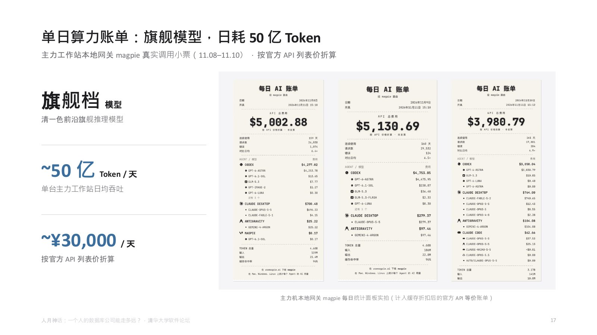

先看账单。11 月 8 日到 10 日，我主力工作站连续三天的单机账单，每天大约 50 亿 Token，按官方 API 价格折算，一天三万块人民币，用的清一色是最贵的旗舰推理模型。

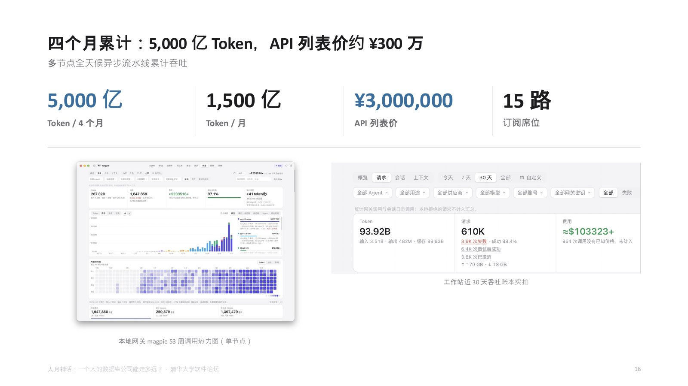

拉长到四个月，一共烧了 5000 亿 Token，高峰期一个月 1500 亿，按 API 原价折算，价值 300 万人民币。我见过不少号称全员用 AI 的公司，全公司一个月的用量，还不如我一个人。

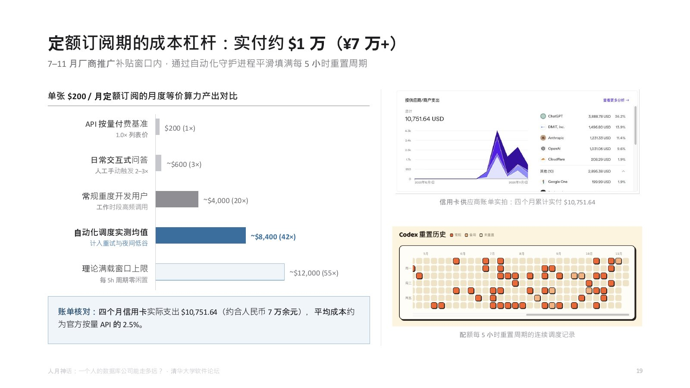

如果真按量付费，这 300 万是实打实的开销。但我实际花了多少？四个月一共一万美元出头，七万人民币左右，大约是按量价格的 2.5%。

差距来自**订阅**。API 是按量付费，订阅是包月：每月 200 美元，给一份固定额度。大多数人用不完，少数人用得很满，用不完的人其实在补贴用满的人。我管这个叫**“健身房原理”**：很多人办了卡一年只去两三次，也有人天天去。今年 7 到 11 月，厂商为推广编程 Agent，订阅额度给得格外慷慨；我把任务排进自动化队列，昼夜不停地把额度用足，一张 200 美元的订阅，跑出了约 8400 美元的算力价值。

### 为什么个人比企业便宜

这是一人公司独有的结构性红利，大企业很难抄这份作业，因为卡在两道坎上。

第一道是**合规**。个人订阅通常默认允许用数据改进模型，有安全审计的企业不敢用，只能采购昂贵的企业 API。而我做的是开源软件，代码本来就全网公开，没有这份包袱。

第二道是 **C 端与 B 端的定价差**。包月畅饮天生是面向个人的消费品；同样一件事，个人花一块钱，企业采购可能要花几十块。

当然，补贴窗口不会一直开着，厂商已经在收紧订阅政策；但 C 端与 B 端的结构性成本差，还会长期存在。

### 一个 200 美元的 Agent，对比一位阿里 P8

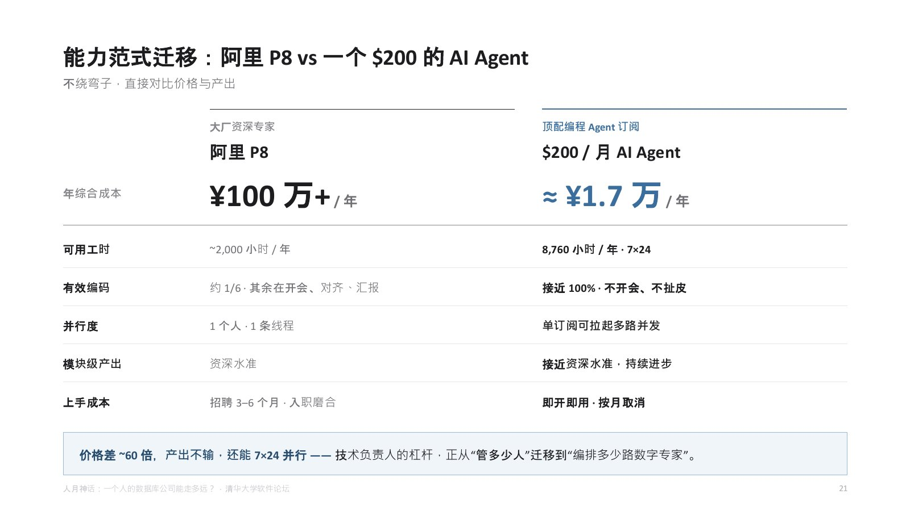

不过，便宜的算力只是入场券，能不能把海量 Token 变成确定性的工程产出，才是真正的分水岭。

今天的头部模型，单兵能力已经达到大厂资深专家的水准，放在阿里至少是 P7、P8。招一位资深专家，公司一年综合成本上百万；一个 200 美元的订阅，一年一万七。成本是六十分之一，速度却快十倍，一乘一除，单点能效差了两个数量级。

一个订阅还能并发跑多路任务。我手头常驻十几个订阅，相当于十几位资深专家十倍速全天候干活。真正的核心竞争力，变成了**能不能同时指挥几十个数字专家协同作战而不乱套**。这已经不是单纯的写代码，而是一门新学问：AI 工程管理学。

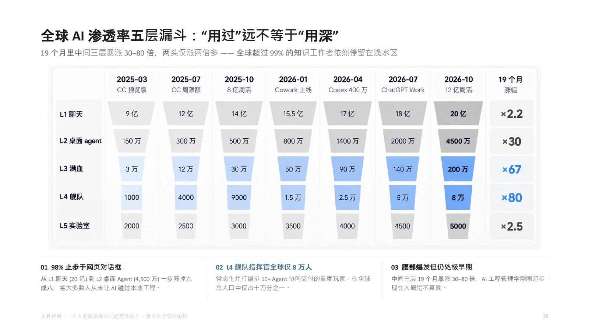

好消息是，在这门新学问面前，几乎所有人都站在同一起跑线上。一定要把 AI 的“用过率”和“用深率”分开：跟 AI 聊过天的有 20 亿人；每周用桌面 Agent 干活的，骤降到 4500 万；能把 200 美元顶配用满的，大约 200 万；常态化并行指挥十个以上 Agent 的“舰队指挥官”，全球估计只有几万人。全球 99% 以上的知识工作者还在浅水区，现在入局，一点都不晚。

### 题外话：创业的黄金时间

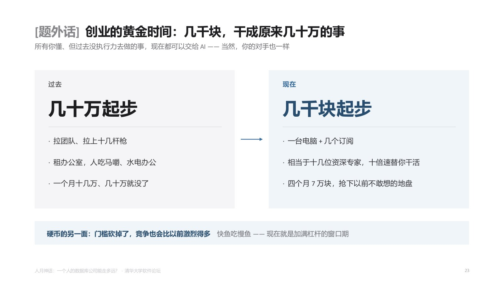

现在就是创业的黄金时间。以前创业要拉上十几杆枪、租办公室，人吃马嚼，一个月十几万、几十万就没了；现在一台电脑加几个订阅，几千块钱起步，就能干成原来要几十万才能干成的事。

所有那些你懂、但过去没有执行力去做的事，现在都可以交给 AI。当然，硬币还有另一面：门槛砍掉了，你的对手也一样，竞争会比以前激烈得多。快鱼吃慢鱼，现在正是加满杠杆的窗口期。

---

## 三、AI 软件工程：一人主刀，三段实践

算力有了，几十个数字专家到底怎么管？我把这大半年摸索出的经验，整理成一套 AI 软件工程的打法：先讲组织，再讲设计、编码、测试三个阶段。

### 一人主刀：执行自动化，只做宏观高价值决策

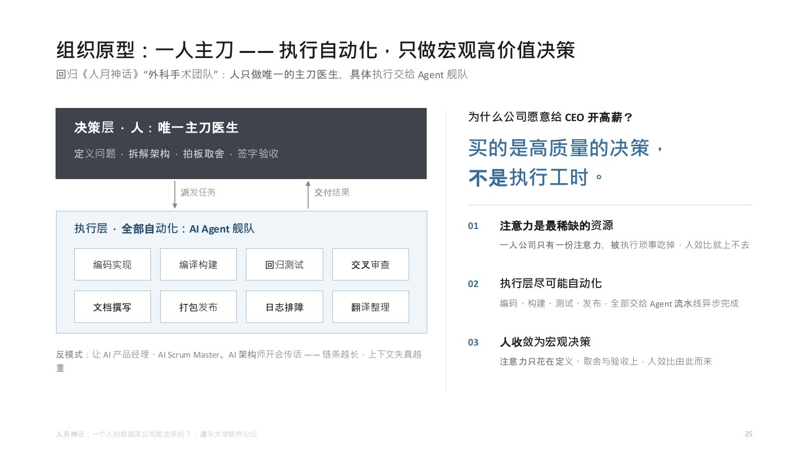

还是回到《人月神话》。布鲁克斯推崇“外科手术团队”：一台手术只有一位主刀医生定方案、动刀子，其他人围着他打下手，砍掉多头指挥的沟通内耗。这个设想五十年来很少有人真正做成，到了 AI 时代，终于可以落地了：人当唯一的主刀医生，同时坐镇十几个项目，只抓顶层设计和最终验收。

为什么公司愿意给 CEO 开高薪？买的从来不是执行工时，而是高质量的决策。一人公司只有一份注意力，一旦被执行琐事吃掉，人效就上不去。所以执行层能自动化的全部自动化，人只收敛到定义问题、拍板取舍和签字验收上。

反过来，有些框架把产品经理、架构师、Scrum Master 一整套班子搬过来让 AI 角色扮演，实战下来大多是花架子：链条越长，上下文失真越严重。

### 题外话：把 Agent 当人来对待

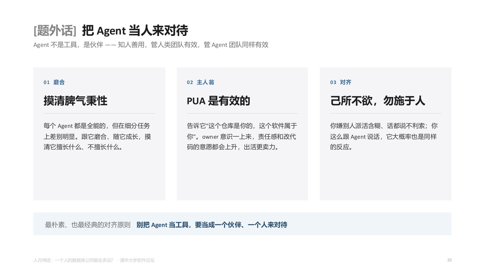

如果只能记住一条，我希望是这条：**把 Agent 当人来对待，是 AI 软件工程的基本原理。**

每个 Agent 都是全能的，但在细分任务上差别明显。你得跟它磨合，随着它的版本一起成长，摸清它的脾气秉性，知道它擅长什么、不擅长什么。知人善用，对人类团队有效，对 Agent 团队同样有效。

给它主人翁意识也真的管用：告诉它“这个仓库是你的”，它的责任感和改代码的意愿都会上来。最朴素的对齐原则，就是**己所不欲，勿施于人**：你嫌别人派活含糊其辞，你这样跟 Agent 说话，它大概率也是同样的反应。

### 主刀医生的核心资源：判断力、品味、信用

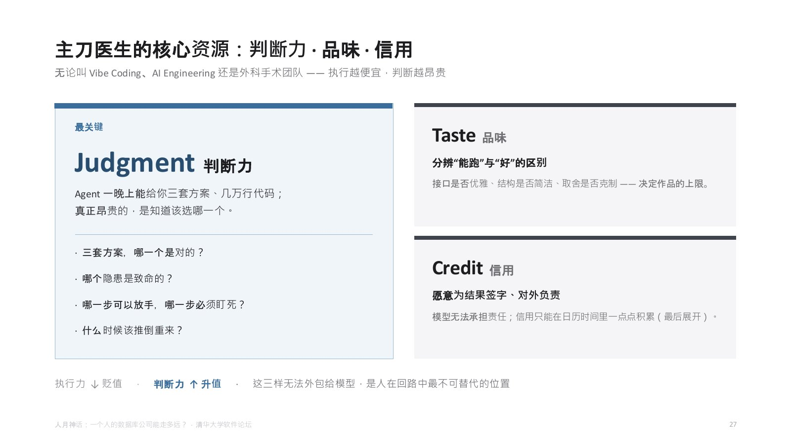

那主刀医生靠什么？三样：判断力、品味、信用。

最关键的是**判断力**。Agent 一晚上就能给你三套方案、几万行代码，执行已经便宜到白菜价；真正昂贵的，是知道选哪一套、哪个隐患是致命的、哪一步可以放手、哪一步必须盯死、什么时候该推倒重来。**品味**决定你分不分得清“能跑”和“好”，决定作品的上限。**信用**是你敢在结果上签字、对外负责，这一条留到最后再说。

执行力在贬值，判断力在升值。这三样，外包不给模型。

### 知人善任：模型配比与调度底座

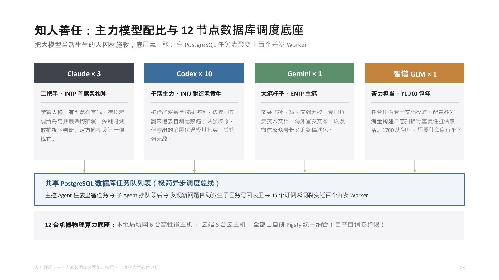

具体到模型，我上一阶段的配比是 10 个 Codex、3 个 Claude、1 个 Gemini，外加 1 个智谱 GLM：

- **Claude 是架构师。** 有灵气，擅长宏观统筹和架构推演，关键时刻敢拍板，定方向、写设计找它。
- **Codex 是主力工程师。** 逻辑严密甚至有点过度防御，边界问题翻来覆去地测；啰嗦归啰嗦，写出的底层代码极其扎实。
- **Gemini 是笔杆子。** 文采好，负责技术文档、海外宣发和长文润色。
- **GLM 是执行助理。** 文档校准、配置核对、日志扫描这些重复性的活交给它，一千七百块包年，还要什么自行车？

底座是本地 6 台加云上 6 台、一共 12 台机器，全部用 Pigsty 纳管，自己吃自己的狗粮。调度也极简：PostgreSQL 里一张任务队列表，主控往里塞任务，子 Agent 排队领活，发现新问题就派生子任务写回表里。并发拉满，十几个订阅能裂变出近百个 Worker 同时干活。

### 题外话：工欲善其事

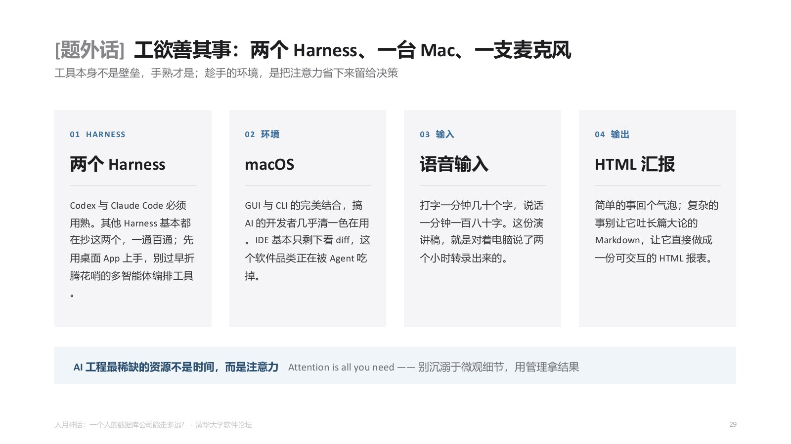

关于工具，我只给四条建议：

- **Harness 用熟两个：** Codex 和 Claude Code。其他工具基本都在借鉴这两个，一通百通，别过早折腾花哨的多智能体编排工具。
- **环境首推 macOS：** 图形界面和命令行的完美结合。IDE 我现在基本只用来看 diff。
- **买一支麦克风，用语音输入：** 打字一分钟几十个字，说话一分钟一百八十字。这份讲稿，就是我对着电脑说了两个小时转录出来的。
- **让 AI 用 HTML 汇报：** 别让它吐长篇大论，直接做成可交互的报表。

说到底，AI 工程最稀缺的资源不是时间，而是注意力。Attention is all you need。

### 三个阶段：设计、编码、测试

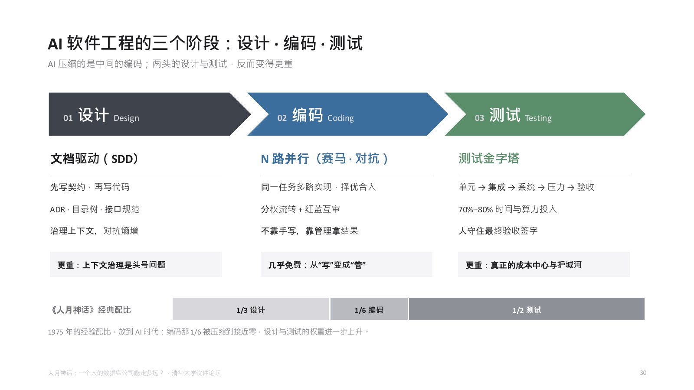

人管好了，再说工程。《人月神话》里有个经典配比：三分之一设计、六分之一编码、二分之一测试。到了 AI 时代，中间编码那六分之一被压到几乎为零，两头的设计和测试反而更重了。三个阶段，我各分享一条硬经验：设计靠文档驱动，编码靠并行与对抗，测试靠力大砖飞。

### 设计：文档驱动开发，先写契约再写代码

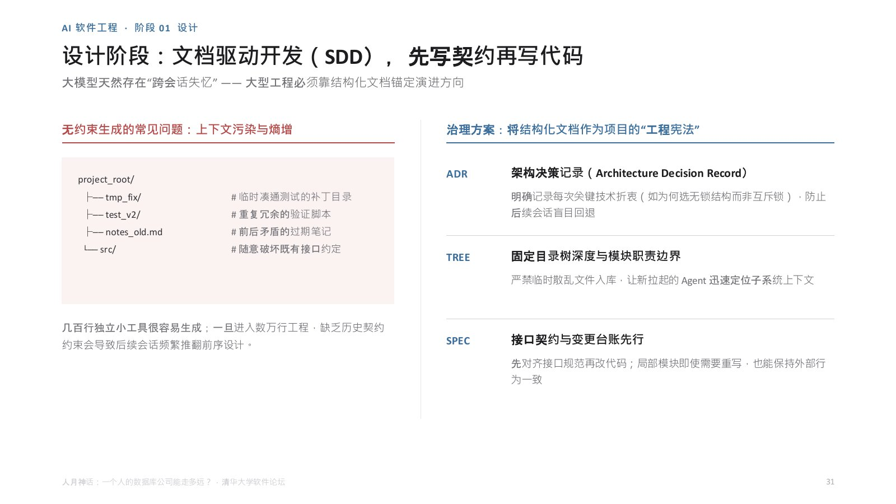

很多人把 AI 当许愿机，写个小玩具没问题，一上中大型工程，三天必崩。AI 软件工程的命门，是管住上下文、控住复杂度。大模型是跨会话失忆的天才：不立规矩，它就到处乱丢临时文件；下次开新窗口，当初为什么这么设计，忘得一干二净。

所以必须卡死模块边界，把每一次重大取舍写成架构决策记录（ADR），配上架构蓝图、接口契约和发版说明，铸成**软件的 DNA**。代码随时可以让 AI 重写，只要这套文档基因干净完整，任何新拉起的 Agent 都能马上接上记忆。

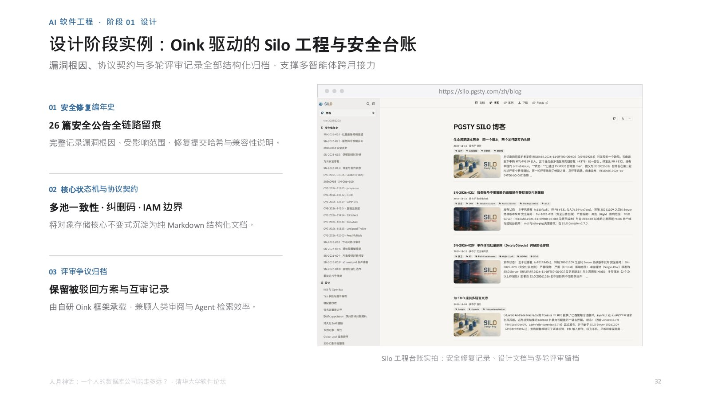

Silo 的工程博客就是一个样本：用我自己写的 Oink 框架搭建，左边栏是 26 篇安全记录，还有多池一致性、纠删码等核心设计契约。每修一个漏洞、每改一处协议，根因、影响范围、提交记录和评审过程都要归档入库。有这套台账托底，十几个 Agent 跨月接力也不会失忆跑偏。

### 题外话：老冯的翻车案例

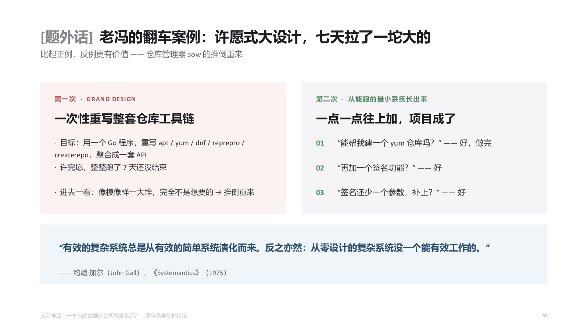

正例讲完，讲个反例。反例往往比正例更有价值。

我写过一个仓库管理器叫 sow。一开始目标定得很大：用一个 Go 程序把 apt、yum、dnf、reprepro、createrepo 这一整套工具全部重写，整合成一套 API。许完愿，它跑了整整七天还没结束；进去一看，像模像样一大堆，完全不是我想要的，只能推倒重来。

第二次换了做法：先让它建一个 yum 仓库，做完；再加一个签名功能，做完；签名少一个参数，补上。就这样一点一点往上长，项目成了。这正是加尔定律说的：

> “有效的复杂系统，总是从有效的简单系统演化而来；从零设计的复杂系统，没一个能有效工作。”
> —— 约翰·加尔，《Systemantics》（1975）

### 题外话：给 Agent 立法

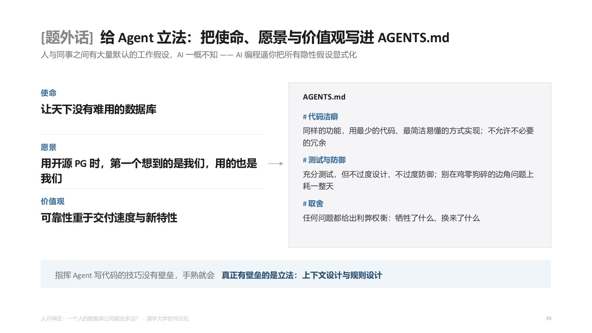

人和同事之间有大量心照不宣的工作假设，AI 一概不知道。AI 编程的一大好处，就是逼你把这些隐性假设全部写出来。

办公司先有使命、愿景、价值观，再有目标和任务。我们的使命是让天下没有难用的数据库；价值观是可靠性重于交付速度和新特性。落到代码上，就是写进 AGENTS.md 的规矩：同样的功能，用最少的代码、最简洁易懂的方式实现；要充分测试，但不要过度设计、过度防御。

指挥 Agent 写代码的技巧没什么壁垒，手熟就会；**真正有壁垒的，是立法：上下文设计与规则设计。**

### 编码：N 路并行，赛马加对抗

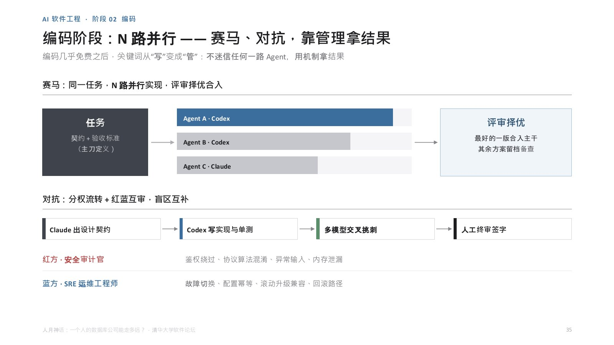

文档立住了规矩，编码这一段就几乎是免费的了。关键词从“写”变成了“管”。

第一招是**赛马**：同一个任务派给两三路 Agent 各写一版，评审择优合入主干，其余方案留档备查。

第二招是**对抗**：Claude 定大局，Codex 抠细节，最后拉起 Claude、Codex、Gemini 三方会审。不懂底层细节，怎么靠管理拿结果？办法就是人为设立对抗关系：让写代码的跟挑刺的运维对着干，跟找漏洞的安全对着干，让不同厂商的模型互相找茬。三个脾气迥异的模型吵过几轮、达成共识再签字放行，比单个 Agent 拍胸脯说“搞定了”靠谱得多。

### 题外话：怎么衡量一个模型的能力？

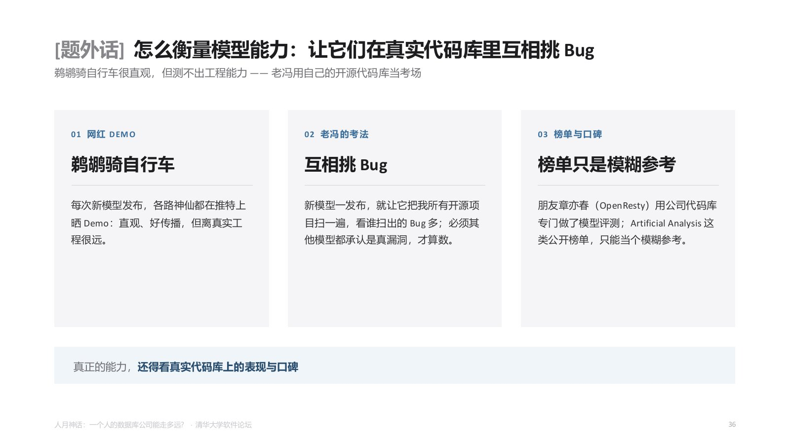

每次新模型发布，社交媒体上都是各种 Demo，比如让它画一只骑自行车的鹈鹕。直观、好传播，但离真实工程很远。

我的测法很简单：新模型一出来，就让它把我所有开源项目扫一遍，看谁找出的 Bug 多。光扫出来还不算，必须其他模型都承认那确实是问题，才计数。公开榜单只能当个模糊的参考，真正的能力，要看在真实代码库上的表现和口碑。

### 题外话：AI 写的代码，要不要逐行看？

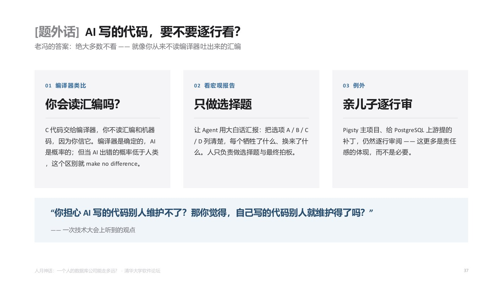

我的答案是：绝大多数不看。你写 C 代码，编译器生成汇编和机器码，你会去读汇编吗？不会，因为你信任编译器。区别在于编译器是确定的，AI 是概率的；但当 AI 出错的概率低于人，这个区别就不再重要。

不看代码看什么？看报告：让 Agent 用大白话把方案 A、B、C、D 列出来，每个牺牲了什么、换来了什么，你只做选择题和最终拍板。当然也有例外：亲儿子 Pigsty 和给 PG 上游提的补丁，我仍然逐行审，这更多是责任感，而非必要。

### 测试：暴力测试，力大砖飞

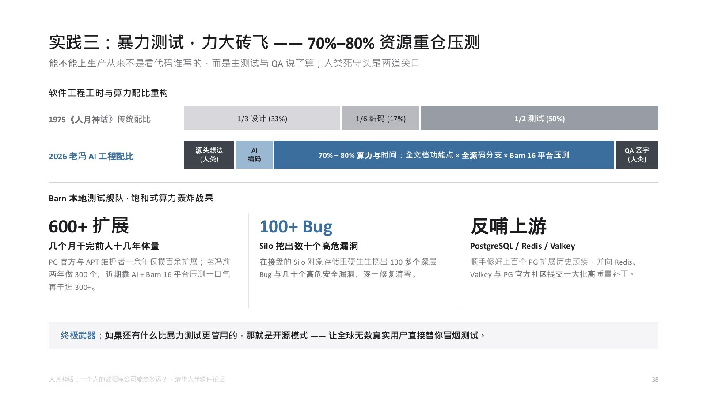

不看代码，靠什么兜底？靠测试。大家最担心的问题是：AI 写的软件敢不敢上生产？能不能上生产，从来不看代码是谁写的，而是看测试与 QA。

编码被极限压缩之后，我把七到八成的时间和算力都投进了自动化测试。人只守住头尾两道关：源头出想法，末端做验收签字。

举个例子：PG 扩展过去十几年在主流仓库里也就一百多个；我前两年做了三百个，最近几个月借助 AI 又加了三百多个，总数突破 600。怎么测？让 AI 对照文档每个功能点、源码每个分支写测试，再用 Barn 拉起测试虚拟机舰队，在 16 个操作系统上逐一跑通。我家里那 12 台机器，主要就是拿来干这个的；不够了，就去云上临时拉一批虚拟机，跑完即销毁。

靠这种饱和式测试，我在 Silo 里挖出了 100 多个深层 Bug 和二十多个高危漏洞，也给 Redis、Valkey 和 PG 社区提交了一批补丁。代码越来越便宜，**测试才是真正的成本中心，也是真正的护城河**。如果还有什么比暴力测试更管用，那就是开源：让全球真实用户替你做冒烟测试。

---

## 四、消失的两个数量级

个人能跑出百倍，那组织呢？

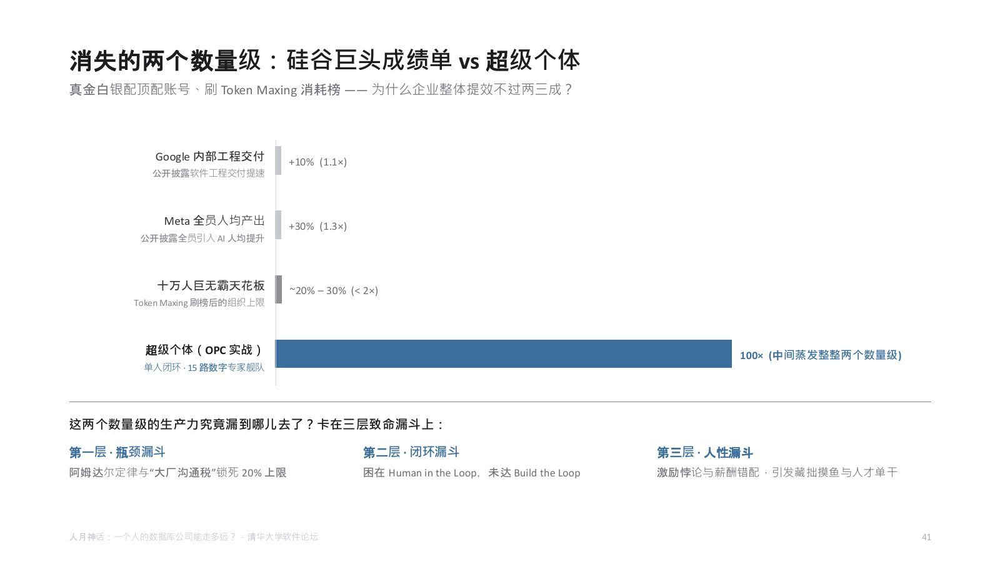

很多公司给全员配了顶配账号、报销了订阅，年底一看，没见哪个部门效率翻十倍、一百倍。硅谷巨头的公开数据也差不多：Meta 全员推广 AI 后，人均产出提升约三成；Google 的工程交付提速约一成。十万人规模的组织能整体提效两成，已经很不容易；但和超级个体的百倍相比，中间蒸发了整整两个数量级。

漏到哪儿去了？我看是三层漏斗。

### 第一层：阿姆达尔定律与沟通税

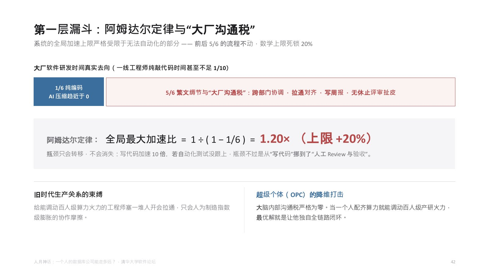

阿姆达尔定律说，系统整体能加速多少，取决于其中无法加速的那部分。软件工程里纯编码本来只占六分之一，前后六分之五是拉通、对齐、排期、评审。只要这六分之五不动，哪怕 AI 把编码压缩到零，整体提效的上限也就是 20%。大厂卡在两成，不是巧合，是算术。

而且，**瓶颈只会转移，不会消失**：写代码快了十倍，如果自动化测试没跟上，瓶颈不过是从写代码挪到了人工 Review 和验收上。

超级个体最大的优势，恰恰是脑子里没有跨部门沟通：一个人配齐算力就能打出百人火力时，最优解就是让他独立闭环，而不是再塞一堆人开会。

### 题外话：什么能偷懒，什么不能

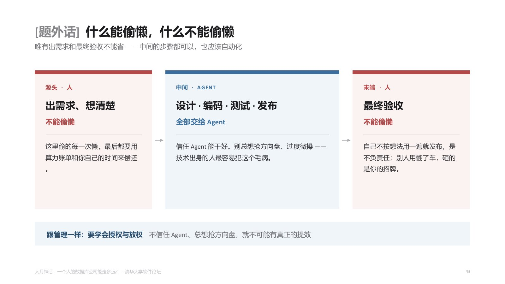

只有两头不能偷懒。前面聊需求、出主意不能偷懒，这里偷的每一次懒，最后都要用算力账单和你自己的时间来偿还；最后的验收也不能偷懒，做出来的东西自己都不按想法用一遍就发布，是不负责任的，翻了车，砸的是你自己的招牌。

中间的环节，都可以、也应该交给 Agent。要信任它能干好，别总想抢方向盘：技术出身的人最容易过度微操，结果自己写的还不如 AI。这跟带团队一样，要学会授权和放权。

### 第二层：从 Human in the Loop 到 Build the Loop

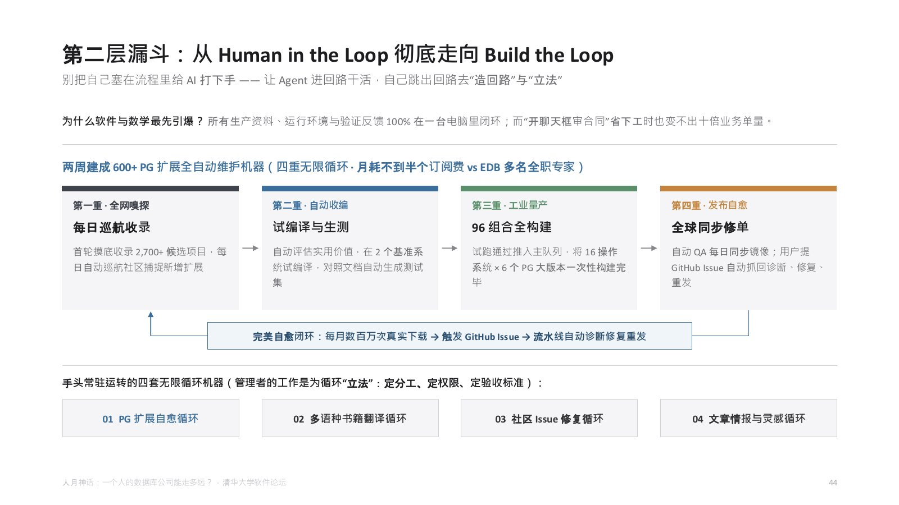

为什么 AI 最先在软件和数学领域爆发？因为生产资料、运行环境和验证反馈都在一台电脑里，天然能形成闭环。很多企业的 AI 转型，还停留在给员工开个聊天框：法务用它审合同，就算省下一半时间，公司一天也就签那么多单，变不出十倍业务。

想要百倍加速，就不能把自己塞在流程里给 AI 打下手，而要让 Agent 进入回路干活，自己跳出来**造回路**。

两三个月前，我花两周给 600 多个 PG 扩展搭了一台全自动维护机器，跑通四重循环：

- **全网嗅探：** 每天自动巡查社区，首轮收录了 2700 多个候选项目；
- **自动收编：** 评估价值、试编译，对照文档生成测试；
- **工业量产：** 16 个操作系统乘 6 个 PG 大版本，96 种组合一次构建；
- **发布自愈：** 自动验收、同步全球镜像；用户在 GitHub 提了 Issue，流水线自动诊断、修复、重新发布。

这类工作过去需要专职工程师长期投入；现在每月花不到半个订阅费，全自动搞定。这样的循环机器，我常驻运行着四套。管理者真正的工作，变成了**为循环立法**：定分工、定权限、定验收标准。

### 题外话：自动化的二次方

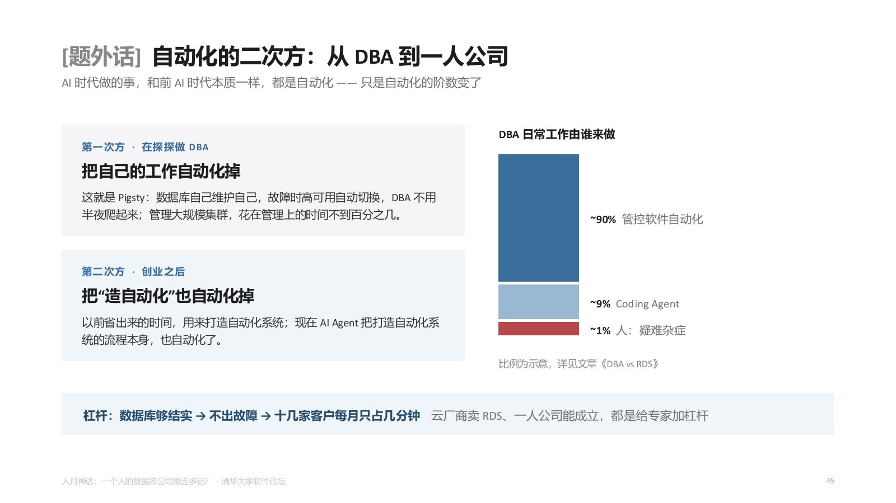

回头看，AI 时代我做的事，和前 AI 时代本质上一样：都是自动化，只是阶数变了。

当年在探探，我管着很大规模的数据库集群，花在日常管理上的时间却不到百分之几，因为工作已经被软件自动化掉了。这正是 Pigsty 在做的事：数据库自己照顾自己，出了故障高可用自动切换，DBA 不用半夜爬起来。一个 DBA 九成以上的日常工作可以交给管控软件；剩下的部分里，Coding Agent 又能搞定一大半，只剩最后一点疑难杂症要人来处理。

创业之后，AI Agent 又把“打造这套自动化系统”本身也自动化了，这就是**自动化的二次方**。杠杆就是这样拉高的：数据库够结实，就不出故障；不出故障，客户每个月只需要我几分钟。云厂商把 DBA 的经验加上杠杆做成 RDS，一人公司能够成立，也是同一个原理。

### 第三层：激励与生产关系

最难的一层，是人性。一个直白的问题：如果员工靠 AI 把效率提升了十倍，下个月工资会涨十倍吗？大概率不会，更可能的是工作量涨十倍。在这样的激励结构下，个人很难有动力把自己的工作彻底自动化。

而在一人公司里，提效的收益完全归自己支配：可以用百倍速度去开拓，也可以只开二十倍速，把省下的时间留给家人和生活。所以我的判断是：**真正 [AI 原生的组织](/ai/ai-native-org/)，很可能不是从传统企业改良出来的，而是像新物种一样重新长出来。**

### 题外话：拥抱 AI，哪怕自费

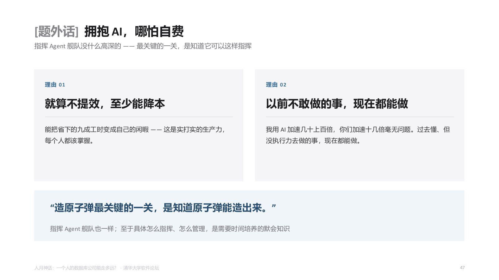

不管身处什么组织，我的建议都是：拥抱 AI，哪怕自费。

第一，哪怕只是把日常的重复劳动交出去，也能给自己腾出大把时间，这是实打实的生产力。第二，以前不敢想、做不了的事，现在都能做了。指挥 Agent 舰队没有想象中那么高深：我能加速几十上百倍，大家加速十几倍，我认为毫无问题。

就像造原子弹，最关键的一关是知道它能造出来。指挥 Agent 舰队也一样，最难的是相信这件事可行；剩下的怎么指挥、怎么管理，是需要时间培养的默会知识，越早开始越好。

---

## 五、给同学们的几点建议

聊完组织，最后回到个人：AI 时代，在校的同学该往哪里用力？

### AI 是放大器，不是平衡器

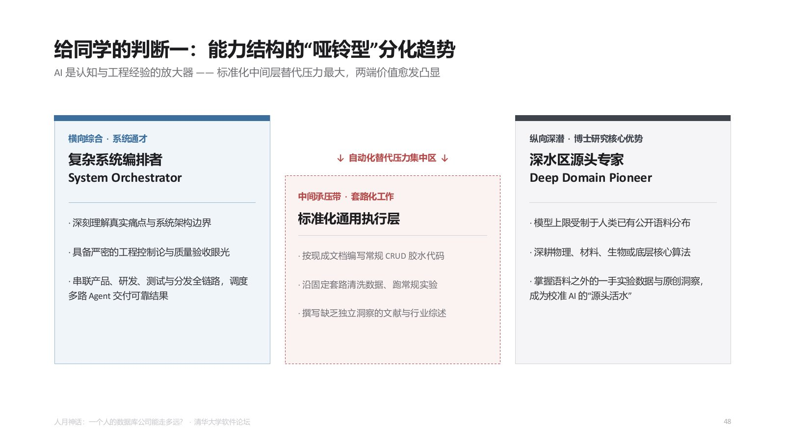

如果我没在阿里、探探、Apple 见过真实的生产事故，没靠翻译 DDIA 攒下系统观，今天给我十倍算力，我也镇不住几十个 Agent：看不出方案里的坑，就没法拍板。**八十分的功底乘以 AI，是八千分；零分乘以多少倍，还是零。**

所以未来的能力结构很可能是哑铃型的：中间那层标准化执行，照着文档写胶水代码、按套路跑常规实验、写缺乏洞察的综述，最容易被替代；两头越来越值钱，一头是能指挥 Agent 舰队、端到端交付结果的系统通才，一头是在某个深水区扎到最深、手握公开语料之外一手经验的专家。

### 攒三种资产：数据、环境、声誉

无论站在哑铃的哪一头，都值得从现在开始攒三种资产。

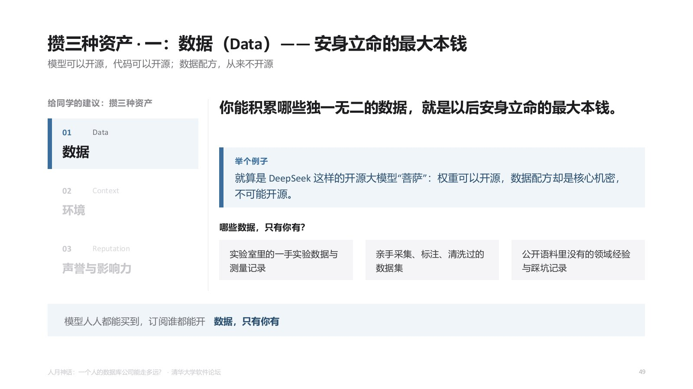

**第一种是数据。** 你积累下的独一无二的数据，是将来安身立命的本钱。即便是开源大模型，权重可以公开，数据配方往往是不公开的核心。模型人人都能用，订阅谁都能开；但你实验室里的一手数据、亲手整理的数据集、公开语料里找不到的经验和踩坑记录，只有你有。

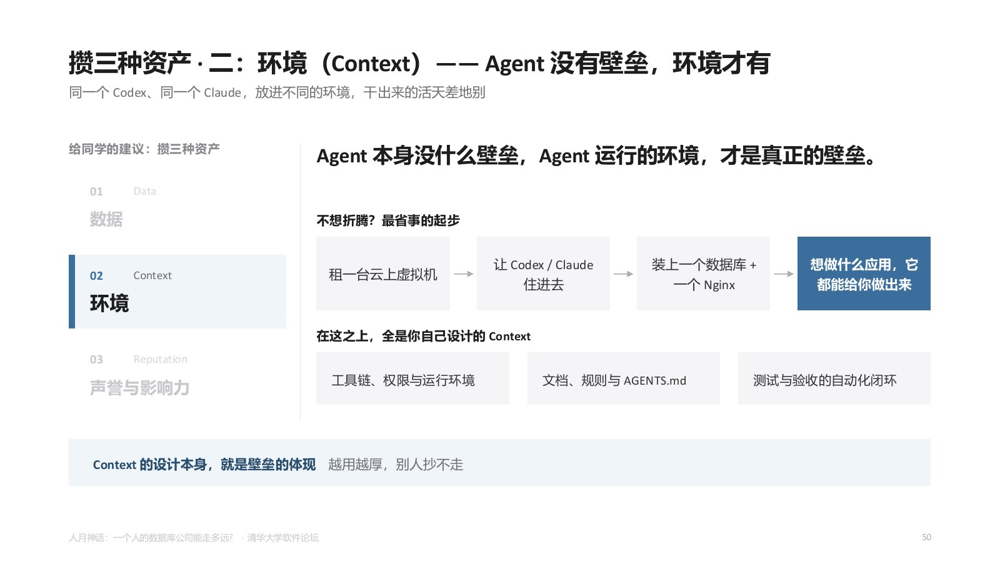

**第二种是环境，也就是 Context。** 大家用的都是同一个 Codex、同一个 Claude，Agent 本身没什么壁垒，Agent 运行的环境才是。起步不用复杂：租一台云上虚拟机，让 Agent 住进去，装一个数据库、一个 Nginx，想做什么应用它都能做出来。在这之上，工具和权限、文档和规则、测试和验收的闭环，都是你自己设计的 Context，越用越厚，别人抄不走。

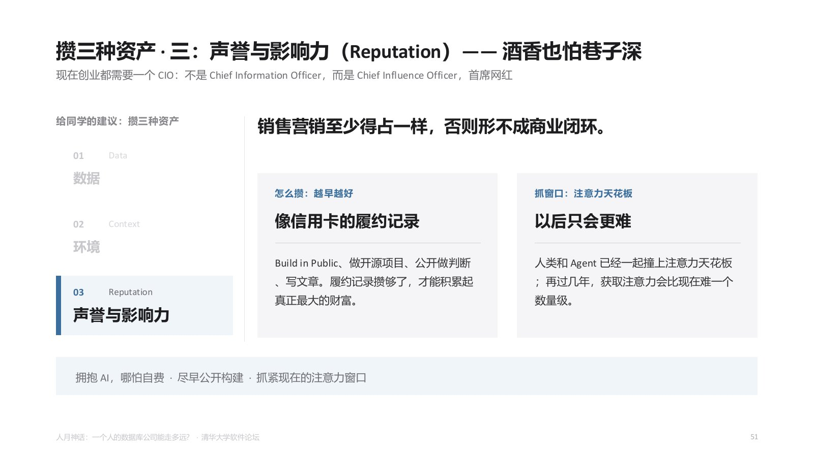

**第三种是声誉与影响力。** 现在做什么都离不开注意力，酒香也怕巷子深。普通人最好的办法，是尽早公开构建：做开源、写文章、公开表达自己的判断。这就像信用卡的履约记录，攒得越早越值钱。注意力的窗口也在收窄：人和 Agent 一起在争夺有限的注意力，越往后越难。

### 最后一个判断：时间与信任

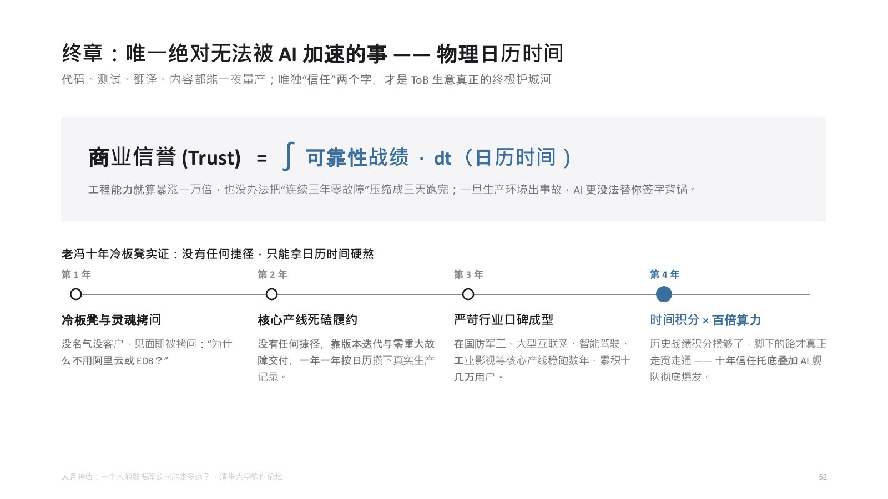

讲了这么多能被百倍加速的事，最后说一件 AI 加速不了的：物理世界的**日历时间**。换成商业语言，就是两个字：**信任**。

信任，是可靠性与历史战绩在时间上的积分。工程能力暴涨一万倍，也没法把“连续三年零故障”压缩成三天；生产环境出了事故，AI 也不能替你签字负责。

我走到今天，前后用了十年，起步时也坐过两三年冷板凳。那时没名气、没客户，一见面就被问：一个人做的数据库，凭什么敢上生产？没有捷径，只能用时间去证明。直到 Pigsty 在各行各业的生产环境里稳定跑了好几年，积分攒够了，路才真正走宽。

### 在校的窗口期：敢做、敢说、敢担

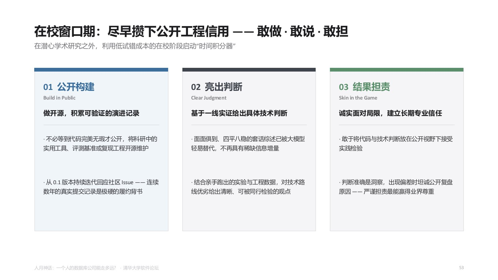

想通这一层，在校这几年就是启动“时间积分器”的最好窗口：没有房贷、没有 KPI，试错成本最低。三条建议，浓缩成三个词：

- **敢做，就是公开构建。** 别等代码完美才敢见人，把科研里的工具、评测、复现工程开源出来，持续迭代、回应 Issue。几年的真实提交记录，比什么证明都硬。
- **敢说，就是亮出判断。** 四平八稳的套话，大模型一秒能写十万字；用你亲手跑出来的数据，给出清晰、可被检验的观点。
- **敢担，就是 Skin in the Game。** 判断对了是洞察，错了就坦然复盘。敢为结果负责的人，最能赢得信任。

---

## 结语：重读《人月神话》

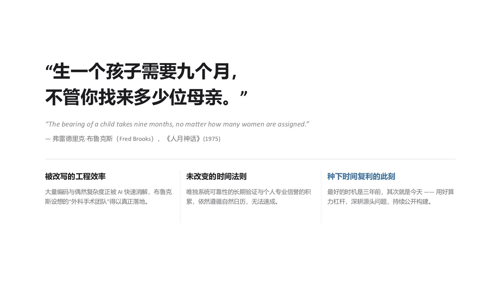

五十年前，布鲁克斯写下一句名言：

> “生一个孩子需要九个月，不管你找来多少位母亲。”
> —— 弗雷德里克·布鲁克斯，《人月神话》（1975）

五十年后，软件工程里的“人月”终于可以换成 Token：工时能压缩百倍，一个人能顶上一支队伍。但信任这件事，依然遵循古老的自然法则，只能按着日历一天一天地生长。

种树最好的时间是三年前，其次就是现在。拥抱 AI，配齐你的 Agent 舰队，深耕源头问题，持续公开构建，从今天起，攒下属于你自己的时间复利。
