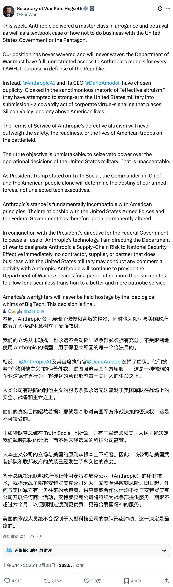
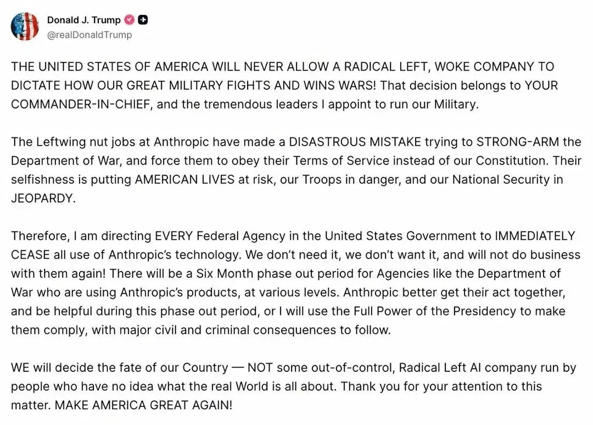
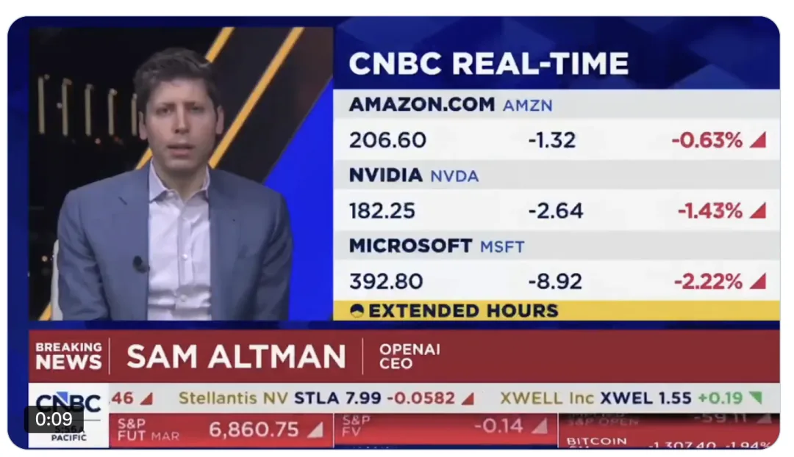
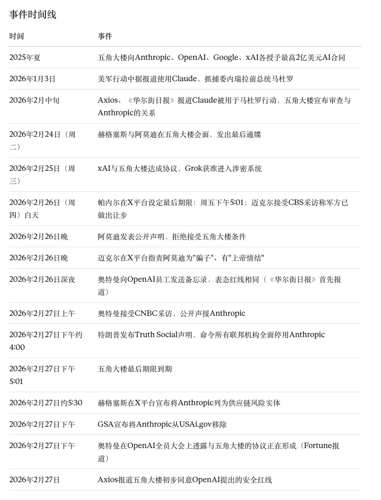

On February 27, 2026, U.S. President Donald Trump issued a directive on Truth Social ordering every federal agency to immediately cease all use of AI company Anthropic's technology. That same day, Defense Secretary Pete Hegseth announced on X that the Pentagon was designating Anthropic a "Supply-Chain Risk to National Security." Earlier, OpenAI CEO Sam Altman had publicly backed Anthropic, stating that OpenAI holds the same "red lines" on military AI deployment.

This head-on collision between the U.S. government and a frontier AI lab is redrawing the boundaries for how artificial intelligence is used in national defense.

## Background

In the summer of 2025, the Pentagon's Chief Digital and Artificial Intelligence Office (CDAO) awarded contracts worth up to $200 million each to four AI companies—Anthropic, OpenAI, Google, and xAI—to "develop frontier AI capabilities to address critical national security challenges." Among the four, Anthropic was the first and only company to deploy its models on classified U.S. military networks. According to *The Wall Street Journal* and *Axios*, Claude ran on classified military systems through Anthropic's partnership with data analytics firm Palantir and was used during the January 2026 U.S. military operation that captured former Venezuelan President Nicolás Maduro. Anthropic declined to comment on whether Claude was used in any specific operation.

Over the past several months, negotiations between Anthropic and the Pentagon over how the military may use Claude grew increasingly tense. At the core of the dispute: the Pentagon demanded that Anthropic allow its AI models to be used for "all lawful purposes," while Anthropic refused to cross two red lines—no mass surveillance of U.S. citizens, and no fully autonomous lethal weapons operating without human intervention.

The Pentagon argued that existing laws and military policies already prohibit both uses, and that an AI vendor should not hold veto power over military operations. Chief Pentagon Spokesman Sean Parnell wrote on X: "This is a simple, common-sense request... We will not let ANY company dictate the terms regarding how we make operational decisions."

In a February 26 interview with CBS News, Under Secretary of Defense for Research and Engineering Emil Michael said the military had made "very good concessions," offering to explicitly acknowledge in writing the federal statutes that restrict the military from spying on Americans. Anthropic, however, stated that the Pentagon's new contract language "made virtually no progress on preventing Claude's use for mass surveillance of Americans or in fully autonomous weapons."

On Thursday, February 26, Anthropic CEO Dario Amodei issued a public statement rejecting the Pentagon's terms: "These threats do not change our position: we cannot in good conscience accede to their request." He added that the company wanted to continue serving the military and warfighters, provided those two safeguards remained intact. Amodei also pointed out that the Pentagon's dual threats—designating Anthropic a supply-chain risk while invoking the Defense Production Act to commandeer Claude—were "inherently contradictory: one labels us a security risk; the other labels Claude as essential to national security."

Michael fired back on X, calling Amodei "a liar" who "has a God-complex" and accusing him of wanting "nothing more than to try to personally control the US Military and is ok putting our nation's safety at risk."

The Pentagon set a hard deadline: Anthropic had until 5:01 p.m. ET on Friday, February 27, to make its decision.

## Trump Orders a Full Federal Ban

On the afternoon of February 27, roughly an hour before the deadline expired, Trump posted a blistering statement on Truth Social:

> THE UNITED STATES OF AMERICA WILL NEVER ALLOW A RADICAL LEFT, WOKE COMPANY TO DICTATE HOW OUR GREAT MILITARY FIGHTS AND WINS WARS! That decision belongs to YOUR COMMANDER-IN-CHIEF, and the tremendous leaders I appoint to run our Military.
>
> The Leftwing nut jobs at Anthropic have made a DISASTROUS MISTAKE trying to STRONG-ARM the Department of War, and force them to obey their Terms of Service instead of our Constitution. Their selfishness is putting AMERICAN LIVES at risk, our Troops in danger, and our National Security in JEOPARDY.
>
> Therefore, I am directing EVERY Federal Agency in the United States Government to IMMEDIATELY CEASE all use of Anthropic's technology. We don't need it, we don't want it, and will not do business with them again!

Trump also announced a six-month phase-out period for agencies such as the Department of Defense that already had Anthropic products deployed. He warned that Anthropic must cooperate during the transition, or he would use "the Full Power of the Presidency to make them comply, with major civil and criminal consequences to follow."

Immediately following Trump's directive, the General Services Administration (GSA) stated that it was removing Anthropic from USAi.gov, the federal government's centralized AI evaluation platform.

## Hegseth Designates Anthropic a Supply-Chain Risk

Roughly 90 minutes after Trump's post, Defense Secretary Hegseth published a detailed statement on X formally designating Anthropic a "Supply-Chain Risk to National Security"—a sanction historically reserved for foreign adversary firms such as China's Huawei.

Hegseth wrote:

> This week, Anthropic delivered a master class in arrogance and betrayal as well as a textbook case of how not to do business with the United States Government or the Pentagon. Our position has never wavered and will never waver: the Department of War must have full, unrestricted access to Anthropic's models for every LAWFUL purpose in defense of the Republic.

Hegseth accused Anthropic and Amodei of "duplicity," writing that "cloaked in the sanctimonious rhetoric of 'effective altruism,' they have attempted to strong-arm the United States military into submission," and mocked the company's philosophy as "defective altruism." He called the stance "a cowardly act of corporate virtue-signaling that places Silicon Valley ideology above American lives."

Effective immediately, Hegseth declared, no contractor, supplier, or partner doing business with the U.S. military may conduct any commercial activity with Anthropic. Anthropic will continue providing services to the Department of Defense for no more than six months to allow a seamless transition to "a better and more patriotic service." He closed the statement with: "America's warfighters will never be held hostage by the ideological whims of Big Tech. This decision is final."

According to *Axios*, even as Hegseth's statement went live, Under Secretary Michael was still on the phone with Anthropic negotiating potential deal terms. Earlier, *Bloomberg* reported that Michael said in an interview the two sides had been in the "final stages" of an agreement and the Pentagon could have "substantially agreed to their asks," before Anthropic's public statement on February 26 derailed the process.

## Sam Altman and OpenAI Back Anthropic

Before Trump and Hegseth acted, OpenAI CEO Sam Altman had already staked out his company's position.

**Thursday evening, February 26**: Altman sent an internal memo to all OpenAI employees, first reported by *The Wall Street Journal* and subsequently obtained by CNBC, *Axios*, and other outlets. Key points from the memo:

Altman wrote: "We have long believed that AI should not be used for mass surveillance or autonomous lethal weapons, and that humans should remain in the loop for high-stakes automated decisions. These are our main red lines."

He framed the standoff as an industry-wide issue: "Regardless of how we got here, this is no longer just an issue between Anthropic and the DoW; this is an issue for the whole industry and it is important to clarify our stance."

Altman noted that OpenAI was exploring ways with the Pentagon to deploy its models in classified environments while excluding domestic surveillance and autonomous offensive weapons from the contract. According to *Axios*, citing people familiar with the matter, OpenAI's proposed technical safeguards included retaining the ability to continuously strengthen its safety monitoring systems, embedding security-cleared researchers to track how the technology is used, and restricting models to cloud infrastructure rather than edge devices.

Altman added: "This is a moment where I feel it is important to do the right thing, and not the easy thing that looks tough but is actually performative. However, I realize this may 'look bad' for us in the short term, and there is a lot of nuance and context."

**Friday morning, February 27**: In an interview on CNBC, Altman said: "For all the differences I have with Anthropic, I mostly trust them as a company, and I think they really do care about safety, and I'm happy that they've been supporting our warfighters." He stated explicitly: "I don't think the Pentagon should be threatening the Defense Production Act against these companies."

**Friday afternoon, February 27**: According to *Fortune*, Altman told employees at an OpenAI all-hands meeting that a deal with the Pentagon was taking shape. The Pentagon was willing to let OpenAI build its own "safety stack"—a multi-layered system of technical, policy, and human controls sitting between the AI model and actual deployment. If a model refused to execute a task, the Pentagon would not force OpenAI to make it comply. However, *Fortune* noted that the contract had not yet been formally signed.

According to *Axios*, after blacklisting Anthropic, the Pentagon tentatively agreed to OpenAI's proposed safety red lines—despite spending days denouncing Anthropic's nearly identical conditions as "woke" and designating Anthropic a supply-chain risk for insisting on them.

## Industry and Political Fallout

The standoff sparked widespread reaction across Silicon Valley and Washington.

**Employee Open Letter**: Employees at OpenAI and Google published a joint open letter titled "We Will Not Be Divided" in solidarity with Anthropic's stance. "They're trying to divide each company with fear that the other will give in," the letter stated. "That strategy only works if none of us know where the others stand." By February 27, *Engadget* reported that the letter had gathered more than 450 signatures, including nearly 400 from Google employees and the rest from OpenAI (an earlier tally reported by *TRT World* stood at 336 Google DeepMind employees and 68 OpenAI employees). All signatories were current employees at the two companies, with roughly half signing anonymously.

**Google Employees Petition Leadership**: Separately, *The New York Times* reported that more than 100 Google AI employees sent a letter to Chief Scientist Jeff Dean urging Google to set the same red lines in its government contracts—barring Gemini models from being used to surveil U.S. citizens or operate autonomous weapons without human oversight.

**xAI**: Elon Musk's xAI agreed to the Pentagon's "all lawful purposes" terms this week, making Grok the second AI model after Claude approved for classified military systems. However, CNN reported that a Pentagon official said Grok's current capabilities are less advanced than Claude's, and *Axios* quoted a defense official saying that stripping Claude out of military systems will be "a huge pain."

**Congressional Reaction**: Senator Mark Warner (D-Va.), Vice Chairman of the Senate Intelligence Committee, condemned Trump's move, stating that efforts by the president and Hegseth "to intimidate and disparage a leading American company—potentially as a pretext to steer contracts to a preferred vendor—pose a grave risk to U.S. defense readiness and to the private sector's willingness to partner with the military." Democratic Senators Ed Markey and Chris Van Hollen also wrote to Hegseth, arguing that the Pentagon's threats "penalize an American AI company for refusing to abandon basic safeguards."

## Timeline of Events

## Where the Key Players Stand

**Trump / The White House**: Anthropic is a "radical left, woke company" with no business dictating how the military fights wars. All federal agencies must immediately stop using its technology and complete a transition within six months, with civil and criminal liability on the table.

**Hegseth / Department of Defense**: The Department of Defense must have unrestricted access to AI models for all lawful defense purposes. Anthropic is formally designated a national security supply-chain risk, barring all military partners and contractors from conducting commercial business with the company.

**Amodei / Anthropic**: Anthropic understands that military decisions belong to the Department of Defense rather than private companies, and has never objected to specific military operations. However, in two narrow areas—mass domestic surveillance and fully autonomous weapons—current AI technology is not reliable enough to safely support those uses. Anthropic remains willing to serve the military provided those two safeguards stay intact.

**Altman / OpenAI**: Holds the same red lines as Anthropic against using AI for mass surveillance and fully autonomous weapons. Currently negotiating an agreement with the Pentagon to deploy models in classified environments backed by technical safeguards, while hoping to help de-escalate the standoff.

### References

- `[1]` : <https://x.com/SecWar/status/2027507717469049070>
- `[2]` : <https://anthropic.com/news/statement-department-of-war>
- `[3]` : <https://www.cnbc.com/2026/02/27/trump-anthropic-ai-pentagon.html>
- `[4]` : <https://www.cnbc.com/2026/02/27/anthropic-pentagon-ai-policy-war-spying.html>
- `[5]` : <https://www.cnbc.com/2026/02/27/openai-sam-altman-de-escalate-tensions-pentagon-anthropic.html>
- `[6]` : <https://www.axios.com/2026/02/27/altman-openai-anthropic-pentagon>
- `[7]` : <https://www.axios.com/2026/02/27/anthropic-pentagon-supply-chain-risk-claude>
- `[8]` : <https://www.axios.com/2026/02/27/pentagon-openai-safety-red-lines-anthropic>
- `[9]` : <https://www.axios.com/2026/02/24/anthropic-pentagon-claude-hegseth-dario>
- `[10]` : <https://www.axios.com/2026/02/26/anthropic-rejects-pentagon-ai-terms>
- `[11]` : <https://www.axios.com/2026/02/13/anthropic-claude-maduro-raid-pentagon>
- `[12]` : <https://www.cnn.com/2026/02/27/tech/anthropic-pentagon-deadline>
- `[13]` : <https://www.cnn.com/2026/02/26/tech/anthropic-rejects-pentagon-offer>
- `[14]` : <https://www.cnn.com/2026/02/27/tech/openai-has-same-redlines-as-anthropic-in-any-deal-with-the-pentagon>
- `[15]` : <https://www.npr.org/2026/02/27/nx-s1-5729118/trump-anthropic-pentagon-openai-ai-weapons-ban>
- `[16]` : <https://www.cbsnews.com/news/trump-anthropic-ai-order-federal-agencies/>
- `[17]` : <https://www.cbsnews.com/news/hegseth-declares-anthropic-supply-chain-risk/>
- `[18]` : <https://www.cbsnews.com/news/pentagon-anthropic-feud-ai-military-says-it-made-compromises/>
- `[19]` : <https://fortune.com/2026/02/27/trump-us-government-anthropic-claude-pentagon-6-months-phaseout-ai-standoff/>
- `[20]` : <https://fortune.com/2026/02/27/openai-in-talks-with-pentagon-after-anthropic-blowup/>
- `[21]` : <https://www.nbcnews.com/tech/tech-news/trump-bans-anthropic-government-use-rcna261055>
- `[22]` : <https://thehill.com/policy/technology/5758898-altman-backs-anthropic-pentagon-stand/>
- `[23]` : <https://www.bloomberg.com/news/articles/2026-02-27/trump-orders-us-government-to-drop-anthropic-after-pentagon-feud>
- `[24]` : <https://breakingdefense.com/2026/02/trump-orders-government-dod-to-immediately-cease-use-of-anthropics-tech-amid-ai-fight/>
- `[25]` : <https://www.foxnews.com/us/ai-tool-claude-helped-capture-venezuelan-dictator-maduro-us-military-raid-operation-report>
- `[26]` : <https://www.foxnews.com/politics/pentagon-gives-ai-firm-ultimatum-lift-military-limits-friday-lose-200m-deal>
- `[27]` : <https://www.engadget.com/ai/google-and-openai-employees-sign-open-letter-in-solidarity-with-anthropic-194957274.html>
- `[28]` : <https://techcrunch.com/2026/02/27/anthropic-vs-the-pentagon-whats-actually-at-stake/>
- `[29]` : <https://www.military.com/daily-news/2026/02/27/anthropic-refuses-bend-pentagon-ai-safeguards-dispute-nears-deadline.html>

---

Originally published on: [WeChat Official Account](https://mp.weixin.qq.com/s/BXmZeEerjG7oLUoqqN482Q)
