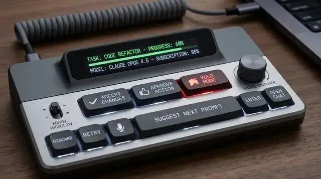
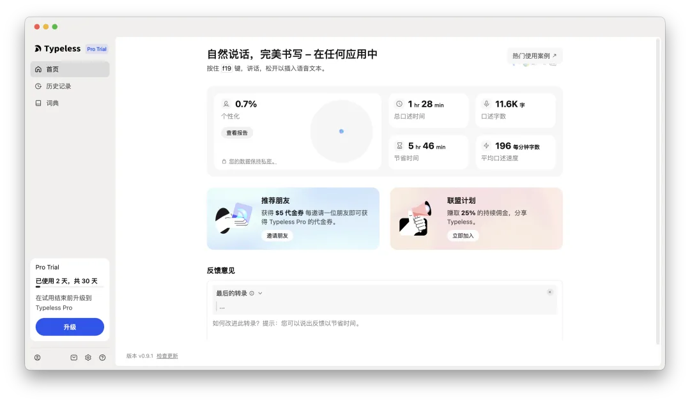
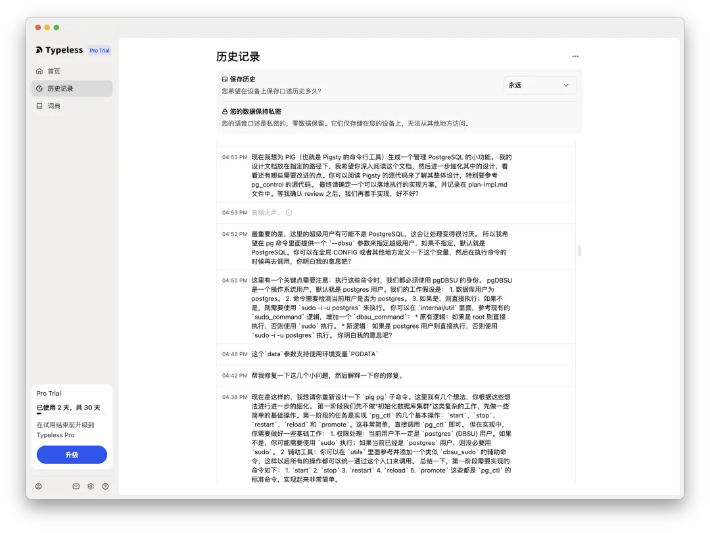
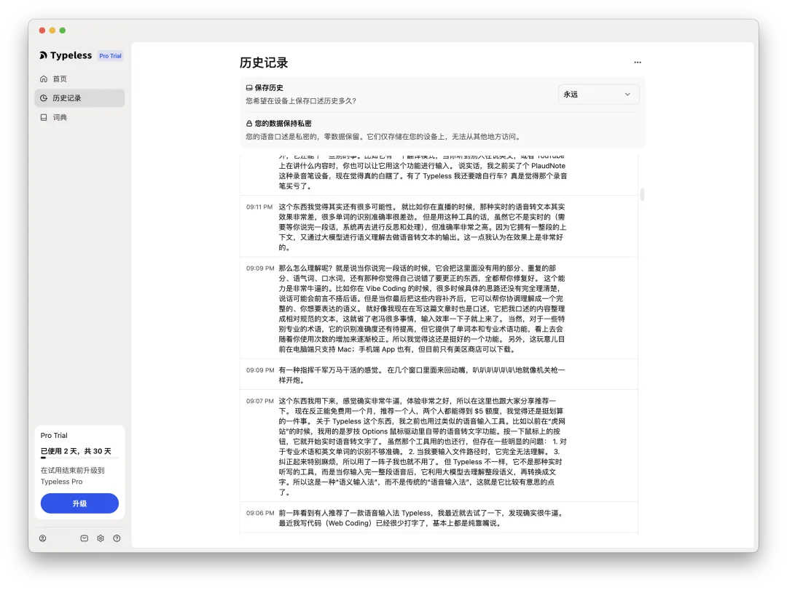
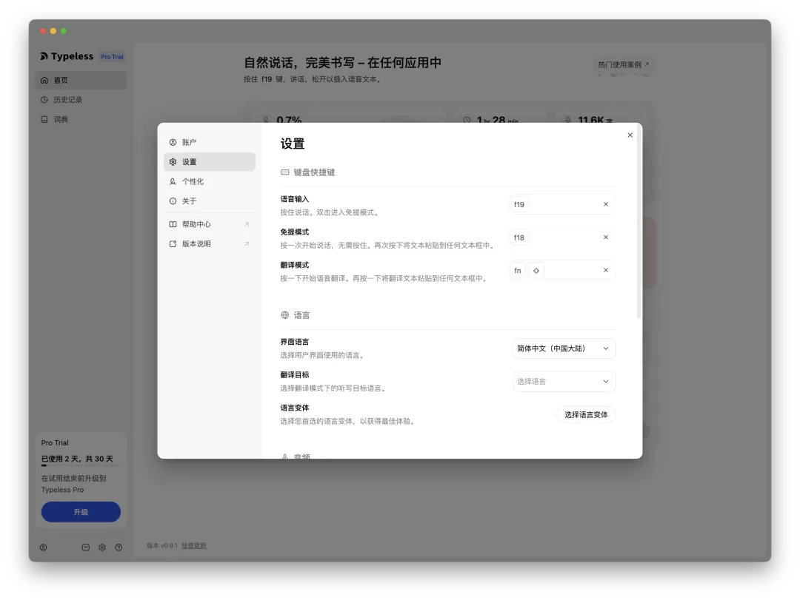
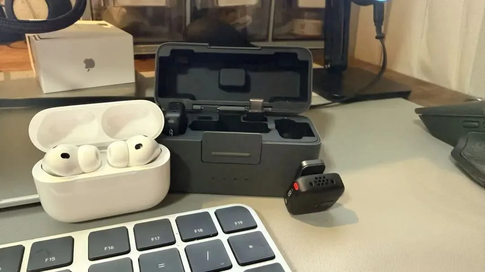
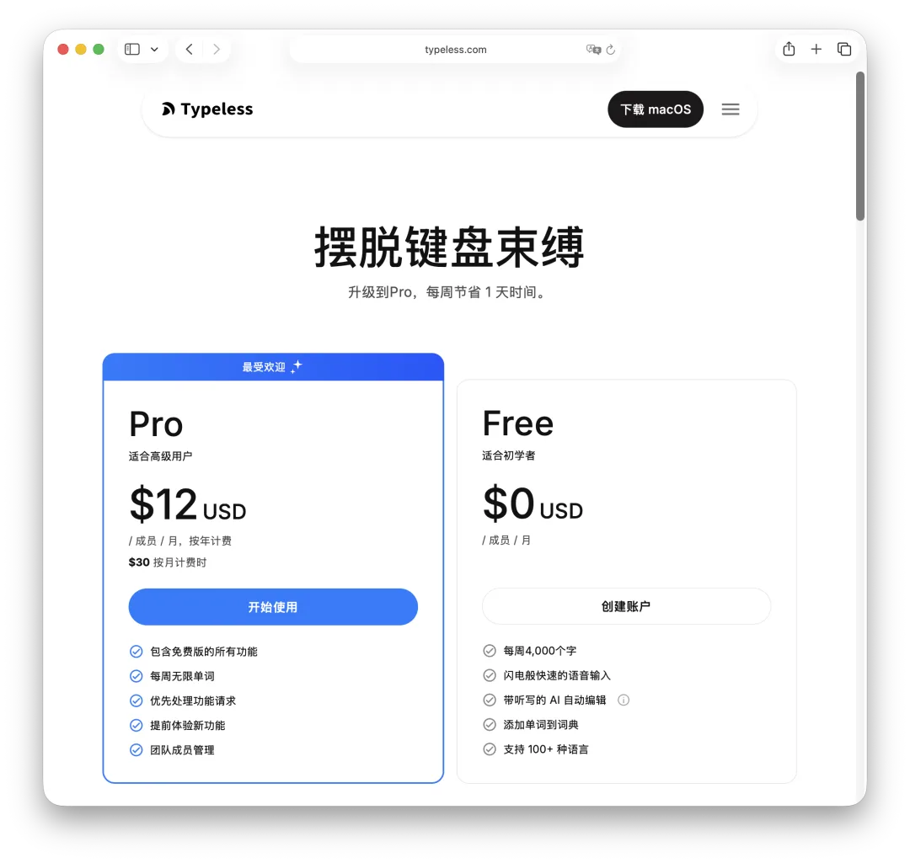

Remember this meme about the hardware a vibe coder really needs in 2026? In a sense, it is already here.

A while back, someone recommended a voice input tool called Typeless. After trying it out, I was genuinely impressed. Over the past couple of days of vibe coding, I have barely touched the keyboard. I do almost everything by voice now, which feels like directing an army from a command post—jumping across windows and firing off instructions like a machine gun without lifting a finger. Why type when you can just talk?

My dictation speed hits 196 words per minute—easily faster than I can type. Better yet, that number reflects polished output after the tool has stripped out filler words and verbal clutter.

First things first: **it currently offers a free one-month trial**. If you sign up with my referral link, we both get $5 in free credit. Give it a spin here: <https://www.typeless.com/refer?code=XVCCJNA>

## A Semantic Input Method, Not Just Speech-to-Text

I have tried voice-to-text tools before. Back when I was [throwing together websites](/db/dba-meets-frontend/), I used the built-in dictation feature in the Logitech Options mouse driver: hold a mouse button to dictate in real time, release to stop. It worked, but it was never smooth. Technical jargon and English terms mixed into Chinese speech tripped it up constantly, and file paths, shell commands, and code snippets were basically a lost cause. Worst of all, fixing the transcription errors took so much effort that it broke my vibe-coding flow, so I gave up on it after a while.

### Semantic Input: Not Real-Time, and Much More Accurate

Typeless takes a different approach. Instead of streaming characters onto the screen word by word as you speak, it **waits until you finish a thought**, runs the whole utterance through an LLM to understand what you meant, and outputs clean text that reads like something a human actually wrote. That is why I prefer to call it a **semantic input method**. The distinction is not marketing spin; in daily use, it feels like a step change.

Natural speech is full of noise: filler words ("um", "uh"), repetitions, mid-sentence corrections, false starts, and afterthoughts tacked onto the end. Traditional dictation dumps all of that raw transcript onto the screen and leaves you to clean up the mess. Typeless treats those stumbles as draft noise and does a first-pass edit for you—stripping out filler words, merging repetitions, and folding your mid-sentence self-corrections into the final sentence.

What I like most about this workflow is that **it gives your thinking a buffer**.

You can dump whatever is in your head out loud without worrying about speaking in print-ready sentences. Even if you misspeak in the first half of a sentence and correct yourself in the second half, Typeless stitches the fragments back into a coherent whole. That buffer matters a lot for vibe coding: thinking through code is rarely linear. You are constantly talking, revising, and adding context on the fly, and the tool reassembles those scattered thoughts into a clean prompt.

I dictated this post the same way. Typeless gave me a structured rough draft, I passed that to Claude and GPT for a second round of organization and editing, and then I did a final pass myself to tune the voice, pacing, punchlines, and cuts. The whole workflow is much faster than typing from scratch.

A quick note on accuracy: technical terms still trip it up occasionally, but it includes a personal dictionary for custom vocabulary, so **the more you use it, the better it adapts to how you talk**. There are a few practical platform limits right now: **on desktop, it is macOS-only**. There is also an iPhone app, though it does not appear to be listed on the mainland China App Store—you will need a **US App Store** account to download it. I am not sure which model it runs under the hood, but it works directly in mainland China without a VPN.

## How It Works: One Hotkey, Two Modes

Typeless has almost zero learning curve: bind a hotkey and start talking. I mapped mine to **F19** in the top-right corner of my Apple Magic Keyboard—a mysterious, otherwise unused key that sits right where my right thumb can tap it without taking my hand off the mouse.

- **Push-to-talk mode**: Hold the key while speaking, then release to transcribe and insert the text.
- **Hands-free mode**: Double-tap the key to lock recording on and talk for as long as you want; tap once more when you are done to trigger transcription.

Beyond transcription, it also has a translation mode: if someone is speaking English—or if you are watching a YouTube video—it can listen, understand, and output translated text directly. Honestly, seeing that feature made the **Plaud Note** voice recorder I bought earlier feel redundant. Typeless's "speak -> clean up -> insert at cursor" loop fits day-to-day input far better; most of the time, I have no need for a separate "record now, transcribe later" workflow. Once you have Typeless, a dedicated AI voice recorder starts looking unnecessary.

## Buying Back Your Attention for $12 a Month

Typeless currently gives you a full month of Pro for free before you have to decide on an annual plan. Billed annually, it comes out to about **$12/month** (roughly **80 RMB/month**). That feels reasonable to me—especially considering that a hardware recorder like the Plaud Note also charges several hundred RMB a year just for its transcription subscription. Typeless gives you a voice-recorder-grade experience directly on your computer and phone, saving you an extra piece of hardware. And from my usage so far, there are no word-count or duration caps, which makes it very friendly for heavy dictation.

At bottom, what it sells is not speech-to-text, but **freeing text input from the keyboard**. If you spend your days writing design docs, proposals, code comments, PRDs, and emails, the subscription pays for itself quickly in saved time. For anyone like me who has always felt bottlenecked by how fast their fingers can hit keys, taking the keyboard out of the loop feels liberating.

## Hardware Pairing: Picking a Microphone

You can use your Mac's built-in mic or plug in a desktop USB mic, of course, but the two setups I have found most practical are:

1. **AirPods Pro**
2. **DJI Mic Mini**

I own both, and after comparing them side by side, I prefer the **DJI Mic Mini**.

The upside of AirPods Pro is convenience: pop them in and talk, with decent mic quality and active noise cancellation. However, they have one annoying quirk: **an occasional startup delay when recording begins**. You press the hotkey, the mic takes a second or two to wake up, and your opening words get swallowed—which is infuriating when dictating. Also, if you are listening to music while working, speaking triggers automatic volume ducking, which breaks the rhythm. Plus, wearing in-ear buds all day gets uncomfortable.

The DJI Mic Mini avoids all of that. Because it is a clip-on lavalier mic sitting right on your collar, it picks up a quiet voice clearly while rejecting background noise. My wife can be belting out karaoke on the big speakers in the background while I sit at my desk vibe coding, and it barely affects my dictation—which is pretty impressive. Its one annoyance is connectivity: although the transmitter can pair directly with a phone over Bluetooth, it cannot connect directly to a Mac via Bluetooth. On macOS, you have to plug the receiver into a USB port and let the transmitter talk to the receiver.

You also have to be realistic about office etiquette: if you sit in an open office barking prompts at your monitor all day, the people at the next desk will probably think you are arguing with thin air. A collar-clipped lavalier mic lets you speak in a low, natural voice and keeps the social awkwardness to a minimum. Since DJI recently released the Mic Mini, the older DJI Mic 2 and first-generation kits have likely dropped in price; a single-transmitter, single-receiver kit now goes for just over 200 RMB. Battery life easily lasts a full workday, and you just drop it back into the charging case at night. I use the two-transmitter, one-receiver kit so I can rotate between the two mics whenever one runs low.

## Wrap-Up

Typeless exceeded my expectations: clean, focused, and smooth, with a tangible boost to daily input speed. For input-heavy work—writing essays, coding with agents, or drafting specs—it fits right in.

Again, this is not a sponsored post; the tool simply works well, and the free first month plus $5 referral credit for both of us makes it zero-risk to try. Use it until it clicks, then decide whether it is worth paying for. Referral link: <https://www.typeless.com/refer?code=XVCCJNA>

Will an open-source alternative show up soon? Maybe. But polishing the macOS and iOS experience to this level of reliability is not something you can vibe-code over a weekend. I am happy to pay a modest subscription for a tool that saves my attention—because the time it buys back is worth far more than the monthly fee.

---

Originally published on [WeChat Official Accounts](https://mp.weixin.qq.com/s/8iMiG86dy97h7Hor_Mk5_g)
