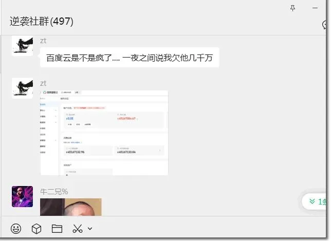
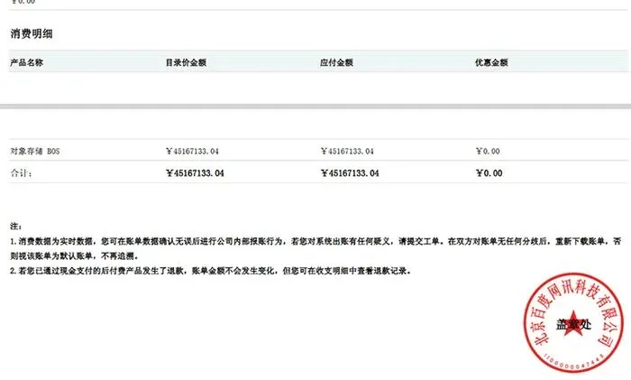

Someone in a group chat shared an entertaining case today: a developer storing a few hundred megabytes on Baidu Cloud Object Storage (BOS) generated 261.8 KB of outbound download traffic—and got billed 20,374,385.48 RMB (~\$2.8 million USD).

The funniest part of the invoice is the "Confirmation Status" field: **Confirmed**. Honestly, if a human being had played even the slightest role in "confirming" that bill, a number this absurd would never have been generated and sent to a customer.

Nor was this an isolated glitch. At 8 a.m. this morning, another site operator posted their own Baidu Cloud invoice—this one for 45 million RMB (~\$6.3 million USD)—along with a service suspension notice.

"Your Object Storage service has been suspended. Because your account is overdue, your data will be permanently deleted in 15 days and cannot be recovered."

I ran the numbers: that works out to 7.78 RMB (~\$1.10) per byte, or 7.7 billion RMB (~\$1.1 billion) per gigabyte of traffic. Bandwidth to Mars doesn't cost that much. With pricing that absurd, anyone can tell at a glance that something broke. Baidu's support team replied that an early-morning backend deployment had introduced a bug into the billing system.

Of course, I don't doubt that Baidu Cloud simply tripped over its own makeshift engineering. Cloud providers have been face-planting so often lately that I haven't even bothered writing them up—a three-in-a-row streak of AWS outages, an Azure outage triggered by a configuration change, Ernst & Young's 4 TB database backup exposed on Azure, and the list goes on. Still, when AWS goes down, the postmortem at least teaches you something useful; Baidu Cloud's stunts are just pure comedy.

## My Take

As laughable as this incident is, it raises an uncomfortable question. Because this billing bug turned a few cents into tens of millions of yuan, anyone with basic common sense could spot it immediately. What if the bug had been subtler—not a twenty-million-yuan spike, just 1% higher, or a few extra yuan, or a few extra cents per bill? Who would ever notice?

It reminds me of the plot of the movie *Office Space*, where the characters use a "salami slicing" scheme to skim tiny fractions of a cent from thousands of transactions. I vaguely recall a few real-world cases in our industry where people pulled that exact penny-shaving trick. As someone in the group chat joked: "Careful, you just uncovered where CDN vendors get their profit margins (SI vs. IEC)."

I once ran into [an absurd billing trap on Tencent Cloud CDN](/en/cloud/cdn/) myself: clicking "cache warm-up" on a 1 GB package racked up several hundred RMB in internal traffic charges. After I wrote a scathing post calling them out, they admitted the mistake and fixed it. Yet that also meant that for all the time before I spoke up, everyone who had stepped into that same trap had simply been overcharged without anyone noticing.

In truth, ordinary users have almost no technical way to verify the line items on a cloud vendor's bill. Most cloud customers can barely make sense of their top-level spend, let alone audit the rounding errors. Running in the cloud brings a whole new set of operational challenges, to the point where cloud billing and cost accounting has turned into a dedicated business and discipline of its own: FinOps. Sometimes you really have to clamp onto every detail like a bulldog when dealing with cloud vendors—otherwise you end up getting fleeced.

### References

- `[1]` : <https://www.nodeseek.com/post-494925-1>
- `[2]` : <https://t.cj.sina.com.cn/articles/view/1234557003/4995d84b02701ca8q>

---

Originally published on [WeChat Official Accounts](https://mp.weixin.qq.com/s/K9tdxeiqU8_S4lVylcWQeQ)
