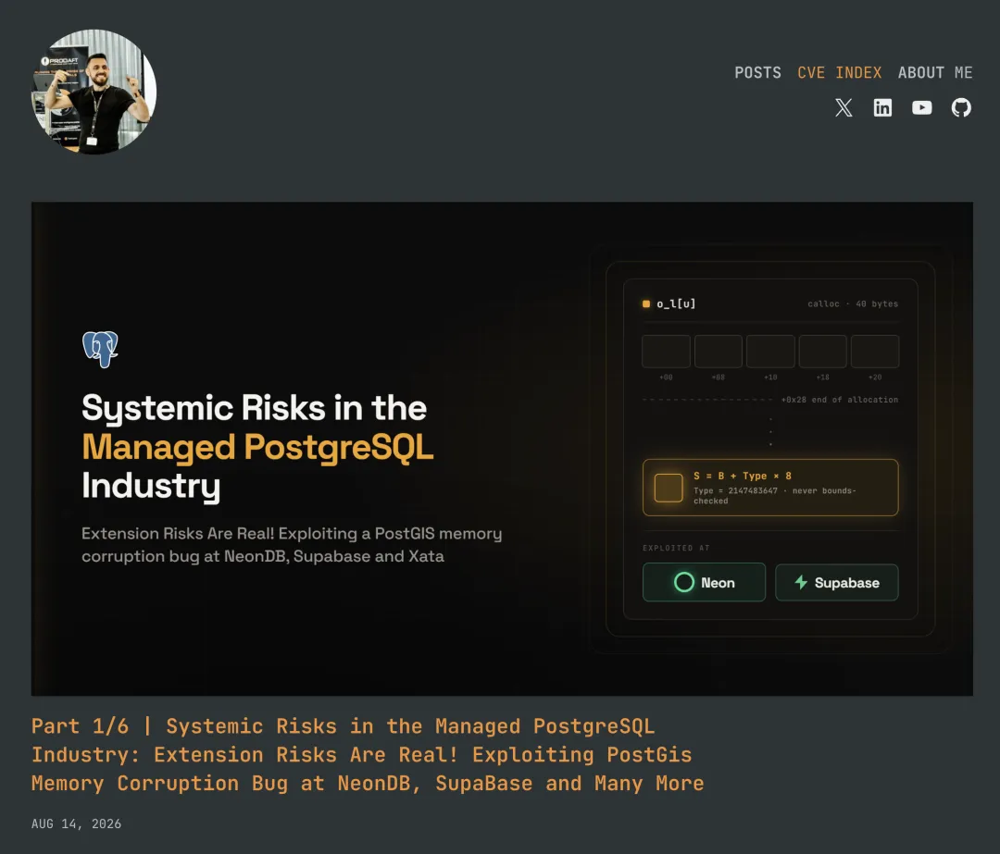
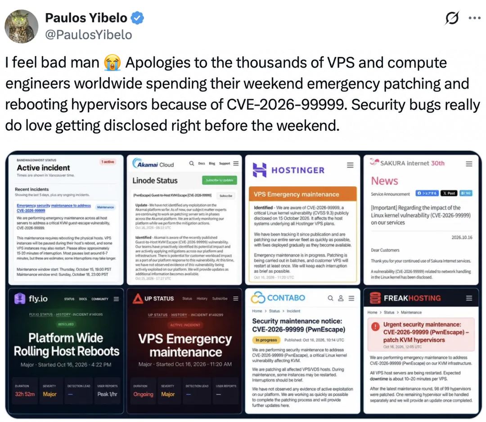
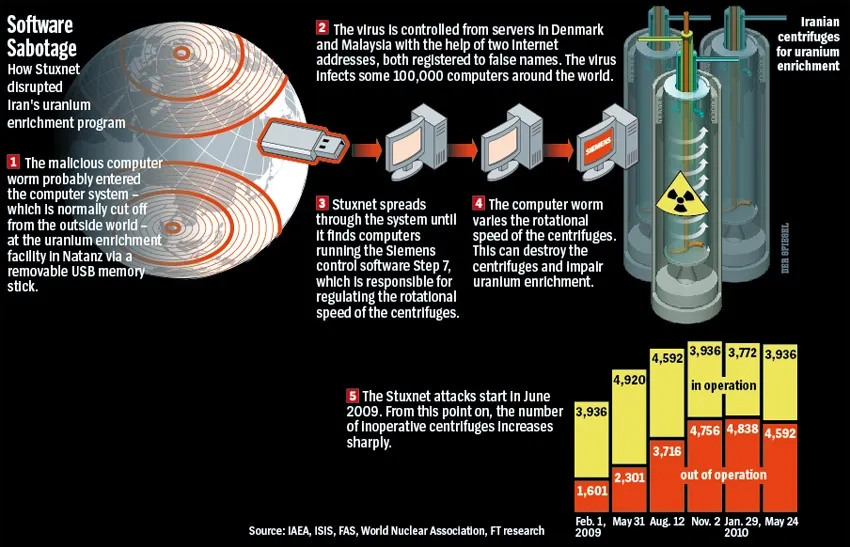

The past two weeks in cloud computing and databases have played out like a disaster movie.

First came the **TiDB Cloud data breach** that dominated the news over the past couple of days. The extortion group [FulcrumSec](https://www.moxfive.com/blog/who-is-fulcrumsec-inside-the-cloud-extortion-group-behind-21-victims-and-counting) put up a dedicated page for PingCAP on its leak site (*[The PingCAP TiDB Cloud Leaks](https://fulcrumsec.vg/pingcap/)*), claiming to have exfiltrated **10.6 TB** of data from TiDB Cloud. Alongside a public taunt, the group released a **200 GB** first-stage sample for anyone to download and verify.

This was not an isolated incident. Step back, and the cloud infrastructure industry is in the middle of a **cascade of systemic failures**:

- **Zeabur breached twice, then announces its shutdown**: Once a popular PaaS platform among developers, Zeabur suffered an environment-variable leak in late August, [followed on October 14 by a second, devastating intrusion that reached its underlying dedicated servers; on October 17, it formally announced that the service will shut down completely at the end of December](https://zeabur.com/zh-CN/blogs/zeabur-is-shutting-down).
- **Regional clouds and major hosting providers hit in succession**: On October 7, the East Japan region of **IDCF Cloud**, a prominent Japanese cloud provider under the SoftBank group, [was crippled by ransomware, bringing 495 enterprise and local-government customers to an immediate halt](https://www.neuracybintel.com/articles/ransomware-attack-disrupts-japans-idcf-cloud-affecting-495-businesses-and-local-governments) and encrypting roughly 3.6 PB of data. The provider even announced that [data in the affected availability zone would be nearly impossible to recover, leaving customers to rely on their own external backups](https://hard2bit.com/en/blog/idcf-cloud-ransomware-snapshots-backups-outside-cloud-provider/). Meanwhile, European hosting heavyweight **Hetzner** [suffered an attack against its Cloud API and console on October 14 that temporarily disrupted service](https://status.hetzner.com/incident/23397b40-e121-48d7-9c4e-0a6b4dcc4307).
- **16,000 Supabase databases left exposed**: Security firm UpGuard just disclosed that as AI-assisted “vibe coding” proliferates, [more than 16,000 cloud databases hosted on Supabase were left with publicly exposed endpoints and missing row-level security (RLS) policies](https://www.upguard.com/blog/everything-everywhere-systemic-data-exposure-in-supabase-apps), leaving their data open to bulk scraping. Configured like that, those databases are sitting ducks waiting to be harvested.

These headlines are only the surface. Underneath them, **the fundamental dynamics of offense and defense have shifted.**

At the current pace of vulnerability disclosure and exploitation, I suspect almost every internet-connected cloud server and virtual machine will soon be riddled with holes.

## 1. PostgreSQL 19's Rare Delay and the Vulnerability Wave

Why are vulnerabilities being disclosed—and cloud platforms compromised—at such an abnormal pace?

Anyone following the PostgreSQL community may have noticed a rare signal. PostgreSQL, long known for clockwork release discipline, delayed its version 19 general availability release originally scheduled for this fall: [GA was pushed back to November 19](https://www.postgresql.org/about/news/postgresql-19-rc-1-released-3409/), [and during the beta cycle the team pulled 13 items from the release notes](/en/pg/pg19b4-release/) spanning **[11 already-implemented features](https://dev.to/devopsdaily/postgres-19-slipped-to-november-every-pulled-feature-and-why-3b4m)** (including high-profile additions such as SQL/PGQ property graph queries, `FOR PORTION OF` temporal updates, `MERGE/SPLIT PARTITION`, and online data checksums).

The immediate official reason is to fold a large batch of fixes from the November minor releases into PostgreSQL 19 before cutting another release candidate. Behind that lies an interesting dynamic: **scores of people have been pointing Claude and other LLMs at the PostgreSQL source tree to hunt for bugs, then flooding the community with bug reports and patches.** Even core developer Robert Haas, when launching his [“scary patch contest”](https://www.postgresql.org/message-id/CA%2BTgmob9NY6m0YNFTQ4nFH2d0iC9SQRruDYxfndGKKzh8OC80w%40mail.gmail.com) on `pgsql-hackers` in late August, used Claude directly to evaluate which new features harbored the scariest bugs. I used AI to turn up a few PostgreSQL bugs myself not long ago.

PostgreSQL is a mountain of C code built over more than three decades, and its code quality is among the finest in open source. Even so, automated AI code auditing has become startlingly effective. Edge-case memory bounds, integer overflows, and type confusions that once took a top security researcher months to trace can now be unearthed in batches by running an LLM overnight.

Recent public disclosures show the scale of this shift. In its routine security update on August 13, PostgreSQL [disclosed and fixed 28 CVEs in a single release](https://www.postgresql.org/about/news/postgresql-186-1711-1615-1519-1424-and-19-beta-3-released-3365/)—[an all-time record that included 14 high-severity remote code execution (RCE) vulnerabilities rated CVSS 8.8](https://blog.codercops.com/blog/postgresql-august-2026-security-release-cve-guide). From a [heap buffer overflow in the ubiquitous `to_char()` function (`CVE-2026-14669`)](https://www.cve.org/CVERecord?id=CVE-2026-14669) and memory corruption in `pg_stat_statements` (`CVE-2026-14676`) to integer-wraparound memory writes in full-text search `tsvector` (`CVE-2026-14662`) and `fuzzystrmatch` (`CVE-2026-15742`), mature code paths were turned inside out.

See [“A Flood of Fixes: PostgreSQL's Latest Minor Releases Address 28 CVEs and 110 Bugs”](/pg/pg-186-cve/).

The very next day, August 14, security researcher Mehmet Ince published a landmark write-up bluntly titled [“Systemic Risks in the Managed PostgreSQL Industry”](https://mehmetince.net/part-1-6-systemic-risks-in-the-managed-postgresql-industry-extension-risks-are-real-exploiting-postgis-memory-corruption-bug-at-neondb-supabase-and-many-more/). He targeted `address_standardizer`, an auxiliary extension bundled with PostGIS and allowlisted by default across nearly every managed cloud provider.

He chained an out-of-bounds read in PostGIS ([`CVE-2026-73515`](https://www.strix.ai/cve/CVE-2026-73515)) to defeat address space layout randomization (ASLR) with an out-of-bounds write in `address_standardizer` (`CVE-2026-73514`) to corrupt memory. Taking advantage of how the C compiler represents Boolean values at the assembly level, he even forged a “Shadow-Superuser” state capable of bypassing superuser checks in specific code paths. That exploit chain cut straight through **NeonDB, Supabase, Xata**, and a string of other popular serverless and managed PostgreSQL platforms.

Think the Linux containers and VMs underneath will save you once the database process is compromised?

Look at the recent wave of **Linux kernel exploits and container or VM escapes**:

**[“Copy Fail” (`CVE-2026-31431`)](https://www.suse.com/blog/suse-responds-to-the-copy-fail-vulnerability/)**, a vulnerability in the kernel's cryptographic subsystem, requires no race condition; public demonstrations claim reliable triggering across affected kernels in mainstream distributions including Ubuntu, RHEL, and Amazon Linux. It allows an unprivileged local user to tamper with the page cache and escalate privileges, and in shared-kernel container environments where exploit conditions hold, it can threaten the host and neighboring tenants. Worse, because modifying the page cache does not alter the underlying files on disk, file-integrity monitoring that only checks on-disk hashes can miss it entirely.

Then there is **[`PwnEscape` (`CVE-2026-99999`, CVSS 9.3)](https://socprime.com/blog/cve-2026-99999-analysis/)**, disclosed on October 15: an out-of-bounds write in `skb_checksum_help()` that had [lurked in the Linux kernel's IPv4 networking stack for 18 years](https://tuxcare.com/blog/pwnescape-kvm-guest-escape/). Distribution advisories state the risk plainly: an untrusted guest VM can send packets with malformed checksum metadata over its virtual NIC to leak or corrupt host kernel memory, and potentially **achieve a VM escape to execute arbitrary code as root on the host**. [AlmaLinux's advisory](https://almalinux.org/blog/2026-10-16-pwnescape-cve-2026-99999/) confirmed the severity. It is worth keeping the demonstration scope clear: [Vercel's disclosure](https://vercel.com/blog/findings-from-the-1-million-dollar-vercel-sandbox-challenge#the-kernel-zero-day) demonstrated host memory disclosure in production, while the host crash and root code execution were completed in a matching KVM / Firecracker environment built by the researchers.

*Source: [Paulos Yibelo on X, October 17, 2026](https://x.com/PaulosYibelo/status/2111541156572013043).*

Memory corruption in application-layer extensions, RCE in the database engine, page-cache poisoning in containers, and network-packet escapes from KVM guests—the entire defensive stack is leaking from top to bottom.

## 2. Why the Cloud Is Bound to Get Riddled with Holes

Back to my opening claim: why do I think that, at the current pace of AI-assisted bug hunting, almost every public-cloud server and database will eventually be riddled with holes? This is not because any individual cloud provider is slacking off. It is an irreconcilable structural conflict between **how open-source software is developed** and **how multitenant public clouds are operated**.

Consider how little effort an attacker needs today. They do not even have to run Claude to hunt for zero-days themselves; they only need to **watch the public `git commit log` for Linux and PostgreSQL.** Commits and ordinary bug fixes on open-source mainlines are public, and some fixes expose enough clues to be weaponized before anyone flags them as security vulnerabilities. Suppose a core developer commits a patch to the PostgreSQL main branch today fixing a bug that “causes an out-of-bounds memory write under specific boundary conditions,” with the mechanism spelled out in the commit message.

An attacker—or an automated AI agent running on their behalf—can immediately reverse-engineer the trigger conditions from that commit. For some bugs, producing a working exploit prototype takes minutes. What about the cloud provider? **By design, a cloud provider's rollout pipeline cannot keep pace with upstream commits.**

Take PostgreSQL. The community [normally ships minor releases once a quarter, scheduling extra releases when critical bugs or security issues arise](https://www.postgresql.org/developer/roadmap/). Confirmed security vulnerabilities follow an [embargoed coordination process](https://wiki.postgresql.org/wiki/UpdateReleaseDrafting#Security_Releases), so patches are not simply dumped in public months ahead of a release. Even so, a gap remains for ordinary fixes committed in public and for instances that remain unpatched after a release ships. Once the community cuts a release, each cloud vendor still has to pull the upstream code, merge it into its custom fork, run control-plane compatibility tests, and schedule staged maintenance windows. By the time the update actually reaches customer instances, the window for exploitation has been wide open for weeks.

In all my years in the database industry, I have never seen a cloud provider dare to track `master` commits in a database or the Linux kernel and hot-patch thousands of live production instances every day. It is an engineering impossibility. Any provider that tried would take itself down through botched upgrades long before an attacker needed to lift a finger.

The result is a **fatal time lag** lasting weeks or months. The fix or exploit clues are out in the open for anyone to study, while unpatched cloud VMs and multitenant databases sit exposed on the public internet—or crammed onto the same physical host as unknown neighboring tenants—waiting in line for a patch window months away.

That lag has always existed, but AI has changed what happens inside it: reckless AI vibe coding at the top of the stack creates an avalanche of misconfigurations, while automated bug discovery and exploitation at the bottom punch through isolation boundaries.

Previously, low-level exploit development was largely confined to a relatively small, disciplined circle of security researchers. Today, a script kiddie running an uncensored build of GLM, Qwen, or another unrestricted open-weight model does not even need to read assembly or understand memory layouts—they can feed a public commit log to the model, have it generate a PoC automatically, and start firing at exposed targets.

In an internet-facing, multitenant environment, that patch gap turns the cloud into a one-way shooting gallery—and leaves it riddled with holes.

### An Aside: Would Proprietary Software Be Safer?

At this point, someone selling closed-source commercial software will inevitably chime in: “See? Open-source software is getting hammered by AI because its source code and commits are public! For security, you should buy proprietary software whose source code is kept secret.” Buying into that argument means jumping straight out of the frying pan into the fire.

Security has a foundational rule: **never rely on security through obscurity.** Assuming attackers cannot find bugs if you hide the source code is pure self-deception. When the cost of offensive analysis drops by orders of magnitude, the flimsy proprietary systems that previously survived only because they were obscure, poorly scrutinized, or not worth a researcher's time are the ones most likely to get blown apart—as the string of compromised proprietary cloud control planes at the start of this article already illustrates.

First, strip away the marketing from most commercial databases sold under banners of “sovereign control” and “enterprise-grade security,” and nine times out of ten you will find a heavily modified fork branched off an older version of PostgreSQL or MySQL. Every decades-old vulnerability unearthed upstream exists in their inherited codebase too. Worse, because their custom forks diverged from upstream years ago, merging security patches takes them even longer than public-cloud vendors—assuming they do not simply bury the issue and pretend nothing happened.

Second, even a proprietary system written entirely from scratch in C or C++ will not escape AI scrutiny. Once human-written C or C++ code is compiled into machine code by a modern compiler, its memory allocations, bounds checks, and protocol parsers exhibit highly consistent **patterns**. Modern AI workflows already pair directly with decompilers like IDA and Ghidra to reverse-engineer stripped binaries and drive targeted fuzzing.

More importantly, blaming open source gets cause and effect backward. Is it a bad thing that researchers are scrutinizing open-source code, finding bugs, and submitting fixes? **From a software engineering standpoint, it is a massive net positive.**

A basic truth of software engineering applies here: **as long as you stop piling on flashy features and churning the core architecture, the total number of bugs in a mature system is finite.** Why did PostgreSQL 19 break with years of tradition, delay its release, and drop a dozen already-written features? Because the community made a clear-eyed choice: pause new features and clear out the existing minefield first.

On a feature-frozen stable branch, assuming fixes do not introduce new regressions, bugs are a nonrenewable resource—**every bug that AI finds and developers properly fix is one fewer landmine lurking in the codebase, making the stable branch progressively harder to break.** Linux and PostgreSQL are currently going through the most intense collective trial by fire in software history: the world's sharpest security researchers, armed with frontier compute, are sweeping open-source infrastructure for landmines free of charge.

What about closed-source commercial software? With its source locked away, it gets neither the scrutiny of thousands of independent reviewers nor the hardening of public attack and defense. That does not mean it has no vulnerabilities; it just means nobody has swept it for mines. Inside the black box, brittle implementations and elementary bugs that would fail basic static analysis pile up undisturbed. Everything looks calm until the source leaks or an attacker points an AI binary auditor at it—at which point, with no real defense in depth, it gets torn open in a single pass.

So do not invert cause and effect: **the mistake was never openness and transparency; it is running exposed in a public, multitenant environment.** The real vulnerability of open-source software today is the **time window between when a fix becomes public and when the patch is deployed**. If we want the battle-tested resilience of open-source software without sitting on the public internet as a live target during that window, how do we square the circle?

The answer is straightforward: **use physical separation in space to cut off the remote paths that exploit the patching lag in time.**

## 3. The Days of Burning DVDs for the Server Room

I have long been a committed advocate of **local-first software and data autonomy**. Anyone who has used **Pigsty** knows that it has supported offline installation since day one, built around a foundational assumption: **the internet does not exist**.

Where did that design constraint come from? Our very first customer operated in a classified environment. Inside their core server room, pulling a Docker image from the public internet or running `yum install` was out of the question—the room was physically air-gapped, with not a single cable reaching the outside world. How did we deploy a database? We had to bundle the OS dependencies, database packages, monitoring stack, and every last transitive RPM into a self-contained offline repository, burn the whole thing onto DVDs, walk the discs into the server room, and install directly from the servers' optical drives.

At the time, I thought the process was a massive hassle. After watching the surreal state of cloud security over the past few years—and especially this latest wave of vulnerabilities—I have come to respect the wisdom of that tradeoff: **physical isolation remains the simplest, bluntest, and most effective ultimate line of defense in information security.**

In the cloud, you can draw polished architecture diagrams and tout zero trust, fine-grained IAM, eBPF sandboxes, and SOC 2 compliance. None of that changes a brutal reality: **as long as your machines are reachable from the public internet or share underlying hardware with other tenants, a single misconfiguration, a leaked support token, or a C buffer overflow committed to GitHub an hour ago can let a script kiddie on the other side of the planet clean you out in seconds.**

What happens to the attacker's cost structure under a true **air gap**? Every script and AI agent on the far side of the internet hits a dead end. To get malicious code onto your network, an attacker has to compromise the supply chain, smuggle in removable media, or turn an insider. Think of Stuxnet against Iran's Natanz uranium-enrichment facility: not being wired directly to the public internet does not make a target invincible, but look at what it took to bridge that gap.

Otherwise, the attacker has to mount a literal physical operation—breaking into your building at night to touch internal hardware or steal an office laptop—or fall back on cryptography's most feared attack vector, [rubber-hose cryptanalysis](https://en.wikipedia.org/wiki/Rubber-hose_cryptanalysis), immortalized by xkcd as the [five-dollar wrench attack](https://xkcd.com/538/): kidnap your DBA and beat the password out of them with a heavy wrench.

An air gap does not make security 100% absolute, but it forces the bar up from **a script kiddie pressing Enter** to **Hollywood espionage or violent felony**. That is why, across the many air-gapped internal networks I have seen over the years, Linux kernels and databases often go three to five years without an upgrade—running versions seven or eight years old without patches—while the ops teams sleep soundly at night, and in the environments I have witnessed, those systems genuinely run without incident for years on end.

Physical isolation and dedicated hardware keep strangers' malicious SQL, hostile neighbor containers, and rogue VMs outside the perimeter—**most remote attack paths are severed at the physical network layer before they ever reach a software vulnerability.** You still have to guard against untrusted internal accounts, compromised internal apps, and supply-chain poisoning, and isolation is not an excuse to never patch; even so, getting an exploit in front of the vulnerable code becomes orders of magnitude harder.

Even where a full air gap is impractical, putting a properly configured firewall and private-network perimeter around your hosts and databases drastically shrinks the attack surface. Unfortunately, a huge share of cloud breaches happen precisely because teams fail to get basic perimeter configuration right—those 16,000 exposed Supabase instances being a textbook example.

## 4. Cyberpunk 2077's Prophecy: Retreat Behind the Blackwall

We may be standing at a historic inflection point.

Over the past decade, cloud vendors used the narrative of economies of scale and dedicated security teams to persuade enterprises to hand over their core data to multitenant public clouds. Now the explosion of AI compute is turning vulnerability discovery from artisanal craft into an industrial assembly line. Once bug discovery outpaces cloud patch deployment, the scale that public clouds boasted about flips into a massive liability: **break through once, compromise across the fleet**.

That shift will fundamentally rebalance the equation between **cloud services** and **self-hosted, local-first infrastructure**.

Writing this brings to mind the lore of *Cyberpunk 2077*.

In the game's backstory, the legendary netrunner Rache Bartmoss unleashes the DataKrash virus, setting loose swarms of rogue AIs across the old public Net and turning an interconnected global network into a lethal wasteland where jacking in fries your neural interface on contact. Humanity is ultimately forced to retreat into local networks behind the **Blackwall** to keep the feral Old Net locked out. A fictional AI barrier in a video game is obviously not the same thing as a physical air gap, yet the metaphor—walling off a hostile outside network—hits close to home.

Look at the automated scanners sweeping internet ports 24/7, the AI models relentlessly auditing open-source C codebases, and the cloud providers getting breached one after another. Does *Cyberpunk 2077* still look like pure science fiction? Right now, it feels like we are flooring the throttle straight toward it.

Obviously, I am not suggesting that everyone unplug their network cables tomorrow—that would be absurd. The pragmatic answer is **tiering by sensitivity**: pull your most critical, sensitive data back into your own hands, retreat onto private internal networks, and put physical isolation around the crown jewels; for everything else, at least lock down your firewalls and shrink the exposed surface.

Because across a wasteland overrun by feral AI and automated exploits, the only truly safe ground may be the territory you have taken off the grid.

