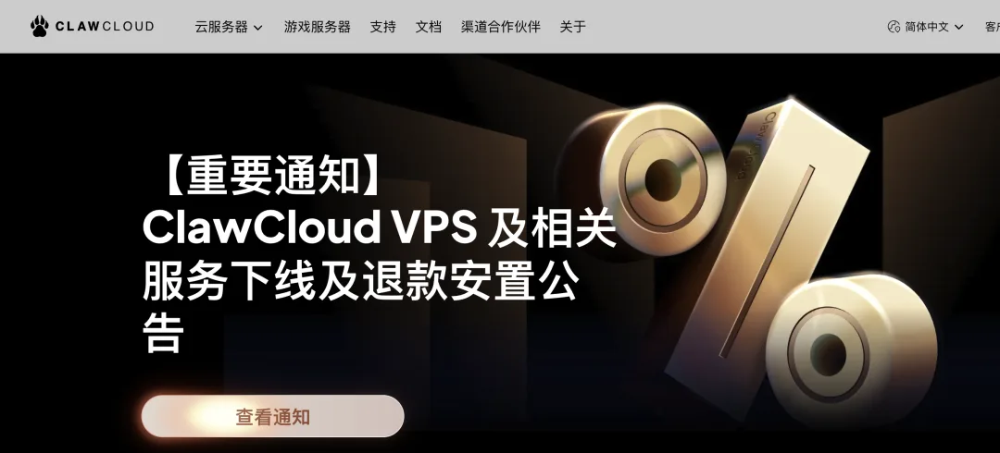
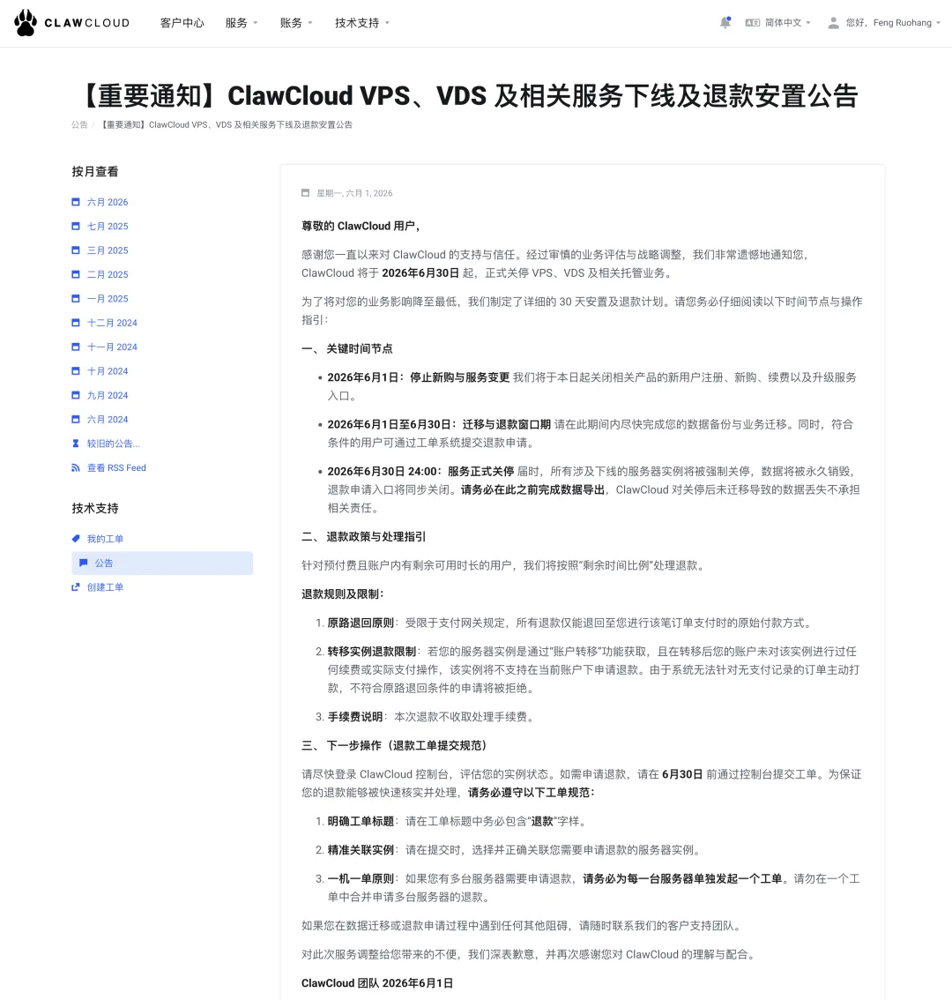
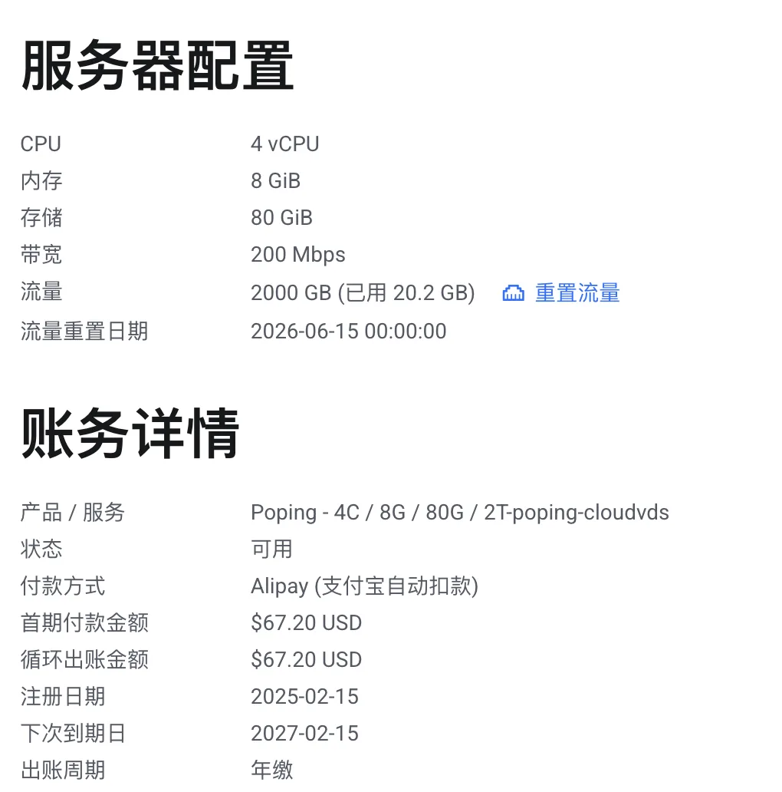
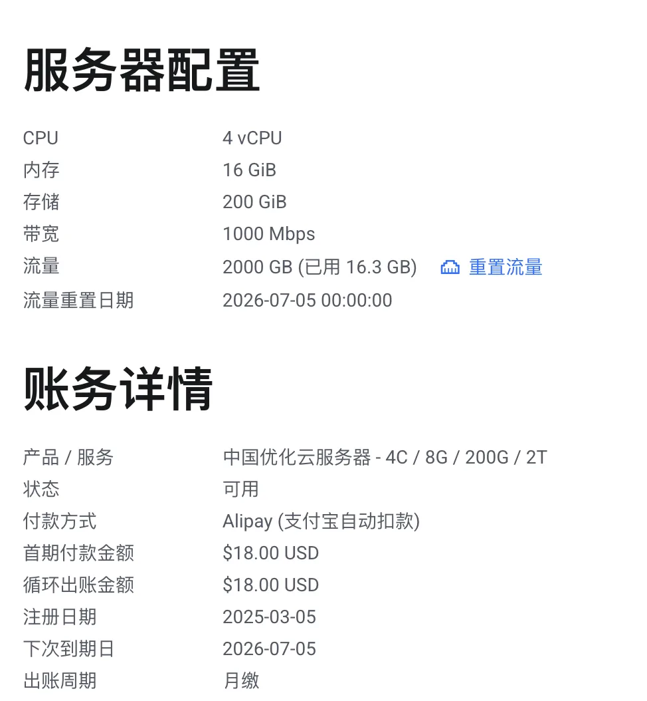
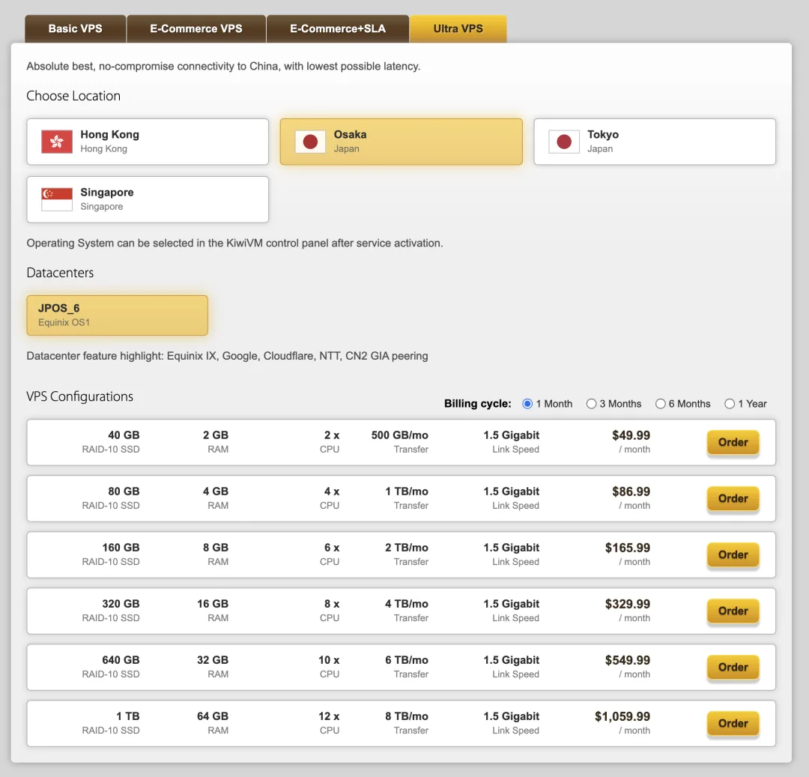
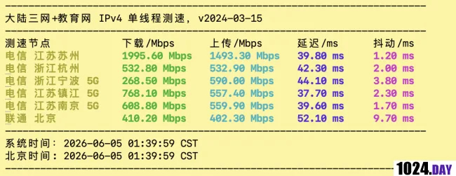
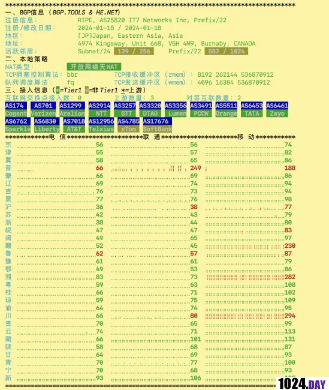
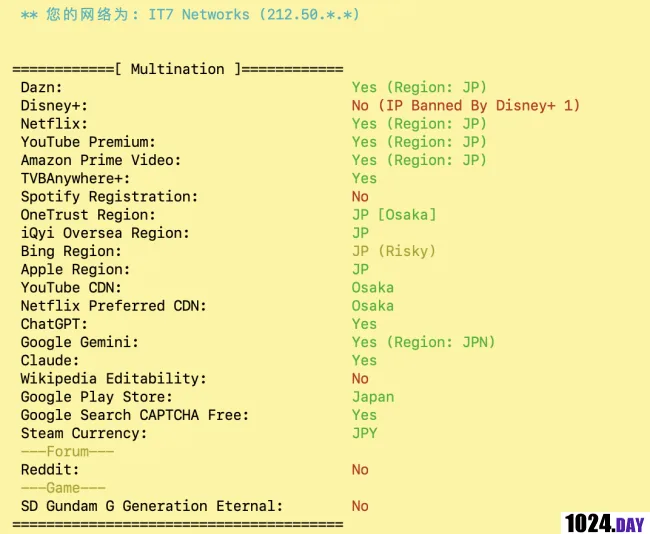
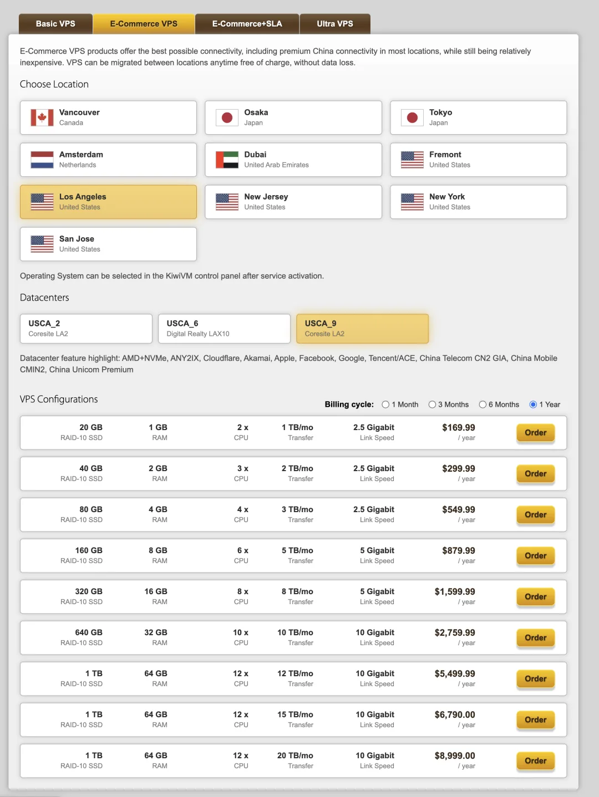

I previously recommended ClawCloud's VPS plans in [*Which Budget Cloud Server Is Best?*](/cloud/cheap-vps/) and in my PostgreSQL getting-started tutorials. Unfortunately, it looks like ClawCloud is pulling the plug for real this time. Their website just posted an official notice — *Announcement on the Discontinuation and Refund Arrangements for ClawCloud VPS and Related Services* — confirming that all VPS and VDS services will shut down on June 30, 2026.

According to insiders, ClawCloud was actually a side brand backed by Alibaba Cloud. It is unclear why they are winding it down — maybe everyone has pivoted to AI and no longer cares about low-margin VPS hosting, or maybe they were bleeding too much money subsidizing bandwidth. Either way, they are calling it quits. They had already shut down their Hong Kong region once before; this time they are axing the entire VPS product line. It is a real shame, because machines with that kind of price-to-performance ratio are hard to come by.

I had picked up two of their servers during a promo. One was a VDS with 4 vCPUs, 8 GB of RAM, 80 GB of disk, 2 TB of monthly transfer, and a 200 Mbps port for $67 a year.

The other was a China-optimized server with 4 vCPUs, 16 GB of RAM, 200 GB of disk, a 1 Gbps port, and 2 TB of monthly transfer for $18 a month.

Those two boxes hosted several of my sites, including my personal blog (`vonng.com`), the Chinese Pigsty site (`pigsty.cc`), and the Chinese PostgreSQL website mirror (`pg.center`).

Honestly, finding another cloud server at that price point is tough. My requirements are straightforward:

- Reachable worldwide, with heavy traffic from mainland China (which rules out domestic mainland cloud servers).
- Around 1 TB of monthly transfer, with as much bandwidth as possible.
- Low, stable latency over a premium route into mainland China (which means China Telecom CN2 GIA).
- Direct access to ChatGPT and Claude from the server (which rules out Hong Kong IPs).

Because most of my traffic comes from mainland China, Japan is currently the sweet spot. From Shanghai, latency to Japan is roughly on par with Hong Kong, whereas Hong Kong IPs are blocked by ChatGPT and Claude and cost significantly more. Singapore sits around 70–100 ms, the US West Coast is 120 ms+, and a good Japan CN2 GIA route gets down to 30–40 ms.

ClawCloud's "China-optimized" servers did not actually run on CN2 GIA anyway — latency from Shanghai was around 60–70 ms, and evening peak throughput was ugly. Since I had to migrate anyway, I decided to skip the half-measures and pay for top-tier routing once and for all.

After looking around, I found that almost every VPS with genuine CN2 GIA transit is expensive, and the shortlist quickly narrowed down to two providers: DMIT and BandwagonHost. Among mainland users, those two are the endgame for premium China routing — pricey, but rock-solid. DMIT was completely out of stock on the plans I wanted, leaving BandwagonHost as the only option you can actually buy right now. And the price is... well, steep.

I ended up picking the 80 GB tier of BandwagonHost's Ultra VPS in their Osaka, Japan datacenter (`JPOS_6`): 4 vCPUs, 4 GB of RAM, 80 GB of SSD storage, 1 TB of monthly transfer, and a 1.5 Gbps port for $87 a month — about RMB 600 per month, or roughly RMB 6,000 a year.

I have already migrated all my websites off ClawCloud onto this new VPS. You get what you pay for: whether for serving web pages or proxying traffic through it, the experience is faultless, and evening peak performance stays smooth.

For a detailed benchmark of this exact plan, see <https://1024.day/d/3851>:

Of course, I only paid for the Osaka plan because I run public websites that need fast, reliable access from both mainland China and the rest of the world. If you just need a box for personal use, BandwagonHost's Los Angeles E-Commerce VPS line is a much better deal: for roughly the same money, you can get 6 vCPUs, 8 GB of RAM, 5 TB of monthly transfer, and a 5 Gbps port. Aside from the higher physical latency to China (~120 ms), there is nothing to complain about.

If you know of any other solid VPS plans or routes worth checking out, feel free to share them in the comments.

---

Originally published on [WeChat Official Accounts](https://mp.weixin.qq.com/s/Jk_4KMeN6qBWMZwUFZ7B4w)
