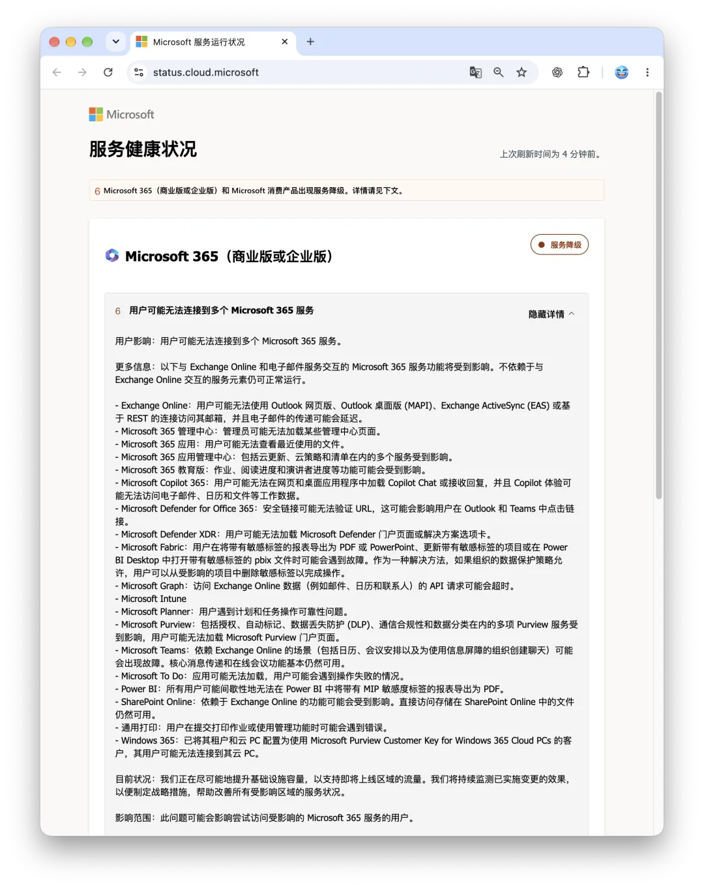
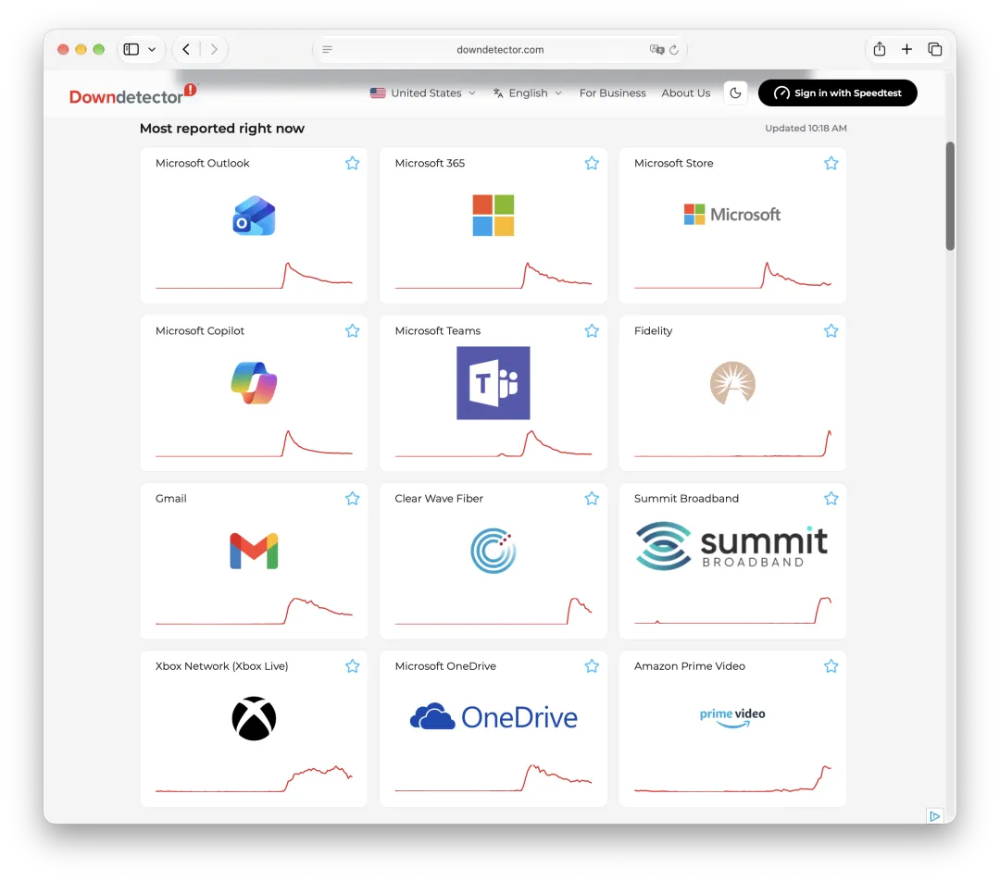
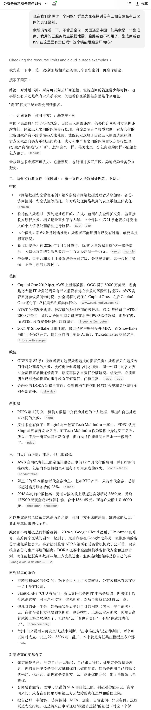

At 00:17 on November 13, 2026, Microsoft's core email infrastructure, **Exchange Online**, suffered a major global outage (`EX1550543`). It quickly spread through shared internal dependencies into a cascading failure across the **Microsoft 365** ecosystem (`MO1550821`). At the peak, Downdetector recorded nearly 130,000 reports of Outlook problems, with enterprise users across the Americas, Europe, and Asia-Pacific unable to connect. All times in this article are Beijing time (UTC+8).



The investigation found that **the server process responsible for establishing secure connections had overloaded and crashed**; this was not an external attack or a genuine traffic surge. Automatic health checks then removed nodes, triggering a collapse in the remaining capacity. Microsoft rolled back a **recent network configuration change** whose timing closely matched the start of the outage, yet its public status page still shows degraded service. The struggle has now lasted nearly ten hours; the exact incident closure times for individual tenants and the final root cause await the formal post-incident review (PIR).

## The Facts

At 00:17 on November 13, Microsoft's backend first recorded problems accessing Exchange Online. Enterprise users simultaneously lost access through the web client (OWA), desktop clients (MAPI), mobile clients (EAS), and REST APIs. Mailboxes were stuck on “Disconnected” or an endless loading spinner. Reports surged to a peak within two hours, with Outlook alone approaching **130,000 reports** on Downdetector. Microsoft then opened the umbrella incident `MO1550821` to cover multiple products, expanding its initial assessment from “parts of the Americas” to connections in any region worldwide.

This was a classic **failure in a shared underlying dependency**. Core Teams messaging and direct file access in SharePoint remained largely available, but services that depended on Exchange mail, calendar, and contact data went down with it. Microsoft Graph APIs timed out on a large scale, Teams meeting scheduling failed, and **Microsoft 365 Copilot** stopped working because it could not read work data. Defender's Safe Links checks, Purview compliance components, and even some Windows 365 Cloud PCs with Customer Key enabled all reported errors.



The failure even crossed Microsoft's boundaries, taking down the M365 enterprise connectors used by **OpenAI (ChatGPT)** and **Anthropic (Claude)**. More absurdly, **the M365 Admin Center itself failed to load for a time**. Large numbers of system administrators around the world could not even get into the console to read an incident update. They had to turn to Reddit and other communities, piecing together the status from updates copied by fellow users.

Microsoft's troubleshooting dragged on for nearly ten hours, with several reversals in its diagnosis. Initially, it blamed the disconnections on “increased load across multiple regions.” After 03:00, it froze changes globally and abandoned the traffic-surge hypothesis, acknowledging that high load was only a symptom. The real problem was that **large numbers of servers had failed automated health checks and been removed from the cluster**, shifting the existing workload onto the remaining nodes and immediately overwhelming them. As for whether anything had changed, Microsoft first said it had found no relevant recent changes, then said an hour later that it was investigating a small number of configuration updates.

Between 06:00 and 08:00, recovery efforts hit a particularly stubborn dead end. Microsoft tried partitioning and isolating infrastructure and restarting nodes in batches. It briefly saw improvement in some areas, only to discover that **servers became unresponsive again as soon as they returned to service and took real traffic**. Only at 09:06 did Microsoft identify the underlying process failure: **the core process responsible for establishing secure connections on affected servers was overwhelmed**. While restricting certain traffic and rebuilding nodes with the old configuration, Microsoft rolled back a **recent network configuration change whose timing correlated closely with the start of the incident**. As of 10:01, its public service health page still showed degraded service.

## Technical Analysis

The following is a model of how the failure spread, reconstructed from Microsoft's public incident updates. It is not Microsoft's confirmed account of the full root cause. Details of the health-check policy, the connection process's internal behavior, and reconnection traffic volumes still await the formal PIR.

Taken together, ten hours of fragmentary updates describe a textbook infrastructure failure: a configuration change collapses capacity, then a positive feedback loop amplifies the failure. The chain is clear:

```text
Recent network configuration change (strongly suspected trigger)
       ↓
Secure connection process malfunctions & health checks fail
       ↓
Many nodes removed → Effective capacity plummets
       ↓
Reconnection storm overwhelms surviving nodes (positive feedback trap)
       ↓
Exchange disconnects → Cascading failures across M365 and external AI
```

The deadliest mechanism here is **health checks working against recovery, trapping the system in a metastable failure state**. Health checks are meant to remove the occasional sick machine. But in a failure with a common cause across the fleet, unless the load balancer's health checks have a fail-open safeguard that caps the proportion of nodes they can remove, they will evict slowing nodes one after another, creating a devastating capacity cliff themselves.

As long as the faulty network configuration remains in place and the abnormal cost of secure handshakes persists, simply restarting machines achieves nothing. A freshly restarted node faces a wall of automatic reconnections from clients around the world and collapses under the load again within minutes. That would explain Microsoft's repeated cycle of a few minutes of recovery followed by another failure through the early morning.

The outage also stripped away the pretense that modern cloud office suites are loosely coupled. Cloud vendors sell SaaS as modular, highly resilient, cloud-native infrastructure. Under stress, the venerable Exchange turns out to be a hidden single point of failure tying together enterprise collaboration, security auditing, and even cutting-edge AI agents.

When the underlying mail connection layer falters, all the compute behind LLM connectors and Copilot cannot stop them from going blind. Meanwhile, Microsoft's official accounts kept ending every post on X by telling administrators to “sign in to the Admin Center for details,” even as the Admin Center itself would not open. Having production and control planes fail together is an old architectural problem. A multinational giant can still fall into that trap.

## My Take

The timing could hardly have been worse. I recently moved email for my business domain (`pgsty.com`) from iCloud to Microsoft's business email service. I had been using it for barely a month. This morning I opened my mail client and found not a single new message: my turn to get blindsided by Microsoft. Email is one of the few services I advise against self-hosting, because poor mail-server reputation can get your messages rejected. So I do not have a particularly good alternative here.


**When you buy services from a cloud giant, you get convenience along with the full burden of its complexity and risk.**

Step back for a moment. Suppose you colocate a few physical servers in a conventional data center and quietly run your own business applications or mail system. It is hard to imagine a failure like this: “The data center pushed a line of low-level network configuration, which sent my secure connection process and health checks into a runaway failure loop.”

Yet on hyperscale public clouds, we keep seeing the same script: DNS failures, circular dependencies between OSS and IAM, misconfigured allowlists, or a control-plane change somewhere that takes tenants down worldwide. **Hyperscale has its own failure modes. At your scale, those problems would not even exist.**

**[What Can We Learn from Tencent Cloud's Outage Postmortem?](/en/cloud/qcloud/)**

**[What Can We Learn from Alibaba Cloud's Epic Outage?](/en/cloud/aliyun/)**

**[Huawei Cloud's International Outage: A Suspected IAM Upgrade Failure](/en/cloud/huawei-iam/)**

**[Cloudflare's November 18 Outage Postmortem](/en/cloud/cf-ck-down/)**

**[How an AWS DNS Failure Cascaded Through Half the Internet](/en/cloud/aws-dns-failure/)**

**[Google Cloud and Cloudflare Outages Take Down Services Worldwide](/cloud/gcp-cf-outage/)**

**[Google Cloud Deleted a Major Fund's Entire Cloud Account](/en/cloud/gcp-unisuper/)**

Problems in small systems tend to be local, obvious, and linear. A disk fails or a process dies; you check the logs, restart something, or fail over. To keep a global multitenant platform running, a hyperscale public cloud must stack hundreds of layers of complex software-defined networking, automated health probes, dynamic traffic orchestration, and security gateways underneath it.

The whole contraption looks impregnable in normal operation. But when a configuration change jams one of its gears, the automated disaster recovery it prides itself on can instantly become a brutally efficient failure amplifier. Tenants end up paying for the structural fragility of a distributed monster made of hundreds of thousands of servers.

[**Stop Worshipping Complexity: High Availability After Leaving the Cloud**](/en/cloud/uptime/)

And if you expect meaningful guarantees or compensation when a cloud giant goes down, lower your expectations now. Exchange Online does have an SLA, but it does not mean “ten hours of downtime automatically gets you compensation for ten hours of losses.” Availability is calculated according to the applicable service, affected users, and agreed measurement period. Whether you receive a service credit depends on filing a claim and having it assessed under the contract. Even if approved, the credit covers only part of the relevant subscription fee. A few vouchers bear no relation to the actual losses from missed critical emails and interrupted business processes.

[**Alibaba Cloud's CDN Is Down: Remember to Claim Your SLA Credit**](/cloud/aliyun-cdn-sla/)

[**Are Cloud SLAs a Placebo?**](/en/cloud/sla/)

Moving to the cloud means accepting a take-it-or-leave-it bargain and putting your fate in the vendor's hands. You get the convenience of a ready-made service, and you have to swallow the consequences when its scale-related ailments flare up. Think moving to the cloud lets you hand the blame to the vendor when something breaks? Come on. You are still the one left answering for it.



## Series: Cloud Computing, Warts and All

**Cloud Outages**

[**Cloud Vendors Need Oversight: Cloudflare Is Down Again**](https://mp.weixin.qq.com/s?__biz=MzU5ODAyNTM5Ng==&mid=2247490554&idx=1&sn=01636e81b9fe923e218fe814fe1b3d8d&scene=21#wechat_redirect)

[**Baidu Cloud: 20 Million Yuan for 261 KB of Traffic**](/en/cloud/baidu-cloud-bill/)

[**Alibaba Cloud “Borrows” Supabase: The Gray Area Between Open Source and Cloud**](/en/cloud/aliyun-supabase/)

[**AWS's Official Outage Postmortem**](/en/cloud/aws-postmotem/)

[**How an AWS DNS Failure Cascaded Through Half the Internet**](/en/cloud/aws-dns-failure/)

[**An Outage in AWS's Largest Region Takes Down Multiple Services**](/en/cloud/aws-dns-failure/)

[**Zhihu Is Down: A Certificate Problem or a CDN Failure?**](/cloud/zhihu-outage/)

[**Alibaba Cloud's CDN Is Down: Remember to Claim Your SLA Credit**](/cloud/aliyun-cdn-sla/)

[**16 Billion Login Credentials Leaked: Apple, Google, Facebook, and Telegram**](/cloud/16b-credentials-leak/)

[**Google Cloud and Cloudflare Outages Take Down Services Worldwide**](/cloud/gcp-cf-outage/)

[**Major Outage: Alibaba Cloud's Core Domain Was Seized**](/cloud/aliyun-domain-seized/)

[**Inside the Dior Data Leak: A Cloud Misconfiguration to Blame?**](/cloud/dior-leak/)

[**An App with 100,000 Users Wiped Out over a 2-Yuan Tencent Cloud Bill?**](/cloud/tencent-2yuan/)

[**AWS Tokyo Availability Zone Outage Affects 13 Services**](/cloud/aws-tokyo-outage/)

[**Shopify's April Fools' Outage Was No Joke**](https://mp.weixin.qq.com/s?__biz=MzU5ODAyNTM5Ng==&mid=2247489406&idx=1&sn=f51aea1ea2148f7d281f1bded9de8888&scene=21#wechat_redirect)

[**Oracle Cloud Breach: Authentication Data for 6 Million Users Leaked**](/cloud/oracle-cloud-leak/)

[**OpenAI's Global Outage: Circular Dependencies in Kubernetes**](/en/cloud/openai-failure/)

[**Alipay Is Down? More Singles' Day (November 11) Antics**](https://mp.weixin.qq.com/s?__biz=MzU5ODAyNTM5Ng==&mid=2247488632&idx=1&sn=dba2c78f37bb4af2421677e842b57fdd&scene=21#wechat_redirect)

[**Incompetence Comes Back to Bite: An Expired Certificate Takes Down Apple Music**](/cloud/apple-music-cert/)

[**Alibaba Cloud: The Myth of High Availability and Disaster Recovery Falls Apart**](/en/cloud/aliyun-ha/)

[**Alibaba Cloud's Outage Forecast: Another 20 Years of Downtime?**](/en/cloud/aliyun-ha/)

[**Alibaba Cloud Drive's Disastrous Bug: Can You See Other People's Photos?**](/cloud/aliyun-drive-bug/)

[**Alibaba Cloud's Singapore Availability Zone C Is Down; Rumors of a Data Center Fire**](https://mp.weixin.qq.com/s?__biz=MzU5ODAyNTM5Ng==&mid=2247488345&idx=1&sn=684398668bdddc05d4218c42f5a383b0&scene=21#wechat_redirect)

[**Now It Is WPS's Turn to Go Down**](https://mp.weixin.qq.com/s?__biz=MzU5ODAyNTM5Ng==&mid=2247488215&idx=1&sn=34bedcf01169facd0207200b3e018989&scene=21#wechat_redirect)

[**Amateur Hour at Alibaba Cloud: An RDS Outage**](/en/cloud/rds-failure/)

[**What Can We Learn from the NetEase Cloud Music Outage?**](/en/cloud/netease/)

[**GitHub Goes Down Sitewide: Another Database Failure?**](/cloud/github-outage/)

[**Windows Blue Screens Worldwide: Amateurs on Both Sides of the Contract**](/en/cloud/bsod-friday/)

[**Alibaba Cloud Is Down Again: A Severed Fiber Cable This Time?**](/cloud/aliyun-fiber-cut/)

[**Google Cloud Deleted a Major Fund's Entire Cloud Account**](/en/cloud/gcp-unisuper/)

[**The Cloud Is Hostile Territory: A Bucket Name Is All It Takes to Blow Up Your S3 Bill**](/en/cloud/s3-scam/)

[**taobao.com's Certificate Expired**](https://mp.weixin.qq.com/s?__biz=MzU5ODAyNTM5Ng==&mid=2247487367&idx=1&sn=d6e4abd2b2249d27bd8b8146b591b026&scene=21#wechat_redirect)

[**What Can We Learn from Tencent Cloud's Outage Postmortem?**](/en/cloud/qcloud/)

[**Cloud SLAs: Placebos or Toilet Paper?**](/en/cloud/sla/)

[**Tencent Cloud: Incompetence on Full Display**](/cloud/tencent-disgrace/)

[**Tencent Cloud's Second Epic Failure**](/cloud/tencent-epic-fail-2/)

[**The Amateurs Behind Internet Outages**](https://mp.weixin.qq.com/s?__biz=MzU5ODAyNTM5Ng==&mid=2247486590&idx=1&sn=d4d85de483fafb867487f024631a3e6c&scene=21#wechat_redirect)

[**From Cost-Cutting Farce to Real Efficiency**](/en/cloud/smile/)

[**Alibaba Cloud's Weekly Outage: The Cloud Database Control Plane Is Down Again**](/cloud/aliyun-weekly-crash/)

[**What Can We Learn from Alibaba Cloud's Epic Outage?**](/en/cloud/aliyun/)

[**Alibaba Cloud's Epic Failure**](/en/cloud/aliyun/)

**Cloud Resources**

[**Paying to Be Fleeced: Escaping the Cloud's Myawaddy Scam Compound**](/en/cloud/patsy/)

[**Are Cloud Databases a Tax on the Gullible?**](/en/cloud/rds/)

[**Is Cloud Block Storage a Pig-Butchering Scam?**](/en/cloud/ebs/)

[**The Real Cost of Cloud Compute**](/en/cloud/ecs/)

[**Object Storage Exposed: From Cutting Costs to Fleecing Customers**](/en/cloud/s3/)

[**Tencent Cloud's Lousy CDN: From Getting Started to Giving Up**](/en/cloud/cdn/)

[**32 Seconds of Alibaba Cloud DCDN Left Me Owing 1,600 Yuan**](https://mp.weixin.qq.com/s?__biz=MzU5ODAyNTM5Ng==&mid=2247488466&idx=1&sn=21a77c9076643f723038047b8c14ba59&scene=21#wechat_redirect)

[**Cloud SLAs: Placebos or Toilet Paper?**](/en/cloud/sla/)

[**FinOps Ends with Leaving the Cloud**](/en/cloud/finops/)

[**Why Is China's Cloud Business Less Profitable Than Sand Mining?**](/en/cloud/profit/)

[**Are Cloud SLAs a Placebo?**](/en/cloud/sla/)

[**A Paradigm Shift: From Cloud to Local-First**](/en/cloud/paradigm/)

**Leaving the Cloud**

[**Paying to Be Fleeced: Escaping the Cloud's Myawaddy Scam Compound**](/en/cloud/patsy/)

[**Amateur Hour at Alibaba Cloud: An RDS Outage**](/en/cloud/rds-failure/)

[**DHH Leaves the Cloud: Every Extra Day on S3 Costs Another 40,000**](/cloud/dhh-s3-migration/)

[**DHH: Leaving the Cloud Beat Expectations and Could Save 100 Million**](/en/cloud/odyssey-done/)

[**Optimize Your Carbon-Based BIO Cores Before Your Silicon CPU Cores**](/en/db/bio-core-cpu-core/)

[**The Single-Tenant Era: A SaaS Paradigm Shift**](/cloud/single-tenant-saas/)

[**Stop Worshipping Complexity: Staying Reliable After Leaving the Cloud**](/en/cloud/uptime/)

[**Saving 10 Million in Six Months: DHH's Cloud Exit FAQ**](/cloud/cloud-exit-faq/)

[**Is It Time to Give Up on Cloud Computing?**](/cloud/odyssey/)

[**An Odyssey Out of the Cloud**](/cloud/odyssey/)
