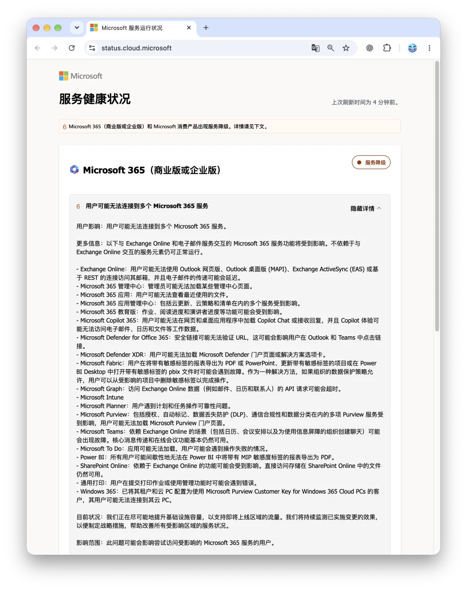
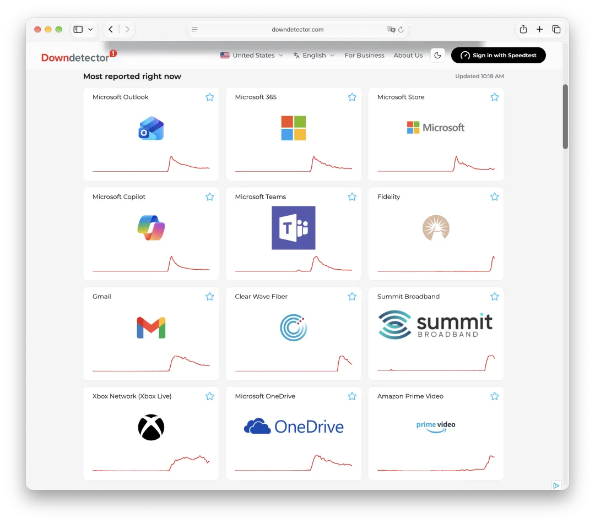
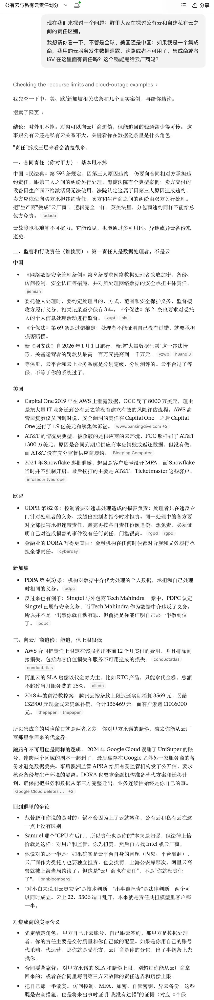

北京时间 2026 年 11 月 13 日凌晨 00:17 起，微软核心邮件基础设施 **Exchange Online** 突发全球级大规模宕机（`EX1550543`），并顺着内部共享依赖链迅速演变为波及整个 **Microsoft 365** 生态的级联故障（`MO1550821`）。事故高峰期 Downdetector 录得近 13 万条 Outlook 报错，美洲、欧洲与亚太地区企业用户全面受阻。



排查表明，此次事故并非外部攻击或真实流量暴涨，而是服务端**负责建立安全连接的进程发生过载崩溃**，叠加自动健康检查摘除节点引发剩余容量雪崩。在回滚一项与故障起点高度吻合的**近期网络配置变更**后，微软公共状态页目前仍显示“服务降级”，整场拉锯战已经近十个小时，精确的租户级关闭时间与最终根因仍待正式复盘报告（PIR）披露。

## 事实核验

北京时间 11 月 13 日凌晨 00:17，微软后台首次记录到 Exchange Online 接入异常。企业用户的网页版（OWA）、桌面端（MAPI）、移动端（EAS）及 REST 接口同时失联，邮箱彻底陷入“已断开连接”或无限转圈状态。两小时内报错迅速冲顶，Downdetector 上仅 Outlook 单项报告就逼近 **13 万条**，微软随即立项跨产品主工单 `MO1550821`，影响范围也从最初评估的“美洲局部”扩大至全球任何区域的连接。

这是一场典型的**底层依赖问题**。事故期间，Teams 的核心即时消息与 SharePoint 的直接文件读取大体可用，但凡是依赖 Exchange 邮件、日历与联系人数据的上下游服务全部连坐瘫痪——Microsoft Graph 相关 API 大面积超时，Teams 日程排会失效，**Microsoft 365 Copilot** 因读不到工作数据直接罢工，Defender 的 Safe Links 校验、Purview 合规组件乃至启用客户密钥的部分 Windows 365 云桌面纷纷报错。



故障甚至穿透微软边界，导致 **OpenAI（ChatGPT）** 与 **Anthropic（Claude）** 的 M365 企业连接器同步失灵。更讽刺的是，**M365 管理中心（Admin Center）自身也一度无法加载**，全球大批系统管理员连进后台看一眼故障通报的路都被堵死，只能涌向 Reddit 等社区靠网友手抄的状态镜像对表。

微软的排障过程整整折腾了近十个小时，且多次出现判断反转。官方起初将断连归咎于“多区域负载升高”，凌晨 3 点后在冻结全局变更的同时推翻了流量暴涨假说，承认高负载只是表象，真凶是**大批服务器未能通过自动健康检查而被移出集群**，迫使存量请求瞬间压垮了剩余节点。围绕“到底改没改过东西”，微软先是声称未发现相关近期变更，一小时后又改口正在核查少量配置更新。

凌晨 6 点至 8 点间，抢修陷入了最棘手的死胡同：微软尝试切分隔离基础设施并分批重启节点，一度观察到局部回暖，但很快发现**重新上线的服务器一旦承接真实流量，便会再次失去响应**。直到上午 09:06，微软才找到真正病灶——确认受影响服务器上**负责建立安全连接的核心进程被压垮**，在限制特定流量并用旧配置重建节点的同时，正式回滚了一项**与事故爆发时间高度相关的近期网络配置变更**。截至上午 10:01，微软公共健康状态页依然显示“服务降级”。

## 技术分析

以下是根据微软公开事故通报重建的故障传播模型，并非微软已经确认的完整根因。具体的健康检查策略、连接进程内部行为和重连流量规模，仍需等待正式 PIR 披露。

把长达十小时的零碎通报串起来看，这是一起教科书级别的“配置变更诱发容量塌缩，进而触发正反馈雪崩（Failure Amplification）”的基础设施事故，整个故障链条非常清晰：

```text
近期网络配置变更（高度可疑诱因）
       ↓
安全连接进程异常 & 健康检查失败
       ↓
大批节点被踢出 → 有效容量断崖下跌
       ↓
重连风暴压垮幸存节点（正反馈死锁）
       ↓
Exchange 断连 → M365 与外部 AI 级联瘫痪
```

整个过程中最致命的机制，在于**自动健康检查的“拆台效应”与亚稳态死锁**。健康检查的本意是摘除个别生病的单机，但在全局共因故障面前，如果负载均衡探针缺乏最大摘除比例熔断（Fail-open），它就会把成批变慢的节点逐一踢出服务池，亲手制造出毁灭性的“容量悬崖”。

而只要底层的畸形网络配置没有回滚、安全握手的异常开销没有解除，单纯重启机器毫无意义——刚拉起来的干净节点一面对全球无数客户端排山倒海的自动重连风暴，几分钟内就会再次过载暴毙。这也解释了为什么微软后半夜反复上演“刚好几分钟又断气”的拉锯战。

与此同时，这场事故也扯下了现代云端办公套件“松耦合”的遮羞布。平日里云厂商总把 SaaS 描绘成模块化、高弹性的云原生大厦，真到了关键时刻才发现，老牌的 Exchange 依然是串起企业协同、安全审计乃至前沿 AI Agent 的隐性单点。

底层邮件连接层一抖，上层算力再充沛的大模型连接器与 Copilot 也瞬间沦为断网的瞎子；至于官方账号在 X 上每条推文末尾雷打不动地叮嘱管理员“请登录 Admin Center 查看详情”，偏偏管理后台自己也打不开——生产面与管控面同生共死的架构老病，跨国巨头照样一脚踩空。

## 老冯评论

说来也是真够寸的。老冯自己的企业域名邮箱（`pgsty.com`）前阵子刚从 iCloud 迁移到微软企业邮箱，满打满算才用了一个月，结果今早一睁眼打开客户端，一条新邮件也没有，结结实实挨了微软这一记闷棍。毕竟邮件是少数几个老冯不建议自建的服务，因为邮箱信誉不足会被拒收，所以确实没有啥好办法。


**当你选择使用云巨头的服务时，你买到的不只是省事，更是全盘继承了云巨头的复杂度与风险性。**

不妨退一步想想看：假如你在传统的 IDC 机房里自己托管几台物理服务器，安安分分跑一套自己的业务或者邮件系统，你几乎不可能想象 “机房因为推了一行底层网络配置，结果把我的安全连接进程和健康检查搞出死循环雪崩”这种离奇死法。

但在巨头公有云平台上，我们已经反反复复看到一样的剧本重复上演—— DNS 故障，OSS/IAM 循环依赖，白名单配错，某处控制面变更把全球租户一起带进沟里。**Mega-scale 有 Mega-scale 专属的病，而这些问题在你自己的 Scale 里，根本就不会存在。**

**[我们能从腾讯云故障复盘中学到什么？](/cloud/qcloud/)**

**[我们能从阿里云史诗级故障中学到什么](/cloud/aliyun/)**

**[华为云国际站故障：疑似 IAM 升级故障](/cloud/huawei-iam/)**

**[Cloudflare 11-18 断网故障复盘报告](/cloud/cf-ck-down/)**

**[一次AWS DNS故障如何级联瘫痪半个互联网](/cloud/aws-dns-failure/)**

**[带瘫全球互联网，Google云/Cloudflare全球故障](/cloud/gcp-cf-outage/)**

**[删库：Google云爆破了大基金的整个云账户](/cloud/gcp-unisuper/)**

小规模系统的问题往往是局部、直观、线性的，坏块盘、挂个进程，上去看一眼日志重启切走也就完了。而超大规模公有云为了维持全球多租户底座的运转，必须在底下叠加上百层复杂的软件定义网络、自动化健康探针、动态流量编排与多层安全网关。

这套庞然大物平时看着固若金汤，可一旦某个齿轮因为一次配置变更卡死，它引以为傲的自动化容灾机制瞬间就会变成最高效的“故障放大器”。租户却被迫为几十万台服务器组成的巨型分布式怪兽承担结构性脆弱的代价。

[**拒绝用复杂度自慰：下云高可用的秘诀**](/cloud/uptime/)

至于指望云巨头挂了之后能给你什么实质性的保证或赔付？趁早别抱幻想。微软的 Exchange Online 确实有 SLA，但它不是“服务挂了十小时，就自动赔你十小时损失”这么简单。它按适用服务、受影响用户和约定统计周期计算可用率，最终能否获得账单抵扣，还得按合同规则申请和核定。即便拿到了抵扣，也不过是相应订阅费用的一部分，赔你点代金券，跟关键邮件收不到、业务流程中断造成的真实损失，根本不是一个数量级。

[**阿里云故障，CDN挂了，记得申请SLA赔付**](/cloud/aliyun-cdn-sla/)

[**云SLA是不是安慰剂？**](/cloud/sla/)

说白了，上云就是签了一份“生死有命”的城下之盟：享受了它拎包入住的便利，就得默默咽下它隔三差五犯“大厂规模病”的苦果。觉得上云之后，遇上故障就能把锅甩给云厂商？别逗了，最后背锅的其实还是你自己。



## 专栏：云计算泥石流

**云故障**

[**云厂商需要有人管起来，CloudFlare又宕机了**](https://mp.weixin.qq.com/s?__biz=MzU5ODAyNTM5Ng==&mid=2247490554&idx=1&sn=01636e81b9fe923e218fe814fe1b3d8d&scene=21#wechat_redirect)

[**百度云：261KB流量，收费两千万**](/cloud/baidu-cloud-bill/)

[**阿里云"借用"Supabase：开源与云的灰色地带**](/cloud/aliyun-supabase/)

[**AWS 故障官方复盘报告**](/cloud/aws-postmotem/)

[**一次AWS DNS故障如何级联瘫痪半个互联网**](/cloud/aws-dns-failure/)

[**AWS最大区域故障，带崩多项服务**](/cloud/aws-dns-failure/)

[**知乎挂了：证书问题还是CDN翻车？**](/cloud/zhihu-outage/)

[**阿里云故障，CDN挂了，记得申请SLA赔付**](/cloud/aliyun-cdn-sla/)

[**Apple,Google,FB,TG 160亿登录信息泄露**](/cloud/16b-credentials-leak/)

[**带瘫全球互联网，Google云/Cloudflare全球故障**](/cloud/gcp-cf-outage/)

[**大故障：阿里云核心域名被拖走了**](/cloud/aliyun-domain-seized/)

[**深度分析：迪奥数据泄露事件，云配置失当的锅？**](/cloud/dior-leak/)

[**10万用户的软件，因腾讯云欠费2元灰飞烟灭？**](/cloud/tencent-2yuan/)

[**AWS 东京可用区故障：影响13项服务**](/cloud/aws-tokyo-outage/)

[**Shopify：愚人节真的翻车了**](https://mp.weixin.qq.com/s?__biz=MzU5ODAyNTM5Ng==&mid=2247489406&idx=1&sn=f51aea1ea2148f7d281f1bded9de8888&scene=21#wechat_redirect)

[**Oracle云大翻车：6百万用户认证数据泄漏**](/cloud/oracle-cloud-leak/)

[**OpenAI全球宕机复盘：K8S循环依赖**](/cloud/openai-failure/)

[**支付宝崩了？双十一整活王又来了**](https://mp.weixin.qq.com/s?__biz=MzU5ODAyNTM5Ng==&mid=2247488632&idx=1&sn=dba2c78f37bb4af2421677e842b57fdd&scene=21#wechat_redirect)

[**草台回旋镖：Apple Music证书过期服务中断**](/cloud/apple-music-cert/)

[**阿里云：高可用容灾神话的破灭**](/cloud/aliyun-ha/)

[**阿里云故障预报：本次事故将持续至20年后？**](/cloud/aliyun-ha/)

[**阿里云盘灾难级BUG：能看别人照片？**](/cloud/aliyun-drive-bug/)

[**阿里云新加坡可用区C故障，网传机房着火**](https://mp.weixin.qq.com/s?__biz=MzU5ODAyNTM5Ng==&mid=2247488345&idx=1&sn=684398668bdddc05d4218c42f5a383b0&scene=21#wechat_redirect)

[**这次轮到WPS崩了**](https://mp.weixin.qq.com/s?__biz=MzU5ODAyNTM5Ng==&mid=2247488215&idx=1&sn=34bedcf01169facd0207200b3e018989&scene=21#wechat_redirect)

[**草台班子唱大戏，阿里云RDS翻车记**](/cloud/rds-failure/)

[**我们能从网易云音乐故障中学到什么？**](/cloud/netease/)

[**GitHub全站故障，又是数据库上翻的车？**](/cloud/github-outage/)

[**全球Windows蓝屏：甲乙双方都是草台班子**](/cloud/bsod-friday/)

[**阿里云又挂了，这次是光缆被挖断了？**](/cloud/aliyun-fiber-cut/)

[**删库：Google云爆破了大基金的整个云账户**](/cloud/gcp-unisuper/)

[**云上黑暗森林：打爆云账单，只需要S3桶名**](/cloud/s3-scam/)

[**taobao.com证书过期**](https://mp.weixin.qq.com/s?__biz=MzU5ODAyNTM5Ng==&mid=2247487367&idx=1&sn=d6e4abd2b2249d27bd8b8146b591b026&scene=21#wechat_redirect)

[**我们能从腾讯云故障复盘中学到什么？**](/cloud/qcloud/)

[**云SLA是安慰剂还是厕纸合同？**](/cloud/sla/)

[**腾讯云：颜面尽失的草台班子**](/cloud/tencent-disgrace/)

[**【腾讯】云计算史诗级二翻车来了**](/cloud/tencent-epic-fail-2/)

[**互联网故障背后的草台班子们**](https://mp.weixin.qq.com/s?__biz=MzU5ODAyNTM5Ng==&mid=2247486590&idx=1&sn=d4d85de483fafb867487f024631a3e6c&scene=21#wechat_redirect)

[**从降本增笑到真的降本增效**](/cloud/smile/)

[**阿里云周爆：云数据库管控又挂了**](/cloud/aliyun-weekly-crash/)

[**我们能从阿里云史诗级故障中学到什么**](/cloud/aliyun/)

[**【阿里】云计算史诗级大翻车来了**](/cloud/aliyun/)

**云资源**

[**花钱买罪受的大冤种：逃离云计算妙瓦底**](/cloud/patsy/)

[**云数据库是不是智商税**](/cloud/rds/)

[**云盘是不是杀猪盘？**](/cloud/ebs/)

[**剖析云上算力真实成本**](/cloud/ecs/)

[**扒皮对象存储：从降本到杀猪**](/cloud/s3/)

[**垃圾腾讯云CDN：从入门到放弃**](/cloud/cdn/)

[**记一次阿里云 DCDN 加速仅 32 秒就欠了 1600** ](https://mp.weixin.qq.com/s?__biz=MzU5ODAyNTM5Ng==&mid=2247488466&idx=1&sn=21a77c9076643f723038047b8c14ba59&scene=21#wechat_redirect)

[**云SLA是安慰剂还是厕纸合同？**](/cloud/sla/)

[**FinOps终点是下云**](/cloud/finops/)

[**本土云计算为啥还没挖沙子赚钱？**](/cloud/profit/)

[**云SLA是不是安慰剂？**](/cloud/sla/)

[**范式转移：从云到本地优先**](/cloud/paradigm/)

**下云记**

[**花钱买罪受的大冤种：逃离云计算妙瓦底**](/cloud/patsy/)

[**草台班子唱大戏，阿里云RDS翻车记**](/cloud/rds-failure/)

[**DHH下云：S3晚搬一天，就多花四万**](/cloud/dhh-s3-migration/)

[**DHH：下云超预期，能省一个亿**](/cloud/odyssey-done/)

[**先优化碳基BIO核，再优化硅基CPU核**](/db/bio-core-cpu-core/)

[**单租户时代：SaaS范式转移**](/cloud/single-tenant-saas/)

[**拒绝用复杂度自慰，下云也保稳定运行**](/cloud/uptime/)

[**半年下云省千万：DHH下云FAQ答疑**](/cloud/cloud-exit-faq/)

[**是时候放弃云计算了吗？**](/cloud/odyssey/)

[**下云奥德赛**](/cloud/odyssey/)
