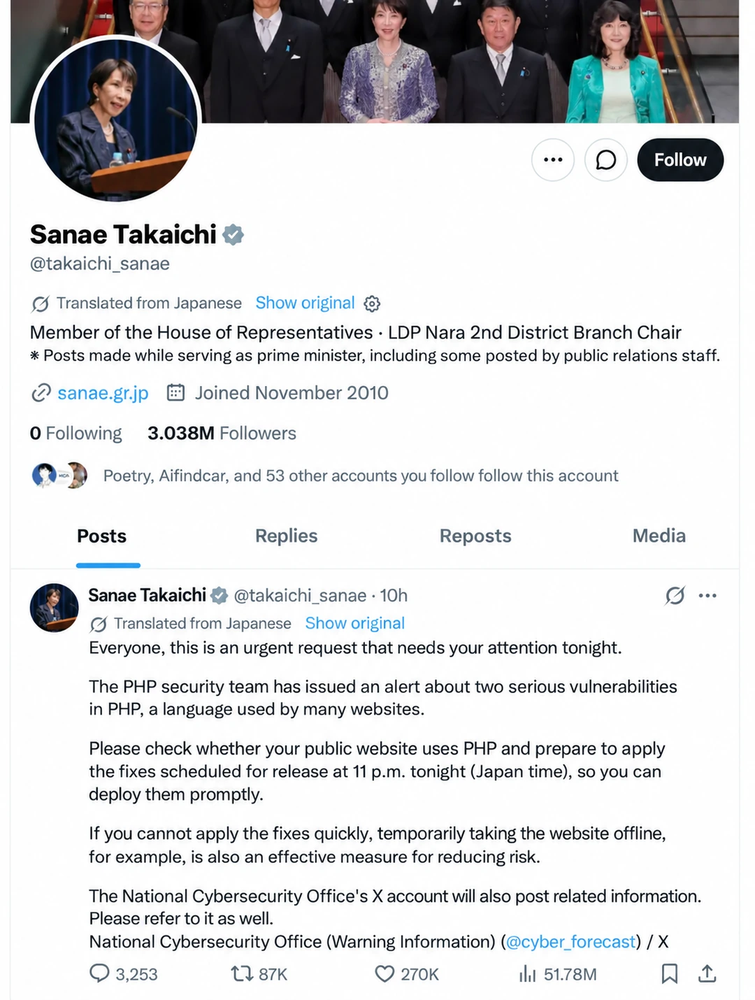

Yesterday I wrote [“When AI Tears Through Cloud Security”](/en/cloud/blackwall/), arguing that at the pace AI is finding vulnerabilities, every cloud server and managed database will eventually be shot full of holes.

That already looks too conservative. **In just the past two days, half the internet has been shot full of holes.**

## A Week of Breaches Across the Stack

The biggest shock was **PHP2Shell**[^1], the critical PHP remote code execution bug that dominated feeds last night (`CVE-2026-109618` / `CVE-2026-109619`, CVSS 9.2).

It requires no authentication and no prior privileges. A single crafted request lets an attacker dump server memory, execute arbitrary code, and take over the entire web server. Worse, with proof-of-concept exploits already circulating in the wild, the community realized to its dismay that the initial emergency patch might be incomplete.

How bad did it get? Japanese Prime Minister Sanae Takaichi posted a warning on X herself[^2] urging site operators to patch. As one commenter put it: “Never thought I'd live to see a head of state tell me to install a patch.” Many assumed it was a parody. It wasn't—her own official PHP site had just been compromised.

PHP2Shell was just one piece of a brutal week. Put the past few days' security advisories side by side, and the entire foundation of modern software is taking fire at once:

First, **core infrastructure was breached**. A few days ago, `CVE-2026-99999` (not a joke—that is the actual CVE ID) hit major virtualization vendors across the board. Next, Node.js shipped emergency security releases[^3] patching more than a dozen vulnerabilities, including remote code execution. Then GitLab disclosed its **third** CVSS 10.0 vulnerability in six weeks (`CVE-2026-110264`)[^4]—another unauthenticated RCE granting full server takeover. The blast radius spans **12 years**: every self-hosted GitLab instance since version 7.0, released in 2014, has to be upgraded. Every single one.

Second, **the emerging AI toolchain showed that it is held together with duct tape**. LiteLLM, a staple of LLM application development, suffered a supply-chain compromise in version `1.107.0` that bundled credential-stealing malware into the official release package. Meanwhile, OpenCode Console was breached[^5], leaking users' OpenAI, Anthropic, and Google API keys.

Then came **pure farce at the root of trust**. Eight intermediate CA certificate private keys from **eMudhra**, a major Indian certificate authority, were compromised[^6] (see the Cisco Talos analysis[^7]) after researchers found that a certificate private key was, literally, the single digit **`4`**. Cryptography didn't fail; the gatekeeper hung a paper padlock on the front gate.

From kernel virtualization and language runtimes to source code hosting, AI middleware, and certificate authorities, almost no layer of the stack made it through the week intact.

These aren't abstract advisories. The casualties are already piling up: **Zeabur** announced it is shutting down after repeated cyberattacks[^8]; [**TiDB Cloud** was breached by FulcrumSec, with 10.6 TB of data exfiltrated](https://mp.weixin.qq.com/s?__biz=MjM5MDE0Mjc4MA==&mid=2651295551&idx=1&sn=64b4e33bd21b374f8a213b5e11cdad6e&scene=21&poc_token=HKNN2WqjTX-s4VloE7UhlApBbnNgO-KqfUzn10VG#wechat_redirect)[^9]; and prominent Japanese cloud provider **IDCF Cloud** was hit by ransomware, knocking nearly 500 customer businesses offline[^10].

## A Reckoning—and a Catalyst—for Legacy Systems

Amid the wall of red alerts, I see an opening.

**Publicly traded US cybersecurity stocks have already started ticking up, and hiring for security engineers is due for a short-term rebound.** For the past two years, the entire industry has sprinted headlong after product growth and AI while trimming security budgets wherever possible. Now that live rounds are grazing people's heads, the deferred maintenance bill has come due.

**This crisis is going to force a massive wave of legacy system upgrades.**

Frankly, from an infrastructure standpoint, **I think that is a very good thing.**

Anyone who works on systems software knows how much of the world runs on the rule “if it isn't broken, don't touch it.” Even in 2026, plenty of production environments still sit on long-dead CentOS 7.9 or even 5.4, often running something like PostgreSQL 9.1 from more than a decade ago.

In normal times, warning stakeholders about technical debt or end-of-life (EOL) risks goes nowhere. Upgrades carry operational risk, win nobody a promotion, and leave you holding the bag if anything breaks. Entrenched legacy systems usually need an industry-wide shock like this to force organizations to hold their noses and modernize the underlying stack.

**The question is what happens two years after today's relics are finally forced to upgrade.**

**If you migrate onto an unmaintained component today, two years from now you'll be in the exact same position as the victims of last night's PHP exploit.**

Why is every critical PHP vulnerability such a bloodbath? Because the internet is full of neglected PHP sites and legacy systems frozen on ancient versions, with no maintainer and no viable upgrade path. When an RCE surfaces in the runtime underneath them, those systems have no way to apply a patch. They are sitting ducks.

## Unmaintained Software: Online and Defenseless

I see this firsthand because I maintain two pieces of core open-source infrastructure: **an [open-source PostgreSQL distribution](https://mp.weixin.qq.com/s?__biz=MzU5ODAyNTM5Ng==&mid=2247492498&idx=1&sn=ff2e6b477826c2fe899c62cdab7673f2&scene=21#wechat_redirect), Pigsty[^11], and [open-source object storage, Silo](https://mp.weixin.qq.com/s?__biz=MzU5ODAyNTM5Ng==&mid=2247492702&idx=1&sn=c45e85f69bb1f87aaebffc46dc49d90e&scene=21#wechat_redirect)**. The workload has picked up noticeably lately. Now that both defenders and attackers are using AI, bug reports and vulnerability disclosures keep coming, and every day involves heavy code review and patching.

Take the widely used open-source object store **MinIO**. Since [the vendor stopped shipping regular open-source community releases last October](https://mp.weixin.qq.com/s?__biz=MzU5ODAyNTM5Ng==&mid=2247490694&idx=1&sn=d79444d4b55d6d42133f88db84fa5e18&scene=21#wechat_redirect) and I started maintaining the community fork **Silo**, **I have patched more than 20 security vulnerabilities and dozens of bugs** in just six months.

Many teams don't take the end of upstream maintenance seriously enough. The assumption is simple: “The binary we already deployed isn't going to break on its own. Why not just stay on the last free release?”

As I wrote yesterday, if your system runs in an air-gapped or strictly isolated network environment, you can probably get away with that. If it is still connected to the internet, what used to pass no longer works.

**If you are still running upstream MinIO pinned to the October 2025 release—or anything older—and it is exposed to the public internet, you are running wide open.**

The mechanics are brutal. Every security fix in an open-source project leaves a public commit and a readable diff. With today's LLMs, attackers don't need to discover zero-days from scratch. They can simply pull the 20-plus vulnerability fixes I've committed, run AI-assisted patch diffing, generate working exploits in minutes, and scan the internet for unpatched MinIO instances still sitting on old releases.

In an era of automated internet-wide scanning, **unmaintained software doesn't stand still—it visibly decays into a publicly documented backdoor.**

That is why this fork, essentially a solo project, has reached **4,000 GitHub stars** and **4 million downloads** in six months. A maintenance distribution offers no flashy new features—only steady security patches and updates. But when half the internet is getting shot full of holes, **having someone still watching your infrastructure and shipping patches** is as fundamental a requirement as there is.

## Closing Thoughts

For more than a decade, the tech industry has worshiped building new wheels. People love grand concepts and disruptive features, while the thankless work of fixing bugs and shipping patches is treated like air—free, ambient, and taken for granted. It took a week like this, watching PHP, GitLab, and Linux virtualization take direct hits one after another, for a basic truth to sink in: **when AI-driven attacks come down like a downpour, surviving the night doesn't depend on flashy new features. It depends on whether there is still a human maintainer behind that dull update command, keeping your system patched.**

Even so, however fast maintainers ship fixes, this remains a reactive arms race. PHP2Shell and GitLab's CVSS 10.0 flaws aren't freak outliers; they are the first rumble of a new baseline. Don't assume that surviving this week means the storm has passed. Decades of accumulated legacy code are now being audited all at once by AI compute. Subtle logic flaws that once took a top security researcher months of manual review to tease out are now being uncovered on an assembly line.

Against automated discovery at this scale, any static defense that stops evolving is paper-thin. Either give your infrastructure the operational agility to upgrade smoothly and patch on short notice, or physically disconnect it from the public internet. For legacy systems that never get upgraded, time is running out.

## References

[^1]: [PHP2Shell](https://watchtowr.com/intelligence/php-cve-2026-109618-faq/)
[^2]: [Sanae Takaichi's original post on X](https://x.com/takaichi_sanae/status/2112890642590564386); see [ABMedia's report](https://abmedia.io/php-critical-rce-takaichi-warning) for context.
[^3]: [Node.js October 2026 Security Releases](https://nodejs.org/en/blog/vulnerability/october-2026-security-releases)
[^4]: [GitLab CVSS 10.0 Vulnerability (CVE-2026-110264)](https://thehackernews.com/2026/10/critical-gitlab-flaw-cvss-100-could.html)
[^5]: [OpenCode Console Breach May Have Exposed Users' API Keys](https://thehackernews.com/2026/10/opencode-console-breach-may-have.html)
[^6]: [eMudhra Intermediate Certificate Private Keys Compromised](https://emudhra.we-have-a-problem.com/)
[^7]: [Cisco Talos: Compromised Intermediate Certificates Analysis](https://blog.talosintelligence.com/compromised-intermediate-certificates/)
[^8]: [Zeabur Announces Shutdown](https://zeabur.com/zh-CN/blogs/zeabur-is-shutting-down)
[^9]: [TiDB Cloud Data Breach](https://www.techflowpost.com/article/34741)
[^10]: [IDCF Cloud Official Announcement](https://www.idcf.jp/news/topics/20261008001)
[^11]: [Pigsty](https://pigsty.io/)
