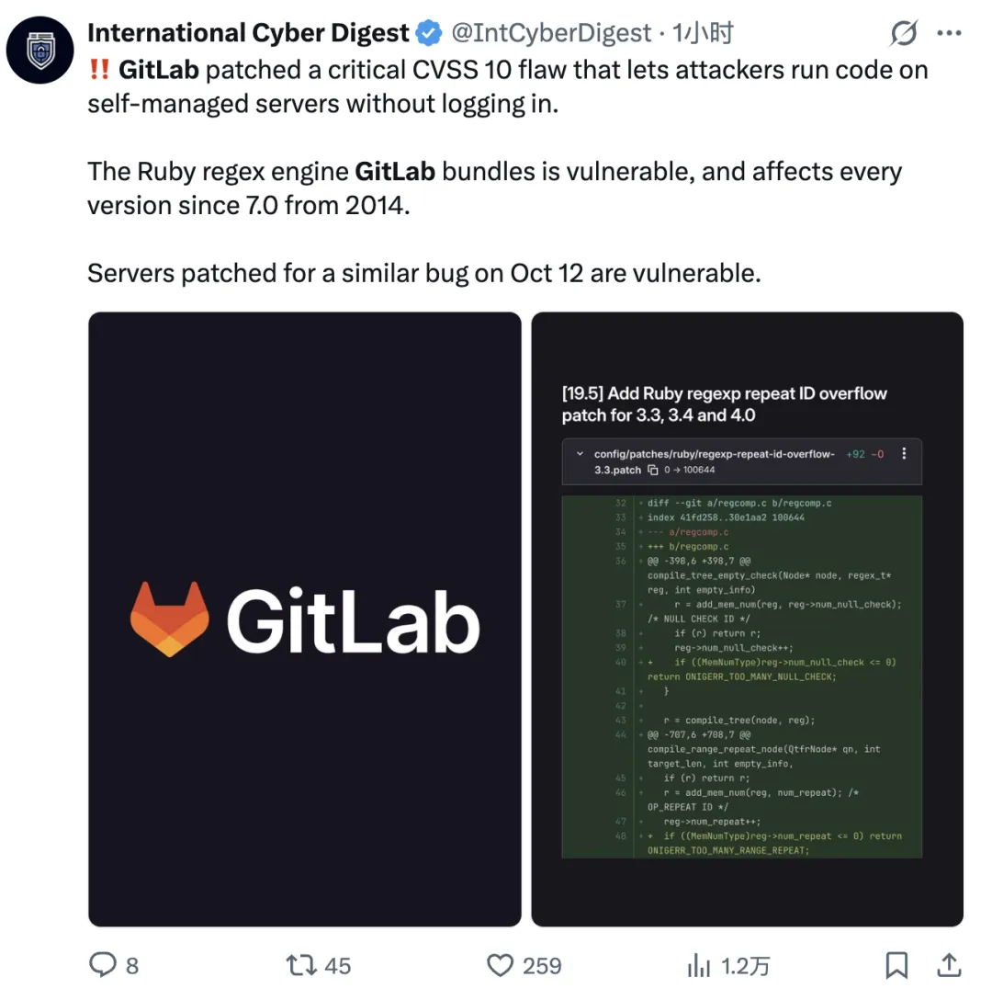
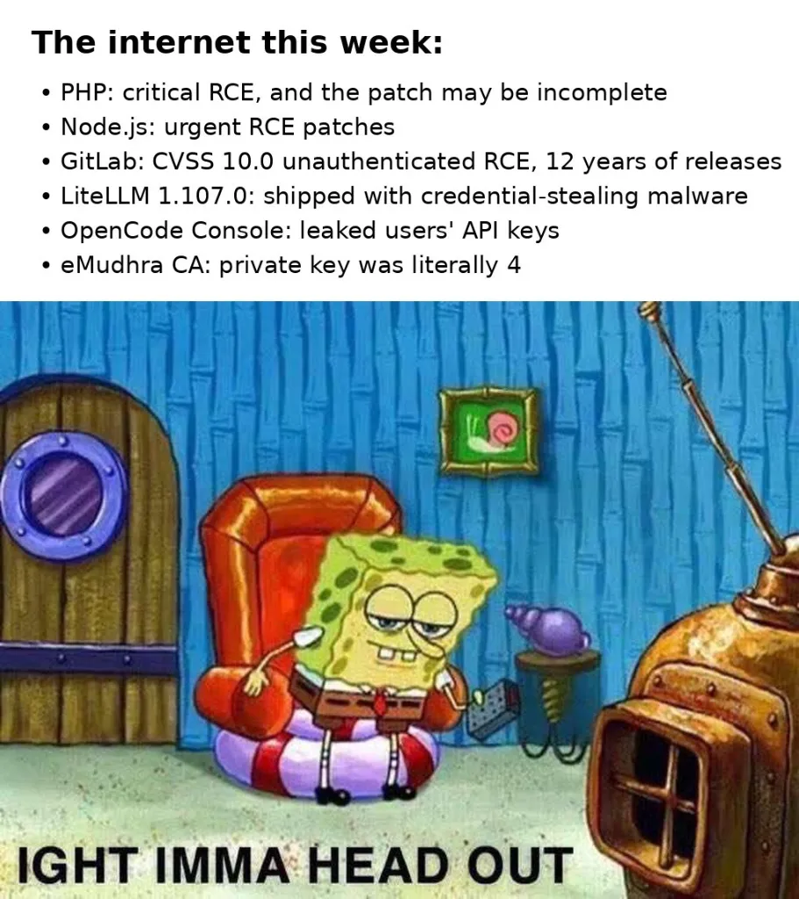
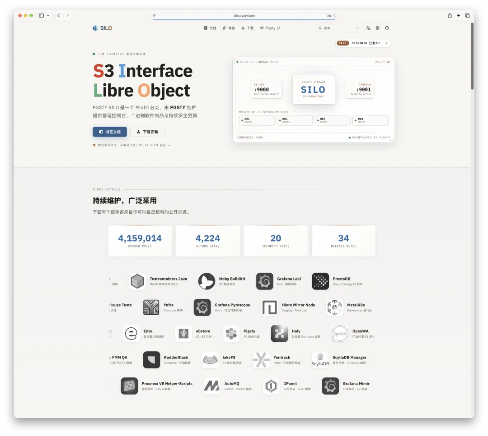
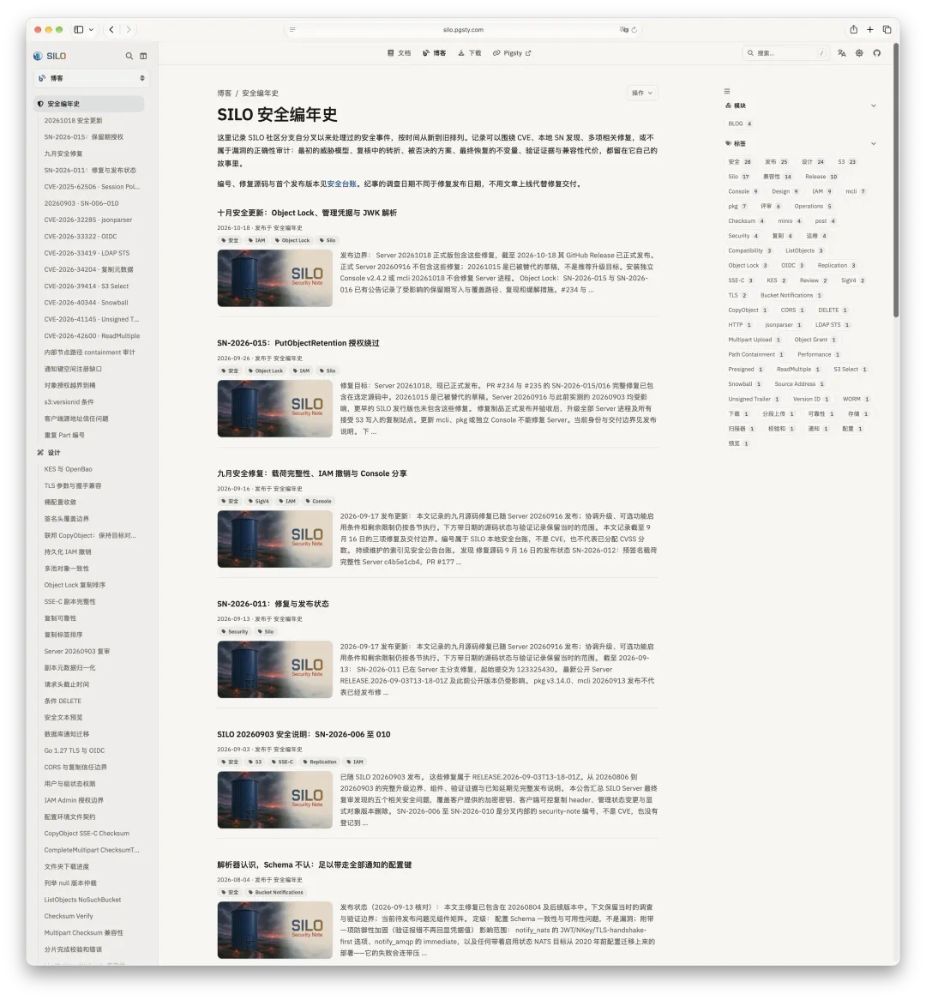

昨天老冯刚写了篇《[当云被打成筛子](/cloud/blackwall/)》，说到：照现在 AI 挖漏洞的节奏发展下去，所有的云服务器和云数据库，迟早都会被打成筛子。

今天看来还是太保守，**就在这两天，半个互联网已经被打成了筛子。**

## 全线失守的一周

最炸裂的莫过于昨晚刷屏的 PHP 远程代码执行漏洞 **PHP2Shell**[^1]（`CVE-2026-109618` / `CVE-2026-109619`，CVSS 9.2）。

不用登录，没有任何前置权限，攻击者只需要发一个构造好的请求，就能直接执行任意代码、暴露服务器内存，一把拿下整台网站服务器。更要命的是，在早期利用代码已经满天飞的时候，社区绝望地发现最初的紧急补丁甚至可能是不完整的。

严重到什么程度？连日本首相高市早苗都专门发了一条推文[^2]提醒防范这件事。有人评论：“有生之年会从国家元首那里被告知要打补丁。”算得上是互联网奇观了。很多人还以为是段子，其实是真的——她自己的 PHP 站都被人拿了。

但这只是这周连环爆破的一个缩影。如果你把过去几天的安全通报拼在一起，会发现整个现代软件工程的底座正在经历一场无差别洗礼：

首先是**核心基础设施的穿透**。前几天代号 `CVE-2026-99999`（不是段子，就是 99999）的漏洞直接波及了各家主流虚拟机厂商；紧接着 Node.js 紧急发布安全补丁[^3]，修复包括 RCE 在内的十余个漏洞；随后 GitLab 爆出六周内的**第三个** CVSS 10.0 满分漏洞（`CVE-2026-110264`）[^4]。同样是无需登录直接控制服务器，影响范围横跨过去 **12 年**——所有 2014 年（7.0 版本）以来的自建实例，有一个算一个，全得升级。

其次是**新兴 AI 工具链的草台化**。大模型开发高频使用的 LiteLLM 在 `1.107.0` 版本中被直接投毒，发布包里夹带了窃取凭证的恶意软件；另一边，OpenCode Console 遭遇入侵[^5]，直接把用户的 OpenAI、Anthropic 和 Google API Key 泄露了出去。

还有**信任底座的荒诞剧**。印度主流 CA 机构 **eMudhra** 的 8 个中级根证书私钥沦陷[^6]（思科 Talos 分析报告[^7]），被人发现其证书私钥字面意义上就是个位数 **`4`**。不是什么密码学大厦崩塌，而是守门人自己把纸糊的锁挂在了大门上。

从内核虚拟化、运行环境、代码托管、AI 中间件到根证书机构，这一周内几乎没有一块拼图是完好的。

这些攻击不是抽象的公告，而是已经出现了成片的受害者：因为接连遭遇网络攻击而宣布关停的 **Zeabur**[^8]，[被 FulcrumSec 捅穿、拖走 10.6 TB 数据的 **TiDB Cloud**](https://mp.weixin.qq.com/s?__biz=MjM5MDE0Mjc4MA==&mid=2651295551&idx=1&sn=64b4e33bd21b374f8a213b5e11cdad6e&scene=21&poc_token=HKNN2WqjTX-s4VloE7UhlApBbnNgO-KqfUzn10VG#wechat_redirect)[^9]，还有遭遇勒索攻击、导致近五百家企业停摆的日本知名云厂商 **IDCF Cloud**[^10]，等等等等……

## 祖传系统的丧钟与契机

看着满屏的红色警报，老冯看到了一个契机。

**二级市场上美股安全相关的板块已经开始涨了，短期内对安全工程师的需求会迎来一波反弹。** 过去两年全行业都在蒙头狂奔卷业务、卷 AI，安全预算能砍则砍；现在枪子儿贴着头皮飞过来了，该补的课一节都逃不掉。

**这波危机将强行推动大量历史遗留系统（Legacy Systems）的更新与升级。**

说实话，从基础设施演进的角度看，**我觉得这是一件大好事。**

做底层软件的朋友都很清楚，这个世界上跑着太多“只要不崩就绝对不动”的祖传系统了。都 2026 年了，外面依然有大把的生产环境跑在早就被扫进历史垃圾堆的 CentOS 7.9 甚至 5.4 上，里面跑着的，可能还有十几年前的 PostgreSQL 9.1。

平时你跟业务方讲技术债、讲 EOL（生命周期结束）风险，是没人当回事的。因为升级有风险、没绩效，出了锅还得自己背。这种盘根错节的陈年老系统，往往就需要这样一场全行业的“大地震”作为契机，倒逼着大家捏着鼻子把底座翻新一遍。

**但问题在于：今天这波老古董被逼着升上去了，那两年后呢？**

**如果挑错了没人维护的组件，两年后的结局，大概就像昨晚的 PHP 漏洞一样。**

PHP 为什么每次出大洞都格外惨烈？因为全世界有无数跑着老旧 PHP 版本的野生网站和历史系统，早就处于无人维护、无法平滑升级的停滞状态。一旦底层爆出 RCE，它们连打补丁的能力都没有，只能排着队等死。

## 停更软件的宿命：连网即裸奔

老冯对这件事体感极深，因为我自己手里就维护着两大块核心基础软件：**一个是[开源 PostgreSQL 数据库发行版](https://mp.weixin.qq.com/s?__biz=MzU5ODAyNTM5Ng==&mid=2247492498&idx=1&sn=ff2e6b477826c2fe899c62cdab7673f2&scene=21#wechat_redirect)（Pigsty[^11]），另一个是[开源对象存储（Silo）](https://mp.weixin.qq.com/s?__biz=MzU5ODAyNTM5Ng==&mid=2247492702&idx=1&sn=c45e85f69bb1f87aaebffc46dc49d90e&scene=21#wechat_redirect)**。最近活儿确实特别多。当攻防两端都用上 AI 之后，各种各样的 Bug Report 和安全漏洞层出不穷，每天都在高强度地审代码、打补丁。

就拿大家都很熟悉的开源对象存储 **MinIO** 来说。自从去年 10 月[原厂断供、停止常规的社区开源版本发布](https://mp.weixin.qq.com/s?__biz=MzU5ODAyNTM5Ng==&mid=2247490694&idx=1&sn=d79444d4b55d6d42133f88db84fa5e18&scene=21#wechat_redirect)、我接手拉起社区维护分支 **Silo** 以来，在短短半年时间里，**我已经修了 20 多个安全漏洞和几十个 Bug 缺陷。**

很多团队对“软件断更”缺乏基本的敬畏心，觉得“现有的二进制文件又不会自己坏掉，我停在最后一个免费版接着用不就行了？”

昨天老冯也说过，如果你跑在物理隔离的或者网络隔离的环境中，这并不是不可以。但如果你还连着网——以前或许可以混过去，但现在不行了。

**如果你今天还在用原版 MinIO，版本停留在 2025 年 10 月最后发布的那个节点或者更早，而且还连着公网——那基本上跟裸奔没有任何区别。**

道理非常残酷：开源项目的每一次安全修复，Commit 记录和代码变动都是全网公开的。在今天的大模型能力下，攻击者根本不需要去从头挖 0-day。他们只需要拉下我最近修补的这 20 多个漏洞记录，用 AI 跑一遍补丁比对（Patch Diffing），几分钟就能反向生成出全套的利用代码（Exploit），然后对着全网还没升级的旧实例挨个点名，直接把你的 MinIO 捅穿。

在自动化扫街的时代，**停止维护的软件不是“静止”的，而是会以肉眼可见的速度腐烂成公开的后门。**

这也是为什么老冯搞的这个几乎算是个人项目的分支，半年时间就能干到 **4,000 Star** 和 **400 万下载**。说到底，一个没有任何花哨新功能的维护版本，提供的仅仅是持续的安全补丁和更新。但在整个互联网都被打成筛子的今天，**“有人还在替你守着底座、持续发补丁”**，这个需求本身，就是最硬的刚需。

## 尾声

过去十几年，整个技术圈都在崇拜“造新轮子”，大家喜欢聊宏大的概念、聊颠覆性的新特性；至于修 Bug、打补丁这种脏活累活，往往被当成理所当然的免费空气。直到这一周，从 PHP、GitLab 到 Linux 虚拟化底座被挨个打穿，很多人才惊醒：**当 AI 驱动的攻击像暴雨一样砸下来时，决定你能不能活过今晚的，根本不是什么花哨的新功能，而是那个枯燥的更新命令背后，到底还有没有活人在替你兜底。**

但老实说，就算维护者修得再快，这依然只是一场被动的军备竞赛。PHP2Shell 和 GitLab 的满分漏洞绝不是什么偶然的异常峰值，它们只是新常态的第一声闷雷，千万别以为挨过这一周就天下太平了。过去积攒了十几年的人类祖传代码库，正在集体接受 AI 算力的无情审视。以前需要顶级安全研究员熬几个月才能抠出来的逻辑漏洞，现在正在被流水线式地批量批发。

在这种降维打击面前，任何停止演进的静态防御都是纸糊的。要么让你的基础设施拥有随时平滑升级、随时打补丁的机动能力，要么就彻底切断它与公网的物理连接。留给那些“万年不升”的祖传系统的时间，真的不多了。

## 参考资料

[^1]: [PHP2Shell](https://watchtowr.com/intelligence/php-cve-2026-109618-faq/)
[^2]: [日本首相高市早苗提醒防范 PHP 严重漏洞](https://abmedia.io/php-critical-rce-takaichi-warning)
[^3]: [Node.js 2026 年 10 月安全更新](https://nodejs.org/en/blog/vulnerability/october-2026-security-releases)
[^4]: [GitLab CVSS 10.0 满分漏洞（CVE-2026-110264）](https://thehackernews.com/2026/10/critical-gitlab-flaw-cvss-100-could.html)
[^5]: [OpenCode Console 遭遇入侵，用户 API Key 可能泄露](https://thehackernews.com/2026/10/opencode-console-breach-may-have.html)
[^6]: [eMudhra 中级证书私钥泄露](https://emudhra.we-have-a-problem.com/)
[^7]: [思科 Talos：中级证书失陷分析](https://blog.talosintelligence.com/compromised-intermediate-certificates/)
[^8]: [Zeabur 宣布关停](https://zeabur.com/zh-CN/blogs/zeabur-is-shutting-down)
[^9]: [TiDB Cloud 数据泄漏事件](https://www.techflowpost.com/article/34741)
[^10]: [IDCF Cloud 官方公告](https://www.idcf.jp/news/topics/20261008001)
[^11]: [Pigsty](https://pigsty.io/)
