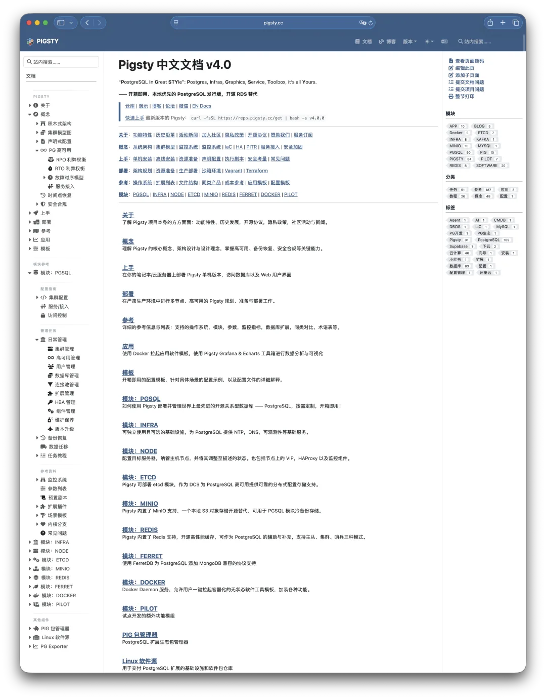

A few days ago, I sat down with several SaaS founders to talk about leaving the cloud. Everyone can do the math: managed cloud databases are expensive, and once you hit scale, they easily eat 20% to 30% of your margins. Yet when it comes to actually taking the leap into self-hosting, Li, a technical co-founder, put his finger on the real hesitation:

## "Feng, I'm Not Afraid of Hard Engineering—I'm Afraid of Being Held Hostage."

That hit the nail on the head. Paying a cloud provider feels like paying protection money, sure, but you are buying a standardized commodity. If something breaks or someone leaves, you can always find another engineer to take it over. What happens when you roll your own? You hire a database guru to build a bespoke setup that only he understands. The moment he demands a raise, threatens to quit, or just wakes up in a bad mood, he holds the company's data lifeline in his hands.

That kind of **organizational risk** keeps founders awake at night far more than any cloud bill.

## The Guild Master Guarding Legacy Scripts

What Li fears is the classic "guild master" DBA.

Like pre-industrial weavers, these DBAs treat the database as their **personal fiefdom**. Their technical chops may be solid, but behind a wall of undocumented shell scripts, arcane tuning parameters, and quirky custom configs, they mold the database into an impenetrable black box. Whenever product teams ask for a change, their knee-jerk reaction is pushback: "That's not safe," or "That'll hurt performance."

At that point, the DBA stops being a technical enabler and becomes a **bottleneck to innovation**. The "technical moat" he painstakingly built keeps hackers out, but it also locks the company out of its own infrastructure. Going down this path of artisanal, homegrown ops means handing the keys to the kingdom to a single individual—a gamble no non-technical founder wants to take.

**The catch is: if you refuse to take that gamble, you're stuck paying the cloud tax forever.**

## The Artisanal Weaver vs. the Spinning Jenny

To unpack this dilemma, I gave Li an analogy.

**Artisanal self-hosting** is like hiring a master hand-weaver—exquisite craftsmanship, but your entire output depends on one person's mood, and production halts the day he walks out. **Public cloud**, on the other hand, is like buying imported finished cloth—hassle-free, but you never own the loom, and the larger you grow, the faster your margins bleed out. One path locks you into a person; the other locks you into a bill. **Is there a third way?**

That is why **Pigsty** exists.

**Pigsty doesn't teach you how to train master weavers; it hands you a modern Spinning Jenny.**

At its core, Pigsty is an open-source, on-premises RDS alternative. The high availability, observability, and backup pipelines that once required a veteran DBA to hand-craft thousands of lines of custom scripts are now packaged into a **standardized industrial product**.

Bringing in Pigsty changes the rules of the game:

- **Demystification**: No secret recipes or tribal knowledge—just open, documented blueprints.
- **Lower barrier to entry**: You don't need a 10x wizard; a competent generalist engineer can run it after basic training.
- **Replaceability**: What if your DBA quits? Everything follows a standard architecture, so the next engineer can pick up the docs and take over seamlessly.

**Decoupling capability from individuals and codifying it into tooling is the only real cure for organizational risk.**

## The Independent Technical Inspector

Li relaxed for a moment, then frowned again: "The machine sounds great, but I'm not a database specialist myself. What if my own team still snows me? What if they claim the system needs a massive overhaul just to pad their budget, or cut corners where I can't see?"

"That's why you don't need a full-time wizard," I replied. "You need an **independent technical inspector**." An inspector's value lies in **unconflicted incentives**: they don't sell cloud resources, so they won't push you to over-provision hardware; and they aren't on your internal org chart, so they can tell you objectively whether a proposal actually solves a problem or just manufactures complexity for job security.

That is the role I play—not stepping in as an indispensable guru, but advising as an **independent technical consultant**.

With that in place, the ideal blueprint for self-hosting off the cloud looks like this:

1. **Foundation (Pigsty)**: Build your own "database factory" with open-source software, owning the means of production like buying the looms outright and driving infrastructure costs down to bare-metal levels.
2. **Operations (In-House Team)**: Arm your existing team with standardized tooling so regular engineers can run day-to-day operations without holding the company hostage.
3. **Insurance (External Advisor)**: Retain an independent expert as a night watchman—conducting periodic audits, providing a backstop during critical incidents, and keeping everyone honest.

## Cloud Exit as an Industrial Upgrade

Li picked up his teacup, looking as if a weight had finally been lifted. "So the reason I was afraid to self-host was that I equated it with 'hiring a guru and enshrining him.' What you're describing is building a modern database factory."

He paused, then asked the sharpest question of the afternoon:

"Still, Feng, you're one person too. What guarantees that *you* won't become the irreplaceable single point of failure in this setup?"

"Fair question. **The answer lies in open source and standardization.**"

Pigsty isn't about me delivering a personal service; it's about codifying that service into software, code, and documentation—**Service as Software**. The capability doesn't live in my head or on my laptop. It lives in a public, reproducible engineering system: configuration as code, workflows as runbooks, metrics as dashboards, drills as playbooks, changes with rollbacks, and audits with trails.

You bring me in to speed up decisions, avoid costly trial and error, and set up governance. But you don't depend on me—without me, the system still runs, your team can still rotate, and your stack can still evolve. More importantly, I am far from the only person who understands how it works. Open source means the stack is verifiable, replaceable, and portable: you can swap out your team, your consultant, or your vendor at any time, or train people from scratch internally. **Refusing to be held hostage by anyone is a core design goal of the system itself.**

Li smiled. "Got it. Cloud vendors sell convenience, guild masters sell artisanal craft, and your open-source model sells **standards, transparency, and replaceability**."

I nodded. "Leaving the cloud isn't a step backward, and it isn't a leap in the dark. It's an industrial upgrade: turning unpredictable craftsmanship into repeatable engineering, turning vendor dependency into an owned asset, and turning vague dread into a bounded management problem."

When you leave the cloud and self-host this way, you are really buying four things:

**Profit**—stopping the endless bleed of cloud bills;

**Pace**—freeing your roadmap from vendor lock-in and individual moods;

**Risk**—turning black-box anxiety into a quantifiable, testable, auditable ledger;

**Control**—putting the steering wheel back in your own hands.

**That is what real freedom looks like.**

---

Originally published on [WeChat Official Accounts](https://mp.weixin.qq.com/s/V6EKwqBfyZpqiv6qq1g0Rw)
