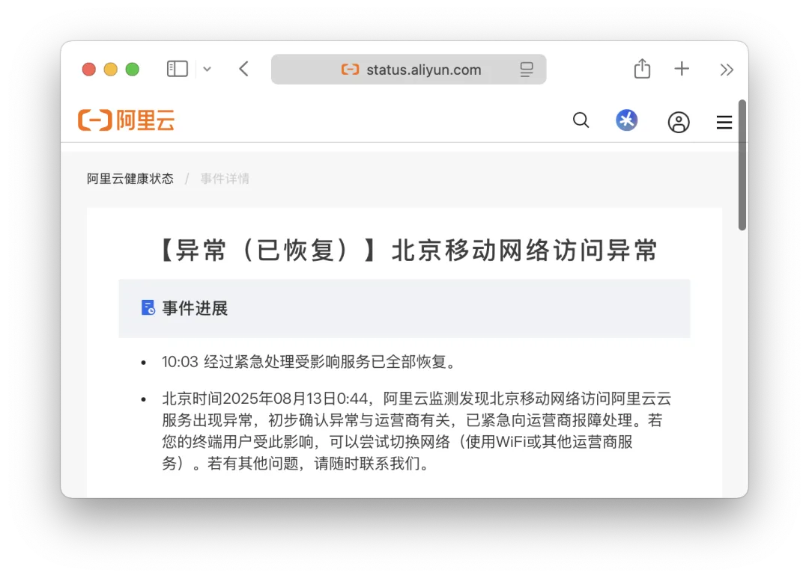
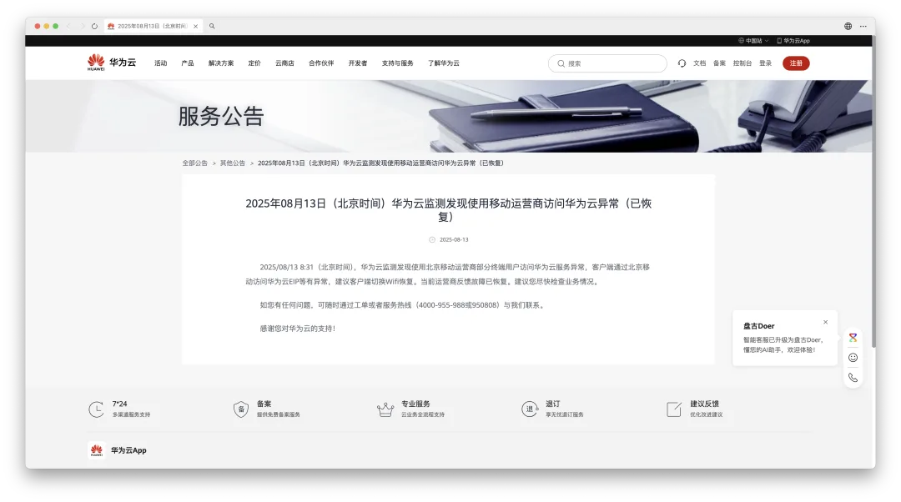
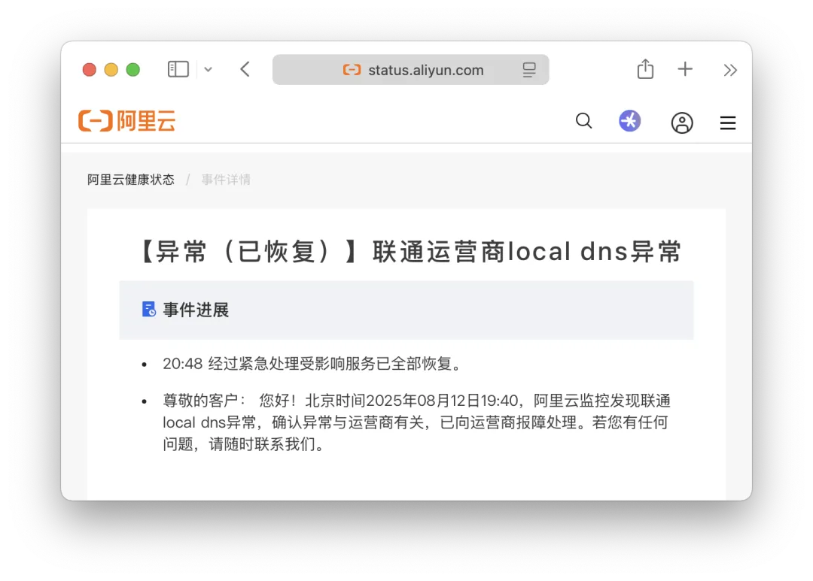
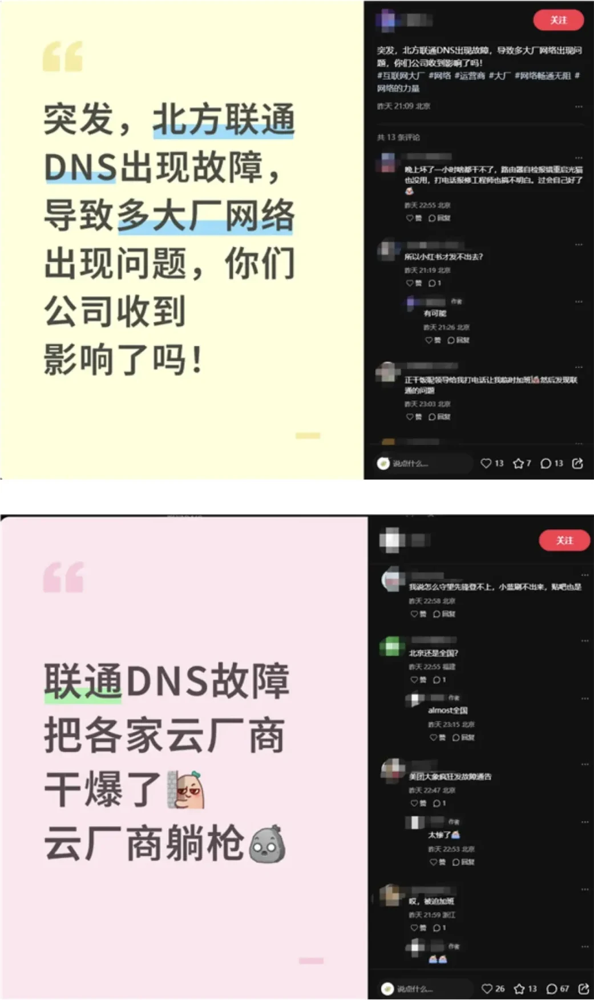

2025 年 08 月 13 日 0:44，阿里云监测发现北京移动网络访问阿里云云服务出现异常，初步确认异常与运营商有关，已紧急向运营商报障处理。

10:03 分通告：经过紧急处理受影响服务已全部恢复。

无独有偶，就在昨天，多地联通用户（以北京为主），也反馈联通网络出现崩溃，部分网站和 APP 无法访问。（网传联通 DNS 把许多网站的域名解析到 127.0.0.2 本地地址去了）。

> [!SOCIAL] 郑树新
>
> 今晚联通DNS出问题了，把很多大站的域名解析到127.0.0.2上了，这个居然没上热搜，估计有两个重要原因，一是各主要APP都基本使用HTTP DNS了，所以对于这次联通DNS故障对主要APP影响没那么大，还有一个可能就是，那些反正也上不了网也没法发声了，自然也无法上热搜了😂
{avatar="avatar-zhengshuxin.webp" date="2025-08-12 22:36" platform="weibo"}

> [!SOCIAL] CFC4N
>
> 看来，你真的是受到影响了。联通DNS被污染，一大堆域名被污染解析到127.0.0.2。😳😳😳//@seu_lzd:阿里云，百度一堆网站被劫持到127.0.0.2
>
> > [!SOCIAL] CFC4N `@CFC4N`
> >
> > 为什么没人提DNS故障这事？#联通# 🐶🐶 你那dns还正常吗？
> {avatar="avatar-cfc4n.webp"}
{avatar="avatar-cfc4n.webp" platform="weibo"}

这世上没有不崩的神话，联通崩完移动崩，这下压力给到电信了。

PS：友情提醒，阿里云[六月份两次大故障](/cloud/aliyun-cdn-sla/) SLA 赔付时效即将到期，再不申请赔付就没有机会了。

---

发布版本：[微信公众号](https://mp.weixin.qq.com/s/QpuQz4gLKwUwN63KwPZlkg)
