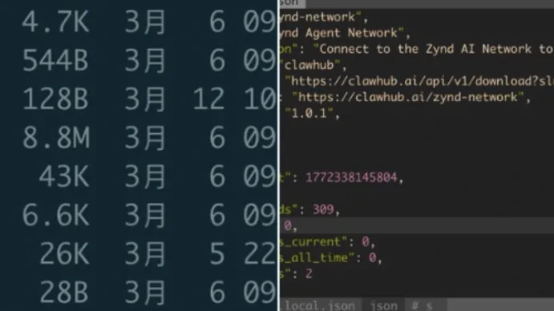
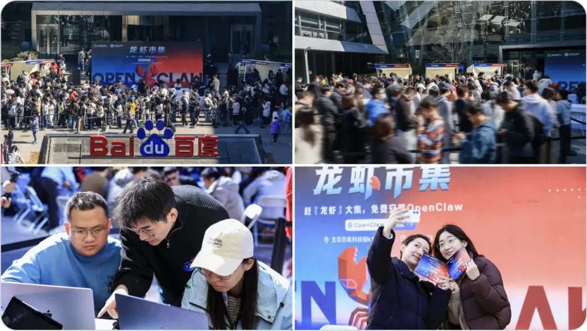

> Dedicated to the open-source projects that Tencent kindly "helps."

## 1. Good news: the goose strikes again

On March 11, 2026, Tencent Cloud quietly launched a platform called **SkillHub**. It copied more than **13,000 skills** from OpenClaw's official marketplace, ClawHub, onto Tencent's own servers, with a tiny note in the corner saying "Skill data sourced from ClawHub."

Impressive. If you cite the source, it's a "mirror." If you don't, it's "original work."

## 2. The lobster king gets angry

The story first broke on X when SnowShadow (@Alfredxia) publicly asked OpenClaw founder Peter Steinberger whether he knew Tencent had copied the entire ClawHub marketplace.

> [!SOCIAL] SnowShadow `@Alfredxia`
>
> @steipete Do you know that Tencent created a skillhub, which scraped all the skills from clawhub and imported them into its own platform?
>
> 
{avatar="avatar-alfredxia.webp" platform="x"}

> [!SOCIAL] Peter Steinberger 🦞 `@steipete`
>
> Kinda... I got an email once from folks complaining that my rate limits block them from scraping fast enough.
>
> They copy yet they don't support the project in any way. 😞
{avatar="avatar-steipete.webp" platform="x"}

Peter's response, paraphrased:

> "More or less. I even got emails from people complaining that my rate limits slowed down their scraping. They copy the project and support it in no way."

That line says everything. People were not only scraping his project. They were upset that his anti-abuse measures made the scraping less efficient.

Peter then tagged Tencent Hunyuan directly and asked, again paraphrased, whether they would consider helping instead of driving his infrastructure costs into five digits.

> [!SOCIAL] Peter Steinberger 🦞 `@steipete`
>
> @TencentHunyuan would you be up for helping out a bit, instead of driving my server costs into 5 digits?
{avatar="avatar-steipete.webp" platform="x"}

That number matters. A solo developer maintaining an open-source project suddenly gets hit with a five-figure hosting bill because a giant platform decides to mirror first and talk later.

## 3. Tencent responds with math

Tencent AI's response was textbook PR:

> "In the first week, we served 180 GB of traffic for users, while only pulling 1 GB from the official source through non-concurrent requests."

> [!SOCIAL] Tencent AI `@TencentAI_News`
>
> Hi Peter, we hear your concerns. SkillHub is a localized skills platform from Tencent built on the OpenClaw ecosystem, providing better availability & speed for users in China.
>
> We are transparent that we act as a local mirror and have always credited ClawHub as the source. In our first week, we handled 180GB of traffic (870k downloads) for users, **while only pulling 1GB** (from non-concurrent requests) from the official source.
>
> Many of our team members are active contributors (code & PRs), and we are eager to support the ecosystem and become a better sponsor.
{avatar="avatar-tencentai-news.webp" date="2026-03-12" platform="x"}

Translated into plain English: once Tencent moved 13,000 skills onto its own servers, Chinese traffic naturally stopped hitting ClawHub. Tencent then proudly declared that it had saved the upstream project bandwidth.

> Editor's note: a 200 GB Tencent CDN traffic package is priced at roughly RMB 68, with internal cost far below that.

That logic is like opening a clone store across the street from someone else's shop and then saying, "Look, your foot traffic is down. I reduced your operating pressure."

Andy Stewart (@manateelazycat) called out the absurdity on X: Tencent was criticized for pushing the upstream bill higher, yet its answer was not apology or sponsorship, but a calculator.

> [!SOCIAL] Andy Stewart `@manateelazycat`
>
> Tencent's move left me speechless... Scraping ClawHub's data wasn't enough—they even complained about OpenClaw founder Peter Steinberger's server rate limits??? 🤡
>
> Best of all, after Peter called them out, their reply in the comments never once mentioned sponsorship—just boasted that they only pulled 1 GB while serving 180 GB of traffic for users...
>
> Classic.
{avatar="img/social/manateelazycat.webp" date="2026-03-12" platform="x"}

> [!SOCIAL] Doiiars Fortune `@Daiiors`
>
> Reading the context, he didn't say Tencent was behind all of those incidents.
{avatar="avatar-daiiors.webp" platform="x"}

> [!SOCIAL] Andy Stewart `@manateelazycat`
>
> Look at the second screenshot—isn't it obvious who he's pointing at?
{avatar="img/social/manateelazycat.webp" platform="x"}

> [!SOCIAL] 路人M `@M4123R0`
>
> I don't really agree with this pile-on. By that logic, plenty of domestic mirror sites have the exact same issue...
{avatar="avatar-m4123r0.webp" platform="x"}

> [!SOCIAL] Andy Stewart `@manateelazycat`
>
> 🤣 Empty pleasantries don't beat writing a real check—or even having Tencent Cloud pick up part of the upstream traffic.
{avatar="img/social/manateelazycat.webp" platform="x"}

> [!SOCIAL] Benjamin Gao `@BenjaminGao2025`
>
> 😂 Classic Tencent—buying more shares!
{avatar="avatar-benjamingao2025.webp" platform="x"}

Peter later clarified that he was not against mirrors in principle. He objected to Tencent doing it without communication, without an official arrangement, and without even the minimal courtesy of asking first.

## 4. Thirteen warlords circle the lobster

Tencent is not the only company that smelled opportunity in OpenClaw. People quickly compiled lists of Chinese internet giants building their own Claw variants, gateways, managed editions, and mobile wrappers.

The underlying logic is obvious:

> "It can sell model tokens and serve as a new user-input entry point. If you don't occupy that territory, someone else will."

To big platforms, the OpenClaw ecosystem is not just a tool. It is a **traffic entrance** and a user-acquisition channel. Tencent's move simply looked worse because it cloned the marketplace itself instead of merely building a client or deployment solution around it.

## 5. Closing thought

The core issue is simple: **a trillion-dollar company copied data maintained by an independent open-source developer, then argued it was helping.**

Open source does not mean "take whatever you want with zero human decency." You can mirror. You can build on top. But saying hello first, or offering sponsorship if you clearly benefit, is basic manners even when it is not a legal requirement.

Tencent says it wants to become a better ecosystem sponsor. Great. A practical first step would be paying Peter's server bill.

> [!SOCIAL] Baidu Inc. `@Baidu_Inc`
>
> Our engineers were spotted outside today, setting up an OpenClaw "Lobster Market." 👀
>
> Nearly 1,000 visitors stopped by to get @openclaw installed, learn a few tips from the team, and check out our newly launched DuClaw.
>
> And if you missed it — last month we made it possible to access OpenClaw directly within Baidu App, bringing open-source agent capabilities to around 700M MAUs. Baidu AI Cloud is also among the first cloud platforms in China to support OpenClaw deployment.
>
> 
{avatar="avatar-baidu-inc.webp" date="2026-03-11" platform="x"}

> [!SOCIAL] Peter Steinberger 🦞 `@steipete`
>
> Amazing. We're open for maintainers or sponsorships :)
{avatar="avatar-steipete.webp" platform="x"}

All factual claims here are based on public reporting and public statements by the parties involved. Quoted remarks are paraphrased.
