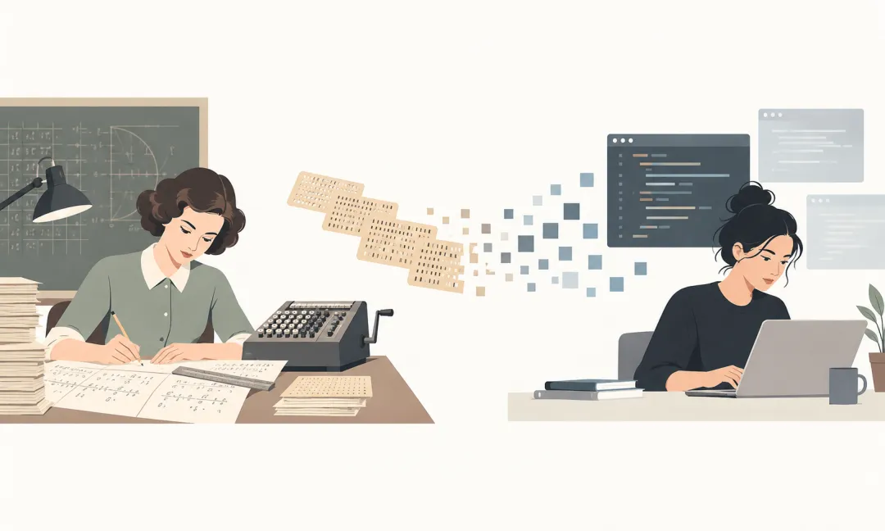
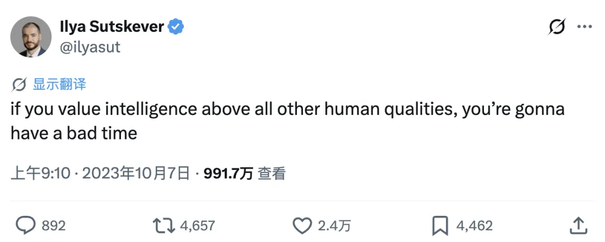
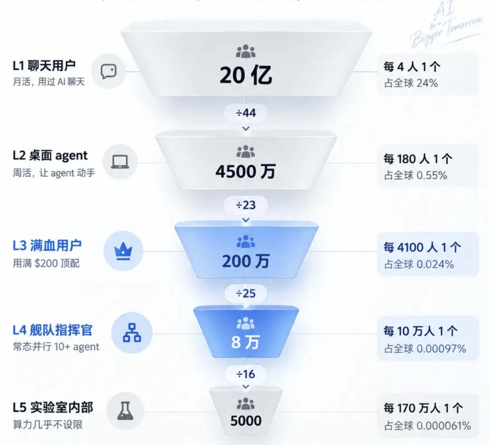

今天是 10.24。在中国，这天通常被当成程序员的节日——毕竟对程序员来说，1024 = 2¹⁰，是二进制世界里一个整齐又吉利的整数。借着这个日子，老冯想聊一聊自己对“程序员”这个职业的一些看法。

老冯有一种强烈的直觉：**这可能是我们过的最后一个程序员节了。**

当然，明年的 10 月 24 日照样会来，我说的 “最后”，是指“程序员”作为一个独立工种的终结 —— 也许用不了多久，它就会像当年的“Computer”一样，变成历史书里的一个注脚。

## 一、从“人肉计算机”到历史注脚

为什么这么说？今天我们提到 Computer，指的都是桌上的电子计算机；但在几十年前，Computer 指的是一份实打实的人类职业——**计算员**。

那时候的 Computer，是用纸、笔和计算尺去手算指数、对数、开根号和微积分的人。电影《隐藏人物》（**Hidden Figures**）讲的就是这样一群人：上世纪 60 年代初的太空竞赛中，NASA 兰利研究中心的几位非裔女性计算员，用手算为美国第一次载人绕地飞行核验轨道。在那个年代，计算员是一份体面、门槛不低的白领工作。

但后来的结局大家都知道了。电子计算机的普及，让“计算”从一门人类技艺变成了机械化的底层操作。今天除了在小学课堂上出于教学目的练练手，已经没有人会靠“手算开根号”来谋生了。

不过电影里最耐人寻味的，其实是主角：多萝西·沃恩。她看到 IBM 的电子计算机要进场，没有坐等被淘汰，而是自学了 FORTRAN，还把它教给手下的计算员，带着整个组一起转了型。**计算员这个工种消失了，但最早拥抱新机器的那批计算员，成了第一代程序员。**

**今天的程序员，就站在当年“计算员”的位置上。**

前阵子老冯在聊《[DeepSeek 面试博杰](/ai/deepseek-interview/)》的时候就吐槽过：在这个时代，你去招 AI Native 的新一代工程师，如果还按老黄历考人家怎么手搓 OJ 算法题，就跟当年招程序员时非要考人家笔算加减乘除、手开根号一样离谱。

程序员作为一个独立职业工种的时代，正在迎来终结。它谢幕的方式，与当年 Digital Computer 取代 Human Computer 如出一辙。

## 二、祭司阶级的黄昏与超级个体的黎明

我非常理解这种剧变给很多同行带来的心理冲击。就在两三年前，程序员还被社会奉为某种程度上的“祭司阶级”——掌握着凡人看不懂的神秘咒语，敲敲键盘，就能从赛博空间里摘取强大的力量，拿着令人艳羡的高薪。

然而短短一两年间，这种神圣的垄断就被打破了。一场技术界的“宗教改革”轰然降临：越来越多不会写代码的人，捧着 Claude Code 和 Codex 这本“白话圣经”，跳过祭司、直接与“神”对话，自己动手构建软件。

这对传统程序员的自尊心和饭碗，无疑是一记闷棍。如果你依然沉溺于过去靠“做题家思维”和“手写代码技巧”建立起来的优越感，不妨听听 AI 先驱 Ilya Sutskever 这句刺耳但清醒的话：

> “如果你把智力看得比所有其他人类品质都重要，你会过得很惨。”
>
> —— Ilya Sutskever

**然而硬币的另一面是：如果你愿意放下身段、拥抱这股力量，你迎来的不是末日，而是一个算力杠杆前所未有的黄金时代。**

你可以用廉价的算力作支点，去撬动过去一个人无法想象的工程规模：原本需要拉起十几号人的团队、烧掉几十上百万启动资金才能做出来的项目，现在可能只需要几个每月 200 美元的顶尖模型订阅，就能单枪匹马落地。

与此同时，软件的造价降下来，需求往往不降反升—— 杰文斯悖论。各行各业即将到来的自动化重构，会释放出远超以往的软件需求。旧的护城河被填平了，但新大陆的疆域大得惊人。

## 三、程序员会消失，但工程师永存

如果“程序员”变成了历史注脚，什么角色会取而代之？答案其实就在另一个更古老、更本质的称呼里：**程序员（Programmer）会消失，但工程师（Engineer）不会。**

在真正的软件工程里，花在“敲代码”上的时间本来就没那么多。软件工程圣经《人月神话》里早就给出过一个经典的工时划分：1/3 的时间用于设计；1/6 的时间用于编码；1/2 的时间用于测试。

老冯认为这个比例至今依然贴切。除了少数小众的底层领域，中间那 **1/6 的“编码”** 已经不再是瓶颈。就像计算器普及之后，没人再比拼手算的速度——大家比的是知道该算什么，以及算出来的数对不对。

于是，真正的核心矛盾就转移到了两头——**设计**与**测试**。老实说，哪怕在这两个环节，现在的 AI Agent 也已经干得相当漂亮了，但人类依然必须在首尾两端守住两个不可替代的角色：

1. **设计端：提供“愿力”与“品味”。** 至少在今天，AI 不会自己生出 Purpose（目的）。它没有欲望，没有痛感，也不知道自己为什么要存在。它需要人类去赋予目标与意义，需要人类提供创意、喂给它 Token、替它买单，用人类的**愿力**去驱使它运转。而要提出一个真正有价值的创意，决定“做什么、不做什么”，考验的是你的**品味（Taste）**。

2. **测试与交付端：提供“分发”与“担责”** —— 纯 Agent 生成的软件是没有信用背书的。软件要真正进入生产环境、完成商业交付，最终必须由某个具体的人或组织，拿自己的真金白银与商业信誉（Credit）出来**担责（Accountability）**。

至于一头一尾中间的那些脏活累活，已经可以交给 Agent 去干，而且又快又便宜。

更进一步看，当软件工程本身的造价大幅下降，**工程之外的环节**权重就会随之上升——比如分发、营销，以及最底层的**信任构建**。

在 AI 时代，任何人都能在周末轻松搓出一堆花里胡哨的项目，但绝大多数作品的宿命，就是静静地腐烂在 GitHub 的角落里无人问津。如何让你的作品真正被其他人类或 Agent 用起来，跑通正向反馈的飞轮，进而打造成一台持续运转、自我造血的软件机器，这才是新时代工程师面临的真正考题。

最近有个半开玩笑的说法：这年头每家创业公司都需要一个 **CIO** —— 不是 Chief Information Officer（首席信息官），而是 **Chief Influencer Officer（首席影响者 / 网红）**。只有建立起真实的影响力与信任连接，你才能真正按下这台软件机器的启动按钮。

## 四、直面大浪：现在入局，还不算晚

抵制 AI、拒绝 AI，是不是一个可行的选项？老实说，此路不通。无论中国还是美国，目前都已经把底牌亮得很清楚：在押注前沿生产力（AI 与机器人）这条赛道上一路绿灯、全速推进。至于转型期带来的结构性失业，在宏大叙事里往往只会被一笔带过，称作不可避免的阵痛——就像工业革命时期的纺织工、汽车普及时的马车夫，以及电子计算机普及后的手算计算员。

如果你的核心技能恰好落在这次 AI 替代的射程之内，这确实很残酷，而且这不是你的错。焦虑和愤怒都可以理解，但它们解决不了问题，抱残守缺也改善不了处境。

大浪打过来的时候，最危险的是站在浅滩上——那里浪最高、碎得最狠。要么你退到足够深的水里，深耕那些 AI 一时啃不动的底层领域；要么你学会冲浪，干脆骑到浪头上去。**浪头上未必安全，但那是视野最好的位置——只有站在那里，你才看得清前方的航向与风险。**

更重要的是，老冯认为**现在入局，完全来得及。**

不要被科技圈的信息茧房蒙蔽：今天 AI 在真实生产中的渗透率，远没有你想象的那么高。老冯粗略估计，全球大概有百万量级的资深 AI 程序员，以及十万量级的“Agent 军团指挥官”；但把这个数字放到全球三五千万开发者、乃至 80 亿人口的基数里，依然只占很小的一部分。

[AI 深透率，可能没那么高](/ai/funnel/)

在这个新战场上，所有人都是从零起跑的。哪怕是全世界最资深的 Claude Code 骨灰级玩家，满打满算也不到两年的经验；这不到两年积攒下来的体感，已经让他们和传统程序员拉开了数量级产能代差。但只要你现在愿意躬身入局，这个身位完全追得上。

更何况，能够亲眼见证、亲手参与一项人类史级别的技术从 0 到 1 的演进，伴随它一起成长，摸索它每一代模型跃迁的脉络——这本身就是可遇不可求的时代体验。

## 五、从“大头兵”到“千夫长”：做 Agent 军团的指挥官

那么，具体该怎么入局？答案很简单：**把算力拉满，在实战中练出你的“统帅感”。**

如果你只是每个月花 20 美元买个聊天机器人解闷，它顶多算个不错的电子顾问；但如果你能把主流 AI 的 200 美元顶配订阅真正榨干、用满，你能干成的事情，很可能会超出你过去的想象。

老冯知道，几个顶配订阅加起来，对很多人来说不是一笔小钱。不必一上来就全买：先挑一个最顺手的顶配，把它用到额度见底，再决定要不要加。拿它跟招一个人的成本比一比，这笔账其实不难算。

在这个过程中，最核心的修炼，是去摸清不同 AI 的“脾气秉性”。

不要把 Codex、Claude、Gemini、Grok、GLM、DeepSeek 仅仅当成冷冰冰的工具，你要把它们当成性格迥异、各有所长的“数字同事”。它们有各自擅长的领域，也有各自的思维怪癖、偷懒习惯和能力盲区。老冯自己每天在十几个顶配订阅之间派活，对这一点体会很深。如何与这群新同事朝夕相处，摸透它们的脾气，做到**知人善任**，是未来每一位工程师的必修课。

这种驾驭 AI 的手感，看十篇教程、听百场讲座都学不会。唯一的办法就是自己挽起袖子下场，在高强度的真实工程里去碰撞、去踩坑。只有这样，你才能真正做到如臂使指：清楚什么活该派给什么 Agent，学会如何拆解目标、如何授权放权、如何划定边界、如何审查验收。

归根结底，每个程序员都需要在这个时代完成一次身份跃迁——**从一个埋头写代码的大头兵，变成一名运筹帷幄的指挥官。**

从前的技术管理，管 8 个人叫小头目，管几十个叫中层，管一两百号人叫大头目；而在即将到来的时代，硬核工程师十夫长起步，往上是百夫长、千夫长——你不再靠手敲代码的行数来证明自己，你能有效调动和驾驭的 Agent 军团规模，就是你新的职级与疆域。

回头看去，当年电子计算机的普及，确实消灭了手握纸笔的“计算员”，却也催生了人类历史上最波澜壮阔的软件工程时代——而第一批写程序的人里，就有多萝西·沃恩那样最早转身拥抱新机器的计算员。

今天 AI Agent 的崛起，正在终结手敲代码的“程序员”，也在开启一个“一个人就是一支队伍”的新纪元。当年的计算员成了第一代程序员；今天的程序员，也可以成为第一代舰队指挥官。

祝各位——也许是最后一个——1024 程序员节快乐。明天醒来，欢迎来到属于工程师与指挥官的新世界。
