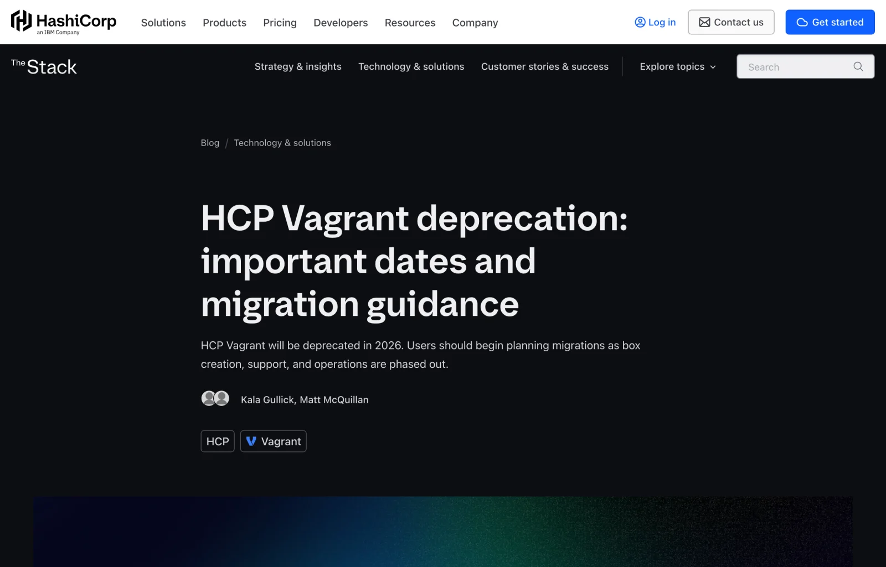
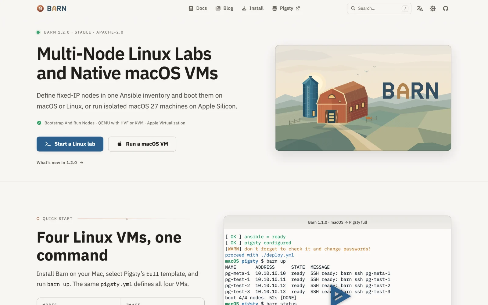
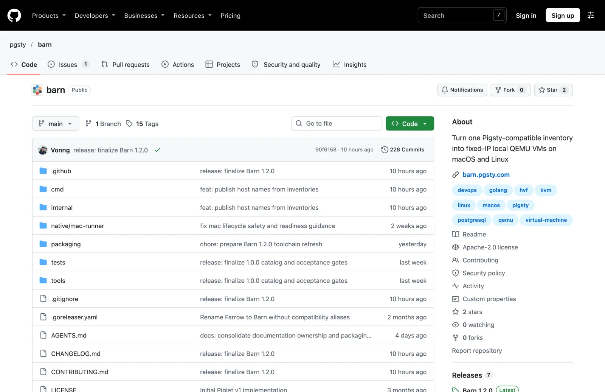
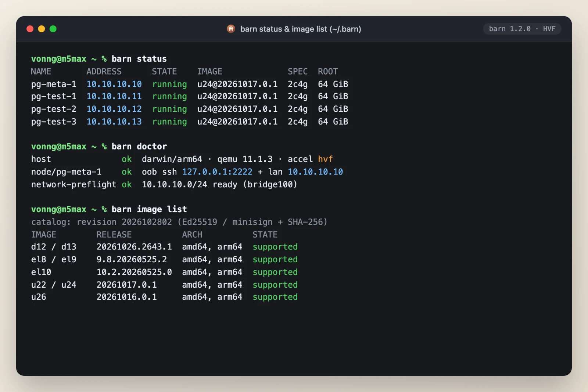
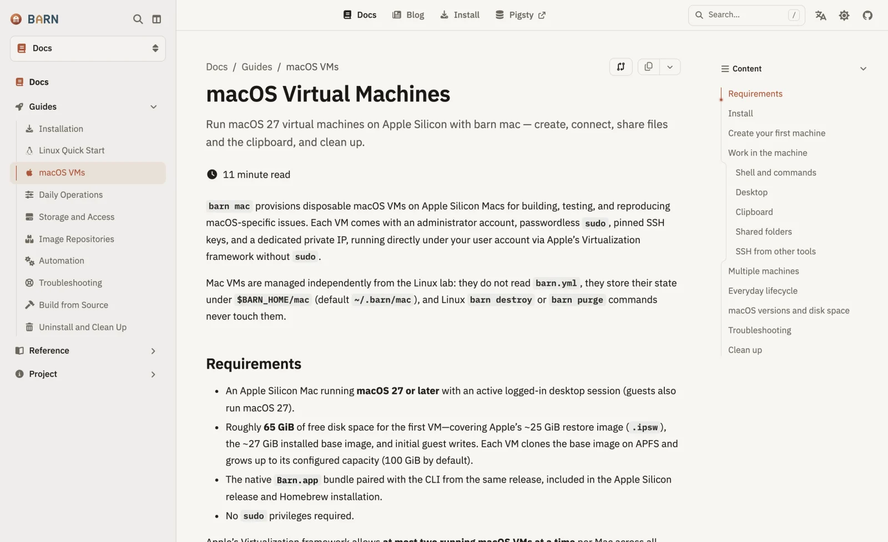
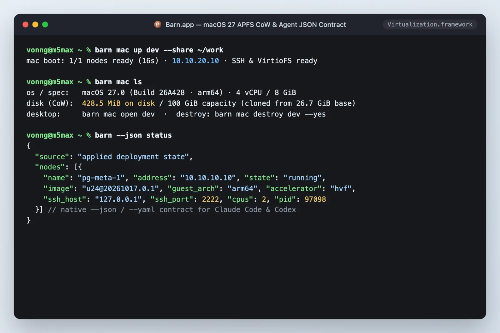

Last week, on November 2, 2026, an old friend in the infrastructure world reached the end of the road: **HashiCorp officially ended maintenance for [HCP Vagrant and the Vagrant Public Registry](https://www.hashicorp.com/en/blog/hcp-vagrant-deprecation-important-dates-and-migration-guidance)**, announcing that its servers will shut down for good on December 31.

[](https://www.hashicorp.com/en/blog/hcp-vagrant-deprecation-important-dates-and-migration-guidance)

The news hit close to home. For years, Vagrant was the best local VM manager around: write one declarative config file and spin up a multi-machine lab on macOS, Linux, or Windows with a single command. For local development and testing, nothing else came close. I used it on and off for seven or eight years—in fact, before [Pigsty](https://pigsty.cc/) ever had a public release, it was incubated and refined inside Vagrant VMs.

In its prime, the HashiCorp stack was hard to beat: Vagrant for local VMs, Terraform for cloud provisioning, Consul for service discovery, Nomad for scheduling, and Vault for secrets management. An entire generation of engineers built their workflows around that toolkit.

It didn't last. After HashiCorp abruptly relicensed its products under BSL 1.1 in 2023 and later sold itself to IBM, the writing was on the wall for Vagrant. Its core [`vagrant-libvirt`](https://github.com/vagrant-libvirt/vagrant-libvirt) plugin stalled out, forcing well-known projects like [`netlab`](https://blog.ipspace.net/2026/09/sunsetting-vagrant-libvirt/) to drop support this fall. The Vagrant CLI froze at [`2.4.9`](https://github.com/hashicorp/vagrant/releases/tag/v2.4.9), going **over 14 months without a single release**; over the past three months a lone contributor has barely kept the repository on life support, leaving even bugs that broke `vagrant up` on newer macOS versions unshipped. Now HashiCorp is pulling the plug on the public registry hosting all those `generic/*` and `bento/*` boxes. The era that defined "local dev environments as code" is officially over.

As heavy users of local VMs, the Pigsty community and I felt the impact directly.

Anyone who reads my writing knows I am an unapologetic bare-metal and VM fundamentalist when it comes to databases. Docker is great for stateless microservices. But if you are building and testing a production-grade database distribution—multi-node `systemd` service orchestration, Patroni HA failover, floating VIPs, Linux kernel parameter tuning, APT/YUM repository syncing, and dedicated `ext4`/`XFS` data-disk mounts—containers simply don't cut it. You need real Linux VMs running full kernels.

Over the past few years, though, spinning up test clusters for new users or for myself meant fighting Vagrant every step of the way: Ruby dependency headaches that refused to die, VirtualBox choking on Apple Silicon, `libvirt` setup friction scaring off newcomers, and now the official box registry closing shop.

If you can't rely on anyone else, you build a new one yourself.

After HashiCorp changed its license, Terraform forked into [OpenTofu](https://opentofu.org/) and Vault forked into [OpenBao](https://openbao.org/), yet nobody ever picked up Vagrant. I briefly considered forking Vagrant as-is, and I even had the name picked out: **OpenWonton**, rounding out a full dim sum breakfast spread alongside tofu and steamed *bao* buns. Then I opened the codebase and looked at more than a decade of accumulated Ruby baggage. Rather than patching up a crumbling old house, it made far more sense to write a clean replacement from scratch in Go tailored to what we actually need. After all, having already taken on a codebase the size of MinIO and turned it into [Silo](/en/db/minio-silo-1year/), a local VM manager didn't seem out of reach. To borrow DHH's line: **["We can fix everything!"](/en/cloud/cloud-exit-2026/)**

## Welcome to Barn

That effort became **[Barn](https://github.com/pgsty/barn)** (**B**ootstrap **A**nd **R**un **N**odes), an open-source local virtualization manager written in Go under the Apache-2.0 license. Its website and full English and Chinese documentation are now live at **[barn.pgsty.com](https://barn.pgsty.com/)**.

[](https://barn.pgsty.com/)

Readers familiar with the Pigsty ecosystem will spot the farmyard naming theme right away: **[Pigsty](https://pigsty.cc/)** is the pen where the databases live, **[Silo](https://silo.pgsty.com/)** stores the grain (object storage), **[PIG](/en/pg/pig/)** is the piglet package manager, **[Oink](/en/ai/oink-intro/)** is the voice (our docs framework), and **Barn** is **where you keep the livestock**. In cloud-native parlance, disposable instances that can be torn down and rebuilt at will are "cattle, not pets." Barn takes that literally: a sturdy, low-overhead barn for raising whole herds of Linux and native macOS VMs deterministically on your MacBook or Linux workstation.

Barn does one thing cleanly: **take a standard Ansible-compatible YAML inventory and boot a multi-node Linux cluster with fixed private IPs locally (backed by QEMU with HVF/KVM hardware acceleration), or clone isolated native macOS VMs in seconds on an Apple Silicon Mac (backed by `Virtualization.framework`).**

[](https://github.com/pgsty/barn)

No bloated VirtualBox install, no fragile Ruby plugin chain. Three commands tell the story:

```bash
# 1. Install Barn (includes the signed and notarized native Barn.app on macOS)
brew install pgsty/infra/barn

# 2. Boot the default Linux node (or a multi-node cluster from ./barn.yml) and SSH in
barn up && barn ssh

# 3. Clone an isolated macOS VM in seconds on Apple Silicon with a shared workspace
barn mac up dev --share ~/work
```

## What Barn Rethinks About Vagrant

Barn is not a straight port of Vagrant to Go. I laid out every pitfall I hit over a decade of using Vagrant and made five very different engineering choices:

### 1. One YAML File, Zero Split-Brain Configuration

Running Pigsty sandboxes on Vagrant always came with an annoying chore: first you wrote a `Vagrantfile` in Ruby defining how many machines to boot, their CPU and memory specs, and their IP addresses; then you maintained a separate Ansible `pigsty.yml` inventory repeating the exact same IPs and hostnames. Change a single node, and you had to reconcile both files by hand.

In Barn, **there is no separate VM DSL**. [`barn.yml`](https://barn.pgsty.com/docs/reference/configuration/) is itself a valid **standard Ansible YAML inventory**:

```yaml
all:
  vars:
    admin_ip: 10.10.10.10
    vm_image: d13          # Supports aliases like u22/u24/u26, d12/d13, el8/el9
    vm_cpu: 4
    vm_mem: 8GiB
    vm_disk: 64
  children:
    pg_meta:
      hosts:
        10.10.10.10: { nodename: meta }
    pg_test:
      hosts:
        10.10.10.11:
          nodename: node-1
          vm_disks:
            - { path: /data, size: 128, fs: auto, persistent: true }
        10.10.10.12:
          nodename: node-2
```

Barn reads only the `vm_*` fields it cares about to create the machines (all of which have defaults and can be omitted), while Ansible and Pigsty run playbooks directly against **that exact same file** (`ansible-playbook -i barn.yml`). Infrastructure provisioning and configuration management share a single source of truth instead of fighting each other. In the newly released `1.1.0`, you don't even have to edit the file: `barn up -I el9 -A amd64` overrides the distro and architecture on the fly from the CLI, making cross-distro compatibility matrices trivial to run.

### 2. One Global Deployment (`~/.barn`), No More Ghost VMs

One of my least favorite parts of Vagrant's design is dropping a `.vagrant/` directory into every working folder. Use it long enough and your drive ends up littered with a dozen half-forgotten scratch directories while ghost VMs sit quietly in the background eating RAM. Worse, boot `10.10.10.10` in directory B while an old `10.10.10.10` in directory A is still running, and you get an immediate IP collision and a broken SSH `known_hosts` file.

Barn cuts out per-directory project scoping altogether: **[One Deployment, No Projects](https://barn.pgsty.com/blog/design/one-deployment-no-projects/)**. All state, SSH keys, cached base images, and VM disks are consolidated under `~/.barn`. Run `barn status` from any directory and you see the exact same globally managed local lab. If you genuinely need a second isolated environment, set the `BARN_HOME` environment variable explicitly. No hidden directory magic, no orphaned processes.



### 3. Dual-NIC Decoupling: Out-of-Band Recovery + Fixed Private IPs

Dynamic DHCP is pointless for distributed systems and database experiments; cluster nodes need fixed private IPs that never move. Barn gives every Linux node a [dual-NIC topology](https://barn.pgsty.com/blog/design/fixed-ip-two-nics/):

- **Management / NAT NIC**: Handles outbound internet access and exposes a dedicated management SSH port on host loopback. Even if you break the private network interface inside the guest, `barn ssh` still connects reliably, just like an out-of-band IPMI port on a physical server.
- **Fixed Private NIC**: Backed by `socket_vmnet` on macOS and a host bridge on Linux, assigning the exact static private IPs declared in your inventory.

The instant a cluster comes up, the default `dba` admin user with passwordless `sudo`, `/etc/hosts` resolution across all nodes, and **passwordless SSH trust from the control node (`admin_ip`) to every worker node** are ready out of the box. SSH into the control node and run Ansible immediately, with zero manual setup.

### 4. Copy-on-Write Clones and Guardrails Against Silent Destruction

Nothing is worse in an infrastructure tool than cleverness you didn't ask for. In Barn, each base image is downloaded and cached once, and new nodes boot in seconds as `qcow2` copy-on-write clones. If you accidentally remove a node from `barn.yml` and run `barn up` or even `barn recreate`, Barn **[will never silently destroy that machine](https://barn.pgsty.com/blog/design/convergence-without-surprise/)**. Instead, it stops and reports a conflict; deleting a node always requires explicit authorization via `barn destroy NODE`. Dedicated data disks marked `persistent: true` are likewise preserved across routine rebuilds, so a cluster reset won't wipe out your test data.

### 5. Decentralized Static Image Catalogs: Never Get Unplugged Again

The HCP Vagrant shutdown delivered a clear lesson: **never tie the lifeline of a core developer tool to one company's centralized SaaS.**

Barn provides official minimal images for major distributions (Ubuntu, Debian, Rocky Linux, and others) across both `amd64` and `arm64`. The entire image supply chain has zero dependency on a dynamic backend: it runs on **[plain static image catalogs + Ed25519 / minisign cryptographic signatures + strict SHA-256 verification](https://barn.pgsty.com/blog/design/repo-yaml-catalog-json/)**. You can mirror the whole repository to your own object storage (such as [Silo](https://silo.pgsty.com/)), an internal Nginx server, or any CDN at any time, or import custom images with `barn image import`. Even if the outside internet goes dark tomorrow, your barn stays intact.

## Splitting One Mac into Three: A Safe Barn for AI Agents

If you have a high-memory Apple Silicon Mac—like the 128 GB M5 Max MacBook Pro I use as my daily driver—Barn has an ace up its sleeve that Vagrant never came close to: **[`barn mac`](https://barn.pgsty.com/docs/start/macos/)**.

[](https://barn.pgsty.com/docs/start/macos/)

The release package bundles an Apple-signed and notarized native **`Barn.app`**, built directly on Apple's `Virtualization.framework` and **APFS copy-on-write (CoW)**. Install the base `.ipsw` restore image once, run `barn mac up`, and within seconds you get a clean macOS guest cloned with **zero upfront disk overhead**—complete with a native desktop window, clipboard sync, preconfigured passwordless SSH, and fast **VirtioFS** directory sharing (`--share ~/work`). When you are finished, `barn mac destroy --yes` cleans everything up without leaving a crumb behind on the host.

Under Apple's virtualization limits, a single Mac host can run two macOS VMs simultaneously, meaning **one high-memory Mac splits cleanly into three isolated Mac environments**.

That also answers a question plenty of people will ask: **in 2026, why spend the effort building a local VM manager from scratch?**

Beyond database engineering and testing, heavy daily work with coding agents turned up a use case where nothing else comes close: **[a local sandbox farm for AI agents](/ai/memory-vs-context/)**.

Anyone leaning heavily on autonomous coding agents like Claude Code or Codex knows the tradeoff all too well. Leave confirmation prompts enabled, and you end up babysitting a terminal mashing Enter; turn on full-auto YOLO mode directly on your host, and one rogue `rm -rf` or careless system edit can take out your primary development machine. Worse, run three separate Claude accounts at once, or multiple GUI-driving agents, and they pollute each other's environment variables, steal window focus, and fight over the mouse cursor. Put them inside Docker containers instead, and the moment an agent hits `systemd`, kernel modules, nested builds, or the native macOS toolchain, its hands are tied.

**Lightweight local VMs that clone in seconds—with real kernels, full `root` access, and isolated desktops—are [the ideal sandbox for AI agents](/en/ai/agent-os/).**



That is why Barn treated **[structured CLI output contracts](https://barn.pgsty.com/blog/design/cli-contracts/)** as a first-class requirement from day one. Nearly every command natively supports `--json` and `--yaml` output paired with clear semantic exit codes, making it easy for humans to type and purpose-built as infrastructure primitives for AI agents. You can lock an agent inside the barn with full permissions and let it run flat out: have it call `barn up` to spin up three Linux nodes for database benchmarks, or `barn mac up` to clone a clean Mac for a full release build and verification pass. If it wrecks the guest, tear it down and start fresh in seconds, spending nothing more than idle local CPU and memory.

Vagrant carried us through the first decade of infrastructure automation, and it deserves a genuine thank-you and goodbye. Today, with high cloud costs, abundant local hardware performance, and the rise of AI agents, local virtualization shouldn't wither away just because an older tool aged out. It should get lighter, faster, and more deterministic.

This newly built **Barn**, open source under Apache-2.0, is dedicated to every engineer who still loves bare metal, loves Linux, and likes having full control on their own machine.

- **Website & Documentation**: [https://barn.pgsty.com](https://barn.pgsty.com/)
- **GitHub Repository**: [https://github.com/pgsty/barn](https://github.com/pgsty/barn)
- **Quick Install (macOS)**: `brew install pgsty/infra/barn`

Feel free to drop by the barn, take a look around, and leave a star if it's useful.
