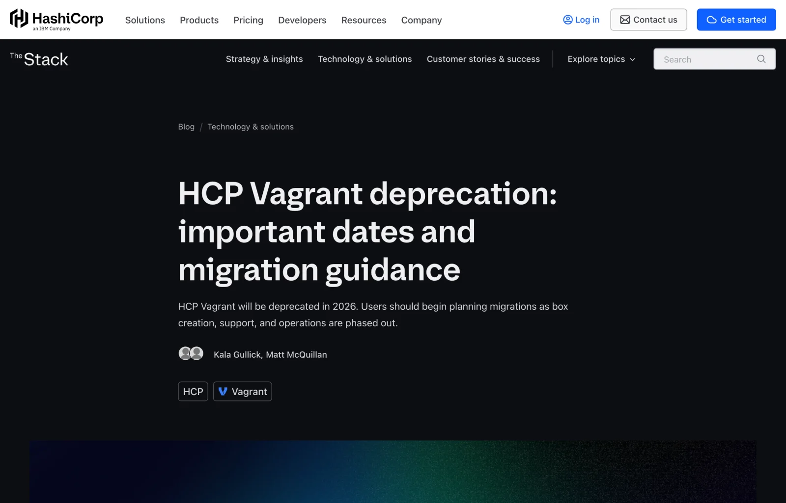
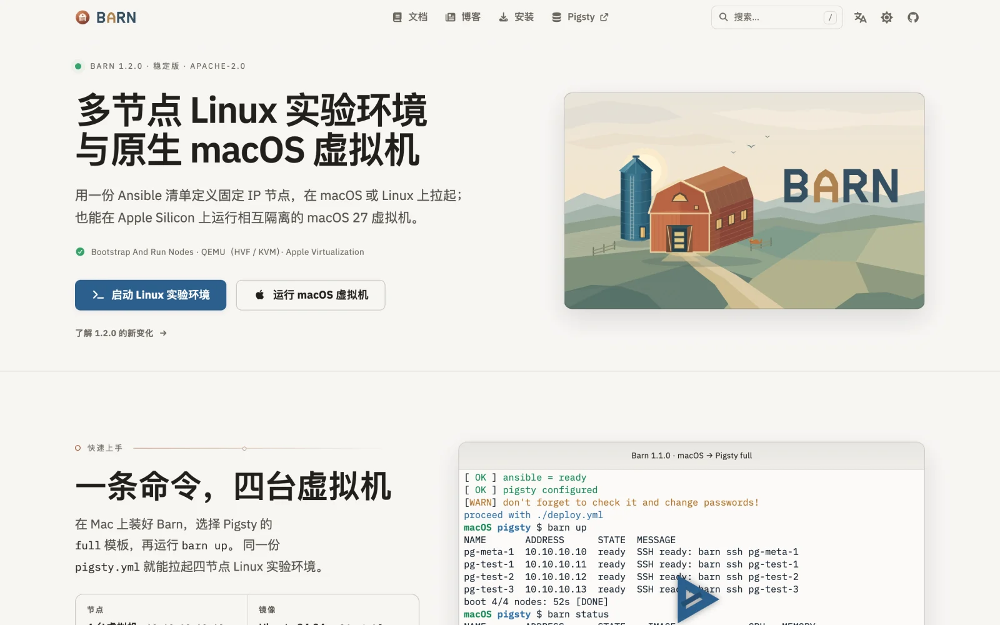
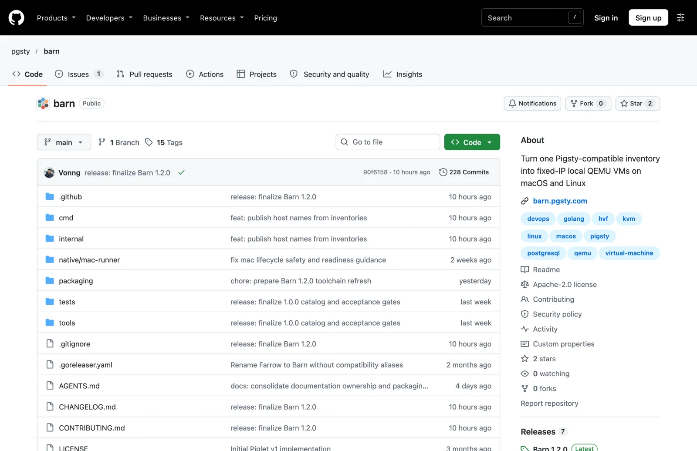
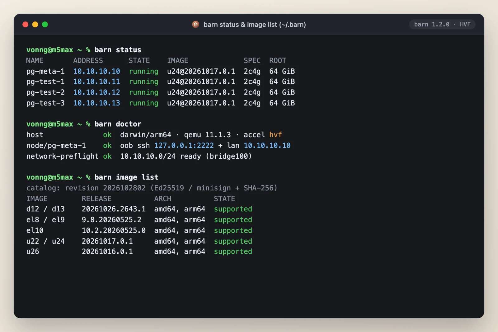
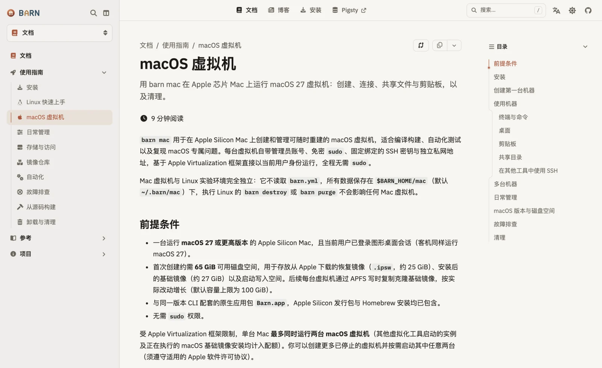
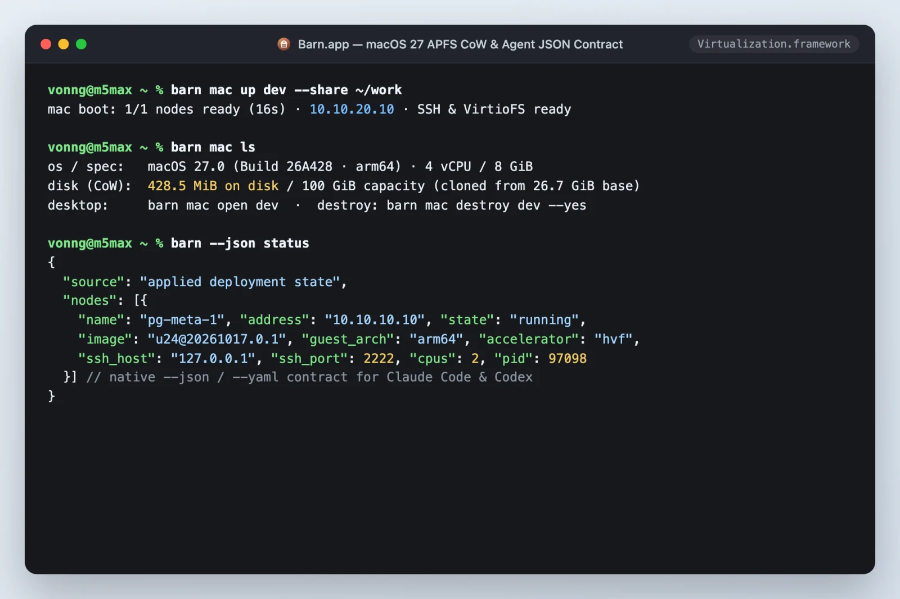

就在上周（2026 年 11 月 2 日），基础设施圈的一位老朋友迎来了终局：**HashiCorp 正式终止对 [HCP Vagrant 与公共镜像仓库（Vagrant Public Registry）的维护](https://www.hashicorp.com/en/blog/hcp-vagrant-deprecation-important-dates-and-migration-guidance)**，并宣布在今年 12 月 31 日彻底关停服务器。

[](https://www.hashicorp.com/en/blog/hcp-vagrant-deprecation-important-dates-and-migration-guidance)

看到这条消息，老冯还是挺感慨的。Vagrant 曾经是最好用的本地虚拟机管理工具——写一份声明式清单，就能在 Mac、Linux、Windows 上一键拉起多台虚拟机，拿来搭本地开发测试环境简直是神器。老冯前前后后用了七八年，[Pigsty](https://pigsty.cc/) 甚至在正式诞生之前，就是在 Vagrant 拉起的虚拟机里孵化和打磨出来的。

想当年 HashiCorp 全家桶如日中天：本地起虚机用 Vagrant，上云编排用 Terraform，服务发现用 Consul，调度用 Nomad，密钥管理用 Vault，一套组合拳造福了无数工程师。

可惜好景不长。2023 年 HashiCorp 突然将开源协议改为 BSL 1.1，随后又卖身 IBM，Vagrant 的命运其实早就写在了墙上：核心插件 [`vagrant-libvirt`](https://github.com/vagrant-libvirt/vagrant-libvirt) 陷入停滞，逼得 [`netlab`](https://blog.ipspace.net/2026/09/sunsetting-vagrant-libvirt/) 等知名项目在今年秋天正式弃坑；Vagrant CLI 停留在 [`2.4.9`](https://github.com/hashicorp/vagrant/releases/tag/v2.4.9) 之后，整整 **14 个多月没发过一个新版本**，仓库近三个月只剩一人勉强维持，连新版 macOS 上 `vagrant up` 报错的 Bug 都迟迟无人发版修复。如今连托管着无数 `generic/*`、`bento/*` 镜像的公共仓库都要拔网线了——那个定义了“本地开发环境即代码”的黄金时代，算是正式落下了帷幕。

作为重度本地虚拟机用户，我和 Pigsty 社区受这件事的影响非常直接。

熟悉老冯的朋友都知道，我是个坚定的“数据库裸机/虚拟机原教旨主义者”。跑无状态微服务，Docker 确实香；但如果你要研发、测试一套真实的生产级数据库发行版——涉及多节点 `systemd` 服务编排、Patroni 高可用故障切换、VIP 漂移、Linux 内核参数调优、APT/YUM 仓库同步，以及 `ext4`/`XFS` 独立数据盘挂载——容器根本糊弄不过去，你手里必须要有带完整内核的真 Linux 虚拟机。

但这几年，每次带新用户或者我自己拉测试集群，Vagrant 都在疯狂消耗耐心：Ruby 环境依赖阴魂不散，VirtualBox 跟 Apple Silicon 水土不服，`libvirt` 配置门槛劝退新手，现在连官方镜像源都要关门大吉了。

指望不上别人，那就自己动手盖一座新的。

HashiCorp 改协议之后，Terraform 分叉出了 [OpenTofu](https://opentofu.org/)，Vault 分叉出了 [OpenBao](https://openbao.org/)，唯独 Vagrant 一直没人接盘。老冯起初动过念头，想把 Vagrant 原样 Fork 过来，连名字都起好了，就叫 **OpenWonton**——豆腐、包子、馄饨，刚好凑一桌早点。但扒开代码一看，十几年的 Ruby 历史包袱实在积重难返。与其在旧房子里修修补补，不如按自己的真实需求用 Go 从头写一个。毕竟连 MinIO 这种体量的巨型项目老冯都接过来搞出了 [Silo](/db/minio-silo-1year/)，没理由搞不定一个本地虚拟机管理器。借用 DHH 的那句名言：**["We can fix everything!"](/cloud/cloud-exit-2026/)**

## 欢迎来到 Barn（畜棚）

于是就有了 **[Barn](https://github.com/pgsty/barn)**（**B**ootstrap **A**nd **R**un **N**odes）——一个使用 Go 编写、Apache-2.0 协议完全开源的本地虚拟化管理工具，官网与完整中英文文档现已上线：**[barn.pgsty.com](https://barn.pgsty.com/zh/)**。

[](https://barn.pgsty.com/zh/)

熟悉 Pigsty 生态的读者大概已经会心一笑了：如果说 **[Pigsty](https://pigsty.cc/)** 是猪圈，**[Silo](https://silo.pgsty.com/)** 是存粮的筒仓，**[PIG](/pg/pig/)** 是猪仔包管理器，**[Oink](/ai/oink-intro/)** 是发声筒，那么 **Barn** 就是那座**结结实实的本地畜棚**。在云原生语境里，随时可销毁重建的实例被称为“牲畜”（Cattle），Barn 就是专门用来在你的 MacBook 或 Linux 工作站上，低成本、确定性地养起一整群 Linux 与原生 macOS 虚拟机的畜棚。

Barn 干的事情非常纯粹：**用一份兼容 Ansible 的标准 YAML 清单，在本地拉起带固定私网 IP 的多节点 Linux 集群（基于 QEMU + HVF/KVM 硬件加速）；或者在 Apple Silicon Mac 上秒级克隆独立的原生 macOS 虚拟机（基于 `Virtualization.framework`）。**

[](https://github.com/pgsty/barn)

不需要装臃肿的 VirtualBox，不需要折腾脆弱的 Ruby 插件链，三行命令就能见真章：

```bash
# 1. 安装 Barn（macOS 自带签名公证过的原生 Barn.app）
brew install pgsty/infra/barn

# 2. 拉起默认 Linux 节点（或读取当前目录 barn.yml 多节点集群）并连入
barn up && barn ssh

# 3. 在 Apple Silicon 上秒级拉起一台挂载工作目录的独立 macOS 虚拟机
barn mac up dev --share ~/work
```

## 革了 Vagrant 哪些命？

Barn 绝不是“用 Go 把 Vagrant 照抄一遍”。我把过去十年用 Vagrant 踩过的所有深坑摊在桌面上，做了五个完全不同的工程取舍：

### 1. 一份 YAML 到底，消灭“双份配置分裂”

以前用  Vagrant 跑 Pigsty 的沙箱有件很麻烦的事：你得先用 Ruby 写一份 `Vagrantfile`，定义几台机器、几核几 G、什么 IP；然后再去维护一份 Ansible 的 `pigsty.yml` 主机清单，把同样的 IP 和主机名再抄一遍。只要改一个节点，两边就得手动对齐。

在 Barn 里，**没有独立的虚拟机 DSL**。[`barn.yml`](https://barn.pgsty.com/zh/docs/reference/configuration/) 本身就是一份完全合法的 **Ansible 标准 YAML 主机清单**：

```yaml
all:
  vars:
    admin_ip: 10.10.10.10
    vm_image: d13          # 支持 u22/u24/u26, d12/d13, el8/el9 等别名
    vm_cpu: 4
    vm_mem: 8GiB
    vm_disk: 64
  children:
    pg_meta:
      hosts:
        10.10.10.10: { nodename: meta }
    pg_test:
      hosts:
        10.10.10.11:
          nodename: node-1
          vm_disks:
            - { path: /data, size: 128, fs: auto, persistent: true }
        10.10.10.12:
          nodename: node-2
```

Barn 只挑它关心的 `vm_*` 字段去创建机器（全都有默认值，不写也行），Ansible 和 Pigsty 直接拿**同一个文件**去跑剧本（`ansible-playbook -i barn.yml`）。基础设施与配置管理共享唯一事实来源，再也不必左右互搏。在刚发布的 `1.1.0` 中，你甚至不用改文件，直接敲 `barn up -I el9 -A amd64` 就能在命令行临时覆盖发行版与架构，跑跨系统兼容性矩阵爽得飞起。

### 2. 全局单部署（`~/.barn`），告别满地碎片的“幽灵虚拟机”

老冯最讨厌 Vagrant 的设计之一，就是往每个工作目录塞一个 `.vagrant/`。用久了之后，硬盘里散落着十几个早忘了路径的实验目录，后台挂着一堆白吃内存的幽灵 VM；更要命的是，你在 B 目录拉起一台 `10.10.10.10`，直接跟 A 目录忘了关的 `10.10.10.10` 撞 IP，SSH `known_hosts` 当场爆炸。

Barn 干脆利落地砍掉了“按目录分项目”的概念——**[One Deployment, No Projects](https://barn.pgsty.com/zh/blog/design/one-deployment-no-projects/)**。所有状态、密钥、缓存镜像和虚拟机磁盘统一收口在 `~/.barn` 下。无论切到哪个目录敲 `barn status`，看到的都是同一座全局受控的本地实验室；如果确实需要完全隔离的第二套环境，显式指定环境变量 `BARN_HOME` 即可，不搞隐式魔法，不留孤儿进程。



### 3. 双网卡解耦：带外救火 + 固定私网 IP

做分布式系统和数据库实验，动态 DHCP 毫无意义，集群节点之间必须死死钉住固定私网 IP。Barn 为每个 Linux 节点设计了[双网卡拓扑](https://barn.pgsty.com/zh/blog/design/fixed-ip-two-nics/)：

- **管理/NAT 网卡**：负责出网访问，并在宿主机回环地址暴露独立的管理 SSH 端口。哪怕你在虚机里把内网网卡折腾断了，`barn ssh` 依然能像服务器带外管理卡（IPMI）一样稳稳连进去救火。
- **固定私网网卡**：macOS 基于 `socket_vmnet`，Linux 基于宿主网桥，严格按清单分配固定私网 IP。

机器拉起的瞬间，免密 sudo 的默认管理员账号 `dba`、各节点 `/etc/hosts` 解析，以及**从控制节点（`admin_ip`）到所有工作节点的免密 SSH 互信**全部预装就绪。进控制节点直接跑 Ansible，零手工配置。

### 4. 写时复制与安全防呆：绝不自作聪明“删库”

基础设施工具最忌讳“自作聪明”。在 Barn 里，基础镜像只下载缓存一次，新节点通过 `qcow2` 写时复制秒级克隆拉起。如果你不小心从 `barn.yml` 里删掉了一个节点，运行 `barn up` 甚至 `barn recreate` 时，Barn **[绝不会静默销毁那台机器](https://barn.pgsty.com/zh/blog/design/convergence-without-surprise/)**，而是直接报冲突拦截——删节点必须通过显式的 `barn destroy NODE` 授权。标记了 `persistent: true` 的独立数据盘在常规重建中也会完好保留，绝不轻易格式化你的测试数据。

### 5. 去中心化静态镜像源：拒绝再被商业公司拔网线

这次 HCP Vagrant 关停给所有人上了一课：**不要把基础工具的生命线绑在一家商业公司的中心化 SaaS 服务上。**

Barn 官方提供了涵盖 Ubuntu、Debian、Rocky Linux 等主流发行版在 `amd64` 与 `arm64` 双架构下的精简镜像，但整个镜像供应链完全不依赖动态后端，而是采用[**纯静态镜像目录 + Ed25519 / minisign 密码学签名 + SHA-256 强校验**](https://barn.pgsty.com/zh/blog/design/repo-yaml-catalog-json/)。你可以随时把整套镜像源同步到自己的对象存储（比如 [Silo](https://silo.pgsty.com/)）、内网 Nginx 或任意 CDN 上，也可以用 `barn image import` 导入自制镜像。就算哪天外网彻底断了，你的畜棚依然完好无损。

## 杀手锏：把一台 Mac 劈成三台用，给 AI Agent 盖座安全畜棚

如果你手里有一台大内存的 Apple Silicon Mac（比如老冯主力干活的 128GB M5 Max MacBook Pro），Barn 还有一个让 Vagrant 望尘莫及的杀手锏：**[`barn mac`](https://barn.pgsty.com/zh/docs/start/macos/)**。

[](https://barn.pgsty.com/zh/docs/start/macos/)

我在发行包里直接内置了经过 Apple 签名公证的原生 **`Barn.app`**，底层直接调用苹果原生的 `Virtualization.framework` 与 **APFS 写时复制（Copy-on-Write）**：基础 `.ipsw` 恢复镜像只需安装一次，随后敲一行 `barn mac up`，几秒钟就能**零额外磁盘开销**克隆出一台纯净的 macOS 客机——既有原生的桌面窗口和剪贴板同步，又自动配好了免密 SSH 与基于 **VirtioFS** 的高速目录共享（`--share ~/work`），用完一句 `barn mac destroy --yes` 干干净净，宿主机不留一丝垃圾。

按照苹果的虚拟化限制，一台 Mac 宿主机允许同时跑两台 macOS 虚拟机——这意味着**一台大内存 Mac 瞬间就能劈成 3 台相互隔离的独立 Mac 环境来用**。

这也就回答了很多人可能会问的一个问题：**都 2026 年了，为什么还要花大力气造一个本地虚拟机管理器？**

除了研发测试数据库，我在日常高强度的 AI 原生开发流里，找到了它最不可替代的新战场：**[AI Agent 的本地沙箱农场](/ai/memory-vs-context/)。**

今天大家都在重度使用 Claude Code、Codex 这类自主智能体，肯定都体会过那种纠结：不开全自动免确认模式（YOLO Mode），你得像保姆一样盯着终端一直敲回车；开了 YOLO 模式直接在宿主机上裸跑，万一它哪天抽风敲错一行 `rm -rf` 或者乱改系统环境，主力开发机当场就得交代。更别提当你同时跑三个不同的 Claude 账号，或者跑多个需要操控 GUI 的 Agent 时，它们还会互相污染环境变量、抢桌面焦点、抢鼠标指针。而如果把它们塞进 Docker 容器里，一旦遇到 `systemd`、内核模块、嵌套构建或 macOS 原生编译链的任务，Agent 立刻束手束脚。

**轻量、秒级克隆、带真实内核、完整 root 权限与独立桌面的本地虚拟机，才是 [AI Agent 最完美的沙箱](/ai/agent-os/)。**



这也正是为什么 Barn 从第一天起就把 **[CLI 结构化输出契约](https://barn.pgsty.com/zh/blog/design/cli-contracts/)** 当成一等公民：几乎所有命令都原生支持 `--json` 与 `--yaml` 输出，配合语义明确的退出码，不仅好让人敲，更是天生喂给 AI Agent 的基础设施原语。你可以放心大胆地把 Agent 关进畜棚里开满权限狂飙——让它自己调 `barn up` 拉起三台 Linux 节点跑数据库压测，或者 `barn mac up` 克隆一台干净的 Mac 跑完整构建验收。造烂了随时销毁重来，付出的不过是一点本地闲置的算力与内存。

Vagrant 陪伴我们走过了基础设施自动化的启蒙十年，值得道一声感谢与再见。而在云成本高企、本地硬件性能过剩、AI 智能体崛起的今天，本地虚拟化不该随着旧工具的老去而凋零，它理应变得更轻、更快、更确定。

这座新盖好的 **Barn**，Apache-2.0 完全开源，献给所有依然热爱裸金属、热爱 Linux、喜欢在自己机器上掌控一切的工程师。

- **项目官网与文档**：[https://barn.pgsty.com](https://barn.pgsty.com/)
- **GitHub 仓库**：[https://github.com/pgsty/barn](https://github.com/pgsty/barn)
- **快速安装（macOS）**：`brew install pgsty/infra/barn`

欢迎来畜棚里溜达一圈，顺手点个 Star。
