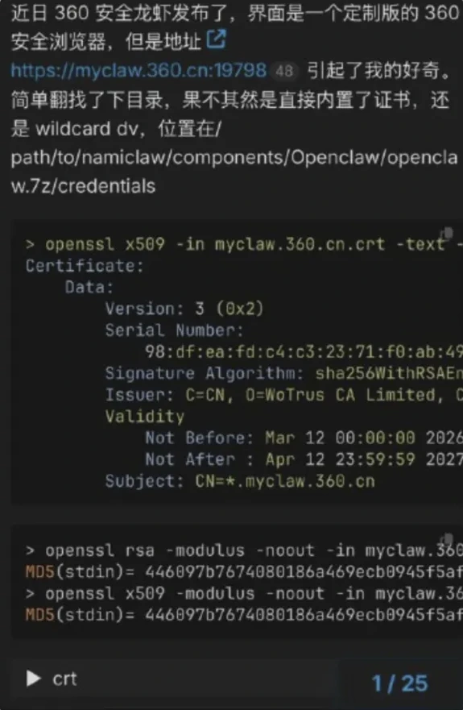

近日，安全社区发现：360 刚发布的 AI Agent 产品 **“360安全龙虾”**（基于 OpenClaw 的一键部署客户端），在其公开安装包中，包含了 `*.myclaw.360.cn` 泛域名证书的 **SSL 私钥文件**。

一家以安全为核心卖点的公司，把自己的通配符证书私钥，打包进了面向公众分发的安装包里。

> **声明**：本文仅作为网络安全技术探讨与供应链安全案例分析。文中引用的技术数据及文件路径均来自公开网络渠道及官方公开发布的软件安装包，不涉及任何逆向工程、破解或入侵行为。本文所述内容均基于公开信息与可独立验证的技术事实，不构成对任何公司的主观评价。如相关厂商已发布官方修复公告，请以官方信息为准。

> [!SOCIAL] Lukasz Olejnik `@lukOlejnik`
>
> 中国最大的网络安全公司奇虎 360 显然刚发布了一款 AI 助手，安装包里竟然直接内置了自己的 SSL 私钥。奇虎 360 类似于诺顿或迈克菲，但在整个中国市场占据主导地位。
>
> 他们的新款 AI 产品“360安全龙虾（Security Claw）”似乎是对 @OpenClaw 做的一层封装。任何下载安装包的人都能直接拿到其中用于 `*.myclaw.360.cn` 域名的 SSL 证书私钥。SSL 私钥本质上是网站加密连接的主密码：攻击者拿到它可以冒充 360 的服务器、静默拦截用户流量、伪造看起来完全合法的登录页面，甚至可能完全接管这个 AI Agent。该证书有效期至 2027 年 4 月，覆盖平台上的所有子域名，如今已经公之于众。创始人发布产品时还承诺“绝不泄露密码”，结果发布时就自己泄了？坐拥 4.61 亿用户、100 亿美元估值，发版前竟然没人检查一下压缩包。这张证书要到 2027 年 4 月才到期。
>
> 
{avatar="avatar-lukolejnik.webp" date="2026-03-16" platform="x"}

> [!SOCIAL] Viking `@vikingmute`
>
> 笑死我了，360安全龙虾是基于 OpenClaw 做的一个封装，结果在安装包里，任何人下载后都能直接访问到一个用于域名 `*.myclaw.360.cn` 的 SSL私钥，这个证书有效期到2027年4月，覆盖了该平台所有子域名。
>
> 360在产品发布时信誓旦旦地承诺，这个AI助手永远不会泄露密码。结果刚上线就直接把自己的核心私钥泄露了？没人检查一下检查安装包里的内容吗？什么草台班子
>
> > [!SOCIAL] Lukasz Olejnik `@lukOlejnik`
> >
> > 中国最大的网络安全公司奇虎 360 显然刚发布了一款 AI 助手，安装包里竟然直接内置了自己的 SSL 私钥。奇虎 360 类似于诺顿或迈克菲，但在整个中国市场占据主导地位。
> {avatar="avatar-lukolejnik.webp" date="2026-03-16"}
{avatar="img/social/vikingmute.webp" date="2026-03-16" platform="x"}

## 发生了什么

360安全龙虾于 2026 年 3 月 14 日正式发布，定位是 OpenClaw 智能体的一键安装部署工具。

安全研究人员在解压安装包后发现，在以下路径中存在明文的证书与私钥文件：

```text
/path/to/namiclaw/components/Openclaw/openclaw.7z/credentials
```

该目录下包含了 `*.myclaw.360.cn` 的 **Wildcard DV 泛域名证书** 及其对应的 **RSA 私钥**。

证书由 **WoTrus（沃通）CA** 签发，有效期从 2026 年 3 月 12 日至 2027 年 4 月 12 日，覆盖 `*.myclaw.360.cn` 下的所有子域名。

## 技术验证

据安全博客“秋风于渭水”的独立验证，通过标准的 OpenSSL 工具分别提取私钥和证书中的 Modulus（模数），进行 MD5 哈希比对，两者的指纹完全一致，在技术上证实了该 `.key` 文件确为对应泛域名证书的有效私钥。


此外，X（原 Twitter）上多位用户已公开贴出该证书的完整 PEM 编码内容，任何人均可自行下载验证。证书透明度日志（crt.sh）中亦可查询到对应记录。

> [!SOCIAL] 奶昔🥤 `@realNyarime`
>
> 360Claw的SSL证书泄漏
>
> ```text
> -----BEGIN CERTIFICATE-----
> MIIGJjCCBI6gAwIBAgIRAJjf6v3EwyNx8KtJDIo8eBkwDQYJKoZIhvcNAQELBQAw
> SjELMAkGA1UEBhMCQ04xGjAYBgNVBAoTEVdvVHJ1cyBDQSBMaW1pdGVkMR8wHQYD
> VQQDExZXb1RydXMgUlNBIERWIFNTTCBDQSAyMB4XDTI2MDMxMjAwMDAwMFoXDTI3
> MDQxMjIzNTk1OVowGjEYMBYGA1UEAwwPKi5teWNsYXcuMzYwLmNuMIIBIjANBgkq
> hkiG9w0BAQEFAAOCAQ8AMIIBCgKCAQEA6GoA3XNAfUmduNst6xvYGphkmWpMKTC9
> RCJpvKoKSuFylOwY+tGm8vmKl4Uc4SYUp3a8TdFjFtEzCuRqEo3IVYRdenk94K8G
> ...
> ```
{avatar="avatar-realnyarime.webp" url="https://x.com/realNyarime/status/2033428417488757122" platform="x"}

> [!SOCIAL] 科技圈 在花新闻 `@ZaihuaNews`
>
> 360Claw 出现 SSL 证书泄露事件
>
> 有网友发现 360Claw 疑似出现 SSL 证书泄露事件，涉及域名为 `*.myclaw.360.cn` 的数字证书及配套私钥。泄露的证书由 WoTrus CA Limited 签发，有效期从 2026 年 3 月 12 日至 2027 年 4 月 12 日。
>
> 此次泄露包含完整的证书文本与私钥内容，可能导致相关域名的加… [crt.sh/?q=%2A.myclaw.360.cn](https://crt.sh/?q=%2A.myclaw.360.cn)
{avatar="avatar-zaihuanews.webp" url="https://x.com/ZaihuaNews/status/2033481130532392997" platform="x"}

老冯也在本地使用 OpenSSL 对上述证书和私钥文件进行了独立验证，Modulus 哈希比对结果与上述报告一致。


## 这意味着什么

SSL 私钥是 HTTPS 加密通信的核心。持有某域名的 SSL 私钥，在技术上意味着：

**1. 中间人攻击（MITM）**

在公共 Wi-Fi、企业内网、运营商链路等场景下，第三方可以利用该私钥伪造 `*.myclaw.360.cn` 下任意子域名的合法 HTTPS 服务。由于证书本身是合法签发的，客户端不会弹出任何安全警告，用户的加密流量可被实时解密。

**2. API Key 截获风险**

360安全龙虾作为 OpenClaw 部署工具，用户在使用过程中通常会配置各类大模型的 API Key。如果客户端与 `*.myclaw.360.cn` 之间的通信被中间人劫持，这些 API Key 存在被明文截获的风险。

**3. 供应链劫持**

如果客户端的自动更新、配置下发等机制依赖于该域名的 HTTPS 验证，攻击者理论上可以伪造服务器，向客户端推送未经授权的指令或代码。

需要说明的是，以上是泛域名私钥泄露后在技术层面 **客观存在** 的风险面，并不代表这些攻击已经实际发生。

## 证书吊销与 OCSP 的尴尬

根据 CA/Browser Forum Baseline Requirements（4.9.1.1 章节），当 CA 意识到证书私钥可能已遭泄露时，应在 **24 小时内** 执行吊销操作。本次事件的时间线如下：

| 时间 | 事件 |
|------|------|
| 2026-03-12 | WoTrus 签发 `*.myclaw.360.cn` 证书 |
| 2026-03-14 | 360安全龙虾正式发布，安装包公开分发 |
| 2026-03-15 | 安全社区发现并公开讨论私钥泄露问题 |
| 2026-03-16 08:07 UTC | 据“秋风于渭水”博客报告，证书 OCSP 状态变更为 Revoked（已吊销） |

证书目前名义上已被吊销。但事情远没有这么简单。

主流浏览器对 OCSP 通常采用“软失败”（Soft-Fail）策略：如果无法访问 OCSP 服务器，浏览器会默认放行而非拒绝连接。换句话说，能做中间人攻击的人，顺手拦截掉 OCSP 流量也不是什么难事，仅靠 OCSP 吊销并不能完全消除已泄露私钥的威胁。

更有意思的是老冯的实测结果。2026 年 3 月 16 日晚间 22:14，老冯使用 OpenSSL 对 OCSP 状态进行验证，返回结果竟然是 **“未吊销”**。OCSP 响应返回的是 3 月 15 日的缓存结果。


进一步排查发现：该 OCSP 服务的三个后端 IP **返回了三个不一致的结果**，有的说已吊销，有的说没有。


该证书确实已经吊销。但这个发现本身暴露出证书基础设施的一个严重可靠性隐患：**即使你已经真的吊销了证书，在相当可观的一段时间里面，OCSP 依然可能在返回结果中认为它是有效的。**

## 从工程实践角度看

这类事故在软件工程中有明确的防御手段。

泛域名私钥属于高等级凭据，在标准的安全开发实践（SDL）中：

- 私钥应存放在 **HSM（硬件安全模块）** 或专用的 **KMS（密钥管理系统）** 中
- CI/CD 流水线应配置 **Secret 扫描**，在构建阶段自动检测并阻断凭据的意外打包
- 发布前的安全审查应覆盖安装包内的所有文件
- 开发人员不应直接接触私钥本体

以上均为业界通行做法，并非什么高不可攀的要求。对于一家主打 **安全** 的公司而言，这些应该是基本功。

## 对终端用户的建议

如果你已经安装了360安全龙虾，出于审慎考虑：

1. 在官方发布包含新证书的修复版本前，**避免在不可信网络环境** 下使用该客户端
2. 如果你在客户端中配置过大模型 API Key，建议前往对应服务商后台 **重新生成（Regenerate）密钥**
3. 关注360官方的后续安全公告

## 附：360 安全龙虾发布会图


## 信息来源

本文所述内容均基于以下公开信息与可独立验证的技术事实。

1. [TechWeb 报道：360推出“安全龙虾”](https://finance.sina.com.cn/tech/roll/2026-03-14/doc-inhqyhwn7349741.shtml)
2. [新浪科技（北京日报）：周鸿祎官宣将推出360安全龙虾](https://finance.sina.com.cn/tech/roll/2026-03-11/doc-inhqqqfv9519753.shtml)
3. [小众软件 Appinn Feed 社区帖（转自 L 站用户报告）](https://talk.appinn.net/posts/16284)
4. [秋风于渭水博客：技术验证与风险分析](https://www.tjsky.net/news/1451)
5. [X 用户 @realNyarime 贴出的完整证书 PEM 编码](https://x.com/realNyarime/status/2033428417488757122)
6. [X 用户 @ZaihuaNews（科技圈在花新闻）事件报道，含 crt.sh 查询链接](https://x.com/ZaihuaNews/status/2033481130532392997)

**关于本文引用的技术数据说明**：OpenSSL Modulus 哈希比对结果及 OCSP 吊销时间点的具体数值，来源于“秋风于渭水”博客的独立验证以及老冯的本地复现。相关验证方法为标准操作，任何持有该安装包的人均可使用 OpenSSL 自行复现。

------

*写 Bug 能理解。但发布前跑一遍 Secret 扫描，很难吗。*
