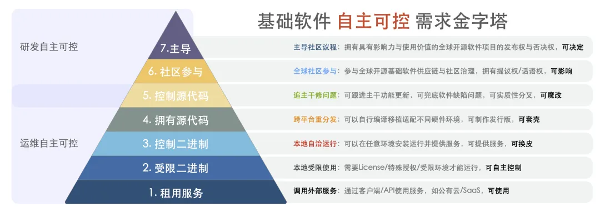
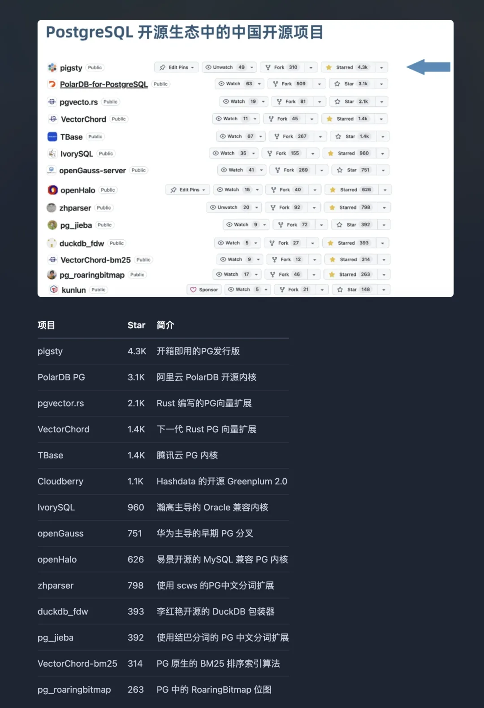

Early on New Year's Day 2026, while most people were still celebrating the holiday, the Bank of China mobile app went down.

[Deep Dive: How a Huawei GaussDB Bug Took Down the Bank of China App on New Year's Day](https://mp.weixin.qq.com/s/6TyRKtsg81cTLz5A3q0Njw)

The official statement said a technical issue had been resolved. In private engineering circles, however, word quickly spread that the database connection pool had maxed out and failed to release connections. It wasn't the first time—almost the exact same script played out six months earlier, in July.

A few years ago, news like this would have made me furious. I might have written an anguished post venting my frustration at an industry that refused to live up to its potential.

Today, reading the stream of "system outage" notices, I feel nothing at all—if anything, a faint urge to laugh.

Anger is for people who still have expectations.

## 1. "Innovation" by Archaeology

Strip away the grand narratives of "independent R&D" and "world-leading breakthroughs," and look at the bare technical reality.

In OLTP database kernels, Chinese vendors trail the global state of the art by a conservative estimate of **ten years**.

That sounds harsh, but code doesn't lie. Take openGauss: its kernel is forked from PostgreSQL 9.2, released in 2012. What does that mean in practice? When vendors tout "domestic innovation" in 2026, the lifeblood underneath is fourteen-year-old technology.

Onto an ancient release that the upstream open-source community has long since iterated past, vendors have bolted a pile of "bespoke features" designed purely to check boxes on *XinChuang* (state-mandated IT localization) compliance checklists.

That isn't leapfrogging the competition. It's welding a rocket engine onto a 1980s Volkswagen Santana and acting surprised when the chassis shakes itself apart at speed.

## 2. Don't Blame the Code; Blame Slideware-Driven Development

I don't blame the engineers writing the code.

China has no shortage of top-tier database engineers. Look at the global PostgreSQL contributor list and you will find Chinese developers from the Pivotal alumni network, Alibaba Cloud, HighGo, WWIT, and elsewhere making real upstream contributions. They understand internals, they understand architecture, and they know what good code looks like.

The tragedy is that their talent is being burned in a giant theatrical exhibition match.

In this game, the enterprise buyer's core metric isn't TPS (transactions per second); it's PowerPoint. Management doesn't need a database that can survive peak production traffic—they need a "self-reliant and controllable" (*zizhu kekong*) label that looks good in briefing decks, clears localization compliance audits, and unlocks procurement budgets.

So engineers are forced to put down their dragon-slaying blades and spend their days carving decorative flowers out of radishes.

To prove "independence," they alter interfaces where open-source licenses permit it, turning standard protocols into proprietary ones and breaking compatibility where it already existed. To prove "control," they carve a thriving ecosystem into isolated fragments.

The resulting product is something its own developers wouldn't touch without holding their noses.

None of that matters, though—as long as the red official stamp lands on the acceptance form, everyone declares a "great victory."

## 3. True Technological Sovereignty Isn't Built Behind Closed Doors

Our understanding of "self-reliance and control" went off the rails from the very beginning.

When sweeping Western sanctions hit Russia in 2022, Oracle pulled out and Microsoft left. Did Russia's financial system collapse?

No.

They had Postgres Pro—an enterprise PostgreSQL distribution with deep customizations that continuously contributes back upstream—and ClickHouse, a real-time analytical database used worldwide. Those products didn't survive on protectionist procurement policy; they survived on engineering merit. Even cut off from all foreign commercial support, Russian teams kept their systems running because they understood the open-source codebase deeply and could track the upstream trunk.

What have we pursued instead?

**Performative self-reliance at the R&D layer**—forking an open-source repo, scrubbing the name, claiming "100% homegrown IP" to justify steep markups, and severing ties with the upstream community.

This approach is actively dangerous.

An open-source community is a living river. If you divert water into a walled-off enclosure and call it a "domestic pond," the river outside keeps flowing while your pond turns stagnant within a few years. When critical security vulnerabilities or performance bottlenecks hit, you discover that your "independent codebase" has diverged so badly it can't even cherry-pick upstream patches.

In 2023, the Swiss government passed legislation requiring public-sector bodies to prioritize open-source software. That is what clarity looks like: genuine technological sovereignty is rooted in embracing open-source communities, not walling yourself off from them.

Build high walls out of compliance certifications, and all you incubate are fragile, oversized infants that collapse at the first real test.

[What Kind of Self-Reliance Does Infrastructure Software Actually Need?](/en/db/sovereign-dbos/)

## 4. Wrapping Open Source Isn't a Sin; Destroying Value Is

Critics often dismiss domestic databases as mere "wrappers" around open-source projects.

Honestly, wrapping isn't the problem.

A Linux distribution is a wrapper around the kernel. Chrome is a wrapper around Chromium. Commercial software is very often the art of wrapping raw core technology in layers of usability. Red Hat built a business wrapping the Linux kernel and was acquired by IBM for $34 billion in 2019; Supabase put a wrapper around PostgreSQL and passed a $5 billion valuation. You can call Cursor a VS Code wrapper or Manus an LLM wrapper, and neither is any less dominant in its market for it.

The real question is simple: **Does your wrapper add value, or does it destroy value?**

A good wrapper makes the underlying technology easier to use, more reliable, and more capable—shipping turnkey high availability, integrating enterprise monitoring and alerting, simplifying day-two operations, and expanding the ecosystem rather than crippling it.

What do a large share of domestic databases do instead?

Starting from a decade-old kernel fork, they break compatibility with standard connection poolers, mangle standard monitoring interfaces, and lock out hundreds of battle-tested community extensions. To upsell proprietary companion tools, they strip out features that come free in upstream open source—or reimplement them using ten times the instructions.

That isn't value creation. It is **value destruction**.

It is like taking a free, move-in-ready apartment, gutting it down to bare concrete, and billing the buyer for a luxury villa on the grounds that "we laid this interior brick wall ourselves."

[Are Chinese Domestic Databases Another Backyard Steel Campaign?](/en/db/db-china/)

[Are Databases Really Being Strangled?](/en/db/db-choke/)

## 5. Developers Vote with Their Feet

Y Combinator's motto is simple: "Make Something People Want."

Enterprises may sign the checks for databases, but developers are the ones who actually have to use them.

What do developers want from a database?

The requirements are modest: **clear documentation**, not vague PDFs; **a rich ecosystem**, not an island of proprietary protocols; **an active community**, where you can find answers on Stack Overflow instead of opening a support ticket and waiting on the vendor; and **transferable skills**, so what you learn remains useful at your next job instead of locking you into a closed niche.

Just look at GitHub.

For all their marketing fanfare, China's flagship "domestic databases" often carry less real-world clout than a handful of pure community projects. [Pigsty](/en/pg/forge-a-pg-distro/), a PostgreSQL distribution I maintain as a solo developer, has more GitHub stars than the open-source PG kernel forks backed by massive budgets at Alibaba, Tencent, and Huawei—which is frankly absurd.

Developers are voting with their feet; the industry just chooses to ignore the signal.

It isn't because developers lack patriotism.

It's because in the world of code, a tool either works well or it doesn't. **Political correctness won't fix an OOM, and national pride won't clear a deadlock.**

Ignore the laws of engineering, and reality will teach the lesson through a major production outage.

[Can Chinese Domestic Databases Really Compete?](/en/db/db-china/)

## 6. Focus on Your Own Work

A few years ago, all of this still made me angry. I wrote critiques, joined discussions, and tried to push for change.

Not anymore.

**I'm past the stage of outrage; I've moved on to detached observation.**

Not because I stopped caring, but because I finally understood one thing: what ails this industry isn't a technical problem—it's an incentive structure problem.

The vendors living off localization mandates, the products kept alive by government procurement, the keynote pitches boasting of "world-leading" breakthroughs—together they form a self-reinforcing community of aligned interests. Inside that bubble, whether the product works doesn't matter; how the slide deck looks does. Whether the technology is advanced doesn't matter; whether the story holds together does.

Criticize them, and they won't fix the product—they'll question your loyalties. Bring data, and they'll call your numbers biased. Point out technical flaws, and they'll call them "growing pains."

I have heard that script too many times to have any interest in debating it further. So I've made my choice: **focus on doing my own work well, and let time test everyone else's**.

When an industry is full of noise, time is the best filter.

Products that survive on policy subsidies, sell vaporware on slide decks, and harvest customers through information asymmetry will eventually be weeded out.

And I believe the products that solve real problems, create real value, and genuinely serve users will survive and inherit the field.

Twenty years from now, today's fanfare will likely be nothing more than a footnote in history—a farce in retrospect.

What gets remembered in the end is never the glossy slide deck, but the work that actually stands on its own.

---

Published on: [WeChat Official Account](https://mp.weixin.qq.com/s/KpR2PYkiwsxkG2N1dPTkEg)
