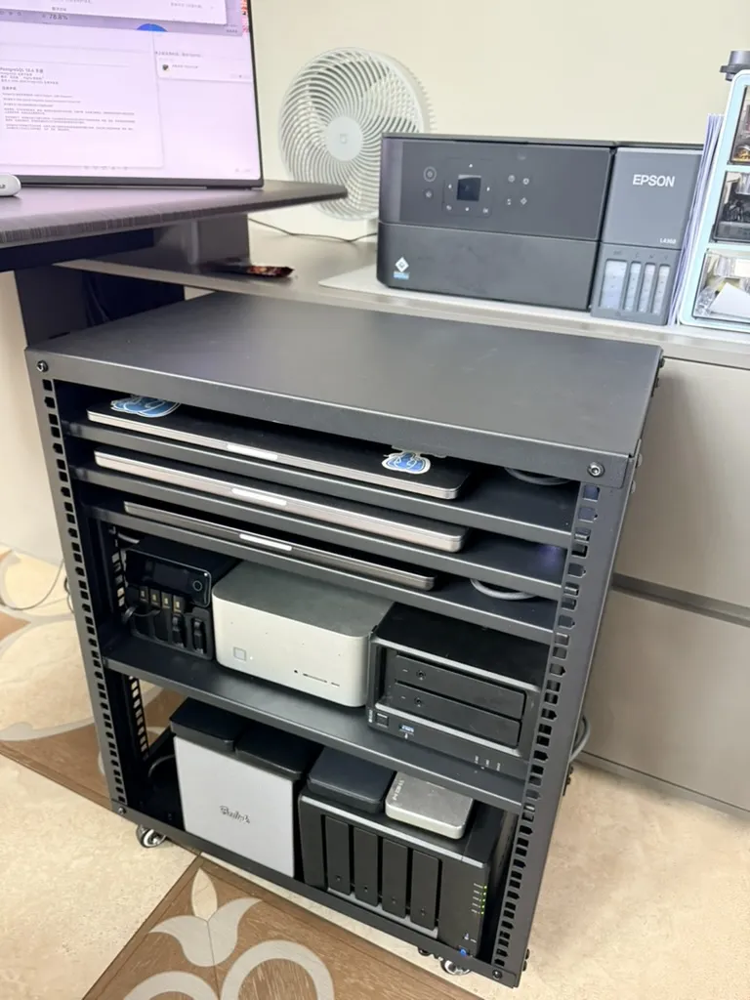
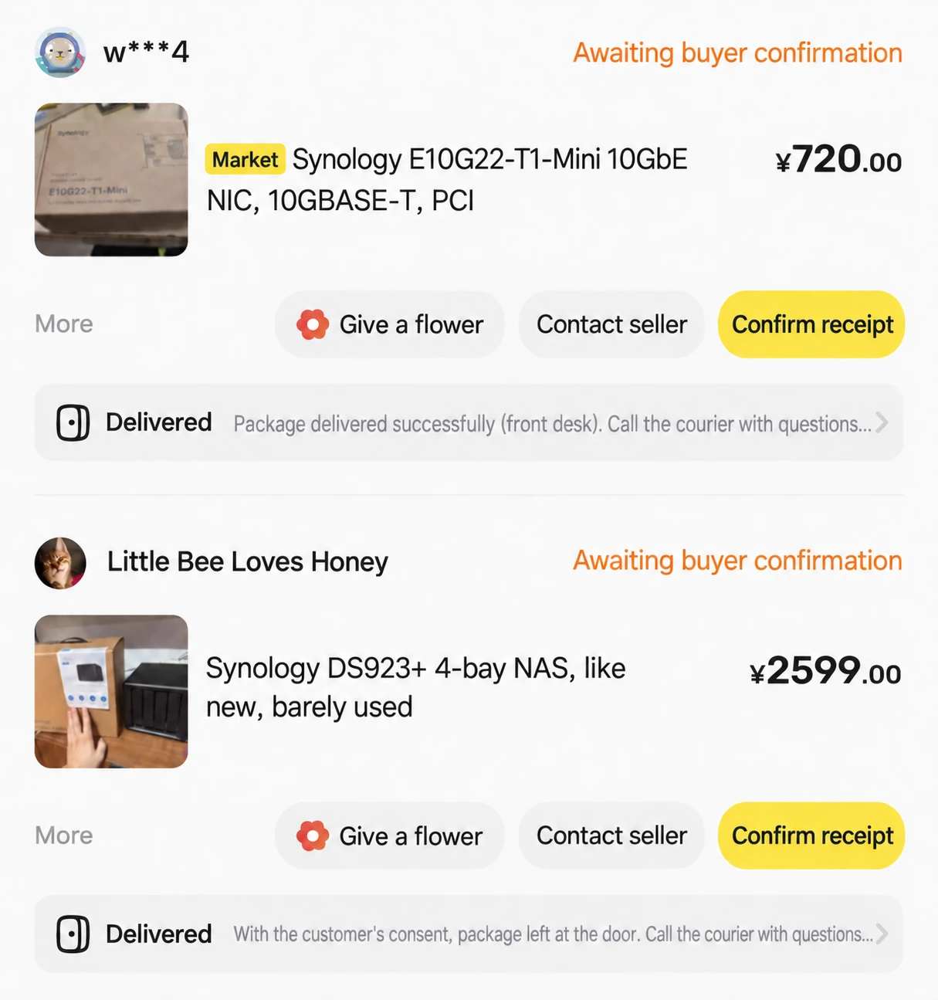
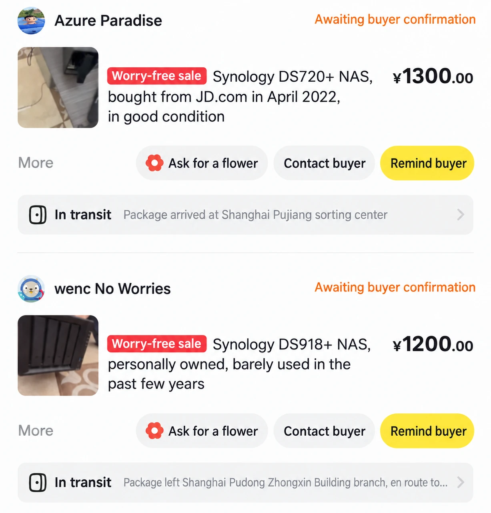
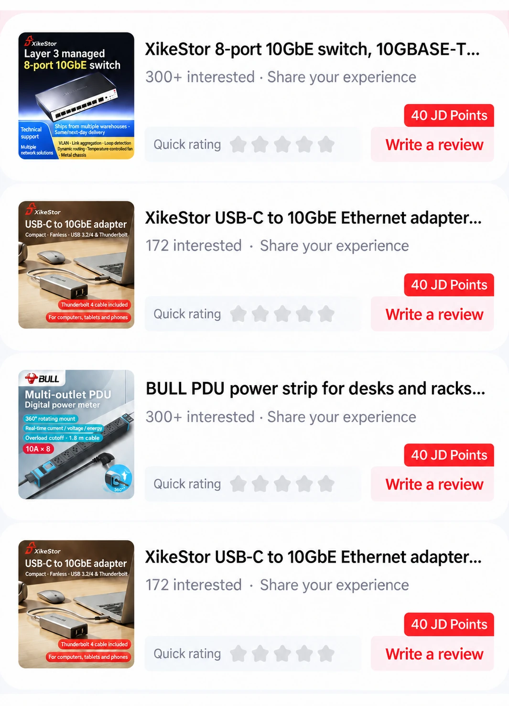
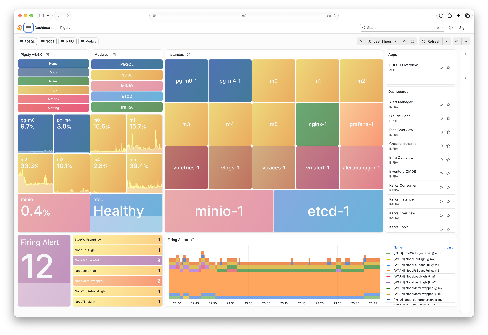

The joke goes that middle-aged men have three hobbies: **NAS boxes, routers, and chargers**.

I stayed home for all seven days of China's National Day holiday. Rather than fight the holiday crowds, I kept my head down and worked.

I didn't spend the entire week just grinding away at my desk, though. While I was at it, I overhauled my home network from end to end: bought two new NAS units, sold two old ones, added a 10GbE switch and a handful of 10GbE NICs, and pulled together a full 10GbE LAN inside a rolling 12U rack.

All three hobbies, checked off at once.

## Why Now: AI Agents Ate My Disk Space

What triggered this sudden NAS and network overhaul? Ironically, AI agents forced my hand. My two daily-driver laptops—an M1 Max and an M5 Max—each have 8 TB of local storage. On paper, that is plenty. In practice, once you start doing "make-a-wish" agentic coding, 8 TB burns down fast.

It kept happening: I would start with 2 TB free, fire off a prompt telling an agent to build something, and come back to a full disk and a stalled task. After getting burned a few times too many, I decided to set up a proper NAS and offload all the miscellaneous clutter.

## Choosing a NAS: The Compact Beelink ME Pro

I already had two Synology units:

- **DS918+** (bought in 2018): 4 bays, populated with four 10 TB HGST hard drives.
- **DS720+**: 2 bays, populated with two 16 TB Seagate IronWolf hard drives.

I had also pulled two 4 TB NVMe SSDs from a desktop recently, and had a few other spare SSDs sitting in a drawer. I figured I could put those idle drives to work in a new 10GbE NAS.

I went through a pile of reviews, including DIY-friendly NAS distributions like fnOS. At first, Minisforum's five-bay N5 series caught my eye. Then I came across Beelink's compact four-bay **ME Pro** (which also comes in a two-bay model), and it immediately won me over.

I already had a good impression of Beelink. A year ago, I bought their [GTR9 Pro AMD mini PC](/ai/local-200b/) for a little over 10,000 yuan; today it goes for 24,000 yuan. That little machine has been a workhorse—it runs most of my x86 builds and compiles many of the extensions in PGEXT.

Compared with the bulky Minisforum N5 chassis, the ME Pro is much smaller and cleaner-looking. It matches the height of my two Synology units, so they line up neatly side by side. Better still, it uses a **replaceable motherboard**: you can choose from several Intel and AMD CPUs, or even a Loongson board, and upgrade later by swapping the board alone. I'll likely look for this design again next time I buy.

The unit arrived with Windows 11 Pro, which I wiped immediately in favor of Ubuntu 26.04. Its onboard 10GbE port worked out of the box. I also slotted in the salvaged NVMe SSDs, making it a nice testbed for projects like Silo, a single-node multi-disk object store.

The barebones unit was a bargain at 2,000 yuan, though adding 32 GB of RAM and a 512 GB boot SSD tacked on another 2,000 to 3,000 yuan. Memory and storage prices are brutal right now, especially for NAS hard drives: four years ago, a 16 TB drive cost me 3,000 yuan; instead of getting cheaper, the same capacity now runs 5,000 to 6,000 yuan. Ridiculous.

It's a neat little machine—I'll write a dedicated post about it later.

## Upgrading the Synology: 10GbE for ~800 Yuan Net

I went back and forth on whether to replace the old DS918+.

It was still holding up fine. Even with only dual 1GbE ports onboard, a USB 5GbE adapter could push it to 5 Gbps—plenty of bandwidth for four spinning disks. Still, if I was moving the rest of the network to 10GbE, why leave the NAS as the bottleneck?

So I picked up a used **DS923+** on Xianyu, China's secondhand marketplace, for around 2,600 yuan. I skipped the newer DS925+ because the DS923+ still accepts Synology's official 10GbE add-in card. That proprietary module cost another 700-plus yuan—classic Synology pricing when a USB 10GbE adapter costs 200 to 300 yuan. Together, the NAS and card came to 3,319 yuan.

Then I sold off the old units to recoup the cost:

- Listed the DS918+ on Xianyu for 1,400 yuan, and let it go to a friend for 1,200.
- Listed the DS720+ for 1,400 yuan, and sold it outright for 1,300.

Both sold within half an hour of listing, bringing back 2,500 yuan. **For a net outlay of just over 800 yuan**, my Synology storage was on 10GbE.

## Storage Pools: Three Pools, Three Jobs

With all the drives in place, I split the storage into three pools:

| Device | Drives | Array | Usable capacity | Purpose |
| --- | --- | --- | --- | --- |
| DS923+ | 4 × 10 TB HGST | SHR-1 | ~26 TB | Primary storage pool |
| ME Pro | 2 × 16 TB Seagate IronWolf | RAID 0 | ~30 TB | Bulk storage pool |
| ME Pro | 2 × 4 TB NVMe | RAID 0 | ~8 TB | Large databases |

## 10GbE Networking: A 1,300-Yuan Switch

Previously, my home network ran off an ASUS ROG "Magic Box" Wi-Fi router with eight 2.5GbE ports. A 2.5GbE LAN was serviceable, but it always felt a step short of what I wanted.

So I picked up a 10GbE switch from the domestic brand XikeStor for around 1,300 yuan.

That gave both NAS boxes and the GTR9 Pro 10GbE ports, leaving my three MacBooks—the two main laptops plus an old 2018 Intel model. Conveniently, XikeStor also sells USB 10GbE adapters for 300 yuan apiece, each bundled with a Thunderbolt 4 cable. Plugging one into each MacBook brought the entire LAN onto 10GbE.

## Power and Rack: Three Cables Under the Desk

For USB-C power, I went with a 240 W Hagibis desktop charger that supports USB PD 3.2 AVS (ready to charge an iPhone 18) and has four built-in retractable cables, three of which feed the MacBooks. Their combined rated power exceeds 300 W, but they rarely run flat out at the same time, so 240 W handles them fine. Besides, my primary M5 Max draws power through its desktop dock anyway, leaving the charger with only two laptops to supply.

Main AC power runs through a Bull rack PDU with surge protection and a digital display.

With the gear sorted, I needed an enclosure. I originally planned to frame one out of aluminum extrusion, but after working out the dimensions, I bought a ready-made 12U rack on Taobao for a little over 200 yuan and assembled it myself. The space allocation worked out cleanly:

- **Bottom 5U**: Both NAS boxes, power bricks, and the PDU.
- **Middle 4U**: The switch, charger, and GTR9 Pro, with room left to tuck a Mac Studio in back later.
- **Top 3U**: One MacBook per shelf, normally running in clamshell mode as servers.

Only three cables leave the rack: main power, an Ethernet uplink, and a single cable to the monitor dock on my desk. The rack sits on casters, rolls around easily, and tucks right under the desk—much cleaner than having gear sprawled across the tabletop.

All told, the 10GbE mini-rack came to 7,000–8,000 yuan. Chargers, NAS boxes, and routing/switching: all three midlife pastimes in one frame.

## The Era of the "PC-Building Guru" Is Over

The most interesting part of the build was how much of the process AI handled.

Picking the rack specs—width, depth, and layout—went straight to Claude Opus 5.5. Give it the model names of every device, and it calculates the dimensions, airflow, and power layout, then hands back a diagram you can build from.

Installing NICs, loading drivers, partitioning and formatting drives, installing the OS, configuring SSH—all the tedious setup chores that used to eat up a weekend now take little more than a prompt. As long as a machine powers on and accepts SSH connections, Codex and Claude can configure the rest. Add an IP KVM, and agents could handle the whole lifecycle end to end.

**The era of needing a PC-building guru is gone for good.**

## Prerequisites for Leaving the Cloud

This points to a larger topic: **leaving the cloud**.

Cloud exit has prerequisites. Many engineers who grew up cloud-native have never touched a physical server, a rack, a PDU, or network hardware. Today, without spending much money, you can get hands-on experience with all of it at home: figure out how the hardware works, then bring it up yourself. That is rewarding in its own right.

Take my six local machines. Four of them run Linux and host a complete Pigsty environment running:

- PostgreSQL databases and Silo object storage.
- Internal tools and dashboards.
- Monitoring, build coordination, and task queues.
- Git repositories and internal CI/CD.
- Business and financial workflows on Odoo.

Everything runs locally on my own hardware. It is a small footprint, but all the pieces of a modern company platform are there—**one person covering what used to take an entire infrastructure team**. It is an interesting experiment, and if you are considering a cloud exit, it is great practice: with agents taking care of the setup toil, a single engineer can run the whole stack independently.

Of course, production data centers operate on a very different scale now: 25GbE is the baseline, 100G and 400G optical transceivers are everywhere, and nobody runs 10GBASE-T copper in a serious deployment. Still, the fundamentals transfer directly: rack dimensions, power distribution, and cable routing follow the same rules. And frankly, physical infrastructure skills may hold up against AI replacement better than writing code—**AI still can't grow a pair of hands and plug in that Ethernet cable for you.**

## Closing Thoughts

No wonder people joke about these being middle-aged men's hobbies: the tinkering itself is the fun.

That is the big picture for now. When I have some time in a few days, I'll follow up with a detailed breakdown of the specific hardware and the reasoning behind each pick.
