Last night before bed, I threw together a quick post on [the three gadgets middle-aged men obsess over](/en/db/homelab-10g/): NAS boxes, routers, and chargers. It picked up more than 30,000 reads in a single day. Apparently the stereotype holds up.

In that post, I mentioned I would write a separate piece today on my new Beelink ME Pro NAS. So here I am before bed again, writing about this little aluminum cube. Standard disclaimer first: nobody paid me for this, and it is not a sponsored post. I bought everything here with my own money for my own homelab.

## How I Ended Up Looking at Beelink

I first noticed Beelink's mini PCs when DHH was promoting Omarchy. He was experimenting with Linux mini PCs, found that Beelink's compact boxes worked well for Omarchy, and posted a string of tweets about them that got my attention. Last September, I went through Beelink's entire lineup and eventually bought a GTR9 Pro: an AMD Ryzen AI Max+ 395 with 128 GB of RAM, which I wrote about in [“WinStudio: Running a 200B Model Locally for ¥10,000?”](/ai/local-200b/).

On paper, that machine might be my highest-returning “investment” of the past year: the official retail price climbed from just over ¥10,000 to ¥27,000. In daily use, it has been great—fast compile times, plenty of headroom for test VMs and a PostgreSQL extension build farm, and near-silent operation. It is far easier to live with than my old Dell PowerEdge R730 server.

My only regret is not buying a few more at the time. Once the RAM price surge pushed the sticker price to ¥27,000, buying another was out of the question, though the rest of the catalog was still worth a look.

## Why Another NAS?

High-memory mini PCs aren't the bargain they were a few months ago, which left another category worth tinkering with: NAS hardware.

Say “NAS” and most people think of Synology, QNAP, or TerraMaster. Over the past couple of years, though, a wave of newcomers has entered the market: Beelink, Minisforum, fnOS, UGREEN, and even Xiaomi.

I have used Synology for years. Synology charges a steep premium—meaning poor hardware specs for the money—and most of what you are paying for is DSM, the software stack. It works out of the box, manages storage pools cleanly, and requires almost no babysitting. If you have the budget and don't want to tinker, Synology is still the easiest recommendation.

As I mentioned in yesterday's post, I previously ran a Synology DS918+ alongside a two-bay DS720+. I sold both yesterday and consolidated onto a DS923+ with a 10GbE upgrade. My primary data—the files I cannot afford to lose or corrupt—still lives on that Synology as the authoritative copy. Outside of that, though, I don't mind having a second NAS to experiment with.

The immediate trigger was simpler: my China Merchants Bank credit card offers 10x points on my birthday, so I was looking for an excuse to buy something. I came across the ME Pro, checked the specs, and realized it matched my spare-parts pile to the letter: four spinning hard drives and four NVMe SSDs pulled from old desktops. The ME Pro has four 3.5-inch drive bays and four M.2 slots, enough to put every last one of those drives back to work. Why not?

## Minisforum N5 vs. Beelink ME Pro

At first, I was actually leaning toward the Minisforum N5 series. It is another tidy-looking box, with five drive bays. The top-tier N5 Max runs the same AMD Ryzen AI Max+ 395 as my GTR9 Pro. On second thought, though, I already had a machine with that chip; buying a second one made little sense when what I needed here was storage.

The N5 Air and N5 Pro also looked solid, and the N5 Pro supports ECC memory. All three share the same five-bay enclosure, though, and the dealbreaker for me was its bulk. I also didn't have a fifth hard drive on hand. When I checked drive prices to see what filling another one to three bays would cost, I backed right off: a 16 TB Seagate IronWolf cost me ¥3,300 in 2022, and JD now lists the same drive at ¥5,900—nearly double. At those prices, five bays were unnecessary.

The ME Pro has four bays in a tight, space-efficient chassis. Better yet, it matches the exact height of my Synology, so both sit neatly side by side on the same rack shelf. Beelink makes two-bay and four-bay versions, but for any reasonably serious NAS setup, four bays is the baseline.

To be fair, the Minisforum N5 is a strong contender. My final shortlist came down to the N5 series and the four-bay Beelink ME Pro. With the national trade-in subsidy and a store promotion, the ME Pro came out to ¥4,819.

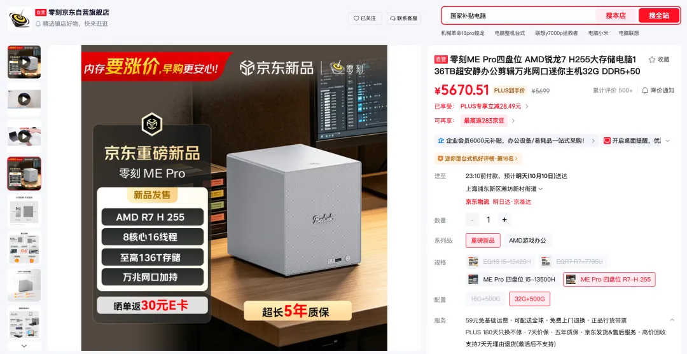

## Why Beelink Won Out

What tipped the decision to Beelink?

Size was the main factor. The CNC-machined unibody aluminum chassis on the four-bay model measures roughly [165 × 145 × 165 mm without the feet](https://www.bee-link.com.cn/computer-73493777)—remarkably compact, and about as tall as an iPhone Pro Max. I meant to take more photos, but both NAS boxes were busy copying data and I didn't feel like moving them. These shots should give a rough sense of scale.

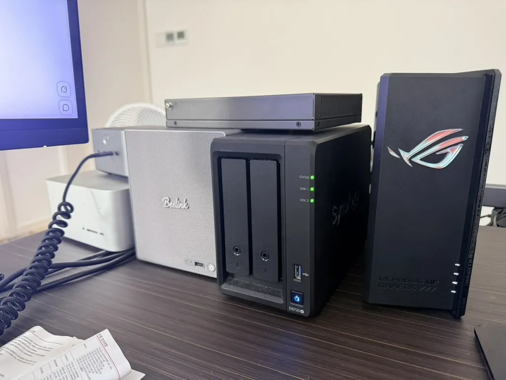

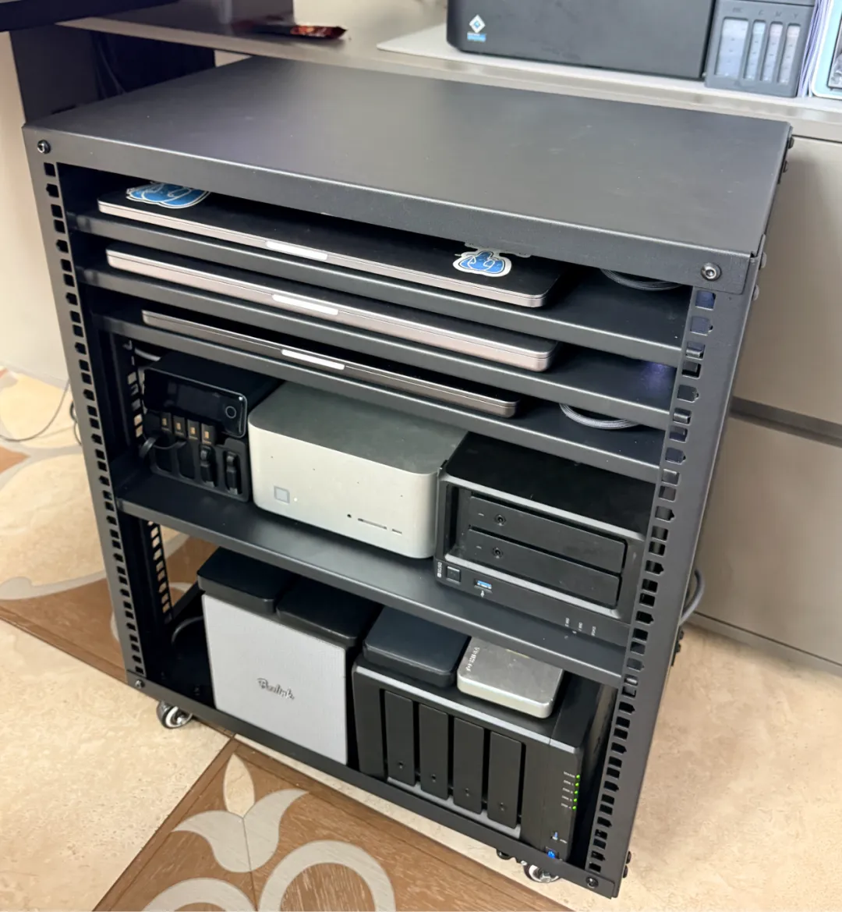

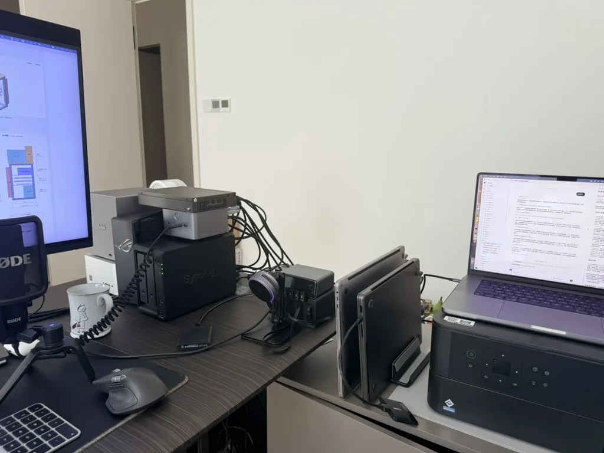

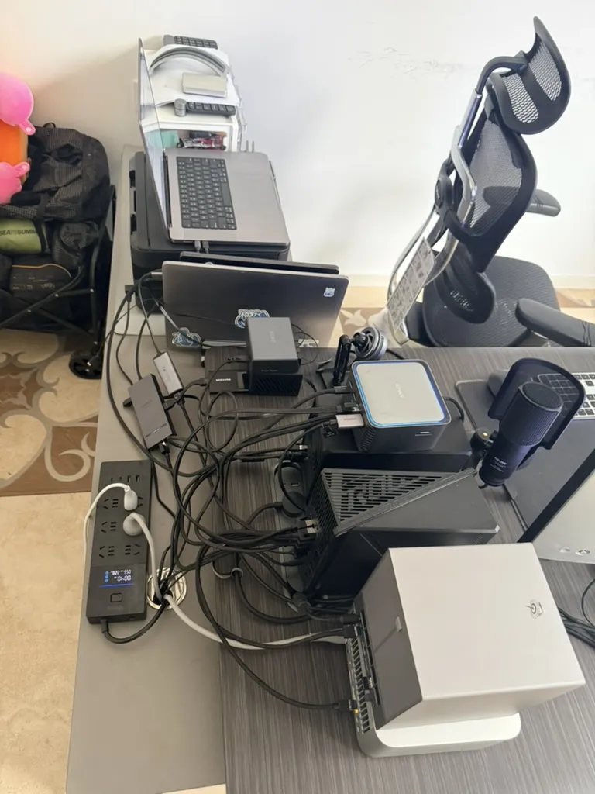

Another design detail I like is the modular compute sled. The motherboard sits on a slide-out drawer that pulls out just like a drive tray, allowing the entire board assembly to be swapped across different processor platforms. Beelink doesn't appear to sell standalone replacement boards yet, but the mechanical design leaves the door open for upgrades and makes routine dust cleaning much easier.

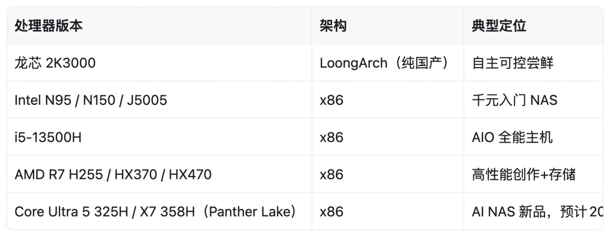

I bought the lower-cost Ryzen 7 H 255 model. Beelink also lists HX 370 and HX 470 versions, plus—wildly enough—a Loongson motherboard option. I previously helped get [Loongson (`loong64`) support into the official PostgreSQL APT repository](/pg/pg-apt-loong64/). If I ever need to test Loongson builds locally, I won't need to buy another oddball machine; I can just slide a Loongson ME Pro board into this chassis.

## Hands-On: Bring a Screwdriver

In person, the hardware is easy to like.

Coming from Synology, though, you will be turning a lot of screws. The rear cover over the drive bays is magnetic and pops right off, but all four internal drive trays are secured with hex screws (an Allen key is tucked into the underside of the chassis). Pulling or installing a drive means backing those screws out and threading them back in every time—far more fiddly than Synology's tool-free snap-in trays.

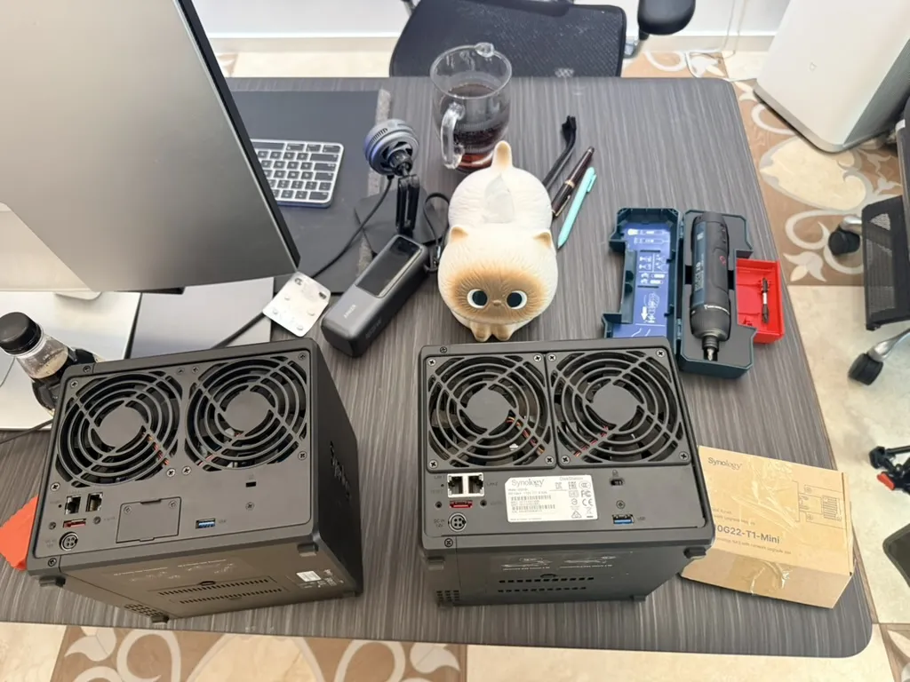

*With a Bosch Go electric screwdriver in hand, I'm ready for anything.*

The NVMe slots require some disassembly too. One major reason I picked the “lower-tier” Ryzen 7 H 255 model is that while the CPU is modest, its M.2 allocation is generous—four slots in total:

- Two PCIe ×4 slots on the underside of the motherboard;
- One PCIe ×4 slot on top for the boot drive;
- One PCIe ×1 slot right next to the boot drive, left empty from the factory.

If you only want to add two NVMe drives, you just pop the bottom cover and undo two screws. To populate that fourth ×1 slot as well, you have to slide out the motherboard drawer, remove three screws holding the cooling fan, undo two more screws on the top SSD heatsink cover, and then seat the drive. It takes a bit of work, though turning a few screws is hardly an obstacle.

## OS Setup: Wipe Windows, Install Ubuntu

Beelink sells a few configurations at checkout. The cheapest is a barebones unit without RAM or storage for a little over ¥2,000. I bought the bundle with 32 GB of RAM and a 500 GB system SSD for about ¥4,800, since buying 32 GB of RAM separately right now would have cost more than the bundled difference.

The machine ships with Windows 11 Pro preinstalled. I had no use for that, so I wiped the drive immediately and installed Ubuntu.

You can also install fnOS. Friends who use it say the user experience is polished and ranks among the better third-party NAS operating systems available today. I didn't feel like learning another appliance UI, and I don't need media-center bells and whistles. I just need storage: build the RAID arrays, export an SMB share, and mount it locally. Stock Ubuntu handles that without fuss.

If you want a turnkey NAS experience closer to Synology DSM, fnOS is probably the better route. I haven't tested it myself, but from what I gather, fnOS's own branded NAS hardware is manufactured by Beelink anyway, making the ME Pro quasi-first-party hardware for it.

## PC NAS: A Hybrid Category

Strictly speaking, machines like this aren't traditional NAS appliances anymore. They are closer to a PC and a NAS in one box—call it a “PC NAS.”

Traditional NAS units only care about storage; their compute is negligible. Across my three Synology boxes, the CPUs are either dual-core embedded Ryzens or quad-core Celerons paired with 2 to 4 GB of RAM. By today's standards, what can you actually run on such anemic hardware? Pretty much one thing: file storage.

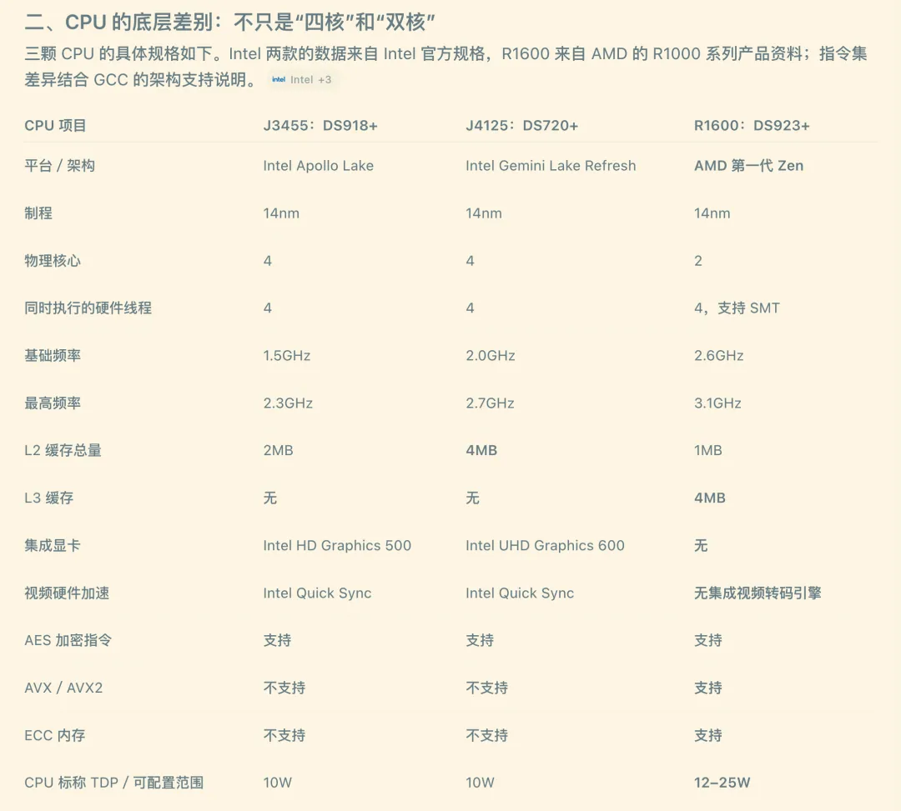

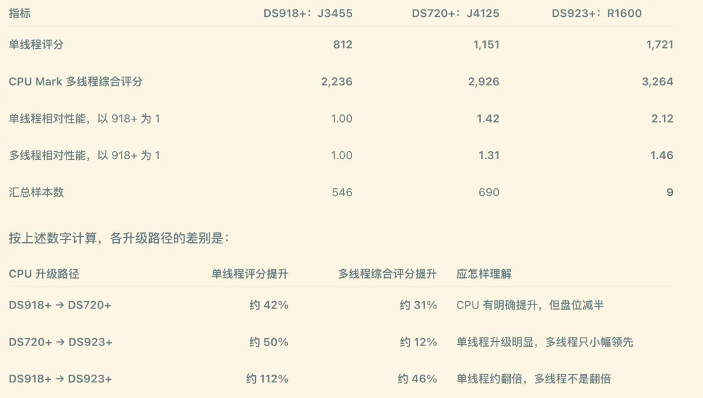

The newer crop of NAS boxes—whether from Synology, Beelink, or Minisforum—finally ships with usable CPU performance. The Ryzen 7 H 255 is an 8-core, 16-thread Zen 4 chip, which is plenty capable of running real workloads alongside storage.

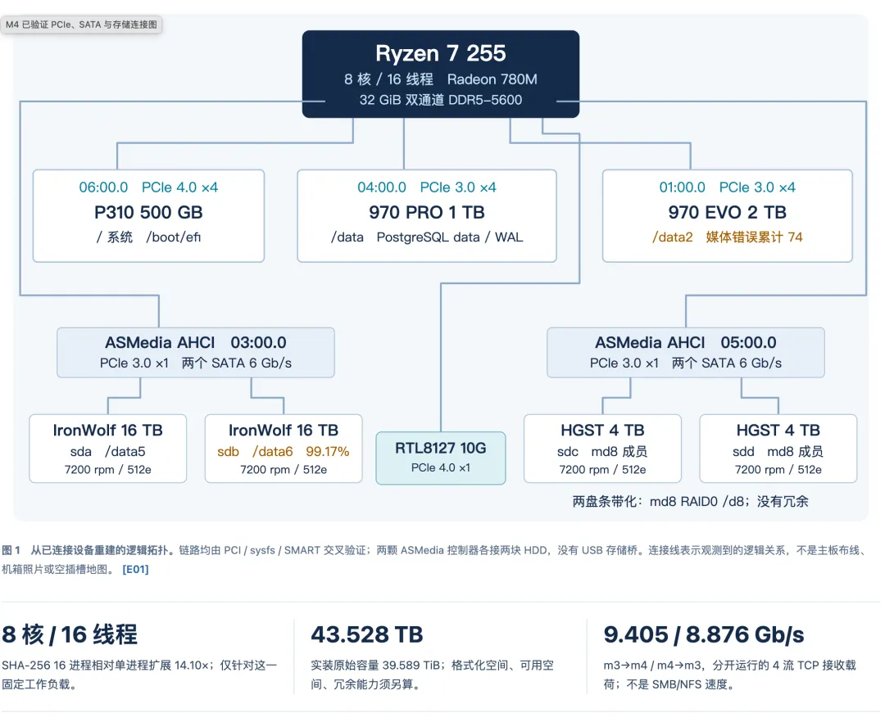

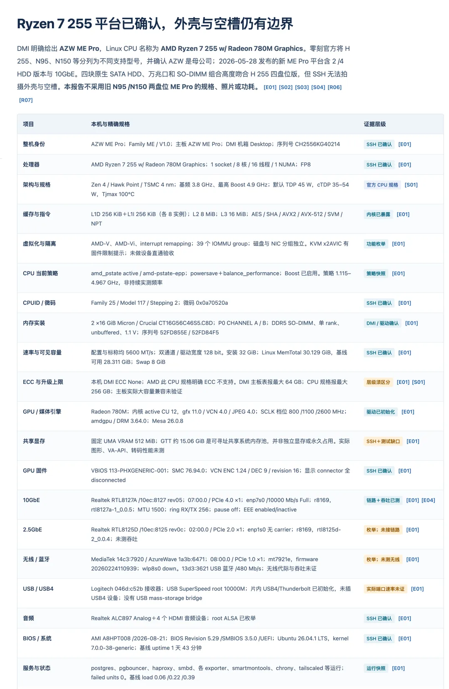

Honestly, if I didn't already own the GTR9 Pro, I probably would have bought the Minisforum N5 Max with an AMD Ryzen AI Max 395/495 and let a single box handle both storage and heavy compute.

One natural workload for a NAS with real CPU headroom is self-hosted photo management. Synology Photos is fairly bare-bones; if you want a self-hosted photo library that feels close to Apple Photos, the server needs some compute for indexing and ML tasks. I run Immich for this. The catch with Immich is that it requires PostgreSQL—and not just vanilla PostgreSQL, but one equipped with vector search extensions. `pgvector` is still the foundation, and [current Immich deployments also use VectorChord on top of it](https://docs.immich.app/administration/postgres-standalone/).

Most people spin it up with Docker Compose. Since I maintain Pigsty, I naturally used my own stack: a one-command PostgreSQL deployment via Pigsty with Immich running on top, which now hosts my entire photo library. Here are the [deployment docs](https://pigsty.cc/docs/app/immich/).

[Pigsty v4.4 Release](/en/pigsty/v4.4/): Native Immich support

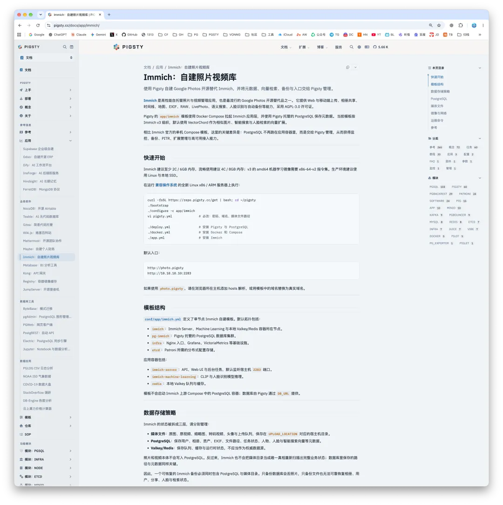

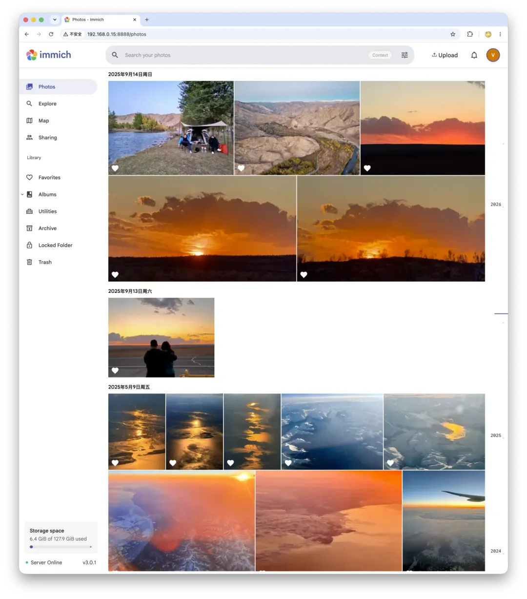

## What Do I Actually Keep on a NAS?

Which brings us back to a basic question: what do you actually use a NAS for?

Most people treat a NAS as a private cloud drive for movies, photos, and raw footage. Video creators use them heavily because camera footage has to live somewhere, and my use case isn't much different.

My Synology DS923+ provides about 26 TB of usable capacity, which is just enough to hold all my primary data (roughly 25 TB after deduplication). Because the Synology holds a complete, authoritative copy, I skipped parity on the ME Pro and striped the drives in RAID 0:

- **30 TB pool (two 16 TB HDDs):** mirrors the files from the Synology, plus overflow data that previously didn't fit;
- **8 TB pool (two 4 TB HDDs):** holds private-tracker datasets alongside video-editing footage and project files.

Its biggest payoff, though, is freeing up the 8 TB internal SSDs on both of my daily-driver Macs (an M1 Max and an M5 Max) so that flash storage can stay dedicated to coding work. Apple prices internal flash storage like solid gold; spinning rust in a NAS is a much better place for cold data.

## What's Next on the Hardware List?

I now have six computers running on my home LAN. I'm glad I never sold off the older ones for scrap value—in the AI agent era, every one of those older machines has found a second life.

I still have a couple of older systems sitting around that I've been thinking about repurposing:

1. An old X99 gaming rig with a 2019-era flagship CPU, 32 GB of RAM, and an RTX 2080 Ti.
2. A Dell PowerEdge R730 server with sixteen 16 GB ECC DIMMs (256 GB total), dual CPUs totaling 36 cores and 72 threads, and a 3.2 TB PCIe NVMe SSD.

Throwing those parts out would be a waste, and combining them would yield a capable machine. The catch is noise and power draw. Right now, my entire rack plus monitor idles around 400 W and peaks around 700–800 W under full load. A 2U rack server can burn that much power all by itself under load.

More importantly, my current rack is nearly silent—aside from some faint drive chatter during heavy seeks, which doesn't bother me at all. It sits right next to my desk and doubles as a space heater in cold weather. Living next to screaming server fans is a non-starter.

I looked into transplanting those parts into a quieter chassis. Decade-old dual-socket workstation towers like the Dell Precision T7910 or HP Z840 fit the bill: I could pick up a bare chassis, move over the R730's dual CPUs and 16 DIMMs, drop in the GPU and PCIe NVMe card, and maybe tinker with some Intel Optane drives or a Micron X100—prime retired enterprise surplus hardware.

When I thought it through, though, I couldn't come up with a workload that actually needed that box.

If I'm being honest, there are only two machines I really want right now.

The first is a Mac Studio with an M5 Ultra and 512 GB of unified memory. Half a terabyte of unified memory is enough to run GLM-5, GLM-5.3, and GLM-5.3 Flash-class models locally at usable token speeds, including uncensored weights.

Some context here: I already have Zhipu's v1 Max GLM Coding Plan, which costs next to nothing for the volume it provides, plus ¥16,000 sitting in my Zhipu account balance—enough to cover years of subscriptions. Cloud quota and model capability aren't the issue. Even with free cloud credits, though, I am not comfortable handing a personal assistant with deep local access over to a cloud API; [what ZCode did was warning enough](/en/ai/zcode-upload/).

What I want is a single box running an always-on, uncapped, strictly local dispatcher—an assistant that routes tasks across my fleet and handles routine jobs itself. That will probably be my next computer.

The second machine would be a top-end AMD desktop paired with a serious GPU. If street prices on the RTX 5090 or RTX Pro 6000 ever come back down to earth, I'd love to pick one up. I'm still kicking myself for not buying a card a few months ago when pricing was reasonable.

The remastered *Witcher 3* just came out, and with a new expansion, *The Witcher 4*, and other GPU-heavy titles lined up, nursing my old RTX 2080 Ti along is getting painful. What I'd really love to see is a breakthrough in NVIDIA driver support on Apple Silicon—or a community workaround—so I could hang an NVIDIA eGPU off a Mac or the GTR9 Pro and game on that.

Anyway, that is all for another day. Between the Synology DS923+ and the Beelink ME Pro, my storage setup is set for the next five years. I doubt I'll buy another NAS during that stretch; any storage tinkering from here on out will probably just be playing with old Intel Optane or Micron X100 drives.

## Closing Advice for NAS Buyers

That about covers it. To wrap up, a few practical takeaways if you are shopping for a NAS:

If you don't want to tinker and just want an appliance that works, Synology is still the best option on the market. DSM is mature, the package ecosystem is well-integrated, and the tool-free drive bays don't require turning a single screw. The hardware markup, however, is brutal: for the same money, you get an anemic CPU and 1GbE networking, which feels borderline insulting. You are paying strictly for peace of mind.

If you are willing to get your hands dirty, hardware like the Beelink ME Pro is much more interesting. Calling it a NAS undersells it; it is really a PC NAS. If you want an appliance UI, install fnOS. If you just need a fast storage server, let Codex walk you through the Linux storage and SMB configuration and mount the shares on your workstations—it takes very little effort.

As for me, I wanted both: a hands-off, near-enterprise appliance for my primary data, and an open box where I can tinker and run whatever open-source stack I like. Buying one of each solved the problem cleanly.
