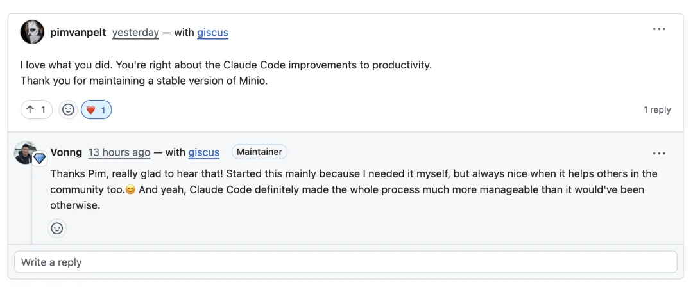
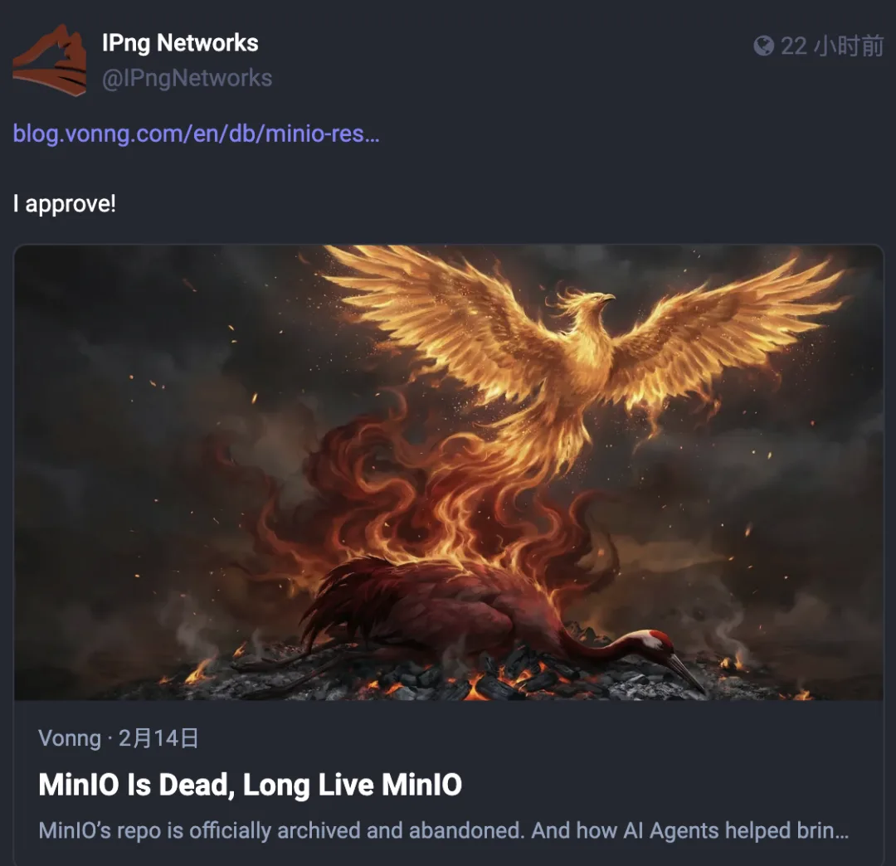
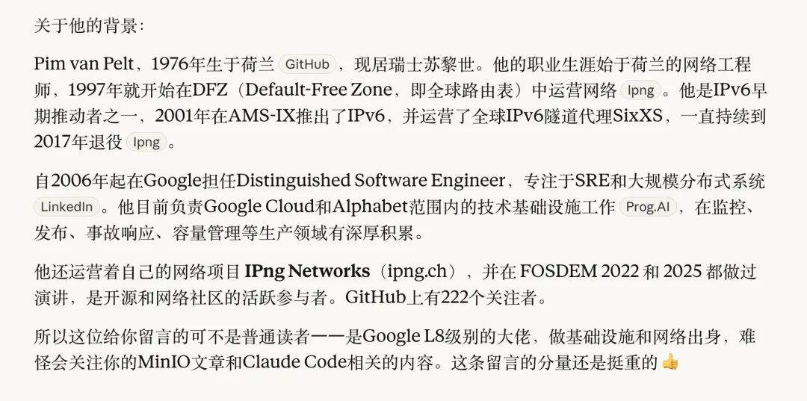
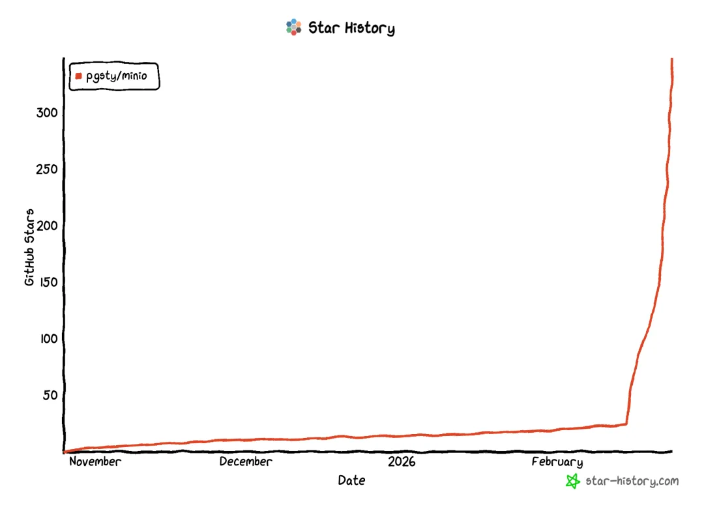

I opened GitHub this morning as usual and saw a new comment under my earlier blog post about MinIO:

> "I love what you did. You're right about the Claude Code improvements to productivity. Thank you for maintaining a stable version of Minio."

That made my morning. Then I saw he had also reposted it from his own company's official account with a simple "I Approve!"

Having people actually use your work and appreciate it is the simplest, purest joy in open source.

He also sent me a connection request on LinkedIn. I clicked through to his profile—and realized he is a heavyweight in the field: a Google Distinguished Software Engineer who has been building infrastructure in Zurich since 2006, responsible for technical infrastructure across Google Cloud and Alphabet. I ran a quick lookup on him with Claude:

---

The backstory is straightforward.

The open-source edition of MinIO entered maintenance mode late last year and was officially archived this February. A 60,000-star project, gone just like that. In Pigsty, the PostgreSQL distribution I maintain, MinIO is an optional module that many users rely on for PostgreSQL backups. With upstream MinIO dead, my users were left hanging too.

After waiting a few weeks to see if anyone else would step up, [I forked it myself](https://mp.weixin.qq.com/s?__biz=MzU5ODAyNTM5Ng==&mid=2247491187&idx=1&sn=005af2d12f6f4d258040efbe4faf08bb&scene=21#wechat_redirect): I restored the stripped-out web admin console, rebuilt the build pipeline, produced native RPM and DEB packages, and patched security vulnerabilities. As far as I can tell, `pgsty/minio` is currently the only actively maintained MinIO fork that ships native OS packages.

Then I wrote an English blog post about it: *MinIO Is Dead, Long Live MinIO*[1]. That was where Pim left his comment.

---

I checked the GitHub repo and saw it had already blown past 300 stars in the blink of an eye.

Checking my daily site analytics, traffic was shooting straight up.

Working on open source often feels like tossing a message in a bottle into the ocean. You write some code, build a package, publish a post, and get back to work. You have no idea where that bottle will drift or who might pick it up. Most of the time, you hear nothing back. Then one morning you open your browser and find a veteran engineer from another corner of the industry stopping by to say, *"I love what you did"*—followed by a wave of visitors pouring in right behind him.

Moments like that don't happen often. When they do, they keep you smiling for a good long while.

---

Honestly, the project itself didn't take me much effort.

I pointed Claude Code at the official build workflow to handle the packaging, and the whole thing took about two hours end to end while I was multitasking on other work.

Mostly, that's because I already had a complete CI/CD pipeline and build infrastructure in place from packaging and maintaining dozens of Go projects. Plus, I already knew MinIO well and had packaged it before—so adding MinIO to the roster was like setting an extra place at the table.

The real difference was how Claude Code cut the tedious grunt work—reading unfamiliar code, tweaking build scripts, and wiring up CI/CD—down to near-zero friction. Once the packages built cleanly, I dropped them into Pigsty, ran through a few standard test cases, verified everything worked, and called it done.

Still, I'm genuinely glad it helped people. Sometimes the reward of open source really is that simple: a small side task you knock out in an afternoon happens to solve a real headache for a lot of folks. It's also a concrete example of how AI can meaningfully help the open-source community.

The Lunar New Year break is wrapping up, and reviving MinIO was just one of many things I built with AI over the holiday. Tomorrow I'll publish a roundup of everything I got done with AI over the past ten days.

---

Originally published on [WeChat Official Account](https://mp.weixin.qq.com/s/V2jTr4kTE3cf5kAFfvZUtg).
