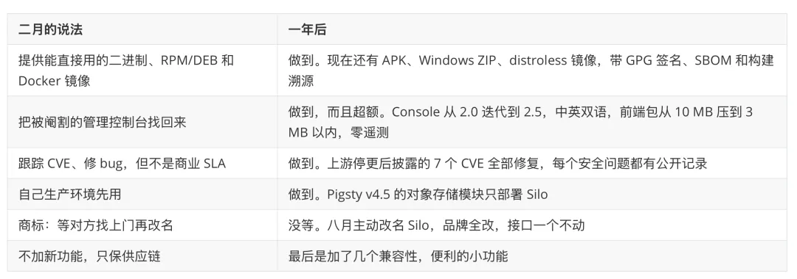

On October 15, 2025, MinIO published its final open-source release, then progressively locked down and archived the repository.

At the time, I figured I would wait a month or two to see if someone in the community would step up and take it over. Nobody did. So I rolled up my sleeves and forked it myself—what is now Silo: `pgsty/silo`.

My original goal was modest. In Pigsty, we use MinIO as an optional backup repository for PostgreSQL. Once upstream walked away, I owed my users a working software supply chain. So I hit Fork and built binaries for our own use.

It quickly became clear that plenty of others in the community still needed open-source MinIO binaries too. Since I was already building them for myself, I figured I might as well publish them for everyone. In February, I wrote [MinIO Is Dead, Long Live MinIO](https://mp.weixin.qq.com/s?__biz=MzU5ODAyNTM5Ng==&mid=2247491187&idx=1&sn=005af2d12f6f4d258040efbe4faf08bb&scene=21#wechat_redirect), which unexpectedly landed on the front page of Hacker News.

A year later, here is where things stand: **4,300+ GitHub stars**, **5 million** Docker image pulls, **20 security vulnerabilities** patched, and dozens of bugs fixed. We have shipped on a steady monthly cadence, stayed on top of security advisories, cleaned up defects inherited from upstream, restored the full Web Console that upstream had gutted from the open-source edition, and built a modernized frontend rewrite alongside it.

A long list of open-source projects that previously depended on MinIO—including ClickHouse, Grafana Loki, Testcontainers, RAGFlow, and 1Panel—have since migrated smoothly to Silo.

By those numbers, the life-support effort has worked out well. Yesterday (October 26, 2026), we shipped the `20261026` release. Since it marks the one-year milestone, rather than writing another routine release note, I want to share what I have learned over the past year keeping a "dead" open-source project alive.

## Open Source Runs the Gauntlet

Over the past month, half the internet has been riddled with holes, with a dizzying wave of security vulnerabilities dropping throughout October. As I wrote recently in [When the Cloud Gets Riddled with Holes](https://mp.weixin.qq.com/s?__biz=MzU5ODAyNTM5Ng==&mid=2247493702&idx=1&sn=23231259ad592eb2f45e5a2f672298a8&scene=21#wechat_redirect) and [When the Internet Actually Gets Riddled with Holes](https://mp.weixin.qq.com/s?__biz=MzU5ODAyNTM5Ng==&mid=2247493712&idx=1&sn=2edd004cb0e18d0c7341f941127b9317&scene=21#wechat_redirect), open-source software is going through an unprecedented trial by fire.

Why? Frontier LLMs are now scanning open-source repositories around the clock, unearthing decades-old bugs at industrial scale. And the moment a security patch becomes public, AI drops the cost of reverse-engineering a working exploit to near zero. Right now, if your patching lags by even half a beat, any script kiddie with GLM, a jailbroken GLM, or Qwen can diff the commit and swiss-cheese every unpatched deployment on the internet.

I have had a front-row seat to the spectacle—and taken plenty of punches myself. We have fielded a steady stream of security disclosures and bug reports for Silo lately. Frankly, I underestimated what it takes to maintain a codebase of this size. When I wrote the fork announcement in February, I confidently remarked: **"I'm not building new features, just maintaining it—how many MinIO CVEs have you ever seen?"** That held up for the first half of the year: we patched a handful of issues and things stayed quiet. Then over the past few months, vulnerabilities started popping off like popcorn.

## Measured Against PostgreSQL, It's Amateur Hour

My day job is PostgreSQL, so I instinctively judge infrastructure software by PostgreSQL's engineering standards. Measured against that bar, MinIO looks like **amateur hour**. Once you get deep into maintaining the codebase, you realize most of the bugs surfacing today were never newly introduced—they are years of technical debt that upstream either ignored or left half-baked. A few representative examples:

- **Features implemented, but never wired up:** Take `--read-header-timeout`. It defaults to 30 seconds, accepts a CLI flag, and is documented clearly—yet the value was never passed into the underlying `http.Server` constructor. Classic Slowloris attacks (drip-feeding HTTP headers to exhaust server connections) worked against it out of the box. Or take the erasure-coding read path: it dutifully checked out a buffer from the memory pool, then never passed it to the reader, allocating fresh memory on every read anyway—pure performance theater.
- **APIs that lie with a straight face:** In the final upstream release, the bucket-level CORS endpoints were registered in the router, but `GET` returned an empty stub while `PUT` and `DELETE` threw `NotImplemented`. Per-bucket CORS simply didn't work. Multipart uploads were even worse: upload a single 5 MiB part, complete the upload with a duplicate part list `[1, 1]`, and the server would happily return HTTP 200—conjuring a 10 MiB object out of thin air.
- **Features that work in isolation, but destroy data or infinite-loop when combined:** If you enabled lifecycle expiration on a versioned bucket with remote tiering, expiring the current version was supposed to write a delete marker while leaving older versions intact in cold storage. Instead, upstream's implementation deleted the underlying data in remote storage first. In another case, multipart objects using full-object CRC32 checksums dropped the checksum type metadata during cross-site replication; the target cluster validated against the default algorithm, threw `BadDigest`, and trapped the source cluster in an infinite retry loop.
- **Zero blast-radius isolation:** One malformed NATS notification target would silently take down Kafka, Webhook, and MQTT notifications along with it. And an IAM policy scoped to `bucket/*`—meant only to grant access to objects inside a bucket—could bleed into bucket-level operations via a trailing slash, letting a client flip the entire bucket to anonymous read-write.

And that doesn't even count the seven formal CVEs. The worst of them, **CVE-2026-33322** (CVSS 9.8), was an OIDC JWT algorithm-confusion flaw: anyone who knew the `ClientSecret` could forge tokens for any identity, including `consoleAdmin`. That vulnerability sat wide open from November 2022 until March 2026—three and a half years.

Linus's Law claims that "given enough eyeballs, all bugs are shallow." With 60,000 GitHub stars and billions of Docker pulls, MinIO had no shortage of eyeballs. Yet in practice, the vast majority of users never leave the happy path: if `PUT`, `GET`, and `LIST` work, they move on. The landmines above live in the intersections—versioned buckets plus remote tiering, multi-pool clusters plus replication, canceled requests plus slow disks. When ordinary users hit those bugs, they usually assumed they had misconfigured something. Meanwhile, upstream spent its final two years focused almost entirely on its closed-source commercial edition. The result was software that looked feature-complete on paper, but stalled out halfway on correctness.

After the repository was archived, things got even more darkly comedic. In August, we ran a systematic audit of the inter-node RPC paths. Pulling on the thread of **CVE-2026-42600**, we found 12 additional vulnerabilities inherited from upstream sharing the same root cause, the worst scoring **9.1** on CVSS 3.1. The absurd part? **None of them can get CVE IDs.** Under standard CNA rules, assigning a CVE requires the original vendor of the affected product to acknowledge the flaw and coordinate disclosure. Since `minio/minio` is archived and read-only, nobody is home to claim them.

Archiving a repository doesn't make its vulnerabilities disappear; it just orphans them. In today's threat environment, an unmaintained open-source project isn't a static artifact you can safely leave running in a corner. It is a body without an immune system—a corpse-in-waiting that will rapidly rot into a backdoor.

## Offense, Defense, and Who Does the Dirty Work

Fortunately, offense and defense cut both ways. If AI handed attackers a sledgehammer, it also gave defenders a shield. I have never been a huge fan of Anthropic, but I have to give Dario Amodei credit for getting one call right: putting frontier AI security capabilities into the hands of defenders first, buying maintainers a critical window to audit and patch their codebases before those same capabilities become ubiquitous.

Starting in July, with the arrival of models like GPT-6 Astra and Claude Fable, defenders gained serious leverage of their own. That gave me the confidence to tackle gnarly, deep-seated bugs I would never have touched solo in the past, restoring a fragile equilibrium between offense and defense at a higher level.

That said, getting access to programs like OpenAI's Daybreak or Anthropic's Glasswing takes jumping through real hoops. After all the paperwork, I only managed to get a single GPT account whitelisted, which I reserve strictly for security auditing and vulnerability discovery.

Standard commercial subscriptions, meanwhile, can be maddeningly puritanical about security work. Ask a mainstream model to analyze a vulnerability and write a fix, and half the time it trips a safety guardrail, flags your prompt as a cyberattack, and refuses to answer. So we had to split the workflow—and occasionally farm out the dirty work to less squeamish models like GLM, then verify the patches through indirect validation.

A year of heavy maintenance has also given me a clear sense of where AI coding hits its limits. Asking AI to build an industrial-grade system of this scale from scratch is still a fool's errand. My earlier `pgrust` experiment proved the point: a clean-sheet rewrite in Rust stalled out completely, and we only got the regression suite passing by mechanically translating PostgreSQL's existing C codebase into Rust. Conversely, when you are maintaining an already mature codebase, AI shines—because the repository is already packed with architecture, idioms, and adjacent examples to anchor on.

Over the past month, I have had eight Codex subscriptions running in parallel, burning through the full quota of three or four of them on Silo alone. Orchestrating test suites and chasing down corner cases takes real compute and time, but the agents have pulled their weight.

## AI-Assisted Engineering and the Production Testing Moat

Even with AI doing the heavy lifting, Silo still takes up roughly a fifth to a sixth of my working hours. Maintaining core storage infrastructure is nothing like the cartoon version where you toss a bug report at an LLM and click merge. The architectural tradeoffs that determine whether a storage system survives production still require a human call.

**First is the tradeoff between correctness and performance.** Left to its own devices, Codex will chase textbook correctness by plastering hot paths with defensive checks—or letting goroutines block indefinitely waiting on a degraded disk flush long after the client has canceled the request. Sure, the race condition is gone and the logic looks airtight on paper, but now a single slow drive stalls the entire node or cuts throughput in half. Would you merge that patch? Conversely, if you cap fast-path overhead at 5% while allowing 30% extra validation on rare error paths—lifting correctness under extreme concurrency from 50% to 99%—where do you draw the line?

**Second is the backward-compatibility paradox.** Suppose upstream made a design mistake years ago—like the overly permissive `bucket/*` policy matching mentioned earlier—and users have spent years running production scripts that inadvertently rely on that broken behavior. Do you preserve the bug for backward compatibility, or fix it cleanly and break existing deployments on upgrade?

Models don't have answers for those system-level tradeoffs; a human maintainer has to make the call. Our approach is to tighten default security boundaries while providing explicit compatibility flags, and to document every major tradeoff in an Architecture Decision Record (ADR)—preserving the debate between competing models, the human reasoning, and the final verdict so future maintainers understand *why* the code looks the way it does.

Along the way, I have settled on four AI software-engineering practices that actually work in production:

1. **Companion documentation and doc-driven development:** Every subsystem lives alongside dense architecture and specification docs. Both humans and agents start from the docs, which anchor what the model is allowed to touch. I now run 40 documentation sites, and even **[built a dedicated documentation framework, Oink](https://mp.weixin.qq.com/s?__biz=MzU5ODAyNTM5Ng==&mid=2247492913&idx=1&sn=a16ef8f82c99603301e2d399f479a8ea&scene=21#wechat_redirect)**, to support this workflow.
2. **Adversarial multi-agent review:** Never trust a single model. Have different agents write and review each other's patches—one implements, another tries to tear it apart—while the human acts as the engineering manager accountable for the final merge.
3. **Strict complexity budgets:** Every change must prove itself both necessary and minimal. Penalizing complexity is the only way to keep AI-generated patches from degenerating into an unmaintainable ball of mud.
4. **Scheduled debt-paydown passes:** AI ships fixes fast, which means patch-on-patch complexity accumulates fast too. After every intense bug-hunting sprint, we dedicate token budget specifically to refactoring and structural cleanup.

Roughly 80% of the tokens we burn on Silo go toward adversarial testing and verification. Object storage sits at the bottom of the stack; if it loses data, the blast radius is massive, and my own reputation is on the line.

Even so, my biggest takeaway from the past year is simple: **nothing replaces real users in production.**

You can have AI generate ten thousand local regression tests, and your test matrix still won't capture the bizarre combinations of multi-bucket policies, multi-site replication, asymmetric networks, and quirky S3 clients that show up in the wild. Many of the nastiest bugs we fixed in Silo were only caught because real users hit them in production and filed detailed reports.

It is the exact same dynamic we see in the PostgreSQL world. Plenty of database startups claim PostgreSQL compatibility, pass syntax checks and standard regression suites with flying colors, and still never come close to replacing PostgreSQL. **You can fork the code, but you cannot fork the community.** The real moat of open source is distributed production testing: you give the software to the world for free, and the world stress-tests it across every imaginable edge case for free. That feedback loop compounds at a rate no closed-source QA team can match.

Sadly, after reaping the full benefit of community testing to harden its product, MinIO Inc. chose to slam the door on the community and go all-in on its closed-source commercial edition. People often ask me: **"Will Silo eventually pull a MinIO and launch a commercial edition too?"** Let me put this in writing: **Never.** I don't make my living selling object storage, and I have zero incentive to play that game. I have given the same advice to my friends at RustFS: respect the community and don't repeat MinIO's mistake.

## Silo vs. RustFS: Boring by Design vs. Moving Forward

Since I brought up RustFS, let's address the comparison head-on. Every time I post an update on Silo, commenters inevitably bring up RustFS, and a few spectators try to pit the two projects against each other. It always amuses me—what they don't know is that Kevin, the founder of RustFS, is an alumnus and a good friend of mine. When clients ask me for commercially supported object storage, I actively send them his way.

[RustFS 1.0 GA: Don't Become Another MinIO](https://mp.weixin.qq.com/s?__biz=MzU5ODAyNTM5Ng==&mid=2247493267&idx=1&sn=b4e87d6976ae6fe6effe7cae0eb165e4&scene=21#wechat_redirect)

So why didn't I just switch to RustFS instead of maintaining Silo? Partly because RustFS wasn't ready back then—but more importantly, because the two projects serve completely different niches.

RustFS aims to push the frontier of S3-compatible object storage, whereas Silo exists to keep an established software supply chain running without disruption. Their performance profiles differ as well: RustFS is faster on small objects, while MinIO and Silo hold an edge on larger payloads.

Although RustFS is pitched as a drop-in replacement for MinIO, the operational reality on the ground is more nuanced. Its on-disk format and S3 API are compatible, yes—but its scrubbing and recovery semantics, Prometheus and OpenTelemetry metric names, and even TLS certificate directory layouts are different. **API and data-format compatibility are not the same thing as operational drop-in compatibility.**

That last mile of operational compatibility is the exact hill Silo is built to defend. No matter how elaborate your existing MinIO deployment playbooks, Grafana dashboards, or Kubernetes manifests are, you should be able to swap `minio` for `silo` in the container image tag, change zero lines of configuration, and have everything just work—with all current security patches and bug fixes included, and without unexpected shifts in performance characteristics.

The moment a project starts chasing new features and re-architecting internals, it inevitably drifts away from what it used to be. That is why Silo's core philosophy comes down to a single word: **boring**. People ask for Silo's roadmap. There isn't one. Silo won't be chasing S3 Vectors or S3 Tables. You get one boring release a month containing security patches and correctness fixes, and nothing else.

Now that RustFS hit 1.0 GA in September, choosing between the two is straightforward:

**When to choose RustFS:**

1. **License constraints:** If legal or compliance policies prohibit strong copyleft licenses like AGPLv3, pick RustFS (Apache 2.0).
2. **Modern S3 features:** If your workload needs newer capabilities like S3 Tables, S3 Express One Zone, or native vector storage, or if small-object throughput is your primary bottleneck.
3. **Commercial support and SLAs:** If your organization wants a vendor contract with a dedicated object-storage company on the hook when things break. RustFS positions itself directly against commercial MinIO at roughly half the price.

**When to choose Silo:** If you already run a fleet of MinIO instances internally, don't care about AGPLv3, and have no desire to rewrite your monitoring dashboards and deployment automation just to stay patched—even knowing full well that Silo is maintained by one guy and a fleet of AI agents—then Silo is the cleanest, lowest-friction replacement available.

## Scope, Restraint, and What Comes Next

Looking back at the goals we set in February, we have kept every promise on the list.

On our "no new features" rule, we have allowed ourselves two pragmatic exceptions:

- **Native health-check subcommand:** Previously, running health probes in Docker Compose or Kubernetes meant bundling `curl` into the container image. We added a built-in health-check subcommand directly to the `silo` binary so a minimal image works out of the box. Small operational improvements like that are an easy yes.
- **Completing S3 compatibility semantics:** When upstream AWS S3 refines its behavior, or when MinIO left behind hollow stubs like bucket-level CORS, filling in those gaps isn't feature creep—it is paying off technical debt in a system that claims S3 compatibility.

Over the past year, users have also pitched some genuinely appealing features:

- **"Could you add on-the-fly image transcoding and thumbnail generation? Every cloud object store has it."**
- **"Could Silo act as a transparent local caching tier in front of cloud object storage?"**

Are those good ideas? Sure. We still said no to all of them.

The math is simple: I am not running an object-storage company. Silo brings in zero revenue while costing me real time and token budget. Keeping the core solid and the security holes patched is already a full plate. The fastest way to kill an open-source maintenance project is scope creep—bite off more than you can chew, and you pull a muscle. Besides, the RustFS team has already built caching acceleration; if you need that, go use RustFS. A clean division of labor makes the whole ecosystem healthier.

Watching Silo's GitHub star count climb toward Pigsty—my main project, into which I have poured years of work—feels surreal at times. It shows just how strong the demand is for a MinIO build that is clean, stable, and actively maintained. Now that so many open-source projects and production systems rely on Silo, dropping the ball would hurt my own reputation as a maintainer. As long as people rely on it, I will keep maintaining it.

We will stick to our monthly release cadence, rolling up each month's fixes into a predictable build. For high-severity vulnerabilities, our policy is to patch and validate privately first, and publish advisory details only after the updated binaries and container images are live—keeping the exposure window for operators as narrow as possible. No fanfare; just doing the work.

The silver lining is that **software that never adds features has a finite number of bugs.** As we use AI to systematically pay down the backlog of defects inherited from upstream, Silo will eventually converge toward a quiet, low-maintenance steady state. The past month or two of non-stop vulnerability triage has been intense, but once we clear this minefield, the road ahead should get much smoother.

An abandoned open-source project doesn't have to rot into a supply-chain backdoor. Keeping it alive isn't magic: **someone takes ownership, AI does the heavy lifting, a human makes the hard calls, scope stays locked down, and time and production users do the rest.**
