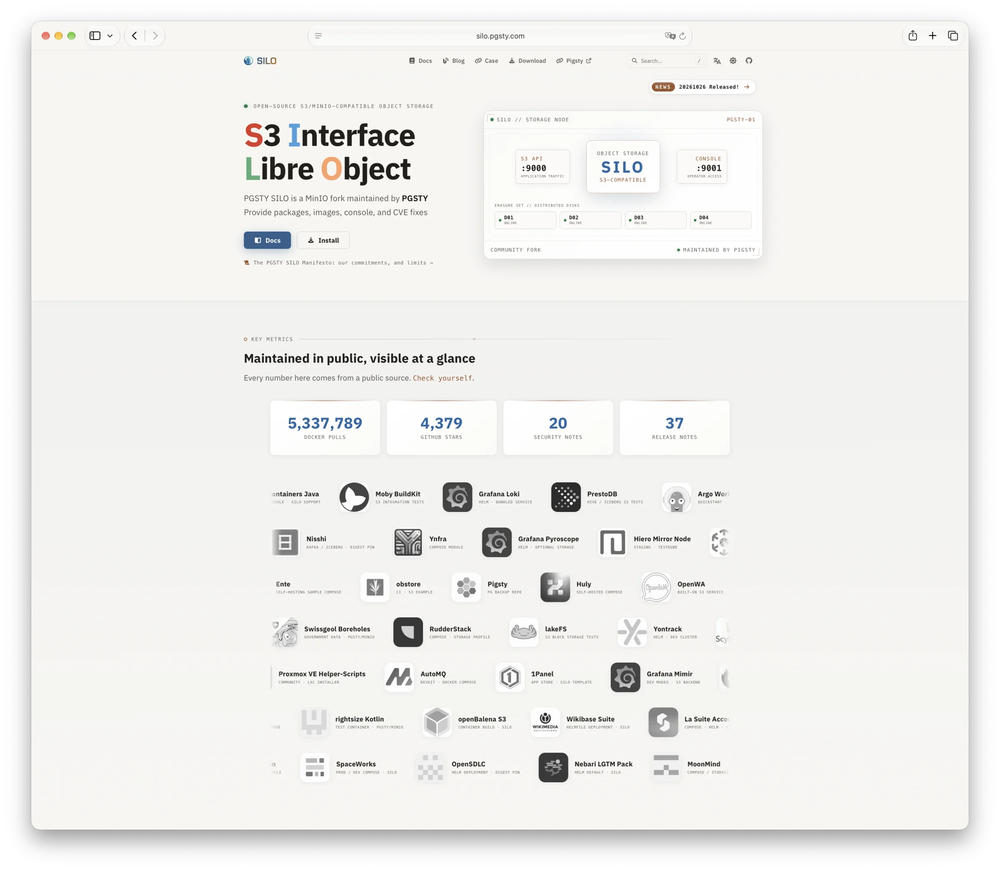
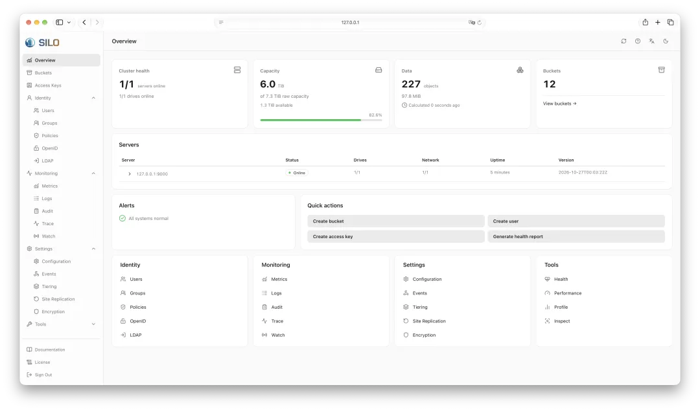
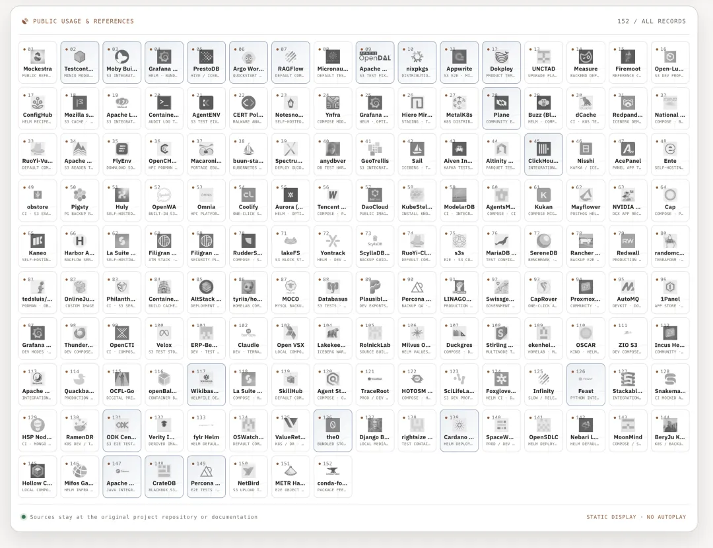
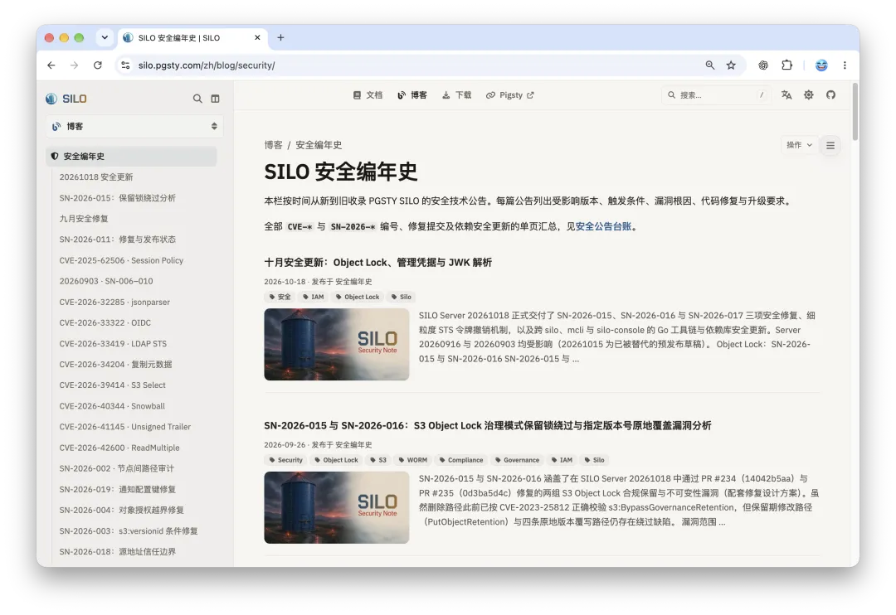
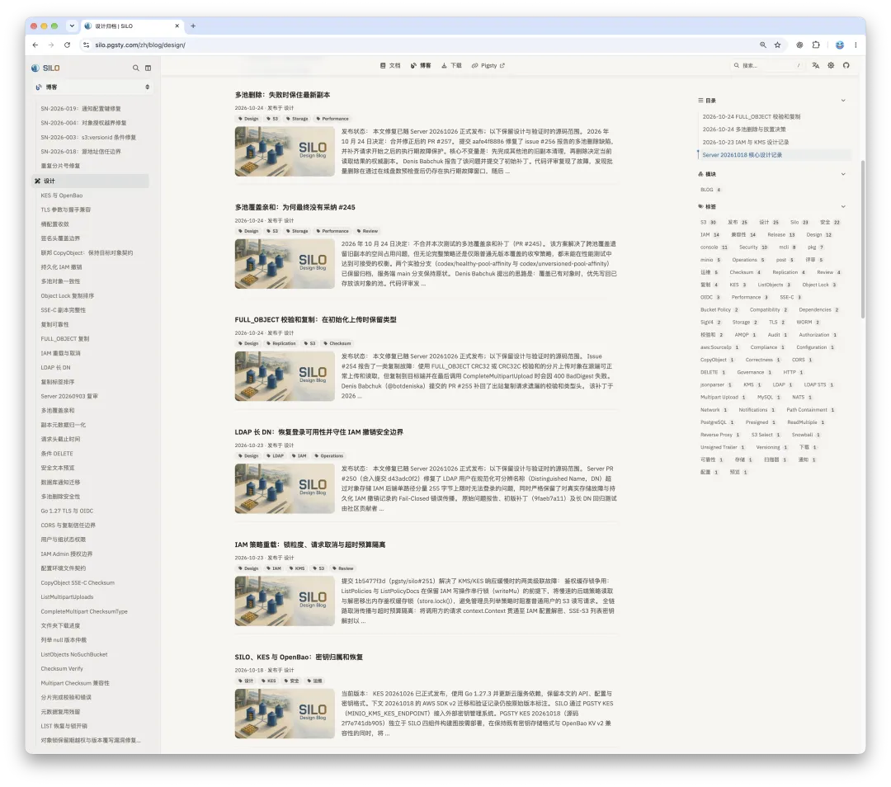
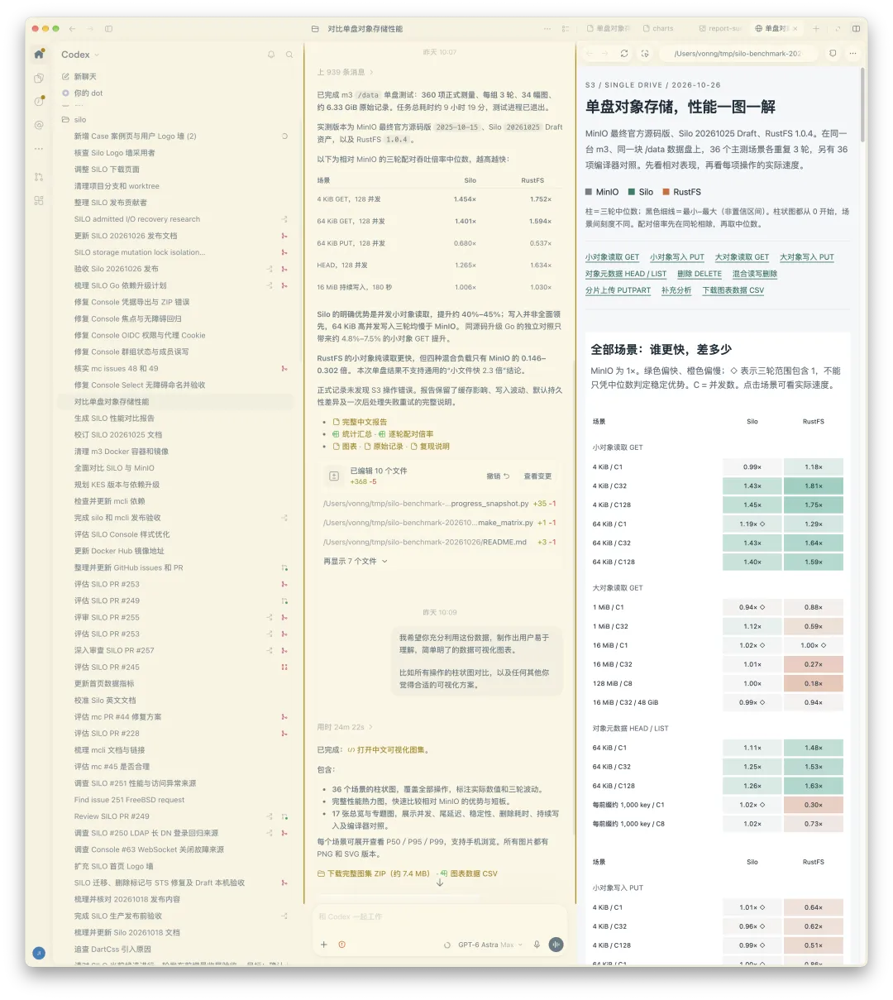
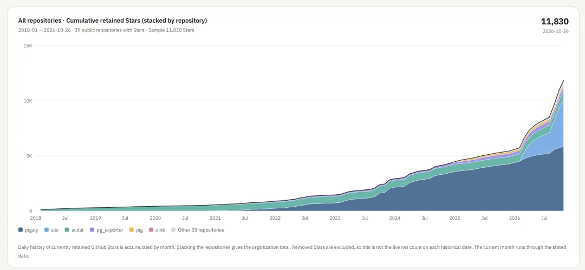

2025 年 10 月 15 日，MinIO 发布了最后一个开源版本，随后一步步将仓库锁定归档。

当时老冯本来想等一两个月，看看社区里有没有哪路神仙愿意站出来接盘。结果等了一两个月实在没人出头。那就只能自己挽起袖子上了——拉了个分支，也就是现在的 Silo: `pgsty/silo`。

最开始我的想法特别简单：在 Pigsty 里，我们用 MinIO 作为 PostgreSQL 的可选备份仓库。现在上游撂挑子不干了，我总得给自己的用户一个交代，至少把这条软件供应链维持下去。于是我点了 Fork，自己打了个二进制包先用着。

后来发现，社区里对 MinIO 开源二进制有刚需的人实在不少。反正自己也是用，不如干脆放出来大家一起用。今年 2 月，我写了一篇《[MinIO 已死，MinIO 复生](https://mp.weixin.qq.com/s?__biz=MzU5ODAyNTM5Ng==&mid=2247491187&idx=1&sn=005af2d12f6f4d258040efbe4faf08bb&scene=21#wechat_redirect)》，没想到还冲上了 Hacker News 的首页。

一转眼一年过去了，先跟大家晒一下这本账： **4300+ Star** 和 **500 万次** Docker 镜像下载；实打实处理了 **20 个安全漏洞**，修了几十个 BUG。保持着每月一个版本的节奏，持续跟进安全漏洞，清理上游遗留缺陷，把当年被上游阉割掉的 Web 管理控制台（Console）也满血复活了，还做了个用现代前端重制的新版本；

像 ClickHouse、Grafana Loki、Testcontainers、RAGFlow、1Panel 等大批原本依赖 MinIO 的开源项目，如今都已经平滑切到了 Silo。

从这个结果来看，这次“续命”干得还算蛮成功的。昨天（2026 年 10 月 26 日），我们刚刚发了 `20261026` 版本。恰逢满一周年，比起写一篇例行的 Release Note，我更想借这个节点，跟大家聊聊这一年给一个“死掉”的开源项目续命的乐子与心得。

## 开源项目进入“渡劫”时代

最近这一个月，大半个互联网几乎被打成了筛子，10 月份密集爆出的安全漏洞多得让人眼花缭乱。老冯在前阵子的《[当云被打成筛子](https://mp.weixin.qq.com/s?__biz=MzU5ODAyNTM5Ng==&mid=2247493702&idx=1&sn=23231259ad592eb2f45e5a2f672298a8&scene=21#wechat_redirect)》和《[当互联网真被打成筛子](https://mp.weixin.qq.com/s?__biz=MzU5ODAyNTM5Ng==&mid=2247493712&idx=1&sn=2edd004cb0e18d0c7341f941127b9317&scene=21#wechat_redirect)》两篇文章里也聊过这个趋势：开源软件正在经历一场前所未有的“渡劫”。

为什么？因为顶尖的大模型现在正日夜不停地扫描全网的开源代码，源源不断地翻出陈年新洞；而补丁一旦公开，逆向出漏洞利用代码的门槛又被 AI 拉到了地板上。在这个微妙的时间点，只要你的补丁稍微慢半拍，随便来个脚本小子，手里拎着 GLM、破甲版 GLM 或者千问，就能顺着补丁把没升级的系统打成筛子。

老冯自己就在前排吃瓜兼挨揍。最近给 Silo 提过来的安全 Issue 和 Bug 报告确实不少，说实话，我当初还是低估了维护这种体量的开源项目要耗费的精力。今年 2 月写分叉宣言的时候，我曾自信满满地说过一句话：**“我又不做新功能，就纯粹维护一下，你见过几个 MinIO 的 CVE 啊？”** 这话在当时是成立的——上半年统共也就修了几个漏洞，大家相安无事。结果最近这几个月，跟炒爆米花一样，噼里啪啦全炸开了，热闹得很。

## 以 PG 的标准看，真是个草台班子

老冯本职是做 PostgreSQL 的，看什么基础软件都会下意识地拿 PG 的工程标准去量一量。如果拿这把尺子去量 MinIO，结论真就四个字：**草台班子**。深度接手维护之后你会发现，现在翻出来的大量 Bug，根本不是什么新引入的问题，而是上游压根没修、甚至只写了一半就留在那儿的历史坏账。挑几个最有意思的给大家感受一下：

- **写了代码，但忘了接电线的：** 比如 `--read-header-timeout` 默认 30 秒，命令行能设，文档里也写得明明白白，但它从来没被传进底层的 HTTP Server 构造器里。慢速发送请求头（Slowloris）这种最古老的拖死服务端手法，对它一直有效。再比如纠删码读取路径，规规矩矩从内存池里借了 Buffer，结果转头就没交给 Reader，每次读照样重新分配内存，纯属气氛组编程。

- **一本正经胡说八道的 API：** 上游末版里的桶级 CORS（跨域配置），路由好端端在那里，但 GET 返回空占位，PUT 和 DELETE 直接抛 `NotImplemented`，想按桶配跨域根本配不了。更离谱的是分片上传，你传一个 5 MiB 的分片，完成时传个重复序号 `[1, 1]`，服务端欣然返回 HTTP 200，凭空给你拼出一个 10 MiB 的对象。

- **单步能跑，组合起来就删库或死循环的：** 开启版本控制的桶配了远端分层（Tiering），当前版本到期本该只是加一个删除标记（Delete Marker），老版本还得留在远端供读取；结果上游的实现会先把远端冷存里的真实数据给删掉。还有用 CRC32 做整对象校验的分片对象，源端跨站复制时漏带了校验类型，目标端按默认类型去验直接报 `BadDigest`；源端重试、再失败，当场陷入死循环。

- **一颗老鼠屎坏一锅汤的：** 一个 NATS 通知配置写错，就能连坐导致 Kafka、Webhook、MQTT 的通知全部悄悄失效；一条本该只管桶内对象的 `bucket/*` 授权，能顺着尾斜杠摸到桶级操作，把整个桶改成匿名公开可读写。

这还没算那 7 个正式的 CVE。其中最重的 **CVE-2026-33322** 是 OIDC JWT 算法混淆漏洞，CVSS 高达 9.8 分：只要知道 ClientSecret，就能伪造包括 `consoleAdmin` 在内的任意身份。这个洞从 2022 年 11 月一直敞开到 2026 年 3 月，整整三年半。

林纳斯定律说：“只要眼睛足够多，所有 Bug 都是浅的。” MinIO 坐拥 6 万 Star，Docker 拉取量以十亿计，眼睛不可谓不多。但现实是，绝大多数用户只走 Happy Path：`PUT`、`GET`、`LIST` 能跑通就行。真正会踩中上面这些雷区的，往往是“版本桶 + 远端分层”、“多池 + 复制”、“取消请求 + 慢盘”这类复杂组合。普通用户碰到了，大多怀疑是自己配错了；而上游最后这两年的精力，早都扑在闭源商业版上了。于是一个在功能列表上看似“写完了”的软件，在正确性上就这么停在了半路。

仓库归档之后，事情就更黑色幽默了。今年 8 月，我们对节点间通信路径做了一次系统性审计，在 **CVE-2026-42600** 的同一个根因上，顺藤摸瓜又挖出了 12 个继承自上游的缺陷，最严重的按 CVSS 3.1 评估高达 **9.1 分**。但最荒诞的地方在于：**这些洞拿不到 CVE 编号。** 因为按常规流程，申请 CVE 需要受影响产品的原维护方认领并协调披露，而 `minio/minio` 已经只读归档，没人认领了。

漏洞不会因为代码仓库归档而消失，它只是没有了主人。而在这个时代，没有人维护的开源项目，并不是一个可以放在那儿静态不用的东西，而是一具缺乏免疫系统、会很快腐烂成后门的期货尸体。

## AI 时代的攻防易形：谁来干脏活？

好在攻防永远是相互转化的。AI 既然给攻击者递了锤子，自然也给防御者和建设者造了盾牌。在这一点上，虽然我个人一直不太感冒 Anthropic，但不得不承认 Dario 的一些判断确实有远见：先把最前沿的 AI 安全能力对防御者开放，替维护者争取一个宝贵的时间窗口去查漏补缺。

从今年 7 月开始，随着 GPT-6 Astra、Claude Fable 这类模型的陆续发布，防御侧也拿到了实打实的“超能力”，让老冯有底气去啃那些过去单枪匹马不敢碰的陈年顽疾，攻防两端总算在更高维度上重新达成了一种脆弱的平衡。

不过吐槽归吐槽，无论是 OpenAI 的 Daybreak 计划，还是 Anthropic 的 Glasswing，申请门槛都相当高。折腾到最后，我手里也只有一个 GPT 账号申请进了白名单，专门留着干安全审计和漏洞挖掘的活。

至于其他常规订阅，在修安全漏洞这件事上经常让人哭笑不得：你让它分析并修复一个漏洞，它反手触发安全护栏，把你的请求标记成恶意攻击直接拒答。所以有些活只能搞分工，甚至是交给 GLM 这种道德感弱的模型去干脏活，完了再各种绕弯验收。

在这一年的高强度维护中，我也算摸清了 AI 写代码的真实边界：如果你让 AI 从零手搓一个这种工业级规模的系统，目前依然是极难的。之前的 `pgrust` 就打了个样——试图从零重写的那一版根本做不下去，最后还是把 PostgreSQL 自己的 C 代码整体翻译成 Rust，才跑通了回归测试。但反过来，如果你是在一个已经高度成熟的 Codebase 上做持续维护，AI 的威力就能发挥得淋漓尽致，因为代码库里到处都是现成的上下文、惯用法和成例可供参考。

以 Silo 为例，最近一个月老冯手上有 8 个 Codex 订阅，其中 3 到 4 个的额度都花在了跟进 Silo 上。投入不算小，各种测试要安排，各种边角问题要解决。但说实话，AI Agent 干得真挺不错。

## AI 驱动的软件工程与“众测”护城河

即便有 AI 加持，Silo 目前依然占据了我大约 1/5 到 1/6 的工作时间。维护一个核心基础设施，远不是外人想象的那样“出了问题甩给 AI 修一下就完事”，大量关乎系统命脉的架构权衡，最终必须由人来拍板。

**第一类是正确性与性能的权衡。** 如果你完全放手让 Codex 自己发挥，它为了追求绝对的正确性，会毫不犹豫地在热路径上给你糊满层层叠叠的防御性校验，甚至在客户端取消请求后让协程死等慢盘落盘。Bug 确实是没了，代码逻辑看似无懈可击，但代价是遇到一块慢盘就全节点卡死，或者吞吐性能直接腰斩——这种补丁你敢合吗？反过来，如果要求快路径（Fast Path）只允许牺牲 5% 以内的性能，而在罕见的异常冷路径上允许增加 30% 的检查开销，以此把极端并发下的正确率从五成拉升到 99%，这笔账该怎么算？

**第二类是更头疼的兼容性悖论。** 上游当年设计时犯了个错（比如前面提到的 `bucket/*` 权限过宽），但不少用户的客户端和老脚本已经围绕这个错误的行为跑了好几年。你是应该原样保留这个错误以维持兼容，还是犯起代码洁癖一刀切把它掰过来，然后看着用户的生产环境升级后报错？

这些宏观层面的取舍，AI 给不出标准答案，全得靠人来决断。为此，我们在收紧默认安全边界的同时留好兼容开关，并且把每一次重大的权衡都沉淀成了项目的决策记录（ADR）——把多个 AI 的争论过程、人类的判断依据以及最终结论完整归档，给未来的维护者留下一本明白账。

在这个过程中，我也跑通了一套真正管用的 AI 软件工程实践：

1. **伴生文档栈与文档驱动开发：** 代码旁边永远长着一套高密度的架构与规范文档，人和 Agent 都从文档出发干活，用文档锚定 AI 的行为边界。我现在有 40 个文档站，甚至为了这件事还[**专门造了一套专用的文档框架 Oink**](https://mp.weixin.qq.com/s?__biz=MzU5ODAyNTM5Ng==&mid=2247492913&idx=1&sn=a16ef8f82c99603301e2d399f479a8ea&scene=21#wechat_redirect)

2. **多 Agent 对抗机制：** 不迷信单一模型，让不同的 Agent 互相 Review、互相挑刺（一个写、一个审），人类站在管理者的位置只对最终结果负责。

3. **严格的复杂度惩罚：** 要求所有修改必须“充分且必要”，倒逼最小复杂度。这是防止 AI 生成的代码迅速劣化成“屎山”的核心紧箍咒。

4. **定期清理技术债：** AI 修得快，补丁堆得也快，每轮密集修复后必须专门拨出配额做结构收敛与重构。

Silo 消耗掉的 Token 里，有 80% 都砸在了极其刁钻的测试和验证上。对象存储是数据底座，一旦翻车牵连甚广，砸的也是我自己的招牌，容不得马虎。

但这一年下来，我感触最深的一点依然是：**真实用户，才是终极的测试。**

你在本地可以靠 AI 写出近万个回归测试用例，但再完备的测试矩阵，也模拟不出真实世界里多桶、多站点、异构网络和千奇百怪客户端交织出来的复杂部署拓扑。Silo 修掉的许多深水区 Bug，全靠真实用户在生产环境踩坑后上报的现场。

这和 PostgreSQL 的生态逻辑一模一样。为什么市面上常有号称复刻 PG 的项目，能比较轻松地跑通语法和回归测试，却永远无法替代 PG？**因为你可以复制代码，但你复制不了社区本身。** 开源最大的护城河就是“众测”——你把软件免费交给全世界用，全世界免费替你在最极端的场景下做压力测试，所有的反馈汇流成河，把系统的“学习率”拉到闭源软件望尘莫及的高度。

遗憾的是，MinIO 官方在吃尽了社区众测的红利、用全世界的反馈把产品打磨成熟之后，选择直接一脚踢开社区，关起门做闭源商业版去了。经常有人问我：**老冯，Silo 以后会不会也搞个商业版，重走 MinIO 的老路？** 在这里我把话放这儿：**绝对不会。** 我又不靠对象存储挣钱，犯不着干这种事。同时我也规劝过 RustFS 的朋友，千万别走 MinIO 的老路，敬畏社区，现在这种良性互动的模式才是最健康的。

## Silo vs RustFS：无聊与演进

既然提到了 RustFS，就顺带聊透这个话题。每次我发 Silo 的动态，评论区总有人刷 RustFS，甚至有些无聊的看客喜欢在底下搞拉踩。每次看到我都想笑——他们根本不知道 RustFS 的创始人 Kevin 是我的校友兼好友，平时遇到有商业对象存储诉求的客户，我还会主动介绍给他们。

[RustFS 1.0 GA：别活成 MinIO 的样子](https://mp.weixin.qq.com/s?__biz=MzU5ODAyNTM5Ng==&mid=2247493267&idx=1&sn=b4e87d6976ae6fe6effe7cae0eb165e4&scene=21#wechat_redirect)

那为什么老冯不直接用 RustFS，还要维护 Silo？答案很简单：直接因为当然是当时 RustFS 还没起来，更重要的是 RustFS 和 Silo 其实是两个不同的生态位。

RustFS 的目标是“紧跟 S3 对象存储前沿”，而 Silo 的使命是 “维持现有软件供应链存活”。而且，两者的性能曲线也并不一样，RustFS 的小文件表现更好，而 MinIO/Silo 更擅长大一些的文件。

虽然 RustFS 号称是 MinIO 的 Drop-in Replacement（原地替换），但如果你的视角下沉到一线运维层面，两者的差异是存在的。底层数据格式和 S3 API 是兼容的，但两者的校验与容灾策略不同、Prometheus 和 OTEL 监控指标体系不同、TLS 证书存放的目录结构都不一样。**API 与数据格式的兼容，并不等于运维体系的无缝兼容。**

而 Silo 死磕的恰恰就是这最后一步的“绝对兼容”。Silo 要做到的是：无论你过去写得多么复杂的 MinIO 运维流水线、监控大盘、容器编排拓扑，你只需要把镜像名字里的 `minio` 改成 `silo`，配置一行不用动，直接就能跑起来，同时自动获得所有最新的安全补丁和 Bug 修复。甚至是性能曲线，也不应该出现显著的变动。

只要一个项目开始追求新特性、做架构演进，它就不可避免地会与原有的形态发生漂移，最终分道扬镳。所以 Silo 的核心哲学就两个字：**无聊**。有人问 Silo 的 Roadmap 是什么？不好意思，没有 Roadmap。Silo 不会去折腾什么 S3 Vectors 或者 S3 Tables 这类新特性，只有每月一个、带着安全与正确性修复的无聊版本。

今年 9 月份 RustFS 已经正式 GA 了，如果你在纠结怎么选，老冯给你划个清晰的道：

**什么时候建议选 RustFS？**

1. **许可证合规红线：** 公司业务完全无法接受 AGPLv3 这种强传染性开源协议，那不用纠结，直接选 RustFS（Apache 2.0）。

2. **追求前沿特性：** 业务明确需要用到 S3 Tables、S3 Express One Zone 或向量存储等新潮特性，或者需要更优的小文件性能。

3. **花钱买平安：** 企业需要原厂商业支持，希望找一家专门做对象存储的商业公司签 SLA 兜底。RustFS 对标 MinIO，但定价只要一半。

**什么时候建议用 Silo？** 如果你手里已经跑着一大堆 MinIO 实例，在内网自用，不在乎什么 AGPLv3，更不想为了升个级去重写现有的监控大盘和部署脚本——哪怕你也清楚这项目背后就是老冯一个人带着一群 AI 在框框猛砸，但只要觉得省事、稳定、够用，那 Silo 就是目前最纯粹、最直接的 MinIO 替代品。

## 边界、克制与未来

回头看今年 2 月份立下的 Flag，我们当时做过的承诺，都兑现了。

| 二月的说法 | 一年后 |
| --- | --- |
| 提供能直接用的二进制、RPM/DEB 和 Docker 镜像 | 做到。现在还有 APK、Windows ZIP、distroless 镜像，带 GPG 签名、SBOM 和构建溯源 |
| 把被阉割的管理控制台找回来 | 做到，而且超额。Console 从 2.0 迭代到 2.5，中英双语，前端包从 10 MB 压到 3 MB 以内，零遥测 |
| 跟踪 CVE、修 bug，但不是商业 SLA | 做到。上游停更后披露的 7 个 CVE 全部修复，每个安全问题都有公开记录 |
| 自己生产环境先用 | 做到。Pigsty v4.5 的对象存储模块只部署 Silo |
| 商标：等对方找上门再改名 | 没等。八月主动改名 Silo，品牌全改，接口一个不动 |
| 不加新功能，只保供应链 | 最后是加了几个兼容性，便利的小功能 |
{.wide .expand}

关于“绝不加新功能”这条铁律，我们在实际维护中也做了一点务实的变通：

- **内置原生健康检查：** 以前大家用 Docker Compose 或 Kubernetes 部署时，为了跑健康探针还得往镜像里额外塞一个 `curl`；我们在二进制里内置了原生健康检查子命令，单靠一个干净的二进制文件就能闭环。像这种减轻运维负担的小改进，我很乐意加。

- **跟进 S3 兼容性语义：** AWS 上游的 S3 行为规范在演进，或者像桶级 CORS 这种上游留下的空壳，作为标榜 S3 Compatible 的存储跟进补齐，算不算新功能？严格来说这是还旧账，这类改动我们也会持续做。

这一年里，也有不少用户提过非常诱人的需求：

- **“老冯，能不能在存储侧顺手加个图片实时转码和缩略图裁剪？各大云厂商的对象存储都有这功能。”**

- **“能不能把 Silo 改造成一个透明缓存层，用来给云端对象存储做本地加速？”**

这些需求好不好？真挺好的。但我们想了想，全部拒绝了。

道理很简单：我不是开对象存储公司的，在 Silo 上一分钱不赚，还要搭进去可观的时间和算力成本。能把现有的基本盘守住、把安全漏洞堵死，就已经功德圆满了。做开源最怕贪多嚼不烂，步子迈得太大，早晚会扯到蛋。至于像缓存加速这种需求，RustFS 团队已经做进去了，有需要的朋友直接去用他们的就好，生态分工明确，岂不美哉？

看着 Silo 的 Star 数一步步逼近老冯苦心经营多年的主业 Pigsty，有时候也觉得挺魔幻的。这说明存量市场对一个“干净、稳定、有人管”的 MinIO 确实有着极其旺盛的渴求。既然已经有这么多开源项目和生产环境把 Silo 当成了底座，作为开源供应链上的一环，要是掉了链子，折损的也是我自己的声誉。所以，只要大家还在用，这副担子我就会继续挑下去。

我们会坚持每月发布一个版本的节奏，集中清理当月攒下的问题。对于高危安全漏洞，我们的策略是先在私下静默修复并完成验证，等到新版本镜像发布就绪后再公开披露细节，尽可能帮大家缩小暴露在火力下的攻击窗口。这种事没什么花架子，直说就是干呗。

好消息是，**一个不写新功能的软件，它的 Bug 总量是有上限的。** 随着我们用 AI 把上游遗留的陈年老账一笔笔清算干净，Silo 终将收敛到一个稳定、几乎不需要怎么费神的舒适状态。最近这一两个月虽然还在密集渡劫的忙乱期，但穿过这片雷区，前面就是坦途了。

死掉的开源项目未必只能腐烂成后门。如何让它重生？说穿了也没什么玄乎的：**有人认领，AI 干活，人来拍板，守住边界，剩下的交给时间与用户。**
