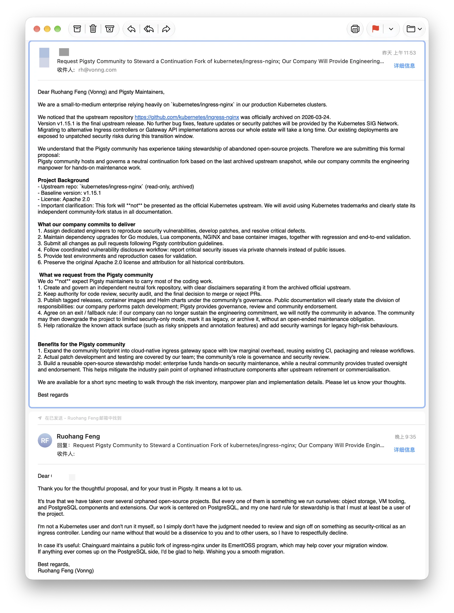
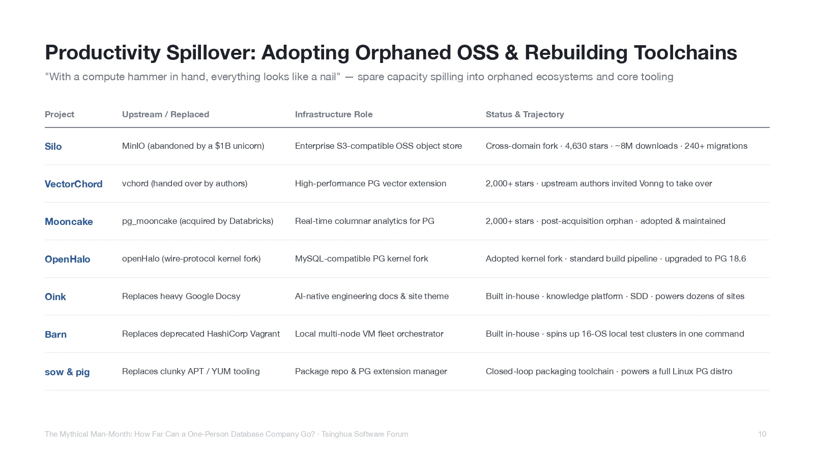
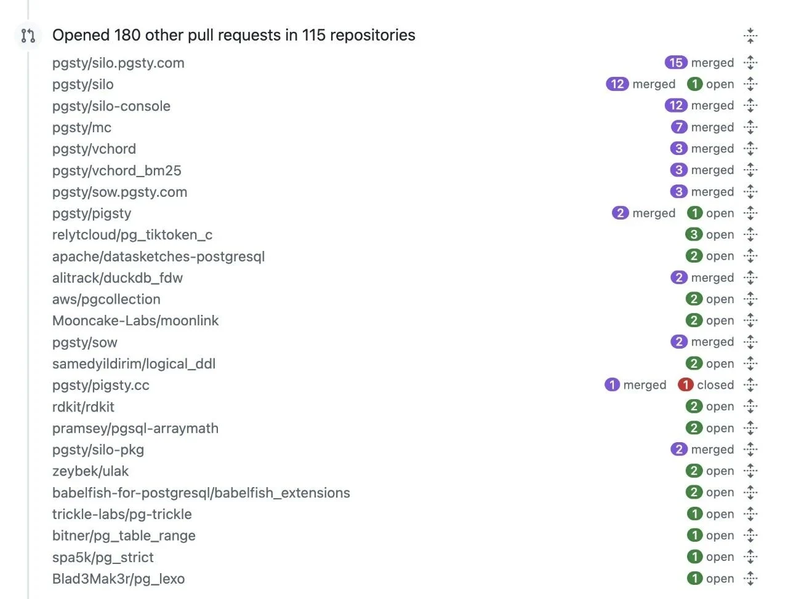
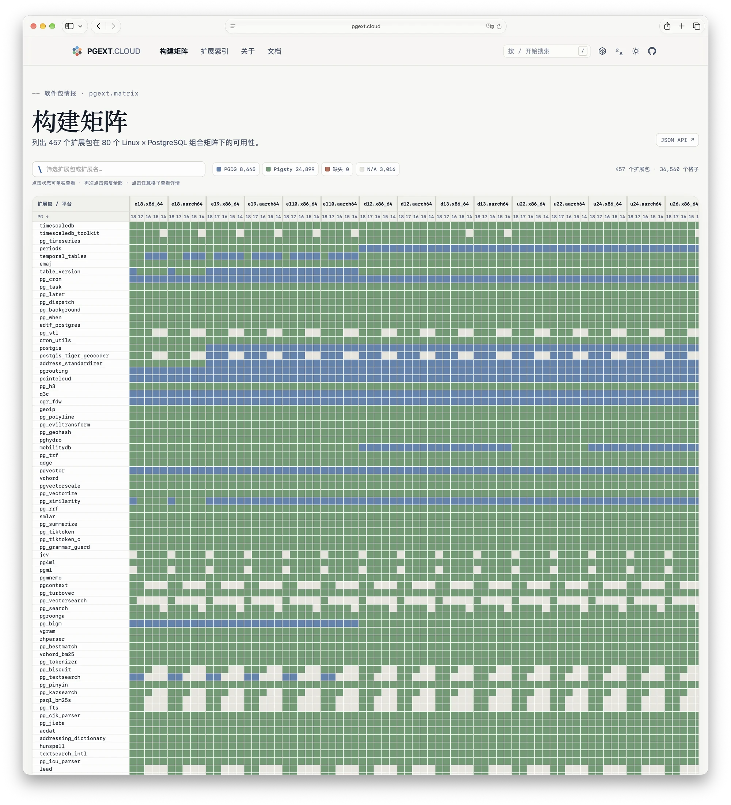

Today I received a long email that made me double-check the recipient line: an engineering team at a small-to-medium enterprise had written a formal proposal asking the "Pigsty community" to take stewardship of Kubernetes's `ingress-nginx`.

`ingress-nginx` is one of the most widely deployed ingress controllers in the Kubernetes ecosystem; by the project's own estimate, roughly half of cloud-native environments run it. On March 24 of this year, the repository was officially archived at v1.15.1: no more bug fixes, no more security patches.

This company relies heavily on it in production, and migrating their fleet will take a long time. Their proposed compromise: their engineers would reproduce vulnerabilities, write patches, and run tests; on our side, they "do not expect Pigsty maintainers to carry most of the coding work." We would simply put our name on a neutral fork and handle governance, code review, security audits, releases, and community endorsement. At the bottom of the email, they even thoughtfully listed three "Benefits for the Pigsty community," leading with: "Expand the community footprint into cloud-native ingress gateway space with low marginal overhead."

I didn't quite know whether to laugh or groan. I wrote back to politely decline for a simple reason: I don't use Kubernetes at all. I'm not even a user of the software.

To be fair, they weren't completely barking up the wrong tree. Over the past few months I've adopted the [Silo](/en/db/long-live-silo/) object store, [several PostgreSQL extensions](/en/pg/maintain-vchord/), and a PostgreSQL kernel fork—plus built replacements for [Vagrant](/en/db/barn-intro/) and the [Docsy](/en/ai/oink-intro/) documentation framework.

[Solo Founders and Software Engineering in the AI Era: How Far Can a One-Person Database Company Go? (Chinese)](/ai/thu-opc-talk/)

A few days ago, someone on X joked that "the world needs more 'bag-holders' like @RonVonng"—using the Chinese slang for someone willing to step in and adopt abandoned projects. From the outside, I've apparently earned a reputation as a professional adopter of orphaned open source.

> [!SOCIAL] Spencer `@real_spencercjh`
>
> "Yet another" (no definitive proof) staple of the Kubernetes ecosystem is dead: [[Feat]: Is the project still alive? · Issue #367 · norwoodj/helm-docs](https://github.com/norwoodj/helm-docs/issues/367)
>
> The world needs more "bag-holders" like @RonVonng 🫡
{avatar="avatar-real-spencercjh.webp" platform="x"}

AI really has driven down the cost of software maintenance. Work that a solo engineer wouldn't have dared touch a few years ago is now manageable with a fleet of coding agents. But when your leverage grows, so does the temptation: when all you have is a hammer, everything looks like a nail. Consider this post a reminder to myself—adopting orphaned open-source projects can be rewarding, just know when to stop.

## Don't Adopt Someone Else's Pain

My first rule for adopting an open-source project is simple: I have to at least be a user myself.

The whole point of Pigsty as a PostgreSQL distribution is [staying away from Kubernetes](/en/db/db-in-k8s/) and getting PostgreSQL right on bare metal, VMs, and standard Linux. That kept me out of the bloodbath of Kubernetes PostgreSQL Operators and left me with almost no competition in Ansible-based orchestration. Asking me to adopt a Kubernetes ingress controller is a stretch, to put it mildly.

Being a user matters because without usage, there is no feedback loop. You can't guess where a tool chafes from the sidelines; you only feel it by running the software in anger in your own environment. That isn't armchair theory—I paid for it in abandoned prototypes. With personal output jumping in the AI era, I've scratched plenty of cross-domain itches myself. Looking back across my own projects, the dividing line between what survived and what died is clear: the tools I use every day for a real pain point mostly worked out; the ones I didn't personally need mostly fizzled out.

[AI Software Engineering: Choose Problems You Care About](/en/ai/ikigai/)

Unless you have a gift for reading minds, the only demand you can be 100% certain is real is your own. That holds when starting a new project, and it holds just as much when adopting an old one.

Dig one level deeper and there's a second question: does this project actually *need* rescuing? Ingress controllers are hardly in short supply, and when upstream archived the repo, it pointed straight at Gateway API as the migration path. Even for teams that just need transition runway, Chainguard already launched a security-only fork late last year under its EmeritOSS program to bridge the gap. When viable alternatives exist, it's better to let users move on; spinning up yet another fork just adds noise.

Object storage was a different story. After [MinIO stopped maintaining its open-source edition](/en/db/minio-silo-1year/), newer projects like RustFS have been catching up fast, yet if you need a truly painless, drop-in replacement for an existing MinIO deployment, the only thing that fits is MinIO itself. Stepping in actually matters when a component sitting in your production path loses its supply chain and has no real drop-in alternative.

## Code Is Cheap; Signing Off Is Expensive

Take a closer look at the proposed division of labor, and the framing gets interesting. They repeatedly emphasized that their team would shoulder the heavy coding, leaving me with security audits, merges, tagging, and releases. On paper, that sounds like the easy end of the bargain. Today, the economics are completely inverted.

In the AI era, writing the patch is the cheap part. Reviewing a security fix for an internet-facing ingress controller—and putting your name on the release—is the expensive part. Just last year, `ingress-nginx` was hit by IngressNightmare, a CVSS 9.8 remote code execution flaw. Even upstream archived it in the name of user safety: without enough maintainers to keep up, shutting it down was safer than leaving users exposed.

Put plainly, they don't lack people who can write code—they already have engineers. What they lack is a trusted name: a "neutral endorsement" that makes users comfortable upgrading and puts someone on the hook if things go wrong.

Forking a repository and pushing commits is the trivial part. At bottom, adopting a project means putting your reputation on the table. Before you make that bet, you should at least be able to read the cards in your hand. Having someone who doesn't run Kubernetes sign off on Kubernetes security patches might look helpful, but it's irresponsible to users.

## If Writing Code Is No Longer the Moat, What Is?

That said, the drop in maintenance costs is real.

[PostgreSQL 19 just shipped](/pg/pg19-released/), and a large chunk of the extension ecosystem hadn't caught up yet. Today I pointed Codex at over a hundred extensions and opened 180 pull requests in one sweep, clearing out nearly every PG 19 compatibility issue across the board.

Incidentally, as of two days ago, I also cleared all 2,000+ red "Missing" slots for PG 19 across the build matrix.

Many people assume once code is written it will run forever. In reality, software behaves more like a living organism: without ongoing metabolism, it decays. A major PostgreSQL release only has a five-year support lifecycle. Over the past few years, I've run into plenty of unmaintained PG extensions—open a PR and you find the original author vanished years ago. In the past, those extensions would simply get dropped from package repositories and left to die. Today, it's easy enough to fork them, apply compatibility patches, and carry them forward across major releases so they stay alive.

When I brought this up in a group chat today, my friend Jiang pushed back: "If the technical barrier is gone, couldn't anyone do this?" Fair point. Asking an AI to port an extension to PG 19 really is a one-line prompt now. Whether the patch is actually correct—and whether it will blow up in production—is not something the model gets to decide. Over 80% of my tokens and time didn't go into writing code at all; they went into building test harnesses and running verification.

And there's one thing no model upgrade can replace: a large base of real users running the packages you build in production every day, hitting edge cases, and filing bug reports when something breaks. Writing code stopped being the moat a while ago. Quality control, distribution, and trust earned over years are what actually hold up.

Take those upstream PRs, for instance: every patch had already been baked locally, packaged into RPM and DEB releases, shipped live, and vetted over time before I ever sent it upstream.

## For PostgreSQL, I'll Be the Backstop

Enough about what I won't take on—here's what I *will*. After maintaining an object store, a PostgreSQL kernel fork, and hundreds of extensions, I'm confident enough to put this on the record: if a genuinely useful open-source project in the PostgreSQL ecosystem ever goes unmaintained, I'm willing to backstop it.

When [pgBackRest briefly looked like it was shutting down](/en/pg/pgbackrest-resume/), I had already forked the repository and started porting it to PG 19; once upstream resumed maintenance, I quietly stood down. I've even done a full Go rewrite of Patroni and put it through heavy testing as a backup plan—but as long as upstream is doing its job, I have no intention of throwing it out there to create noise. The same rule applies across the ecosystem's de facto standards, PgBouncer included: while upstream is actively maintained, I'm happy to be a user and handle packaging and distribution. If upstream ever walks away, I'll step in to keep it alive.

That confidence didn't come out of thin air. PostgreSQL "extensions" may sound peripheral, but they interact directly with internal kernel APIs and data structures every day—get comfortable with them and you're halfway into the core engine. Two or three years ago, my extension repo was mostly repackaging upstream tarballs. Today it's embedded deep in the PostgreSQL software supply chain. Stepping in to maintain orphaned tools has a public-goods aspect to it, and now that maintenance costs have dropped, I don't mind shouldering a bit more of the load.

Still, before stepping in, I always check two things: first, do I actually have the engineering judgment to maintain it well? Second, do I have the distribution channels and community credibility to get users onto it?

Apply those two tests to `ingress-nginx`: I don't use it, and my credibility lives in PostgreSQL, not Kubernetes. Zero for two. Taking it on anyway would be pure overreach.

In the PostgreSQL ecosystem, I use the stack every day, I run a distribution and an extension repository, and I have a large base of real production users. Two for two—that's a responsibility I have no reason to duck.

So to my friends in the Kubernetes world: sorry, I'll have to sit this one out. But if a solid tool in the PostgreSQL ecosystem ever gets abandoned, feel free to send it my way—that's one I'll gladly pick up.

## Further Reading

- [PostgreSQL 19 Released: Another Milestone (Chinese)](/pg/pg19-released/)
- [After The Mythical Man-Month: How Far Can a One-Person Database Company Go? (Chinese)](/ai/thu-opc-talk/)
- [Goodbye Vagrant, Hello Barn](/en/db/barn-intro/)
- [Taking Over Another PostgreSQL Extension: vchord Yesterday, pg_mooncake Today](/en/pg/fork-pg-mooncake/)
- [Why I'm Maintaining a VectorChord Fork](/en/pg/maintain-vchord/)
- [AI Software Engineering: Choose Problems You Care About](/en/ai/ikigai/)
- [MinIO's One-Year Memorial: How to Revive a Dead Open-Source Project](/en/db/minio-silo-1year/)
- [The Karma of Open Source: When Code Is Worthless, Where Does Trust Come From?](/en/ai/oss-karma/)
- [The pgBackRest Rescue and Open Source's Forced Price Discovery](/en/pg/pgbackrest-resume/)
- [Database in K8S: Pros & Cons](/en/db/db-in-k8s/)
- [What Is a PostgreSQL Distribution?](/en/pg/what-is-pg-distro/)
