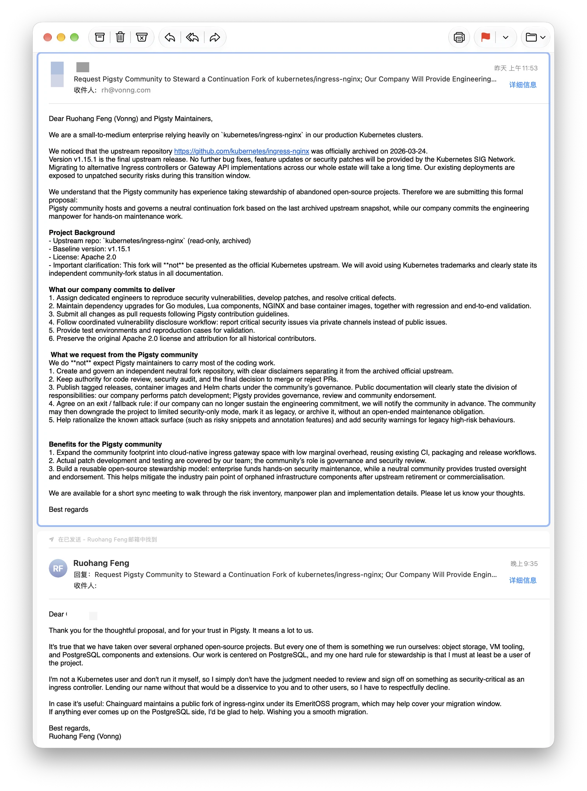
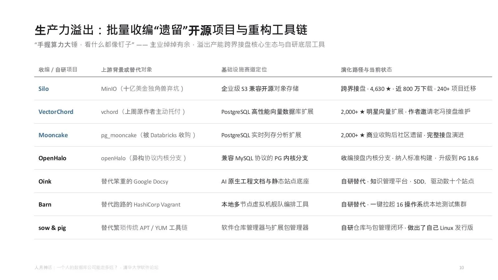
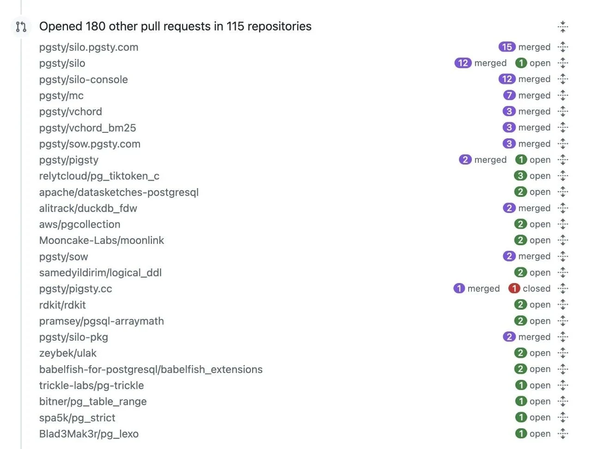
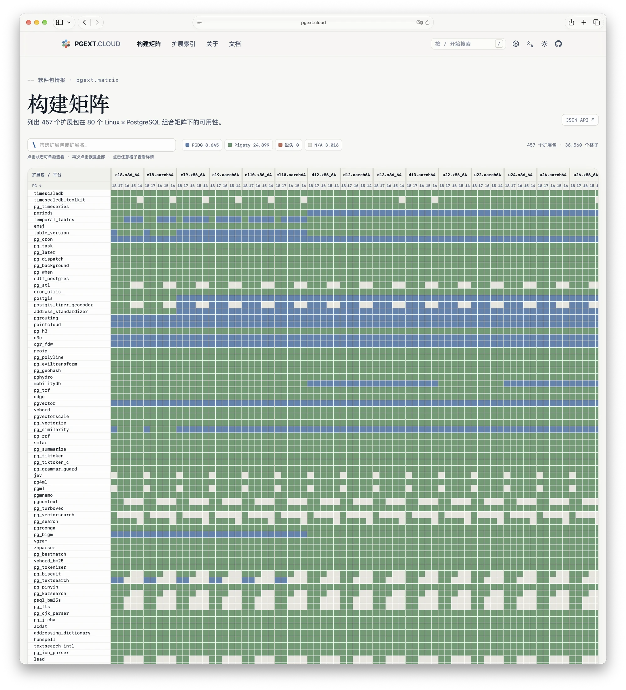

今天收到一封英文长信，看开头还以为发错了人：一家中小企业的团队，郑重其事地写了份正式提案，想请“Pigsty 社区”出面，接盘 Kubernetes 的 `ingress-nginx`。

`ingress-nginx` 是 K8s 生态里用得最广的入口网关之一，官方自己估计，差不多一半的云原生环境都在跑它。今年 3 月 24 日，仓库正式归档，版本停在 v1.15.1，从此不再修 Bug，也不再发安全补丁。

这家公司的生产环境重度依赖它，迁移又要拖很久。于是他们想了个折中方案：他们出工程师复现漏洞、写补丁、做测试；我这边“不需要承担大部分编码工作”，只要挂名开个中立分叉，负责治理、代码评审、安全审计、发版和社区背书。信的末尾还很贴心地替我算了笔账，列了三条“对 Pigsty 社区的好处”，头一条就是“以极低的边际成本，把社区版图拓展到云原生网关领域”。

看完老冯多少有点哭笑不得。我回信婉拒了，理由很简单：我压根不用 K8s，连用户都算不上。

不过人家找上门倒也不算完全走错片场。前阵子接了对象存储 [Silo](/db/long-live-silo/)、[几个 PG 扩展](/pg/maintain-vchord/)、一个 PG 内核，顺手还接盘了 [Vagrant](/db/barn-intro/) 和文档框架 [Docsy](/ai/oink-intro/)。

[AI 时代的超级个体与软件工程：一人数据库公司能走多远？](/ai/thu-opc-talk/)

前几天有网友喊话“世界需要更多接盘侠”，在外面看来，老冯大概已经成了专业接盘开源的了。

> [!SOCIAL] Spencer `@real_spencercjh`
>
> “又一个”（没有明确证据）Kubernetes 生态的常用项目死了：[[Feat]: Is the project still alive? · Issue #367 · norwoodj/helm-docs](https://github.com/norwoodj/helm-docs/issues/367)
>
> 这个世界需要更多的“接盘侠” like @RonVonng 🫡
{avatar="avatar-real-spencercjh.webp" platform="x"}

AI 确实把软件维护的成本打下来了，以前一个人想都不敢想的活，现在带着一群 Agent 也能扛得动。但能力放大了，诱惑也跟着放大，手里攥着大锤，看什么都像钉子。这篇算是写给自己提个醒：接盘虽好，可不要贪杯哦。

## 不是自己的痛，别硬扛

接不接一个开源项目，我给自己划的第一条线很朴素：自己至少得是它的用户。

做 Pigsty 这套 PostgreSQL 发行版，[主旨就是不碰 K8s](/db/db-in-k8s/)，把裸机虚机原生 Linux 系统上的 PG 做好。这让我避开了卷成血海的 K8s PG Operator 赛道，在 Ansible 编排这条路上几乎没什么对手。让俺去接盘 K8s 的入口网关，实在有点勉为其难。

自己得是用户，是因为没用过，就没有反馈回路。一个工具哪里硌脚，不真刀真枪在自己环境里跑，全凭脑补是没用的。这不是拍脑袋的道理，是拿废案换来的。AI 时代个人产能暴涨，我也没少手痒跨界瞎折腾，回头清点手里的项目，成败的界线其实很清晰：自己每天在用、确实有痛点的，基本都做成了；自己用不上的，基本都烂尾了。

[AI 软件工程：愿力驱动选题](/ai/ikigai/)

如果没有凭空洞察人性的本事，那你能百分百确定的真实需求，就只有你自己的需求。写新项目如此，接盘老项目也一样。

再往深一层看，还得问一句这东西是不是非接不可。Ingress 控制器市面上替代品一大把，上游归档时也明指了往 Gateway API 迁移的路。退一步说，真要过渡，Chainguard 去年底就已经拉了个只修安全漏洞的分叉，帮大家撑过迁移期。有的选的项目，让用户顺水推舟迁走就是了，多一个分叉只是添乱。

对象存储就不一样。[MinIO 停更](/db/minio-silo-1year/)之后，RustFS 这类新项目虽然也在追，但真要原地无痛、drop-in 替换掉 MinIO 的，还真只有它自己。这种没得选、又卡在生产链路里的东西断了供，接盘才有实在的意义。

## 代码便宜了，签字才贵

回头细看这封邮件的分工方案，其实挺有意思。对方反复强调，繁重的写代码工作由他们来扛，我只要负责安全审计、合并代码、打标签发版。账面听上去，好像我还占了便宜。但把这套分工放到今天，逻辑恰恰是倒挂的。

AI 时代，写补丁反而是最便宜的环节；给一个直接暴露在公网的入口网关做安全评审，然后签上自己的名字发出去，才是最贵的环节。`ingress-nginx` 去年才爆过 9.8 分的远程代码执行漏洞 IngressNightmare，上游决定把它归档，打的也是用户安全的旗号——人手兜不住，干脆停掉，免得害人。

说白了，对方缺的不是写代码的人，工程师他们自己有。他们缺的是一块招牌，一个能让别人放心升级、出了事也有个着落的“中立背书”。

接盘从来不只是把仓库 fork 过来继续提交代码，本质上是把自己的名声押在牌桌上。押注之前，至少得看得懂手里的牌。一个不用 K8s 的人，替 K8s 的安全补丁签字画押，听着像帮忙，其实是对用户不负责。

## 写代码不再是壁垒，那什么是

话又说回来，AI 把维护成本打下来，确实是真的。

[PostgreSQL 19 刚发布](/pg/pg19-released/)，生态里一大堆扩展还没来得及适配。今天我用 Codex 对着一百多个扩展挨个开火，一口气提了 180 个 PR，把 PG19 有兼容问题的扩展基本扫平了。

顺便一提，截止到前天，PG 19 的所有构建槽里两千多个红色的 Missing 都被俺处理解决掉了。

很多人以为代码写完就能用到地老天荒，其实软件跟活物一样，不新陈代谢就会腐化。PG 一个大版本的生命周期是五年而已。这几年，老冯也撞见不少早就断更的 PG 扩展，PR 提上去才发现作者失联多年。放以前，这种扩展多半就从仓库里踢出去自生自灭了；现在顺手 fork 过来打上补丁，跟着大版本往下续，它们就还能活着。

今天在群里聊起这个，蒋老板跟我抬杠：技术壁垒都没了，这活谁不能干？道理没错。让 AI 把一个扩展升到 PG 19，确实就是一句话的事。但改完之后到底对不对、上线会不会炸，这事 AI 自己说了不算。我手头八成以上的 Token 和时间，其实都没花在写代码上，全花在搭测试、跑验证上了。

有一样东西是模型怎么升级都替代不了的：一大批真实用户，每天在生产环境里真跑着你制作分发的软件，踩到坑了会来找你、给你报 Bug。所以这个时代，写代码本身早就不是壁垒了，质量把关、分发渠道和长期攒下来的信任，才是。

就说上面这些提给上游的 PR，其实也都是已经在本地沉淀好的补丁，都已经用这些补丁构建出 RPM/DEB 产物发布上线，经过一段时间测试与考验之后才提交给上游的。

## PG 的盘，老冯兜底

说了半天什么不接，也说说哪些盘我敢接。折腾完对象存储、PG 内核和这一大堆扩展之后，我现在可以有充足的底气说：PG 生态里那些实用的开源项目，哪天要是真烂尾了，老冯来兜底。

之前备份工具 [pgBackRest 一度传出要停止维护](/pg/pgbackrest-resume/)，我已经把仓库 fork 下来，动手做 PG 19 适配了；后来上游恢复更新，我就顺手收了回来。高可用组件 Patroni 我也用 Go 完整重写过一遍，跑了大量测试留作备胎，但只要上游还在好好干活，我就不拿出来添乱了。包括连接池 PgBouncer 在内，这些生态里的事实标准组件，规矩都一样：上游活跃维护，我老实当用户、做做打包分发；上游哪天真撒手不管了，我来续命兜底。

底气也不是凭空来的。PG 扩展听着叫“扩展”，其实天天跟内核的 API 和数据结构打交道，摸透了基本算半个内核。两三年前我做扩展仓库，还只是停留在打包搬运；做到今天已经实打实嵌进整个 PG 供应链里了。接盘这事带点公益性质，维护成本降下来之后，俺倒是不介意多扛几副担子。

但下手之前，总归得盘算清楚两件事：一是自己有没有真把它接好的判断力；二是手里的分发渠道和社区信誉够不够让用户用起来。

拿这两条套一下 `ingress-nginx`：我既不是用户，影响力也全在 PG 这边，到了 K8s 地界上根本不好使，两头不沾，硬接就是贪杯。

换到 PG 生态，我天天在用，有发行版、有扩展源，还有一大批真实用户在跑，两头都占着，那就当仁不让。

所以 K8s 的朋友们实在抱歉，这杯酒老冯确实喝不了。不过要是 PG 生态里哪个趁手的工具哪天跑路了，尽管来找我，这盘我还是挺乐意接的。

## 延伸阅读

- [PostgreSQL 19 正式发布：又一个里程碑](/pg/pg19-released/)
- [人月神话之后：一个人的数据库公司能走多远？](/ai/thu-opc-talk/)
- [再见 Vagrant，你好 Barn](/db/barn-intro/)
- [开源接盘侠又来了：昨天 vchord，今天吃月饼](/pg/fork-pg-mooncake/)
- [老冯又接盘新开源项目了](/pg/maintain-vchord/)
- [AI 软件工程：愿力驱动选题](/ai/ikigai/)
- [MinIO 周年祭：如何让死掉的开源项目重生](/db/minio-silo-1year/)
- [开源的业力：当代码一文不值，信用从哪里来](/ai/oss-karma/)
- [pgBackRest 续命战与开源世界的逼定价](/pg/pgbackrest-resume/)
- [数据库应该放入K8S里吗？](/db/db-in-k8s/)
- [什么是 PostgreSQL 发行版？](/pg/what-is-pg-distro/)
