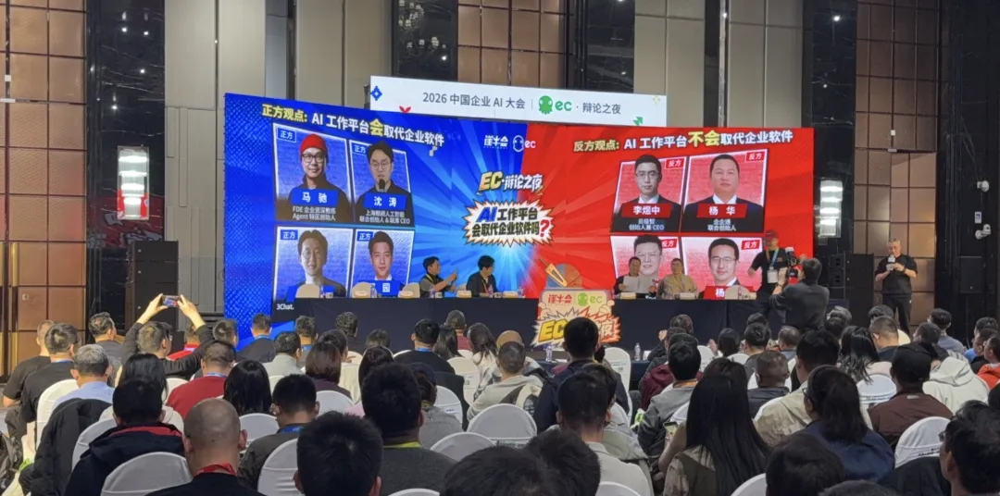

Yesterday, after giving a talk at the China Enterprise AI Conference, I went straight into a debate. The motion was: **“Will AI work platforms replace enterprise software?”**

Watching both sides trade blows on stage, I came away with one thought: the details of the debate and who won no longer mattered—**the moment this question was put on the agenda in earnest, the outcome was already obvious.**

To avoid arguing from a blind spot, I tried to put myself in the opposing camp: if I had to defend traditional enterprise software, what could I say? After thinking hard, the only way out was to move the goalposts through definitions and wordplay: classify the AI work platform (the so-called Harness) as a new generation of enterprise software; count the underlying database as part of enterprise software; define “replace” as complete physical extinction—if a thin shell remains on top, it does not count; or retreat to the safe platitude that “it will be hard to replace completely in the short term.”

Every one of these defenses is logically hollow. Nadella punctured this fiction a year or two ago: **enterprise applications are essentially CRUD (create, read, update, delete) wrappers on top of a database.** When the conference host posed the slightly brutal follow-up—“Will only foundational software deserve to be called software in the future, with AI work platforms absorbing all the middle-layer applications?”—the answer was almost inevitable.

## I. Architectural Convergence: The Universal Harness Talks Directly to the Database

I made this call early: **Software in the agent era is `Agent talking to database`—simple, with no middleman taking a cut.**

I wrote about this in detail in [In the AI Era, Software Starts at the Database](/en/ai/ai-agent-era/).

At the time, many people could not understand the idea because they lacked a concrete physical analogy. Today even slow observers can see it. Look at WorkBuddy. In my view it is a somewhat clumsy Codex imitation, but it did teach the market an important lesson: complex office workflows really can be stuffed into a single chat box and completed there.

Then consider `Ask America`, recently launched by the US government. The public-service system of a huge federal government was compressed into a single chat box: approvals, queries, and administrative tasks get handled as if you were assigning work in a group chat. If you have used Claude or Copilot seriously, you know what I mean: you no longer need to buy a sprawling ERP, CRM, or accounting system.

Most people see only the spectacle of the first half—the front-end Agent Harness—and miss the important half—the Database and business logic behind it.

Strip away the flashy interfaces, and traditional business software does only two things: define data structures and implement CRUD business rules. In the past, these rules lived in bulky back-end application code. But they can just as well sink into the database as stored procedures or be pulled out into `agents.md` as natural-language business rules. Traditional back-end applications are merely a carrier from a particular historical phase. They may not go to zero, but they will most likely atrophy into a very thin glue layer (a Thin Wrapper).

This points in the same direction as my article [The Application Layer Is Collapsing: The Moat Moves to the Database](/en/ai/sor-harness/): **the value of the entire software world is converging sharply toward two ends—a universal Harness with a uniform interface up front, followed immediately by an irreplaceable SOR (System of Record—the system that holds the authoritative record) at the back.**

This is not just a thought experiment. My own day-to-day operations have been running on this architecture for a while. I maintain system state, task queues, message logs, and daily operating reports across many systems without building dedicated admin panels. For example, I keep the catalog and build status of hundreds of PostgreSQL extensions directly in a database; there is no need to build a so-called “PostgreSQL extension management platform.” I just have Codex read and write the state in the database (Talking to Database), and the job is done. State has a home, intelligence has a place to be scheduled, and the long software-engineering layer in between becomes a redundant middleman taking its cut.

That is why I keep emphasizing in [Put Your Agent’s State in a Database](/en/db/agent-state-db/) that when tasks, memory, messages, and permissions are shared by multiple agents, the database is the truly stable center.

## II. The Law of Conservation of Complexity

If we think seriously on behalf of the opposing side, we reach a central point: **the form of enterprise software can disappear, but the complexity of the business itself cannot vanish into thin air.**

Physics has conservation of energy; software engineering has conservation of complexity. When the traditional middle layer evaporates, the original business complexity has to move and reorganize in three directions:

1. **Sinks downward**: It moves into the database layer, becoming rigorous table constraints and stored procedures.

2. **Rises upward**: It moves into AI work platforms and Coding Agents, where it settles into an explicit business-rule repository, such as a structured collection of rule files and prompts.

3. **Crystallizes dynamically**: It evolves into a hybrid state, half software and half Agent. High-frequency, deterministic logic gradually solidifies at runtime, like a crystal, into standard plugins embedded in the Harness. Eventually, modules with different degrees of crystallization interweave into a **Super Harness**.

Once you understand dynamic crystallization, you can also see through a huge illusion in today's venture market: **do not assume that building a “vertical-domain-specific Agent” gives you much of a moat.**

Why is the moat around a vertical Agent so wafer-thin? Because the underlying capability exemplified by Coding Agents is a general-purpose “meta-capability.” It is not merely the ability to solve problems directly, but the ability to **solve problems by inventing tools**, and **software itself is a tool it can forge on demand.**

Ask a Coding Agent to explore a complex vertical business workflow for the first time, and it may move slowly, trying one step at a time. Once it has found its way through the workflow, it can instantly distill the whole thing into conventional deterministic software code, then replay it at machine speed thousands upon thousands of times. That has quietly opened the door to the software industry's decades-old dream: **Self-Evolving Software**. A system is no longer a static artifact that freezes at delivery; it becomes a living thing that adjusts, refines, and evolves in real operation.

## III. Why Databases Stand Firm

At this point, someone will push the minimalist logic one step further: “If Coding Agents are so capable, why not dispense with the database too and have Codex read and write local files?”

Anyone who thinks this way is seriously underestimating the database.

Across the entire history of computer software, only two things can fairly be called foundational software: **operating systems** and **databases**. Linux is so general-purpose that it is actually far removed from specific business logic. What stays closest to the pulse of business and carries the state of society's core assets is the database.

Look back at China's industrial economy over the past twenty years. Why have internet companies and finance stayed at the top of the salary rankings? Because information flows reshaped productivity, and the absolute heart of both industries' IT stacks is the **database**. The old internet era also had the Web server as a core technology; then ByteDance's rise made recommendation algorithms, followed by large language models, the next generation's core technologies. But a new generation of technology does not mean the old foundation leaves the stage. **The database remains the unshakable anchor of enterprise software.**

For a desktop utility or a standalone edge application, using the file system or SQLite is perfectly reasonable. But once you cross into enterprise applications—with high-concurrency collaboration, a hard requirement for transactional consistency, and strict access control—you need a real enterprise-grade database.

I discussed this in [Database as Business Architecture](/en/db/db-is-the-arch/). Business logic, the Web server, and even the entire front end and back end may move back into the database. The arrival of AI work platforms simply makes that return more natural and easier to execute.

## IV. The Commercial Endgame in a Post-Software Era

This sharp architectural convergence will inevitably trigger a brutal reshuffling of the commercial landscape.

At the conference, Engineer Ma asked a question that made the software vendors' backs run cold: **if customers build their own software, what reason is left for software companies to exist?** He shared several real-world examples from the front lines: hospital nurses, front-line police officers, and lawyers at law firms are now using Coding Agents to hack together business software themselves. It works, and they understand the business pain better than outsourced teams do. A vendor selling medical hardware can at least advise a hospital on how to plan its departments and design its workflows. Most traditional HIS companies, by contrast, have neither a hard technical foundation nor the ability to provide business consulting. Faced with customers who have woken up and capable Agents, they become invisible overnight.

He also quoted a precise observation from Huang Dongxu: **the enterprise software industry will be torn in two—either move up into deep management consulting, or sink down and tackle hard-core foundational software. The middle is a dead end.**

This matches what I wrote in [We Don't Lack Good Database Kernels; We Lack DBAs Who Know How to Use Them](/db/need-dba-not-kernel/): a database kernel by itself is not a complete product. What is truly scarce is the ability to turn infrastructure into a usable, maintainable production system with someone there to stand behind it when things go wrong.

As someone who has spent years working on foundational software and databases, I agree. From the demand side, this is an enormous windfall: in the age of the universal Harness, everyone needs a database, and the default database in today's ecosystem is PostgreSQL. If you want to deploy a production-grade enterprise PG on Linux, the most mature open-source and free solution is [Pigsty](/pigsty/better-rds-alternative/). Whether the database has an old-school ERP or CRM on top of it, or a new-school Codex, Claude Code, or WorkBuddy, honestly, I don't care—the river may change course, but it still has to flow through the riverbed. Hold the foundation steady and let everything else change.

**But this is still not the real endgame.** Follow the logic one layer deeper: even if you build foundational software or databases, are you really safe on your perch?

Not necessarily. Vendors selling commercial database licenses and cloud database services will also have a rough time ahead—precisely because open-source, free RDS troublemakers like Pigsty are out there. Once an open-source distribution has automated 99% of the DBA's tedious work and distilled it into a standard SOP, and Coding Agents can follow that procedure to handle routine operations cleanly, business models that charge rent for information asymmetry and software sales will be broken too. Software and services get flattened at the same time. In the end, all that remains is consulting.

That is why I often say that I do not sell databases or foundational software. **What I actually sell is management consulting—more precisely, my Judgment, plus the certainty that someone will stand behind the outcome.**

The business logic is straightforward. Open-source automation and AI Agents already solve 99% of routine operations for free. If you are willing to carry the risk yourself, take the tools and use them without paying a cent. But an enterprise database in production always has that lethal 1%: a high-risk architecture change, a core database suddenly going down, a cross-major-version upgrade, or a nasty security vulnerability. What do you do when neither AI nor the regular team can handle it?

At that point, an enterprise does not need another piece of code. It needs **the presence of a top expert, decisive professional Judgment, and an insurance policy: someone willing to take responsibility and provide a reliable backstop.**

I charge only for that insurance and certainty. The other 99% of automated capability is given away for free as open source. When the marginal cost of producing code approaches zero, the era of selling software functionality is over. In the post-enterprise-software era, the only business model that can last through the cycles is pure consulting—**selling your judgment.**

How do you prove to the market that your judgment is worth paying for in such a noisy era? The answer is simple: keep making public judgments in the real waves of technology and business, and let time serve as your evidence. But that is another question.

## Further Reading

1. [In the AI Era, Software Starts at the Database](/en/ai/ai-agent-era/)
2. [The Application Layer Is Collapsing: The Moat Moves to the Database](/en/ai/sor-harness/)
3. [Database as Business Architecture](/en/db/db-is-the-arch/)
4. [What Kind of Database Does an Agent Need?](/en/db/agent-native-db/)
5. [Put Your Agent’s State in a Database](/en/db/agent-state-db/)
6. [Stop Arguing, the AI-Era Database Has Been Settled](/en/db/db-for-ai/)
7. [Why PostgreSQL Won in the AI Era](/en/ai/postgres-and-ai/)
8. [PostgreSQL Is Eating the Database World](/en/pg/pg-eat-db-world/)
9. [OpenAI: One Postgres Cluster Supports 800 Million ChatGPT Users](/pg/openai-postgres/)
10. [We Don't Lack Good Database Kernels; We Lack DBAs Who Know How to Use Them](/db/need-dba-not-kernel/)
11. [A Better Open-Source RDS Alternative: Pigsty](/pigsty/better-rds-alternative/)
12. [Why Established Companies May Never Become AI-Native](/en/ai/ai-native-org/)
