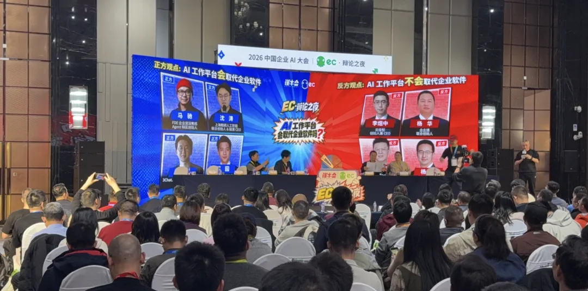

昨天在中国企业 AI 大会上做完演讲，紧接着是一场辩论赛，辩题叫：**“企业软件会被 AI 工作平台取代吗？”**

看着台上正反双方唇枪舌剑，老冯只有一个感受：辩论的具体内容和胜负其实已经无关紧要了——**当这个议题被郑重其事地摆上台面时，结局就已经不言而喻。**

为了避免视角盲区，我试着绞尽脑汁代入反方：如果非要为传统企业软件辩护，我还能怎么说？想来想去，唯一的出路只能在概念定义上“偷换靶子”、玩文字游戏：比如把 AI 工作平台（也就是所谓的 Harness）强行归类为新一代企业软件；把底层的数据库也算进企业软件的版图；或者把“取代”定义为百分之百的物理消亡——只要外面还包着一层薄壳，就不算取代；再不然，就只能退守到“短期内很难彻底替代”这种正确的废话里。

你会发现，所有这些辩护在逻辑上都极其苍白。纳德拉在一两年前就已经捅破了这层窗户纸：**所谓的企业级应用，本质上不过是架在数据库之上的 CRUD（增删改查）换皮而已。** 当大会主持人抛出那个略显残酷的追问——“以后是不是只有基础软件才配叫软件，中间层的应用软件都会被 AI 工作平台消化吸收掉？”——答案几乎是宿命般的不可避免。

## 一、架构大收敛：万能 Harness 直连数据库

老冯很早就写过一个判断：**Agent 时代的软件形态，就是 `Agent talking to database`——简简单单，没有中间商赚差价。**

我在[《AI 时代，软件从数据库开始》](/ai/ai-agent-era/)里详细写过这个判断。

在当时，很多人无法理解这句话，因为缺乏直观的物理参照物。但到了今天，哪怕是迟钝的观察者也看懂了。看看市面上的 WorkBuddy，虽然在老冯看来它只是个略显拙劣的 Codex 模仿，但它确实完成了一次重要的市场启蒙：原来复杂的办公流程，真的可以直接塞进一个对话框里干完。

再看前阵子美国政府上线的 `Ask America`，偌大一个联邦政府的公共服务体系，直接浓缩成了一个对话框，什么审批、查询、办事，像在群里派活一样聊着天就把事办了。只要你深度用过 Claude 或 Copilot，就会明白老冯在说什么：你根本不需要再去买一套繁琐的 ERP、CRM 或管账系统。

不过，大多数人只看到了前半截热闹（前端的 Agent Harness），却没看透后半截门道（后端的 Database 与业务逻辑）。

剥开所有花哨的界面，传统业务软件干的事无非两件：定义数据结构，编写增删改查的业务规则。过去，这些规则写在厚重的后端应用代码里；但实际上，它们既可以下沉到数据库里写成存储过程，也可以抽离出来写进 `agents.md`，梳理成自然语言业务规则。传统的后端应用只是一个特定历史阶段的“载体”，到了最后，它未必会百分之百清零，但大概率会退化成极薄的一层胶水封装（Thin Wrapper）。

这与我在[《应用层塌缩：当 Agent 吃掉软件，护城河退守数据库》](/ai/sor-harness/)里写过的判断是同一个方向：**整个软件世界的价值正在向两端剧烈收敛——前面是一个交互统一的万能 Harness，后面紧接着一个不可替代的 SOR（System of Record，记录系统/数据库）。**

这绝非纸上谈兵，老冯自己的日常运营早就按这套架构跑起来了。我现在维护的诸多系统状态、任务队列、消息记录乃至每日运营报表，根本没有去开发什么专门的后台管理系统；比如维护几百个 PostgreSQL 扩展的清单与编译状态，完全不需要搭一套所谓的“PG 扩展管理平台”，直接让 Codex 对着数据库读写状态（Talking to Database）就全搞定了。状态有地方安放，智能有地方调度，中间那层冗长的软件工程自然就成了多余的差价。

这也是为什么我在[《把 Agent 的状态放进数据库》](/db/agent-state-db/)中反复强调：当任务、记忆、消息和权限开始被多个 Agent 共享时，数据库才是那个真正稳定的中枢。

## 二、复杂度守恒定律

当然，如果我们替辩论赛的反方做一次真正有深度的思考，会触及一个核心命题：**企业软件的形态可以消失，但企业业务本身的复杂度不会凭空消失。**

物理学讲能量守恒，软件工程同样存在“复杂度守恒”。当中间层的传统软件蒸发后，原有的业务复杂度必然会向三个方向转移与重组：

1. **向下沉淀**：直接下沉到数据库层，转化为严谨的表结构约束与存储过程。

2. **向上浮起**：上浮到 AI 工作平台与 Coding Agent 中，沉淀为显式的业务规则库（如体系化的规则文件与提示词）。

3. **动态结晶**：演化出一种“半软件、半 Agent”的混合态——高频、确定的动态逻辑会在运行中逐渐固化，像晶体一样“结晶”成标准插件嵌在 Harness 内部，最终多种不同结晶层次的模块交织在一起，演化成一个 **Super Harness（超级工作台）**。

看懂了“动态结晶”的逻辑，就能顺便看穿当下创投圈的一个巨大幻觉：**千万不要以为做一个“垂直领域特定 Agent”就能建立起多深的护城河。**

为什么垂直 Agent 的壁垒薄如蝉翼？因为以 Coding Agent 为代表的基座能力，本质上是一种通用的“元能力（Meta-capability）”——它不只是直接解决问题的能力，而是“**通过发明工具来解决问题**”的能力，而 **“软件”本身就是它随手锻造的工具。**

你让 Coding Agent 第一次探索某个复杂的垂直业务流程，它可能会一步一试错，跑得很慢；但只要它把这条路摸通了一次，就能瞬间把整个流程沉淀、“结晶”成传统的确定性软件代码，随后以极高的机器速度成千上万次地复现运行。这其实在无意间推开了软件行业梦想了几十年的那扇大门——**自我演化的软件（Self-Evolving Software）**：系统不再是交付即僵死的静态制品，而是在真实运行中自我调整、自我加工、自我演化的生命体。

## 三、为什么数据库屹立不倒

聊到这里，总会有人顺着极简主义的逻辑继续抬杠：“既然 Coding Agent 这么神通广大，干脆连数据库也省了，直接让 Codex 读写本地文件不行吗？”

有这种想法的人，实在太小看数据库的分量了。

纵观整个计算机软件史，真正配得上“基础软件”四个字的，满打满算只有两样东西：**操作系统**与**数据库**。甚至可以说，底层的 Linux 操作系统因为太过通用，离具体的业务逻辑反而很远；真正贴着业务脉搏跳动、承载人类社会核心资产状态的，正是数据库。

不妨回看过去二十年中国产业经济的薪资版图：为什么互联网和金融能够长期霸榜全行业薪资前两名？因为信息流重构了生产能效，而这两个行业整个 IT 架构的绝对心脏，概括起来就是**数据库**。诚然，互联网上半场还有半个核心技术叫 Web Server，从字节跳动崛起为代表，推荐算法与大模型接棒成为了新一代核心技术；但新一代核心技术的诞生，绝不意味着老一代底座的退场——**数据库依然是企业级软件不可撼动的定海神针。**

自己写个桌面端小工具、做个单机端侧应用，拿文件系统凑合或者塞个 SQLite 进去都无可厚非；但只要迈入企业级应用的门槛——面对高并发协同、事务一致性底线以及严格的权限管控——你就必须拥有一套真正的企业级数据库。

我在[《数据库即业务架构》](/db/db-is-the-arch/)中讨论过，业务逻辑、Web Server 乃至整个前后端，都有可能重新回到数据库里。今天 AI 工作平台的出现，只是让这种回流变得更自然、更容易执行。

## 四、后软件时代的商业终局

技术架构的剧烈收敛，必然引发商业版图的残酷洗牌。

在大会现场，马工抛出了一个让在座软件厂商背脊发凉的问题：**当甲方自己下场做软件，软件公司还有什么存在的价值？** 他分享了几个一线的真实切片：医院里的护士、一线的公安、律所的律师，如今直接拿着 Coding Agent 自己手搓业务软件，不仅跑得通，而且比外包团队更懂业务痛点。相比之下，卖医疗硬件设备的厂商好歹还能指导医院怎么规划科室、怎么设计业务流；而绝大多数传统 HIS 公司，既没有硬核底座，又缺乏业务咨询能力，在觉醒的甲方与强悍的 Agent 面前瞬间沦为了透明人。

他还引用了黄东旭的一个精准论断：**未来的企业软件行业将被彻底撕裂——要么往上走，去做深度的管理咨询；要么往下沉，去啃硬核的基础软件。夹在中间的，死路一条。**

这与我在[《不缺好数据库内核，缺能用好数据库的 DBA》](/db/need-dba-not-kernel/)里写过的判断一致：数据库内核本身不是完整的产品，真正稀缺的是把基础设施变成可用、可运维、可兜底的生产系统的能力。

作为常年深耕基础软件的数据库老司机，我赞同这个判断。从需求端看，这简直是泼天的大红利：万能 Harness 时代人人皆需数据库，而当今生态下的默认数据库就是 PostgreSQL；你要在 Linux 上部署一套生产级的企业 PG，最成熟还开源免费的方案就是[老冯的 Pigsty](/pigsty/better-rds-alternative/)。至于数据库上面顶着的究竟是老派的 ERP、CRM，还是新派的 Codex、Claude Code 乃至 WorkBuddy，说实话，I don't care——水流怎么改道，都得从河床上过，以不变应万变足矣。

**但故事讲到这里，还没到真正的终局。** 顺着这个逻辑再往下深挖一层：哪怕是做基础软件、做数据库，就真的能稳坐钓鱼台吗？

未必。卖商业数据库 License 和卖云数据库服务的厂商，接下来的日子同样会非常难受——恰恰是因为有老冯和 Pigsty 这样的开源免费 RDS “搅屎棍”存在。当开源发行版已经把 DBA 99% 的繁琐工作高度自动化，并且沉淀出一套标准 SOP，连 Coding Agent 都能照着规程把日常运维干得井井有条时，单纯靠“信息差”和“软件售卖”收租的商业模式同样会被击穿。软件、服务同时被拍扁，最后能剩下的，只有咨询。

这也是为什么老冯常说：我根本不卖数据库，也不卖基础软件。**老冯真正卖的，其实是管理咨询——更准确地说，卖的是我的 Judgment（判断力），以及兜底的确定性。**

这套商业逻辑非常清晰：日常 99% 的常规操作，开源软件自动化和 AI Agent 已经帮你免费解决了；如果你愿意自负风险，拿去随便用，一分钱都不用掏。但企业级数据库生产环境永远存在那致命的 1% 问题：当你面临高危架构变更、核心库突然搞挂、跨大版本升级，或是爆发棘手的安全漏洞，连 AI 和常规团队都搞不定时，该怎么办？

这时候，企业需要的不再是一段代码，而是**顶级专家的在场（Presence）、一锤定音的专业判断（Judgment），以及有人站出来承担这份责任、提供确定性兜底的“保险”。**

老冯只为这份保险和确定性收费，其他 99% 的自动化能力，是以开源的形式，作为礼物免费送给大家的。当代码本身的边际生产成本趋近于零，卖软件功能的时代就已经落幕了。在后企业软件时代，真正能够成立并穿越周期的商业模式，其实就是纯咨询——**卖的是你的判断力。**

至于在这个喧嚣的时代，你该如何向市场证明自己拥有值得付费的判断力？答案也很简单：去真实的技术与商业浪潮里，持续不断地做出公开判断，让时间替你作证。当然，那就是另一个问题了。

## 参考阅读

1. [AI 时代，软件从数据库开始](/ai/ai-agent-era/)
2. [应用层塌缩：当 Agent 吃掉软件，护城河退守数据库](/ai/sor-harness/)
3. [数据库即业务架构](/db/db-is-the-arch/)
4. [Agent 需要什么样的数据库？](/db/agent-native-db/)
5. [把 Agent 的状态放进数据库](/db/agent-state-db/)
6. [别争了，AI 时代数据库已经尘埃落定](/db/db-for-ai/)
7. [AI 时代，PostgreSQL 凭什么赢了？](/ai/postgres-and-ai/)
8. [PostgreSQL 正在吞噬数据库世界](/pg/pg-eat-db-world/)
9. [OpenAI：一套 PG 支持 8 亿 ChatGPT 用户](/pg/openai-postgres/)
10. [不缺好数据库内核，缺能用好数据库的 DBA](/db/need-dba-not-kernel/)
11. [更好的开源 RDS 替代：Pigsty](/pigsty/better-rds-alternative/)
12. [企业 AI 转型，可能是个伪命题](/ai/ai-native-org/)
